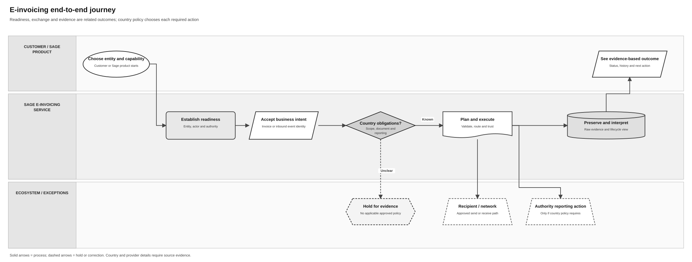
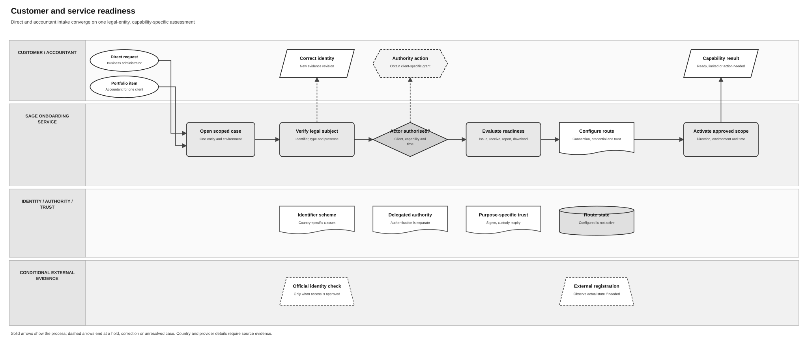
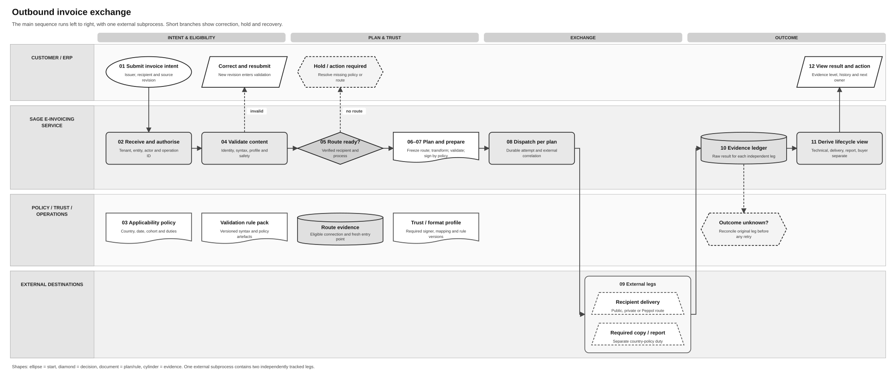
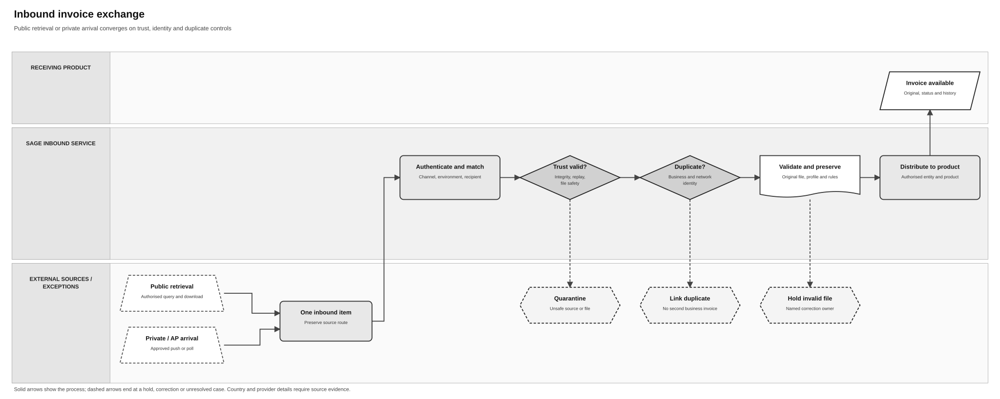
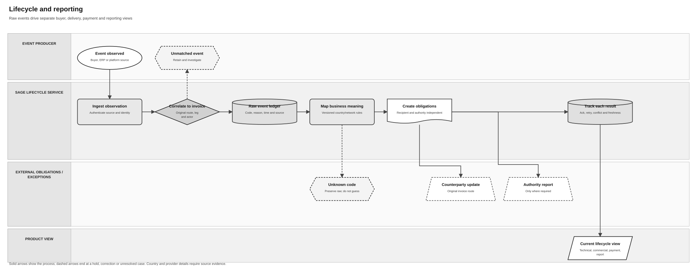
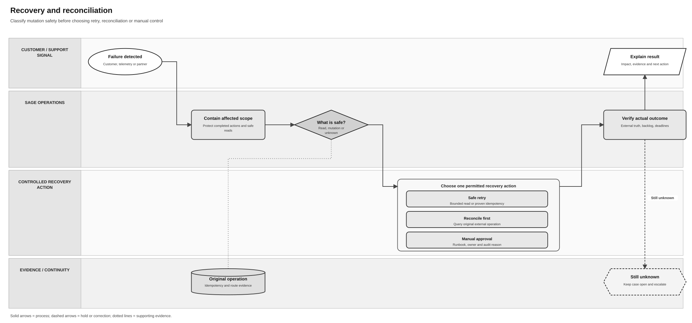
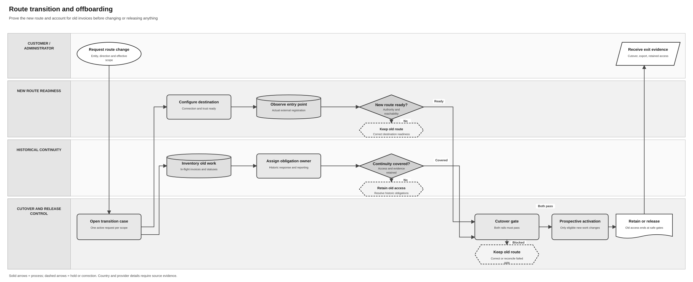

# E-Invoicing Process Flow Specification

## Purpose and review state

This is a **solution-design working draft** for a consistent family of business and technical process flows. It translates existing PRD behaviour into reviewable actor handoffs, decisions, evidence and exception paths. The referenced PRDs remain authoritative for product requirements and country rules. The diagrams do not approve an architecture, network route, provider, legal interpretation or production release.

The outbound pilot established the visual convention through review. The remaining diagrams apply that convention to the agreed main and domain flows. All diagrams remain draft solution analysis for validation; this document is not selected for Confluence publication.

## Diagram family

| Level | Proposed diagram | Boundary |
|---|---|---|
| Main | End-to-end e-invoicing journey | How readiness, exchange, lifecycle and recovery connect |
| Domain 1 | Customer and service readiness | Identity, authority, onboarding, connections and activation |
| Domain 2 | Outbound invoice exchange | From invoice intent to separate recipient and reporting outcomes; **pilot below** |
| Domain 3 | Inbound invoice exchange | Receipt, trust, validation, retrieval and product distribution |
| Domain 4 | Lifecycle and reporting | Source events, derived views, buyer decisions and reporting obligations |
| Domain 5a | Recovery and reconciliation | Unknown outcomes, incidents and safe recovery |
| Domain 5b | Route transition and offboarding | Prospective cutover and historical continuity |

Country and network differences are overlays on these flows. A separate variant is warranted when the actual process differs, such as an independent tax-reporting leg, not merely because a country or provider has its own PRD.

## Diagram index

| Flow | Review preview | Editable Draw.io source | Principal requirement sources |
|---|---|---|---|
| Main journey | [View](../assets/diagrams/e-invoicing-end-to-end-overview.svg) | [Edit](../assets/diagrams/e-invoicing-end-to-end-overview.drawio) | PRD-SEI-227, 231, 223, 224, 225 |
| Customer and service readiness | [View](../assets/diagrams/e-invoicing-customer-service-readiness.svg) | [Edit](../assets/diagrams/e-invoicing-customer-service-readiness.drawio) | PRD-SEI-101, 104, 222, 231 |
| Outbound invoice exchange | [View](../assets/diagrams/e-invoicing-outbound-exchange-pilot.svg) | [Edit](../assets/diagrams/e-invoicing-outbound-exchange-pilot.drawio) | PRD-SEI-223, 233, 241, 242 |
| Inbound invoice exchange | [View](../assets/diagrams/e-invoicing-inbound-exchange.svg) | [Edit](../assets/diagrams/e-invoicing-inbound-exchange.drawio) | PRD-SEI-102, 223, 227, 241 |
| Lifecycle and reporting | [View](../assets/diagrams/e-invoicing-lifecycle-reporting.svg) | [Edit](../assets/diagrams/e-invoicing-lifecycle-reporting.drawio) | PRD-SEI-224, 232, 242 |
| Recovery and reconciliation | [View](../assets/diagrams/e-invoicing-recovery-reconciliation.svg) | [Edit](../assets/diagrams/e-invoicing-recovery-reconciliation.drawio) | PRD-SEI-203, 225, 227 |
| Route transition and offboarding | [View](../assets/diagrams/e-invoicing-route-transition-offboarding.svg) | [Edit](../assets/diagrams/e-invoicing-route-transition-offboarding.drawio) | PRD-SEI-201, 202, 222, 243 |

The main diagram shows how domains connect. Each domain diagram is independently editable and is meant to be read with its text equivalent and source PRDs. The grayscale palette, horizontal lanes and shape meanings stay consistent, while each diagram follows the structure of its own process:

| Flow | Distinct layout |
|---|---|
| Main journey | Short navigation spine with conditional recipient, authority and hold branches |
| Readiness | Direct and accountant starts converge; identity and authority corrections branch upward; evidence cards sit in separate lanes |
| Outbound | Reviewed pilot with validation and route gates, plus a contained external exchange split |
| Inbound | Public retrieval and private arrival converge before trust, duplicate and file checks |
| Lifecycle | Correlation and raw event ledger lead to independent counterparty and authority obligations |
| Recovery | Safety decision opens a bounded choice of retry, reconciliation or manual action, followed by outcome verification |
| Transition | New-route readiness and historical continuity run in parallel into one cutover gate |

## Main: end-to-end e-invoicing journey



**Editable source:** [End-to-end Draw.io diagram](../assets/diagrams/e-invoicing-end-to-end-overview.drawio).

```text
Customer selects legal entity and capability
  → Sage establishes tenant, actor and authority
  → evaluates independent capability readiness
  → receives invoice intent
  → applies effective country policy and validation
  → plans and executes an eligible exchange
  → uses the selected network/recipient and any required authority leg
  → preserves raw outcomes and source evidence
  → derives a customer-safe view and next action
  ↳ if an external outcome is uncertain: reconcile its original leg
```

This is a **navigation diagram**, not a single synchronous transaction. Inbound receipt, buyer decisions and reporting can occur later and independently. Country policy selects which legs exist; a product cannot infer delivery or buyer approval from local intake. Sources: [shared service](PRD-SEI-227-e-invoicing-as-a-service.md), [identity and authority](PRD-SEI-231-country-identifiers-tenancy-and-delegated-accountants.md), [exchange](PRD-SEI-223-interoperability-routing-transformation.md), [lifecycle](PRD-SEI-224-lifecycle-rejection-payment-reporting.md).

## Domain 1: customer and service readiness



**Editable source:** [Readiness Draw.io diagram](../assets/diagrams/e-invoicing-customer-service-readiness.drawio).

```text
Business or accountant requests a capability for one legal entity
  → Sage opens a scoped case and verifies the legal subject
  → checks the acting person's client-specific authority
  → evaluates issue, receive, report and download readiness separately
  → configures route, connection and purpose-specific trust
  → performs only the external checks required by that capability
  → compares intended and observed external state
  → activates the approved direction/scope at the effective time
  ↳ identity error: correct a new evidence revision
  ↳ authority absent: obtain the relevant grant
  ↳ external outcome unknown: reconcile before mutation is repeated
```

Batch intake repeats the per-client path and isolates each result; the diagram represents one client item. The lower evidence cards identify checks that may inform a gate; their lack of arrows means they are conditional references, not sequential tasks. A ready connection is not an active route, and an authenticated accountant is not automatically authorised for a client. Sources: [public onboarding](PRD-SEI-101-public-platform-onboarding.md), [accountant intake](PRD-SEI-104-accountant-and-single-client-onboarding.md), [entry point and migration](PRD-SEI-222-customer-onboarding-entry-point-migration.md), [identity/authority](PRD-SEI-231-country-identifiers-tenancy-and-delegated-accountants.md).

## Pilot: outbound invoice exchange

**Business outcome:** An authorised issuer can submit an invoice once and see an explainable delivery result and any separate required reporting result. The product must not claim recipient delivery, buyer acceptance or reporting completion from an earlier technical acknowledgement.

**Scope:** One logical outbound invoice. The pilot includes correction, no eligible route, separate external legs and an uncertain result. Batch orchestration, inbound processing, buyer rejection/payment and detailed provider protocol are separate flows.



**Editable source:** [Outbound invoice exchange Draw.io diagram](../assets/diagrams/e-invoicing-outbound-exchange-pilot.drawio). The SVG is a review preview; the `.drawio` file contains native editable nodes and connectors.

**Presentation convention:** The pilot uses horizontal swimlanes, four phase bands and one left-to-right main path. The palette is black, white and grey. Shape carries meaning: an ellipse starts the journey; rounded rectangles are service tasks; a diamond is a route decision; documents hold rules or the frozen plan; cylinders hold route or outcome evidence; parallelograms are customer input/output; trapezoids are external exchange legs; a dashed hexagon is a hold or recovery action. Policy cards sit below the steps they inform without flow arrows. The two external obligations sit inside one subprocess with one incoming and one outgoing connection. Exception branches stop at a named action instead of looping across the page. The lanes identify responsibility rather than a physical deployment architecture.

Draw.io connector ports are fixed on the intended sides of each shape. Straight progression arrows have no label; only the three exception branches are labelled (`invalid`, `no route`, `unknown`).

### Text equivalent

```text
Issuer / ERP submits invoice intent
  → Sage authorises actor, entity and operation
  → Country policy evaluates applicability and duties
  → Service validates exact input or generated representation
      ├─ invalid → customer corrects a new revision → validate again
      └─ policy evidence absent → hold with named action
  → Service resolves recipient address, capability and eligible route
      └─ no proven route → hold with named action
  → Service freezes exchange plan: route, representation, trust and legs
  → Service transforms, validates and signs/seals if approved policy requires it
  → Service persists a correlated send operation
      ├─ recipient delivery leg → public, private or Peppol destination
      └─ required copy/reporting leg → authority or public solution
  → Service records raw result for each leg separately
      └─ uncertain external mutation → reconcile original leg before retry
  → Service derives separate technical, delivery, reporting and buyer views
  → ERP shows status, evidence freshness and next action
```

### Node and handoff contract

| Node | Owner shown in diagram | Business meaning and technical evidence |
|---|---|---|
| 1–2 | Issuer/ERP → Sage service | Invoice intent is received under tenant, legal entity, actor, revision and stable operation identity. Durable intake is not external delivery. |
| 3 | Country policy | Effective policy classifies the transaction and identifies document, delivery and reporting duties independently. Unknown applicability is held. |
| 4 | Sage service → ERP | Versioned identity, syntax/profile and rule checks return actionable issues. Correction creates a new revision without rewriting prior evidence. |
| 5 | Sage service and route policy | Recipient address, supported document/process, entry point, environment, connection and freshness are evaluated. An unsupported or ambiguous destination is not guessed. |
| 6–7 | Sage service, governed by trust policy | The exchange plan freezes route, representation, trust rule, required legs and versioned evidence. Any transformation preserves required meaning and is validated before the applicable signature or seal. Signer, seal and transport credential remain distinct. |
| 8 | Sage service | An idempotent send operation and external correlation are recorded before a potentially mutating handoff. |
| 9, with 9a/9b inside | External recipient and authority/public solution | One external subprocess contains recipient delivery and any required copy or reporting as distinct obligations, attempts and outcomes. The country pack determines whether 9b exists. |
| 10–12 | Sage service → ERP | Raw observations are preserved; unknown outcomes reconcile; derived views expose evidence level and next action. Technical acknowledgement does not prove buyer approval. |

### Business and solution decisions exposed by the pilot

| Decision | Proposed treatment in this diagram | Review point |
|---|---|---|
| Applicability or policy evidence unavailable | Hold before external mutation and show an owner/action | Define the actual country policy and authoritative evidence per pack |
| Input fails validation | Return issue and correction owner; new revision re-enters validation | Confirm product UX and the point at which draft preview becomes final validation |
| Recipient route cannot be proven | Hold rather than invent a destination | Confirm country route authority, discovery freshness and fallback policy |
| External legs differ | Track recipient and reporting/copy legs independently | Confirm each country obligation and whether the leg is simultaneous or sequenced |
| One external mutation times out | Preserve known leg results; reconcile only the uncertain original leg | Confirm provider/public query, idempotency and manual escalation contracts |
| Status is shown to the customer | Show evidence level and source age; keep buyer-processing separate | Confirm the product vocabulary and source-event mapping |

### Pilot acceptance checks

1. A reviewer can identify the business actor, Sage owner and external party at every mutating handoff.
2. A validation failure or unproven route stops dispatch and gives a responsible next action.
3. A recipient delivery success cannot mark a separate copy/reporting leg complete.
4. A timeout after a possible external mutation enters reconciliation before any resend or route change.
5. The diagram and text distinguish intake, network acknowledgement, recipient delivery and buyer decision.
6. The Draw.io source opens with editable shapes and connectors; the SVG preview remains readable in GitHub Markdown.

## Domain 3: inbound invoice exchange



**Editable source:** [Inbound Draw.io diagram](../assets/diagrams/e-invoicing-inbound-exchange.drawio).

```text
One approved source supplies an invoice: public retrieval OR private/AP arrival
  → Sage authenticates source, channel and environment
  → matches the intended recipient tenant and legal entity
  → verifies trust, integrity, replay and file safety
  → detects duplicates using business and network identities
  → validates the exact incoming representation
  → preserves the original and maps approved semantics
  → distributes to the authorised Sage product
  → exposes retrieval, status and evidence history
  ↳ wrong recipient: deny without revealing another tenant
  ↳ untrusted or invalid file: quarantine with owner and evidence
  ↳ duplicate: link observations without creating another business invoice
```

The two source boxes are **alternative intake paths**, not a requirement to run both. A public poll may produce no new invoice; that is different from denied access or a failed query. Original bytes and route evidence remain available even when a derived representation is created. Sources: [public consultation/retrieval](PRD-SEI-102-public-platform-invoice-consultation-retrieval.md), [exchange](PRD-SEI-223-interoperability-routing-transformation.md), [shared inbound contract](PRD-SEI-227-e-invoicing-as-a-service.md), [validation](PRD-SEI-241-ubl-validation-service.md).

## Domain 4: lifecycle and reporting



**Editable source:** [Lifecycle Draw.io diagram](../assets/diagrams/e-invoicing-lifecycle-reporting.drawio).

```text
Buyer, ERP or external platform produces an event
  → Sage authenticates and correlates it to the original invoice/leg
  → preserves raw code, reason, source and times
  → maps meaning with the effective country/network rule version
  → creates any required counterparty or authority obligations
  → delivers and tracks each obligation separately
  → derives technical, delivery, commercial, payment and reporting views
  → shows source, freshness and the next action to the product
  ↳ unmatched or conflicting event: retain and investigate
  ↳ one reporting leg times out: reconcile that leg only
```

External obligation outcomes re-enter as new observations and are correlated to the original leg; the diagram shows that loop through the event-start and tracking nodes without a long return connector. It does not collapse a transport acknowledgement into buyer approval or a payment report into settlement evidence. Later events on an older invoice follow its original route and policy context. Sources: [Spain rejection/payment](PRD-SEI-224-lifecycle-rejection-payment-reporting.md), [country status mapping](PRD-SEI-232-country-lifecycle-status-mapping.md), [Peppol feedback](PRD-SEI-242-peppol-lifecycle-feedback.md).

## Domain 5a: recovery and reconciliation



**Editable source:** [Recovery Draw.io diagram](../assets/diagrams/e-invoicing-recovery-reconciliation.drawio).

```text
Customer, telemetry or partner reports a failure or mismatch
  → Sage opens a case for the affected entity, invoice and leg
  → contains only unsafe new work in that scope
  → classifies the operation as read-safe, idempotent or reconcile-first
  → compares intended state with observed external evidence
  → selects retry, resume, reconciliation or authorised manual action
  → checks original provider/network and authority state
  → verifies customer outcome, backlog and deadlines
  → closes with owner, action, evidence and communication
  ↳ still unknown: keep the case open and escalate; do not blind-resend
```

The recovery-action group shows permitted choices after classifying mutation safety. Its original-operation evidence card anchors reconciliation to the affected route and leg. Completed legs remain completed. Recovery never silently switches an in-flight invoice to a new route. Sources: [private-platform resilience](PRD-SEI-203-private-platform-resilience-operations.md), [operations](PRD-SEI-225-operations-resilience-support-reconciliation.md), [shared failure model](PRD-SEI-227-e-invoicing-as-a-service.md).

## Domain 5b: route transition and offboarding



**Editable source:** [Route transition Draw.io diagram](../assets/diagrams/e-invoicing-route-transition-offboarding.drawio).

```text
Authorised customer requests a change or exit for a named scope
  → Sage opens one transition case and inventories unfinished invoices
  → proves replacement destination and entry point are ready
      ↳ not ready: keep the existing route active
  → records authority and effective cutover time
  → changes the route only for eligible new work
  → observes the new external state and old-provider dependencies
  → retains original route and lifecycle access for earlier invoices
  → releases credentials, registration and data only at separate safe gates
  → provides cutover, export and remaining-access evidence
  ↳ activation unknown: reconcile before another route mutation
```

Cutover, provider deregistration, credential revocation and data disposition are different actions. The two readiness rails prevent a prepared destination from erasing unfinished work or historical access on the previous route. Sources: [Phase 2 transition](PRD-SEI-201-public-private-platform-transition.md), [connection and route foundation](PRD-SEI-202-private-platform-connection-routing-foundation.md), [customer migration](PRD-SEI-222-customer-onboarding-entry-point-migration.md), [offboarding](PRD-SEI-243-customer-offboarding-and-provider-exit.md).

## Cross-diagram rules and country overlays

| Rule | Applies to |
|---|---|
| Identity, actor authority, route readiness and invoice applicability are separate decisions | Main, readiness, outbound, inbound |
| Connection or route changes apply prospectively; existing invoices retain origin context | Readiness, lifecycle, recovery, transition |
| Recipient delivery, copy/reporting and buyer-processing outcomes have separate evidence | Main, outbound, lifecycle, recovery |
| External outcome unknown triggers original-leg reconciliation before a mutating retry | All exchange, readiness, reporting and transition flows |
| Country packs decide effective scope, syntax/profile, directory, reporting and status meaning | Every flow; the shared shape does not approve a country-specific rule |

| Country overlay | Process change that needs a later evidenced variant |
|---|---|
| Spain | Public baseline, optional private entry point, public bridge and faithful-copy duty; confirm exact technical sequence before a country diagram is delivery-ready |
| Germany | Structured invoice and agreed delivery path; do not infer a universal network or central reporting leg |
| Ireland | Phase-specific issue/receive readiness and separate buyer-delivery versus Revenue-reporting legs |
| UK | Effective policy before Peppol activation; participant, AP and process readiness remain separate from buyer response |

## Evidence and maturity

| Source | Applied to the diagram family | Limit |
|---|---|---|
| [PRD-SEI-101](PRD-SEI-101-public-platform-onboarding.md), [PRD-SEI-104](PRD-SEI-104-accountant-and-single-client-onboarding.md), [PRD-SEI-231](PRD-SEI-231-country-identifiers-tenancy-and-delegated-accountants.md) | Legal-entity, accountant, authority and per-capability readiness | Actual external grant and credential mechanisms remain country evidence gates |
| [PRD-SEI-102](PRD-SEI-102-public-platform-invoice-consultation-retrieval.md) | Public consultation, retrieval, duplicate handling and freshness | Public interface details and cadence remain external gates |
| [PRD-SEI-201](PRD-SEI-201-public-private-platform-transition.md), [PRD-SEI-202](PRD-SEI-202-private-platform-connection-routing-foundation.md), [PRD-SEI-222](PRD-SEI-222-customer-onboarding-entry-point-migration.md), [PRD-SEI-243](PRD-SEI-243-customer-offboarding-and-provider-exit.md) | Route setup, prospective cutover, observed state and historic access | Entry-point sequence, offboarding responsibilities and release policy need confirmation |
| [PRD-SEI-227](PRD-SEI-227-e-invoicing-as-a-service.md) | Shared intent, effective country policy and separate delivery/reporting dimensions | Discovery model; not approved implementation |
| [PRD-SEI-223](PRD-SEI-223-interoperability-routing-transformation.md) | Spain exchange plan, transformation-before-trust, public/private recipient routes and faithful-copy distinction | Exact country specification and operator model remain gates |
| [PRD-SEI-224](PRD-SEI-224-lifecycle-rejection-payment-reporting.md) | Separate lifecycle and reporting obligations, including rejection and payment | Exact country event and deadline contracts remain confirmation gates |
| [PRD-SEI-203](PRD-SEI-203-private-platform-resilience-operations.md), [PRD-SEI-225](PRD-SEI-225-operations-resilience-support-reconciliation.md) | Safety classification, scoped containment, reconciliation and incident ownership | Recovery runbooks and service objectives remain operational decisions |
| [PRD-SEI-233](PRD-SEI-233-peppol-multi-address-and-endpoint-routing.md) | Scheme-qualified recipient discovery and immutable endpoint evidence | Peppol is used only if the country pack activates it |
| [PRD-SEI-241](PRD-SEI-241-ubl-validation-service.md) | Preview/final validation and correction lineage | Syntax/profile detail belongs to its format PRD |
| [PRD-SEI-242](PRD-SEI-242-peppol-lifecycle-feedback.md) | Evidence-level feedback and outcome-unknown handling | Actual AP/provider signal support requires pilot evidence |

## Draw.io and Confluence integration note

The repository's current Markdown publisher renders headings, tables, images and its explicit HTML macro blocks. It does not currently upload `.drawio` files or produce a native Draw.io Confluence macro. The editable source is therefore kept in Git and the Markdown shows an SVG preview. Before Confluence publication, the publisher or a controlled manual workflow must be tested against the installed Draw.io app so the diagram stays editable without making Confluence the only source of truth. Do not add a Confluence-only diagram that can be overwritten by a later Git publication.

## Review questions

1. Does the main view make the domain handoffs clear without implying that inbound, outbound, reporting and buyer decisions are one synchronous transaction?
2. Are the readiness and inbound ownership lanes correct for Sage products, the shared service and external operators?
3. Does lifecycle/reporting keep source events, derived customer meaning and each delivery obligation distinct enough for solution review?
4. Is the split between recovery and route transition the right boundary for operations and customer review?
5. Should the customer view lead with one summary containing independent delivery/reporting details, or present those outcomes separately?
6. Which country should supply the first fully evidenced process variant: Spain, Ireland, UK or Germany?

## Revision history

| Date | Change | Basis |
|---|---|---|
| 2026-10-05 | Created unpublished specification with one editable outbound-exchange pilot diagram | User request and cited PRDs |
| 2026-10-05 | Redrew the pilot in monochrome with horizontal swimlanes | User visual feedback |
| 2026-10-05 | Simplified connectors to one main service line, short exception branches and a contained external split | User feedback on confusing arrows |
| 2026-10-05 | Added semantic shapes and phase bands to distinguish actions, decisions, evidence, external exchange and customer outcomes | User feedback on flat, rectangle-only layout |
| 2026-10-05 | Replaced paired external connectors with one external subprocess and removed policy-card arrows | User feedback on persistent connection confusion |
| 2026-10-05 | Fixed Draw.io connection ports and removed labels from short progression arrows | Review of editable connector behaviour |
| 2026-10-05 | Added end-to-end, readiness, inbound, lifecycle, recovery and route-transition diagrams with text equivalents and source traceability | User approval of pilot style and request for the remaining flows |
| 2026-10-05 | Redrew the six follow-on diagrams with process-specific topology, lane counts, node types and connector paths | User feedback that the shared layout made the flows too uniform |
