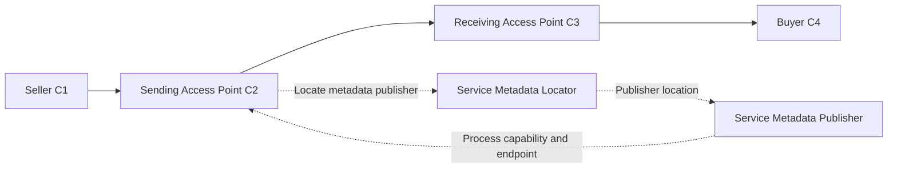

# Peppol governance and operating model

A seller needs to reach a buyer through a supported invoice process. Sage needs to know who can authorise that exchange, who operates each part and which country rules apply. The business decision is which responsibilities Sage will operate itself and which it will buy, while retaining clear customer and support accountability.

## Confirmed foundation

Peppol combines governance, document rules, discovery and exchange. Its four corners are seller C1, sending Access Point C2, receiving Access Point C3 and buyer C4. AP services and metadata publication are distinct roles. Provider eligibility depends on agreements and conformance. **Evidence: P01**, governance and technical models in the [source register](../RES-SEI-003-peppol-source-register.md#global-network-sources).

The solid path shows document exchange. The dotted path shows recipient discovery before dispatch. The business application connections to APs depend on selected provider contracts. This diagram does not allocate Sage services or imply that a successful lookup proves delivery.

## Responsibilities to qualify

The first four roles follow P01. The Sage roles are proposed accountability assignments; named owners remain open.

| Actor | Responsibility or decision | Evidence needed for the selected offer |
|---|---|---|
| OpenPeppol | Common framework and central network governance | Applicable policies, specifications and service domains |
| Peppol Authority | Jurisdictional governance and approved additional rules | Authority agreement and local requirements |
| AP operator | Qualified network exchange | Exact legal entity, agreement, conformance and operating scope |
| Metadata service operator | Publication of recipient capabilities | Qualified service role, management contract and migration responsibilities |
| Customer or authorised delegate | Approve actions for the represented business | Capability-specific authority and current business relationship |
| Sage product owner | Define supported customer journeys and truthful outcomes | Product/cohort/direction scope, data gaps and acceptance wording |
| Sage platform owner | Qualify reusable implementation contracts | Build, owner, limitations and interoperability evidence |
| Country compliance owner | Decide local applicability and activation | Country evidence and unresolved legal/technical gates |
| Operations and security | Approve support, trust custody and recovery | Runbooks, alert ownership, incident and renewal evidence |

An authenticated application identifies the caller. It does not establish authority to act for every customer. Use the [shared glossary](../../../context/GLO-SEI-001-e-invoicing-terminology.md#identity-access-and-authority) for represented party, authenticated principal and authority.

## Decisions that must remain separate

| Decision | Why it changes the outcome | Required qualification |
|---|---|---|
| Operate an AP or connect to one | Changes legal, engineering and support responsibility | Assess the actual Sage asset before comparing options; see RES-SEI-008 |
| Operate or contract metadata services | Changes participant administration and exit responsibility | Do not infer metadata ownership from AP ownership |
| Certify a network role | Establishes eligibility for a stated scope | Does not establish every national tax obligation or product capability |
| Activate a country process | Determines which documents and parties may exchange | Country rules, identifiers, versions and counterparties must fit |
| Offer voluntary exchange | Can create value before a mandate | Needs an eligible route and accurate product claims; does not approve future statutory compliance |
| Add authority reporting | Introduces another recipient and outcome | A national obligation must establish the action; network statistics are a separate operating concern |

These distinctions are analysis boundaries, not new approvals. [PRD-SEI-245](../../../prds/PRD-SEI-245-peppol-access-point-validation-and-certification.md) owns the immediate AP qualification path. [PRD-SEI-240](../../../prds/PRD-SEI-240-peppol-access-point-service-readiness.md) remains its predecessor; this research does not reopen the recorded stakeholder update as though no AP asset existed.

## Reuse assessment

| Candidate | Reusable design | Local qualification before use |
|---|---|---|
| Identity and delegation | Separate customer, legal entity, caller and authority | National identifiers, registration rights and delegation evidence |
| Participant discovery | Resolve a qualified participant/document/process | Permitted schemes, authority rules, metadata operator and freshness policy |
| Document qualification | Bind exact bytes to a profile and rule release | Country semantics, mapping coverage and valid periods |
| Exchange evidence | Preserve route and raw observations | Provider contract and local interpretation of acknowledgements |
| Operations | Monitor trust, failures and recovery | Service levels, support coverage, local reporting and incident duties |

Existing design patterns are reuse candidates. A current implementation needs its own contract, owner and test evidence. Spain public-copy, identity and reporting behaviour must not become global defaults.

## Questions for network and legal owners

1. Which Sage legal entity holds the AP agreement and which service domains does it cover?
2. Who owns participant registration, metadata publication and customer migration today?
3. Which additional rules apply in each target jurisdiction, and which are already implemented?
4. Who remains accountable when a provider subcontractor or upstream dependency fails?
5. Which rights allow export of evidence and continued historical access after contract exit?

Close these questions with contract and implementation evidence. Public membership or certification listings alone cannot settle customer authority, service coverage or operational readiness.
