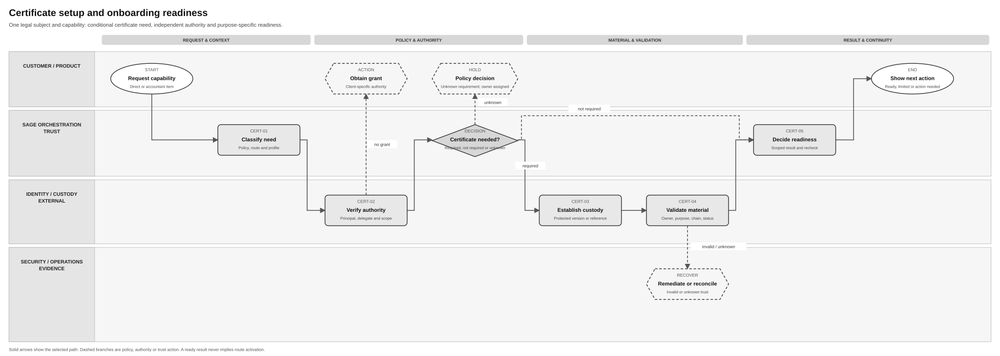

# Certificate Management Solution Specification

Terminology follows the [shared e-invoicing glossary](../context/GLO-SEI-001-e-invoicing-terminology.md). Local terms explain this feature; exact technical IDs, fields and source codes keep their stated meanings.

## Part 1 Feature Solution Summary

### Reader guide

Part 1 explains the scope, people involved, workflow and open decisions. Start here for a stakeholder review. Part 2 gives the detailed behaviour and rules. Part 3 describes service interactions and data. Part 4 links requirements to the checks and evidence needed before release.

The design remains a draft. **Proposed** choices still need review; **open** decisions still need an owner’s recorded answer. Technical IDs and state names are kept so engineering, testing and stakeholders can refer to the same item.

### 1 Purpose and reading route

This draft explains how Sage could manage certificates and keys used by onboarding, connections, invoice exchange and operations. For each requested use, the service checks whether the approved policy and current evidence allow it. It also protects private keys, manages replacement or compromise, and preserves evidence for earlier operations.

[PRD-SEI-226](../prds/PRD-SEI-226-security-trust-identity-data-audit.md) remains the source of product and security requirements. The interfaces, records and state names in this spec are **proposed**. They are not an approved architecture.

The four views below form one canonical document and one intended Confluence page. The supplied templates guide its structure; they do not establish certificate policy or approve this design:

1. This summary: scope, parties, workflow, lifecycle and decision gates.
2. [Part 2 Logical Feature Specification](#part-2-logical-feature-specification): complete behaviour, invariants, transitions, errors and acceptance scenarios.
3. [Part 3 Logical Service Interactions and Data Inventory](#part-3-logical-service-interactions-and-data-inventory): logical operations, events, records and contracts.
4. [Part 4 Assurance and Traceability View](#part-4-assurance-and-traceability-view): requirement coverage, verification and unresolved gates.

This document is for Product, Business Identity, Security, Legal, Spain Compliance, engineering, operations and integration teams. Start with Part 1 for the scope and decisions. Part 2 explains behaviour, Part 3 describes interfaces and data, and Part 4 shows how to verify the design. Open questions remain in the source PRDs until an approved decision record replaces them.

### Public source baseline

The supplied public contracts distinguish electronic-certificate and electronic-seal access. These ports establish transport choices; they do not establish invoice-signing authority or a compatible Tax Service implementation. Public web-service authentication still needs a qualified certificate and effective authority for the selected operation.

See [REF Source references](#ref-source-references) for the original files, exact locations and source limits. The [technical evidence guide](../context/RES-SEI-002-spain-public-platform-technical-evidence.md) tracks shared source conflicts. The constraints below align this feature with the supplied public evidence; Sage implementation and activation remain gated.

### Spain certificate bridge direction and evidence

**Proposed reference slice:** assess the existing Tax Service Engine Vault as a custody candidate for eligible Spain customer and accountant certificates. A centralised certificate bridge would resolve authorised dataset/client context, obtain a protected material reference, and request authentication or signing inside an approved protected boundary. The bridge stores mappings and evidence references. The supplied blueprint describes Tax Vault custody, but the ES AFL design below shows a different, purpose-specific Connections Service/AFL boundary; G1/G9 must establish the actual custodian and avoid a second copy of each credential. This supports the blueprint's “Upload Once, Comply Everywhere” aim only where purpose, authority, source and contract checks pass.

Certificate reuse can remove a repeat upload. It cannot establish business authority, complete external registration or prove that a certificate supports every purpose. A valid certificate found by `datasetId` is a candidate for validation; it does not immediately make the customer `Authorized` or finish onboarding. The result is the existing purpose-specific readiness decision from CERT-05.

| Evidence | What it supports | Limit / treatment in this spec |
|---|---|---|
| [Solution Blueprint: Centralised Spain Certificate Bridge Layer](https://confluence.sage.com/spaces/DNBU/pages/848083761/Solution+Blueprint+Centralised+Spain+Certificate+Bridge+Layer), user-supplied text; source date absent | Tax Vault reuse direction; `datasetId` lookup; pass-through upload; `Connection-Id` selection; signing wrapper and representation gaps. | Internal proposal, not an approved service contract. Claims of “100% reuse”, live API behaviour and legal equivalence remain unverified. |
| *Sage certificate management*, supplied PDF, decision dated 25 March 2026 | Describes current ES AFL customer-certificate storage and retrieval, and a Sage-owned seal design with a dedicated connection provider, AFL KMS encryption and a legal-agreement gate. | Document status says `UNDER REVIEW` despite calling its summary agreed. Its proposed sequence diagram labels Parameter Store, while its resolved Q1 selects Secrets Manager; use the resolved Q1 and verify deployment. ES AFL tax behaviour does not establish B2B signing or public-platform acceptance. |
| [How to upload Sage ES AEAT seal](https://confluence.sage.com/spaces/CCLD/pages/771513038/How+to+upload+Sage+ES+AEAT+seal+certificate+to+AWS), supplied runbook/PDF | Operational evidence for pre-encryption, protected handover, environment-specific deployment, manual rotation, expiry alerting and functional verification of the ES AFL Sage seal. | Restricted runbook details, credentials, cloud account identifiers and payloads are deliberately omitted here. Confirm live deployment and current controls with CloudOps. |
| Supplied Product → Lambda → Submission Engine → Connections Service → AEAT sequence diagram | Shows two ES AFL credential-retrieval points and separate preparation/signing and tax-submission phases, with retry and later status checks. | Its hash/signature/QR flags and almost-complete-input statement are diagram assumptions for the anti-fraud flow, not generic B2B requirements or proof of a production contract. |
| [Veri*factu developer reference](https://internaldeveloper.sage.com/network/docs/v1.0.0/solutions/tax/spain/spain-anti-fraud-legislation/verifactu#4-uploading-xml-file-for-submission) and [non-Veri*factu developer reference](https://internaldeveloper.sage.com/network/docs/v1.0.0/solutions/tax/spain/spain-anti-fraud-legislation/non-verifactu) | Candidate evidence for Tax Service upload, connection and operation contracts. | Inaccessible during review on 6 October 2026. `POST /operations`, action `sign`, response `signatureValue` and mandatory `Connection-Id` are reported by the blueprint, not independently verified here. G9/G10 require owner-supplied contracts and tests. |
| [AEAT Informador Veri*factu](https://www2.agenciatributaria.gob.es/wlpl/AVAC-CALC/InformadorVerifactu) | Official guidance entry point for billing-system and representation questions. | Accessible; not a Tax Vault API contract or proof of B2B certificate/profile compatibility. |
| [Order HAC/1028/2026, Article 11](https://www.boe.es/diario_boe/txt.php?id=BOE-A-2026-20587) and [repository evidence E-04](../research/spain-public-platform-order-evidence.md) | Public access uses accepted AEAT certificates. Third-party retrieval and consultation require registered power of attorney, including automated/web-service access. Cl@ve is an option for specified forms. | Exact certificate acceptance, authority verification and service contracts still require AEAT technical evidence. This does not prove that every Veri*factu asset is suitable for every public or private B2B purpose. |

Use **qualified electronic certificate** for a certificate and **qualified electronic signature (QES)** for a signature. Possessing a certificate or obtaining a raw cryptographic signature does not establish a QES; see the [European Commission's eSignature guidance](https://ec.europa.eu/digital-building-blocks/sites/spaces/DIGITAL/pages/467109069/What%2Bis%2BeSignature). The blueprint's certificate-equivalence claim requires validation of the actual subject, permitted use, issuer, profile, custody and target service.

#### ES AFL credential paths and transfer limit

| Existing or proposed ES AFL path | Source-described custody and use | Requirement for this B2B design |
|---|---|---|
| Customer-provided certificate (current ES AFL design) | A client application sends the customer certificate/password to Connections Service under a designated provider. Connections Service asks an AFL encryption endpoint to encrypt them and stores encrypted credentials in its database. AFL retrieves the encrypted value and decrypts with its KMS key for XML signing or tax submission. | Confirm the actual secret ingress, encryption, plaintext lifetime, authorisation, version and deletion controls before reuse. This is not evidence that Tax Vault holds this credential or that a normal B2B product API may accept it. |
| Sage-owned AEAT seal (ES AFL proposal and deployment runbook) | Sage centrally holds one seal. The certificate/password are encrypted with the target-environment AFL KMS boundary before storage in Connections Service's AWS Secrets Manager; deployment injects the encrypted value into its service task. A dedicated connection provider/credential type selects it. Only AFL decrypts for use. | Require a stored, purpose-specific customer agreement and approved actor/representation mode before selection; qualify the exact tax or B2B purpose independently. Keep customer-certificate and Sage-seal paths distinct. |

The ES AFL source says customers may choose their own certificate or the Sage seal. A `Connection-Id` selects the corresponding provider, but selection alone does not prove legal authority. For the Sage seal, the source forbids use until Sage has stored the customer's signed agreement for that purpose. Accountant-managed tax files may need accountant details, and the AEAT tax-submission endpoint differs by certificate mode. Those file and endpoint rules remain ES AFL-specific until the target B2B route confirms equivalent requirements. The sequence diagram retrieves a credential during preparation and again during submission; a B2B flow using that split must bind both steps to an approved material version or re-authorise an intentional change, never silently substitute a certificate.

### Spain use and reuse boundaries

This is a **Spain reference design**. The classifications below describe proposed reuse of behaviour, not proof that existing code is ready for use. **Reusable unchanged** means the design pattern can stay the same. **Reusable with country binding** means the shared behaviour needs approved local policies or adapters. **Country-specific** rules stay in the country pack. **Unknown** means implementation fitness or coverage still needs evidence.

This follows the [shared platform and country-pack direction](../prds/PRD-SEI-227-e-invoicing-as-a-service.md). Spain pilot or production use still depends on this spec’s approval and evidence gates. Reuse in another country needs that country’s own assessment.

| Area | Intended use in Spain | Reuse classification | Condition and owner |
|---|---|---|---|
| Versioned inventory and evidence | Keep certificate versions, operation references and historical proof for Spain. | Reusable unchanged | Reuse the record and audit pattern; check storage, access and recovery fitness. Trust owner and Records. |
| Readiness, protected use and rotation | Check the purpose, actor, route/profile and current authority before Spain operations. | Reusable with country binding | Bind approved Spain certificate, signer/seal, trust-source, custody and retention policies. Business Identity, Security and Spain Legal. |
| Spain trust requirements | Resolve public-solution authentication, representation and signing requirements for each supported Spain route. | Country-specific | Keep these rules in the Spain policy. Do not carry them into another country by default. Spain technical owner and Legal. |
| Existing Tax Service, Connections Service and AFL credential paths | Assess each actual protected source and certificate-selection capability for eligible Spain datasets. | Unknown; existing implementation reuse candidates | Sources show an ES AFL Connections Service/AFL path; the blueprint also proposes Tax Vault. Confirm build, owner, APIs, certificate classes, isolation and operations through G9–G12 before activation. Tax Service, Connections Service, AFL, Business Identity and Architecture. |

### Tax Service reuse qualification and remaining work

Each row separates a reported implementation from the proposed integration. None is proof of Spain B2B production readiness.

| Source capability | Intended reuse and local change | Gap / evidence before activation | Accountable owner |
|---|---|---|---|
| Tax Vault custody proposed by the bridge blueprint | Reuse an eligible protected source by reference after identifying the real owner and source. | ES AFL customer credentials instead follow the Connections Service encrypted-store/AFL KMS path; establish whether Tax Vault is a separate build, alias or migration target. Confirm import, access, deletion and lifecycle contracts per source. | Tax Service, Connections Service, AFL and Security; G1/G3/G9 |
| ES AFL Sage seal connection | Assess the dedicated provider/credential type and centrally pre-encrypted secret for approved ES AFL purposes; retain the signed-agreement gate. | Confirm deployed build, agreement record/lookup, provider ownership, runtime version evidence, exposure and rotation controls. No B2B use follows from the tax design. | Connections Service, AFL, Spain Legal and Security; G2/G9/G12 |
| Existing Veri*factu certificate setup | Reuse eligible assets without another upload; add readiness checks and a standalone ERP upload path. Sage 50/200 are blueprint examples, not confirmed product integrations. | Dataset-to-business ownership, product access, import outcome lookup and remediation coverage. | Onboarding/Product and Tax Service owner; G9 |
| Tax Service network authentication | Reuse protected client-certificate operations where the target protocol permits; add the selected public-service adapter. | Working AEAT tax-server communication does not prove SPFE endpoint, certificate or mTLS compatibility. Obtain counterpart conformance and failure evidence. | Spain Technical Owner and connection owner; G4/G8/G10 |
| Reported `POST /operations` signing block | Reuse the cryptographic mechanism if eligible; add exact B2B representation/profile orchestration and evidence capture. | Reported anti-fraud schema restriction; no verified arbitrary UBL/Facturae support, signature profile, output binding or safe retry contract. | Tax Service owner and exchange owner; G5/G10 |
| Reported `Connection-Id` selection | Reuse backend certificate selection; add server-side dataset/client/connection mapping and runtime checks. | Header semantics, secrecy classification, ownership, version selection and tenant/environment isolation. This needs backend authorisation as well as UI mapping. | Bridge/Identity and Tax Service owners; G9 |
| Accountant representation | Reuse identity/authority patterns; add an effective-dated registry that links each client to the delegate and evidence. | The Vault is not the authority register. Confirm action-specific legal permission, registered powers where required and revocation verification. | Business Identity and Spain Legal; G2/G8/G11 |
| DTS transformation candidate | Assess DTS for preparing and validating the selected B2B representation before protected signing. Keep transformation outside credential custody. | Qualify actual build, input/output contracts, mappings, Spain rule packs, operations and final-byte provenance; a proposed pattern is not an existing implementation. | DTS and exchange owners; [SPEC-SEI-008](SPEC-SEI-008-spain-ubl-mapper-migration-to-dts-solution-specification.md), G10 |

Country-neutral patterns are protected custody, reference lookup, scoped readiness, version binding and recovery. Spain NIF/authority rules, AEAT acceptance, public-copy rules and route/profile choices remain in the Spain policy and adapters. No other country inherits them from this bridge.

### Plain-language terms

| Term | Meaning |
|---|---|
| Legal entity / legal subject | The business to which the invoice or action belongs. Technical fields use `legalSubject` for this business. |
| Authority | Permission to perform a specific action for that business. Logging in or holding a certificate does not by itself give this permission. |
| Capability | A supported function, such as receiving invoices or signing them. |
| Route | The time-bound selection of platform and connection for a defined invoice scope and direction. A ready connection does not activate a route or rewrite earlier invoice plans. |
| Idempotency | Repeating the same logical request adds no effect within the contract’s defined scope and retention window. The contract binds request identity and input and defines conflict handling. |
| Reconciliation | Check the original operation against a reliable source to establish what actually happened before deciding the next action. |
| Gate | A condition, decision or evidence check that must pass before the next step can proceed. |
| Tenant | The customer account boundary used to keep one customer’s data and access separate from another’s. |
| Immutable / append-only | Immutable means a saved record cannot be changed. Append-only means later information is added as another record. Neither means indefinite retention. |
| Provenance | The record of where data came from and which versions, checks and changes produced the result. |
| Contract | The agreed inputs, outputs, behaviour and responsibilities between services or parties. |
| Durable | Saved through the agreed recovery boundary so the record survives a process restart or worker failure. Long-term retention is a separate policy. |
| Custodian / custody | The party or protected system that holds and uses a private key. |
| Represented party / delegate | The business or person on whose behalf an action is performed; and the actor authorised to act for them. The represented party is separate from the authenticated caller. |
| Signature / seal | Different cryptographic proofs associated with a signer or an organisation. Their permitted use must be approved separately. |
| Rotation / cutover | Rotation prepares replacement trust material. Cutover switches future eligible operations to it at an agreed boundary; earlier operations keep their original material versions. |
| PKI / HSM | Public key infrastructure manages certificates and keys. A hardware security module is a device that protects cryptographic keys. |
| CA / RTO / RPO | Certificate authority; target time to restore a service; and maximum acceptable loss of recent data. Values remain subject to approval. |
| LFS | Logical Feature Specification: Part 2 of this document. |
| QTSP | Qualified trust service provider; an external provider that issues certificates for the selected qualified service. FNMT is the blueprint's example, not a mandatory issuer. |
| `datasetId` | Tax Service dataset reference. The bridge must verify its relationship to the tenant, business and environment before lookup. It is not proof of authority. |
| `Connection-Id` | Tax Service request-header name reported in the blueprint for selecting a connection/certificate context. Exact contract and secrecy classification need verification. |
| Apoderamiento / NIF / mTLS | Power of attorney; Spain tax identifier; and transport authentication in which both ends present certificates. These are separate authority, identity and connection concepts. |
| Public platform (SPFE) / DTS | Spain public e-invoicing platform; and Document Transformation Service, the preferred Sage transformation reuse candidate. Their exact service/profile contracts need qualification. |

Use **represented party** for the business or person on whose behalf an action is performed and **authenticated principal** for the trusted caller. Existing logical records retain `principal` wording where actual field mappings still need Identity and Trust owner confirmation; this wording does not rename them.

### 2 Terms used

| Term | Meaning |
|---|---|
| Trust material | A certificate, certificate chain, key reference or external validation identity. Its subject, custodian, permitted purpose and lifecycle must be defined. |
| Material version | One saved version of the certificate or key reference. Renewal creates a new version and keeps the earlier record. |
| Trust policy | A rule valid for a stated period. It defines who may use which material, for what purpose and route/profile, and the required checks and evidence. |
| Readiness | The current result of capability checks for a stated legal entity, actor, environment and route/profile, with evidence, limitations and a recheck condition. Readiness is separate from authority, route activation and invoice outcomes. |
| Protected operation | Use of a key inside the approved protected system operated by the customer, Sage, a provider or a trust service. |
| Operation binding | The fixed link between one attempt and its policy version, material version, authority snapshot and exact input hash. |
| Evidence package | Saved references to the exact signed file, signature or seal, certificate chain, status and time evidence, policy and source history. These allow later verification. |

### 3 Feature purpose and scope

The process starts when an authorised owner requests, selects or registers trust material, or when another service asks to use it. The trust service records the material and its permitted purpose, checks custody and trust, and returns readiness for the requested use. It monitors dependent services and manages replacement, retirement and retained evidence.

Direct customer signing, delegated accountant signing, Sage-managed remote signing, provider signing or sealing, Sage operator sealing, workload identity, transport authentication and inbound validation are **different policy classes**. Each class needs its own approved policy.

Policy activation for an individual class requires legal/security approval.

The process can finish with an active version approved for the requested use, a retired or destroyed private key with historical evidence retained, or a verified reference to material held externally. Denied or inapplicable requests are closed with a reason and an audit record.

`VALIDATION_UNKNOWN`, uncertain key creation or use, and failed replacement remain recovery cases. The service must show who owns the next action; it must not report success or close them silently.

The first design slice covers inventory, versioning, readiness, expiry monitoring, rotation and dependency impact for approved certificate classes; onboarding and exchange consume the service through explicit interfaces. Physical PKI/HSM selection, final Spanish certificate profiles, public-solution authentication details, exact retention periods, and the legal permissibility of an operator seal are outside this draft's authority. No universal certificate-upload step is assumed.

For the Spain bridge slice, customer/accountant certificate issuance is external and out of scope for Sage. Sage manages approved custody and use. If no suitable certificate exists, onboarding offers approved, localised guidance to external issuers and a secure import path where policy permits it. Other workload/key classes may retain their separately approved generation flows.

### 4 Parties and responsibility boundary

| Party | Responsibility | Handoff |
|---|---|---|
| Customer or accountant | Identifies intended legal subject and direct/delegated signing mode; completes approved proof or customer-held setup | Supplies authority evidence to onboarding/identity; never grants authority by presenting a certificate alone |
| Onboarding service | Resolves requested capability/route/profile, asks for certificate need and readiness, displays remediation | Stores scoped readiness reference, not a private key; [PRD-SEI-101](../prds/PRD-SEI-101-public-platform-onboarding.md) owns customer onboarding |
| Identity and authority service | Resolves legal subject, represented party, delegate, scope and effective authority | Supplies independently versioned authority decision; [PRD-SEI-231](../prds/PRD-SEI-231-country-identifiers-tenancy-and-delegated-accountants.md) owns identity/delegation model |
| Trust service owner | Owns material inventory, policy evaluation, protected-operation orchestration, lifecycle and evidence contract | Returns purpose-specific readiness, operation result and audit/evidence references |
| Certificate bridge owner (proposed Domain Services role) | Owns dataset/client mappings, Tax Service adapter and scoped orchestration | Resolves INT-13; never retrieves Vault passwords/private keys; final ownership remains G1 |
| Tax Service, Connections Service and AFL owners | Identify the actual credential source and split storage, selection, encryption/decryption and key use for each path | Supply source-specific contracts, runtime version and lifecycle evidence; ES AFL evidence does not establish B2B ownership |
| Custodian or provider | Holds/operates the protected key or supplies external trust/status evidence under an approved agreement | Returns attested result and evidence; custody and export rules are approved per class |
| Exchange/connection service | Freezes trust plan per operation and enforces runtime readiness | Does not substitute signer, seal or transport credential; [PRD-SEI-223](../prds/PRD-SEI-223-interoperability-routing-transformation.md) owns exchange |
| Security, Legal and Operations | Approve policy and high-risk actions; monitor expiry, compromise and historical proof | Control suspension, incident and restoration; [PRD-SEI-225](../prds/PRD-SEI-225-operations-resilience-support-reconciliation.md) owns shared operations |

### 5 Key open solution decisions

| Decision | Current position and design impact | Owner / gate |
|---|---|---|
| Which service physically owns inventory, remote signing, validation and preservation? | Identify the actual Tax Vault or Connections Service/AFL source per credential class; use a reference-only bridge where qualified. Inventory, authority and preservation ownership still need agreement | Tax Service, Connections Service, AFL, Business Identity, Domain Services and architecture / G1/G9 |
| Who may sign, and when may a Sage operator seal be used? | Keep direct, delegated, remote-service and seal modes separate; seal cannot substitute for issuer/delegate signature by default | Spain Legal, Security / trust-policy activation |
| Which classes may import/export keys, and which custodians are approved? | Reference-only product boundary; non-exportability is preferred where applicable | Security, Legal / custody design |
| Which CA/trust lists, status sources, freshness, signature profiles and preservation evidence apply? | Parameterise by country/route/profile; no guessed defaults | Spain technical owner, Security / conformance |
| Which expiry horizon, overlap, retention and destruction rules apply per class? | Versioned policy fields with no universal duration | Security, Operations, Legal / production |
| What is the public-solution authentication and representation contract? | Do not claim external registration or certificate need without official technical evidence | Spain regulatory/technical owner / external design |
| Can the Tax Service bridge operate by reference for the selected Spain purposes? | Require owner-confirmed lookup, secure import, certificate selection, handshake/signing and outcome-query contracts; no key replication fallback | Tax Service owner and bridge owner / G9/G10 |
| Can shared custody support B2B peaks and cross-service lifecycle changes? | Measure authentication/signing load, failure isolation, rotation and restore; no assumed HSM or capacity guarantee | Spain Engineering Manager, Tax Service and Operations / G12 |

### 6 End-to-end workflow

Three process diagrams cover setup, protected use and lifecycle control. Each uses the existing `assets/diagrams` convention: horizontal responsibility lanes, phase bands, black/grey shapes, short branch labels and a version-controlled Draw.io source. Solid arrows are the selected process; dashed arrows are exception or conditional paths. The diagrams show logical responsibility, not a physical deployment or approved certificate policy.

#### Process 1 Certificate setup and onboarding readiness

Diagram step names use plain-language actions. The smaller activity references link to the detailed behaviour and checks below.



**Editable source:** [Certificate setup and onboarding Draw.io](../assets/diagrams/certificate-setup-onboarding-process.drawio). **Preview:** [PNG](../assets/diagrams/certificate-setup-onboarding-process.png). This is the certificate-specific detail of the broader [customer and service readiness Draw.io](../assets/diagrams/e-invoicing-customer-service-readiness.drawio). The broader diagram's route activation belongs to Phase 2/3; Phase 1 public onboarding returns capability readiness without activating a private route.

```text
Customer or accountant requests one capability for one legal subject
  → CERT-01 resolves the effective route/profile policy and certificate need
  → CERT-02 checks represented-party/delegate authority independently
      └─ missing or expired grant → customer/accountant obtains the scoped grant
  → evaluate the certificate-need decision for the authorised capability
      ├─ NOT_REQUIRED → CERT-05 records an evidenced no-certificate result
      └─ UNKNOWN or conflicting policy → hold for a named policy decision
      └─ REQUIRED → CERT-03 establishes an approved protected version or external reference
          → CERT-04 checks owner, purpose, environment, chain, validity and status
              └─ invalid or unknown trust → remediation or original-operation reconciliation
  → CERT-05 returns scoped readiness, next recheck and responsible action
  → onboarding displays the result without exposing a private key
```

The direct and accountant paths share the same trust controls. A portfolio item is assessed per client and capability; one accountant certificate does not grant authority across the portfolio. A `READY` decision does not register the customer externally or activate a route.

For the Tax Vault slice, CERT-02 verifies the client and any delegation; INT-13 then resolves the authorised dataset/connection mapping. CERT-03 registers an existing Vault version by reference or starts INT-14 secure import. CERT-04/05 validate and return readiness. A confirmed missing asset prompts issuance/import guidance; an unavailable Vault or ambiguous mapping holds the request for recovery. The existing setup diagram shows these logical custody and authority steps; it does not establish a physical Vault API.

#### Process 2 Protected use and evidence



**Editable source:** [Protected use Draw.io](../assets/diagrams/certificate-protected-use-process.drawio). **Preview:** [PNG](../assets/diagrams/certificate-protected-use-process.png).

```text
Exchange supplies final exact representation bytes and input hash
  → CERT-06 freezes actor, authority snapshot, policy and material version
  → use-time checks re-evaluate current scope, status and suspension
      └─ failed check → block only affected new use; no key operation
  → INT-06 invokes the protected custodian using one operation ID and input hash
      ├─ definitive rejection → return safe rejected result with audit evidence
      ├─ outcome unknown → CERT-09 queries/reconciles the original operation
      │   └─ if still unproven → hold; do not start a fresh signing attempt
      └─ confirmed result → CERT-07 durably stores exact object and trust evidence
  → return an evidence reference and customer-safe trust result
```

A confirmed cryptographic result is not invoice delivery or buyer acceptance. Reconciliation may establish a confirmed signature or definitive rejection; it must preserve the original operation identity and cannot silently change the representation or signer.

For the bridge slice, the server resolves and freezes the dataset/client/connection binding before INT-06. Tax Service performs the approved key operation within custody. B2B preparation, including any qualified DTS reuse, produces the final input before signing. A schema-limited tax operation cannot be treated as a general B2B signer until G10 is passed.

#### Process 3 Renewal, containment and retirement



**Editable source:** [Renewal and recovery Draw.io](../assets/diagrams/certificate-renewal-recovery-process.drawio). **Preview:** [PNG](../assets/diagrams/certificate-renewal-recovery-process.png).

```text
Monitoring detects approaching expiry, revocation or compromise
  → CERT-08 maps active workloads, routes, policies and in-flight attempts
      └─ compromise/revocation → CERT-09 contains affected new use and opens case
  → for planned renewal, CERT-08 creates a new protected material version
  → CERT-04 validates it and tests the required counterpart/profile
      └─ failed or unknown test → hold; old version remains usable only if safe
  → approved effective cutover selects the new version for future work
  → frozen in-flight attempts retain their original binding or reconcile
  → CERT-10 retires/destroys old key material after dependency and hold gates
  → historical signed bytes, certificate and validation evidence remain available
```

The route, certificate and trust-policy versions used by an earlier operation remain part of its historical evidence. Key destruction and evidence retention follow separate approved schedules.

The lifecycle below follows setup, permitted use, evidence storage, replacement and retirement (`CERT-01`–`CERT-10`). Inbound validation uses `CERT-04` and `CERT-07` without signing. When an external result is unknown, check the original operation before requesting another change.

### 7 One feature lifecycle

| Activity | Result that must be visible | Responsible party | Detailed reference |
|---|---|---|---|
| CERT-01 Classify | Material class, intended purpose, environment and owner are explicit | Trust service | LFS §3, INT-01 |
| CERT-02 Authorise | Represented party/delegate/operator and effective policy are resolved independently of authentication | Identity/authority and trust | LFS §4, INT-02 |
| CERT-03 Establish custody | Key is protected or externally referenced; version is inventoried | Custodian and trust | LFS §5, INT-03 |
| CERT-04 Validate | Chain, scope, validity and status produce evidenced result or unknown | Trust | LFS §6, INT-04 |
| CERT-05 Decide readiness | Scoped result and next recheck/remediation are returned | Trust; onboarding consumes | LFS §6, INT-05 |
| CERT-06 Bind and use | Approved actor/policy/material/input are frozen before protected use | Exchange and trust | LFS §7, INT-06 |
| CERT-07 Preserve | Exact output and evidence references are durable | Trust/evidence store | LFS §7, INT-07 |
| CERT-08 Rotate | Replacement passes validation and dependency cutover before old new-use is disabled | Trust and operations | LFS §8, INT-08 |
| CERT-09 Contain | Affected purposes stop; incident and unknown outcomes remain reconcilable | Security and operations | LFS §9, INT-09 |
| CERT-10 Retire | Key-use ends; approved historical evidence remains available | Trust and records owner | LFS §10, INT-10 |

### 8 Cross-cutting controls and risks

Tenant, environment, legal subject, actor, purpose and route/profile are explicit in every decision; no bare certificate ID authorises use. Protected APIs require least privilege and action-specific authorisation. Every mutation is auditable and designed to handle repeats safely. The system retains prior material and policy versions so a route change or certificate expiry cannot rewrite the original signing conclusion. Capacity, latency, alert thresholds, retention and recovery targets require baselines and approval; this draft specifies the measurement points rather than inventing values.

The main risks are using material for the wrong purpose, acting for a client without permission, silently replacing a signer or seal, an outage caused by expiry, signing twice after a timeout, and losing historical evidence. Part 2 explains when to block work and how to recover.

This draft is **ready for solution review**. The decisions in §5 and the assurance gates must be resolved before production activation.

## Part 2 Logical Feature Specification

This part explains the proposed behaviour step by step. An invariant is a rule that must always hold, including during failures and recovery.

### 1 Authority, status and design boundary

This is a **proposed logical design** for the certificate/key lifecycle in [PRD-SEI-226](../prds/PRD-SEI-226-security-trust-identity-data-audit.md), including the conditional onboarding consumer in [PRD-SEI-101](../prds/PRD-SEI-101-public-platform-onboarding.md) and exchange consumer in [PRD-SEI-223](../prds/PRD-SEI-223-interoperability-routing-transformation.md). It does not approve a PKI/HSM product, cryptographic algorithm, certificate authority, signer model, Spanish legal interpretation, cloud boundary, or physical API. The [Part 1](#part-1-feature-solution-summary) provides the lifecycle map; the [Part 3](#part-3-logical-service-interactions-and-data-inventory) defines logical contracts; [Part 4](#part-4-assurance-and-traceability-view) tracks verification.

**Confirmed product constraints from the PRDs:** certificate need is capability/route/profile dependent; authority is independent of certificate possession; different trust purposes are not interchangeable; key material remains inside approved custody; invalid/currently unknown trust blocks new dependent operations; old signed evidence persists independently of private-key lifecycle; ambiguous external mutations reconcile before repetition. **Proposed design:** the records, state vocabulary, commands/events, concurrency model and operation-binding protocol below. **Open:** the policy content, accountable service owner, custody implementation, trust/status sources, legal signature/seal modes and service objectives.

### 2 Actors, scope and invariants

Actors are customer/delegate, product/onboarding, identity/authority service, trust-policy approver, trust service, custody provider, exchange/connection service, security operations and evidence/archive service. An external certificate subject or provider is evidence, not a Sage-authorised user. Logical tenancy is `(tenant, legalSubject, environment)`; every material/policy/decision additionally has purpose, permitted actor/mode, capability, route and profile where applicable.

**Invariants**

| ID | Rule that must always hold |
|---|---|
| CM-I01 | A material reference never confers business authority. An effective authority decision is checked for the requested represented party/delegate/action and time. |
| CM-I02 | Every logical material version has exactly one class, custodian, owner, environment and version identity. Separate purpose bindings can reference one physical Vault asset without duplicating custody. A new certificate/key is a new source version; historical rows are append-only. |
| CM-I03 | A trust policy explicitly lists permitted uses. Authentication, direct signature, delegated signature, Sage-managed remote signature, provider signature/seal, operator seal, validation and timestamp are distinct purposes. |
| CM-I04 | No product API, queue, log, support view, audit event or document carries an exportable private key or reusable secret. Custody APIs may receive protected material only inside an approved secure boundary. |
| CM-I05 | `ACTIVE` material is usable only after policy, chain/status, authority, custody and environment checks for that exact operation. Inventory state alone cannot authorise use. |
| CM-I06 | A protected operation is bound to immutable `operationId`, `materialVersionId`, `policyVersion`, `authoritySnapshotId`, `inputHash`, legal subject and environment before execution. A material/policy switch does not silently change an in-flight attempt. |
| CM-I07 | A timeout after a possibly executed protected operation creates `OUTCOME_UNKNOWN`. No fresh attempt is issued until the original is reconciled or the custodian's effective idempotency guarantee is evidenced. |
| CM-I08 | Rotation and route change affect future operations that meet the policy. They never rewrite prior signed bytes, actor, material/policy binding or historical conclusion. |
| CM-I09 | Revocation, compromise, wrong purpose/owner/environment or stale/unknown validation blocks affected *new* use. Containment targets the narrowest proven dependency set. |
| CM-I10 | Private-key destruction and evidence disposition are separate governed actions. Evidence cannot be deleted merely because material retires or a provider exits. |
| CM-I11 | `datasetId` and connection selection are resolved from an authorised tenant/business/environment mapping. Caller-supplied identifiers cannot select another client's credential. |
| CM-I12 | Reuse of any qualified protected source creates references and policy bindings, not another copy of the private key, certificate import package or password. One physical asset can support separate approved purpose bindings without duplicating custody. Customer-provided and Sage-owned seal credentials remain distinct material classes and authority paths. |

### 3 CERT-01 Classify request and applicability

**Trigger:** onboarding requests a capability; connection/exchange needs trust; an owner requests issuance/import/reference; or monitoring detects changed material. **Preconditions:** caller identity, trusted environment and one legal subject/operator are resolved. The trust service looks up an effective, approved policy by country, capability, direction, route, format/profile, actor mode and time. A policy can return `NOT_REQUIRED`, `REQUIRED`, `PROHIBITED` or `UNDETERMINED`; `NOT_REQUIRED` is an evidenced decision, not a default caused by missing configuration. `UNDETERMINED` blocks the dependent capability and creates a policy decision case.

The request names a class from the PRD taxonomy (direct issuer, accountant/delegate, Sage-managed remote signing, Sage operator seal, provider signing/sealing, workload, transport, external validation or timestamp). The service rejects a generic “Sage certificate” or “signing certificate” with no legal actor/purpose. The selected policy version and rule reason are stored in `D-02`; no material is provisioned from a policy lookup alone.

Duplicate logical requests return the same classification for the same idempotency key and immutable input digest. A changed input creates a new assessment revision. `INT-01` serves the lookup.

| Class | Decision inputs that cannot be inherited from another class | Consumer boundary |
|---|---|---|
| Direct issuer signature | Issuer/signatory identity, approved representation profile, key usage and direct authority | Outbound exchange; onboarding checks conditional readiness |
| Accountant/delegated signature | Client-by-client mandate, delegate, permitted action, effective time and route | Accountant onboarding and outbound exchange |
| Sage-managed remote signing | Actual customer/delegate signatory, Sage's custody/service role and approved remote-signing authority | Trust service performs protected use; ERP receives no key |
| Sage operator seal | Named operator legal person, permitted document/route and Legal-approved seal policy | Exchange; never silently satisfies customer signature |
| Provider signing/sealing | Provider's actual actor and attested returned evidence, authority defined by the contract and approved adapter | Provider adapter and trust verification |
| Workload / transport | Endpoint or service identity, channel protocol, environment and counterpart trust | Connection/transport; cannot imply invoice signature |
| External validation / timestamp | Trust-list, status/time source, evidence freshness and preservation profile | Inbound and historical validation |

The activated format profiles in [PRD-SEI-236](../prds/PRD-SEI-236-ubl-format-profile.md), [237](../prds/PRD-SEI-237-cii-format-profile.md), [238](../prds/PRD-SEI-238-un-edifact-format-profile.md) and [239](../prds/PRD-SEI-239-facturae-format-profile.md) may require different representation and signature policy. The policy lookup must bind an exact profile/version rather than treating UBL, CII, EDIFACT and Facturae as interchangeable.

### 4 CERT-02 Resolve subject and authority

The caller supplies tenant/workspace context, legal subject reference, requested acting person/service, represented party, capability and direction. The identity/authority owner independently verifies the tenant-to-subject relationship and an effective grant for the requested action, route/profile and environment. The decision includes evidence source/version, effective interval, revocation check and result; it is not inferred from login, portfolio membership, certificate subject, possession, or provider access.

A direct signer must be distinguished from a delegate; a Sage-operated signing service is the custodian/operator and not automatically the signatory. An operator seal identifies the operator legal person and requires its own policy approval.

`DENIED`, `REVOKED`, `EXPIRED` or `UNDETERMINED` authority blocks the affected scoped action, records a reason with sensitive values removed and leaves unrelated clients/capabilities unchanged. An authority change emits invalidation for dependent readiness and future operations, while preserving prior snapshots. `INT-02` returns a versioned authority reference; no raw mandate is copied into the material inventory.

**Spain delegation registry (proposed):** `D-11` links a represented client legal-subject/NIF reference to the accountant actor/delegate, applicable dataset/connection mapping, allowed actions, effective interval and authority evidence reference. Identity/authority owns the decision; the bridge consumes it. A local row records evidence and scope, and cannot create legal power of attorney. Each client is checked independently on setup, selection and runtime use. Revoked, expired or unverified powers invalidate only their dependent readiness and future use. Relevant registered-authority procedures remain G11. Public retrieval and consultation apply the Article 11 boundary recorded in Part 1; tax-submission authority cannot be carried over without validation.

### 5 CERT-03 Establish custody and material version

An authorised owner requests one of: generate/issue in an approved protected boundary; register a customer-held or provider-held reference; or import only when the class-specific custody policy permits it. The request requires owner, custodian, subject, class, purpose, scope, environment, policy, renewal owner and change reason. High-risk actions require independently attributable approval and separation of duties under the effective corporate policy. The trust service records a `REQUESTED` inventory item before any external mutation, then `APPROVED` and `PROVISIONING`/`PROVISIONED` according to observed custodian evidence.

`PROVISIONING_OUTCOME_UNKNOWN` means the custodian may have created material; reconcile by request reference before issuing another command.

The custodian returns a non-secret handle and public certificate/attestation metadata. The trust service verifies the returned subject, issuer/chain, public-key fingerprint, key usage/extended usage, validity, custodian attestation and environment against the approved request. It records an immutable material version, including source and observation time. It never stores the private key in an application database or emits it in an event. A customer-held key may never be copied to Sage just to satisfy readiness.

If an external reference cannot provide the necessary evidence, readiness stays `UNDETERMINED`. `INT-03` is the logical command; `D-03` is the inventory record.

#### Spain protected-source lookup and secure import

**Trigger and actor:** onboarding or an authorised owner needs material for a policy classified `REQUIRED`. **Preconditions:** CERT-02 has resolved business authority and the service has a trusted tenant/environment context. INT-13 resolves `D-10`, the versioned dataset/client/connection mapping, and asks the qualified source owner for eligible non-secret material metadata. The source-specific adapter is a G9 decision; Tax Vault and ES AFL Connections Service/AFL cannot be treated as one store by assumption.

| Lookup outcome | Operation and visible result | Recovery / owner |
|---|---|---|
| One eligible, evidenced protected-source version | CERT-03 records its protected reference and source version in D-03; CERT-04/05 still check purpose, trust and authority. No repeat upload. | Trust/bridge owner handles failed validation; no automatic `Authorized` state. |
| Confirmed no suitable asset | Offer approved external-issuance guidance or INT-14 import. The blueprint's standalone ERP wizard is this path. | Customer/accountant supplies an eligible asset; Product owns localised guidance and issuer links. |
| Several candidates or conflicting mappings | Hold selection with an action for an authorised owner to choose/repair the binding. | Bridge/Identity owner; never select a first/default certificate silently. |
| Protected source unavailable, metadata stale or result unknown | Return `UNDETERMINED` and a safe dependency reason. | Source owner/Operations restores lookup and rechecks; do not report “no certificate” or request another upload. |
| Dataset/client/environment mismatch | Reject before Vault access; audit safe scope and reason. | Bridge/Identity owner investigates or corrects the authorised mapping. |

INT-14 is a **proposed B2B secure custody workflow**: an approved UI transfers `.pfx`/`.p12` and its password directly into the approved source's import boundary under a short-lived, scoped upload authorisation. Exact source, transport, size/type checks and ephemeral handling require G3/G9 approval. The bridge stores only request/session references and resulting public metadata. Certificate packages and passwords must not enter normal product APIs, application storage, queues, logs, analytics or support views. The existing ES AFL customer path does receive the package/password in Connections Service before AFL encryption; that path needs a separate security assessment and must not be represented as satisfying INT-14. Cancellation or a definite pre-custody failure clears transient input under the approved contract. After possible source acceptance, timeout/cancellation requires INT-09 lookup by the original request before any repeat import. A concurrent upload or renewal uses expected source/mapping versions and cannot overwrite the currently selected version silently.

Successful import means an inventoried protected version, followed by validation; it does not mean business onboarding is complete. Each purpose has its own logical policy binding even if transport and signing reuse the same physical Vault asset. The same source reference/fingerprint avoids duplicate custody and supports shared rotation/incident impact.

### 6 CERT-04/05 Validate trust and calculate scoped readiness

**Validation inputs:** material version, trust policy version, owner/represented party/delegate, authority decision, capability, route/profile, environment and checked time. Validation evaluates: (1) exact subject/owner and permitted purpose; (2) custody and key availability/attestation; (3) current validity interval and algorithm/profile policy; (4) chain/trust-list status and approved issuer; (5) current revocation/status evidence and freshness; (6) dependency or incident suspension; and (7) per-operation authority where the class requires it. The source and version of each check are retained. Failure in one dimension cannot be hidden by a passing dimension.

**Proposed readiness outcomes:** `NOT_REQUIRED`, `READY`, `EXPIRING`, `ACTION_REQUIRED`, `BLOCKED`, `UNDETERMINED`. `EXPIRING` can remain usable only until the approved horizon/policy says otherwise; it always creates a renewal action. `VALIDATION_UNKNOWN` yields `UNDETERMINED` and blocks new protected use by default. The result includes scope, material/policy/authority versions, evaluation time, next mandatory check, expiry, evidence reference, reason code, responsible remediation actor, and a non-secret dependency summary.

The customer-facing label maps to `TRANSPORT_READY`, `DIRECT_SIGN_READY`, `DELEGATED_SIGN_READY`, `SEAL_READY` or `VALIDATION_READY`; it cannot collapse all purposes into one “certificate valid” flag. Onboarding stores only the readiness result/reference and rechecks before later use. A batch evaluates each legal subject and capability independently, including shared accountant material.

`INT-04` validates material; `INT-05` returns readiness. Cache use, if approved, may not outlive the shortest applicable authority, certificate, status-source, policy or incident validity. Cache invalidation is driven by version change or revocation/suspension events; an unavailable status source is not a reason to assume validity. Exact freshness targets are open by class/profile.

For inherited Tax Vault material, checks include source version, dataset/client binding, import/custody evidence and target-service eligibility. Authentication and signing return separate readiness results. Zero-touch reuse applies only when every required check already passes; missing evidence or permission produces remediation rather than a second upload by default.

### 7 CERT-06/07 Bind protected use and preserve evidence

Before exchange uses a key, it finalises the representation under the approved transform/validate order, calculates the exact input hash and freezes a trust plan. The plan names the represented party, actual signer/delegate or seal creator, custody service role, material version, policy version, authority snapshot, route/profile, environment and correlation. The trust service rechecks current authority, status and dependency suspension **at use time**; an onboarding `READY` result is not a perpetual grant.

A workload or transport certificate cannot fill a missing invoice-signature policy. A Sage operator seal remains blocked for a signature duty until the legal/policy decision explicitly permits that use.

`INT-06` invokes the protected operation with an idempotency/correlation reference. The custodian must either guarantee one result per reference or expose authoritative operation lookup before automatic retry can be enabled. A definitive success returns signature/seal or channel proof, actual material version, observed time and custodian evidence. The trust service verifies that the result binds to the same input hash and approved actor/policy.

`INT-07` commits the immutable signed object/reference, hash, signature/seal, public chain, revocation/status and trusted-time evidence, authority snapshot, validation policy/conclusion, transformation provenance and retention class before reporting the operation as complete. If persistence fails after possible key use, outcome remains unknown and reconciliation searches by original operation ID; the system does not sign a new revision silently.

Inbound validation takes the same evidence principle but has no Sage signing actor: it verifies external channel/platform identity, replay controls, exact received bytes, signature/seal, recipient and profile. Untrusted content enters quarantine with reason with sensitive values removed; no trusted product delivery or success assertion occurs. This follows the boundary in PRD-SEI-226 and exchange behaviour in PRD-SEI-223.

#### Spain connection selection and signing adapter

Before INT-06, the bridge resolves INT-13 from the active legal subject and authorisation decision, checks the current D-10/D-11 versions, and freezes the dataset, connection reference, mapping version and exact source material version in D-06. It injects the reported `Connection-Id` header only inside the approved Tax Service adapter if G9 confirms that contract. A product/client selector is an input to authorisation, never permission to supply an arbitrary header. Concurrent portfolio operations carry their own context; changing the UI's active client cannot alter queued or in-flight bindings. Treat connection references as restricted internal data until Security confirms their secrecy classification.

Where a Sage-owned seal is selected, INT-02 must also return evidence that the customer's signed agreement for the exact purpose is stored and effective. The selected provider/credential type, permitted actor mode, authority evidence and material version are bound before use. The ES AFL source reports different AEAT tax endpoints for Sage-seal and customer-certificate submissions, plus accountant data in some representative files; a route adapter must use its own approved mode-specific rules. If preparation/signing and submission each retrieve the credential, both retrievals must prove the same frozen version or stop and re-authorise a new operation. The source diagram's hash/QR flags and retry timing do not define B2B invoice behaviour.

The blueprint reports a `POST /operations` action `sign` and a returned `signatureValue`, with anti-fraud schema validation. G10 must prove whether that mechanism can accept the final B2B input and produce the required signature/evidence. If it cannot, Tax Service must supply an approved extension or protected B2B adapter before this path activates. Do not export a key or wrap a commercial invoice in an unrelated tax schema to bypass the restriction. A raw signature value is insufficient unless the adapter verifies input binding, algorithm/profile, actual actor/material version and final signed-object integrity.

Exchange owns representation preparation and validation; DTS is the preferred transformation reuse candidate where relevant, subject to its separate build/mapping/rule-pack qualification. UBL 2.1 and Facturae are blueprint examples, not proof of public-platform profile acceptance. The bridge neither transforms invoice semantics nor applies an invoice signature to a route that only requires transport authentication. Unknown signing/handshake results use the same INT-09 recovery rules; returning a channel/signature result cannot imply successful external invoice submission.

### 8 CERT-08 Monitor, renew and rotate

Monitoring evaluates every active version against its class-specific expiry horizon, revocation/status freshness, chain/trust-list and algorithm policy, plus authority and owner changes. It produces a dependency graph covering workloads, connections, routes, signing policies, queued/in-flight operations and historic obligations. A renewal case names an owner, deadline derived from approved policy, replacement source and affected capabilities. No universal fixed warning period is assumed.

Rotation creates a **new** version, validates it in the correct environment and tests counterpart acceptance where required. The owner approves an effective-dated cutover. New operations select the new version after cutover; in-flight operations retain their frozen binding and either complete on the old version while valid or enter controlled reconciliation/restart under an explicit policy. Overlap is permitted only where the protocol and trust policy allow it.

For the ES AFL Sage seal, the supplied runbook describes manual, environment-specific AFL pre-encryption, controlled transfer, update of an encrypted deployment secret, redeployment and expiry monitoring. Rotation verification must check the credential version served by Connections Service **and** an authorised functional signing/submission result from AFL; a successful deployment or credential response alone cannot prove that a stale service task has stopped serving the old value. Record the new fingerprint/version, environment, deployment observation, functional result and rollback decision without recording the certificate package, password or encrypted payload. G7/G12 must assign alert ownership and verify this runbook against the live implementation; it is not a universal rotation method for other material classes.

An unsuccessful cutover leaves the old version usable only if still valid and safe, records rollback and blocks unsafe new use; it does not erase the failed replacement. Old private-key use ends after dependency checks, then revocation/retirement/destruction follow approved gates. `INT-08` coordinates the change and emits `EVT-03`/`EVT-04`.

For a shared Vault asset, D-05 includes Tax Service and e-invoicing consumers and D-10/D-11 mappings. The Tax Service owner and bridge owner agree how source-version changes are observed and how cutover selects an exact version. If the reported connection engine can select only “current certificate”, frozen-version execution must be proved or held for an approved restart; do not assume a connection reference pins a version. Offboarding one client removes its scoped use/mapping and does not delete an asset still needed by another authorised client or tax workload.

### 9 CERT-09 Revoke, compromise and reconcile

Confirmed revocation or compromise immediately marks the affected version and its dependent capabilities unavailable for new use. Security/operations classify the incident, preserve forensic and signing-time evidence, identify affected attempts/representations and evaluate whether historical conclusions require new review. The trust service sends scoped invalidation to onboarding, connection and exchange consumers; it does not globally suspend unrelated tenant/environment/purpose combinations without evidence. Support sees the impacted scope and next authorised action, with no secret exposure.

An unknown external provisioning, signing, revocation or deletion outcome opens a case with `intendedState`, `observedState`, original request ID, last authoritative query, owner and next safe action. Reconciliation queries the custodian/external system if the contract supports it. If the contract lacks safe lookup/idempotency, the case requires manual, dual-controlled resolution; a blind duplicate mutation is prohibited. Recovery completion records the source of truth, preserves all attempted versions, and requires revalidation before resumption. The generic incident/reconciliation owner is PRD-SEI-225; this spec owns trust-specific facts and controls.

### 10 CERT-10 Retire, destroy and prove history

Retirement requires dependency checks for new and in-flight use, unresolved outcomes, legal hold, historical access and provider exit obligations. `RETIRED` removes new-use eligibility; `DESTROYED` applies only after custodian evidence that private-key material is destroyed or inaccessible under approved policy. Public certificate, chain, signature/seal, exact signed bytes or immutable hash/object reference, time/status/authority/policy and preservation evidence remain according to their separate legal schedule.

An approved historical verification re-evaluates the signed object against the **signing-time** and preservation evidence under the applicable validation policy; present-day certificate expiry alone does not invalidate the past result. Revalidation/augmentation events are append-only and do not alter the original signing time or signed bytes.

### 11 State machines and concurrency

**Material version (proposed):** `REQUESTED → APPROVED → PROVISIONING → PROVISIONED → ACTIVE → EXPIRING → ROTATION_PENDING → RETIRED → DESTROYED`. Exceptions are `PROVISIONING_OUTCOME_UNKNOWN`, `SUSPENDED`, `EXPIRED`, `REVOKED`, `COMPROMISED`, `VALIDATION_UNKNOWN`. `REVOKED` and `COMPROMISED` cannot return to `ACTIVE`; replacement requires a new version. State transitions use expected version/compare-and-swap and record actor, reason, source and time. An incident-suspension overlay can coexist with a lifecycle state; the service must not replace evidence of compromise with a generic `SUSPENDED` label.

**Readiness (derived, not manually set):** input/version changes create a new decision. The current view points to the latest valid scoped decision, but old decisions remain immutable. Concurrent requests with the same logical scope and input digest deduplicate; different input revisions are serialised or compared by revision so an older asynchronous response cannot overwrite a newer result. Authority revocation, policy withdrawal and material events invalidate affected cached decisions immediately as far as the event contract permits; use-time evaluation is still required.

**Protected operation:** `PREPARED → SUBMITTED → CONFIRMED | REJECTED | OUTCOME_UNKNOWN → RECONCILED_CONFIRMED | RECONCILED_REJECTED | MANUAL_REVIEW`. Only a confirmed/evidenced result may become complete. A retry uses the same operation ID only when the custody contract proves idempotency; changing input hash, actor or material version requires a different logical operation and an explicit correction decision.

### 12 Security, operations and service qualities

Authorisation is action-specific for view, create, approve, activate, rotate, revoke, destroy, use, validate and audit. High-risk actions follow approved separation of duties. Every service-to-service call authenticates workload and environment independently of customer authority. Non-production and production use isolated keys, endpoints, identities, policies, stores and monitoring data. Evidence/audit stores are append-only or tamper evident; support/customer projections redact subject identifiers as policy requires and never expose private keys, reusable tokens, raw cert-import packages or uncontrolled invoice contents.

Data residency, retention, deletion and access policies are external approval inputs, not inferred here.

Observability records counts/age for expiry within policy horizon, unowned dependencies, failed validation by reason, blocked wrong-purpose/attempts outside the permitted scope, rotation outcomes, protected operations with unknown outcomes and missing evidence packages. Each event carries trace/correlation and a safe material reference. Alerts route to the named renewal/incident owner. Capacity and latency must be measured by material class, custody provider and peak operation rate in pilot; no target is set without baseline and operator commitment.

Disaster recovery must preserve inventory/evidence integrity and reconcile possible external key uses before traffic resumes.

**Proposed commercial measures from the blueprint:** existing eligible Veri*factu users complete the certificate-configuration segment in `< 1 minute`; regional certificate-configuration support tickets reduce by `50%`; and SPFE adoption exceeds `80%` within 60 days among eligible active Sage Active/X3 datasets. These are hypotheses for Product approval, not service commitments. Measure configuration from reuse assessment start to CERT-05 readiness, separating external issuance and authority remediation; compare support tickets per active dataset against an agreed baseline; define eligible datasets and activation start for adoption. Record results without certificate/password contents. G12 separately requires engineering peak-load, latency, queue, isolation and restore evidence for the actual Vault/HSM implementation; adoption targets do not prove technical capacity.

### 13 Requirements and acceptance

| ID | Testable logical requirement | Source |
|---|---|---|
| CM-R01 | The service returns certificate applicability for an exact capability/route/profile/actor/environment, including evidenced `NOT_REQUIRED` and blocking `UNDETERMINED`. | PRD-226 FR30/45; PRD-101 FR39 |
| CM-R02 | Provisioning records class, owner, custodian, purpose, environment and immutable version before it can become active. | PRD-226 FR31/36 |
| CM-R03 | Protected key material remains in approved custody; product/service outputs contain only approved references/public metadata. | PRD-226 FR36/37 |
| CM-R04 | Authority is checked independently from possession/authentication for every direct/delegated/Sage-managed use. | PRD-226 FR33; PRD-101 FR41/42 |
| CM-R05 | Readiness and use reject wrong-purpose, wrong-owner, wrong-environment, expired, revoked, compromised, suspended and validation-unknown material for affected new operations. | PRD-226 FR39/45 |
| CM-R06 | A protected operation freezes material, policy, authority and exact input hash and cannot silently substitute a signer or seal. | PRD-226 FR32/33/40 |
| CM-R07 | A possible external mutation with unknown result reconciles by original reference before a new attempt. | PRD-226 J8; PRD-225 |
| CM-R08 | Rotation activates a validated new version through approved effective time and preserves in-flight and historical bindings. | PRD-226 FR38/40 |
| CM-R09 | Revocation/compromise invalidates scoped new use, preserves forensic history and requires reapproval before resumption. | PRD-226 FR39/41 |
| CM-R10 | Evidence supports historic validation after expiry, rotation, key destruction or provider exit without changing original signed bytes. | PRD-226 FR42–44 |
| CM-R11 | Onboarding receives readiness for each client and capability and remediation without key data; later use rechecks current state. | PRD-101 FR39–50 |
| CM-R12 | All protected actions emit audit that identifies the actor, hides sensitive values and shows signs of tampering with operation/policy/material version and outcome. | PRD-226 FR17/18 |
| CM-R13 | An eligible existing protected-source asset is reused by reference after scoped validation; asset presence alone cannot authorise or complete onboarding. Its actual custodian and source version are recorded. | Blueprint REQ-001 and supplied ES AFL design, qualified by CM-R01/04/05/11; proposed |
| CM-R14 | Missing eligible material uses approved external-issuance guidance and a qualified secure import path; no second copy of the credential is created, and ambiguous imports reconcile before repeat. | Blueprint REQ-002; PRD-226 custody controls; proposed |
| CM-R15 | Every Tax Service operation resolves and freezes an authorised tenant/client/dataset/connection/material-version mapping; arbitrary headers or UI context cannot select a credential. | Blueprint connection selection; PRD-226 isolation; proposed |
| CM-R16 | Delegation is effective-dated and action-specific for each client; an internal registry records evidence and cannot establish legal authority itself. | Blueprint REQ-003; PRD-226/231; proposed registry |
| CM-R17 | B2B signing reuses only qualified Tax Service contracts and exact prepared input; unsupported schemas, profiles or evidence block activation without key export. | Blueprint signing gap; PRD-226/223; proposed |
| CM-R18 | Shared protected-source changes invalidate/rotate affected tax and e-invoicing dependencies without silently switching in-flight versions or deleting assets needed elsewhere. | Blueprint shared custody; PRD-226 lifecycle; proposed |
| CM-R19 | Sage-owned seal use requires stored, effective customer agreement for the exact purpose and approved actor/representation mode before connection selection or protected use; a customer certificate remains a separate choice. | Supplied ES AFL certificate-management design; PRD-226 authority controls; B2B application subject to G2/G8 |
| CM-R20 | A split signing/submission flow binds both credential retrievals to the authorised source version; manual seal rotation proves the served version and a functional operation in the target environment. | Supplied ES AFL sequence diagram and seal runbook; PRD-226 lifecycle; B2B application subject to G9/G12 |

Acceptance scenarios `CM-AC01`–`CM-AC25` and evidence gates are in [Part 4](#part-4-assurance-and-traceability-view). No feature is production-ready until the decisions there are resolved and test evidence exists.

### SPFE source contract binding

The source facts below govern the public binding. Recovery, storage and qualification actions are proposed Sage controls where stated. Apply them through CERT-02, CERT-04–07. Source conflicts stay open under G4/G8/G10/G11; SPFE-Q01/Q09/Q12; they are not resolved by a local default.

| ID | Constraint and required behaviour | Source reference |
|---|---|---|
| CM-SPFE-R01 Select a public credential port | For an SPFE web-service call, the Trust owner binds the actual certificate class, protected material version and environment to the selected WSDL port. A seal uses the seal port; another electronic certificate uses its certificate port. Missing acceptance or authority evidence blocks the call. A generic NOT_REQUIRED decision cannot bypass public web-service authentication. | SPFE-S02/SPFE-S03/SPFE-S16; [REF](#ref-source-references). |
| CM-SPFE-R02 Preserve caller and represented party | The Trust and Identity owners keep the certificate caller separate from the supplier, recipient and represented business. Verify the action-specific grant. Submission, consultation and locator download cannot inherit one another's authority. Catalogue shortcuts remain gated until reconciled with Article 11. | SPFE-S02/SPFE-S03; [REF](#ref-source-references). |
| CM-SPFE-R03 Separate transport from invoice signing | The connector's minimal ebMS transport description does not remove or create an invoice-signature duty. Exchange selects any required invoice signature under the qualified route/profile. Verify actual protected-operation support before reusing Tax Service or AFL. | SPFE-S08; proposed reuse control under G10; [REF](#ref-source-references). |

## Part 3 Logical Service Interactions and Data Inventory

This part describes what each service asks for, returns and stores. The technical field names support design review; they do not by themselves define an approved API.

### Spain and reuse boundary in contracts

Keep the shared operation and evidence model separate from Spain trust policy. Each decision must retain the selected country/route/profile policy version and actual signer or seal actor. A shared service must not apply another country’s certificate or signing defaults to Spain. The implementation owner remains open under G1; Security and Legal must approve each policy before activation.

Tax Service is a candidate protected-operation adapter for this Spain slice, subject to G9/G10. The ES AFL source also describes a Connections Service/AFL credential path. `datasetId`, `Connection-Id`, import authorisation and source error/schema semantics must be assigned to the actual adapter contract. Shared consumers use scoped logical references. D-10/D-11 retain Spain client/authority bindings without making Spain rules shared defaults.

The relevant country and policy context may be resolved from trusted context or versioned references. Exact field names, service placement and physical APIs remain proposed. Reuse assessment must record the source implementation or design pattern, retained behaviour, local changes, missing functions, owner and qualification evidence before its dependent release gate passes.

### 1 Contract status and common envelope

All interactions below are **proposed logical interfaces**, not approved HTTP routes, event topics or database tables. The [Part 2](#part-2-logical-feature-specification) owns behaviour. Each command/query carries `correlationId`, trusted `environment`, authenticated caller identity, `tenantId` or operator scope as applicable, `legalSubjectId` where applicable, `requestId`/idempotency key for mutation, and an explicit `reason`. No caller-supplied tenant or environment value overrides trusted credentials/deployment context. The service rejects mismatches before data lookup or mutation.

Responses identify `decisionId`/`operationId`, evidence reference, version and safe reason code. All times are recorded with offset/UTC and source clock; exact encoding is an architecture choice.

The caller must not send or receive private keys through these application contracts. Any authorised import is a separately approved secure custody workflow. For asynchronous operations, accepted means **durably received**, never “external operation succeeded.” Error categories are `INVALID_INPUT`, `UNAUTHORISED_SCOPE`, `POLICY_UNDETERMINED`, `AUTHORITY_DENIED`, `TRUST_INVALID`, `DEPENDENCY_SUSPENDED`, `CONFLICT`, `TRANSIENT_UNAVAILABLE`, `OUTCOME_UNKNOWN` and `INTERNAL_FAILURE`; internal/provider details are retained only in controlled evidence. A mutating `TRANSIENT_UNAVAILABLE` is retryable only when it is proven not to have reached custody or the contract provides effective idempotency.

### 2 Logical service interactions

| ID | Caller → owner | Purpose and logical result | Safety / authorisation |
|---|---|---|---|
| INT-01 | Onboarding/exchange → trust policy | Resolve applicability for country, capability, direction, route/profile, actor mode, environment, effective time. Returns `NOT_REQUIRED/REQUIRED/PROHIBITED/UNDETERMINED`, policy version and reason. | Read-only; access scoped to legal subject/operator and product capability. Unknown policy blocks dependent use. |
| INT-02 | Trust → identity/authority | Resolve legal subject and effective authority for represented party/delegate, operation, capability, route and time. For Sage-seal mode, also resolve the stored, effective agreement for the exact customer/purpose. Returns versioned decision/evidence reference. | Read-only but sensitive; no mandate/agreement body copied to product or logs. Revocation or agreement withdrawal forces re-evaluation. |
| INT-03 | Owner/trust → approved custodian | Request issue/generate/register/import under class policy; returns protected handle, public certificate metadata, observed state and custodian reference. | Mutating; durable request/idempotency and authoritative lookup required before automatic retry. High-risk approval/dual control as policy requires. |
| INT-04 | Trust → validator/status sources | Validate chain, subject, usage, period, issuer/trust list, revocation/status freshness and profile. Returns each check, source/version/time and aggregate. | Read-only; failure/unknown does not become valid by fallback. External query limits/freshness need approved policy. |
| INT-05 | Onboarding/connection/exchange → trust | Evaluate scoped readiness from policy, material, authority, status and incident overlays. Returns purpose-specific result, reason, next recheck, owner and evidence reference. | Read-only derived decision; tenant/subject isolation; not a perpetual authorisation token. |
| INT-06 | Exchange/connection → trust/custodian | Prepare and invoke protected signing, sealing or channel operation for frozen actor/policy/material/input. Returns operation state and attested result. | Mutating; same `operationId`/input digest deduplicates. Unknown reconciles via INT-09 before a new attempt. |
| INT-07 | Trust → evidence/archive | Persist exact signed object/reference, output, chain, status/time, authority/policy, provenance and validation conclusion; return immutable package reference. | Mutating; append-only by operation/version, no secret payload. Completion is not returned before required evidence is durable. |
| INT-08 | Owner/operations → trust/custodian | Create replacement version, validate/test it, approve effective cutover, stop old new-use, retire/revoke/destroy at separate gates. | Mutating staged workflow; compare-and-swap on inventory version and explicit approvals; no blind rollback of in-flight work. |
| INT-09 | Operations/trust → custodian/external source | Query original request/operation status for unknown provisioning, key use, revocation or destruction; return authoritative evidence or manual-review need. | Read-only query first; reconciliation case owns next mutation. Lack of query/idempotency blocks automatic replay. |
| INT-10 | Records/operations → trust/custodian | Retire or destroy private-key version after dependency/hold checks, retaining separate historic evidence. | Irreversible action; privileged approval, custodian proof and audit required. |
| INT-11 | Onboarding/operations → trust | List safe inventory/dependency/readiness summary for authorised scope. | Read-only and redacted; no cross-tenant enumeration or key contents. |
| INT-12 | Audit/legal/support → evidence service | Retrieve a permitted historic validation package or initiate versioned revalidation/augmentation. | Role and purpose checked; original signed bytes/evidence immutable; sensitive content masked by role. |
| INT-13 | Onboarding/trust/connection → bridge and qualified source adapter | Resolve authorised tenant/client/dataset/connection/provider binding, then query eligible protected material metadata. Returns custodian, mapping/source versions and non-secret refs, or missing/ambiguous/unavailable reason. | Read-only; CERT-02 authority checked first, including the stored-agreement evidence for any Sage seal. No caller-selected cross-client header. An unavailable source cannot mean absent material. INT-06 freezes and rechecks the binding. |
| INT-14 | Approved upload UI/trust → qualified secure import boundary | Establish scoped upload authorisation; transfer approved package/password inside custody; return original request ref and observed import result/public metadata. | Proposed B2B mutating custody workflow, separate from normal product APIs. Bridge retains refs only. Subject/environment checks, duplicate/concurrency contract and INT-09 authoritative lookup required. Existing ES AFL customer ingress needs separate assessment. Accepted upload is not readiness. |

**Consumer handoffs:** `INT-01` and `INT-05` are the onboarding boundary. `INT-02` remains independently owned by identity/authority. `INT-06` and `INT-07` are exchange-time, and `INT-08`–`INT-12` are trust/operations controls. A product must never activate a route from `INT-05` alone; route authority and external observation belong to PRD-SEI-202/222.

For the bridge slice, INT-13 resolves custody/selection references for CERT-03/05/06 and INT-14 specialises INT-03 secure import. The bridge does not define new physical source endpoints here. G9 must establish lookup/import/connection selection for each actual source and G10 must establish protected-use contracts, including whether a connection supports exact material-version selection at both preparation and submission. The source-reported `sign` action is not an approved B2B API.

### 3 Events and delivery semantics

Events are proposed notifications of committed source state. Consumers must tolerate duplicate, delayed and out-of-order delivery by event ID, aggregate ID and monotonic version. A missing event cannot be the only protection against unsafe use: `INT-06` performs a current check.

| ID | Producer | Meaning and minimum payload | Consumer action |
|---|---|---|---|
| EVT-01 `MaterialVersionRecorded` | Trust | material ID/version, class, owner scope, environment, custody reference, state, event/version/time | Refresh inventory/readiness without treating created as active |
| EVT-02 `ReadinessChanged` | Trust | scope, purpose, old/new result, reason, policy/material/authority versions, next recheck, event/version/time | Onboarding/connection update their projection; maintain old decision history |
| EVT-03 `RotationPlanned` | Trust | old/new version refs, affected dependencies, planned effective time, approval ref | Exchange/operations prepare and test; do not switch early |
| EVT-04 `RotationEffective` | Trust | effective time, new selected version, old new-use disposition, reconciliation ref | New work chooses new version; in-flight work keeps frozen binding |
| EVT-05 `TrustUseBlocked` | Trust | scoped material/purpose, reason class, observed time, incident/case ref | Stop affected new use, notify owner; no secret data |
| EVT-06 `OperationOutcomeChanged` | Trust | operation ID, source, state, evidence ref, version/time | Reconcile original attempt; never infer invoice delivery from signature success |
| EVT-07 `EvidencePreservationChanged` | Evidence service | package ID, preservation/revalidation version, result, time | Update historic evidence view without changing original signed bytes/time |

Tax Service lifecycle changes must be adapted into relevant EVT-01/03/04/05 notifications or an approved authoritative recheck mechanism. No source event API is assumed. D-10/D-11 updates invalidate their dependent decisions; delayed events cannot override INT-06 runtime checks. G9/G12 qualify this delivery/recheck coverage.

### 4 Data inventory

| ID | Record and owner | Required logical fields | Classification, versioning and disposition |
|---|---|---|---|
| D-01 | Trust policy — Security/Legal-approved trust owner | policy ID/version, jurisdiction, route/profile, direction, actor/mode, material class, required checks, signer/seal rule, custody rule, effective interval, approvers/evidence | Sensitive configuration; immutable version, effective-dated. Retain prior versions referenced by operations. |
| D-02 | Applicability/readiness decision — trust service | decision ID, subject/operator scope, capability, purpose, material/policy/authority versions, checks and evidence, outcome/reason, evaluated/next-check times, remediation owner | Sensitive metadata; append-only decisions; current pointer derived. Product gets safe projection only. |
| D-03 | Material/version inventory — trust service | stable material ID, source version ID, class (`CUSTOMER_CERTIFICATE` or `SAGE_SEAL` where applicable), subject/owner, source system and custodian/ref, public certificate fingerprint/chain ref, issuer, key usage, environment, validity, lifecycle state, owner, dependency refs | Restricted security data; no private key or password. Immutable version plus audited lifecycle events; public material retained for historic proof as policy requires. |
| D-04 | Authority snapshot — identity/authority owner | principal, delegate/signatory, legal subject, capability/route/environment, effective period, source/version, revocation result and evidence reference; for Sage-seal mode, purpose-specific stored-agreement reference, storage/effective state and withdrawal version | Restricted personal/business authority data; trust stores reference or approved snapshot, not unrestricted mandate/agreement body. |
| D-05 | Dependency edge — trust service | material version, workload/connection/route/policy, queued or in-flight operation, historical obligation, owner and effective interval | Restricted operational metadata; versioned edges; needed for scoped rotation and containment. |
| D-06 | Protected-operation binding — trust service | operation ID, request digest, input hash, principal/signer/seal creator, material/policy/authority and stored-agreement evidence versions where applicable, route/profile, environment, state, custodian ref and timestamps; for protected-source use, dataset/connection/provider refs and D-10/D-11 versions | Restricted immutable operation plan; corrections use a new version/operation. No key material. |
| D-07 | Evidence package — evidence/archive owner | signed object or immutable object ref, exact hash, signature/seal, chain, status/trust-list/time, authority snapshot, policy/version, validation conclusion, provenance, preservation events, retention class | Highly restricted business/security evidence; append-only and independently retained from private-key version. |
| D-08 | Rotation/incident/reconciliation case — trust/operations | case ID, trigger, intended/observed states, dependencies, owner, approvals, original external refs, next safe action, evidence and closure | Restricted operations record; full history, no secret payload; case closure requires evidenced outcome. |
| D-09 | Audit event — security audit owner | actor/workload, scope, action, reason, request/operation ID, policy/material refs, source/result/time, evidence with sensitive values removed ref | Tamper-evident and access controlled; retention/hold policy separate from application logs. |
| D-10 | Dataset/client/connection mapping — proposed bridge owner | mapping ID/version, tenant, legal subject ref, country/environment, `datasetId`, restricted connection/provider/credential-type ref, source system/custodian and protected material/version refs, allowed purposes, effective interval, owner and approval/source evidence | Restricted metadata; no package, password or upload token. Versioned, authorised changes; source relationship rechecked. Retention/hold follows approved mapping/audit policy. CERT-03/05/06/08/09 consume it. |
| D-11 | Delegation registry binding — identity/authority owner; bridge consumes approved projection | binding ID/version, represented legal-subject/NIF ref, delegate/principal refs, D-10 ref, permitted actions/routes, effective interval, authority source/evidence/version, revocation result and next check | Restricted authority metadata; not a legal register or raw mandate store. Effective-dated and auditable, client-scoped. CERT-02/05/06/09 consume it; retained historical snapshots support D-06/D-07. |

For this slice, custody is **source-specific and unresolved for B2B**. The blueprint proposes Tax Vault; ES AFL sources instead describe encrypted customer credentials in Connections Service with AFL KMS control, and a centrally encrypted Sage seal in Connections Service Secrets Manager. D-03 is the trust service's reference/public-metadata inventory, not a second custody store. Identity/authority remains authoritative for permission decisions; D-11 and the stored Sage-seal agreement evidence reference those decisions. Final physical ownership, retention and reconciliation of metadata/source versions are G1/G3/G6/G9 decisions.

### 5 Proposed payload examples

These are illustrative logical payloads for discussion; names and types are **not an approved API**. Identifiers are synthetic and contain no customer data.

```json
{
  "interaction": "INT-05",
  "requestId": "req-synthetic-01",
  "environment": "TEST",
  "legalSubjectRef": "subject-synthetic-01",
  "capability": "SUBMIT_INVOICE",
  "routeProfileRef": "profile-synthetic-01",
  "actorMode": "AUTHORISED_DELEGATE",
  "purpose": "DELEGATED_SIGNING",
  "atTime": "2026-10-05T12:00:00Z"
}
```

```json
{
  "decisionRef": "decision-synthetic-01",
  "result": "ACTION_REQUIRED",
  "reason": "AUTHORITY_EXPIRED",
  "materialVersionRef": "material-version-synthetic-01",
  "policyVersionRef": "policy-synthetic-01",
  "authorityDecisionRef": "authority-synthetic-01",
  "checkedAt": "2026-10-05T12:00:00Z",
  "nextRecheckAt": null,
  "remediationOwner": "ACCOUNTANT_OR_CUSTOMER"
}
```

The response deliberately has no private key, raw mandate or claim that the customer is registered with an external platform. `ACTION_REQUIRED` affects only the named capability/scope.

### 6 Contract decisions before physical design

The Business Identity/trust owner and architecture must select the actual service boundary and physical API/event transport. Security/Legal must approve custody and signer/seal policies. The Spain technical owner must provide issuer/trust-list/status, public-authentication and format/signature profiles. Custodians/providers must prove lookup/idempotency and returned evidence for each protected mutation. Privacy/records owners must approve retention, access and residency by record class. Performance/error budgets require measured volume and service commitments. Until those decisions are recorded, the fields above are a design proposal and the external adapters remain abstract.

The blueprint's internal endpoint-exposure dependency is captured in G9: Tax Service must expose an approved API for reference-based lookup and operations across its security boundary. The source calls this the “Becca Request”; its `2/7/26` date is ambiguous and is not used as a delivery commitment. Name the accountable team, tracked dependency, contract version and service commitment before build planning. G10 covers schema/signature adaptation, G11 client representation, and G12 the Spain Engineering Manager's capacity/operability validation.

## Part 4 Assurance and Traceability View

This part shows how requirements connect to activities, interfaces, data and acceptance checks. The scenarios describe evidence still needed; they are not a claim that implementation tests have passed.

### 1 Review purpose and status

This view links the [Part 1](#part-1-feature-solution-summary), [Part 2](#part-2-logical-feature-specification) and [Part 3](#part-3-logical-service-interactions-and-data-inventory) to observable verification. This document is a **reviewable logical proposal**. All scenarios below are proposed acceptance tests; their external certificates, profiles, legal permissions and service objectives must be selected and evidenced before a design for implementation is approved.

### 2 Lifecycle coverage

| Activity | Requirements | Interactions / records | Acceptance and evidence |
|---|---|---|---|
| CERT-01 Classify | CM-R01 | INT-01; D-01, D-02 | CM-AC01, CM-AC02; approved policy catalogue and negative policy fixtures |
| CERT-02 Authorise | CM-R04, CM-R11, CM-R16, CM-R19 | INT-02; D-04, D-09, D-11 | CM-AC03, CM-AC04, CM-AC21, CM-AC24; authority and stored-agreement decision matrix |
| CERT-03 Establish custody | CM-R02, CM-R03, CM-R14 | INT-03, INT-13, INT-14; D-03, D-09, D-10 | CM-AC05, CM-AC18, CM-AC19; custody/import isolation, unknown-outcome and secret-leak checks |
| CERT-04 Validate | CM-R05 | INT-04; D-01–D-03 | CM-AC06, CM-AC07; chain/status/profile corpus |
| CERT-05 Decide readiness | CM-R01, CM-R05, CM-R11, CM-R13 | INT-05, INT-13; D-02, D-10, D-11, EVT-02 | CM-AC02, CM-AC08, CM-AC17, CM-AC19; inherited asset and per-scope projections |
| CERT-06 Bind and use | CM-R04, CM-R06, CM-R07, CM-R15, CM-R17, CM-R19, CM-R20 | INT-06, INT-09, INT-13; D-06, D-10, D-11 | CM-AC09, CM-AC10, CM-AC11, CM-AC20, CM-AC22, CM-AC24, CM-AC25; selection isolation, agreement, version and B2B contract proof |
| CERT-07 Preserve | CM-R10, CM-R12 | INT-07, INT-12; D-07, D-09 | CM-AC12; signed-object and evidence integrity checks |
| CERT-08 Rotate | CM-R08, CM-R18, CM-R20 | INT-08; D-03, D-05, D-08, D-10; EVT-03/04 | CM-AC13, CM-AC23, CM-AC25; shared-consumer counterpart and in-flight cutover test |
| CERT-09 Contain | CM-R05, CM-R07, CM-R09, CM-R18 | INT-09; D-05, D-08, D-10, D-11; EVT-05/06 | CM-AC07, CM-AC10, CM-AC14, CM-AC23; scoped incident drill |
| CERT-10 Retire | CM-R10 | INT-10, INT-12; D-03, D-07 | CM-AC15; destruction proof and historic revalidation |

CM-AC16 also checks the country-policy boundary for CERT-01/02/04/06, CM-R01/04/05/06, INT-01/02/04/06 and D-01/D-02/D-06. CM-AC17–25 qualify protected-source reuse and the ES AFL seal boundary, including CM-R13–20, INT-13/14 and D-10/11. Source adapter and country-policy tests are both required; reuse of a proposed pattern does not establish readiness of an existing build.

Every `CM-R` appears in the matrix. `INT-11` is the safe operational projection used across CERT-05, CERT-08 and CERT-09; its authorisation/redaction is covered by CM-AC08 and CM-AC14. `EVT-01` supports CERT-03, `EVT-07` supports CERT-10. Detailed event delivery and replay tests remain part of the architecture and integration gate.

### 3 Acceptance scenarios

| ID | Given / when | Required result |
|---|---|---|
| CM-AC01 | A route/profile has approved `NOT_REQUIRED` policy; onboarding asks for readiness | It receives a versioned, reasoned no-certificate decision and no upload/provisioning step. |
| CM-AC02 | The policy is missing, conflicting or not effective for the requested actor/route | Readiness is `UNDETERMINED`, dependent activation is blocked and a named policy owner/action is returned. |
| CM-AC03 | An accountant holds a valid certificate but lacks effective authority for one client/capability | Only that client/capability is blocked; other authorised client items continue without data leakage. |
| CM-AC04 | A prior grant is revoked after onboarding was ready | Future dependent use fails at runtime; old decision and previously signed evidence stay unchanged. |
| CM-AC05 | An approved custody flow provisions material | Inventory records one immutable version and public metadata; product responses, logs, events and audit contain no private key or reusable secret. |
| CM-AC06 | A valid workload or transport certificate is offered for invoice signing | The request fails for wrong purpose even though transport authentication could independently remain ready. |
| CM-AC07 | Chain, revocation, status freshness, owner or environment fails/is unknown | New affected use is blocked or undetermined with the exact safe reason; no automatic pass/fallback occurs. |
| CM-AC08 | Two onboarding items share a delegate material reference but have different represented parties/grants | Each gets its own scoped decision and remediation; a support query cannot enumerate the other item without authority. |
| CM-AC09 | A remote-signing request passes preflight, then its authority/material changes before key use | Use-time recheck prevents the operation or requires a new approved binding; no stale signature is reported. |
| CM-AC10 | Custody times out after possible signing/provisioning | Original operation enters `OUTCOME_UNKNOWN`; reconciliation queries original reference and does not issue a fresh mutation blindly. |
| CM-AC11 | A caller repeats the same operation ID with identical digest, then with a changed input hash | Identical request deduplicates under proven contract; changed input conflicts and requires a new authorised operation. |
| CM-AC12 | An outbound representation is signed/sealed successfully | Exact bytes/hash, actor, material/policy/authority versions, validation/time and provenance are durable before success is exposed. |
| CM-AC13 | A material version approaches expiry and replacement is cut over | Replacement is validated and accepted by affected counterpart; new work uses the effective version while in-flight attempts retain their frozen binding. |
| CM-AC14 | One material version is compromised | Affected new use stops, dependencies and forensic evidence are visible to authorised operators, unaffected isolated scopes continue where safe, and resumption requires reapproval. |
| CM-AC15 | A retired private key is destroyed and its certificate later expires | Authorised historic verification uses retained signed bytes, chain, status/time/policy and preservation evidence; destruction and current expiry alone do not erase the past result. |
| CM-AC16 | The same trust capability is evaluated for Spain and another country with different approved policies | CM-R01/04/05/06: CERT-01/02/04/06 and INT-01/02/04/06 select the correct policy and actor. D-01/D-02/D-06 retain each decision and operation version. Changing one country’s policy does not change the other country’s readiness or earlier evidence. |
| CM-AC17 | An authorised dataset has an eligible Tax Vault version; then repeat with expired material, wrong purpose or missing authority | CM-R13: passing checks reuse references without upload; failing checks return scoped remediation/hold. No result grants authority, external registration or full onboarding solely from asset presence. |
| CM-AC18 | A standalone ERP has confirmed missing material and uses approved secure import; repeat with timeout after possible acceptance | CM-R14: package/password reach only custody, bridge stores safe refs, validation follows import, and the unknown outcome queries the original request before repeat. Verify cancellation and concurrent-import handling. |
| CM-AC19 | Vault lookup is unavailable, stale, ambiguous or returns a dataset/environment mismatch | CERT-03/05 distinguish unknown/ambiguous from confirmed missing. No repeat-upload prompt caused by outage, cross-scope Vault access, or default certificate selection. |
| CM-AC20 | Parallel accountant requests target two clients; a caller alters dataset/connection context or the active UI client changes after queueing | CM-R15: server-side authorisation rejects tampering; each valid attempt keeps its client, mapping and exact material version. Neither request inherits the other's header/context. |
| CM-AC21 | One delegate asset serves several clients; one client's required power expires/revokes or has no verified registration evidence | CM-R16: only that client's affected action is blocked/undetermined, including retrieval/consultation checks. A local registry row or tax authority grant cannot substitute for the required evidence. |
| CM-AC22 | Tax Service signing that has passed reuse qualification is offered final B2B bytes; repeat with an anti-fraud-only schema, unsupported profile or wrong returned digest/version | CM-R17: activate only an evidenced compatible contract; verify resulting signed bytes/evidence. Unsupported inputs are blocked without key export, schema bypass or signer substitution. DTS reuse also needs actual build/mapping/rule-pack evidence where selected. |
| CM-AC23 | One Vault asset serves tax and e-invoicing workloads; it rotates, is compromised, or one client offboards | CM-R18: all affected dependencies re-evaluate, safe cutover preserves frozen attempts/history, and offboarding removes scoped access without deleting another consumer's asset. Prove source-change observation and recovery under B2B peak load. |
| CM-AC24 | A Sage-owned seal connection is selected for a customer before its purpose-specific signed agreement is stored; repeat after storage, expiry/revocation, and with a customer-owned certificate | CM-R19: seal use is blocked until the agreement is stored and effective for the exact customer/action; later loss of authority blocks new use. The customer-owned path stays distinct. Selection of a connection alone grants no authority. Confirm mode-specific representative data and endpoint only for an approved target route. |
| CM-AC25 | A flow retrieves a credential for signing and later for submission while the seal rotates; repeat with the previous encrypted secret still served by one task | CM-R20: both uses match the frozen source version or stop for explicit re-authorisation. Rotation cannot close until the target environment serves the intended fingerprint/version and an authorised functional signing/submission check passes. No package, password or encrypted payload appears in evidence or logs. |

Additional negative tests must cover tenant and TEST/production crossover, revoked signer versus valid transport, seal substitution, unauthorised approval/destroy, out-of-order events, duplicate event delivery, stale cache, lost evidence write after key use, invalid inbound trust, replay and provider exit. They are grouped into the corresponding scenarios above; test fixtures and exact expected codes require approved physical contracts.

### 4 Security and operational assurance

| Control claim | Evidence required before pilot or production | Owner |
|---|---|---|
| Material cannot cross tenant, legal-subject, operator or environment boundaries | Negative authorisation tests at every interaction; trusted context enforcement; audit of blocked attempts | Security and engineering |
| Key operations are protected and attributable | Custodian/HSM or remote-service design review, access policy, non-exportability/backup proof as applicable, dual-control and key-use audit | Trust owner and Security |
| A signer, delegate and operator seal are not confused | Approved legal/authority matrix, policy fixtures, API labels, actor evidence and negative substitution tests | Spain Legal, Business Identity and Product |
| Rotation does not cause outage or change in-flight work silently | Dependency inventory, expiry alerts, counterpart conformance, cutover/rollback and queue tests | Operations and exchange owner |
| Unknown outcomes are recoverable without duplicate use | Custodian lookup/idempotency contract, fault-injection, reconciliation runbook and unresolved-case dashboard | Trust owner and Operations |
| Historical proof survives expiry, key destruction and provider exit | Evidence-package completeness test, restore/export test, independent verification and retention/hold policy | Records, Legal and Security |
| Service can operate at launch scale | Measured class/provider volumes, latency, queue/backlog, alert and recovery baselines; approved target and capacity test | Product and Operations |
| Tax Service reuse is fit for the selected Spain slice | Named build and owner, approved lookup/import/connection/signing contracts, material-version selection, country/isolation tests and shared-consumer rotation evidence; no duplicated key store | Tax Service, bridge/Identity, Security and Spain Engineering Manager |
| ES AFL Sage seal reuse is controlled | Confirm customer agreement is stored and rechecked for the exact purpose; validate dedicated provider/credential type, AFL-only decryption, source-version binding, expiry alert ownership and manual rotation against deployed behaviour | Connections Service, AFL, Spain Legal, Security and CloudOps |

### 5 Decision and evidence gates

| Gate | Decision or missing evidence | Accountable owner | Effect if unresolved |
|---|---|---|---|
| G1 Trust owner | Identify actual custody per credential class and source: Tax Vault proposal versus ES AFL Connections Service encrypted store/AFL KMS and Sage-seal secret; agree bridge inventory/orchestration, identity/authority and evidence-preservation ownership. | Tax Service, Connections Service, AFL, Business Identity, Domain Services and architecture | Blocks service boundary, API ownership and delivery plan |
| G2 Legal actor | Which direct/delegated/Sage-managed signing and operator-seal modes are permitted for each Spain route/profile? For the ES AFL Sage seal, confirm purpose-specific signed-agreement content, storage, retrieval, withdrawal and runtime check; decide separately for B2B. | Spain Legal, Compliance, Business Identity and Security | Blocks trust-policy activation and signing design |
| G3 Custody | Which key classes may be customer/provider/Sage held; what import/export and dual-control rules apply? | Security and trust owner | Blocks provisioning implementation |
| G4 External profiles | Official public/AS2/AS4/signature profiles, accepted issuers/trust lists, status source and freshness | Spain technical owner and external parties | Blocks conformance and production validation |
| G5 Failure contract | Custodian/provider idempotency or authoritative lookup for each protected mutation | Trust owner and supplier | Blocks automatic retry and recovery automation |
| G6 Retention | Evidence, key destruction, residency, legal hold and access schedules by class | Legal, Privacy and Records | Blocks production data handling and exit |
| G7 Operations | Per-class warning/overlap thresholds, owners, coverage, RTO/RPO and response commitments; verify New Relic expiry alert ownership and controlled manual Sage-seal rotation in the actual ES AFL deployment | Security, Product, CloudOps and Operations | Blocks production runbooks and service objectives |
| G8 Regulatory/public | Apply Article 11 and obtain AEAT acceptance/representation technical contracts for the selected operations; certificate equivalence remains unverified. | Spain regulatory/technical owner | Blocks public-route certificate-dependent activation |
| G9 Protected-source reuse | Named builds/owners for Tax Vault and Connections Service/AFL; confirm whether they are separate sources, a shared build or a migration. Prove reference API, dataset/connection/provider ownership, secure import boundary, secret ingress/exposure, AFL encryption/decryption, version/lifecycle observation, original-request lookup and ERP access. Reconcile the PDF's `UNDER REVIEW` status with deployed behaviour. | Tax Service, Connections Service, AFL, bridge owner, Security and Architecture | Blocks bridge integration and any claim of production implementation reuse; no key-copy fallback |
| G10 B2B operation adapter | Confirm handshake/target-service conformance and reported signing endpoint semantics; resolve anti-fraud schema restriction; prove exact input/output/profile/version binding and evidence. Qualify DTS build/contracts/mappings/rule packs where selected. | Tax Service, exchange/DTS and Spain Technical Owners | Blocks unsupported authentication/signing paths and automatic protected-use retry |
| G11 Delegation registry | Approve per-client action/route scope, required registered powers, verification/revocation source, mapping changes and accountable registry owner. P1 blueprint priority cannot defer legally required authority checks. | Business Identity, Spain Legal and bridge owner | Blocks affected delegated actions, not unrelated direct authorised use |
| G12 Shared service operations | Spain Engineering Manager confirms actual source/KMS capacity, B2B peak-load/latency, failure isolation, shared rotation/offboarding, restore and support ownership; CloudOps proves correct-environment seal encryption/deployment, served version and functional operation, including stale-task recovery; Product approves commercial baselines/targets. | Spain Engineering Manager, Tax Service, Connections Service, AFL, CloudOps, Security, Operations and Product | Blocks pilot/production readiness; blueprint reuse percentages and commercial targets are not evidence |

These gates are drawn from the open questions in [PRD-SEI-226](../prds/PRD-SEI-226-security-trust-identity-data-audit.md), [PRD-SEI-101](../prds/PRD-SEI-101-public-platform-onboarding.md) and [PRD-SEI-223](../prds/PRD-SEI-223-interoperability-routing-transformation.md). The source PRDs remain the authoritative open-question records until approved ADRs replace individual decisions.

G9–G12 turn the supplied blueprint's reuse claims and dependencies into reviewable qualification work. Existing product/security requirements still govern the bridge; these proposed implementation details do not approve or change the source PRDs.

### 6 Readiness judgement

This document is ready for a Product, Tax Service, Connections Service, AFL, Domain Services, Business Identity, Security, Legal, Spain technical and Operations solution review. It is **not approved for implementation or external activation**. The reference slice is one eligible Spain dataset/client, one qualified protected source and one approved authentication or signing purpose. Resolve G1–G3 with G9 to establish ownership/custody, legal seal authority and the actual reuse contract; G4–G8 and G10–G12 determine conformance, delegated-use, pilot and production gates. No document status or Confluence publication is changed by this review view.

### SPFE evidence acceptance

These are required evidence scenarios, not executed implementation tests. The source-binding gate is G4/G8/G10/G11; SPFE-Q01/Q09/Q12. A source-backed review does not establish that this feature is ready for production.

| ID | Scenario | Required result | Requirement coverage |
|---|---|---|---|
| CM-SPFE-A01 | Certificate class or environment does not match its selected PRE port | Deny protected use before calling SPFE; preserve source port, material version and required remediation. | CM-SPFE-R01; CERT-02, CERT-04–07; [REF](#ref-source-references). |
| CM-SPFE-A02 | Valid seal, missing customer consultation grant | Hold only the affected represented-party call; no inference from certificate possession or prior submission. | CM-SPFE-R02; CERT-02, CERT-04–07; [REF](#ref-source-references). |
| CM-SPFE-A03 | Minimal ebMS message with an independently required invoice signature | Apply the qualified invoice trust plan; do not treat unsigned transport as an invoice-signature exemption or claim AFL conformance. | CM-SPFE-R03; CERT-02, CERT-04–07; [REF](#ref-source-references). |

## REF Source references

For public-platform legal and external-contract facts, the original official sources below take precedence over earlier assumptions in linked PRDs and internal notes. PRDs retain product scope and are unchanged by this review. A source conflict remains an explicit gate; this spec cannot approve a local substitute.

Use the original files for the claims they establish. Final published regulation governs legal requirements; technical files supply their stated contract facts. Examples are illustrative. Missing or conflicting evidence remains a named gate. Product requirements and Sage design controls have separate authority. The English guide and extracts are reading aids.

| REF ID | Source and version | Exact location | Supported information and limit |
|---|---|---|---|
| SPFE-S02 | [BOE-A-2026-20587.pdf](<../context/BOE-A-2026-20587.pdf>); Final order; published 5 October 2026. | Article 11 | Authentication and operation-specific representation; no custody or signing implementation. |
| SPFE-S03 | [CatalogoServicios.pdf](<../context/Descripción servicios web/Catálogo de servicios/20261013/CatalogoServicios.pdf>); 0.1.0; cover 9 October 2026. | sections 4.1–4.3, 6.4–6.7; pp. 7–8, 12–15 | Qualified certificate and operation-specific authorization; locator and social-collaboration paths require legal reconciliation. |
| SPFE-S16 | [SendInvoice.wsdl](<../context/WSDL servicios web - PRE/20261013/SendInvoice.wsdl>); Supplied 13 October 2026; SHA-256 in source manifest. | SendInvoiceCertPort, SendInvoiceSealPort and soap:address | Exact PRE certificate/seal destinations; no live access or accepted issuer list. |
| SPFE-S08 | [FormatosEntradaSalida.pdf](<../context/Descripción servicios web/Formatos entrada y salida/20261013/FormatosEntradaSalida.pdf>); 0.1.0; cover 9 October 2026. | sections 4.3 and 5.1.2; pp. 7–9 | Certificate authentication and minimal message transport; draft wording does not settle invoice-signature duties. |
| REF-PRD | [PRD-SEI-226](../prds/PRD-SEI-226-security-trust-identity-data-audit.md); [shared platform and country-pack direction](../prds/PRD-SEI-227-e-invoicing-as-a-service.md); [PRD-SEI-101](../prds/PRD-SEI-101-public-platform-onboarding.md); [PRD-SEI-231](../prds/PRD-SEI-231-country-identifiers-tenancy-and-delegated-accountants.md); [PRD-SEI-223](../prds/PRD-SEI-223-interoperability-routing-transformation.md); [PRD-SEI-225](../prds/PRD-SEI-225-operations-resilience-support-reconciliation.md); [PRD-SEI-236](../prds/PRD-SEI-236-ubl-format-profile.md); [237](../prds/PRD-SEI-237-cii-format-profile.md); [238](../prds/PRD-SEI-238-un-edifact-format-profile.md); [239](../prds/PRD-SEI-239-facturae-format-profile.md). | Product scope and requirement IDs cited in Parts 1–4. | Canonical product requirements. Earlier external-contract assumptions are reconciled with the supplied sources; an unresolved PRD difference needs a product decision, not silent approval. |
| REF-CONTEXT | [RES-SEI-002](../context/RES-SEI-002-spain-public-platform-technical-evidence.md); [source manifest](../assets/regulatory/spain/spfe/source-manifest.json); [shared glossary](../context/GLO-SEI-001-e-invoicing-terminology.md). | Source register, shared conflicts and terminology. | Reading and traceability aids. Hashes identify snapshots; they do not prove live service acceptance or implementation readiness. |
