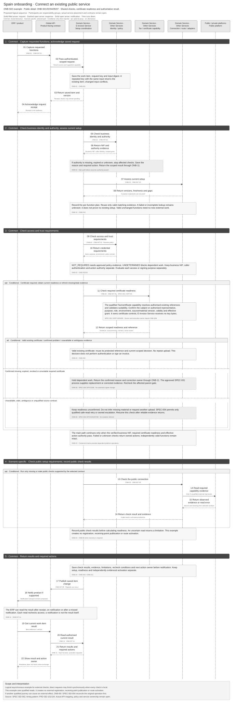
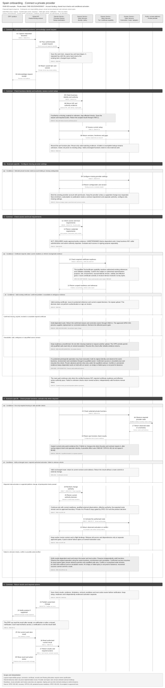

# Customer Onboarding Solution Specification

Use the [shared e-invoicing glossary](../context/GLO-SEI-001-e-invoicing-terminology.md). Local definitions explain this feature. Technical IDs, fields and source codes retain their stated meanings.

## Part 1 Feature Solution Summary

### Reader guide

Start with Part 1 for scope, scenarios and outcomes. Part 2 places each detailed diagram beside its activities, including failures and recovery. Part 3 defines interactions and data. Part 4 contains acceptance checks, open decisions and release gates.

OFR IDs preserve recovery controls from [archived SPEC-SEI-004](archive/SPEC-SEI-004-onboarding-failure-and-reconciliation-solution-specification.md). They remain within the affected onboarding steps.

The design remains a draft. **Proposed** choices need review. **Open** decisions need an owner's recorded answer. Technical IDs and state names give all readers the same references.

### 1 Purpose, authority and boundaries

This **proposed logical design** helps a Spanish business set up, connect, confirm or extend e-invoicing through a Sage ERP or product. It covers new customers, existing public/private services and existing Sage setup. Assess current setup and the requested outcome before planning an external registration or platform change.

The intended outcome is access to selected, supported functions from the Sage ERP through the **E-Invoicing Global API**. Connection, readiness and activation are separate results. The API contract, adapters and implemented capabilities still need qualification. **Phase 1** checks readiness for supported public functions. **Later phases** may configure private connections and activate or change a qualified route. Each scenario retains these phase gates.

**Responsibilities and reuse.** The E-Invoice Service owns setup and recovery; the ERP displays results through the Global API. Identity, certificate, connection, routing and invoice-operation owners retain their controls. [Part 3](#erp-and-api-responsibility-boundary) records the proposed interactions and ownership.

This design is intended for Spain. Shared workflow patterns need country/provider rules; actual implementation coverage remains unqualified. The [reuse assessment](#spain-use-and-reuse-boundaries) records candidates, gaps and owners. Existing Tax/certificate capabilities and DTS require qualification for the selected purpose.

**Main risks and decisions.** Missing authority, uncertain external changes and unsafe cutover can affect access or invoice continuity. The [decision register](#5-key-decisions-and-risks) names owners and gates for public contracts, provider support, credentials, approval, portfolio processing and ERP fields. Unknown effects hold the affected scope; recovery must return to its original check.

### Customer entry journeys and scope

ONB-S01–08 describe entry journeys, not a state for the whole customer. Each supported journey can serve a direct customer or validated accountant. Customer statements inform ONB-10 assessment; they do not prove Sage authority or integration.

Select scenario, acting party and processing mode separately. An accountant can prepare one client without a batch. A direct customer can request bounded bulk work for authorised legal entities where supported. All modes retain client-level checks. **Direct customer** means the business actor; **consumer** means the application or partner using the API.

| Pathway | Intake and permission | Approval and processing | Result |
|---|---|---|---|
| Direct customer | Bind the authenticated actor to the represented business and its permitted administrator role. | Verify authority for each action. Obtain missing approvals from an eligible business approver. | One scoped case with independent function results and owned actions. |
| Accountant for one client | Bind the firm, authenticated actor, current firm-client relationship and permission to prepare setup. | Evaluate delegated authority separately. The accountant may approve only where verified authority covers that decision. Otherwise, request client action under ONB-12. | The same client-level result contract, with the delegate and client action owner identified. |
| Accountant portfolio | Accept a batch under ONB-13. Validate access and authority for every client item. | Schedule independent safe work. Hold only items or functions needing approval, correction or reconciliation. | Durable receipt, an access-controlled aggregate and authorised client results. Receipt is not readiness. |

#### Entry scenarios

| Scenario | Current situation and desired outcome | Work required | Result and boundary |
|---|---|---|---|
| ONB-S01 First-time setup | Customer has no e-invoicing setup and wants to start through Sage. | Establish the business and authority. Present supported options. Configure missing prerequisites and check each selected function. | Return public readiness under ONB-04 or later-phase private activation under ONB-05–07. Do not select a platform without customer choice. |
| ONB-S02 Connect existing public service | Customer uses the public B2B service outside Sage and wants supported functions in the ERP. | Identify the service and environment. Check Sage access, represented-party authority and required trust. Reuse valid evidence and complete missing checks. | Return evidenced public readiness through the Global API. ONB-04 alone cannot establish active invoice exchange or publish a receiving destination. |
| ONB-S03 Connect existing private provider | Customer wants to keep the current private provider and use it from the ERP. | Qualify the integration. Bind the existing account with permission. Configure the Sage connection. Check sending and receiving separately. | Retain the provider. Establish the Sage route explicitly if required. Duplicate commercial enrolment or receiving-point publication requires a contract requirement. |
| ONB-S04 Connect public and private services | Customer uses both services and wants Sage to support the selected combination. | Record each function, direction and execution owner. Qualify public and private connections separately. Record unchanged and changed setup. | Return a result for each function. Public reporting or copy capability is not a second delivery route. Prevent duplicate delivery and unsupported overlapping selection. |
| ONB-S05 Confirm or extend Sage setup | Customer already connects through Sage and wants confirmation or an additional function. | Read authoritative configuration. Check current permissions and evidence. Recheck stale dependencies. Set up only missing functions. | Confirm valid unchanged setup without external mutation, or add only the requested supported function. Failed checks cannot renew readiness. |
| ONB-S06 Change platform | Customer wants to move an authorised future sending or receiving scope to another supported platform. | Record the current route and earlier obligations. Qualify the new connection. Obtain change authority. Observe required external changes and commit the boundary. | Change new traffic only through ONB-07. Keep earlier invoice context. Private A → Private B remains gated by SPEC-SEI-014 and its source product decision. |
| ONB-S07 Add B2B after B2G use | Customer uses government invoicing, such as FACe, and now needs supported B2B functions. | Record the existing B2G service. Assess B2B identity, authority, connection and capability requirements separately. | Set up B2B without changing B2G. B2G support through this API needs a separate scope and adapter decision. |
| ONB-S08 Unsupported or uncertain setup | Requested provider, function or combination is unsupported, or current setup is unknown. | Explain the missing integration or evidence. Name the owner. Offer only qualified options. Reconcile any possible external effect. | Return a limitation, action required or unresolved case. Do not force migration, substitute a platform or report connected. |

### 2 Outcomes and handoffs

| Outcome | Observable result | Boundary |
|---|---|---|
| Public capability ready | Return readiness for the entity and capability. Include limitations, evidence, expiry or recheck, and next action. | Do not claim external registration, invoice compliance, delivery or private-route activation. |
| Private route active | Intended and observed readiness match for the authorised direction and scope. Record the effective boundary for new traffic. | Earlier invoices retain their original route and operator. |
| Existing setup confirmed | Requested functions have current evidence. Return unchanged route and configuration through the API without new external work. | Do not renew stale evidence or grant missing permission. |
| Setup extended | Requested additional functions pass their own gates. Unchanged functions retain their context. | Do not report all functions active from new readiness alone. |
| Unsupported connection or function | Tell the ERP which provider, function or combination is unsupported. Return the available next action. | Do not substitute a provider, force migration or report connected. |
| Action required / blocked | Hold the affected entity, capability or direction. Return a stable reason and owner. | Other portfolio items and unaffected directions continue. |
| Client approval required | Return the specific decision, eligible approver role and request status under ONB-12. | Keep dependent work at ACTION_REQUIRED. An approval response alone cannot establish readiness or effective legal representation. |
| Portfolio received or partially processed | Return the batch reference, version and permitted aggregate with client action owners. | Do not label the whole portfolio ready. Withhold current results for clients the caller can no longer access. |
| Cancelled before activation | Close pending work under policy. Keep live routing unchanged. | Reconcile completed external actions. Reverse them separately where required. |
| Recovery or rollback case | Preserve actual external and invoice state. Restoration is a new transition with evidence. | Do not reset state silently or rewrite history. |
| Waiting safe retry | OFR-04 schedules only an approved repeat-safe operation under its versioned budget. | Readiness and activation still use the owning ONB gates. |
| Outcome unknown / reconciling | OFR-05/06 preserves the original possible effect. Dependent readiness and final cancellation remain blocked until resolution. | Readiness and activation still use the owning ONB gates. |
| Escalated recoverable | OFR-07 assigns unresolved work to Operations/provider with its evidence and deadline. Exhaustion does not prove absence. | Readiness and activation still use the owning ONB gates. |
| Corrected or reconciled | OFR-03/06 returns to the exact parent gate. ONB-11 reports the resulting per-function outcome after the required checks. | Readiness and activation still use the owning ONB gates. |

### 3 Process diagrams and text equivalent

The overview shows the shared journey. Part 2 places [public checks](#onb-03-prerequisites), [private setup](#onb-05-private-choiceconfiguration), [approval](#onb-12-coordinate-client-approval-and-evidence) and [portfolio processing](#onb-13-manage-portfolio-batch) beside their detailed rules. Each diagram has a short introduction. See the [diagram guide](#reading-the-detailed-diagrams) for labels and arrows, and [Part 3](#onboarding-technical-sequences) for technical interactions.

**Onboarding overview**

Record the request, verify authority and assess current setup (ONB-01/02/10). Follow the public or private path for each selected function. Return results and required actions through ONB-11; recovery returns to the affected check.

[Editable Draw.io](../assets/diagrams/onboarding-scenario-selection-process.drawio) · [PNG](../assets/diagrams/onboarding-scenario-selection-process.png).

For ONB-S04, run public and private checks independently. Preserve unaffected functions. The invoice feature still checks required public-copy and reporting dependencies. These branches do not create two delivery routes for one action. ONB-12 adds approval where needed; ONB-13 applies the same checks to each portfolio client.

## Part 2 Logical Feature Specification

This part explains the proposed behaviour step by step. An invariant is a rule that must always hold, including during failures and recovery.

### Plain-language terms

| Term | Meaning |
|---|---|
| Legal entity / legal subject | The business to which the invoice or action belongs. Technical fields use `legalSubject` for this business. |
| Authority | Permission to perform a specific action for that business. Logging in or holding a certificate does not by itself give this permission. |
| Capability | A supported function, such as receiving invoices or signing them. |
| Onboarding | Establish or confirm the setup for selected functions through Sage. This can connect an existing service, add a function or coordinate an authorised platform change. |
| Onboarding component | A proposed internal component of the E-Invoice Service that could implement setup and recovery coordination. Its implementation remains open. |
| Global API | The proposed common e-invoicing API contract used by Sage products and authorised partners. It does not establish that an integration is implemented or active. |
| B2B / B2G / B2C | Business to business; business to government; business to consumer. Each transaction and service has its own scope and controls. |
| Route | The time-bound selection of platform and connection for a defined invoice scope and direction. A ready connection does not activate a route or rewrite earlier invoice plans. |
| Idempotency | Repeating the same logical request adds no effect within the contract’s defined scope and retention window. The contract binds request identity and input and defines conflict handling. |
| Reconciliation | Check the original operation against a reliable source to establish what actually happened before deciding the next action. |
| Gate | A condition, decision or evidence check that must pass before the next step can proceed. |
| Tenant | The customer account boundary used to keep one customer’s data and access separate from another’s. |
| Immutable / append-only | Immutable means a saved record cannot be changed. Append-only means later information is added as another record. Neither means indefinite retention. |
| Provenance | The record of where data came from and which versions, checks and changes produced the result. |
| Contract | The agreed inputs, outputs, behaviour and responsibilities between services or parties. |
| Durable | Saved through the agreed recovery boundary so the record survives a process restart or worker failure. Long-term retention is a separate policy. |
| Readiness | The current capability-check result for a stated legal entity, actor, environment and route/profile. It includes evidence, limitations and a recheck condition. It is separate from authority, route activation and invoice outcomes. |
| Entry point | The published receiving destination for a legal entity. It need not be a raw URL. Publication does not by itself prove operational eligibility for a particular invoice. |
| Cutover / rollback | Cutover changes future work to a qualified route at an agreed boundary. Rollback is a controlled change back, with its own checks and evidence. Earlier invoices keep their actual route history. |
| Portfolio | An accountant’s set of client businesses. Each client is checked separately. |
| Client relationship | The current link between a firm and a client workspace or business. It permits only approved product access and does not establish delegated authority. |
| Approval evidence | A recorded decision by an eligible approver for a named business, purpose, scope and request or plan version. Acceptance is separate from verification that the decision establishes effective authority. |
| Batch receipt | Durable acceptance of a group of requests for processing. It does not prove that any client is ready, approved or active. |
| Input digest / hash | A calculated fingerprint used to detect a change in the submitted data. |
| External mutation | An operation that changes another system, such as registering a business. A timeout may leave its result unknown. |
| Retry budget / backoff / jitter | Limits on retry attempts and elapsed time; waiting between attempts; and varying that wait to avoid many retries at once. |
| Portfolio item | One client’s work item. Other clients do not share its permission, retry limits or result. |
| Correlation | A reference linking related requests and results. Input digest uses the existing definition above. |

### Setup checks and phase boundaries

ONB-01 can open a case while NIF or certificate checks are pending. ONB-02 verifies the represented business and action authority. ONB-03/06 apply the selected function’s access and trust policy before dependent external work. ONB-07 separately gates activation; ONB-11 describes later-use rechecks.

The source [PRDs](#ref-source-references) define customer outcomes and safety constraints. Proposed services, states and contracts need qualification. Public-interface rules, representation, signing, operator choice, provider sequence, service targets and actual dependency ownership remain open in the [decision register](#5-key-decisions-and-risks).

Actors are the business administrator or validated delegate, product/API, E-Invoice Service, dependency owners, platform/provider and Operations. Each acts only within its authorised tenant, business, environment, function, direction and route scope. Each client has an isolated item; portfolio membership shares no mandate or credential.

Keep firm, authenticated actor and client approver separate. ONB-02 checks the current firm role, client relationship and action grant. ONB-Q07/08 qualify staff-role rules and the client action channel.

### Reading the detailed diagrams

Detail diagrams use responsibility lanes. **Other Services** groups Identity, certificate, connection and routing responsibilities. Physical boundaries remain open under ONB-Q05/OFR-Q03.

**Common** means shared work. **Scenario-specific** means work selected for the current setup. **Conditional** means work required or permitted by the selected policy and contract. These labels do not prove that an existing implementation can be reused. Country and provider rules determine the checks, including certificate need.

A qualified operation has evidence that its contract supports the selected purpose.

Solid process arrows show the main path. Dashed arrows show conditional work or recovery. Sequence arrows distinguish requests, responses and notifications. In sequences, **opt** means optional work and **alt** means alternative outcomes.

### 1 Scope model and invariants

Changes affecting the same business, direction and scope run one at a time. Independent clients and directions that do not overlap can proceed separately. TEST and production use separate identities, evidence, credentials, route state and keys.

| ID | Rule that must always hold |
|---|---|
| ONB-I01 | Authentication, legal-subject identity, representation authority, credential possession, commercial entitlement, external registration and active route are independent facts. |
| ONB-I02 | Public readiness is per entity and capability, with limitations and evidence. It cannot activate a private route or prove invoice compliance. |
| ONB-I03 | Check the accountant grant for each client, capability, action and effective time. Portfolio success must not hide a failed item. |
| OFR-I06 | One client/capability failure cannot roll back or promote another portfolio item. |
| ONB-I04 | Change the route for new eligible traffic only after an explicitly authorised cutover. Each invoice retains its actual origin route, operator and identifiers. |
| OFR-I10 | Corrected or reconciled success returns to the exact parent gate; recovery does not commit a route, activate exchange or switch providers automatically. |
| ONB-I05 | An unknown external mutation is not success or permission to retry. Observe and reconcile the original operation before repeating it. |
| OFR-I01 | A 4xx/5xx, timeout or closed socket is evidence about transport, not a complete business outcome. |
| OFR-I02 | Automatic retry requires a proven safety class, unchanged logical identity, current authority/environment and an approved policy budget. |
| OFR-I03 | A possible external mutation remains OUTCOME_UNKNOWN until original-state observation or approved manual disposition; no fresh mutation or READY state is inferred. |
| ONB-I06 | Subscription, connection, entry-point registration, route, transition and historical access have separate state and separate release gates. |
| ONB-I07 | No private key or reusable secret enters a product response, work item, audit event or support view. |
| OFR-I07 | Error payloads, metrics, logs and notifications contain no full tax identifiers, names, credentials or raw confidential provider body. |
| ONB-I08 | Reuse evidence only for its proven subject, authority, purpose, role, provider/profile, country and environment. Check versions and validity. Record the source and missing checks. |
| OFR-I04 | Correcting data/authority creates a new revision; original request, attempt and decision remain reproducible. |
| ONB-I09 | An entry scenario or customer statement cannot prove external registration, Sage access, B2B readiness or active exchange. Unknown current setup is visible. |
| OFR-I08 | A failed observation cannot erase registration or route history, renew stale readiness or prove external absence. Preserve observations with their source and time. |
| ONB-I10 | Setup failure affects only dependent functions and scopes. Preserve unaffected selections. The owning invoice feature enforces dependencies between functions. |
| OFR-I09 | Recovery holds only affected/dependent work; independently valid functions stay intact. Possible external route changes require actual reachability evidence before previous traffic continues. |
| ONB-I11 | No-change confirmation performs no external enrolment, publication, subscription creation or route commit. Extending setup changes only explicitly requested supported functions. |
| ONB-I12 | Before certificate-based readiness, both business NIF verification and required-certificate checks must pass. Action authority remains separate. A policy-backed NOT_REQUIRED result removes only the certificate requirement; unknown certificate need does not. |
| ONB-I13 | Product access, client relationship, approval evidence and effective delegated authority are separate decisions. An APPROVED request cannot bypass official evidence verification, trust or readiness checks. |
| ONB-I14 | Bind each approval to the represented business, delegate where relevant, purpose, scope, environment and request/plan revision. Changed material facts cannot inherit that approval silently. |
| ONB-I15 | Batch state describes coordination only. Recheck current access for item operations, aggregate results and protected execution. Batch receipt never freezes authority for future work. |
| OFR-I05 | Cancellation stops queued safe work but cannot erase an uncertain external side effect. |

### Ordered lifecycle

| Activity | Trigger and required result | Owner / consumer |
|---|---|---|
| ONB-13 Manage portfolio batch | When supported batch intake is selected, persist a receipt and manifest. Decompose, schedule and aggregate independent client items. | Product → E-Invoice Service |
| ONB-01 Capture requested functions | Create one scoped, versioned item from an authenticated request. For a duplicate key, return the same result. | Product → E-Invoice Service |
| ONB-02 Check business identity and authority | Verify the business NIF for the legal subject. Check the represented party or delegate, action and authority validity. Show any missing grant. | Identity/authority → E-Invoice Service |
| ONB-12 Coordinate client approval and evidence | At a missing-approval gate, reuse qualified evidence or request an eligible client's decision. Verify evidence and resume only the covered scope. | E-Invoice Service ↔ product / Identity and evidence owners |
| ONB-10 Assess current setup | Read public, private and Sage setup evidence. Compare requested functions. Preserve unchanged selections without mutation. | E-Invoice Service → connection/route/adapters |
| ONB-03 Assess prerequisites | Assess applicability, environment and external checks. Require a valid, suitable certificate where policy requires one. Keep NIF, certificate and authority results separate. | E-Invoice Service → identity / qualified certificate capability / external adapter |
| ONB-04 Publish public readiness | Return each capability's result, evidence and recheck condition. Do not change a route. | E-Invoice Service → product |
| ONB-05 Configure private choice | Save the explicit option, subscription and connection intent, and scope. Do not activate new traffic. | Customer/product → E-Invoice Service / Routing |
| ONB-06 Prove private readiness | Establish observed readiness for the operator, transport, profile and required external entry point. | Connection/adapter → E-Invoice Service |
| ONB-07 Cut over new traffic | Process overlapping scope changes one at a time. Record the authorised effective boundary. | Route service → exchange/product |
| ONB-08 Reconcile/recover | Assign an owner to each unknown or inconsistent result. Record observed state and a safe next action. | Operations/external adapter |
| ONB-09 Preserve and release | Preserve original invoice context. Release previous dependencies only after approved gates pass. | Route/records/operations |
| ONB-11 Return results and required actions | Return setup, readiness and activation separately for each selected function through the Global API. Include limitations, evidence and required actions. | E-Invoice Service → Global API → ERP/product |

### 2 Activities and state transitions

**ONB-01 Capture requested functions.** The product submits the business reference, requested capabilities and directions, actor, environment and any portfolio batch reference. A delegate request also identifies the firm and client relationship through trusted references. The E-Invoice Service checks the request format, current product access, permission to prepare setup and capability support. It then saves a work item. Accountant membership alone cannot satisfy these checks. ONB-13 applies them separately to each batch item.

The case can open before NIF or certificate verification is complete. Retain the authorised business scope and show pending checks. Do not require a new certificate upload as an intake condition. This does not permit a platform operation or readiness result before its prerequisites pass.

For the same key and input fingerprint, the E-Invoice Service returns the existing item. For the same key with different content, it returns a conflict. Cancellation stops pending steps. It does not erase a possible completed external change. The portfolio parent shows overall progress. Each client item retains its own permission, state and error.

Record the desired outcome: first setup, connection of an existing service, setup confirmation or extension, or platform change. These descriptions are proposed intent labels. They are not approved API enum values. ONB-10 derives the scenario without replacing the requested capability, direction or scope. For an unsupported request, return a precise limitation without an external operation.

**Failure, correction and next action**

| Condition | Required behaviour and action owner | Safe next action |
|---|---|---|
| Saving intent fails before a possible external call | Integration must prove no transmission occurred before treating the failure as local. If transmission is possible, preserve the original intent/correlation. | Recover the same operation; an uncertain effect uses ONB-08, without a fresh mutation. |

**OFR-01 Capture durable intent.** Before an external call, save the scoped operation and authority snapshot under OFR-D01/02/09. Bind the operation kind, safety-policy version, input fingerprint, idempotency key and correlation reference.

OFR-D09 binds the parent scenario, plan revision, resume checkpoint, provider/role, direction/scope, connection/profile/route versions and evidenced pre-state. These references identify dependencies; they do not create duplicate stores. No-change confirmation needs no recovery case or invented registration attempt. Classify a failed read by its actual fault and safety.

Apply the failure table above. Proven non-transmission permits INTERNAL with no external effect. Otherwise recover the saved intent, outbox or adapter correlation through OFR-05.

**ONB-02 Check business identity and authority.** The legal-subject service resolves Spanish identity and its product and tenant mapping. It does not treat a user login as the legal entity. The authority service checks the direct administrator or delegate mandate for the exact capability, direction, action and time. Missing, expired, revoked or ambiguous authority blocks the affected child item. Grant correction creates a new decision snapshot. An in-flight external operation retains the snapshot used at submission. Reconcile that operation before replacement. Recheck authority immediately before ONB-07 and other external mutations.

For a delegate, verify the firm-client relationship, the actor's current firm role and permission for the client action independently. Recheck them at every protected read or change. For missing approval or representation evidence, return a named client/accountant action under ONB-12. Continue only safe steps covered by separate current permission. An unavailable evidence source remains undetermined; do not replace it with an approval checkbox or repeatedly ask the client to approve.

Obtain the business NIF verification result and evidence under the approved identity policy. Bind that result to the represented legal subject and environment. For an individual business, retain the approved NIF/NIE mapping. Keep the caller or delegate identity separate. An unverified NIF blocks readiness even when a certificate is valid; NIF verification alone does not prove action authority.

**Failure, correction and next action**

| Condition | Required behaviour and action owner | Safe next action |
|---|---|---|
| Invalid or unverified represented-business NIF | OFR-03 links corrected identity evidence. Identity owns verification. | ONB-02 Check business identity and authority; refresh the affected ONB-10 plan. |
| Missing, expired or unknown action authority | Identity/authority resolves the scoped grant. OFR-03 handles correction; failed safe observations use OFR-04/07. | ONB-02, or the ONB-07 authority recheck for activation. |

**OFR-03 Correct.** A customer or validated delegate can amend only their own entity/capability item. New subject data, mandate, credential reference or policy evidence increments inputRevision and triggers the relevant parent onboarding gate again. Unchanged invalid data cannot enter an automatic loop. If old revision has an uncertain external effect, it remains under OFR-05/06 while the new revision is held from conflicting mutation. Preserve the original failure and correction lineage for support.

**ONB-10 Assess current setup.** After access to the tenant and entity is established, the E-Invoice Service reads authoritative connection, route and readiness records. If a qualified external read exists, it inspects the named provider, account or service without changing it. Record customer-declared facts separately from observed evidence. Include the source, time, environment and version. Do not assume a universal platform directory or query an unrelated business. A failed or empty lookup does not prove that the business has no setup.

Compare selected functions with current public and private connections, routes and obligations for earlier invoices. Record a plan for each function. The plan confirms unchanged setup, refreshes a stale check, configures a missing connection, requests supported activation, or returns an unsupported or unknown result. ONB-S04 can contain several plans. Create a new subscription for an existing account only if the commercial contract requires it. Keep B2G and B2B service contexts separate. Scenario correction creates a new plan revision. Do not repeat completed or uncertain operations.

For supported scope, public checks apply to ONB-S01/02/04/05/07 in Phase 1. Private setup applies to ONB-S01/03/04/05/06/07 in later phases. Each plan retains its scenario and phase gates.

Apply ONB-I08 to every reused check, including input, policy and credential versions, expiry and recheck conditions. Record retained evidence, omitted work, gaps and owner. Recheck stale, changed, revoked or unproven dependencies. Never copy secrets or transfer TEST evidence to production. A plan that becomes stale before mutation needs refresh and the expected route version. ONB-08 retains any original uncertain effect.

**Failure, correction and next action**

| Condition | Required behaviour and action owner | Safe next action |
|---|---|---|
| Setup lookup fails or evidence is stale | Connection/Identity owners retain declared and previously observed facts separately. A failed observation cannot prove absence or renew readiness. | Refresh the affected qualified read or return an owned unresolved case. Preserve independent valid functions. |
| Correction changes the plan or the requested intent | E-Invoice Service revises the affected plan; the route owner resolves version conflicts. | Recheck only changed dependencies. A change from connection to migration requires a new authorised plan. |

Use the correction row above. Preserve independently valid decisions and the existing provider/account. A changed route version needs requalification and the route owner’s conflict decision before activation.

Classify an unsupported function as POLICY or its stable capability reason, not automatically TRANSIENT_DEPENDENCY. The parent and Connection/Routing owner identify affected dependencies. Apply ONB-I09/10 and OFR-I08/09; failed discovery cannot erase observed history or turn B2G evidence into B2B readiness.

**Public setup checks — detail**

Check identity, authority, required credentials and the public connection for each selected function (ONB-02–04). Correct or recover failed checks at the affected step. Return readiness and required actions through ONB-11. Public readiness does not activate invoice exchange.

[Open full-size SVG](../assets/diagrams/onboarding-public-readiness-process.svg) · [Editable Draw.io](../assets/diagrams/onboarding-public-readiness-process.drawio) · [PNG](../assets/diagrams/onboarding-public-readiness-process.png).

**ONB-03 Prerequisites.** The E-Invoice Service resolves a versioned capability policy for the phase, operator, environment, route, direction and effective date. It checks required legal identity and representation evidence, and product entitlement. It performs external verification only under an approved contract. Check certificate readiness only where policy requires it. Record NOT_REQUIRED with policy evidence. UNDETERMINED blocks progress under that policy. The qualified certificate capability returns purpose-specific readiness and an evidence reference under [SPEC-SEI-001](SPEC-SEI-001-certificate-management-solution-specification.md). It does not expose key material.

Where required, obtain an existing protected reference and purpose-specific readiness through SPEC-SEI-001. Resolve the business/source binding from authorised context and apply ONB-I08. ONB-D04 stores safe references and results; the qualified custodian retains material. Reopening setup does not require another upload.

If no suitable certificate is confirmed, return the required action and its owner. Missing, expired, revoked or unsuitable credentials need correction through the approved certificate process. Missing authority is a separate permission issue. If lookup is unavailable, stale or ambiguous, record the unknown result and use ONB-08. Do not infer absence or prompt another upload from a failed lookup. The ERP shows readiness, limitations, recheck conditions and next actions; exact source reasons need an approved mapping under ONB-Q06.

Establish the credential and authority needed for access before the first dependent platform operation. A certificate can support authentication as well as invoice signing. NIF/NIE identifies the subject but does not replace authentication or authority. Do not assume that every customer must upload a personal certificate. The selected actor, purpose and contract determine the required credential. Validate actual authentication/signing support with the execution owner; a readiness result does not perform either operation.

**Check access and trust requirements** names the ONB-03/06 check. Record credential owner and actor separately from the represented business. Authentication readiness cannot satisfy signing readiness or grant retrieval/reporting authority. Use the policy and correction paths above for required, NOT_REQUIRED and UNDETERMINED results.

External reads may retry under a bounded policy. An external mutation requires a safety classification and reconciliation support. The E-Invoice Service must not create a registration call without a confirmed official interface.

For public functions, use the qualified public connector and required shared connection and profile checks. An existing public login or FACe use does not establish Sage access. Run only missing or invalidated checks identified by ONB-10. The country and effective policy determine required capabilities. The E-Invoice Service must not make a permanent B2B/B2C or international applicability decision for every invoice.

**Failure, correction and next action**

| Condition | Required behaviour and action owner | Safe next action |
|---|---|---|
| Confirmed missing, expired, revoked or unsuitable required certificate | The qualified SPEC-SEI-001 owner provides correction and a protected reference/version. OFR-03 links the evidence. E-Invoice Service does not issue or copy credentials. | ONB-03/06 Check access and trust requirements, including fresh CERT-05 readiness. |
| Certificate lookup unavailable, stale or ambiguous | OFR-02 retains the actual source reason. OFR-04 permits only proven safe-read retry; OFR-07 assigns unresolved work. No missing-material inference or repeat-upload prompt. | The affected ONB-03/06 readiness check. |
| Certificate policy unknown or purpose unqualified | Policy or source-contract owner resolves the evidence gap. Return an owned limitation; transport retry cannot approve policy or execution coverage. | ONB-03/06 policy and selected-purpose qualification. |
| Possible protected-source or platform mutation | OFR-05/06 retains original source, purpose, version and operation identity. The qualified operation owner supplies reliable observation; OFR-07 owns unresolved work. | The original ONB-03/05/06 operation gate; separately recheck any later activation. |

Use the certificate-correction row above and SPEC-SEI-001. Do not change signer or retain key bytes to repair setup. Recheck affected NIF, certificate and authority decisions. Reconcile any possible protected effect before another mutation.

For a Tax/certificate operation, query the qualified source under SPEC-SEI-001. Preserve the original material version, purpose and operation identity. The protected-operation owner supplies the observation. If no reliable query exists, retain an owned unresolved case. A successful lookup or certificate correction resumes readiness checks; it does not execute authentication, sign an invoice or activate a route.

**ONB-04 Public readiness.** The E-Invoice Service saves each required check's result and evidence source before it calculates the capability result. Proposed states are NOT_STARTED, CHECKING, ACTION_REQUIRED, READY_WITH_LIMITATIONS, READY, SUSPENDED and OUTCOME_UNKNOWN.

READY means the approved Phase 1 checks passed for that capability at the recorded time. Expired or revoked dependencies can change the result. Show the reason and recheck time. Remove sensitive values from product and support results. Show the user who must act next. A public-readiness event cannot activate a route.

**Failure, correction and next action**

| Condition | Required behaviour and action owner | Safe next action |
|---|---|---|
| A required public check is failed, unknown or unsupported | E-Invoice Service keeps the affected function unready and returns the finding and action owner. | Correct or refresh that check. A pending prerequisite is not an unknown mutation; public readiness cannot activate a route. |

**Private connection and activation — detail**

Connect the selected provider and check each function (ONB-05/06). Activate a route only when the plan requires an authorised change (ONB-07). Return failed or unknown work to its affected check. Preserve earlier invoice context and return separate function results (ONB-09/11).

[Open full-size SVG](../assets/diagrams/onboarding-private-route-process.svg) · [Editable Draw.io](../assets/diagrams/onboarding-private-route-process.drawio) · [PNG](../assets/diagrams/onboarding-private-route-process.png).

**ONB-05 Private choice/configuration.** The product presents supported public, current-provider and Sage options. Show the operator, direction, supported scope, price and support boundary. The E-Invoice Service records explicit customer or delegate choice and action authority. It creates missing proposed subscription and connection configurations separately from active route state. For an existing provider or public route, record current directions and historical obligations. Before any external change, configuration failure or cancellation leaves the old route. A possible external effect requires ONB-08. Block unsupported mixed-scope combinations and explain the limitation. Do not widen scope silently.

For ONB-S03, bind the existing provider account and create only missing Sage configuration. Reuse a matching connection under its current version. Reopening ERP setup must not cause re-enrolment, credential replacement or receiving-destination publication. A required external change needs separate authority and a durable operation record. For ONB-S05, retain unchanged functions and configure only the requested addition. Before external mutation, return a limitation for unsupported provider interfaces or gated platform changes.

**ONB-06 Private readiness.** The E-Invoice Service validates approval for the operator, contract and customer group. It checks credentials, required trust, transport and profile conformance, and provider capabilities. For inbound functions, check required entry-point publication and discoverability. Store the intended value, external operation ID, independently observed value, source, observation time and freshness. A configured connection does not prove external readiness. If publication times out, record OUTCOME_UNKNOWN and invoke ONB-08. If reliable provider observation is unavailable, require a documented manual gate with named evidence and approver. The existing route remains selected.

Use the same SPEC-SEI-001 certificate dependency as ONB-03 where the selected provider requires it. Public authentication, private connection access and invoice signing remain separate purposes. Existing tax-use validity alone cannot satisfy all three. Reuse only a qualified reference and decision; return a precise unsupported-purpose result when the source contract cannot provide the required operation.

Inspect current receiving-point evidence and reuse it where valid. Publish or change the receiving point only when the selected plan and contract require it. Qualify sending, receiving and status functions independently. ONB-S04 keeps public and private results separate and records each execution owner. Successful private transport does not prove readiness for public copies or reporting. A possible external change can invalidate reachability before local route commit. Hold that scope under ONB-08. Do not assume the old route remains safe.

**Failure, correction and next action**

| Condition | Required behaviour and action owner | Safe next action |
|---|---|---|
| Provider or function is unsupported | Product/Integration returns the precise capability limitation. | Keep the current supported arrangement; do not retry until an unsupported capability appears ready. |
| Qualified provider check is unavailable | Integration preserves the actual source failure and tests repeat safety separately. | Retry only an approved safe operation within its budget; otherwise assign an owned case. |
| Receiving-point publication may have occurred before a timeout | Integration saves OUTCOME_UNKNOWN for the original operation. Connection/Routing assesses actual reachability and holds affected unsafe traffic (OFR-05/06). | Observe the original operation; recheck ONB-06 and later ONB-07 gates. Do not create another account, repeat an unsafe mutation or assume the previous route remains safe. |

For **Change e-invoicing platform**, show current and proposed platforms, affected direction, remaining steps and result. **Route** is the technical term. [SPEC-SEI-014](SPEC-SEI-014-shared-platform-connectivity-and-routing-solution-specification.md) owns connection/profile qualification, route-version commit and historical context (SPC-01–08). ONB-06/07 use that foundation. A qualified Sage operator role alone does not migrate customers.

**ONB-07 Activation/cutover.** The E-Invoice Service rechecks the actor's permission and current readiness evidence. The route service locks the affected scope and records the expected route version. The cutover plan records the approved time and sequence, entry-point publication evidence, rollback trigger and customer notice.

The route service changes the route only if its current version matches the expected version. This check is **compare-and-set**. The change applies only to the authorised direction and scope, for invoices accepted after the agreed boundary. If external and internal states differ, do not report ACTIVE. Open ONB-08.

When the exchange service accepts an invoice, it saves that invoice's route version. The selected provider cannot change during processing of that invoice. After successful cutover, save the actual cutover time and return status for each direction. A single ONBOARDED flag must not hide different route states.

If ONB-10 proves the selected Sage route is valid and unchanged, omit route commit. Connecting an existing external provider can still require an explicitly selected initial Sage route. The provider can remain unchanged. Route activation requires separate customer authority. Phase 1 still prohibits route mutation. Private A → Private B remains disabled until the shared-foundation gate is approved.

**Failure, correction and next action**

| Condition | Required behaviour and action owner | Safe next action |
|---|---|---|
| Activation conflict or post-change discrepancy | Connection/Routing establishes actual version and reachability. OFR-08 supplies evidence; restoration requires a new authorised transition. | ONB-10 requalification or ONB-07/SPC-04 as specified by the route owner. No automatic commit. |
| A receiving-point change may have affected traffic before local commit | Connection/Routing compares the intended and actual state and preserves historical invoice origins. | Hold unsafe affected traffic. Requalification or restoration needs current authority, observations and a new permitted transition. |

For a discrepancy, compare observed registration/reachability with pre-state and intent. Connection/Routing decides a hold or safe continuation. A confirmed effect returns to the original check and fresh authority evaluation. Restoration is a new authorised transition; earlier invoice origins and operation evidence remain unchanged.

**ONB-08 Recovery.** The E-Invoice Service coordinates the affected result under OFR-01–08. Keep discrepant transitions blocked with an owner. Apply OFR-05/06 before repeating a possible mutation or claiming readiness. ONB-07 governs restoration after cutover, including current external-state and inbound-discoverability checks; ONB-09 preserves invoice origins.

**OFR-05 Hold unknown.** A timeout after possible mutation, lost response, uncertain provider code or persistence failure after possible success records OUTCOME_UNKNOWN on that operation and blocks dependent readiness or terminal cancellation. Freeze original request hash, operation ID, provider reference if known, policy/adapter version and transmission timing. A lock prevents concurrent correction/retry from creating a second effect for overlapping scope.

**OFR-06 Reconcile.** Check reliable provider or public-platform state using the same business, environment and original correlation reference. Compare the intended and observed values under the applicable contract.

CONFIRMED_SUCCESS records the original effect once and resumes onboarding checks. CONFIRMED_ABSENT permits a controlled retry only when the provider contract accepts that evidence as sufficient proof of absence. CONFLICT and UNRESOLVED stay on hold, with evidence and an escalation owner.

An empty or failed query does not prove that nothing happened. Save a versioned reconciliation result and ensure repeated checks do not create an additional effect.

**ONB-09 Continuity and release.** The E-Invoice Service retains old-route access for in-flight delivery, statuses, rejection and payment reporting, corrections, and audit. Apply confirmed actor and channel rules. Release the old entry point, registration, credentials and commercial relationship at separate approved gates. [Offboarding SPEC-SEI-003](SPEC-SEI-003-offboarding-solution-specification.md) governs a later full exit. If the historical execution path is unconfirmed, block release. This does not block a new-traffic cutover already supported by evidence.

**ONB-11 Return results and required actions.** After decisions are durable, return the authoritative work-item version through the Global API. Use ONB-D11 and the [ERP result fields](#erp-result-fields) for each function’s business/environment, service/role, connection/version, readiness/recheck, applicable route/boundary, activation evidence, limitations and owned actions. ONB-Q04 qualifies exact API fields. Keep request completion, readiness and activation separate; do not create a whole-customer state or rename readiness values.

The ERP can show **ready for supported public operations**, **sending active**, **receiving pending**, **existing setup confirmed**, or **connection unavailable**, as evidence permits. These are illustrative messages, not new technical states. If activation evidence is missing, report pending or unknown even when connection checks passed. Keep public-copy and reporting results separate from delivery and receiving. A setup result must not claim invoice acceptance, payment or completion of a legal report.

For unchanged setup, return valid existing references. Do not create a subscription, publish an entry point or commit a route. Notify the product and owning runtime feature when readiness changes. A failed recheck must not leave a misleading ready result. After a lost notification, read the authoritative version.

Before a dependent runtime action, its owner applies the required authority and credential-validity checks under SPEC-SEI-001 and the selected contract. Expiry, revocation or changed authority can block new use. Preserve prior evidence and invoice history. Setup completion is not indefinite permission to use a credential.

**Failure, correction and next action**

| Condition | Required behaviour and action owner | Safe next action |
|---|---|---|
| Result notification is lost, repeated or out of order | E-Invoice Service retains the committed item/version; the product deduplicates notifications (OFR-08). | Read the authoritative item and return its current permitted result; do not repeat the external operation. |
| Safe retries are exhausted or no reliable source observation exists | Operations/provider owns the unresolved case, evidence, deadline and safe customer message (OFR-07). | Return the unresolved state and action owner. Assignment alone cannot establish success or complete cancellation. |

**OFR-07 Escalate.** Open a case when a safe budget expires, no authoritative query exists, observed state conflicts or age breaches the approved objective. Include affected item, fault domain, deadline exposure, original operation, last observation, unsafe actions, provider contact and message safe to show to the customer. An authorised manual decision must cite evidence and approver; it cannot overwrite actual external state. Security incidents use the incident path.

**OFR-08 Publish.** Save state before notification. Return ACTION_REQUIRED, WAITING_RETRY, OUTCOME_UNKNOWN/RECONCILING, READY_WITH_LIMITATIONS or READY with safe next actions. Portfolio counts retain each state; unknown is not failed or complete. Consumers deduplicate by item version and repair lost notifications by reading the authoritative item.

Return the recovery outcome, affected provider/function/direction/scope, observation and parent resume checkpoint to ONB-11. It composes the per-function result. For example, recovered public access can coexist with private sending active and receiving pending. These are display examples, not technical states. Missing or stale activation evidence remains explicit.

READY and READY_WITH_LIMITATIONS require the parent checks to pass. CONFIRMED_SUCCESS proves only the original effect. OFR-I10 retains the separate activation and restoration gates.

**Client approval and evidence — conditional detail**

Reuse current evidence or request a missing decision from an eligible approver (ONB-12). Verify the response and required official evidence before resuming covered work. Refusal, expiry or withdrawal keeps dependent work blocked; reconcile any unknown submitted operation.

[Editable Draw.io](../assets/diagrams/onboarding-client-approval-process.drawio) · [PNG](../assets/diagrams/onboarding-client-approval-process.png).

**Approval boundary:** keep the decision purposes below separate. ONB-12 coordinates evidence; it does not register legal representation. ONB-Q07 qualifies approvers, accepted evidence and any external representation process.

**ONB-12 Coordinate client approval and evidence.** A check in ONB-02/03/05/06/07 identifies a missing decision or evidence for the requested action. The E-Invoice Service first asks the owning capability whether current evidence already covers the exact purpose and scope. If it does, retain the qualified reference and omit a new request. Otherwise, confirm that the requesting actor may prepare this client's setup and request that decision. Do not expose a client approval channel to an unrelated firm or user.

| Decision purpose | Required distinction | Validation owner |
|---|---|---|
| Permission to manage onboarding | Product role and current business/client access permit preparation and correction. They do not grant invoice operations. | Product and Identity |
| Service-terms acceptance | Bind the accepted terms version, represented business, operator/service and eligible accepting actor. | Subscription/contract owner, with Identity |
| Delegated operation | Bind the client, delegate organisation and permitted actor scope, capability, direction, route, environment and validity. Verify the accepted Spain representation evidence where required. | Identity/authority, with Spain policy owner |
| Route activation or change | Bind the current and proposed route, direction, effective boundary and request/plan revision. Recheck at ONB-07. | E-Invoice Service and Routing, with Identity |
| Signing or credential administration | Check the named signer/delegate and purpose separately from custody and permission to configure setup. | Identity and the SPEC-SEI-001 trust owner |

The E-Invoice Service saves an approval request before the product notifies the eligible approver. Bind it to the business, delegate where relevant, decision purpose, scope, environment, request digest, applicable plan version, policy/terms version and expiry condition. Show what will be authorised, who will act and whether the decision permits an external change. The ERP or an approved client action channel presents the request. An invitation, reminder or notification is not approval evidence. Channel, authentication, expiry and reminder rules remain open under ONB-Q07; this spec does not approve an email flow or a new approval service.

**Proposed approval-request states:** REQUESTED, APPROVED, DECLINED, EXPIRED, WITHDRAWN and SUPERSEDED. These describe the request, not authority or readiness. Identity verifies the approver's current eligibility and the response's business, purpose, scope, version and validity. APPROVED records an accepted response. Any required official evidence must still be supplied and verified before Identity returns effective authority. Dependent capability work remains ACTION_REQUIRED until its own gates pass. Record source decisions separately; never use one generic consent flag to satisfy the decision purposes above.

Only REQUESTED can receive an initial approval or refusal. EXPIRED, WITHDRAWN, DECLINED and SUPERSEDED requests cannot become APPROVED. Correction creates a new request/version and preserves the earlier response. A duplicate response for the same request, digest and decision returns the recorded result after current access checks. A stale or conflicting response cannot overwrite it. Material changes to business, delegate, purpose, scope, operator, terms or plan require revalidation; replace the request where its evidence no longer covers the change. A relevant grant or relationship withdrawal invalidates further use even if the approval response was recorded earlier.

An APPROVED request can later become WITHDRAWN or SUPERSEDED. Pending-request expiry produces EXPIRED; expiry of an effective grant or accepted evidence is evaluated separately by its owner. A duplicate response may return its historical acknowledgement, but it cannot restore withdrawn, superseded or expired permission.

Save each response, withdrawal or replacement only if its expected request version matches the current version. Process conflicting decisions one at a time. If withdrawal takes effect before protected execution starts, the earlier approval cannot authorise that execution. An external operation already submitted keeps its recorded authority snapshot and follows ONB-08 where its outcome is uncertain.

While approval is pending, return the specific missing decision and eligible action owner through ONB-11. Do not retry client refusal as a technical fault. After expiry or refusal, show the permitted next action, such as a new request or scope correction, under the approved policy. A client can withdraw approval through a qualified channel. The evidence owner records the effective time, notifies dependent owners and stops affected new protected work. Effective representation revocation follows its own approved mechanism; a local withdrawal does not claim that an external register was updated.

After new evidence is verified, the E-Invoice Service resumes the same affected item at its blocked gate. Recheck current relationship, authority, plan and trust before dependent execution. Resume only covered functions; approval to send does not permit retrieval or signing. Already submitted external operations retain their original evidence snapshot and use ONB-08 if their outcome is uncertain. Approval withdrawal is not batch cancellation, invoice deletion or an automatic route rollback. Runtime owners stop unauthorised future use and preserve historical context.

**Accountant portfolio — process clients separately**

Save a batch receipt, then check and process each client independently (ONB-13). Receipt does not prove readiness. Correct or cancel selected items while other safe items continue; an unresolved external effect prevents final cancellation.

[Editable Draw.io](../assets/diagrams/onboarding-portfolio-batch-process.drawio) · [PNG](../assets/diagrams/onboarding-portfolio-batch-process.png).

**ONB-13 Manage portfolio batch.** A product submits a batch with a stable request key, input digest, environment, firm/actor context where applicable and client item references. Requested functions, directions, intent and evidence references belong to each item. The E-Invoice Service checks the envelope, submitter's batch permission and approved size limits. An unusable envelope returns FAILED_ENVELOPE with safe structural findings and creates no client items. A durable RECEIVED acknowledgement returns the batch reference/version, received count and authorised status access. It does not claim identity verification, approval or readiness for the items.

Bind the batch key to the trusted submitting organisation/product context, environment and command purpose. The same key and digest returns the same logical receipt after current access checks. The same key with different content returns a conflict. Persist the accepted item manifest before acknowledging receipt. Create or attach each client item once, with a stable mapping from submitted reference to work item. Resume incomplete decomposition after a restart. Identical repeated item entries map to one logical item and are counted separately from unique work items. Conflicting entries for the same item reference reject the envelope before client work starts. Across overlapping batches, identical authorised commands can attach to existing work; changed input or stale versions must conflict safely rather than repeat effects.

For each item, resolve current client access under ONB-01/02 before protected reads or changes. Return the same safe denial for an unknown or unlinked reference. Do not reveal client existence or configuration. Schedule independent permitted items within qualified capacity and dependency limits. Every worker rechecks the affected relationship and authority at the protected execution point. A received batch, valid firm credential or one client approval cannot grant access to other items. Record the protected credential reference per client and purpose; verified reuse across clients follows SPEC-SEI-001 and ONB-Q06.

| Proposed batch state | Meaning and transition condition |
|---|---|
| RECEIVED | Receipt and item manifest are durable. Decomposition or item processing has not yet started. |
| PROCESSING | Work is advancing and no item currently requires approval, correction or unknown-effect resolution. |
| PARTIAL | At least one item has an unresolved approval, correction or external outcome. Other safe items may continue. Include processing and outcome counts; the state alone does not describe every item. |
| COMPLETED | All requested work has a recorded final disposition and no pending action or uncertain effect remains. Preserve successful, limited and final denied outcomes separately. This is not a readiness result. |
| CANCELLING | Cancellation of all remaining batch work is recorded. Stop safe pending steps; await in-flight finalisation or reconciliation. |
| CANCELLED | All remaining batch work is stopped and possible external effects satisfy the [recovery cancellation gate](#onb-13-manage-portfolio-batch). Retain completed item results. An unresolved effect keeps cancellation open. |
| FAILED_ENVELOPE | The envelope was rejected before client items or external work were created. |

Compute the parent from committed item and recovery records. CANCELLING takes precedence while cancellation is unresolved. Otherwise, pending approval, correction or unknown effects produce PARTIAL, even if other items are processing. Use COMPLETED only after all remaining work has a final disposition. Queue/decomposition failure after receipt is recoverable work, not FAILED_ENVELOPE. An operationally assigned but unresolved external effect remains visible; assignment alone cannot satisfy the [recovery cancellation gate](#onb-13-manage-portfolio-batch).

Selected-item cancellation changes only those item outcomes. The parent remains PROCESSING or PARTIAL while other work remains and becomes COMPLETED when all work has a final disposition. Do not report the whole batch CANCELLED because one selected item was cancelled. An uncertain effect on a selected item remains PARTIAL until resolved.

ONB-11 returns immutable receipt counts and a versioned, access-controlled progress view. Current progress counts and item detail cover only clients the caller can currently access. Withheld items may be identified only as withheld submitted references, without current status or evidence. If the underlying batch state would reveal inaccessible progress, return a visibility limitation instead of that state. Filtering and pagination use stable opaque item references. Clients awaiting action show the client/accountant/support owner and reason. Lost or duplicate notifications are resolved by reading the current permitted result, not by resubmitting the batch.

An authorised correction resumes selected client items at the affected gate with new evidence versions. Do not restart completed independent items. Cancellation can target selected items or the remaining batch; recheck permission for each affected item. Do not cancel work the actor can no longer manage. Relationship loss or staff-role removal stops affected future protected work and result access. An eligible client or reassigned actor may continue the existing client case only after fresh access and authority checks. Do not transfer the previous accountant's grant or credential. Reconcile in-flight effects through an authorised operational path under ONB-08. Batch limits, worker fairness, result pagination, action-channel coverage and role reassignment require ONB-Q08.

**Recovery cancellation gate:** stop queued safe work and obtain an evidenced resolution or approved evidence-backed disposition sufficient for closure for every possible effect. An open unknown effect keeps cancellation open; assigning an owner or escalation case is insufficient. Apply the ONB-13 parent and selected-item rules above.

### 3 Logical requirements and quality controls

| ID | Requirement and PRD source |
|---|---|
| ONB-R01 | Before mutation, resolve the legal subject, tenant, environment and exact capability. Source: PRD-SEI-101/222. |
| ONB-R02 | Verify direct or per-client delegate authority for each action. Recheck before activation. Source: PRD-SEI-104/231. |
| ONB-R03 | Maintain separate readiness dimensions with evidence. Check certificates only where policy requires them. Source: PRD-SEI-101/226. |
| ONB-R04 | Return partial portfolio results. Isolate correction, cancellation and failure for each client. Source: PRD-SEI-104/107. |
| OFR-R06 | Isolate portfolio recovery and cancellation by item; FR14–15. |
| ONB-R05 | Allow private configuration and tests without changing the live route. Source: PRD-SEI-222. |
| ONB-R06 | Before cutover, require observed external inbound readiness and explicit authority for the scope. Source: PRD-SEI-222. |
| ONB-R07 | Process overlapping cutovers one at a time. Preserve the origin route for each invoice. Source: PRD-SEI-222/202. |
| ONB-R08 | Before retry or success, reconcile external mutations whose outcome is unknown. Source: PRD-SEI-107/222/225. |
| OFR-R01 | Classify business category and operation safety separately; PRD-SEI-107 FR1–4. |
| OFR-R02 | Version retry policy and preserve idempotency/correlation across safe attempts; FR5–7. |
| OFR-R03 | Hold and reconcile ambiguous mutations before retry/success; FR8–9/12. |
| OFR-R04 | Escalate exhausted/unresolvable work without false terminal conclusion; FR10. |
| OFR-R05 | Deduplicate requests and version concurrent revisions; FR11/13. |
| ONB-R09 | Preserve the historical actor, route and evidence. Release previous dependencies separately. Source: PRD-SEI-222/224. |
| ONB-R10 | Audit intent, decisions, mutations, observations, corrections and overrides. Include actor, scope, time and source. Source: PRD-SEI-225/226. |
| OFR-R07 | Apply tenant, authority, environment, security and audit controls to manual action; FR16–17. |
| ONB-R11 | Assess existing services and requested outcome before planning missing work. Separate declared and observed facts. Use ONB-S01–08. Proposed refinement of PRD-SEI-101/222. |
| OFR-R09 | Bind failures to original scenario/operation, provider/role/direction and resume checkpoint; preserve independent valid functions and enforce real dependencies; SPEC-SEI-002 ONB-R11–14 and PRD-SEI-222, proposed scenario extension. |
| ONB-R12 | Reuse only qualified evidence. Confirm unchanged setup without external mutation. Extend only requested functions. Sources: PRD-SEI-101 readiness/recheck and PRD-SEI-222 continuity. This scenario refinement remains proposed. |
| OFR-R10 | Resume parent checks after recovery without duplicate enrolment, forced migration or automatic activation; failed discovery cannot establish absence; SPEC-SEI-002 ONB-R08/12/13 and SPEC-SEI-014 SPC-07. |
| ONB-R13 | Return setup, readiness and evidenced activation for each function through the common API. Do not use a global ONBOARDED flag. Sources: SPEC-SEI-013/014 and PRD-SEI-101/222. |
| OFR-R08 | Provide stable safe customer/support status, correlation and policy version; FR18–20. |
| ONB-R14 | Keep B2G/B2B service contexts, phase gates, unsupported providers and gated platform changes explicit. The owning invoice feature checks transaction applicability. Sources: scope boundaries and ONB-Q02–04. |
| ONB-R15 | The E-Invoice Service owns setup and recovery coordination. Any internal onboarding component remains proposed. Use existing API and dependency owners. Source: user ownership direction and ONB-Q05. |
| OFR-R11 | The E-Invoice Service owns recovery coordination. An internal onboarding component remains proposed. Preserve dependency and manual-case owners. Sources: SPEC-SEI-002 ONB-R15 and OFR-Q03. |
| ONB-R16 | Reuse suitable Tax/certificate references under SPEC-SEI-001. Return safe readiness and customer actions. Failed lookup cannot imply absence or trigger repeat upload. Qualify authentication and signing separately. Sources: SPEC-SEI-001 CERT-03–06, CM-AC17/19 and ONB-Q06. |
| ONB-R17 | Require a verified business NIF before readiness. For certificate-based functions, also require a valid, suitable certificate and effective action authority. Record each result independently. Only approved NOT_REQUIRED policy permits the certificate exception. Sources: PRD-SEI-101 identity/readiness, SPEC-SEI-001 and user setup direction. |
| OFR-R12 | Keep NIF, required-certificate and authority findings separate. Failed lookup cannot trigger repeat upload or establish absence. Reuse qualified protected references and original-operation observations. Sources: SPEC-SEI-002 ONB-R16/17, SPEC-SEI-001 and OFR-Q04. |
| ONB-R18 | Separate case intake, per-function readiness, activation and later use. Qualify authentication, signing, retrieval and reporting for the actual actor and contract. Web-form access does not establish automated API access. Sources: SPEC-SEI-001, Article 11 and Article 7(3) cited in Part 3. |
| ONB-R19 | Bind direct/delegated actor context and recheck firm role, client relationship and action permission at protected reads, changes and execution. Sources: PRD-SEI-104 FR2/3/13/14 and PRD-SEI-231 ID-FR9–12. |
| ONB-R20 | Coordinate missing approval without assuming one consent decision covers terms, delegation, route activation or signing. Validate scope, approver and evidence before effective authority; reuse qualified existing evidence. Proposed refinement of PRD-SEI-104 authority correction and PRD-SEI-222 customer authorisation; ONB-Q07. |
| ONB-R21 | Version approval requests and evidence. Reject expired, stale or conflicting responses. Withdrawal blocks affected new use and preserves earlier snapshots and uncertain-operation recovery. Sources: PRD-SEI-104 FR13/16 and PRD-SEI-231 ID-FR11; request mechanics remain proposed under ONB-Q07. |
| ONB-R22 | Persist batch receipt and item mapping. Isolate envelope failure, item failure and aggregate coordination. Suppress duplicate commands and resume processing after restart. Sources: PRD-SEI-104 FR4–8/15/19 and NFR4. |
| ONB-R23 | Expose permitted aggregate/item results and owned actions. Correct or cancel selected authorised work without repeating independent completed work or hiding uncertain effects. Sources: PRD-SEI-104 FR7/14/16/17/20 and PRD-SEI-107. |
| ONB-R24 | For a customer or accountant preparing setup, prefill qualified existing information and request only missing, changed or unverified fields needed by the selected functions. Return the affected function, reason and correction owner for a missing or conflicting value. Independent permitted work can continue. Proposed field-level refinement of R11–13 and the customer review; Part 3 defines fields and scenario applicability. |
| ONB-R25 | For a new or changed function, distinguish the customer's requested start from its confirmed effective boundary. Retain the existing boundary and retrieval progress for unchanged setup. An unknown original service start must not be invented or used to reset progress. Sources: PRD-SEI-101 FR32, PRD-SEI-222 continuity and R07/09; date fields remain proposed under ONB-Q09. |

Grant only the permissions needed for the approved purpose. Limit delegation to that purpose. Record who makes each support override. Overrides must not bypass external-observation or legal-policy gates. Encrypt sensitive evidence. Isolate tenants, entities and environments. Redact diagnostics and store credentials by reference only.

Define service objectives after measuring volumes, external propagation and recovery baselines. Monitor the age and count of pending, blocked, unknown and inconsistent items. Also monitor expiring grants and trust, stale entry points and failed cutovers. Assign an operations owner to each alert.

Monitor approval wait/expiry, batch queue age, partial-result reasons, duplicate suppression and withheld-result access attempts. Segment by actor path, decision purpose and safe batch-size bands. Do not include client identifiers or approval content in metric labels. Targets and alert thresholds require ONB-Q07/08 evidence.

OFR-R01–08 cite PRD-SEI-107 FR1–20. The remaining OFR rows state their sources. The ONB and OFR requirements are one control set; prefixes preserve traceability.

**OFR-02 Classify.** Classify two things separately: the problem and whether the operation can safely be repeated. Problem categories are VALIDATION, AUTHENTICATION, AUTHORITY, POLICY, CONFLICT, THROTTLE, TRANSIENT_DEPENDENCY, OUTCOME_UNKNOWN, INTERNAL and SECURITY.

Keep the original provider code in controlled storage with the mapping version. Return a stable Sage reason, responsible actor and safe next action. A definite validation or authority problem produces ACTION_REQUIRED. An unclassified provider result must not be treated as safe to retry. Deny and audit a security or environment mismatch; do not queue it.

**OFR-04 Retry safely.** Eligible reads or contractually idempotent mutations use the same operation identity/key and approved adapter semantics. The E-Invoice Service coordinates retry scheduling. Before dispatch, it checks cancellation, current authority, environment, provider guidance, attempt/elapsed budget, load and the affected-scope lock. Bounded backoff/jitter values are configuration, not guessed compliance constants. An exhausted budget creates OFR-07; it does not prove external absence. Manual retry is subject to the same checks and audit.

Durable intent and idempotency records must survive restart and cover the approved duplicate window. Monitoring covers unknown age, retries, reconciliation lag, partial batches and missing owners without high-cardinality personal identifiers. Targets and retention follow approved operational/legal policy and measured pilot baselines.

### Public source baseline

Public onboarding establishes readiness for selected supplied SPFE operations. The bundle provides invoice operations and certificate ports. It does not establish a customer-enrolment or receiving-point publication operation. Readiness remains separate from active exchange.

See [REF Source references](#ref-source-references) for the original files, exact locations and source limits. The [technical evidence guide](../context/RES-SEI-002-spain-public-platform-technical-evidence.md) tracks shared source conflicts. The constraints below align this feature with the supplied public evidence; Sage implementation and activation remain gated.

**Confirmed source context, checked 9 October 2026:** [FACe](https://www.facturae.gob.es/face) is a B2G submission service. [Order HAC/1028/2026](https://www.boe.es/eli/es/o/2026/10/02/hac1028) governs the B2B public solution. These are separate services. The published rules do not prove an implemented Sage connector or customer production access. The [AEAT scope guidance](https://sede.agenciatributaria.gob.es/Sede/iva/factura-electronica/cuestiones-generales/quienes-estan-obligados-que-operaciones-incluyen.html) excludes B2C and international B2B with a business not established in Spain. A transaction addressed to a Spanish permanent establishment can fall within scope. The E-Invoice Service records business context. The owning invoice feature checks applicability for each transaction. B2G use or an international invoice does not establish readiness or exemption for the whole business.

### SPFE source contract binding

The constraints below bind ONB-02–04/10–11 and OFR-02–08 to the supplied public sources. Recovery, storage and qualification actions are proposed Sage controls where stated. Source conflicts remain open under ONB-Q04/Q06/Q07, OFR-Q01/Q04 and the retry-safety decision; SPFE-Q01/Q09/Q12 and the inherited OFR-Q07/OFR-Q12 references require source-owner confirmation. A local default cannot close them.

| ID | Constraint and required behaviour | Source reference |
|---|---|---|
| ONB-SPFE-R01 Qualify each requested public function | ONB-04 records which of submission, consultation, file retrieval and event reporting has a qualified contract, credential and action authority. ONB-11 returns limitations per function. A working network connection or one accepted operation cannot return blanket public readiness. | SPFE-S03/SPFE-S16; [REF](#ref-source-references). |
| ONB-SPFE-R02 Avoid invented public registration | For a public-only setup, the E-Invoice Service performs the checks supported by the supplied contracts. It does not create an external customer registration, directory publication or test invoice. Missing enrolment evidence is reported as unknown or not applicable under the qualified operating model. | SPFE-S03/SPFE-S08; [REF](#ref-source-references). |
| ONB-SPFE-R03 Keep public representation current | ONB-02 checks the represented business independently from the certificate caller. Record verified authority for the intended public action and recheck it before execution. A local approval, stored certificate or existing tax-service setup is insufficient by itself. | SPFE-S02/SPFE-S03; [REF](#ref-source-references). |
| OFR-SPFE-R01 Recover the setup check without submitting an invoice | OFR-02 names the actual failed contract and its owner. Recover a public credential, authority or readiness observation through the qualified read/check path. Do not call SendInvoice or CancelInvoice as an onboarding probe, rollback or registration repair. | SPFE-S03/SPFE-S16; proposed non-mutating setup control; [REF](#ref-source-references). |
| OFR-SPFE-R02 Classify source failures before retry | Keep HTTP result, SOAP fault, structured request result and per-item result distinct. The catalogue's generic resend instruction is insufficient after a possible external effect. Resume the original operation only with proven repeat safety or authoritative reconciliation; otherwise retain an owned hold. | SPFE-S03/SPFE-S08; [REF](#ref-source-references). |

## Part 3 Logical Service Interactions and Data Inventory

This part describes what each service asks for, returns and stores. The technical field names support design review; they do not by themselves define an approved API.

### ERP and API responsibility boundary

The proposed handoff is **Sage ERP / product → Global API → E-Invoice Service → shared identity, trust and connection services → qualified public connector or provider integration**. Responses use the same product-facing contract. This describes responsibilities, not approved endpoints or deployment. [SPEC-SEI-013](SPEC-SEI-013-provider-api-through-the-e-invoicing-global-api-solution-specification.md) owns common API exposure; [SPEC-SEI-011](SPEC-SEI-011-public-platform-connector-solution-specification.md) owns public execution; [SPEC-SEI-014](SPEC-SEI-014-shared-platform-connectivity-and-routing-solution-specification.md) owns connection and route records.

**Confirmed ownership direction:** the E-Invoice Service owns the onboarding journey and its recovery coordination. There is no separate onboarding service. In this spec, **onboarding** names the setup workflow. **Proposed:** an internal onboarding component could implement that workflow within the E-Invoice Service. Its need, code boundary and implementation remain open under ONB-Q05. It does not introduce a separate product API or deployment.

The ERP displays results and required actions. Dependency owners retain their controls; Operations handles assigned manual cases. ONB-01–13 define workflow behaviour and OFR-01–08 define its recovery.

**Certificate reuse direction:** use the existing Tax/certificate capability where its actual contract supports the requested function. The E-Invoice Service requests readiness and a protected reference under SPEC-SEI-001. It does not hold private keys, issue certificates or create another credential store. Tax Service, Connections Service and AFL owners must confirm the actual source and supported operations. Do not assume that the proposed Tax Vault and the described Connections Service/AFL path are the same implementation.

ONB-03/06 define certificate selection and readiness. Qualify authentication and signing separately: lookup or validation does not prove either operation. SPEC-SEI-001 owns custody, validation, protected use, renewal and revocation.

Keep three facts separate: **represented business identity**, **authenticated caller identity**, and **authority for the requested action**. The verified business NIF establishes the first. The accepted authentication method identifies the caller for that service. A Sage login does not itself authenticate a public-platform request. The scoped grant establishes authority. A customer's, accountant's, Sage's or provider's credential can support only its approved actor and purpose. ONB-Q06 must establish the credential owner, custodian, execution owner and effective grant for each function.

**Confirmed operation context, checked 12 October 2026:** [Order HAC/1028/2026, Article 11](https://www.boe.es/eli/es/o/2026/10/02/hac1028) requires accepted electronic certificates for public-platform authentication. Specified generation, status/payment and consultation web forms also allow Cl@ve. Third-party retrieval and consultation require registered representation, including automated access. The web-form option does not establish Cl@ve support for the automated ERP/API connection; qualify that contract separately.

For covered B2B invoices issued through private platforms, [RD 238/2026, Article 7(3)](https://www.boe.es/eli/es/rd/2026/03/25/238/con) requires an advanced electronic signature by the issuer or an authorised delegate. This is separate from connection authentication. For receiving, assess access and retrieval requirements separately from signing. Receiving a signed invoice is not a request to sign it. Private-provider access follows its qualified contract. None of these rules establishes a universal customer certificate-upload step.

This spec owns current-setup assessment, customer intent, journey selection and setup results. [Sending](SPEC-SEI-007-invoice-sending-solution.md), [receiving](SPEC-SEI-016-invoice-receiving-retrieval-and-download-solution-specification.md) and [lifecycle status](SPEC-SEI-009-invoice-lifecycle-status-solution-specification.md) own invoice operations and outcomes. The E-Invoice Service does not issue an invoice or treat a test as delivery. Platforms can support different functions. The API must not promise every provider or function.

Customer-facing actions are **Set up e-invoicing**, **Connect your existing service**, **Review or extend your setup**, and **Change your e-invoicing platform**. All use one work-item model and shared controls. A completed assessment can still return required actions. Report sending or receiving as active only when the owning feature and required route evidence confirm activation.

### Spain use and reuse boundaries

This is a **Spain reference design**. Reuse classifications describe proposed behaviour. They do not prove that existing code is ready. **Reusable unchanged** keeps the design pattern. **Reusable with country binding** needs approved local policies or adapters. **Country-specific** rules stay in the country pack. **Unknown** needs implementation evidence.

The design follows the [shared platform and country-pack direction](../prds/PRD-SEI-227-e-invoicing-as-a-service.md). Spain pilot and production use require this spec's approval and evidence gates. Another country needs its own reuse assessment.

| Area | Intended use in Spain | Reuse classification | Condition and owner |
|---|---|---|---|
| Work items and portfolio isolation | Track each Spanish business separately. Recognise repeated requests and show partial portfolio results. | Reusable unchanged | The E-Invoice Service and Product validate the work-item and version patterns. They verify tenant and client isolation. |
| Approval and batch coordination | Request missing client actions, bind responses to exact plans and process independent portfolio items. | Reusable design pattern with country binding; implementation unknown | Product, Identity and the E-Invoice Service qualify existing relationship, approval and batch capabilities under ONB-Q07/08. Spain approver eligibility and representation evidence stay in the country policy. |
| Current setup, readiness and route transition | Assess existing public and private use. Reuse qualified evidence. Configure or activate missing supported functions separately. | Reusable with country binding | Product, Identity and the route owner bind local identity, authority, entitlement, provider and entry-point policies. They preserve phase gates. |
| Spain onboarding rules | Apply Spain identity and representation checks. Use the confirmed public and private entry-point and migration sequence. | Country-specific | The Spain technical owner and Compliance keep NIF/NIE rules and platform sequences separate from other countries' defaults. |
| Existing onboarding implementation | Assess identity, trust, work-item, connection and routing services for Spain. | Unknown | Architecture and service owners must identify the existing owners, contracts and gaps. This spec does not establish a deployed end-to-end implementation. |
| Internal onboarding component | Coordinate setup and recovery within the E-Invoice Service. | Proposed design pattern; implementation unknown | The E-Invoice Service owner and Architecture assess existing workflow, record and recovery capabilities. Record retained behaviour, local changes, gaps and evidence before deciding what to build under ONB-Q05. |
| Existing Tax/certificate capability | Reuse suitable protected credentials and readiness results for selected Spain functions. | Existing implementation reuse candidate; B2B coverage unknown | Tax Service, Connections Service and AFL owners confirm the source, build, contracts, purpose checks and operations under SPEC-SEI-001. Record local changes and gaps. ONB-Q06 blocks unqualified authentication or signing. |
| Existing customer setup evidence | Reuse checks only for their proven business, purpose, role, environment and validity. This includes identity, mandate, trust and connection checks. | Reusable with country/provider binding | Identity, Trust and Integration record the source, versions, retained checks, gaps, owner and recheck conditions. External use does not prove Sage access. |
| ERP/API integration and representation checks | Return consistent scenario results. The owning exchange features qualify required formats. | Unknown implementation coverage | The API owner qualifies the actual contract and build. Existing DTS is the preferred transformation reuse candidate where relevant. Qualify its selected contracts, mappings, rule packs and operations under SPEC-SEI-008. Setup alone does not prove DTS readiness. |
| Capture, classify and hold unknown results | Record the original attempt, separate problem category from retry safety, and show each client’s actual result. | Reusable unchanged | Reuse the evidence and safety patterns; an unknown external effect stays unresolved. E-Invoice Service owner and Operations. |
| Retry and reconciliation | Retry safe Spain onboarding operations or check the original external result before repeating a change. | Reusable with country binding | Bind the exact provider operation, idempotency guarantee, query support, budgets and approved error mapping. Integration owner and Operations. |
| Spain public-platform recovery | Map the confirmed public-solution errors, authority corrections and cancellation rules. | Country-specific | Official operation and response semantics remain an evidence gate. Spain technical owner, Compliance and Product. |
| Existing recovery implementation | Assess scheduler, error catalogue, case handling and adapter observation support. | Unknown | Architecture and integration owners qualify the actual E-Invoice Service recovery implementation. This logical model does not prove that the component is deployed. |
| Scenario and service continuity | Apply the same failure model to public/private setup and existing-service confirmation. | Reusable with country/provider binding | E-Invoice Service and Routing owners qualify actual pre-state, observation, dependency and resume contracts per role. Public retry evidence does not qualify a private provider. |
| E-Invoice Service recovery coordination | Reuse saved-operation, scheduling and case patterns within the E-Invoice Service. | Proposed design pattern; implementation unknown | The E-Invoice Service owner and Architecture identify source capabilities, local changes, gaps and evidence under OFR-Q03. A separate recovery deployment is not established. |
| Existing Tax/certificate recovery dependency | Refresh protected-reference readiness or query the original protected operation where supported. | Existing implementation reuse candidate; selected-purpose coverage unknown | Tax Service, Connections Service and AFL owners qualify actual contracts, build, code mapping and observation support under SPEC-SEI-001 and OFR-Q04. No credential copy or unqualified repeat operation is permitted. |

### Proposed work-item and operation identity

The proposed recovery key is (tenant, legalSubject, environment, onboardingCase, capability, operationKind, inputRevision). Bind each operation additionally to its provider/service, integration role, direction, scope, connection/profile version and original idempotency domain so concurrent public/private operations cannot share a retry or reconciliation identity. Exact storage/key mapping is proposed and requires compatibility review. A portfolio batch is only an aggregate; it cannot lend authority, credentials, retry budget or success to another client. Proposed operation safety classes are LOCAL_DETERMINISTIC, EXTERNAL_READ_ONLY, CONTRACT_IDEMPOTENT_MUTATION, RECONCILABLE_MUTATION and UNKNOWN_MUTATION. Only an approved, versioned external contract can place an operation in the latter three classes.

The proposed work-item key is (tenant, legalSubject, environment, capability, direction, scope, onboardingIntent). Each request includes an idempotency key and a fingerprint of the input in its agreed standard form.

Record the acting party and processing mode separately from that key. For a delegate, retain the firm, authenticated actor, client-relationship reference/version and authority decision. A portfolio parent groups client items; it does not replace their tenant or legal-subject boundaries. ONB-13 owns the proposed batch receipt and item mapping. ONB-12 owns approval coordination, while Identity owns the effective authority decision.

### Spain and reuse boundary in contracts

Share the error categories, original-operation record and recovery-state model. Select retry safety, code mapping, budgets and observation support by the approved external contract, country and environment. A read or mutation proven safe for one provider does not establish safety for another. Keep an unverified operation on hold or under a named manual gate.

ONB-INT-08 is the setup recovery handoff; OFR-INT-01–09 detail its coordination and dependency calls. ONB-D01 is the setup item; OFR-D01 is its scoped recovery item linked by OFR-D09. ONB-D09 references the recovery case. These logical views do not require duplicate stores. Architecture and service owners decide physical mapping under ONB-Q05/OFR-Q03.

Use versioned country policies and provider adapters with the shared work-item/readiness contract. Another country needs its own identity, representation, certificate and receiving-address evidence; Spain readiness and transition rules cannot become its defaults.

Resolve country/policy context from trusted context or versioned references. Names, service placement and physical APIs remain proposed. The reuse assessment above defines the evidence required before activation.

**Technical sequence views.** These examples show the logical interactions behind the process diagrams. Participant labels group responsibilities; API fields, service boundaries and implementation remain subject to qualification.

**Public setup — sequence**

This ONB-S02 example uses a saved asynchronous request; local checks can finish synchronously. ONB-03/04 perform qualified reads and save readiness without registration, receiving-point publication or route activation. ONB-11 notifies the product; after a lost notification, read the current authorised result.

[Editable Draw.io](../assets/diagrams/spain-onboarding-public-setup-sequence.drawio) · [PNG](../assets/diagrams/spain-onboarding-public-setup-sequence.png).

**Private setup and activation — sequence**

This ONB-S03 example adds only missing configuration. ONB-06 checks each function and required provider state; save intent before any separately approved external change. ONB-07/08 confirm an unchanged route, activate an authorised change or return blocked work to its exact check. ONB-11 returns results; runtime owners retain authentication, signing and validity checks.

[Editable Draw.io](../assets/diagrams/spain-onboarding-private-setup-sequence.drawio) · [PNG](../assets/diagrams/spain-onboarding-private-setup-sequence.png).

### 1 Interaction contracts

These are logical contracts, not approved endpoints or physical service allocations. Every command carries requestId, correlationId, actor, tenant, legalSubject, environment, action, scope, expectedVersion and inputDigest as applicable. An error includes stable category, affected scope, safe retry class and responsible action; never a credential.

These interactions implement the E-Invoice Service ownership described above; they do not define a separately hosted onboarding API. Retry scheduling implementation remains open under OFR-Q03.

OFR commands add caseId, itemId, inputRevision, operationId and idempotencyKey as applicable to the common context. Results add stable category, safety class, state, owner, next action, evidence reference and mapping/policy version. Qualified adapters and Tax/certificate capabilities retain their own contracts.

| ID | Caller → logical owner | Input / output and safety |
|---|---|---|
| ONB-INT-01 | Product → E-Invoice Service | Open/get/cancel work item; idempotency key and digest; returns item/version and child outcomes; conflict on changed duplicate. |
| OFR-INT-01 | E-Invoice Service (setup → recovery) | Save intent and attempt before a possible effect. Return a durable operation identity or reject dispatch. |
| OFR-INT-03 | Product → E-Invoice Service | Submit corrected input/evidence or cancel. Enforce the expected version and authority. Hold any uncertain earlier effect. |
| ONB-INT-02 | E-Invoice Service → identity/authority | Resolve legal subject and scoped decision snapshot; returns grant evidence, validity and reason; fail closed on unknown. |
| ONB-INT-03 | E-Invoice Service → capability policy and qualified Tax/certificate capability | Evaluate policy and required trust. Resolve an existing protected reference/version where supported. Return READY, limited, action, not-required or undetermined with evidence, source, recheck and action owner. Never return key material. Failed lookup remains unknown. ONB-03/06 consume the SPEC-SEI-001 readiness result; exact contract requires ONB-Q06. |
| OFR-INT-09 | E-Invoice Service → qualified Tax/certificate capability | Refresh protected-reference readiness or query the original protected operation under SPEC-SEI-001. Return exact source reasons, observation/evidence, freshness and owner. No key material is returned. Missing observation remains unknown. OFR-02–06/08 consume this result; actual contract requires OFR-Q04. |
| ONB-INT-04 | E-Invoice Service → external verification adapter | Perform approved read/check or mutation only under a versioned contract; record operation ID, safety class, external reference and observed result. |
| OFR-INT-02 | Adapter → E-Invoice Service | Report the transport/provider result, original code, transmission phase and safety evidence. Apply the approved mapping to classify the result. |
| ONB-INT-05 | E-Invoice Service → subscription/connection | Store proposed commercial and technical context; returns independent states; cannot select active route. |
| ONB-INT-06 | E-Invoice Service → entry-point/provider adapter | Publish or inspect supported entry point; intent and observed state remain distinct; unknown result invokes ONB-INT-08. |
| ONB-INT-07 | E-Invoice Service → route/exchange | Compare-and-set cutover for exact direction/scope and effective boundary; route version returned and bound to new invoices. |
| ONB-INT-08 | Operations / E-Invoice Service → adapter | Query/reconcile original external operation; returns confirmed, absent-safe-to-retry or unresolved with evidence; no duplicate mutation. |
| OFR-INT-04 | E-Invoice Service (retry scheduling) → adapter | Retry only under approved safety and budget, using the same idempotency scope. Return a definitive or unknown result. |
| OFR-INT-05 | E-Invoice Service → adapter | Query the original mutation by operation or reference. Return observed value, source, time and confidence. |
| OFR-INT-06 | Operations → E-Invoice Service | Record a manual reconciliation or escalation decision. Include approver, evidence and permitted action. |
| OFR-INT-08 | E-Invoice Service (recovery ↔ setup) and Connection/Routing | Exchange the original scenario, plan, checkpoint, dependencies, pre-state and reconciliation evidence. The route owner decides hold or continuation. Resume exact parent checks with current authority and expected versions. Recovery cannot commit a route. OFR-02/03/06/08 consume this result. |
| ONB-INT-09 | E-Invoice Service → product/operations | Emit state-changed/case-opened notification after durable commit; consumers deduplicate by eventId and version. |
| OFR-INT-07 | E-Invoice Service (recovery → setup) / product | Publish the committed item or aggregate change. Events arrive at least once; consumers deduplicate by item/version. |
| ONB-INT-10 | E-Invoice Service → connection/route and qualified adapters | Read current setup for an authorised business/environment and requested functions; return versioned configuration, observations, source/freshness and limitations; no external mutation or universal directory assumption. Consumed by ONB-10. |
| ONB-INT-11 | E-Invoice Service → Global API → ERP/product | Return per-function setup/readiness and independently evidenced activation, selected references, limitations and owned actions; query by item/version after a lost notification. Consumed by ONB-11; exact field mapping requires ONB-Q04. |
| ONB-INT-12 | Product ↔ E-Invoice Service, Identity and decision-evidence owner | Request/get/respond/withdraw approval for a named business and purpose; bind request/digest/version, scope, delegate, approver and expiry. Return request status and a separate verified evidence/authority decision. Enforce current eligibility, duplicate/conflict rules and protected evidence access. ONB-12 uses the qualified product channel; exact contracts require ONB-Q07. |
| ONB-INT-13 | Product ↔ E-Invoice Service | Submit/get/correct/cancel batch or selected items; bind trusted firm/actor context, batch key/digest/version and item references. Return durable receipt and permitted aggregate/detail. Recheck access per item; apply envelope/item and duplicate/conflict distinctions. Saved manifests support restart recovery. Consumed by ONB-13/01/11; exact API shape and capacity require ONB-Q08. |

Events are proposed ONBOARDING_ITEM_CHANGED, PUBLIC_READINESS_CHANGED, PRIVATE_READINESS_CHANGED, ROUTE_CUTOVER_OBSERVED and ONBOARDING_RECOVERY_OPENED. Delivery is at least once, so the same event may arrive again; consumers recognise repeats and read the authoritative work-item version. A notification is never the sole proof of an external side effect. External adapter capabilities (query, idempotency, publication, revocation, acknowledgement) are registered per provider and environment; unsupported operations become explicit manual gates.

Proposed APPROVAL_REQUEST_CHANGED and ONBOARDING_BATCH_CHANGED notifications use ONB-INT-09 after durable commit. Include an opaque reference, version and permitted action summary; do not include client evidence or portfolio detail. Notification delivery must apply current recipient access. Consumers read the authoritative permitted state and recheck before execution. Authority or relationship changes invalidate dependent future use even if a notification is delayed; event receipt is not the execution permission check.

Proposed events are ONBOARDING_ATTEMPT_CLASSIFIED, ONBOARDING_RECONCILIATION_REQUIRED, ONBOARDING_ITEM_RECOVERED and ONBOARDING_RECOVERY_ESCALATED. An event is a notification, not evidence that an external mutation completed.

### 2 Data inventory

| ID | Record / owner | Essential fields and handling | Consumers |
|---|---|---|---|
| ONB-D01 | Onboarding work item / E-Invoice Service | Immutable request scope/digest; acting party, processing mode, batch/item mapping; mutable state/version, phase, owner, deadline, child links, reason; restricted | ONB-01/11/12/13, product, operations |
| OFR-D01 | Recovery item / E-Invoice Service | Tenant/entity/environment, capability, state/version, parent batch, owner, next action; restricted; OFR-01–08. | ONB-01/08/11/13 |
| ONB-D02 | Legal subject and authority snapshot / identity | Tenant/entity key, verified identity reference, represented party, authenticated actor, delegate firm/user scope, role/client-relationship versions, mandate, action, scope, valid interval, evidence reference; versioned/restricted | ONB-02/03/06/07/12/13 |
| ONB-D03 | Capability policy and readiness / policy and E-Invoice Service | Policy version, phase, dimension, result, source, observedAt, validUntil, next action; append decision history | ONB-03/04/06 |
| ONB-D04 | Trust reference / certificate capability under SPEC-SEI-001 | Purpose, protected material reference/version, readiness, evidence/source, next recheck and action owner. The E-Invoice Service retains safe references and results. The confirmed custodian retains credential material. Never store key bytes here. | ONB-03/06, ONB-11 |
| ONB-D05 | Subscription and connection / respective owner | Operator, terms/entitlement, environment, transport/profile, independent state, credential reference | ONB-05/06 |
| ONB-D06 | Entry-point intent/observation / operator adapter | Direction/scope, intended value, external reference, observed value/source/time, safety class, operation ID | ONB-06/08 |
| OFR-D05 | Reconciliation observation / adapter | Original operation, authoritative source, observed value, time, reference, conclusion and evidence; append-only; OFR-05/06. | ONB-03/06/07/08 |
| ONB-D07 | Route transition / route | From/to route, expected version, effective boundary, approval, observed state, rollback case and outcome | ONB-07/09 |
| ONB-D08 | Invoice origin / exchange/records | Invoice ID, original operator/route/profile, route version, accepted time and external correlations; immutable | ONB-07/09, offboarding |
| ONB-D09 | Recovery/evidence case / operations | Fault class, original operation, intended/observed state, owner, safe action, evidence with sensitive values removed and audit timeline | ONB-08 |
| OFR-D02 | Operation intent/attempt / E-Invoice Service | Immutable operation ID, input hash, authority snapshot, safety class/policy, adapter version, transmission phase, timestamps; restricted; OFR-01/04–06. | ONB-01/03/06/08 |
| OFR-D03 | Error catalogue/mapping / policy | Stable Sage code, provider code mapping, fault domain, safe guidance, version/effective period; controlled; OFR-02/08. | ONB-03/08/11 |
| OFR-D04 | Retry schedule / E-Invoice Service | Same idempotency scope, attempt/elapsed budget, next eligibility, lease, cancellation flag; restricted; OFR-04/07. | ONB-03/06/08 |
| OFR-D06 | Correction lineage / E-Invoice Service | Prior/new input revision, changed evidence reference, actor, authority, reason; restricted; OFR-03. | ONB-02/03/10 |
| OFR-D07 | Escalation case / operations | Fault, owner, deadline, unsafe actions, provider contact, manual approval and audit; restricted; OFR-07. | ONB-08/11, operations |
| ONB-D10 | Current-setup assessment and plan / E-Invoice Service | Scenario/intent, requested functions, declared versus observed facts, source/time, configuration versions, retained evidence, missing checks and per-function plan; restricted/versioned; authoritative connection/route records stay with their owners | ONB-10, ONB-03–08/11 |
| OFR-D09 | Parent recovery context / E-Invoice Service | ONB scenario/intent/plan revision, parent activity/checkpoint, provider/service role, direction/scope, connection/profile/route references and versions, pre-state evidence, affected dependencies and continuation/hold decision owner; restricted/versioned; OFR-01–03/05–08 and OFR-INT-08. | ONB-06/07/08/10 |
| ONB-D11 | ERP capability result / E-Invoice Service | Work-item version, per-function connection/readiness/activation references, effective boundary, limitations, next action and owner; derived from committed evidence, access controlled and rebuildable | ONB-11, Global API, ERP/product, support |
| OFR-D08 | Aggregate/notification / E-Invoice Service | Child counts/versions and redacted event ID; derived/rebuildable; OFR-08. | ONB-11/13, product |
| ONB-D12 | Approval request / E-Invoice Service; decision evidence / qualified Identity or contract owner | Request ID/version/status, business, requester, delegate scope, purpose, capability/direction/route/environment, digest/plan version, policy/terms version, eligible approver, expiry, response/withdrawal time and protected evidence reference. Retain append-only decision history. Effective authority and terms evidence remain with their respective owners. No generic consent grant or credential material. | ONB-02/05/07/11/12, INT-12 |
| ONB-D13 | Batch receipt and item manifest / E-Invoice Service | Trusted submitting boundary, actor/firm, environment, key/digest, immutable received/unique counts and item mapping, processing state/version, cancellation scope, item/recovery references and permitted progress projection. Persist before receipt. Store client details only in scoped child records; audit and restrict the manifest. | ONB-01/11/13, INT-13, operations |

Approved legal, privacy, contract and evidence policy sets retention/deletion per data class; no period is inferred here. Preserve OFR-D02/05/06 long enough to explain outcomes and prevent duplicate effects. Access-control D02/04/05 references. D08 remains available for later statuses and reports. All records retain tenant/entity/environment keys and audit attribution, except the batch parent uses its trusted submitting boundary.

D12 approval evidence and D13 manifests have separate retention and disclosure policies. The batch parent uses its submitting boundary; each child retains its own tenant/entity/environment keys. Firm users cannot read another client through a manifest or approval link. Audit the requester, approver, represented business, purpose, versions, effective times and outcome without copying credentials or raw restricted evidence into logs.

For certificate recovery, OFR-D02/OFR-D05/OFR-D06/OFR-D09 retain protected source and material-version references, purpose, safe observations and correction lineage. The confirmed certificate custodian retains material and protected-operation evidence under SPEC-SEI-001. The E-Invoice Service must not create another credential store. Existing record fields and exact physical mapping remain subject to contract review.

User-facing records hold safe references, not credentials or raw provider bodies.

### 3 Customer and accountant fields by scenario

This **proposed field model** expands D01–05/07/10–13 and INT-01–03/10–13 under R24/25. It adds data detail to ONB-S01–08; it does not change their workflow or phase gates. Labels, types and choices support review. ONB-Q04/09 must qualify the actual API schema, ERP mappings and supported options. These fields span setup, account linking and approval interactions; they are not one flat submission form.

**Required** means that a value must be available at the stated gate. Trusted context or an existing reference can supply it. It does not mean that the customer must enter it again. Many customers may already use e-invoicing; this is a cohort assumption to measure, not proof of field availability or current authority. The field set is derived from the Spain journeys, ERP context and cited SPFE evidence.

#### Fields the customer or accountant may see

| Logical field | Customer-facing label | Type or proposed choices | Source, required condition and correction |
|---|---|---|---|
| `productCompanyRef` | Business / company | Opaque ERP company reference | Required for each case. Use the company currently open or the authorised accountant's client selection. Resolve its legal-subject mapping; reject a foreign tenant/company reference. |
| `legalName` | Legal business name | Text | Required for identity readiness. Prefill from the business record. Confirm or correct through the owning company/identity process; recheck a mismatch. |
| `identifierScheme` | Tax identification type | Approved Spain scheme | Required with the identifier. Prefill; ask only if missing or ambiguous. Use the qualified NIF/NIE binding, not a free-text scheme. |
| `identifierValue` | NIF / NIE | Identifier text | Required for identity readiness. Prefill and verify for the represented business. A certificate caller's identifier cannot replace it. |
| `subjectType` | Business type | Legal entity / individual / other supported classification | Required where the selected identity or country policy needs it. Reuse the business record; obtain missing material facts. |
| `onboardingIntent` | What would you like to do? | Start / connect existing / review or extend / change platform | Required for planning. Take from the entry action or ask the user. ONB-10 resolves the scenario from intent and observed setup. |
| `existingServices[]` | Which services do you currently use? | SPFE / named private provider / B2G service / unknown | Needed for existing-use assessment. Prefill known connections; permit multiple entries. Keep declarations separate from observed facts. Unknown selects investigation, not absence. |
| `selectedServices[]` | Service to use through Sage | Supported service references | Required for each requested function. Prefill the retained service or ask the customer to select a supported option. Record the function-to-service association for combined use. |
| `providerId` | Provider | Supported provider reference | Required for each selected private connection. Prefill an existing provider or select a supported one. An unsupported provider uses ONB-S08. |
| `providerAccountRef` | Provider account / organisation | Provider-defined reference | Required only where the selected provider contract needs it. Prefer the account-linking result; allow manual entry only where supported. Verify its business association. No public account number is established by SPFE-S03/S16. |
| `requestedFunctions[]` | What do you want to use through Sage? | Supported sending, receiving/retrieval and other available functions | Required for planning. Show only qualified choices for the selected service. Derive mandatory public-copy/reporting dependencies from approved policy; do not offer them as optional compliance checkboxes. Bind each function to its service, direction and scope. |
| `targetService` | New e-invoicing service | Supported public or private service | Required for ONB-S06. Display the current service separately. Unsupported or gated transitions remain blocked. |
| `targetProviderId` | New provider | Supported provider reference | Required when ONB-S06 targets a private provider. Link the target account separately from the existing account. Not applicable to a public target. |
| `targetProviderAccountRef` | New provider account / organisation | Provider-defined reference | Required only where the target private contract needs it. Obtain from qualified target-account linking. Keep it separate from the current `providerAccountRef`; not applicable to a public target. |
| `affectedFunctions[]` | What should move? | Supported subset of functions and directions | Required for ONB-S06. Bind to the transition plan. A receiving change does not imply a sending change. |
| `startChoice` | When would you like to start? | As soon as ready / scheduled | For new activation or a platform change, where supported. Unchanged setup does not need a new start choice. Scheduling support remains ONB-Q09. |
| `requestedStartAt` | Requested start date | Date/time with timezone | Required only for a supported scheduled start. Derive from the user's date/time and agreed timezone rule. A date alone must not silently become UTC midnight. |
| `historyChoice` | Do you need earlier received invoices? | New invoices only / include earlier invoices | For initial receiving/retrieval only where these options are supported. Assess existing coverage and obligations before presenting a choice. Do not reset a saved checkpoint. |
| `retrievalStartProposal` | Retrieve invoices from | Date with qualified source-date meaning | Required when the selected history option needs a lower boundary. Receiving confirms available history, authority, date semantics and overlap handling under SPEC-SEI-016. |
| `credentialSelection` | Certificate / access method | Selection of suitable protected reference, or complete setup action | Only where the function requires protected access. Display permitted metadata. Resolve the reference/version through SPEC-SEI-001; missing, unsuitable or unknown evidence follows ONB-03/08. No passwords, key bytes or certificate containers enter this field. |
| `approvalResponse` | Review and approve | Purpose-specific decision bound to request/version | Only when ONB-12 requires a decision. Show business, functions, delegate and proposed change. Record approval or refusal for that exact purpose. Identity still verifies authority; a response is not a generic grant. |

Invoice lines, tax breakdowns, totals, buyer details and payment events belong to the owning invoice-operation contracts. Address, contact or other company fields enter onboarding only where a selected identity, terms or provider check requires them. Obtain missing fields through that qualified flow; do not make them universal setup questions.

#### Scenario applicability and customer actions

The field table above defines meaning and handling. This table adds applicability to the existing scenarios. Common company/identity fields are prefilled where available. Required identity confirmation and any purpose-specific approval still apply when existing evidence is insufficient.

| Scenario | Prefill or display | Customer or accountant supplies | Conditional client action |
|---|---|---|---|
| ONB-S01 First-time setup | Common business fields; supported service options | `selectedServices[]`; `requestedFunctions[]`; private `providerId` if applicable; start/history choices where supported | Missing credential setup, applicable terms or action authority |
| ONB-S02 Existing SPFE use | Common fields; known public connection and existing Sage evidence | Confirm SPFE in `existingServices[]`; `requestedFunctions[]`; start/history choices only for new Sage functions | Missing Sage access or authority; no invented SPFE account-number question |
| ONB-S03 Keep existing private provider | Known `providerId`, account and connection | Select provider if missing; link `providerAccountRef`; `requestedFunctions[]`; applicable start/history choices | Provider-specific access or missing purpose-specific approval |
| ONB-S04 Public and private use | Known services and the functions each handles | Confirm `existingServices[]`; associate `requestedFunctions[]` with `selectedServices[]` | Missing permission for the affected service; no second delivery choice inferred from public-copy handling |
| ONB-S05 Review or extend Sage setup | Current service, account, functions and per-function status | No new setup input for valid unchanged configuration; select added `requestedFunctions[]` and their conditional fields | Only missing, changed or invalidated permissions/access |
| ONB-S06 Change platform | Current platform, affected functions and earlier-work obligations | `targetService`; conditional `targetProviderId`/`targetProviderAccountRef`; `affectedFunctions[]`; supported start choice/date | Approve the bound change after reviewing scope and continuity arrangements. Existing transition gates remain in force |
| ONB-S07 Add B2B after B2G use | Common fields and known B2G service | B2B `selectedServices[]` and `requestedFunctions[]`; applicable start/history choices | Missing B2B access or authority; retain B2G setup |
| ONB-S08 Unsupported or uncertain setup | Known facts and the specific gap | Existing service/provider name and account reference only where useful for investigation | Named correction or support action; skip irrelevant setup fields |

#### Accountant and client-action fields

These fields add the actor dimension to each scenario. They do not create a different client setup contract. Selection of an approver, an invitation or a firm-client relationship cannot establish effective authority.

| Logical field | Type / source | Accountant or client action and condition |
|---|---|---|
| `firmRef`, `actorRef` | Trusted identity references | Supplied by the authenticated session; no manual entry. Recheck current access under R19. |
| `clientCompanyRefs[]` | Authorised ERP company references | Accountant selects one or several clients. Resolve each to a separate `productCompanyRef` and legal subject. A batch is optional. |
| `clientRelationshipRef` | Versioned relationship reference | Resolve existing records. Correct a missing or invalid relationship before protected client work. |
| `authorityEvidenceRef` | Protected evidence reference | Reuse verified evidence for the exact action/scope/period. Return the gap where client or official action is needed. |
| `clientApproverRef` | Eligible client identity reference | Select an eligible approver only when required and permitted. Resolve eligibility through ONB-12; contact details alone are not an approver identity. |
| `approvalRequestRef` | Generated request/version reference | Accountant tracks the outstanding action. The client supplies the bound `approvalResponse` through the qualified channel. |

### 4 System fields, dates and ERP results

#### Context resolved or generated by Sage

The customer does not type these technical fields. Use trusted context and versioned owner records; customer declarations cannot overwrite them.

| Logical fields | Source and use |
|---|---|
| `tenant`, `productId`, `legalSubject`, `environment` | Authenticated product context and authorised identity mapping; scope every case and result. |
| `direction`, `scope`, `countryPolicyRef`, `policyVersion`, `establishmentFactsRef` | Resolve selected functions and required business/policy evidence. Obtain missing material facts through the qualified identity flow; invoice applicability remains transaction-specific. |
| `connectionRef`, `connectionVersion`, `credentialRef`, `credentialVersion`, `credentialPurpose` | Qualified connection/trust owners. Resolve `credentialSelection` to safe references and current checks, not copied credentials. |
| `authorityDecisionRef`, `approvalEvidenceRefs[]`, `termsVersion` | Identity and decision-evidence owners. Resolve independent decisions for operation authority, terms, route change and signing. |
| `expectedRouteVersion`, `transitionPlanRef` | Route owner and authorised plan for a change. Bind current and target service/account references separately. |
| `capabilityProfileRef`, `productMappingVersion` | API, format and exchange owners qualify actual ERP input/output and selected Spain profile. Existing DTS remains the preferred transformation reuse candidate where relevant; qualification stays in SPEC-SEI-008. |
| `requestId`, `correlationId`, `idempotencyKey`, `inputDigest`, `expectedVersion`, conditional `batchId`/`itemRef` | Product/API and work-item records under INT-01/13. Generate or bind under the qualified contract. These are setup references, not public invoice identifiers. |

#### Dates and continuity

| Logical field | Meaning and handling |
|---|---|
| `existingServiceStartedAt` | Optional historical date/time with source and precision. Unknown original start alone does not block an otherwise qualified unchanged setup. |
| `requestedStartAt` | Requested future boundary from the conditional customer input. It is not activation evidence. As-soon-as-ready requests need no invented scheduled date. |
| `effectiveFrom`, `effectiveUntil` | Confirmed interval for the exact function/direction/scope from the owning activation or route record. Pending activation has no confirmed new start. Qualify the cutover rule for new work; do not reassign earlier/in-flight invoices by issue date alone. |
| `retrievalCoverageRef`, `retrievalStartAt` | Receiving-owned coverage/checkpoint and confirmed initial query boundary under SPEC-SEI-016. It can differ from sending activation. An unchanged connection retains progress; unknown coverage needs an owned action, not a default to today or full history. |
| `checkedAt`, `validUntil`, `nextRecheckAt` | Evidence freshness and expiry/recheck times. Authority and credentials retain their own validity intervals. These times do not substitute for activation or statutory applicability dates. |

#### Onboarding → ERP through the Global API

Return per-function results under ONB-11. All names remain logical proposals subject to ONB-Q04/09. Preserve the existing readiness values; customer-facing labels are not new technical states.

| Logical fields | ERP use and result meaning |
|---|---|
| `workItemId`, `workItemVersion`, `requestId`, `caseState`, conditional `batchId`/`itemRef` | Reopen/query/correct the saved setup. Case completion does not mean all functions are active. |
| `productCompanyRef`, `legalSubject`, `environment`, `function`, `direction`, `scope` | Apply each result to the authorised company and exact function. |
| `identityResult`, `authorityResult`, `credentialReadiness`, `capabilityReadiness` | Keep independent decisions and limitations. One passed check cannot enable every function. |
| `platformId`, `integrationRole`, `connectionRef`, `connectionVersion`, `capabilityProfileRef` | Identify the qualified connection and supported role/profile. Return provider account metadata only where access permits. |
| `activationResult`, `activationEvidenceRef`, conditional `routeRef`/`routeVersion` | Distinguish readiness from active use. Missing evidence cannot produce an active label. Omit inapplicable route fields. |
| Confirmed date/coverage fields above | Show requested and confirmed start separately. Preserve agreed retrieval coverage and earlier invoice context. |
| `policyVersion`, `evidenceRefs[]`, `checkedAt`, `validUntil`, `nextRecheckAt` | Explain freshness and recheck conditions through permitted summaries/references. No protected credential material is returned. |
| `reasonCode`, `limitationCode`, `affectedFunction`, `nextAction`, `actionOwner`, conditional `approvalRequestRef`/`recoveryCaseRef` | Explain missing input, correction, approval, temporary unavailability or outcome unknown. Give the permitted action and owner. |

### 5 Sage → SPFE field boundary

ONB-SPFE-R02 applies: **the supplied bundle does not define a separate customer-onboarding payload or onboarding `effectiveDate`**. Keep the ERP company mapping, requested start, terms, work-item state and readiness results in Sage unless a qualified external operation requires them. SPFE-S03 sections 6.1–6.10 and SPFE-S16 describe invoice operations, not an enrolment command. No test invoice or invented registration field is added by this model.

For a later authorised operation, the public connector builds these transport fields. They are not customer form questions or a complete invoice/event field map.

| Exact public contract element | Source and handling |
|---|---|
| Certificate-class service port | SPFE-S16 `service/port`: select the qualified environment and certificate/seal port. Protected authentication remains with the trust owner; a Sage `credentialRef` is internal. Live access remains SPFE-Q12. |
| `MessageInfo/Timestamp`, `MessageInfo/MessageId`, conditional `MessageInfo/RefToMessageId` | SPFE-S18 `MessageInfo`: message time, trace identity and response correlation. These do not establish replay safety; retain SPFE-Q07. |
| `PartyInfo/From/PartyId`, `PartyInfo/From/Role` | SPFE-S08 section 5.1.2, p. 9, and SPFE-S18 `From`: bind the certificate caller separately from the represented business. |
| `PartyInfo/To/PartyId`, `PartyInfo/To/Role` | SPFE-S08 p. 9 and SPFE-S18 `To`: qualified destination identity/role from connector configuration. SPFE-S04 illustrates one submission only; do not turn it into a customer question or production configuration. |
| `CollaborationInfo/Service`, `CollaborationInfo/Action`, `CollaborationInfo/ConversationId` | SPFE-S18 `CollaborationInfo` and SPFE-S08 pp. 9–12: qualified operation binding and conversation context. A supplied submission action does not define an onboarding action. |
| `PayloadInfo/PartInfo/@href` and matching MIME `Content-ID` | SPFE-S16 request/binding documentation and SPFE-S08 pp. 10–11: refer to the actual business-document parts. Pending query/event formats remain SPFE-Q02; invoice contents belong to their owning contract. |

Public responses belong to the operation that produced them. Keep transport/SOAP, request-level and per-document results separate. SPFE-S08 section 5.2, p. 14, does not make technical admission an onboarding, receiving or payment result. Registered third-party retrieval/consultation authority follows SPFE-S02 Article 11 and ONB-SPFE-R03. Exact API mapping and implemented coverage remain open.

## Part 4 Assurance and Traceability View

This part shows how requirements connect to activities, interfaces, data and acceptance checks. The scenarios describe evidence still needed; they are not a claim that implementation tests have passed.

### 1 Verification matrix

| Scenario | Requirement → activities / contracts | Evidence and expected result |
|---|---|---|
| ONB-A01 Direct public readiness | R01–03 → ONB-01–04 / INT-01–04, D01–04 | One entity/capability returns evidenced readiness or precise limitation; no private route changes. |
| ONB-A02 Accountant partial portfolio | R01–04 → ONB-01–04 / INT-01–03, D01–03 | One invalid client remains blocked; authorised clients continue; no shared grant or credential inference. |
| OFR-A07 Mixed accountant portfolio | OFR-R06/08 → OFR-08, OFR-INT-07, OFR-D01/08 | Use ONB-A02 and ONB-A35 for independent client outcomes. Verify OFR-D08 derives accurate counts from committed child versions; unknown work cannot count as failed or complete. |
| ONB-A03 Corrected NIF or grant | R01–03, R10 → ONB-02/03 / INT-02–04 | New evidence revision is checked; earlier decision and external operation remain auditable. |
| OFR-A01 Local invalid data | OFR-R01/07 → OFR-02/03, OFR-INT-02/03, OFR-D03/06 | No external call or unchanged retry; safe correction action. |
| ONB-A04 Configure private without activation | R05 → ONB-05/06 / INT-05/06, D05–07 | Existing inbound/outbound routing is unchanged through tests and failure. |
| ONB-A05 Scoped cutover | R06/07/09 → ONB-06/07/09 / INT-06/07, D06–08 | Only authorised direction changes after evidenced boundary; earlier invoices retain origin. |
| ONB-A06 Publication timeout | R08/10 → ONB-08 / INT-08, D06/09 | Outcome unknown is visible; no second mutation until observed or manually resolved. |
| OFR-A03 Mutation timeout | OFR-R03 → OFR-05/06, OFR-INT-05, OFR-D02/05 | Use ONB-A06 for the unknown-effect outcome. Verify OFR-D02/D05 preserve the original operation and that readiness stays unconfirmed until observation or an approved evidenced disposition. |
| OFR-A04 External success, local persistence failure | OFR-R03 → OFR-01/05/06, OFR-INT-01/05, OFR-D02/05 | Original effect committed once from durable intent/observation. |
| OFR-A05 Budget exhausted | OFR-R04 → OFR-07, OFR-INT-06, OFR-D04/07 | Owned recoverable case, no false external absence. |
| ONB-A07 Overlapping transitions | R07 → ONB-07 / INT-07, D07 | Only one transition passes the expected-version check. The other receives a conflict or waits in the queue; both cannot activate overlapping routes. |
| OFR-A17 Provider/direction and scenario correction isolation | OFR-R02/03/05/09/10 → OFR-01/03–06, OFR-INT-01/03–05/08, OFR-D02/04–06/09 | Same operation kind across public/private providers or directions retains separate identities. New intent cannot replay old uncertain work; stale plan/route version conflicts before mutation. |
| ONB-A08 Rollback after live invoices | R07–10 → ONB-08/09 / INT-07–09, D07–09 | Restoration has new evidence; invoices on each side keep actual route. |
| OFR-A15 Transition uncertainty before/after cutover, ONB-S06 | OFR-R03/07/09/10 → OFR-01/05–08, OFR-INT-01/05–08, OFR-D02/05/07/09 | Before any external effect the prior route remains selected. Possible receiving-point change causes an evidenced safety decision/hold even before local commit; post-cutover restoration is separately authorised and historical origins persist. |
| ONB-A09 Country-bound onboarding reuse | R01–03/06/10 → ONB-02/03/06, INT-02–04/06, D02/03/06 | The same workflow selects separate approved country policies. Spain identity and entry-point rules do not run for another country; missing local policy blocks readiness or activation. Existing Spain evidence remains unchanged. |
| OFR-A10 Provider and country safety isolation | OFR-R01–03/07/08 → OFR-02/04–06, OFR-INT-02/04/05, OFR-D02–05 | A safe retry class for one approved contract is not inherited by another country or provider. Missing local safety evidence prevents automatic repeat; the original operation remains traceable and the next action has an owner. |
| ONB-A10 Shared foundation and understandable results | R03/05–09 → ONB-04/06/07/09; SPEC-SEI-014 SPC-03/04/08, SPC-A01/03/05/09 | Setup returns passed/failed/unknown checks and named required actions without activating a route. Platform change states direction and boundary, uses one Routing owner, and preserves existing provider connections and historical context when an operator role is added. |
| ONB-A11 First-time public/private choices, S01 | R01–03/05/06/11/13 → ONB-01–07/10/11, INT-01–07/10/11, D01–07/10/11 | Supported public choice returns readiness without route mutation; private choice uses separate activation gates. ERP can distinguish ready from active; no silent selection. |
| ONB-A12 Existing public service, S02 | R02/03/11–14 → ONB-02–04/10/11, INT-02–04/10/11, D02–04/10/11 | External public use without Sage authority returns the missing action. With valid matching evidence, omit repeated work; do not infer registration or active exchange. |
| ONB-A13 Existing private provider, S03 | R05/06/11–13 → ONB-05–07/10/11, INT-05–07/10/11, D05–07/10/11 | Retain the current provider, bind its account and check functions; no duplicate enrolment/subscription/publication. Initial Sage route requires explicit authority even when provider is unchanged. |
| OFR-A12 Existing provider binding fails, ONB-S03 | OFR-R01/03/09/10 → OFR-01–03/05/06/08, OFR-INT-01–03/05/07/08, OFR-D01/02/05/06/09 | No second account, duplicate enrolment or provider switch; original uncertain effect remains reconcilable and parent resumes ONB-05/06. |
| ONB-A14 Public/private combination, S04 | R03/06/08/11/13/14 → ONB-03–08/10/11, INT-03–08/10/11, D03/05–07/09–11 | Independently qualify public and private functions; partial failure preserves unaffected selection but dependent invoice actions remain gated. Reject overlapping unsupported routes and prove one executor per delivery action. |
| OFR-A13 Combined setup partially fails, ONB-S04 | OFR-R03/06/08–10 → OFR-02/05/06/08, OFR-INT-02/05/07/08, OFR-D01/02/05/08/09 | Use ONB-A14 for partial public/private setup. Verify OFR-D09 records the affected dependencies and continuation/hold owner; OFR-08 returns those separate results to ONB-11. |
| ONB-A15 Confirm/extend Sage setup, S05 | R03/11–13 → ONB-03–07/10/11, INT-03/05–07/10/11, D03–07/10/11 | Valid unchanged setup returns existing references with zero external mutation and no new route version. Extension adds only requested supported functions; stale evidence is rechecked. |
| OFR-A14 Failed confirmation or extension, ONB-S05 | OFR-R01/05/09/10 → OFR-02–04/08, OFR-INT-02–04/07/08, OFR-D01/03/06/09 | Failed read cannot deregister a business, renew stale readiness or reset valid functions; refreshed evidence resumes the affected check only. |
| ONB-A16 Gated or supported migration, S06 | R06–09/11/14 → ONB-05–11, INT-05–11, D05–11 | Supported change preserves actual historical context. Private A → Private B remains blocked before approval; a diagram cannot enable it. |
| ONB-A17 B2G and transaction boundaries, S07 | R11/14 → ONB-03/10/11, INT-03/10/11, D03/10/11 | FACe/B2G use cannot satisfy B2B service readiness. B2C/international context is retained without a business-wide exemption or blanket applicability decision; owning invoice features evaluate individual transactions. |
| ONB-A18 Unsupported/unknown setup, S08 | R08/11/13/14 → ONB-01/08/10/11, INT-01/08/10/11, D01/09–11 | Unsupported provider/function returns a precise limitation without substitution or mutation. Failed lookup is unknown, not absent; a possible effect uses OFR-01–08. |
| OFR-A18 Unsupported or wrong service evidence, ONB-S07/08 | OFR-R01/08–10 → OFR-02/08, OFR-INT-02/07/08, OFR-D03/09 | Use ONB-A17/18 for service and capability limitations. Verify OFR-02 classifies unsupported work as an owned limitation rather than a transient retry loop; failed discovery cannot establish absence or force migration. |
| ONB-A19 Evidence and implementation reuse | R03/11/12/14 → ONB-03/06/10, INT-03/04/10, D03–05/10 | Changed country, role, purpose, environment, policy or credential version prevents unsupported evidence reuse. Record source build/contracts, local changes, gaps and owner before activating reused components; qualify relevant DTS coverage in its owning spec. |
| OFR-A11 Reused recovery implementation | OFR-R01–05/07/08 → OFR-01–08, OFR-INT-01–07, OFR-D01–08 | Record the source recovery capability and build, Spain changes, gaps, owner and qualification evidence. Prove its saved-intent, error-mapping, safe-retry and original-operation query contracts for the selected provider. Missing evidence prevents automatic recovery; a proposed pattern alone is not proof that an existing implementation is ready. |
| ONB-A20 ERP result and concurrent setup | R07/08/10–13 → ONB-07/08/10/11, INT-07–11, D07/09–11 | Stale setup/route versions cannot overwrite a concurrent change. Repeated result reads and lost/duplicate notifications return the authoritative version; readiness or a recovered external operation alone never claims active exchange. |
| OFR-A06 Duplicate and stale revision | OFR-R05 → OFR-01/03, OFR-INT-01/03, OFR-D01/06 | Existing result or explicit conflict; no second effect. |
| OFR-A16 Recovery is not activation | OFR-R03/08–10 → OFR-06/08, OFR-INT-05/07/08, OFR-D05/09; parent ONB-07/11 | CONFIRMED_SUCCESS records the original effect once and returns to fresh parent gates; it cannot commit a route or claim sending/receiving active by itself. |
| ONB-A21 E-Invoice Service ownership | R15 → ONB-01–11, INT-01–11, D01/03/09–11; OFR-01–08 | ERP requests use the existing Global API and E-Invoice Service. Internal workflow calls do not require a separate onboarding service. Record component reuse candidates, gaps and owners before build; no proposed component is treated as deployed. |
| OFR-A19 Internal E-Invoice Service recovery | OFR-R11 → OFR-01–08, OFR-INT-01–08, OFR-D01–09; parent ONB-01–11 | Use ONB-A21 for E-Invoice Service ownership. Verify the OFR interactions remain internal workflow/dependency calls and that existing component/build coverage and gaps are recorded before new recovery work. |
| ONB-A22 Existing suitable certificate | R03/12/16 → ONB-03/06/11, INT-03/11, D03/04/11; SPEC-SEI-001 CM-AC17 | Reuse the protected reference only when subject, authority, purpose, role, country, environment and versions match. Verify current validity. No duplicate upload or credential copy enters the E-Invoice Service or ERP. |
| ONB-A23 Certificate correction or unknown lookup | R08/13/16 → ONB-03/06/08/11, INT-03/08/11, D03/04/09/11; OFR-01–08 | Confirmed missing, expired, revoked or unsuitable credentials return owned actions. Missing authority remains separate. Unavailable, stale or ambiguous lookup cannot prove absence, trigger repeat upload or renew readiness. Preserve independent valid functions. |
| OFR-A02 Safe read throttled | OFR-R01/02 → OFR-02/04, OFR-INT-02/04, OFR-D02/04 | Same correlation; approved budget/provider guidance; other clients fair. |
| OFR-A21 Certificate lookup unavailable or ambiguous | OFR-R01–03/08/12 → OFR-02/04/07/08, OFR-INT-02/04/07/09, OFR-D02–05/07/09 | Use ONB-A23 for an unavailable, stale or ambiguous certificate lookup. Verify only proven safe reads are retried under approved budgets and that exhausted or unsupported observation has an escalation owner; no repeat-upload prompt or credential copy. |
| ONB-A24 Certificate feedback and protected execution | R03/14–16 → ONB-03/06/11, INT-03/11, D03/04/11; SPEC-SEI-001 CERT-05/06 | ERP receives safe readiness and next actions. Readiness or tax-only certificate validity cannot enable unqualified public authentication, private access or invoice signing. Qualify the actual execution contract and owner for each selected purpose before use. |
| OFR-A22 Protected-source correction and reconciliation | OFR-R03/05/07/12 → OFR-03/05/06/08, OFR-INT-03/05/07–09, OFR-D02/05/06/09; SPEC-SEI-001 | Correction returns a qualified protected version. Unknown protected effects use the original source, purpose and operation identity. Do not issue a certificate, substitute a signer or repeat a possible effect. A recovered result resumes parent checks without authentication, signing or activation. |
| ONB-A25 Both NIF and required certificate | R01–03/13/17 → ONB-02–04/06/11, INT-02/03/11, D02–04/11 | Valid NIF with an unsuitable required certificate cannot produce READY. A valid certificate with unverified business NIF cannot produce READY. Both passing still require action authority. Approved NOT_REQUIRED retains NIF and authority checks. The delegate's identity cannot replace the business NIF. |
| OFR-A20 NIF, certificate and authority isolation | OFR-R03/08/12 → OFR-02/03/06/08, OFR-INT-03/07–09, OFR-D01/05/06/09; parent ONB-02/03/06/11 | Use ONB-A25 for independent NIF, required-certificate and authority gates, including NOT_REQUIRED. Verify OFR-03/06 resumes only the affected check; resolution of one finding cannot promote another failed check. |
| ONB-A26 Intake before readiness | R01/03/13/17/18 → ONB-01–04/06/11, INT-01–03/11, D01–04/11 | An authorised Sage request can open a scoped case while NIF or certificate checks are pending. No default upload is required. The case cannot claim readiness, activate a route or start a dependent platform operation before its gates pass. |
| OFR-A23 Pending setup and operation-specific recovery | OFR-R01/03/08/12 → OFR-02/03/06/08, OFR-INT-03/07–09, OFR-D01/05/06/09; parent ONB-R18 | Use ONB-A26/27 for pending intake and operation/actor boundaries. Verify recovery does not invent an unknown external effect for an unmet prerequisite, or qualify an automated API, signing, retrieval or reporting path from a web-form credential. |
| ONB-A27 Operation, actor and runtime boundaries | R02/03/16/18 → ONB-02/03/06/11, INT-02/03/11, D02–04/11; SPEC-SEI-001 | A Cl@ve web-form option cannot qualify an unproven automated API path. Authentication cannot substitute for signing or grant retrieval/reporting authority. Record the approved credential owner and actor per function. Required runtime rechecks block expired, revoked or unauthorised new use without rewriting prior evidence. |
| ONB-A28 Scenario and diagram correlation | R03/08/11–18 → ONB-01–11, INT-01–11, D01–11; SPEC-SEI-001; OFR-A24 | Map ONB-S01–08 to the process and sequence groups. Shared action names and IDs agree. Both views distinguish certificate requirement from readiness, valid reuse from correction/unknown evidence, and readiness from activation. Confirmation creates no mutation; mixed results preserve valid independent functions. Recovered work resumes its exact gate. |
| OFR-A24 Process and sequence recovery checkpoints | OFR-R01–08/12 → OFR-01–08, OFR-INT-01–09, OFR-D01–09; parent ONB-A28 | Use ONB-A28 for process/sequence correlation. Inject confirmed certificate problems, failed read-only lookup, unknown policy and a possible mutation. Each selects the recovery checkpoint above; a safe read cannot become an unknown mutation and recovered work cannot activate a route. |
| ONB-A29 Actor path and single delegated client | R01/02/19 → ONB-01/02/10/11, INT-01/02/11, D01/02/10/11 | The same setup scenario works for a direct actor and one authorised delegated client without requiring a batch. A firm login or client relationship alone cannot enable a protected action. Another firm's client reference returns a non-enumerating denial. |
| ONB-A30 Existing evidence or client action | R02/20 → ONB-02/12/11, INT-02/12/11, D02/11/12 | Current evidence covering the exact decision omits a new approval request. Otherwise dependent work stays ACTION_REQUIRED, the eligible action owner is returned and other permitted work continues. Approval to send cannot enable retrieval, signing or route change. |
| ONB-A31 Approval response and official evidence | R02/20/21 → ONB-02/12/03/07, INT-02/12, D02/03/12 | APPROVED records the bound response. An ineligible approver, wrong business/environment, missing official representation evidence or changed scope cannot produce effective authority or readiness. A terms decision cannot substitute for a delegated-operation grant. |
| ONB-A32 Approval expiry, refusal and stale response | R20/21 → ONB-12/11, INT-12/11, D11/12 | Refusal is not retried as a technical failure. An expired, withdrawn, superseded or conflicting response cannot approve work. Concurrent approval/withdrawal respects the current version and effective time. Identical response retries return recorded evidence; changed operator, terms or plan require revalidation and a new request where needed. No dependent external effect occurs from a stale response. |
| ONB-A33 Withdrawal or staff/client relationship loss | R02/08/19/21/23 → ONB-02/07/08/11/12/13, INT-02/08/11–13, D02/09/11–13 | After the effective change, affected new work and unauthorised result reads stop. Completed evidence retains its original snapshot. In-flight unknown effects reconcile through an authorised path. An eligible client/new actor can resume the same case after fresh checks; the former grant and credential are not transferred. |
| OFR-A09 Manual retry and redaction | OFR-R07/08 → OFR-07/08, OFR-INT-06/07, OFR-D03/07 | Authority/environment enforced; support view lacks raw identity/secrets. |
| ONB-A34 Durable batch and restart | R04/22 → ONB-13/01/11, INT-13/01/11, D01/11/13 | Valid intake returns receipt after the manifest is saved, before readiness. Restart during decomposition creates each logical item once. A duplicate batch returns the existing receipt; changed content conflicts. Invalid envelope or conflicting duplicate item references create no client work. Identical entries report received versus unique counts. |
| ONB-A35 Mixed portfolio and selected recovery | R04/08/20/22/23 → ONB-13/01–04/08/11/12, INT-01–03/08/11–13, D01–03/09/11–13 | Ready, approval-pending, invalid and outcome-unknown clients retain independent results and action owners. PARTIAL shows permitted counts while safe items continue. Correcting one item does not repeat completed items. Selected cancellation preserves completed results, does not cancel the whole batch and remains unresolved while an external effect is unknown. |
| OFR-A08 Cancel while unknown | OFR-R03/06 → OFR-05/06/08, OFR-INT-03/05, OFR-D01/05 | Use ONB-A35 for selected cancellation. Verify safe queued work stops while the uncertain operation remains reconcilable; the recovery cancellation gate prevents a final result while its effect stays unknown. |
| ONB-A36 Current aggregate visibility | R19/23 → ONB-02/11/13, INT-02/11/13, D02/11/13 | Relationship loss removes current item detail and progress from the former accountant's projection. Receipt counts describe submitted requests only. A parent state that would reveal withheld client progress is replaced by a visibility limitation. Pagination, notification and filter responses cannot restore access or disclose another client. |
| ONB-A37 Approval and portfolio reuse isolation | R19–23 → ONB-02/12/13, INT-02/12/13, D02/12/13; Q07/08 | Shared request/batch patterns use the selected country's approver, representation and disclosure policy. Missing policy blocks the dependent path; Spain evidence cannot authorise another country. Qualify actual existing implementations, contracts, gaps and owners before enabling the paths. Supporting diagrams preserve the existing ONB-01–11 meanings. |
| ONB-A38 Customer fields by scenario | R11/12/24 → ONB-02/03/10/11, INT-01–03/10/11, D02–05/10/11; Q04/09 | Exercise the Part 3 applicability table for S01–08 against the selected ERP's actual fields. Prefill current matching values. Missing/conflicting input returns only the affected function's owned action. S05 unchanged setup needs no new fields or mutation. Unsupported choices retain phase gates. |
| ONB-A39 Accountant fields and client action | R19–24 → ONB-02/11–13, INT-02/11–13, D02/11–13; Q07–09 | Firm/actor context cannot be supplied as trusted manual input. Each selected company retains its own checks. Reuse matching authority or request client action. An ineligible approver, invitation or approved response with missing official evidence cannot enable execution. |
| ONB-A40 Requested and confirmed start | R07/09/25 → ONB-07/09–11, INT-07/10/11, D07/08/10/11; Q09 | Unchanged setup retains the route/version with an unknown historical start. New immediate/scheduled starts remain pending until evidenced. Test agreed timezone conversion and work on both sides of cutover. Distinguish current/target services and preserve earlier/in-flight context. |
| ONB-A41 Receiving history choice | R09/24/25 → ONB-09/11, INT-11, D08/11; SPEC-SEI-016; Q09 | Offer only qualified history options. Validate source date meaning and access. Preserve saved checkpoints and suppress duplicate product intake during overlap. Unknown coverage returns an owned action; no silent omission or full-history import. |
| ONB-A42 ERP and public field boundaries | R13/18/24, ONB-SPFE-R02/03 → ONB-02–04/11, INT-02–04/11, D02–04/11 | ERP receives company/function/version, independent readiness/activation and owned actions without credentials. Setup emits no invented SPFE enrolment or `effectiveDate` and no test invoice. Later calls bind caller and represented party separately. Evidence: SPFE-S02 Article 11; SPFE-S03 sections 6.1–6.10; SPFE-S08 sections 5.1.2–5.2; SPFE-S16 request/binding; SPFE-S18 named types. |

### Key decisions and risks

| Decision | Design impact | Owner and gate |
|---|---|---|
| Official public-solution identity, representation, certificate and API contract | Establish which ONB-03 checks and mutations the contract supports. | Spain regulatory/technical owner; public pilot |
| Private operator, supported directions/scope granularity and activation mechanism | Define the ONB-05–07 command and lock key. | Product, architecture, operator; design |
| Entry-point publish/observe/withdraw order and propagation evidence | Establish safe inbound cutover and rollback. | Local technical/regulatory owner, provider; pilot |
| Post-switch historical status/reporting actor and route | Define retained access to the previous provider. | Compliance/Tax, provider; migration pilot |
| Provider idempotency, state query and correction support | Establish whether automated or manual reconciliation is safe. | Provider owner, operations; integration |
| Trust/signature and retention policies | Define required readiness, expiry checks and record schedules. | Security, Legal/Tax; design |
| ONB-Q01 Provider/account discovery and existing-evidence reuse | Define permitted observations, account binding and evidence freshness. Do not inherit evidence from another role or environment. | Integration, Identity and Trust owners; selected provider pilot |
| ONB-Q02 Public/private combinations and executor ownership | Define supported functions, directions and dependencies. Prevent overlapping routes and duplicate delivery. | Product, Connection/Routing and Exchange owners; design and pilot |
| ONB-Q03 B2G, B2C and international product coverage | Decide coverage beyond this B2B onboarding scope. Qualify the separate service and adapter before expanding scope. | Spain Product and Compliance, API/Integration owners; before enabling that capability |
| ONB-Q04 ERP result and public-operation enablement | Qualify actual Global API fields and evidence for each function. Keep Phase 1 readiness separate from later activation. | API, E-Invoice Service, Sending/Receiving and public connector owners; API design and public pilot |
| ONB-Q05 Internal onboarding component and implementation reuse | Decide which existing E-Invoice Service capabilities can implement setup, saved work items and recovery. Identify remaining component work without introducing a separate service. | E-Invoice Service owner and Architecture; component design before build |
| ONB-Q06 Existing Tax/certificate contract and execution owner | Confirm the actual protected source, lookup/readiness contract, safe metadata and supported authentication/signing operations. Status feedback alone cannot qualify protected execution. | Tax Service, Connections Service, AFL, E-Invoice Service and Security owners; selected-function pilot under SPEC-SEI-001 |
| ONB-Q07 Approval purpose, approver and evidence mechanism | Qualify eligible approvers, accepted Spain representation evidence, current-evidence reuse, terms acceptance, request authentication, expiry, response/withdrawal and notification channels. Establish which existing capability stores each decision. Local approval cannot replace an official representation process. | Spain Compliance/Legal, Product, Identity, Security and contract owners; approval design before build and delegated pilot |
| ONB-Q08 Portfolio contract, roles and capacity | Qualify firm/user/client mappings, permitted batch operations, stable item references, limits, scheduling, aggregate visibility, pagination and role reassignment. Confirm existing batch implementation and gaps. Targets need measured demand and approved external limits. | Accountant Product, API, E-Invoice Service, Identity, Security and Operations; batch design before build and portfolio pilot |
| ONB-Q09 ERP fields and start boundary | Map the Part 3 logical fields to actual ERP settings, API fields and evidence owners. Confirm prefill coverage, required customer input, supported scheduling, timezone rules, activation boundary and initial retrieval coverage. Measure prior e-invoicing use for the selected cohort. | ERP Product, API, Identity, Routing and Receiving owners; ERP contract review and selected-cohort pilot |
| Official public-solution operations, idempotency scope, state query and response semantics determine the safety class | Establish repeat safety and original-effect observation. | Spain technical/regulatory owner; integration design |
| Approved attempt and elapsed budgets, provider guidance, concurrency and freshness targets determine scheduling | Set bounded retry scheduling. | Platform Operations + provider; pilot |
| Legal/authority rules for correction and cancellation after an external effect determine terminal handling | Define permitted correction, cancellation and final disposition. | Spain Legal/Compliance + Product; design |
| Which client-visible reasons and support diagnostics are safe determine the error catalogue | Define safe error and support results. | Product, Privacy/Security, Support; UX/security review |
| Manual proof and approval threshold where no authoritative query exists determine whether a capability can be automated | Define the automation limit and manual evidence gate. | Operations + Compliance; pilot |
| OFR-Q01 Per-function dependency and resume mapping for ONB-S01–08 determines what can continue, what must be held and which parent gate rechecks | Map each failed function to its dependencies and resume point. | E-Invoice Service, Connection/Routing, Exchange/Receiving and API owners; scenario pilot |
| OFR-Q02 Provider-specific receiving-point observation and pre/post-change evidence determines whether the previous route remains safe | Decide whether earlier traffic can safely continue. | Integration, Routing and Operations; before enabling that transition |
| OFR-Q03 Internal recovery implementation determines which existing E-Invoice Service scheduling, saved-operation and case capabilities can be reused | Require implementation and reuse evidence before build. | E-Invoice Service owner and Architecture; component design before build |
| OFR-Q04 Tax/certificate observation and error mapping determines safe reads, correction owners and original-operation reconciliation; lookup failure cannot prove missing material | Qualify original protected-source observations and correction. | Tax Service, Connections Service, AFL, E-Invoice Service and Security owners; selected-purpose pilot under SPEC-SEI-001 |

An accountant could act without client permission. A service could treat public readiness as activation or repeat an external change after a timeout. A transition could lose inbound reachability or access needed for earlier invoices. These are the main risks.

The controls below pause affected work, show intended and observed states, and preserve unaffected routes. Continue the previous route only while evidence confirms its safety and reachability. A possible external change can require a hold before local activation.

### 2 Review and release gates

The logical design is reviewable; implementation and release remain gated. Record each open decision with owner, source, date and accepted outcome. Until the official interface, actor or mutation semantics are qualified, keep the dependent path blocked or behind a named manual gate. Do not report onboarding complete from a manual-case assignment.

| Gate / scope | Required evidence | Owner / decision reference |
|---|---|---|
| Design and recovery review | Confirm operation inventory, safety classes, original-state query support and error catalogue. Map each ONB-S01–08 function to dependencies and its exact resume gate. Qualify provider operation identities, receiving-point pre/post-state and safe previous-route continuation. | E-Invoice Service, Integration, Routing and Operations; ONB-Q01/02, OFR-Q01/02; decision register above. |
| Internal workflow and certificate reuse | Identify actual E-Invoice Service workflow, saved-operation, scheduling and case implementations. Record retained behaviour, local changes, gaps and evidence before build. Prove persistence/restart recovery, independent NIF/certificate/authority results, safe source lookup, correction lineage and source/version binding. Qualify each protected operation and its original-effect observation. Feedback-only coverage cannot enable protected execution or establish a new custodian/signer. | E-Invoice Service, Architecture, Tax Service, Connections Service, AFL and Security; ONB-Q05/06, OFR-Q03/04; SPEC-SEI-001 retains lifecycle gates. |
| Common scenario/API pilot | Exercise ONB-S01–08 against qualified contracts and actual result mappings: existing-account binding, failed discovery, zero-mutation confirmation, stale-evidence refresh, scenario correction, mixed public/private partial results and unsupported functions. Prove correction, safe retry, uncertain mutation, persistence loss, cancellation, partial-portfolio and manual-action drills. Resolve OFR-01–08 before resuming the exact parent gate; recovered effects cannot activate routes. Public recovery evidence does not qualify private or migration paths. | API, E-Invoice Service, Integration and Operations; ONB-Q01–04, OFR-Q01/02. This gate does not expand B2G/B2C/international scope, prove a deployed API or approve another migration mode. |
| Public pilot | Approve capability/representation, external API, authority and conditional trust policies. Prove per-client isolation, cancellation and unknown-outcome handling. Mutation automation stays disabled or manual until repeat/observation semantics are proven. Apply the SPFE evidence scenarios below. | Spain policy/technical, Identity, API and public connector owners; ONB-Q04/06/07 and applicable public-source gates. |
| Private and migration pilot | Qualify operator/provider capabilities, direction/scope granularity, entry-point mechanism/sequence, propagation and observed readiness. Approve historical-obligation handling. Prove receiving-point uncertainty, rollback and concurrent-cutover drills against the selected integration. | Product, provider, Integration, Routing, Compliance/Tax and Operations; ONB-Q01/02, OFR-Q01/02 and unnumbered private/transition decisions above. |
| Delegated and portfolio pilot | Qualify actual relationship, approval and batch implementations and gaps. Exercise single-client delegation, existing-evidence reuse, missing approval, eligible/ineligible responses, refusal, expiry, withdrawal, relationship/staff-role loss, durable receipt, restart-safe decomposition, mixed outcomes, selected correction/cancellation and permitted aggregate visibility. Local approval cannot qualify official representation; batch completion cannot qualify client readiness/activation. | Product, Identity, Security, API and Operations; ONB-Q07/08. |
| ERP fields and selected cohort | Record actual ERP/API field paths, source owner, required condition, reuse/freshness, validation, missing-value action and return mapping for Part 3. Exercise ONB-A38–42, supported scheduling/timezones, activation and retrieval boundaries. Measure prior e-invoicing use; logical names and existing use do not prove readiness. | ERP Product, API, Identity, Routing and Receiving; ONB-Q04/09. |
| Production | Approve attempt/elapsed budgets, legal/operator terms, threat review, conformance, redaction, retention, support runbooks and named ownership. Set measurable recovery/service objectives and monitoring from pilot evidence. Pass end-to-end evidence for each enabled scope. | Owners in the decision register, with Operations, Security and Legal/Compliance. |

### SPFE evidence acceptance

These are required evidence scenarios, not executed implementation tests. The source-binding gate is ONB-Q04/Q06/Q07; SPFE-Q09/Q12. A source-backed review does not establish that this feature is ready for production.

| ID | Scenario | Required result | Requirement coverage |
|---|---|---|---|
| ONB-SPFE-A01 | Setup requests sending and receiving but only submission is qualified | Return separate function results and required actions; no receiving activation from the submission result. | ONB-SPFE-R01; ONB-02–04, ONB-10–11; [REF](#ref-source-references). |
| ONB-SPFE-A02 | Public-only setup and no external registration contract | Make no enrolment, publication or invoice mutation; retain the evidenced readiness result. | ONB-SPFE-R02; ONB-02–04, ONB-10–11; [REF](#ref-source-references). |
| ONB-SPFE-A03 | An accountant has a valid certificate but missing registered retrieval authority | Hold delegated retrieval readiness while independently qualified functions retain their own result. | ONB-SPFE-R03; ONB-02–04, ONB-10–11; [REF](#ref-source-references). |
| OFR-SPFE-A01 | A public readiness check fails and the catalogue says resend | Retry only a qualified repeat-safe check; no invoice submission, withdrawal or route mutation is introduced. | OFR-SPFE-R01/OFR-SPFE-R02; OFR-02–08; [REF](#ref-source-references). |
| OFR-SPFE-A02 | A lost response follows a possibly executed owning-feature mutation | Return the original connector/feature operation to its recovery owner. Do not fabricate setup success or start a new public operation. | OFR-SPFE-R02; OFR-02–08; [REF](#ref-source-references). |

## REF Source references

For public-platform legal and external-contract facts, the original official sources below take precedence over earlier assumptions in linked PRDs and internal notes. PRDs retain product scope and are unchanged by this review. A source conflict remains an explicit gate; this spec cannot approve a local substitute.

Use the original files for the claims they establish. Final published regulation governs legal requirements; technical files supply their stated contract facts. Examples are illustrative. Missing or conflicting evidence remains a named gate. Product requirements and Sage design controls have separate authority. The English guide and extracts are reading aids.

| REF ID | Source and version | Exact location | Supported information and limit |
|---|---|---|---|
| SPFE-S02 | [BOE-A-2026-20587.pdf](<../context/BOE-A-2026-20587.pdf>); Final order; published 5 October 2026. | Article 11 | Accepted certificates and registered third-party recovery/consultation authority. |
| SPFE-S03 | [CatalogoServicios.pdf](<../context/Descripción servicios web/Catálogo de servicios/20261013/CatalogoServicios.pdf>); 0.1.0; cover 9 October 2026. | sections 4.1–4.3 and 6.1–6.10; pp. 7–20 Recovery locator: Section 5.1, p. 9; sections 6.1–6.10 | Operation-specific public capabilities and authorization; no customer registration contract. Recovery limit: Legacy fault/resend guidance and public operations do not provide an automatic safe-retry guarantee. |
| SPFE-S16 | [SendInvoice.wsdl](<../context/WSDL servicios web - PRE/20261013/SendInvoice.wsdl>); Supplied 13 October 2026; SHA-256 in source manifest. | service ports and soap:address Recovery locator: SOAP binding, fault and service ports | Two certificate-class PRE addresses; no environment availability evidence. Recovery limit: Operation-specific SOAP 1.2 contract; no onboarding mutation. |
| SPFE-S08 | [FormatosEntradaSalida.pdf](<../context/Descripción servicios web/Formatos entrada y salida/20261013/FormatosEntradaSalida.pdf>); 0.1.0; cover 9 October 2026. | Cover; sections 5.1.2–5.2, pp. 8–14; sections 5.3–5.9, pp. 14–15. Recovery locator: Sections 4.3 and 5.2–5.9; pp. 7, 12–15 | Message identity, caller/destination, service/action, payload references and request/item response meaning. Draft status, pending service formats and transport conflicts limit qualification; no onboarding payload is defined. Recovery limit: Protocol conflicts, distinct response levels and pending formats retain their qualification gates. |
| SPFE-S18 | [ebms-header-3_0-200704.xsd](<../context/WSDL servicios web - PRE/20261013/xsd/ebms/ebms-header-3_0-200704.xsd>); supplied 13 October 2026; schema identity in filename. | Named types `MessageInfo`, `PartyInfo`, `From`, `To`, `CollaborationInfo`, `PayloadInfo`, `PartInfo`. | Exact header names and structure. Generic schema does not establish SPFE business values, authority, replay safety or live acceptance. |
| SPFE-S04 | [Peticion_ebXML- SUBMITINVOICE.xml](<../context/Descripción servicios web/Ejemplos y peticiones de repuesta/20261013/01 - SendInvoicesSOAP/PETICIÓN/Peticion_ebXML- SUBMITINVOICE.xml>); supplied 13 October 2026; undated example. | `Messaging/UserMessage/PartyInfo`, `CollaborationInfo`, `PayloadInfo`. | One illustrative submission header; not a complete contract, production configuration or onboarding request. |
| REF-PRD | [public onboarding](../prds/PRD-SEI-101-public-platform-onboarding.md); [direct and accountant onboarding](../prds/PRD-SEI-104-accountant-and-single-client-onboarding.md); [recovery](../prds/PRD-SEI-107-public-onboarding-failure-recovery.md); [private onboarding and migration](../prds/PRD-SEI-222-customer-onboarding-entry-point-migration.md); [shared platform and country-pack direction](../prds/PRD-SEI-227-e-invoicing-as-a-service.md). Recovery operations source: PRD-SEI-107 and PRD-SEI-222, already linked above; additional [PRD-SEI-225](../prds/PRD-SEI-225-operations-resilience-support-reconciliation.md) | Product scope and requirement IDs cited in Parts 1–4. | Canonical product requirements. Earlier external-contract assumptions are reconciled with the supplied sources; an unresolved PRD difference needs a product decision, not silent approval. Product recovery, transition and shared-operations requirements. Provider contracts and implementation readiness remain separate evidence gates. |
| REF-CONTEXT | [RES-SEI-002](../context/RES-SEI-002-spain-public-platform-technical-evidence.md); [source manifest](../assets/regulatory/spain/spfe/source-manifest.json); [shared glossary](../context/GLO-SEI-001-e-invoicing-terminology.md). | Source register, shared conflicts and terminology. | Reading and traceability aids. Hashes identify snapshots; they do not prove live service acceptance or implementation readiness. |
| REF-BASE-004 | [Archived SPEC-SEI-004](archive/SPEC-SEI-004-onboarding-failure-and-reconciliation-solution-specification.md); pre-merge Git `a74ee79`; SHA-256 `33ca54126950a31dcd30cfc053c2b9df31d0360503052ba25140d87efdde9574` | OFR design baseline in Parts 1–4. | Recovery design source for OFR activities, requirements, contracts, data, acceptance and open decisions. The hash identifies the pre-merge source, before archive link adjustments and the historical notice. It does not qualify runtime behaviour. |
