# Customer Offboarding Solution Specification

## Part 1 Feature Solution Summary

### Reader guide

Part 1 explains the scope, people involved, workflow and open decisions. Start here for a stakeholder review. Part 2 gives the detailed behaviour and rules. Part 3 describes service interactions and data. Part 4 links requirements to the checks and evidence needed before release.

The design remains a draft. **Proposed** choices still need review; **open** decisions still need an owner’s recorded answer. Technical IDs and state names are kept so engineering, testing and stakeholders can refer to the same item.

### 1 Purpose, authority and boundaries

This **proposed logical design** explains how a business could move a defined part of its invoice traffic away from Sage or leave the service completely. New invoices must still have a valid destination. Work on earlier invoices must still have a responsible party, a permitted channel and the required evidence. [PRD-SEI-243](../prds/PRD-SEI-243-customer-offboarding-and-provider-exit.md) is the outcome and requirement source; [onboarding/migration PRD-SEI-222](../prds/PRD-SEI-222-customer-onboarding-entry-point-migration.md) supplies route transition constraints.

The [onboarding spec](SPEC-SEI-002-onboarding-solution-specification.md) covers adopting Sage; this spec covers leaving an active Sage scope. The proposed case, states, records and interactions need architecture, provider and country-rule review before implementation.

An exit request may cover receiving invoices, sending invoices, one business or the full service. Ending a subscription, stopping new traffic, changing the receiving entry point, deregistering a provider, revoking credentials, exporting evidence and disposing of data are **separate operations**.

New traffic can switch successfully while work on earlier invoices or data remains open. Legal permissions, provider interfaces and retention periods still need evidence; a template or another country’s experience cannot establish them.

### Spain use and reuse boundaries

This is a **Spain reference design**. The classifications below describe proposed reuse of behaviour, not proof that existing code is ready for use. **Reusable unchanged** means the design pattern can stay the same. **Reusable with country binding** means the shared behaviour needs approved local policies or adapters. **Country-specific** rules stay in the country pack. **Unknown** means implementation fitness or coverage still needs evidence.

This follows the [shared platform and country-pack direction](../prds/PRD-SEI-227-e-invoicing-as-a-service.md). Spain pilot or production use still depends on this spec’s approval and evidence gates. Reuse in another country needs that country’s own assessment.

| Area | Intended use in Spain | Reuse classification | Condition and owner |
|---|---|---|---|
| Exit case, inventory and audit | Track requested scope, dependencies, unfinished work and separate release decisions. | Reusable unchanged | Reuse the case and evidence patterns, including preserving actual invoice history. Exit coordinator and Records. |
| Destination checks and release gates | Prove the new route and retain access needed for earlier invoices before release. | Reusable with country binding | Bind provider capabilities, legal authority, historical-work channels, contract and retention rules. Operations, Legal and provider owner. |
| Spain exit obligations | Resolve the actor/channel for post-switch Article 10/12 work and the Spain receiving-point change sequence. | Country-specific | These remain open decisions in this spec. Do not apply Spanish reporting or withdrawal rules to another country. Spain Compliance and providers. |
| Existing exit implementation or experience | Assess route, export and recovery services; use France lessons as discovery input. | Unknown | No reusable exit implementation or verified France incident record is established here. Validate contracts and lessons before claiming fitness. Architecture, Operations and France service owner. |

### Plain-language terms

| Term | Meaning |
|---|---|
| Legal entity / legal subject | The business to which the invoice or action belongs. Technical fields use `legalSubject` for this business. |
| Authority | Permission to perform a specific action for that business. Logging in or holding a certificate does not by itself give this permission. |
| Capability | A supported function, such as receiving invoices or signing them. |
| Route | The platform and connection used to send or receive an invoice. |
| Idempotency | A repeat of the same request has no additional effect. The contract must define how the system recognises that request. |
| Reconciliation | Check the original operation against a reliable source to establish what actually happened before deciding the next action. |
| Gate | A condition, decision or evidence check that must pass before the next step can proceed. |
| Tenant | The customer account boundary used to keep one customer’s data and access separate from another’s. |
| Immutable / append-only | A saved item cannot be changed; new information is added as a new record instead of overwriting earlier records. |
| Provenance | The record of where data came from and which versions, checks and changes produced the result. |
| Contract | The agreed inputs, outputs, behaviour and responsibilities between services or parties. |
| Durable | Saved so the record remains available after a service restart. |
| Offboarding | Leaving the service or moving a defined part of invoice traffic to another platform. |
| Cutover | The agreed point when new invoices start using the destination route. |
| Historical continuity | Keep the access and responsible parties needed to complete work on earlier invoices. |
| Disposition / legal hold | The approved treatment of data, including retention or deletion; a legal hold prevents deletion where required. |
| RACI | A table showing who is responsible, accountable, consulted and informed. |

### 2 Endpoints and responsibilities

| Outcome | Customer and operations result | Constraint |
|---|---|---|
| Planned switch-out complete | New scoped traffic uses an evidenced destination; Sage-origin invoices retain lifecycle/evidence path | Unselected directions and entities unchanged |
| Full exit complete | Commercial, route, provider, credential, access, export and disposition gates have separately evidenced outcomes | Future mandatory receipt responsibility has a valid destination |
| Cutover blocked | Last known safe route remains and next action/owner is shown | No destination or authority is inferred |
| Release pending | New route may be active, but historical access or external withdrawal remains | No premature credential or evidence deletion |
| Outcome unknown / incident | External state and invoice queue are reconciled under an owned case | No repeat or completion claim before checking the original outcome |
| Request cancelled/restored | Actual external state is observed; any reversal is a new transition | Past invoices keep actual origin |

The customer administrator or validated accountant delegate requests and approves scope. Onboarding/route services coordinate; identity verifies authority; exchange and records inventory invoice obligations; external adapters publish/withdraw/query provider state; operations owns unresolved cases; privacy/legal/records owners decide export and disposition.

### 3 Process diagrams and text equivalent

**Planned switch-out and release:** 

[Editable Draw.io source](../assets/diagrams/offboarding-planned-exit-process.drawio) · [PNG preview](../assets/diagrams/offboarding-planned-exit-process.png). The existing [route transition and offboarding overview](../assets/diagrams/e-invoicing-route-transition-offboarding.drawio) shows the wider customer lifecycle.

OFF-01 verifies one legal entity, direction/scope, actor and destination → OFF-02 inventories in-flight invoices, external mutations, obligations, registration, credentials and archive → OFF-03 proves the destination without disturbing live Sage traffic → OFF-04 commits an authorised effective cutover and observes external state → OFF-05 assigns each historical obligation to a permitted actor/channel → OFF-06 withdraws old route/registration and revokes credentials only when dependencies clear → OFF-07 exports evidence and schedules approved disposition. Failure or unknown result diverts to OFF-08; it does not jump to release.

**Recovery and urgent provider exit:** 

[Editable Draw.io source](../assets/diagrams/offboarding-recovery-process.drawio) · [PNG preview](../assets/diagrams/offboarding-recovery-process.png).

An uncertain provider mutation or outage creates OFF-08 with original operation IDs, affected invoices, deadlines and last observed state. Operations queries authoritative state, protects the last safe route, preserves queued/in-flight evidence, then either resumes the same transition, selects an approved prospective fallback or escalates a historical obligation. A reversal after cutover is a new evidenced route transition; OFF-05 retains each invoice's original provider context.

### 4 Ordered lifecycle and gates

| Activity / gate | Result that must be visible | Owner |
|---|---|---|
| OFF-01 / G1 Authority and scope | Validated entity, actor, action, direction, destination and approval | Identity + exit coordinator |
| OFF-02 / G2 Inventory | Frozen snapshot of route, invoices, obligations, provider dependencies and data | Exchange/records + exit coordinator |
| OFF-03 / G3 Destination | Supported new route, inbound discoverability if relevant and tests evidenced | Destination/provider owner |
| OFF-04 / G4 Cutover | Effective new-traffic boundary and observed external/internal state | Route/operator |
| OFF-05 / G5 Historical continuity | Per-obligation actor, permitted channel, state and required access | Compliance/operations/records |
| OFF-06 / G6 Release | Old route withdrawal and each registration/credential action evidenced | Provider + security/operations |
| OFF-07 / G7 Disposition | Export manifest/receipt and each data-class retention/hold/deletion schedule | Records/privacy |
| OFF-08 Recovery | Unknown/failure has owner, observed state, safe action and customer notice | Operations |

### 5 Key design decisions

| Decision | Affected gate | Owner / evidence gate |
|---|---|---|
| Who performs post-switch Article 10 status and Article 12 rejection/payment reports for an old invoice? | G5/G6 | Spain Compliance/Tax, providers; historical-work pilot |
| Which route carries a later rectifying invoice, and can a new provider act on old-provider invoices? | G2/G5 | Spain Compliance/Tax and providers; design |
| What is the authoritative inbound publication, observation and withdrawal sequence? | G3/G4/G6 | Local technical/regulatory team and providers; pilot |
| Which provider actions and state queries are automated, manual or unsupported? | G3/G4/G6/G8 recovery | Provider owner and operations; integration contract |
| What are contract, archive, portability, retention and legal-hold terms by data class? | G5/G7 | Legal/Tax, Privacy, Security; production |
| What France exit failures should become Spain tests and controls? | All | France service owner, Spain PM, operations; discovery |
| Which implementing order and provider specifications are effective for pilot? | G3–G6 | Spain regulatory/technical owner; pilot |

This is reviewable as a safety model, not an approved legal or provider implementation. The source PRD's discovery, design, pilot and production gates remain controlling.

## Part 2 Logical Feature Specification

This part explains the proposed behaviour step by step. An invariant is a rule that must always hold, including during failures and recovery.

### 1 Scope, state and invariants

An exit case has (tenant, legalSubject, environment, direction, scope, action, destination, current route version). Overlapping cases on the same entity/direction/scope are serialised or rejected. A full exit is an explicit set of affected scopes and data/contract operations; it is not a wildcard mutation. Proposed case stages are REQUESTED, INVENTORY, DESTINATION_READY, CUTOVER_PENDING, CUTOVER_OBSERVED, HISTORICAL_CONTINUITY, RELEASE_PENDING, DISPOSITION_PENDING, COMPLETE, BLOCKED, OUTCOME_UNKNOWN and CANCELLED. The overall stage summarises progress. The route, registration, credentials, subscription and data each keep their own state.

| ID | Rule that must always hold |
|---|---|
| OFF-I01 | Only the authorised legal entity, direction, scope and action can change. Accountant authority is per client and effective time. |
| OFF-I02 | Destination configuration and tests cannot mutate the active Sage route. |
| OFF-I03 | An inbound route is not withdrawn until the destination's required reachability/publication and safe sequence are evidenced. |
| OFF-I04 | Each invoice retains original route, provider, identifiers, representation and obligation context through all transitions. |
| OFF-I05 | Unknown external outcome blocks dependent retry, completion and release until authoritative observation or controlled decision. |
| OFF-I06 | Subscription termination never implies provider deregistration, credential revocation, historical access removal or data deletion. |
| OFF-I07 | Every unfinished obligation has one accountable actor/channel or a visible unresolved case; access it needs is not silently removed. |
| OFF-I08 | No support override may erase actual external state, invoice attribution, approval history or evidence. |

### 2 Detailed behaviour

**OFF-01 Request and authority (G1).** Product or contractual process submits action (outbound switch, inbound switch, both, full termination, urgent exit or cancellation), exact scope, proposed destination and effective intent. Verify legal entity and direct/delegate authority for that action; independently validate commercial termination authority if applicable. Persist the request, authority snapshot, expected current route version, idempotency key and input digest. A duplicate returns the same case; same key with changed input conflicts.

An overlapping active case cannot start a second cutover. An unauthorised or underspecified request is rejected before any external mutation.

**OFF-02 Inventory and cutover plan (G2).** Save a snapshot of the active route and receiving entry point, registrations and credentials. Include invoices still being processed or with unknown delivery results; pending Article 10/12 actions, corrections, payments and disputes; evidence and archive records; and subscription and provider obligations.

For each item, record the owner, original operator, any due date, dependencies and confidence in the evidence. Record new events arriving after the snapshot in a separate change log until the cutover boundary. An incomplete inventory blocks release. It may also block cutover if receipt or a mandatory obligation cannot be assured.

Before approving the plan, the customer sees the effect on sending, receiving, support and access to earlier invoices.

**OFF-03 Destination proof (G3).** Validate destination legal/operator eligibility and the exact supported direction/scope. For outbound, test capability and required profile; for inbound, prove the published/discoverable receiving point through the confirmed external sequence. Store intent and independently observed state, source, reference and timestamp. No unverified destination value counts as ready. Manual provider evidence is an explicit approved gate, not an invented automated success. Sage remains live while this work runs.

**OFF-04 Cutover (G4).** Recheck authority, destination freshness, current route version and planned notices. Acquire a scoped transition lock. Record the effective boundary and perform the approved external and internal sequence. The route service applies a compare-and-set decision so only new eligible invoices after the boundary use the destination; inbound receive continuity follows the confirmed publicity/propagation rule. If one step times out after possible side effect, enter OUTCOME_UNKNOWN and OFF-08.

Do not tell the customer cutover is complete until observed external and internal state match. An earlier invoice still uses its original adapter and correlation; no replay through the destination.

**OFF-05 Historical continuity (G5).** For every unfinished obligation, resolve the legally permitted actor, route/channel, credentials, evidence and due date. [SPEC-SEI-009](SPEC-SEI-009-invoice-lifecycle-status-solution-specification.md) owns the event and per-destination obligation contract. Confirmed old-provider work retains access limited to the approved purpose even if new traffic moved. If post-switch Article 10/12 actor or cross-provider handling is unconfirmed, keep a visible case and block dependent release; escalate before deadlines. A new rectifying invoice is evaluated under the then-current confirmed rule, with an explicit link to the original invoice; it is not automatically moved to the old or new route.

Export and customer access must explain both current and historical contexts.

**OFF-06 Old route and credential release (G6).** Separately authorise old-route deactivation, inbound entry-point withdrawal, external deregistration and each credential revocation. Before each action confirm no new traffic is using the old scope, inbound destination is effective, in-flight outcomes are reconciled, historical obligations have a channel, and shared credentials are not needed by other scopes. Store provider acknowledgement or observed withdrawal.

A credential can remain restricted for a documented historical purpose, with owner and review date; it cannot remain indefinitely by default. Unsupported provider actions have a manual owner and evidence.

**OFF-07 Export and disposition (G7).** An authorised export includes agreed exact invoice representations, original identifiers and route, lifecycle events, acknowledgements, public-copy/reporting evidence and a machine-readable manifest of omissions or limitations. Access is scoped to the legal entity and delegate permission; generation, retrieval and receipt are audited. For each data class, record approved retention, legal hold, portability and deletion action/date. A missing export item or undecided data class keeps disposition pending even if cutover is complete. No immediate deletion follows merely from subscription end.

**OFF-08 Recovery, cancellation and urgent exit.** If an external change has an uncertain result, use the original operation and correlation references to check reliable provider or public-platform state. Confirmed absence may permit a retry only under the provider’s proven safety contract. Keep unresolved work on hold.

Cancellation before cutover keeps Sage routing active and closes only draft steps that can be reversed safely. Reversal after cutover is a new authorised transition and needs fresh destination evidence. Earlier invoices keep their actual route.

During a provider outage, operations opens an incident case showing affected queued work, deadlines, unsafe actions, an approved fallback for new traffic, customer communications and the recovery owner. Move work on earlier invoices only through a confirmed, permitted path.

### 3 Requirements and operational controls

| ID | Requirement and source |
|---|---|
| OFF-R01 | Verify entity, actor, direction/scope, action and destination before mutation; PRD-SEI-243 OFR1. |
| OFF-R02 | Inventory in-flight, unknown, historical, registration, credential and archive dependencies; OFR2. |
| OFF-R03 | Prove destination without changing current live route; OFR3–4. |
| OFF-R04 | Apply and evidence a scoped effective cutover; preserve invoice origin; OFR5–6. |
| OFF-R05 | Assign each historical obligation a permitted actor/channel or owned unresolved case; OFR7. |
| OFF-R06 | Independently gate route, registration, credentials, subscription and data; OFR8/13. |
| OFF-R07 | Reconcile unknown external operations before retry/completion; OFR9. |
| OFF-R08 | Serialise overlapping exit scopes; OFR10. |
| OFF-R09 | Expose case state, next action, export and historical terms to authorised users; OFR11–12. |
| OFF-R10 | Preserve actual state through cancellation, restoration and provider outage; OFR14–15. |

Every mutation or override records actor, legal entity, direction/scope, request ID, expected version, timestamp, external reference, observed result, approval and evidence reference. Secrets never appear in cases or exports. Apply tenant/entity/environment isolation, least privilege, audited support access and purpose-limited historical credentials. Measure time spent with an unknown outcome, stale entry points, old-route traffic after cutover, unowned obligations, export omissions, residual access and failed restoration. Product and Operations set targets from pilot baselines rather than guessed values.

## Part 3 Logical Service Interactions and Data Inventory

This part describes what each service asks for, returns and stores. The technical field names support design review; they do not by themselves define an approved API.

### Spain and reuse boundary in contracts

Keep the exit case and gate model shared, while selecting local destination, historical-obligation, provider-withdrawal and data-disposition policies. Article 10/12 obligations remain Spain policy decisions, not universal exit steps. Every provider action needs its own supported contract and evidence; another country’s exit experience cannot approve the Spain sequence.

The relevant country and policy context may be resolved from trusted context or versioned references. Exact field names, service placement and physical APIs remain proposed. Reuse assessment must record the source implementation or design pattern, retained behaviour, local changes, missing functions, owner and qualification evidence before its dependent release gate passes.

### 1 Interaction contracts

These are proposed logical operations, not approved endpoints. All commands use caseId, idempotency key, correlation, actor, tenant/entity/environment, exact scope, expected version and input digest. Responses distinguish definitive rejection, safe retry, outcome unknown, conflict and manual gate. Events are emitted after durable case changes and deduplicated by eventId/version.

| ID | Caller → logical owner | Input / output and recovery |
|---|---|---|
| OFF-INT-01 | Product/contract process → exit coordinator | Open/get/cancel scoped case; returns case/version, gates, blockers and owner; duplicate-safe. |
| OFF-INT-02 | Exit coordinator → identity/authority | Get action-specific direct/delegate authority snapshot and validity; unknown blocks G1/G4. |
| OFF-INT-03 | Exit coordinator → exchange/records | Inventory invoices, route contexts and open obligations; returns snapshot cursor and delta stream; omissions flagged. |
| OFF-INT-04 | Exit coordinator → destination/provider adapter | Validate capability and observe destination/entry point; returns source, observedAt, reference, safety class. |
| OFF-INT-05 | Exit coordinator → route/operator | Compare-and-set cutover with expected route version and effective boundary; returns actual route version/observation. |
| OFF-INT-06 | Exit coordinator → obligation owner | Assign or query actor/channel/access for historical work; returns confirmed or unresolved with deadline/owner. |
| OFF-INT-07 | Exit coordinator → provider/security/subscription | Independently withdraw route/registration, revoke credential or end commercial relationship; each has separate approval and observation. |
| OFF-INT-08 | Exit coordinator → records/export | Build scoped export, manifest and retrieval receipt; record per-class disposition/hold schedule. |
| OFF-INT-09 | Operations → external adapter | Reconcile original uncertain operation or provider outage using correlation and observed state; no external change without checking the original outcome. |
| OFF-INT-10 | Exit coordinator → product/operations | Publish case/gate/incident changes after durable commit; consumer fetches authoritative case version. |

Provider capability metadata records supported direction separation, publication/withdrawal, deregistration, historical query, export, state observation and idempotency. An unsupported action cannot be represented as success; it requires a manual gate and accountable provider owner.

### 2 Data inventory

| ID | Record / logical owner | Essential fields and handling | Consumer |
|---|---|---|---|
| OFF-D01 | Exit case / coordinator | Immutable request/action/scope/digest; gate state, version, owner, next action, approval and notice; restricted | OFF-01–08 |
| OFF-D02 | Authority snapshot / identity | Actor, legal subject, delegate grant, action, validity and evidence reference; versioned | OFF-01/04 |
| OFF-D03 | Inventory and delta / exchange/records | Invoice IDs, original route/provider, in-flight/unknown status, obligations, dependencies and snapshot cursor; access controlled | OFF-02/04/05/06 |
| OFF-D04 | Destination proof / provider adapter | Intended/observed endpoint, direction/scope, profile, source, time, test, external operation/reference; versioned | OFF-03/04/08 |
| OFF-D05 | Route transition / route | From/to, effective boundary, expected/actual version, observed state, rollback link; append-only transitions | OFF-04/08 |
| OFF-D06 | Obligation assignment / records/operations | Invoice, obligation kind, actor/channel, deadline, access dependency, resolution and evidence; restricted | OFF-05/06 |
| OFF-D07 | Release action / provider/security | Action type, dependency check, approval, original operation ID, observed result and credential reference only | OFF-06/08 |
| OFF-D08 | Export and disposition / records/privacy | Package reference, exact-content manifest, omissions, receipt, data class, hold/retention/deletion schedule; sensitive | OFF-07 |
| OFF-D09 | Recovery case / operations | Fault, affected invoices, deadlines, last observed state, unsafe actions, fallback, notice and owner; restricted | OFF-08 |

Invoice representations, external acknowledgements and audit evidence retain their original provenance and are never rewritten by an exit. Approved legal/privacy/contract schedules determine retention; this draft sets no period. Encryption and access controls apply to D02–D09, and D07 stores references rather than reusable credentials.

## Part 4 Assurance and Traceability View

This part shows how requirements connect to activities, interfaces, data and acceptance checks. The scenarios describe evidence still needed; they are not a claim that implementation tests have passed.

### 1 Verification matrix

| Scenario | Requirement → activity / interaction / data | Evidence and expected result |
|---|---|---|
| OFF-A01 Outbound-only switch | R01–04 → OFF-01–04 / INT-01–05, D01–05 | Inbound unchanged; new outbound after boundary uses destination; prior invoices retain Sage context. |
| OFF-A02 Inbound destination unproven | R03 → OFF-03 / INT-04, D04 | G3 blocks cutover; Sage receiving path remains active and owner/action shown. |
| OFF-A03 In-flight unknown delivery | R02/04/07 → OFF-02/04/08 / INT-03/09, D03/09 | Original provider is reconciled before any resend; no duplicate via destination. |
| OFF-A04 Late Article 10/12 obligation | R05/06 → OFF-05/06 / INT-06/07, D06/07 | Required access remains until permitted actor/channel confirmed or approved exception. |
| OFF-A05 Deregistration timeout | R06/07 → OFF-06/08 / INT-07/09, D07/09 | Outcome unknown; no second mutation or complete claim until state observed. |
| OFF-A06 Overlapping exits | R08 → OFF-01/04 / INT-01/05, D01/05 | One scoped cutover wins; other conflicts or queues with visible reason. |
| OFF-A07 Full termination/export | R06/09 → OFF-06/07 / INT-07/08, D07/08 | Route, commercial and disposition actions each evidenced; manifest shows omissions and receipt. |
| OFF-A08 Post-cutover reversal | R04/10 → OFF-08 / INT-05/09, D03/05/09 | New transition has authority and observed state; invoice origin/history stays factual. |
| OFF-A09 Urgent provider outage | R05/07/10 → OFF-05/08 / INT-03/06/09, D03/06/09 | Queue and deadlines are visible; only approved prospective fallback is used. |
| OFF-A10 Country-bound exit reuse | R01/03/05/06 → OFF-01/03/05–07, INT-02/04/06–08, D02/04/06–08 | Shared exit gates select the correct local obligations, provider actions and retention policy. Spain Article 10/12 steps are not imposed on another country. Unknown local rules block only the dependent cutover or release gate. |

### 2 Threat, conformance and release gates

Test cross-client delegate attempts, stale grants, forged destination values, leaked export links, premature credential revocation, duplicate external mutation, concurrent cutovers, stale inbound publication and unsupported manual overrides. The expected control is scoped rejection, audit, explanation with sensitive values removed and retained safe route or owned recovery. Verify provider/state-query and entry-point behaviour against the effective official and contractual specifications before treating an automated action as supported.

**Reviewable now:** the gated case, records, recovery and traceability. **Design gate:** decide historical Article 10/12 actors and correction routing, inbound publication/withdrawal order, provider capability and retention/contract rules. **Pilot gate:** run public/private and private/private switch-out, full exit, in-flight and late-obligation, timeout, cancellation, reversal, export and outage drills with observed external evidence. **Production gate:** approved runbook and support/provider RACI, customer wording, monitoring targets from pilot baselines, privacy/security review, portability rights and passed conformance tests. Open decisions in Part 1 must record owner, source, date and accepted outcome; until then affected automation stays blocked or explicitly manual.
