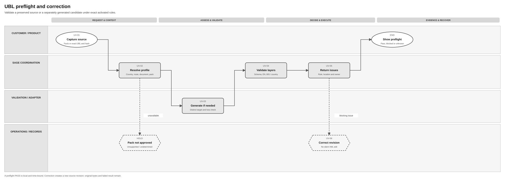

# UBL Validation and Correction Solution Specification

Terminology follows the [shared e-invoicing glossary](../context/GLO-SEI-001-e-invoicing-terminology.md). Local terms explain this feature; exact technical IDs, fields and source codes keep their stated meanings.

## Part 1 Feature Solution Summary

### Reader guide

Part 1 explains the scope, people involved, workflow and open decisions. Start here for a stakeholder review. Part 2 gives the detailed behaviour and rules. Part 3 describes service interactions and data. Part 4 links requirements to the checks and evidence needed before release.

The design remains a draft. **Proposed** choices still need review; **open** decisions still need an owner’s recorded answer. Technical IDs and state names are kept so engineering, testing and stakeholders can refer to the same item.

### 1 Purpose, authority and boundary

This **proposed logical design** gives Sage products a consistent way to check a UBL document and explain how to correct problems. The supplied SPFE formats select UBL 2.5 Invoice for public invoices, including corrections. CreditNote is permitted only for another separately qualified route/profile. Checks use the rules explicitly approved and enabled for the selected country, direction, route, document type and profile. [PRD-SEI-241](../prds/PRD-SEI-241-ubl-validation-service.md) owns the product handoff; [PRD-SEI-236](../prds/PRD-SEI-236-ubl-format-profile.md) owns versioned UBL profile capability; [PRD-SEI-223](../prds/PRD-SEI-223-interoperability-routing-transformation.md) owns transformation and exchange. This spec covers non-mutating preflight, final validation of exact dispatch bytes, structured issues and correction lineage. [SPEC-SEI-007](archive/SPEC-SEI-007-invoice-sending-solution.md) owns Spain outbound orchestration, actual send and external acknowledgement; lifecycle owners handle subsequent feedback.

A validation PASS means that one identified representation passed one identified local rule set at one time. It does not prove that an access point or public platform accepted it, that a buyer received it, or that the invoice is legally settled. A customer correction before dispatch creates a new source revision. A correction after issuance uses the governed issued-invoice correction process. The supplied SPFE representation remains Invoice; another route may use its separately qualified document family. The validation service must not rewrite a sent original.

### Public source baseline

The supplied formats document explicitly selects UBL 2.5 Invoice for SPFE, including corrective invoices. This replaces the earlier absence of technical version evidence. Actual schemas, extended rules, profile conflicts and implemented validation coverage still gate activation. Bilateral/private CreditNote support remains a separate profile decision.

See [REF Source references](#ref-source-references) for the original files, exact locations and source limits. The [technical evidence guide](../context/RES-SEI-002-spain-public-platform-technical-evidence.md) tracks shared source conflicts. The constraints below align this feature with the supplied public evidence; Sage implementation and activation remain gated.

### Spain use and reuse boundaries

This is a **Spain reference design**. The classifications below describe proposed reuse of behaviour, not proof that existing code is ready for use. **Reusable unchanged** means the design pattern can stay the same. **Reusable with country binding** means the shared behaviour needs approved local policies or adapters. **Country-specific** rules stay in the country pack. **Unknown** means implementation fitness or coverage still needs evidence.

This follows the [shared platform and country-pack direction](../prds/PRD-SEI-227-e-invoicing-as-a-service.md). Spain pilot or production use still depends on this spec’s approval and evidence gates. Reuse in another country needs that country’s own assessment.

| Area | Intended use in Spain | Reuse classification | Condition and owner |
|---|---|---|---|
| Source versions, issues and final-file evidence | Preserve exact inputs, explain problems and link final validation to the intended send. | Reusable unchanged | Reuse the version, issue and evidence patterns. Validation owner and ERP Product. |
| Validation and transformation services | Run the exact enabled rules and qualified mapper for the selected Spain route. | Reusable with country binding | Assess DTS as the preferred existing candidate for transformation and relevant validation functions; isolate country packs and qualify gaps. DTS and country/standards owner. |
| Spain UBL profiles and corrections | Select approved Spain syntax/profile, extensions and rules; use the approved issued-invoice correction process. | Country-specific | The supplied SPFE formats select UBL 2.5 Invoice. Exact public schemas/rules and activation remain gated; France or Peppol profiles cannot substitute for the Spain public pack. Spain technical owner, Legal and ERP Product. |
| Exact deployed validation coverage | Establish which DTS/validation build supports the selected input, profile, direction and final-file checks. | Unknown | Existing-service direction does not prove this complete contract. Record build, rule resources, interfaces, ownership and missing functions before activation. Architecture and DTS. |

The existing DTS reuse direction comes from [PRD-SEI-223](../prds/PRD-SEI-223-interoperability-routing-transformation.md). It identifies a preferred candidate; it does not certify a deployed build or Spain acceptance.

### Plain-language terms

| Term | Meaning |
|---|---|
| Legal entity / legal subject | The business to which the invoice or action belongs. Technical fields use `legalSubject` for this business. |
| Authority | Permission to perform a specific action for that business. Logging in or holding a certificate does not by itself give this permission. |
| Capability | A supported function, such as receiving invoices or signing them. |
| Route | The time-bound selection of platform and connection for a defined invoice scope and direction. A ready connection does not activate a route or rewrite earlier invoice plans. |
| Idempotency | Repeating the same logical request adds no effect within the contract’s defined scope and retention window. The contract binds request identity and input and defines conflict handling. |
| Reconciliation | Check the original operation against a reliable source to establish what actually happened before deciding the next action. |
| Gate | A condition, decision or evidence check that must pass before the next step can proceed. |
| Tenant | The customer account boundary used to keep one customer’s data and access separate from another’s. |
| Immutable / append-only | Immutable means a saved record cannot be changed. Append-only means later information is added as another record. Neither means indefinite retention. |
| Provenance | The record of where data came from and which versions, checks and changes produced the result. |
| Contract | The agreed inputs, outputs, behaviour and responsibilities between services or parties. |
| Durable | Saved through the agreed recovery boundary so the record survives a process restart or worker failure. Long-term retention is a separate policy. |
| UBL / ERP | Universal Business Language, a structured electronic document format; the business software that owns the invoice data. |
| Profile / rule pack | The precise rules approved for a country, route and document type; the versioned resources used to check those rules. |
| Preflight / final check | A preview check before sending; and a new check of the exact final file and current rules before dispatch. |
| Representation / semantic preservation | A specific file or form of invoice data; keeping its required business meaning when converting it. |
| XSD / EN 16931 / BIS / CIUS | XML Schema Definition checks XML structure. EN 16931 defines a European invoice model. Business Interoperability Specifications and Core Invoice Usage Specifications add more specific rules. |
| AP / DTS | Access point; and Document Transformation Service, the preferred transformation reuse candidate. Exact mapping and validation coverage still need qualification. |

### 2 Input, output and outcomes

| Entry | Expected result | Limitation |
|---|---|---|
| Prebuilt UBL bytes | Exact source hash, declared/detected context comparison and layered validation | No silent edit or profile guess |
| ERP invoice facts | Generated target UBL as a separately identified representation, comparison of business meaning and validation | Mapper activation and preservation of required business meaning must be proved |
| Preflight preview | PASS, WARNINGS, BLOCKED, UNSUPPORTED or UNDETERMINED with issues and staleness context | No external invoice mutation |
| Corrected revision | New linked source/derived representation and result | Earlier bytes/result remain inspectable |
| Final dispatch check | One validation result bound to exact final bytes, route, profile/rules, trust plan and send intent | External exchange still owns dispatch |

The ERP owns business-data edits and presentation. The Domain Service owns profile selection, rule execution, issue identity and validation evidence. Country/standards owners approve rule packs; operations owns service/configuration problems; a customer/delegate corrects business content only within their authority.

### 3 Process diagrams

Diagram step names use plain-language actions. The smaller activity references link to the detailed behaviour and checks below.

**Preparation checks and correction:** 

[Editable Draw.io](../assets/diagrams/ubl-preflight-correction-process.drawio) · [PNG](../assets/diagrams/ubl-preflight-correction-process.png). Text equivalent: UV-01 accepts source facts or exact UBL → UV-02 resolves an activated profile → UV-03 creates a distinct derived file only if approved → UV-04 runs ordered rule layers → UV-05 returns stable issues and correction owner. Customer correction creates UV-06 as a new revision and loops to profile/validation; missing rule evidence yields UNDETERMINED, not PASS.

**Final check before sending:** 

[Editable Draw.io](../assets/diagrams/ubl-final-validation-process.drawio) · [PNG](../assets/diagrams/ubl-final-validation-process.png). Text equivalent: outbound exchange requests UV-07 with final bytes, route and source revision → UV-02/04 reevaluate the exact selected profile/rules and representation → UV-08 binds PASS to the final hash, route, trust plan and one send intent. Any changed bytes, stale preview, loss of business meaning or unavailable pack blocks dispatch and returns an owned issue. Delivery and feedback are separate outcomes.

### 4 Ordered lifecycle

| Activity | Trigger and required result | Owner |
|---|---|---|
| UV-01 Capture source | Authorised facts or file, source revision, declared context and immutable hash recorded | ERP → validation |
| UV-02 Resolve capability | Exact syntax/document/profile/route/rule versions selected or unsupported/undetermined | Profile registry |
| UV-03 Generate candidate | Approved mapping produces distinct bytes/hash and comparison of business meaning | Transformation |
| UV-04 Validate layers | File safety, parse/schema, code lists, EN 16931, BIS/CIUS and route rules assessed as applicable | Validation |
| UV-05 Return result | Ordered stable issues, guidance suitable for the intended reader, owner, versions and next action stored | Validation → ERP |
| UV-06 Correct | New authorised source revision/result linked to prior attempt; original unchanged | ERP/customer |
| UV-07 Final check | Exact dispatch bytes and current route/profile/rules re-evaluated | Exchange → validation |
| UV-08 Bind evidence | Final result/hash/context bound to one idempotent send intent; no mutation here | Validation → exchange |

### 5 Decisions and risks

| Decision / effect | Owner and gate |
|---|---|
| Reference ERP, input mode and pilot scope: public UBL 2.5 Invoice; any other document family requires its separately qualified route/profile | Product + Domain Service; pilot selection |
| Public UBL 2.5 Invoice is selected by supplied formats. Exact compatible business schemas, EN 16931/Spain extended rules and separate bilateral/private profiles still need qualification | Country/standards owner; profile activation |
| DTS or other mapper qualification and treatment of source fields/extensions that cannot map | Architecture + country technical lead; conformance |
| Whether a generated representation is returned as bytes or reference, and validation/send transport | Architecture; design |
| Correction ownership and customer wording for each rule/fault class | ERP Product/UX + Domain Service; pilot usability |
| Signature/seal actor and protected-use boundary after final validation | Legal/Security + trust design; exchange gate |

The main risks are reusing a preview after data or rules change, assuming that readable XML is approved for a route, silently changing supplied XML, losing business meaning during conversion, or asking a customer to fix a Sage configuration problem. The activities below address these risks. A UBL version still needs approval before production use.

## Part 2 Logical Feature Specification

This part explains the proposed behaviour step by step. An invariant is a rule that must always hold, including during failures and recovery.

### 1 Scope and invariants

The validation context is (tenant, legalSubject, actor, country, direction, route, documentType, sourceInvoiceId, sourceRevision, inputMode). The capability registry selects exact syntax version, profile/CIUS/BIS version, extension set, effective period and validation artefact hashes. The supplied public target is UBL 2.5 Invoice, including corrections. CreditNote belongs only to a separately qualified non-public profile. Preflight/final and outbound/inbound capabilities remain separately activated. Inbound use is a separate trust/quarantine policy; it is not implied by this outbound reference design.

| ID | Rule that must always hold |
|---|---|
| UV-I01 | Source bytes/facts, generated UBL, final dispatched bytes and rendering are distinct, hash-addressed representations. |
| UV-I02 | The service never silently edits prebuilt UBL. Parsing/facts in the agreed common data form do not replace the legal original. |
| UV-I03 | No PASS is returned when required profile/rule evidence is absent, contradictory, expired or unactivated. |
| UV-I04 | A preview is non-mutating and cannot authorise a later send unless exact content and current context are rechecked. |
| UV-I05 | Each issue identifies source rule/layer/version, stable Sage code, location, severity, blocking effect, correction owner and safe guidance. |
| UV-I06 | Correction creates a new linked revision/result; sent bytes and historical validation are append-only. |
| UV-I07 | Final signing/sealing follows target-profile validation and binds to the exact final bytes under [certificate controls](SPEC-SEI-001-certificate-management-solution-specification.md). |

### 2 Detailed behaviour

**UV-01 Capture source.** Authenticate product/delegate and resolve legal entity, environment, country, direction, route intent, document type and source revision. For prebuilt UBL, store exact bytes or immutable protected reference and hash before parsing; verify declared type/profile against content without guessing a missing contradictory profile. For facts mode, store a versioned fact snapshot/reference and hash. Scan file/attachments against approved content, size and file-safety policy.

Duplicate key plus same digest returns the prior validation; changed content under the same key conflicts. Preview creates no external invoice effect.

**UV-02 Resolve capability.** Find the enabled capability using country, route, direction, document type, effective time and declared syntax or profile. Being able to parse a UBL version does not mean it is approved for use.

Select the exact XSD, code-list, EN 16931, BIS/CIUS, country and route packs, including their hashes and effective versions. An unsupported choice returns UNSUPPORTED with safe alternatives where known. A missing pack or conflicting choice returns UNDETERMINED and an action for Sage.

Peppol BIS is a specific UBL/EN 16931 profile, rather than a separate syntax. The supplied SPFE formats explicitly select UBL 2.5 Invoice. That establishes the documented public target; exact business schemas, extended rules, contradictory examples and implementation conformance still need qualification.

**UV-03 Generate candidate.** Facts mode invokes only an approved mapper/generator for the selected target profile. Store mapper version, source relation, target bytes/hash and comparison of business meaning (party identities, invoice type/references, lines, amounts/tax, payment and required extensions as applicable). Any mandatory loss or unsupported extension blocks the candidate. A permitted normalisation is documented as a new derived representation; a supplied UBL source is never overwritten. If generation fails, return a service/mapping issue rather than a false customer data error.

**UV-04 Validate layers.** Run ordered file safety and parse checks, syntax/schema, code lists, EN 16931 core, BIS/CIUS and country/route rules when activated. Retain per-layer PASS, BLOCKED or UNDETERMINED, rule artefact hashes, elapsed time and original rule IDs. A later stage need not run when prerequisite parsing fails; report NOT_EVALUATED rather than PASS. Deterministic rule execution can be retried after infrastructure failure, but the same bytes and pack versions must be used for historical reproducibility. A failed or missing pack blocks final dispatch.

**UV-05 Return result.** Calculate PASS, WARNINGS, BLOCKED, UNSUPPORTED or UNDETERMINED from the policy and individual check results. Each issue records the Sage issue ID, original rule ID, stage, severity, document or field location, developer detail, safe customer text that can be translated, blocking effect, likely correction owner and evidence reference.

Use a consistent issue order. Limit the visible list only under an approved user-experience contract; keep the complete result available to authorised users. Show whether the customer, developer, country policy owner or Sage operations must act next. PASS proves only that the local checks passed at the recorded time.

Use [SPEC011 business and technical error mapping](SPEC-SEI-011-public-platform-connector-solution-specification.md#business-and-technical-error-mapping) for the supplied message resources. Keep the source file classification separate from who must act. A business-file check may be undetermined or require authority recovery; a technical-file schema error may require a generator fix. Do not infer severity, an invalid invoice fact or retry permission from either category.

For optional PRE results, use the [SPEC011 SPFE response and error matrix](SPEC-SEI-011-public-platform-connector-solution-specification.md#spfe-response-and-error-matrix). Link every external issue to the validated file hash, invoice reference, operation and source evidence. Keep all errors for one invoice; do not replace an earlier local result with the external response. REF-SPFE-EX09 illustrates invoice-data and caller-authority failures, not lifecycle states.

When data fails validation, the authorised user checks the source facts; the integration owner checks mapping if the facts are correct. Apply UV-06 to content changes. A consistency error can identify more than one field: retain both locations and let the authorised owner determine which value is wrong. Do not silently copy a contact name into the seller legal name or patch issued XML. REF-SPFE-OBS01 supports an observed error only; its local rule and operation binding remain unqualified.

When caller authority fails, Administrator/Support checks the authenticated caller, certificate, represented business and authority with Security/Compliance. A path to seller identity does not by itself require changing correct invoice data. After authority is resolved, a new PRE attempt can use unchanged invoice bytes. Unknown codes follow PCN-07/09; do not classify them as customer-data errors or automatically repeat a submission.

**UV-06 Correct.** An authorised ERP edit produces a new source revision and new validation request with lineage to the failed result. A customer may fix facts or replace a prebuilt file; the service does not patch XML invisibly. If the invoice has already been sent/issued, route to the approved issued-invoice correction lifecycle; the public representation remains Invoice where the SPFE profile applies and preserve the original signed/sent representation. Do not use a pre-send edit operation to rewrite a post-send invoice. Support can inspect prior hashes and issue versions subject to permissions.

**UV-07 Final check.** Outbound exchange passes the exact final representation reference/hash, frozen route choice, actor/trust plan, source revision and proposed send identity. Resolve current effective profile/rules and confirm the selected representation is the one to be signed/sent. Re-run applicable validation even if preflight PASS exists; changed bytes, route, pack or capability can change the result. If the final target file changes through mapping, validate after mapping and before signing. Failure or UNDETERMINED returns no dispatch authorisation.

**UV-08 Bind evidence.** Save the final result ID, exact file bytes and hash, profile, rule and mapper versions, comparison of business meaning, route version, authority and trust references, and one send intent.

The send intent keeps a stable idempotency identity. A repeat returns the existing link between the result and send intent; changed content returns a conflict. The exchange service alone sends externally. It receives the validation evidence reference and must still enforce the current route and trust policy.

Exchange and lifecycle owners record external rejection or Peppol feedback. That feedback does not rewrite the earlier UV-05 result.

### 3 Requirements and quality controls

| ID | Requirement / source |
|---|---|
| UV-R01 | Bind identity, source revision, direction and request before evaluating; PRD-SEI-241 UVAL-FR1. |
| UV-R02 | Select exact activated profile and artefacts or return unsupported/undetermined; UVAL-FR2/10. |
| UV-R03 | Preserve source and derived bytes/hash plus mapper/semantic provenance; UVAL-FR3/9. |
| UV-R04 | Report each applicable validation layer and stable actionable issues; UVAL-FR4/5. |
| UV-R05 | Keep preflight non-mutating and detect stale context; UVAL-FR6. |
| UV-R06 | Validate exact final representation before send and bind evidence; UVAL-FR7/12. |
| UV-R07 | Create linked corrected revisions without rewriting originals; UVAL-FR8. |
| UV-R08 | Deduplicate final send identity and conflict on changed digest; UVAL-FR11. |

Tenant/entity/delegate access controls apply to files, results and evidence. Diagnostics and logs redact invoice content and personal data; no private key appears in validation. Rule, mapper and profile versions coexist to reproduce historical results. Pilot measures first-pass pass rate, correction completion, preventable external rejection, undetermined/stale-preview rate, latency, processing rate, payload size and issue volume; owners approve targets after baseline measurement.

### SPFE source contract binding

Use the [complete Annex I traceability table in SPEC-SEI-015](SPEC-SEI-015-invoice-creation-solution-specification.md#annex-i-invoice-field-traceability) and its [source-field ledger](../assets/regulatory/spain/spfe/field-traceability.json) when qualifying validation and DTS. Every applicable row and controlled-value domain needs an actual mapping/rule binding and positive/negative evidence. A mapper success or syntax pass cannot close this coverage gate.

The source facts below govern the public binding. Recovery, storage and qualification actions are proposed Sage controls where stated. Apply them through UV-02–04, UV-07–08. Source conflicts stay open under profile activation; SPFE-Q03/Q04/Q05/Q13/Q14; they are not resolved by a local default.

| ID | Constraint and required behaviour | Source reference |
|---|---|---|
| UV-SPFE-R01 Bind the public document type and profile | UV-02 selects the supplied UBL 2.5 Invoice family for the Spain public route. Validate the applicable 380/384/388/389/471 code and fields; do not send a public CreditNote by generic correction logic. Preserve final Annex I ProfileID with ubl:. A conflicting sample remains a conflict, not an alternate approved value. | SPFE-S02/SPFE-S01/SPFE-S08/SPFE-S09; [REF](#ref-source-references). |
| UV-SPFE-R02 Require the actual business validation resources | UV-04 records the exact UBL business schemas and EN 16931/Spain extended rule versions. The supplied ebMS/envelope XSDs and an XML parse do not prove invoice validation. Missing compatible resources produce UNDETERMINED or UNSUPPORTED, with the owning action held. | SPFE-S03/SPFE-S08; SPFE-Q04/Q14; [REF](#ref-source-references). |
| UV-SPFE-R03 Keep PRE validation optional and bounded | Use `ValidationInvoice` from the reviewed 23 November WSDL folder as a separate, optional PRE conformance aid. Its SOAP 1.2 document/literal request body is one `ubl:Invoice`; the response body is `ublds:DocumentStatus`. Use its exact SOAP action and certificate/seal ports; no ebMS/MIME packaging. Apply SPEC-SEI-011 PCN-SPFE-R03 for faults. The imported Invoice and DocumentStatus UBL 2.5 schemas and local dependencies are now supplied. Qualify their provenance, accepted Spain profile and generated client under SPFE-Q04/Q05; local presence does not prove conformance. A result neither registers the invoice nor replaces Sage final-file checks. No production dependency is permitted. The 5120-byte limit remains disputed. | SPFE-S23/SPFE-S25/SPFE-S03; SPFE-Q03/Q04/Q05; [REF](#ref-source-references). |
| UV-SPFE-R04 Evaluate the qualified Annex I rule occurrences | When a validation request selects an enabled Spain public profile, evaluate the applicable Annex I integrity, condition, regime and category checks with their exact source occurrence and field context. Keep absent optional groups separate from required children of selected groups. Select IVA/IGIC/IPSI rules from the explicit national qualifier. Report a failed qualified check with its field/context and correction owner. An unresolved source, missing executable check or evaluation failure produces UNDETERMINED for the affected check and holds final dispatch for that scope. A message template, dictionary lookup or successful transformation cannot supply a missing rule. | SPFE-S26 §§1–2; SPFE-S30/S31; proposed activation/recovery control; SPFE-Q04/Q14/Q22; [REF](#ref-source-references). |

#### Annex I rule coverage

The [Annex I mapping](../assets/mappings/spfe-annex-i-mapping.json) records **151 rule occurrences**, five supporting tables and the section preambles from SPFE-S26, version 0.1, 19 November 2026, marked `Borrador`. It links their explicit term references to all **343 active BG/BT entries** and the unchanged **176 final Annex I field rows**. Source capture and exact-term links are complete; semantic bindings, executable checks and approved fixtures remain unqualified. Source ID, section/page and occurrence identify a check. A bare rule ID is not unique and is not an error-resource key.

| Rule family | Occurrences / source | Required validation concern under UV-SPFE-R04 |
|---|---|---|
| Integrity | 31; §2.1 pp. 3–6 | Evaluate presence/counts within the selected group. Retain recap-period restrictions, prior-invoice references, Spain address conditions and the distinct tax, withholding, cadastral and correction groups. |
| Conditions | 24; §2.2 pp. 6–10 | Evaluate the applicable date, identity, amount and cross-group relationship. Keep method `I`/`S`, original references and tax/withholding calculations separate. IC-Q02/IC-Q06 retain unresolved cardinality and arithmetic decisions. |
| Regime | 52; §2.3 pp. 10–22 | Use the explicit `BT-ES-24` qualifier and the line's `REGI` context. Check same-line combinations and document-wide exclusions. Preserve qualifier preambles and the summary matrix; do not treat a list of regime codes as a complete compatibility rule. |
| Tax category | 44; §2.4 pp. 22–33 | Check the qualified category's rates, VATEX permissions, breakdowns and amounts. Keep standard/corrective cases, `N` regime `01`/`06`, and `D`/`F` conditions distinct. The surcharge-rate table is source evidence, not an approved rounding contract. |

SPFE-S26 §1 excludes EN 16931, UBL-schema, NIF, fixed-mapping and list checks from this PDF. UV-04 must still account for those separate applicable layers. Use the [SPEC011 error mapping](SPEC-SEI-011-public-platform-connector-solution-specification.md#business-and-technical-error-mapping) for proposed handling; assign an external code only after its operation/field binding is qualified. A PDF row cannot create a wire error code.

Format/Validation and the AEAT liaison own the [SPFE-Q22 source questions](../context/RES-SEI-002-spain-public-platform-technical-evidence.md#annex-i-reconciliation-reviewed-23-november-2026). These include reused IDs, missing/mismatched terms, seven unresolved literal paths, qualifier/category and regime-label conflicts, and rate/cardinality details. The supplied UBL tree identifies CSD01 material; require the exact accepted release/profile before activation. Keep the affected check or scenario held, rather than repairing source text or changing correct invoice facts. UV-05/06 own the correction handoff.

## Part 3 Logical Service Interactions and Data Inventory

This part describes what each service asks for, returns and stores. The technical field names support design review; they do not by themselves define an approved API.

### Spain and reuse boundary in contracts

Keep one issue and result model, but independently version the runtime, mapper, syntax resources and country/route rule packs. Assess existing DTS functions before adding a new implementation. A France pack or a parser’s UBL support cannot establish Spain acceptance. A reusable UBL capability also does not establish support for other syntaxes, inbound use or another country.

The relevant country and policy context may be resolved from trusted context or versioned references. Exact field names, service placement and physical APIs remain proposed. Reuse assessment must record the source implementation or design pattern, retained behaviour, local changes, missing functions, owner and qualification evidence before its dependent release gate passes.

### 1 Interaction contracts

The operations below are logical, not approved HTTP endpoints. Commands carry requestId, tenant/entity/environment, actor, source invoice/revision, direction/route/document type, input mode, expectedVersion and idempotency key where relevant.

| ID | Caller → owner | Contract and safe outcome |
|---|---|---|
| UV-INT-01 | ERP → validation | Submit preflight facts or protected UBL reference; returns result ID/state and source hash; no external mutation. |
| UV-INT-02 | Validation → profile registry | Resolve exact activated syntax/profile/rule artefacts; returns versions/hashes/effective period or unsupported/undetermined. |
| UV-INT-03 | Validation → transformation | Generate candidate from facts under approved mapper; returns new representation/hash and comparison of business meaning or loss issue. |
| UV-INT-04 | Validation → rule engine | Evaluate exact bytes under frozen pack set; returns per-layer findings and execution evidence; deterministic duplicate-safe. |
| UV-INT-05 | ERP → validation | Get result/issues or submit corrected source revision; access controlled, new revision linked to previous. |
| UV-INT-06 | Exchange → validation | Request final validation for exact dispatch bytes/context; returns blocking decision and evidence reference. |
| UV-INT-07 | Validation → exchange | Bind PASS evidence to one send intent; duplicate-safe; changed digest conflicts; no send side effect. |
| UV-INT-08 | Validation → operations/product | Emit committed result/pack-fault notification with redacted references; consumers deduplicate by result version. |

Proposed events are UBL_VALIDATION_COMPLETED, UBL_CORRECTION_REQUIRED and UBL_VALIDATION_UNDETERMINED. Their payloads contain IDs, versions and safe status, never raw invoice XML. An event cannot substitute for reading the authoritative result.

### 2 Data inventory

| ID | Record / owner | Essential fields and handling | Consumer |
|---|---|---|---|
| UV-D01 | Source revision / product + validation | Source ID/revision, input mode, immutable bytes/facts reference/hash, actor, tenant/entity; sensitive | UV-01/06 |
| UV-D02 | Capability selection / profile registry | Country, route, direction, document, syntax/profile/extension version, effective interval, approval evidence; versioned | UV-02/07 |
| UV-D03 | Rule pack / country/standards owner | XSD, code lists, EN 16931, BIS/CIUS, country/route artefact IDs/hashes, state; controlled | UV-04/07 |
| UV-D04 | Derived representation / transformation | Source link, mapper version, target bytes/hash, comparison of business meaning and loss findings; sensitive/immutable | UV-03/04/07 |
| UV-D05 | Validation result/issues / validation | Input hash, context, layer states, overall outcome, stable/source rule IDs, location, guidance, owner, pack versions; restricted/append-only | UV-05/06/08 |
| UV-D06 | Correction lineage / validation | Prior/new source/result IDs, actor, reason and changed fields reference; restricted | UV-06 |
| UV-D07 | Final send binding / validation + exchange | Exact final hash, result, route/profile/rules, trust reference, send identity, time; immutable | UV-07/08 |
| UV-D08 | Audit/operational evidence / operations | Correlation, fault domain, rule execution, diagnostics with sensitive values removed and owner; restricted | Support/assurance |

Retention, legal-original status and deletion are governed by approved country/privacy policy. D01/D04/D07 preserve exact provenance; a rendered PDF is labelled derived and cannot be presented as the structured invoice. Candidate rule packs can be disabled for new work without changing D05/D07 historical conclusions.

## Part 4 Assurance and Traceability View

This part shows how requirements connect to activities, interfaces, data and acceptance checks. The scenarios describe evidence still needed; they are not a claim that implementation tests have passed.

| Scenario | Requirement → activity / interaction / data | Expected evidence |
|---|---|---|
| UV-A01 Well-formed UBL fails BIS rule | R02/04 → UV-02/04/05, INT-02/04, D03/05 | Actual BIS rule/version/location and safe correction; no send. |
| UV-A02 Contradictory profile | R02 → UV-02, INT-02, D02 | Unsupported/block; no guessed profile. |
| UV-A03 Facts mapped to UBL | R03 → UV-01/03/04, INT-03, D01/04 | Distinct source/target hashes and comparison of business meaning. |
| UV-A04 Mandatory meaning lost | R03/06 → UV-03/07, INT-03/06, D04/07 | Block before signing/dispatch, mapper/field evidence. |
| UV-A05 Correction | R07 → UV-06, INT-05, D01/05/06 | New linked result; failed original preserved. |
| UV-A06 Preview stale at send | R05/06 → UV-07, INT-06, D05/07 | Exact final bytes/current rules rechecked; new invalid result blocks. |
| UV-A07 Rule pack missing | R02/06 → UV-02/07, INT-02/06, D02/03 | UNDETERMINED and Sage-owned action; no external mutation. |
| UV-A08 Duplicate send identity | R08 → UV-08, INT-07, D07 | Same binding returned or conflict; no second send intent. |
| UV-A09 Historical pack upgrade | R02/04 → UV-02/04, INT-02/04, D03/05 | Old result reproducible; new work selects approved effective pack. |
| UV-A10 Country-pack and reused-service qualification | R02–04/06 → UV-02–04/07, INT-02–04/06, D02–05/07 | Recorded DTS/validation build and rule-pack evidence prove the selected Spain contract. France and Spain packs remain separate; changing one does not change the other or rewrite historical results. Missing Spain resources block the final check. |

**Review gate:** agree reference ERP/input modes, precise country-route profile and correction ownership. **Pilot gate:** approved rule artefacts and corpus, mapper semantic tests, cross-tenant/delegate tests, stale-preview/final-check tests, user comprehension and AP/provider conformance comparison. **Production gate:** country/profile activation evidence, trust/signing boundary, measured capacity objectives, retention/privacy and support runbook. This draft does not activate a Spanish UBL or BIS version.

### SPFE evidence acceptance

These are required evidence scenarios, not executed implementation tests. The source-binding gate is profile activation; SPFE-Q03/Q04/Q05/Q13/Q14. A source-backed review does not establish that this feature is ready for production.

| ID | Scenario | Required result | Requirement coverage |
|---|---|---|---|
| UV-SPFE-A01 | Public corrective Invoice, public CreditNote, and the supplied sample ProfileID | Qualify the Invoice/type rules; reject unsupported CreditNote for this public profile and hold the conflicting sample declaration. Preserve source bytes and issue provenance. | UV-SPFE-R01; UV-02–04, UV-07–08; [REF](#ref-source-references). |
| UV-SPFE-A02 | UBL XSDs are supplied, but the executable Spain rule pack is absent or unqualified | Return no complete invoice PASS. Identify the unqualified validation layer and keep final dispatch blocked. A draft rule PDF does not execute checks. SPFE-S26/S27; SPFE-Q04. | UV-SPFE-R02; UV-02–04, UV-07–08; [REF](#ref-source-references). |
| UV-SPFE-A03 | Generate a PRE validation client, then request production dispatch | Verify both supplied UBL imports and their local dependency closure. Hold qualification until provenance, accepted-profile compatibility and client build are qualified under SPFE-Q04/Q05. With qualified schemas, verify SPFE-S23 exact action/ports and direct Invoice/DocumentStatus bodies. Apply connector fault checks PCN-SPFE-A02. Run the qualified exact-file validation; PRE success cannot establish registration, production acceptance or a permitted size limit. | UV-SPFE-R03; UV-02–04, UV-07–08; [REF](#ref-source-references). |
| UV-SPFE-A04 | One PRE invoice returns four errors; then authority is corrected or an unknown code is returned | Apply the [SPEC011 matrix](SPEC-SEI-011-public-platform-connector-solution-specification.md#spfe-response-and-error-matrix) and UV-05. Retain all four issues against one invoice and the original local result. Separate data correction from authority recovery. Authority recovery alone does not create a new invoice revision. Preserve an unknown code and responsible owner. No validation result creates a lifecycle event, registers the invoice or enables a production dependency. Repeat UV-A10 country-isolation checks. | UV-05/06; UV-SPFE-R03; REF-SPFE-EX09; PCN-SPFE-A05; SPFE-Q20. |
| UV-SPFE-A05 | A supplied consistency error names seller legal name and contact name | Preserve both field locations, original code/description and unconfirmed operation/source. Show an owned data/mapping investigation; do not overwrite the legal name, silently repair XML or fabricate an overall numeric response. Qualify the source rule before local activation. Keep earlier revisions and results under UV-06. | UV-05/06; REF-SPFE-OBS01; PCN-SPFE-A06; SPFE-Q20. |
| UV-SPFE-A06 | Conditional groups absent, selected with missing children, or repeated beyond the selected rule limit | Exercise the integrity occurrences with source/page/field context. Optional absence cannot fail a rule for an unselected group. Missing required children and excessive occurrences fail the applicable qualified check. Reused `BR-ES-3/4/5` IDs retain separate identities. Recover through UV-06 and revalidate final bytes. | UV-SPFE-R04; SPFE-S26 §2.1 pp. 3–6; SPFE-S30/S31. |
| UV-SPFE-A07 | Date boundaries, method I/S and monetary relationships | Test before/equal/after for recap start/end/issue/operation dates and prior-invoice dates. Keep the technical draft's minimum issue-date check separate from legal rollout dates. Check I/S applicability without selecting three or five rectified groups by convenience. Test charge/tax/withholding calculations with approved decimal/rate/rounding fixtures; unresolved precision or source meaning stays UNDETERMINED. | UV-SPFE-R04; SPFE-S26 §2.2 pp. 6–10; IC-Q02/IC-Q06; SPFE-Q22. |
| UV-SPFE-A08 | IVA, IGIC and IPSI qualifiers; permitted/forbidden category and regime combinations | Exercise same-line and cross-line exclusions, standard/corrective rates, VATEX conditions, N regime 01/06 and D/F breakdowns. A qualifier change selects its own rules. Hold the disputed IPSI/Z applicability and 03/05 code-label bindings; do not infer a correction type or replace a regime to obtain PASS. | UV-SPFE-R04; SPFE-S26 §2.3–2.4 pp. 10–33; SPFE-Q22. |
| UV-SPFE-A09 | Dictionary lookup resolves a term but its path or group context is unqualified | Preserve all 343 active entries and the seven literal path questions. A namespace/element/attribute-name match does not prove predicates, cardinality, semantic meaning or an executable XPath. Keep INFO/RCAT/REGI, SUPL/IEDMT/OTROS/MINO/RETE and supporting-reference contexts separate through their final Annex I rows. Return an owned unresolved mapping result instead of fabricated field locations. | UV-SPFE-R04; SPFE-S02/S30/S31/S90; IC-SPFE-R04; SPFE-Q14/Q22. |
| UV-SPFE-A10 | Missing rule, evaluation failure, changed source bundle or another country's invoice | Do not report PASS for a check that did not run. Bind the final result to exact schema/rule/source hashes and the selected country/profile. CSD01 labels and an XSD parse do not prove accepted-release conformance. Requalify changed resources and verify that Spain qualifier/rate/VATEX rules do not become another country's defaults. | UV-SPFE-R02/R04; UV-04/07/08; SPFE-S26/S30/S31; SPFE-Q04/Q22. |

## REF Source references

For public-platform legal and external-contract facts, the original official sources below take precedence over earlier assumptions in linked PRDs and internal notes. PRDs retain product scope and are unchanged by this review. A source conflict remains an explicit gate; this spec cannot approve a local substitute.

Use the original files for the claims they establish. Final published regulation governs legal requirements; technical files supply their stated contract facts. Examples are illustrative. Missing or conflicting evidence remains a named gate. Product requirements and Sage design controls have separate authority. The English guide and extracts are reading aids.

| REF ID | Source and version | Exact location | Supported information and limit |
|---|---|---|---|
| REF-SPFE-EX09 | [RespuestaFacturaValidation.xml](https://sage365.sharepoint.com/sites/global/epd/ib/TechDoc/Shared%20Documents/3.Legal/2.-%20FACTURACI%C3%93N/TRANSVERSAL/FACTURA%20ELECTR%C3%93NICA/ACTUAL/SPFE/Documentaci%C3%B3n%20t%C3%A9cnica/Ejemplos%20de%20peticiones%20y%20respuestas%20de%20SW/09%20-%20ValidationInvoiceSOAP/09%20-%20ValidationInvoiceSOAP/RESPUESTA/RespuestaFacturaValidation.xml); SharePoint copy inspected 10 November 2026; publication date and release version unknown. | SOAP Body/DocumentStatus; DocumentResponse/Response/ResponseCode; repeated DocumentReference/DocumentStatusCode and DocumentDescription. | One overall failure and four errors for the same invoice. Example evidence only; no HTTP headers, complete error catalogue, raw-byte hash or live acceptance evidence. |
| REF-SPFE-OBS01 | User-supplied SPFE response excerpt, received 11 November 2026; original operation, filename and version unknown. | Description, DocumentDescription and DocumentStatusCode value; [source limits](../context/RES-SEI-002-spain-public-platform-technical-evidence.md#code-inventory-coverage). | Records the supplied seller-name consistency error only. No original XML namespace, numeric overall result or runtime provenance is established. |
| SPFE-S02 | [BOE-A-2026-20587.pdf](<../context/BOE-A-2026-20587.pdf>); Final order; published 5 October 2026. | Articles 3–4; Annex I BT-23/24, p. 14 | Final public invoice/copy fields and exact profile identifiers. |
| SPFE-S01 | [Anexo-1-Proyecto-OM-FE.pdf](<../context/Anexo I/20261013/Anexo-1-Proyecto-OM-FE.pdf>); Supplied 13 October 2026; SHA-256 in source manifest. | pp. 4–6 and 25–34 | Copy indicator, profile identifiers, corrective groups and code lists; compare against final Annex I. |
| SPFE-S03 | [CatalogoServicios.pdf](<../context/Descripción servicios web/Catálogo de servicios/20261013/CatalogoServicios.pdf>); 0.1.0; cover 9 October 2026. | sections 6.2 and 6.10; pp. 10–11, 19–20 | Layered validation, disputed size and PRE-only validation service. |
| SPFE-S08 | [FormatosEntradaSalida.pdf](<../context/archive/original-technical-baseline/Descripción servicios web/Formatos entrada y salida/20261013/FormatosEntradaSalida.pdf>); 0.1.0; cover 9 October 2026. | section 5.1.1, p. 8 | UBL 2.5 InvoiceType, not CreditNote, for public invoice submission. |
| SPFE-S09 | [factura.xml](<../context/Ejemplos/20261013/factura.xml>); Supplied 13 October 2026; SHA-256 in source manifest. | cbc:ProfileID, cbc:CustomizationID and cbc:CopyIndicator | Example profile conflicts with Annex I; not conformance evidence. |
| SPFE-S18 | [ebms-header-3_0-200704.xsd](<../context/WSDL servicios web - PRE_23_11_26/xsd/ebms/ebms-header-3_0-200704.xsd>); PRE release 23 November 2026. | xsd:schema targetNamespace `http://docs.oasis-open.org/ebxml-msg/ebms/v3.0/ns/core/200704/`; imports/types. | Messaging or SOAP/XML transport schema. Not a UBL Invoice, ApplicationResponse or DocumentStatus business schema; no country rule validation. |
| SPFE-S19 | [soap-envelope.xsd](<../context/WSDL servicios web - PRE_23_11_26/xsd/w3/soap-envelope.xsd>); PRE release 23 November 2026. | xsd:schema targetNamespace `http://www.w3.org/2003/05/soap-envelope`; imports/types. | Messaging or SOAP/XML transport schema. Not a UBL Invoice, ApplicationResponse or DocumentStatus business schema; no country rule validation. |
| SPFE-S20 | [xml.xsd](<../context/WSDL servicios web - PRE_23_11_26/xsd/w3/xml.xsd>); PRE release 23 November 2026. | xsd:schema targetNamespace `http://www.w3.org/XML/1998/namespace`; imports/types. | Messaging or SOAP/XML transport schema. Not a UBL Invoice, ApplicationResponse or DocumentStatus business schema; no country rule validation. |
| SPFE-S21 | [envelope.xsd](<../context/WSDL servicios web - PRE_23_11_26/xsd/xmlsoap/envelope.xsd>); PRE release 23 November 2026. | xsd:schema targetNamespace `http://schemas.xmlsoap.org/soap/envelope/`; imports/types. | Messaging or SOAP/XML transport schema. Not a UBL Invoice, ApplicationResponse or DocumentStatus business schema; no country rule validation. |
| SPFE-S23 | [ValidationInvoice.wsdl](<../context/WSDL servicios web - PRE_23_11_26/ValidationInvoice.wsdl>); PRE release 23 November 2026. | `wsdl:documentation`; Invoice/DocumentStatus imports; `ValidationInvoiceRequest/Response`; `ValidationInvoicePortType`, SOAP 1.2 binding/action and certificate/seal ports. | Direct UBL bodies, standard faults and exact PRE contract; imports now resolve locally. Accepted-profile, generated-client and live qualification remain open. |
| SPFE-S25 | [UBL schema instructions](<../context/WSDL servicios web - PRE_23_11_26/xsd/ubl-2.5/LEEME.txt>); PRE release 23 November 2026. | Entire file: corrected `ValidationInvoice.wsdl` filename and instruction to obtain OASIS `maindoc/` and `common/`. | The supplied folder also contains the schemas; the instruction does not prove their download provenance or conformance. |
| REF-PRD | [PRD-SEI-241](../prds/PRD-SEI-241-ubl-validation-service.md); [PRD-SEI-236](../prds/PRD-SEI-236-ubl-format-profile.md); [PRD-SEI-223](../prds/PRD-SEI-223-interoperability-routing-transformation.md); [shared platform and country-pack direction](../prds/PRD-SEI-227-e-invoicing-as-a-service.md). | Product scope and requirement IDs cited in Parts 1–4. | Canonical product requirements. Earlier external-contract assumptions are reconciled with the supplied sources; an unresolved PRD difference needs a product decision, not silent approval. |
| REF-CONTEXT | [RES-SEI-002](../context/RES-SEI-002-spain-public-platform-technical-evidence.md); [source manifest](../assets/regulatory/spain/spfe/source-manifest.json); [shared glossary](../context/GLO-SEI-001-e-invoicing-terminology.md). | Source register, shared conflicts and terminology. | Reading and traceability aids. Hashes identify snapshots; they do not prove live service acceptance or implementation readiness. |
| SPFE-S26/S27 | [Annex I rules](<../context/Reglas de negocio ES/ReglasNegocio_AnexoUno.pdf>), 33 pages; [Annex II rules](<../context/Reglas de negocio ES/ReglasNegocio_AnexoDos.pdf>), 6 pages; both version 0.1, 19 November 2026, `Borrador`, received 23 November. | S26 §1 p. 3 and §2 pp. 3–33; S27 §1/§2 pp. 3–6. | Draft rule definitions, not an executable pack. Initial impact and exclusions are in [RES-SEI-002, 23 November review](../context/RES-SEI-002-spain-public-platform-technical-evidence.md#pre-wsdl-and-supporting-evidence-reviewed-23-november-2026). Detailed rule coverage is pending; disputed BT/date bindings remain SPFE-Q21. |
| SPFE-S30/S31 | [BG paths](<../context/Listados auxiliares BG y BT/bg_invoice.properties>); [BT paths](<../context/Listados auxiliares BG y BT/bt_invoice.properties>); received 23 November 2026, embedded versions unknown. | Active key/path entries; S31 `BT-113` and `BT-115`. | Invoice path lookup only. No cardinality or executable-rule coverage; retain the SPFE-Q21 amount-field conflict. |
| SPFE-S90/S69/S47 | [Invoice schema](<../context/WSDL servicios web - PRE_23_11_26/xsd/ubl-2.5/maindoc/UBL-Invoice-2.5.xsd>); [DocumentStatus schema](<../context/WSDL servicios web - PRE_23_11_26/xsd/ubl-2.5/maindoc/UBL-DocumentStatus-2.5.xsd>); [ApplicationResponse schema](<../context/WSDL servicios web - PRE_23_11_26/xsd/ubl-2.5/maindoc/UBL-ApplicationResponse-2.5.xsd>); received 23 November 2026. | Schema roots, types and local imports/includes; full 112-file inventory in the source manifest. | Files parse and local dependencies resolve. No independent OASIS byte comparison, accepted Spain profile, generated client or runtime proof. |
| REF-ANNEX-I-MAP | [Annex I source/rule/path mapping](../assets/mappings/spfe-annex-i-mapping.json); reviewed 23 November 2026. | Source/page/table/row occurrences, raw cells and exact dictionary lines; unchanged final-field trace IDs; schema namespace/element/attribute-name review. | Source navigation and proposed functional/acceptance links. No completed ERP/API binding, executable rule pack, predicate/semantic validation or implementation evidence. |
