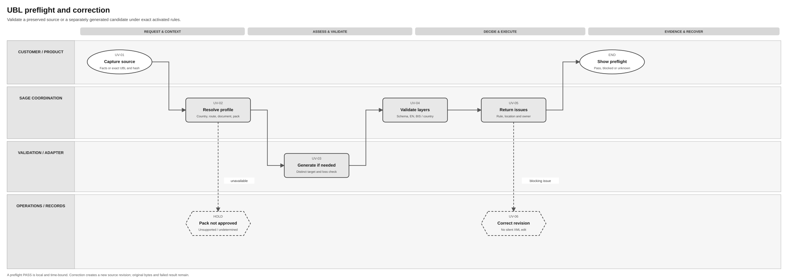

# UBL Validation and Correction Solution Specification

## Part 1 Feature Solution Summary

### Reader guide

Part 1 explains the scope, people involved, workflow and open decisions. Start here for a stakeholder review. Part 2 gives the detailed behaviour and rules. Part 3 describes service interactions and data. Part 4 links requirements to the checks and evidence needed before release.

The design remains a draft. **Proposed** choices still need review; **open** decisions still need an owner’s recorded answer. Technical IDs and state names are kept so engineering, testing and stakeholders can refer to the same item.

### 1 Purpose, authority and boundary

This **proposed logical design** gives Sage products a consistent way to check a UBL Invoice or CreditNote and explain how to correct problems. Checks use the rules explicitly approved and enabled for the selected country, direction, route, document type and profile. [PRD-SEI-241](../prds/PRD-SEI-241-ubl-validation-service.md) owns the product handoff; [PRD-SEI-236](../prds/PRD-SEI-236-ubl-format-profile.md) owns versioned UBL profile capability; [PRD-SEI-223](../prds/PRD-SEI-223-interoperability-routing-transformation.md) owns transformation and exchange. This spec covers non-mutating preflight, final validation of exact dispatch bytes, structured issues and correction lineage. [SPEC-SEI-007](SPEC-SEI-007-spain-invoice-preparation-and-outbound-solution-specification.md) owns Spain outbound orchestration, actual send and external acknowledgement; lifecycle owners handle subsequent feedback.

A validation PASS means that one identified representation passed one identified local rule set at one time. It does not prove that an access point or public platform accepted it, that a buyer received it, or that the invoice is legally settled. A customer correction before dispatch creates a new source revision. A correction after issuance is a separate governed invoice/credit-note lifecycle decision; the validation service must not rewrite a sent original.

### Spain use and reuse boundaries

This is a **Spain reference design**. The classifications below describe proposed reuse of behaviour, not proof that existing code is ready for use. **Reusable unchanged** means the design pattern can stay the same. **Reusable with country binding** means the shared behaviour needs approved local policies or adapters. **Country-specific** rules stay in the country pack. **Unknown** means implementation fitness or coverage still needs evidence.

This follows the [shared platform and country-pack direction](../prds/PRD-SEI-227-e-invoicing-as-a-service.md). Spain pilot or production use still depends on this spec’s approval and evidence gates. Reuse in another country needs that country’s own assessment.

| Area | Intended use in Spain | Reuse classification | Condition and owner |
|---|---|---|---|
| Source versions, issues and final-file evidence | Preserve exact inputs, explain problems and link final validation to the intended send. | Reusable unchanged | Reuse the version, issue and evidence patterns. Validation owner and ERP Product. |
| Validation and transformation services | Run the exact enabled rules and qualified mapper for the selected Spain route. | Reusable with country binding | Assess DTS as the preferred existing candidate for transformation and relevant validation functions; isolate country packs and qualify gaps. DTS and country/standards owner. |
| Spain UBL profiles and corrections | Select approved Spain syntax/profile, extensions and rules; use the approved issued-invoice correction process. | Country-specific | Neither UBL 2.5 nor a France or Peppol profile is automatically approved for Spain. Spain technical owner, Legal and ERP Product. |
| Exact deployed validation coverage | Establish which DTS/validation build supports the selected input, profile, direction and final-file checks. | Unknown | Existing-service direction does not prove this complete contract. Record build, rule resources, interfaces, ownership and missing functions before activation. Architecture and DTS. |

The existing DTS reuse direction comes from [PRD-SEI-223](../prds/PRD-SEI-223-interoperability-routing-transformation.md). It identifies a preferred candidate; it does not certify a deployed build or Spain acceptance.

### Plain-language terms

| Term | Meaning |
|---|---|
| Legal entity / legal subject | The business to which the invoice or action belongs. Technical fields use `legalSubject` for this business. |
| Authority | Permission to perform a specific action for that business. Logging in or holding a certificate does not by itself give this permission. |
| Capability | A supported function, such as receiving invoices or signing them. |
| Route | The platform and connection used to send or receive an invoice. |
| Idempotency | A repeat of the same request has no additional effect. The contract must define how the system recognises that request. |
| Reconciliation | Check the original operation against a reliable source to establish what actually happened before deciding the next action. |
| Gate | A condition, decision or evidence check that must pass before the next step can proceed. |
| Tenant | The customer account boundary used to keep one customer’s data and access separate from another’s. |
| Immutable / append-only | A saved item cannot be changed; new information is added as a new record instead of overwriting earlier records. |
| Provenance | The record of where data came from and which versions, checks and changes produced the result. |
| Contract | The agreed inputs, outputs, behaviour and responsibilities between services or parties. |
| Durable | Saved so the record remains available after a service restart. |
| UBL / ERP | Universal Business Language, a structured electronic document format; the business software that owns the invoice data. |
| Profile / rule pack | The precise rules approved for a country, route and document type; the versioned resources used to check those rules. |
| Preflight / final check | A preview check before sending; and a new check of the exact final file and current rules before dispatch. |
| Representation / semantic preservation | A specific file or form of invoice data; keeping its required business meaning when converting it. |
| XSD / EN 16931 / BIS / CIUS | XML Schema Definition checks XML structure. EN 16931 defines a European invoice model. Business Interoperability Specifications and Core Invoice Usage Specifications add more specific rules. |
| AP / DTS | Access point; and Document Transformation Service. Their responsibilities remain separate from local validation. |

### 2 Input, output and endpoints

| Entry | Expected result | Limitation |
|---|---|---|
| Prebuilt UBL bytes | Exact source hash, declared/detected context comparison and layered validation | No silent edit or profile guess |
| ERP invoice facts | Generated target UBL as a separately identified representation, comparison of business meaning and validation | Mapper activation and preservation of required business meaning must be proved |
| Preflight preview | PASS, WARNINGS, BLOCKED, UNSUPPORTED or UNDETERMINED with issues and staleness context | No external invoice mutation |
| Corrected revision | New linked source/derived representation and result | Earlier bytes/result remain inspectable |
| Final dispatch check | One validation result bound to exact final bytes, route, profile/rules, trust plan and send intent | External exchange still owns dispatch |

The ERP owns business-data edits and presentation. The Domain Service owns profile selection, rule execution, issue identity and validation evidence. Country/standards owners approve rule packs; operations owns service/configuration problems; a customer/delegate corrects business content only within their authority.

### 3 Process diagrams

**Preflight and correction:** 

[Editable Draw.io](../assets/diagrams/ubl-preflight-correction-process.drawio) · [PNG](../assets/diagrams/ubl-preflight-correction-process.png). Text equivalent: UV-01 accepts source facts or exact UBL → UV-02 resolves an activated profile → UV-03 creates a distinct derived file only if approved → UV-04 runs ordered rule layers → UV-05 returns stable issues and correction owner. Customer correction creates UV-06 as a new revision and loops to profile/validation; missing rule evidence yields UNDETERMINED, not PASS.

**Final dispatch gate:** 

[Editable Draw.io](../assets/diagrams/ubl-final-validation-process.drawio) · [PNG](../assets/diagrams/ubl-final-validation-process.png). Text equivalent: outbound exchange requests UV-07 with final bytes, route and source revision → UV-02/04 reevaluate the exact selected profile/rules and representation → UV-08 binds PASS to the final hash, route, trust plan and one send intent. Any changed bytes, stale preview, loss of business meaning or unavailable pack blocks dispatch and returns an owned issue. Delivery and feedback are separate outcomes.

### 4 Ordered lifecycle

| Activity | Trigger and required result | Owner |
|---|---|---|
| UV-01 Capture source | Authorised facts or file, source revision, declared context and immutable hash recorded | ERP → validation |
| UV-02 Resolve capability | Exact syntax/document/profile/route/rule versions selected or unsupported/undetermined | Profile registry |
| UV-03 Generate candidate | Approved mapping produces distinct bytes/hash and comparison of business meaning | Transformation |
| UV-04 Validate layers | File safety, parse/schema, code lists, EN 16931, BIS/CIUS and route rules assessed as applicable | Validation |
| UV-05 Return result | Ordered stable issues, guidance suitable for the intended reader, owner, versions and next action stored | Validation → ERP |
| UV-06 Correct | New authorised source revision/result linked to prior attempt; original unchanged | ERP/customer |
| UV-07 Final check | Exact dispatch bytes and current route/profile/rules re-evaluated | Exchange → validation |
| UV-08 Bind evidence | Final result/hash/context bound to one idempotent send intent; no mutation here | Validation → exchange |

### 5 Decisions and risks

| Decision / effect | Owner and gate |
|---|---|
| Reference ERP, input mode, selected country/route and Invoice/CreditNote pilot scope | Product + Domain Service; pilot selection |
| Exact Spanish public/private UBL, EN 16931, BIS/CIUS and extension versions | Country/standards owner; profile activation |
| DTS or other mapper qualification and treatment of source fields/extensions that cannot map | Architecture + country technical lead; conformance |
| Whether a generated representation is returned as bytes or reference, and validation/send transport | Architecture; design |
| Correction ownership and customer wording for each rule/fault class | ERP Product/UX + Domain Service; pilot usability |
| Signature/seal actor and protected-use boundary after final validation | Legal/Security + trust design; exchange gate |

The main risks are reusing a preview after data or rules change, assuming that readable XML is approved for a route, silently changing supplied XML, losing business meaning during conversion, or asking a customer to fix a Sage configuration problem. The activities below address these risks. A UBL version still needs approval before production use.

## Part 2 Logical Feature Specification

This part explains the proposed behaviour step by step. An invariant is a rule that must always hold, including during failures and recovery.

### 1 Scope and invariants

The validation context is (tenant, legalSubject, actor, country, direction, route, documentType, sourceInvoiceId, sourceRevision, inputMode). The capability registry selects exact syntax version, profile/CIUS/BIS version, extension set, effective period and validation artefact hashes. Invoice and CreditNote, preflight and final, and outbound and inbound are separately activated. Inbound use is a separate trust/quarantine policy; it is not implied by this outbound reference design.

| ID | Rule that must always hold |
|---|---|
| UV-I01 | Source bytes/facts, generated UBL, final dispatched bytes and rendering are distinct, hash-addressed representations. |
| UV-I02 | The service never silently edits prebuilt UBL. Parsing/facts in the agreed common data form do not replace the legal original. |
| UV-I03 | No PASS is returned when required profile/rule evidence is absent, contradictory, expired or unactivated. |
| UV-I04 | A preview is non-mutating and cannot authorise a later send unless exact content and current context are rechecked. |
| UV-I05 | Each issue identifies source rule/layer/version, stable Sage code, location, severity, blocking effect, correction owner and safe guidance. |
| UV-I06 | Correction creates a new linked revision/result; sent bytes and historical validation are append-only. |
| UV-I07 | Final signing/sealing follows target-profile validation and binds to the exact final bytes under [certificate controls](SPEC-SEI-001-certificate-management-solution-specification.md). |

### 2 Detailed behaviour

**UV-01 Capture source.** Authenticate product/delegate and resolve legal entity, environment, country, direction, route intent, document type and source revision. For prebuilt UBL, store exact bytes or immutable protected reference and hash before parsing; verify declared type/profile against content without guessing a missing contradictory profile. For facts mode, store a versioned fact snapshot/reference and hash. Scan file/attachments against approved content, size and file-safety policy.

Duplicate key plus same digest returns the prior validation; changed content under the same key conflicts. Preview creates no external invoice effect.

**UV-02 Resolve capability.** Find the enabled capability using country, route, direction, document type, effective time and declared syntax or profile. Being able to parse a UBL version does not mean it is approved for use.

Select the exact XSD, code-list, EN 16931, BIS/CIUS, country and route packs, including their hashes and effective versions. An unsupported choice returns UNSUPPORTED with safe alternatives where known. A missing pack or conflicting choice returns UNDETERMINED and an action for Sage.

Peppol BIS is a specific UBL/EN 16931 profile, rather than a separate syntax. The existence of the UBL 2.5 standard does not establish that Spain accepts it.

**UV-03 Generate candidate.** Facts mode invokes only an approved mapper/generator for the selected target profile. Store mapper version, source relation, target bytes/hash and comparison of business meaning (party identities, invoice type/references, lines, amounts/tax, payment and required extensions as applicable). Any mandatory loss or unsupported extension blocks the candidate. A permitted normalisation is documented as a new derived representation; a supplied UBL source is never overwritten. If generation fails, return a service/mapping issue rather than a false customer data error.

**UV-04 Validate layers.** Run ordered file safety and parse checks, syntax/schema, code lists, EN 16931 core, BIS/CIUS and country/route rules when activated. Retain per-layer PASS, BLOCKED or UNDETERMINED, rule artefact hashes, elapsed time and original rule IDs. A later stage need not run when prerequisite parsing fails; report NOT_EVALUATED rather than PASS. Deterministic rule execution can be retried after infrastructure failure, but the same bytes and pack versions must be used for historical reproducibility. A failed or missing pack blocks final dispatch.

**UV-05 Return result.** Calculate PASS, WARNINGS, BLOCKED, UNSUPPORTED or UNDETERMINED from the policy and individual check results. Each issue records the Sage issue ID, original rule ID, stage, severity, document or field location, developer detail, safe customer text that can be translated, blocking effect, likely correction owner and evidence reference.

Use a consistent issue order. Limit the visible list only under an approved user-experience contract; keep the complete result available to authorised users. Show whether the customer, developer, country policy owner or Sage operations must act next. PASS proves only that the local checks passed at the recorded time.

**UV-06 Correct.** An authorised ERP edit produces a new source revision and new validation request with lineage to the failed result. A customer may fix facts or replace a prebuilt file; the service does not patch XML invisibly. If the invoice has already been sent/issued, route to the approved correction/credit-note lifecycle and preserve the original signed/sent representation. Do not use a pre-send edit operation to rewrite a post-send invoice. Support can inspect prior hashes and issue versions subject to permissions.

**UV-07 Final check.** Outbound exchange passes the exact final representation reference/hash, frozen route choice, actor/trust plan, source revision and proposed send identity. Resolve current effective profile/rules and confirm the selected representation is the one to be signed/sent. Re-run applicable validation even if preflight PASS exists; changed bytes, route, pack or capability can change the result. If the final target file changes through mapping, validate after mapping and before signing. Failure or UNDETERMINED returns no dispatch authorisation.

**UV-08 Bind evidence.** Save the final result ID, exact file bytes and hash, profile, rule and mapper versions, comparison of business meaning, route version, authority and trust references, and one send intent.

The send intent keeps a stable idempotency identity. A repeat returns the existing link between the result and send intent; changed content returns a conflict. The exchange service alone sends externally. It receives the validation evidence reference and must still enforce the current route and trust policy.

Exchange and lifecycle owners record external rejection or Peppol feedback. That feedback does not rewrite the earlier UV-05 result.

### 3 Requirements and quality controls

| ID | Requirement / source |
|---|---|
| UV-R01 | Bind identity, source revision, direction and request before evaluating; PRD-SEI-241 UVAL-FR1. |
| UV-R02 | Select exact activated profile and artefacts or return unsupported/undetermined; UVAL-FR2/10. |
| UV-R03 | Preserve source and derived bytes/hash plus mapper/semantic provenance; UVAL-FR3/9. |
| UV-R04 | Report each applicable validation layer and stable actionable issues; UVAL-FR4/5. |
| UV-R05 | Keep preflight non-mutating and detect stale context; UVAL-FR6. |
| UV-R06 | Validate exact final representation before send and bind evidence; UVAL-FR7/12. |
| UV-R07 | Create linked corrected revisions without rewriting originals; UVAL-FR8. |
| UV-R08 | Deduplicate final send identity and conflict on changed digest; UVAL-FR11. |

Tenant/entity/delegate access controls apply to files, results and evidence. Diagnostics and logs redact invoice content and personal data; no private key appears in validation. Rule, mapper and profile versions coexist to reproduce historical results. Pilot measures first-pass pass rate, correction completion, preventable external rejection, undetermined/stale-preview rate, latency, processing rate, payload size and issue volume; owners approve targets after baseline measurement.

## Part 3 Logical Service Interactions and Data Inventory

This part describes what each service asks for, returns and stores. The technical field names support design review; they do not by themselves define an approved API.

### Spain and reuse boundary in contracts

Keep one issue and result model, but independently version the runtime, mapper, syntax resources and country/route rule packs. Assess existing DTS functions before adding a new implementation. A France pack or a parser’s UBL support cannot establish Spain acceptance. A reusable UBL capability also does not establish support for other syntaxes, inbound use or another country.

The relevant country and policy context may be resolved from trusted context or versioned references. Exact field names, service placement and physical APIs remain proposed. Reuse assessment must record the source implementation or design pattern, retained behaviour, local changes, missing functions, owner and qualification evidence before its dependent release gate passes.

### 1 Interaction contracts

The operations below are logical, not approved HTTP endpoints. Commands carry requestId, tenant/entity/environment, actor, source invoice/revision, direction/route/document type, input mode, expectedVersion and idempotency key where relevant.

| ID | Caller → owner | Contract and safe outcome |
|---|---|---|
| UV-INT-01 | ERP → validation | Submit preflight facts or protected UBL reference; returns result ID/state and source hash; no external mutation. |
| UV-INT-02 | Validation → profile registry | Resolve exact activated syntax/profile/rule artefacts; returns versions/hashes/effective period or unsupported/undetermined. |
| UV-INT-03 | Validation → transformation | Generate candidate from facts under approved mapper; returns new representation/hash and comparison of business meaning or loss issue. |
| UV-INT-04 | Validation → rule engine | Evaluate exact bytes under frozen pack set; returns per-layer findings and execution evidence; deterministic duplicate-safe. |
| UV-INT-05 | ERP → validation | Get result/issues or submit corrected source revision; access controlled, new revision linked to previous. |
| UV-INT-06 | Exchange → validation | Request final validation for exact dispatch bytes/context; returns blocking decision and evidence reference. |
| UV-INT-07 | Validation → exchange | Bind PASS evidence to one send intent; duplicate-safe; changed digest conflicts; no send side effect. |
| UV-INT-08 | Validation → operations/product | Emit committed result/pack-fault notification with redacted references; consumers deduplicate by result version. |

Proposed events are UBL_VALIDATION_COMPLETED, UBL_CORRECTION_REQUIRED and UBL_VALIDATION_UNDETERMINED. Their payloads contain IDs, versions and safe status, never raw invoice XML. An event cannot substitute for reading the authoritative result.

### 2 Data inventory

| ID | Record / owner | Essential fields and handling | Consumer |
|---|---|---|---|
| UV-D01 | Source revision / product + validation | Source ID/revision, input mode, immutable bytes/facts reference/hash, actor, tenant/entity; sensitive | UV-01/06 |
| UV-D02 | Capability selection / profile registry | Country, route, direction, document, syntax/profile/extension version, effective interval, approval evidence; versioned | UV-02/07 |
| UV-D03 | Rule pack / country/standards owner | XSD, code lists, EN 16931, BIS/CIUS, country/route artefact IDs/hashes, state; controlled | UV-04/07 |
| UV-D04 | Derived representation / transformation | Source link, mapper version, target bytes/hash, comparison of business meaning and loss findings; sensitive/immutable | UV-03/04/07 |
| UV-D05 | Validation result/issues / validation | Input hash, context, layer states, overall outcome, stable/source rule IDs, location, guidance, owner, pack versions; restricted/append-only | UV-05/06/08 |
| UV-D06 | Correction lineage / validation | Prior/new source/result IDs, actor, reason and changed fields reference; restricted | UV-06 |
| UV-D07 | Final send binding / validation + exchange | Exact final hash, result, route/profile/rules, trust reference, send identity, time; immutable | UV-07/08 |
| UV-D08 | Audit/operational evidence / operations | Correlation, fault domain, rule execution, diagnostics with sensitive values removed and owner; restricted | Support/assurance |

Retention, legal-original status and deletion are governed by approved country/privacy policy. D01/D04/D07 preserve exact provenance; a rendered PDF is labelled derived and cannot be presented as the structured invoice. Candidate rule packs can be disabled for new work without changing D05/D07 historical conclusions.

## Part 4 Assurance and Traceability View

This part shows how requirements connect to activities, interfaces, data and acceptance checks. The scenarios describe evidence still needed; they are not a claim that implementation tests have passed.

| Scenario | Requirement → activity / interaction / data | Expected evidence |
|---|---|---|
| UV-A01 Well-formed UBL fails BIS rule | R02/04 → UV-02/04/05, INT-02/04, D03/05 | Actual BIS rule/version/location and safe correction; no send. |
| UV-A02 Contradictory profile | R02 → UV-02, INT-02, D02 | Unsupported/block; no guessed profile. |
| UV-A03 Facts mapped to UBL | R03 → UV-01/03/04, INT-03, D01/04 | Distinct source/target hashes and comparison of business meaning. |
| UV-A04 Mandatory meaning lost | R03/06 → UV-03/07, INT-03/06, D04/07 | Block before signing/dispatch, mapper/field evidence. |
| UV-A05 Correction | R07 → UV-06, INT-05, D01/05/06 | New linked result; failed original preserved. |
| UV-A06 Preview stale at send | R05/06 → UV-07, INT-06, D05/07 | Exact final bytes/current rules rechecked; new invalid result blocks. |
| UV-A07 Rule pack missing | R02/06 → UV-02/07, INT-02/06, D02/03 | UNDETERMINED and Sage-owned action; no external mutation. |
| UV-A08 Duplicate send identity | R08 → UV-08, INT-07, D07 | Same binding returned or conflict; no second send intent. |
| UV-A09 Historical pack upgrade | R02/04 → UV-02/04, INT-02/04, D03/05 | Old result reproducible; new work selects approved effective pack. |
| UV-A10 Country-pack and reused-service qualification | R02–04/06 → UV-02–04/07, INT-02–04/06, D02–05/07 | Recorded DTS/validation build and rule-pack evidence prove the selected Spain contract. France and Spain packs remain separate; changing one does not change the other or rewrite historical results. Missing Spain resources block the final check. |

**Review gate:** agree reference ERP/input modes, precise country-route profile and correction ownership. **Pilot gate:** approved rule artefacts and corpus, mapper semantic tests, cross-tenant/delegate tests, stale-preview/final-check tests, user comprehension and AP/provider conformance comparison. **Production gate:** country/profile activation evidence, trust/signing boundary, measured capacity objectives, retention/privacy and support runbook. This draft does not activate a Spanish UBL or BIS version.
