# Spain Invoice Preparation and Outbound Solution Specification

## Part 1 Feature Solution Summary

### Reader guide

Part 1 explains the scope, people involved, workflow and open decisions. Start here for a stakeholder review. Part 2 gives the detailed behaviour and rules. Part 3 describes service interactions and data. Part 4 links requirements to the checks and evidence needed before release.

The design remains a draft. **Proposed** choices still need review; **open** decisions still need an owner’s recorded answer. Technical IDs and state names are kept so engineering, testing and stakeholders can refer to the same item.

### 1 Purpose, source authority and scope

This **proposed logical design** explains the Spain outbound invoice journey. The ERP submits a draft for checks, reviews the result and issues the invoice. Sage then checks the final issued data, confirms the recipient route, prepares the required files and sends them. Recipient delivery and any required public copy have separate results. The primary business-flow source is the review draft [PRD-SEI-246](../prds/PRD-SEI-246-spain-invoice-preparation-and-outbound-flow.md) and its [combined Draw.io diagram](../assets/diagrams/spain-invoice-preparation-and-outbound-flow.drawio). [PRD-SEI-223](../prds/PRD-SEI-223-interoperability-routing-transformation.md) owns shared route, transformation, trust and leg principles; [PRD-SEI-212](../prds/PRD-SEI-212-public-platform-invoice-submission-structured-review.md) owns the public submission boundary. [SPEC-SEI-005](SPEC-SEI-005-ubl-validation-and-correction-solution-specification.md) owns the UBL result and correction contract; [SPEC-SEI-001](SPEC-SEI-001-certificate-management-solution-specification.md) owns protected trust-material use.

This spec orchestrates those contracts for one issued outbound invoice.

The diagram and PRD-SEI-246 are draft proposals. They do not approve external APIs, fields, format or profile versions, route update rules, who may sign, public-copy timing or legal correction procedures. These decisions remain open.

The ERP owns invoice issuance. The Domain Service may prepare and check a draft, but it cannot issue the invoice or silently change the final business data. A successful draft check cannot authorise sending changed final data.

### Spain use and reuse boundaries

This is a **Spain reference design**. The classifications below describe proposed reuse of behaviour, not proof that existing code is ready for use. **Reusable unchanged** means the design pattern can stay the same. **Reusable with country binding** means the shared behaviour needs approved local policies or adapters. **Country-specific** rules stay in the country pack. **Unknown** means implementation fitness or coverage still needs evidence.

This follows the [shared platform and country-pack direction](../prds/PRD-SEI-227-e-invoicing-as-a-service.md). Spain pilot or production use still depends on this spec’s approval and evidence gates. Reuse in another country needs that country’s own assessment.

| Area | Intended use in Spain | Reuse classification | Condition and owner |
|---|---|---|---|
| Invoice revisions, plans and independent results | Keep ERP issuance separate from preparation; save final-file evidence and recover each external leg independently. | Reusable unchanged | Reuse versioned intent, audit and independent-leg safety patterns. ERP, exchange and lifecycle owners. |
| Applicability, routing, transformation and trust | Prepare the final issued invoice using the selected Spain route, approved format and signer/seal policy. | Reusable with country binding | Bind local applicability, directory evidence, profiles, mapping, trust and provider contracts. Assess DTS for transformation rather than assume native ERP support. Country, exchange and DTS owners. |
| Spain recipient route and public copy | Use the Spain private/public route decision and any separate faithful public-copy obligation described in this draft. | Country-specific | Proven absence, copy duty/timing and correction rules still need the named Spain evidence gates. Do not make this route/copy topology a default elsewhere. Spain Compliance and technical owner. |
| Existing end-to-end outbound implementation | Assess ERP-native functions, shared Sage services and provider-owned operations for the selected journey. | Unknown | This flow does not prove deployed end-to-end coverage. Record the actual execution owner, build, adapter and gaps for each step. Product, Architecture and service/provider owners. |

The existing DTS reuse direction comes from [PRD-SEI-223](../prds/PRD-SEI-223-interoperability-routing-transformation.md). It identifies a preferred candidate; it does not certify a deployed build or Spain acceptance.

### Plain-language terms

| Term | Meaning |
|---|---|
| Legal entity / legal subject | The business to which the invoice or action belongs. Technical fields use `legalSubject` for this business. |
| Authority | Permission to perform a specific action for that business. Logging in or holding a certificate does not by itself give this permission. |
| Capability | A supported function, such as receiving invoices or signing them. |
| Route | The platform and connection used to send or receive an invoice. |
| Idempotency | A repeat of the same request has no additional effect. The contract must define how the system recognises that request. |
| Reconciliation | Check the original operation against a reliable source to establish what actually happened before deciding the next action. |
| Gate | A condition, decision or evidence check that must pass before the next step can proceed. |
| Tenant | The customer account boundary used to keep one customer’s data and access separate from another’s. |
| Immutable / append-only | A saved item cannot be changed; new information is added as a new record instead of overwriting earlier records. |
| Provenance | The record of where data came from and which versions, checks and changes produced the result. |
| Contract | The agreed inputs, outputs, behaviour and responsibilities between services or parties. |
| Durable | Saved so the record remains available after a service restart. |
| ERP / Domain Service | The business software that issues the invoice; and the Sage service that prepares, validates and coordinates its exchange. |
| Preflight | A draft check. It cannot replace checking the final issued invoice before sending. |
| Leg / faithful public copy | One separately tracked delivery or reporting operation; a copy for the public solution when the applicable policy requires it. |
| Representation / hash | A specific file or form of invoice data; its calculated content fingerprint. |
| Entry point / evidence level | The published receiving destination; and what a result actually proves, such as platform receipt rather than buyer acceptance. |

### 2 Endpoints and outcomes

| Outcome | Observable result | Must remain distinct from |
|---|---|---|
| Draft ready for ERP review | Scoped preparation result, issues, route indication and possible generated draft representation | Issued invoice |
| Issued, dispatch blocked | ERP-issued identity/revision retained with an actionable validation, route, trust or policy hold | Automatic return to draft |
| Planned for dispatch | Immutable route/representation/trust/leg plan and durable send intent | External transmission success |
| Recipient leg known | Accepted, rejected or completed outcome for each leg with evidence level | Buyer acceptance or separate public-copy completion |
| Public-copy leg known | Separate faithful-copy result when required | Recipient delivery |
| Outcome unknown | One original external leg is reconciled under its original route/correlation | Permission to repeat all legs |
| Customer view | Separate preparation, issuance, submission, delivery, copy/reporting and later buyer states | One global “sent” flag |

Actors are issuer/ERP; Domain Service preparation and exchange orchestration; legal-subject/authority and country policy; route/entry-point evidence owner; format/transformation, validation and trust services; private platform or public solution; operations; and product/lifecycle consumers. One legal entity, invoice and final revision are in scope per logical exchange; batch orchestration is outside this spec.

### 3 Process diagrams and text equivalent

**Primary Spain flow:** 

[Editable Draw.io](../assets/diagrams/spain-invoice-preparation-and-outbound-flow.drawio) · [PNG preview](../assets/diagrams/spain-invoice-preparation-and-outbound-flow.png). The diagram's numbered nodes 01–15 correspond to OUT-01–OUT-15 below. Its public recipient route and resolved private route are alternatives; the faithful public copy is a separate conditional obligation. Observation arrows into the outcome ledger do not require a synchronous join.

Text equivalent: OUT-01/02 submit complete draft data → OUT-03 applies authority and Spain policy, validates and makes an early route check → OUT-04 returns draft issues or ready result → ERP reviews and issues at OUT-05/06 → OUT-07 submits exact final issued data/revision → OUT-08 rechecks final data, authority, profile and trust → OUT-09 confirms current authoritative recipient lookup. A proven absence of a private receipt entry point selects the public recipient route; failed, stale or ambiguous lookup is held for recovery. OUT-10 freezes the exchange plan → OUT-11 creates the final representation, validates after transformation, obtains approved signature/seal if required and records send intent → OUT-12 executes recipient delivery and any separate required public-copy leg with independent identities → OUT-13 records raw results and reconciles only unknown legs → OUT-14/15 derive and show views that state what the evidence proves. An issued-invoice problem follows an approved correction process, never a silent loop back to draft.

**Outbound exchange and exception detail:** 

[Editable Draw.io](../assets/diagrams/e-invoicing-outbound-exchange-pilot.drawio) · [PNG preview](../assets/diagrams/e-invoicing-outbound-exchange-pilot.png). This existing process makes validation correction, no-proven-route hold and outcome-unknown reconciliation explicit. It is a companion to the primary flow, not a second route policy.

### 4 Ordered lifecycle

| Activity | Trigger and required result | Owner |
|---|---|---|
| OUT-01 Create draft | ERP holds complete business invoice data and source revision | ERP |
| OUT-02 Submit draft | Authorised preparation request and input digest accepted idempotently | ERP → Domain Service |
| OUT-03 Prepare | Entity, actor, policy, data, profile and early route indication evaluated | Domain Service + policy |
| OUT-04 Decide draft | PASS/limitations/issues with correction owner returned; no issuance/send | Validation → ERP |
| OUT-05 Review | ERP user reviews preparation and business content | ERP/customer |
| OUT-06 Issue | ERP assigns issued identity and freezes business revision | ERP |
| OUT-07 Submit final | Exact issued data, identity and revision bound to one dispatch intent | ERP → Domain Service |
| OUT-08 Final checks | Current authority, final data/representation, policy and trust checked | Exchange + validation/trust |
| OUT-09 Lookup | Current authoritative recipient evidence classifies private, proven-none/public or unresolved | Route service |
| OUT-10 Plan | Immutable route, representation, trust mode and independent legs recorded | Exchange |
| OUT-11 Prepare/send intent | Final bytes validated, trust applied if required, durable operation created | Exchange/transform/trust |
| OUT-12 Execute legs | Recipient delivery and conditional copy have separate identities for operations that change external state | Adapter/operator |
| OUT-13 Record outcomes | Each leg's raw/normalised result, unknown state and reconciliation evidence retained | Exchange/operations |
| OUT-14 Derive views | Evidence-qualified technical, delivery, copy and later lifecycle statuses calculated | Lifecycle service |
| OUT-15 Show result | ERP sees known/unknown outcomes, freshness, next action and ownership | Product |

### 5 Material open decisions

| Decision / design impact | Owner and gate |
|---|---|
| Complete draft and final-data contract, issued identity, revision binding and invalidation of preflight | ERP Product + Domain Service; design/pilot |
| Draft artefact and human-readable rendering ownership | ERP Product + Architecture; design |
| Whether early lookup failure blocks ERP issuance; final route must always block dispatch when unresolved | Product/Compliance; design |
| Legal/ERP process for correcting an already issued invoice | Spain Legal/Tax + ERP Product; pilot |
| Authoritative recipient entry-point source, freshness, eligibility, bridging and observed “none” semantics | Local technical/regulatory owner + provider; route pilot |
| Public-copy obligation, representation, timing and outcome vocabulary | Spain Compliance/technical owner; external conformance |
| Signature/seal actor, trust profile and provider handoff | Legal/Security/Business Identity; trust gate |
| External idempotency, query and acknowledgement semantics per leg | Provider/public owner + Operations; integration |

## Part 2 Logical Feature Specification

This part explains the proposed behaviour step by step. An invariant is a rule that must always hold, including during failures and recovery.

### 1 Aggregate model and invariants

The proposed aggregate key is (tenant, legalSubject, environment, businessInvoiceId, issuedRevision). Preparation work is keyed separately by draftRevision. A final submission includes a stable idempotency key and fingerprint of the input in its agreed standard form; the same key/digest returns the existing exchange, while the same key with changed data conflicts. Every external leg has its own operation ID, idempotency scope and result. No endpoint or exact message schema is approved by this draft.

| ID | Rule that must always hold |
|---|---|
| OUT-I01 | Draft preparation, ERP issuance, final validation, external admission, recipient delivery, public-copy completion and buyer acceptance are independent facts. |
| OUT-I02 | The ERP is the system of record for the issued business invoice. The service cannot change issued content or identity without a new authorised ERP revision/correction process. |
| OUT-I03 | Early lookup is guidance; final dispatch uses fresh authoritative route evidence. A failed or stale lookup is not proof of no private entry point. |
| OUT-I04 | A proven absence of a private entry point selects the Spain public recipient route under the effective policy; an observed private point still requires operational eligibility. |
| OUT-I05 | Exchange plan freezes route, profile, representation, trust actor/policy and required legs before the first external invoice mutation. |
| OUT-I06 | Transform and validate final target bytes before applicable signature/seal; no workload/transport certificate can substitute for invoice-signing authority. |
| OUT-I07 | Recipient delivery and faithful public copy have independent attempts and outcomes. One leg's failure cannot repeat or erase another completed leg. |
| OUT-I08 | Unknown mutation remains leg-specific and reconciles against original route, payload hash and operation identity before retry. |
| OUT-I09 | Every representation and result retains source, hash, profile, mapping/trust version and external evidence; later route changes cannot rewrite original context. |

### 2 Detailed behaviour

**OUT-01/02 Draft intake.** The ERP submits complete invoice facts: issuer and recipient, type, dates, lines, quantities/prices, tax, totals, payment and applicable references/attachments, plus tenant/entity, actor, environment, source invoice/draft revision and request identity. The exact field contract is an open design item. A durable request record stores input reference/hash and authority context. The service rejects cross-tenant or unsupported cohort/capability before preparation. Duplicate request identity with same digest returns its existing result; changed digest conflicts. Intake is neither invoice issuance nor external transmission.

**OUT-03/04 Prepare and decide draft.** Resolve legal subject and action-specific authority independently of login or certificate possession. Country policy evaluates applicability, selected document type, required delivery/copy duties, activated profile and supported representation path. Apply [UBL validation/correction](SPEC-SEI-005-ubl-validation-and-correction-solution-specification.md) when UBL is selected; other syntax profiles require their own activated packs. An early recipient lookup may report private, proven no-private/public, or unknown; its source/time and limitations are displayed.

It is not frozen as the final route. Return precise blocking issues, owner and next action. A corrected draft creates a new revision; the prior result remains. Any generated electronic file is a distinct derived artefact, not a silently edited ERP source. No external invoice mutation occurs.

**OUT-05/06 ERP review and issuance.** The ERP decides whether and when to issue and records the final business invoice identity, issue time and revision under its own legal/product controls. A preparation PASS cannot issue on behalf of the ERP. The Domain Service does not infer that a changed draft or final invoice is still valid. Issued content is frozen for exchange; later content correction follows the approved legal/ERP process, potentially a new invoice or credit note, not automatic reversion to draft.

Cancellation before issuance closes safe preparation work; cancellation after issuance cannot erase the issued record.

**OUT-07 Final-data intake.** ERP sends exact issued facts or approved immutable representation reference, issued identity/revision, issuer authority, route intent and idempotency identity. The service verifies that source revision, issued identity and hash are internally consistent and that no conflicting final submission already owns this invoice/revision. Persist final intent and operation identity before possible external mutation. Same final identity/hash resumes the existing exchange; changed bytes or issuer identity under the same key conflict and require an authorised correction/revision decision.

**OUT-08 Final checks.** Re-evaluate effective applicability, legal subject, actor/delegate authority, product entitlement, invoice identity and current profile. The exact final representation is generated or accepted, then validated under versioned syntax, semantic, country/route and attachment rules. A draft result cannot substitute for this gate. The selected signer/seal creator and represented principal, protected material, purpose and policy are resolved through [certificate management](SPEC-SEI-001-certificate-management-solution-specification.md).

Invalid or unknown policy/trust blocks the affected operation. Issues in issued content return an issued-invoice resolution state with owner; the service must not amend the invoice.

**OUT-09 Recipient lookup.** Use the reliable entry-point source for the exact recipient, environment, document and process capability, direction and effective time. Save the source, observed value, observation time, freshness and rule version.

PRIVATE_READY means a private destination is published and its route is eligible under the confirmed interconnection or bridge rule. PROVEN_NONE means the lookup succeeded and confirmed that no private receiving entry point exists. Spain policy then selects the public recipient route.

FAILED, STALE, AMBIGUOUS and UNSUPPORTED leave the route unresolved and block dispatch. Check again or obtain approved manual evidence. A timeout cannot select the public route by default. If the route changes after planning but before an external change, report a version conflict and create a new plan. Legs already sent keep their original route.

**OUT-10 Freeze exchange plan.** Record business invoice/revision/hash, issuer/recipient, selected delivery route and authoritative evidence, exact delivery and public-copy representations/profiles, required leg set, trust mode/actor/policy/material references, mapping versions, source policy and effective time. Each leg specifies destination, purpose, operation/idempotency ID and dependency. The public recipient route and private recipient route are alternatives; a separate faithful public copy exists only when policy requires it.

An unproven eligibility or format/signature combination cannot produce READY_TO_SEND. The plan is immutable; correction or material route/profile change creates a new plan version before mutation, with prior versions retained.

**OUT-11 Final representation and send intent.** Use an approved mapping only when evidence shows that it preserves the required business meaning. Validate each final target representation after transformation. Obtain protected signature/seal on the exact required bytes under the frozen trust plan; a signing timeout reconciles the original protected operation before a new attempt. Store signed/final bytes/hash, validation/trust evidence, external payload reference and durable send intent.

The provider adapter receives only references and authorised protocol inputs; private keys do not enter invoice events or logs. A preparation or trust failure leaves all external legs unsubmitted.

**OUT-12 Execute independent obligations.** For each ready leg, adapter executes recipient delivery (private/direct or public) and any distinct required faithful public-copy leg using that leg's stable operation ID. Persist an attempt with payload hash, target, adapter/contract version and correlation before transmission, or use an approved recoverable external-first design. A public bridge or copy cannot be inferred simply from a private delivery result.

One leg may finish while another remains pending, rejected or unknown. Provider acknowledgement is recorded at its actual evidence level; no customer claim of recipient retrieval, buyer acceptance or public-copy completion is derived solely from transport success.

**OUT-13 Reconcile and retain outcomes.** For each leg, add the raw provider or public-platform response, external references and normalised technical state to the record. A definite validation rejection returns a safe issue; correction follows the rules for an issued invoice. Temporary failures before any external change can retry under the versioned policy.

A timeout after a possible external change produces OUTCOME_UNKNOWN for that leg only. Check the original external state using the same route and correlation before repeating it. Record proven success once. Retry after proven absence only if the contract permits it. An unresolved result opens an operations case.

Do not repeat successful recipient delivery because the public-copy result is uncertain. If external success occurs but local saving fails, rebuild the ledger from the saved intent and reliable external observation.

**OUT-14/15 Derive and present status.** [SPEC-SEI-009](SPEC-SEI-009-invoice-lifecycle-status-solution-specification.md) owns the source-preserving lifecycle event and derived-view contract after exchange handoff. Show separate states for draft preparation, issuance, planning, each leg’s submission or acknowledgement, delivery, public copy or reporting, and later buyer actions. Each leg can be submitted, acknowledged, rejected or unknown.

Include the evidence source, time and freshness, affected leg, safe next action and owner. A status event may arrive later or out of order. Link it to the original invoice and leg; do not infer success without evidence. Limit product and support views to the permitted tenant and business, and remove confidential provider content.

Keep the original sent bytes, route, profile and trust versions, and evidence for each leg under the approved retention policy.

### 3 Requirements and operational controls

| ID | Requirement / source |
|---|---|
| OUT-R01 | Accept complete draft data and return preparation issues without issuing or sending; PRD-SEI-246. |
| OUT-R02 | Preserve ERP ownership of issuance and bind exact final issued identity/revision; PRD-SEI-246. |
| OUT-R03 | Revalidate final representation and current authority/profile before mutation; PRD-SEI-241/246. |
| OUT-R04 | Resolve route from authoritative fresh evidence; distinguish proven-none/public from failed lookup; PRD-SEI-223/246. |
| OUT-R05 | Freeze immutable route, representation, trust and legs in an exchange plan; PRD-SEI-223 FR1–3. |
| OUT-R06 | Transform without losing material business meaning and validate before approved signature/seal; FR7–9/31–34. |
| OUT-R07 | Execute every leg with independent idempotency, correlation and outcome; FR12–16. |
| OUT-R08 | Reconcile uncertain external effects on the original leg before retry; FR22–23. |
| OUT-R09 | Preserve original/derived/sent representations and raw evidence, then derive qualified views; FR25–26/30. |
| OUT-R10 | Keep public recipient delivery, public copy, technical acknowledgement and buyer lifecycle distinct; PRD-SEI-212/223/246. |

Authorisation, tenant/legal-entity and TEST/production isolation apply at draft, final, plan and adapter gates. Restrict invoice payloads and authority evidence; no secrets, private keys or full tax identifiers in logs or errors safe to show to the customer. Enforce compare-and-set or equivalent lock on final invoice/revision and each leg to prevent concurrent duplicate dispatch. Monitor preparation failures, stale/failing route lookup, final-check mismatches, plan conflicts, backlog and time spent in an unknown state for each leg, copy lag, signature failures and evidence gaps.

Quantitative objectives and retention are design gates based on approved volumes, law/contract and pilot baselines.

## Part 3 Logical Service Interactions and Data Inventory

This part describes what each service asks for, returns and stores. The technical field names support design review; they do not by themselves define an approved API.

### Spain and reuse boundary in contracts

Keep the issued-invoice, exchange-plan and per-leg outcome models shared. Country policy must select delivery and reporting obligations; Spain’s public recipient default and faithful-copy leg must not be hard-coded as universal rules. Record whether each operation is ERP-native, shared-service or provider-owned. DTS is a preferred transformation candidate subject to qualification, while ERP issuance and external dispatch remain separate responsibilities.

The relevant country and policy context may be resolved from trusted context or versioned references. Exact field names, service placement and physical APIs remain proposed. Reuse assessment must record the source implementation or design pattern, retained behaviour, local changes, missing functions, owner and qualification evidence before its dependent release gate passes.

### 1 Interaction contracts

These are logical operations, not approved endpoints. Commands use requestId, tenant/legalSubject/environment, actor/authority reference, businessInvoiceId, revision, inputDigest, idempotencyKey and expectedVersion where applicable. Every response distinguishes business result, operation safety and evidence level.

| ID | Caller → logical owner | Input / output and failure contract |
|---|---|---|
| OUT-INT-01 | ERP → preparation | Submit/get/cancel draft revision; returns preparation case, stable issues and early route indication; no external invoice mutation. |
| OUT-INT-02 | Preparation → identity/country policy | Resolve legal subject, actor authority, applicability, required delivery/copy duties and activated capability; unknown blocks. |
| OUT-INT-03 | Preparation/exchange → validation/format | Validate source/candidate/final target bytes under exact activated pack; returns layered result and immutable evidence. |
| OUT-INT-04 | ERP → exchange | Submit exact final issued data/revision and identity; duplicate-safe, changed digest conflicts; returns exchange ID/state. |
| OUT-INT-05 | Exchange → recipient discovery | Query authoritative entry point and operational eligibility; returns observed private, proven-none/public or unresolved with source/freshness. |
| OUT-INT-06 | Exchange → route/plan store | Compare-and-set immutable plan/version with route, representations, trust mode and leg set; rejects stale route/policy. |
| OUT-INT-07 | Exchange → transform/trust | Produce final representation with comparison of business meaning; validate then sign/seal under protected operation; returns exact bytes/hash/evidence or hold. |
| OUT-INT-08 | Exchange → external adapter | Submit one specified leg with stable operation ID/hash/route; returns definitive response or outcome unknown; no cross-leg replay. |
| OUT-INT-09 | Operations/exchange → adapter | Reconcile original leg by correlation/external reference; returns observed state/evidence or unresolved. |
| OUT-INT-10 | Exchange → lifecycle/product | Publish committed leg/result changes at least once; consumer deduplicates by eventId/version and reads authoritative ledger. |

Proposed events are OUTBOUND_PREPARATION_CHANGED, OUTBOUND_PLAN_FROZEN, OUTBOUND_LEG_STATE_CHANGED, OUTBOUND_RECONCILIATION_REQUIRED and OUTBOUND_VIEW_CHANGED. They contain IDs, scope, state, versions and safe evidence references, not invoice XML or secrets. An event cannot prove external completion without the corresponding ledger observation.

### 2 Data inventory

| ID | Record / owner | Essential fields, handling and consumers |
|---|---|---|
| OUT-D01 | Draft preparation / ERP + preparation | Source draft ID/revision, complete-data reference/hash, actor/entity, policy/check results, early route source/time; restricted/versioned; OUT-01–05. |
| OUT-D02 | Issued invoice snapshot / ERP | Business identity, final revision/hash, issue time, issuer authority and correction lineage; immutable issued revision; OUT-06–15. |
| OUT-D03 | Validation/profile result / validation | Exact input/target hash, rule/profile versions, issues, status and evidence; append-only; OUT-03/04/08/11. |
| OUT-D04 | Recipient route observation / discovery | Qualified recipient, lookup source/value/time/freshness, private eligibility, proven-none or unresolved reason; versioned; OUT-03/09/10. |
| OUT-D05 | Exchange plan / exchange | Invoice/revision, selected route, representations, mapping/trust policy, leg set, authoriser, effective version; immutable; OUT-10–15. |
| OUT-D06 | Representation set / transform/trust | Source, canonical, delivery, public-copy and rendering refs/hashes, profiles, mapper, semantic/trust evidence; sensitive/immutable; OUT-08/11/15. |
| OUT-D07 | Leg attempt/ledger / exchange | Leg type, destination, payload hash, operation/idempotency ID, adapter/contract version, attempts, raw/normalised result, external ref; append-only; OUT-12–15. |
| OUT-D08 | Reconciliation case / operations | Original leg, intended/observed state, last query, owner, unsafe actions, deadline and manual approval; restricted; OUT-13. |
| OUT-D09 | Product/lifecycle projection / lifecycle | Separate derived preparation, issuance, delivery, copy/reporting and buyer dimensions with evidence freshness/next action; rebuildable; OUT-14/15. |
| OUT-D10 | Audit/retention policy reference / records | Actor, action, scope, time, policy version, evidence location and retention/hold class; restricted; all activities. |

D02 is ERP-owned; D05/D07 are exchange-owned; D03 and trust evidence are owned by their specialist services. A plan references immutable records rather than copying credentials. Exact retention, archival and data-disposition periods are not asserted here; Legal/Privacy/Records approve them by data class.

## Part 4 Assurance and Traceability View

This part shows how requirements connect to activities, interfaces, data and acceptance checks. The scenarios describe evidence still needed; they are not a claim that implementation tests have passed.

| Scenario | Requirement → activities / interactions / data | Evidence and expected result |
|---|---|---|
| OUT-A01 Invalid draft | R01 → OUT-01–04, INT-01–03, D01/D03 | Customer-correctable issues; no ERP issuance or external invoice transmission by this flow. |
| OUT-A02 Final differs from preview | R02/03 → OUT-06–08, INT-04/03, D01–03 | Exact final revision rechecked; stale preview cannot authorise dispatch. |
| OUT-A03 Private route eligible | R04–07 → OUT-09–12, INT-05–08, D04–07 | Private delivery selected from observed readiness; copy leg only if required; plan frozen before mutation. |
| OUT-A04 Proven no private entry point | R04/10 → OUT-09/10/12, INT-05/06/08, D04–07 | Successful authoritative absence selects Spain public recipient delivery with source/time. |
| OUT-A05 Lookup timeout or stale result | R04 → OUT-09, INT-05, D04 | Route unresolved and dispatch held; no public fallback by inference. |
| OUT-A06 Mapping or trust failure | R03/06 → OUT-08/11, INT-03/07, D03/D06 | No external leg; exact failed representation/policy preserved with owner. |
| OUT-A07 Direct success, copy unknown | R07/08/10 → OUT-12–15, INT-08–10, D07–09 | Delivery success retained; only copy leg reconciles; no repeat delivery. |
| OUT-A08 Lost response after mutation | R08/09 → OUT-12/13, INT-08/09, D07/D08 | Original leg queried; no resend or success claim before checking the original outcome. |
| OUT-A09 Issued-content correction | R02/03 → OUT-06–08, INT-04, D02/D03 | Issued original retained; ERP/Legal correction path named, no automatic draft rollback. |
| OUT-A10 Ack versus buyer status | R09/10 → OUT-13–15, INT-10, D07/D09 | Views that state what the evidence proves keep admission, recipient and buyer states separate. |
| OUT-A11 Country-bound routes and leg plans | R03–07/09/10 → OUT-08–12/14, INT-02/03/05–08/10, D03–07/09 | Spain policy selects the evidenced recipient route and required copy legs. Another country uses its own approved plan without inheriting Spain public fallback or copy duties. Execution owners and reused transformation evidence are recorded; a country-policy change leaves earlier plans unchanged. |

**Review gate:** validate PRD-SEI-246's six open decisions, complete draft/final contracts, route source, representation ownership, trust model and vocabulary for each leg’s outcome. **Pilot gate:** test preflight/final mismatch, issued correction, private route, proven-none public default, failed lookup, conditional copy, loss of business meaning, signature failure, duplicate final request, partial leg result and unknown mutation against selected providers. **Production gate:** approved Spanish profiles/public interfaces and operator terms, conformance evidence, security/retention review, operations runbooks, measured service objectives and end-to-end pilot results. The existing Draw.io is the process basis; this draft does not convert it into an approved external API design.
