# Spain UBL Mapper Migration to DTS Solution Specification

## Part 1 Feature Solution Summary

### Reader guide

Part 1 explains the scope, people involved, workflow and open decisions. Start here for a stakeholder review. Part 2 gives the detailed behaviour and rules. Part 3 describes service interactions and data. Part 4 links requirements to the checks and evidence needed before release.

The design remains a draft. **Proposed** choices still need review; **open** decisions still need an owner’s recorded answer. Technical IDs and state names are kept so engineering, testing and stakeholders can refer to the same item.

### 1 Purpose and reading route

The aim is to move the existing Spain UBL 2.5 mapper into DTS ownership and make its invoice-generation function available through DTS. Existing consumers should move without unintended changes to invoice meaning or their integration behaviour.

This is a **reviewable logical proposal** based on the supplied feature plan and DTS technical documentation. Implementation and production activation still require approval.

The feature plan reports that the Spain team developed a Java mapper outside the shared DTS library, following the DTS API specification. The supplied DTS documentation describes an asynchronous AWS service with C# API handlers, UBL 2.1 processing and a gateway contract restricted to Factur-X/ZUGFeRD outputs. Following the DTS API specification does not prove that the current gateway can offer the Spain mapper without changes.

The migration must cover how the mapper runs, the accepted input, the consumer contract, XML retrieval, completion reporting, ownership and consumer migration.

Read Part 1 for the scope, handoffs and decisions; [Part 2](#part-2-logical-feature-specification) for runtime and migration behaviour; [Part 3](#part-3-logical-service-interactions-and-data-inventory) for contracts and records; and [Part 4](#part-4-assurance-and-traceability-view) for acceptance and release gates. `UM-*` identifiers belong to this migration; `UV-*` identifiers remain owned by [SPEC-SEI-005](SPEC-SEI-005-ubl-validation-and-correction-solution-specification.md).

### Plain-language terms

| Term | Meaning |
|---|---|
| Legal entity / legal subject | The business to which the invoice or action belongs. Technical fields use `legalSubject` for this business. |
| Authority | Permission to perform a specific action for that business. Logging in or holding a certificate does not by itself give this permission. |
| Capability | A supported function, such as receiving invoices or signing them. |
| Route | The platform and connection used to send or receive an invoice. |
| Idempotency | A repeat of the same request has no additional effect. The contract must define how the system recognises that request. |
| Reconciliation | Check the original operation against a reliable source to establish what actually happened before deciding the next action. |
| Gate | A condition, decision or evidence check that must pass before the next step can proceed. |
| Tenant | The customer account boundary used to keep one customer’s data and access separate from another’s. |
| Immutable / append-only | A saved item cannot be changed; new information is added as a new record instead of overwriting earlier records. |
| Provenance | The record of where data came from and which versions, checks and changes produced the result. |
| Contract | The agreed inputs, outputs, behaviour and responsibilities between services or parties. |
| Durable | Saved so the record remains available after a service restart. |
| DTS / UBL / XML | Document Transformation Service; Universal Business Language; and the structured file format used for the generated UBL invoice. |
| Asynchronous processing | The service accepts work first and completes it later. The consumer then checks or receives the result. |
| Parity / semantic preservation | The required old and new behaviour matches; and conversion keeps the required business meaning. |
| Cohort / shadow comparison | A defined group of consumers migrated together; comparing outputs without sending a second invoice downstream. |
| Pinned version / cutover | A version fixed for one operation; the agreed point when new work moves to the new capability. |
| SQS / DLQ / redrive | Amazon Simple Queue Service; a dead-letter queue holding messages that could not be processed; and controlled replay of those messages. |
| NAS / JWT / IAM | The authorisation service named NAS in the supplied documents; JSON Web Token; and identity and access management. The exact NAS protocol is still open. |
| CDK / MIME type / CII | Cloud Development Kit for deployment; a label identifying a file format; and Cross Industry Invoice, another structured invoice format. |

### 2 Evidence and authority

**Confirmed** means explicitly stated by the cited source, within that source's evidence limits. **Proposed** means a design or control recommended here. **Open** requires a named owner to establish the contract or record a decision. **Out of scope** means responsibility belongs elsewhere. The undated internal extracts were supplied by the user; the DTS source code, legacy mapper and deployed environments were not inspected.

Technical-documentation claims below are a documented baseline to verify, not a live deployment certification. Repeated architecture and glossary attachments represent one source each.

| Evidence ID | Source | What it establishes / limitation |
|---|---|---|
| UM-S01 | [Spain UBL 2.5 mapper migration feature plan](https://confluence.sage.com/spaces/DNBU/pages/899154457/Spain+UBL+v2.5+Mapper+Migration+to+DTS+Transformation+Library) | Reports existing external Java mapper; FR1–FR7, NFR1–NFR5, consumer continuity and DTS ownership are the requested outcomes. Exact source schema, build and consumer inventory are absent. |
| UM-S02 | [DTS overview](https://upgraded-bassoon-9mo15j6.pages.github.io/system-overview/) | Async transformation/validation, temporary artifacts, NAS authorization and bounded invoice-document responsibility. No UBL 2.5 generation capability is evidenced. |
| UM-S03 | [DTS architecture](https://upgraded-bassoon-9mo15j6.pages.github.io/architecture/) | Gateway routes, AWS/CDK components, C# handlers, packaged UBL 2.1 resources, exactly two attachments and Factur-X/ZUGFeRD gateway outputs. Java Factur-X project role is unknown; it is not evidence that the Spain mapper is integrated. |
| UM-S04 | [DTS domain model](https://upgraded-bassoon-9mo15j6.pages.github.io/domain-model/) | Separate Task and Transformation; `OwnerId`, `DatasetId`, attachments, result path and `PENDING` → `SUCCEEDED`/`ERROR`. Initial task-state name and failure-to-task mapping are unresolved. |
| UM-S05 | [DTS events](https://upgraded-bassoon-9mo15j6.pages.github.io/events/) | Intake SQS message, stream-derived `transformation.pending`/`transformation.completed`, format routing and two application-dependent notification paths. Delivery deduplication and full event schemas are unknown. |
| UM-S06 | [DTS integrations](https://upgraded-bassoon-9mo15j6.pages.github.io/integrations/) | Required headers, `202`, polling `200`/`303`, PDF result assumptions, NAS checks and API/gateway drift. No established atomic SQS/task write or complete idempotency semantics. |
| UM-S07 | [DTS glossary](https://upgraded-bassoon-9mo15j6.pages.github.io/glossary/) | Identifier and ownership distinctions; names `@Sage/sfds-team-orange` as DTS repository owner. Named migration approvers/on-call owners still need confirmation. |
| UM-S08 | [DTS known limitations](https://upgraded-bassoon-9mo15j6.pages.github.io/known-limitations/) | Explicitly notes incomplete evidence and unavailable direct code inspection. Unknowns must not be presented as confirmed defects. |
| UM-S09 | [DTS operational notes](https://upgraded-bassoon-9mo15j6.pages.github.io/operational-notes/) | Upload → submit → poll → download; operational gaps for retries, expiry, runbooks, environments and capacity. |
| UM-S10 | [OASIS UBL 2.5 Standard](https://docs.oasis-open.org/ubl/os-UBL-2.5/UBL-2.5.html) | Official syntax specification and schema artifacts; checked 6 October 2026. Establishes the standard, not acceptance by a Spanish route or receiver. |
| UM-S11 | [PRD-SEI-223](../prds/PRD-SEI-223-interoperability-routing-transformation.md), [PRD-SEI-236](../prds/PRD-SEI-236-ubl-format-profile.md), [PRD-SEI-241](../prds/PRD-SEI-241-ubl-validation-service.md) | Canonical routing/reuse, activated format profiles and validation requirements. DTS reuse requires qualification, jurisdiction isolation and preservation of business meaning. |

**How the source requirements fit together:** UM-S01 selects UBL 2.5 as the migration target. PRD-SEI-236 requires evidence before production use for any country or route. Build and test the versioned UBL 2.5 capability first, then enable each downstream use only after its acceptance checks pass. Schema validation alone does not establish Spain compliance. Approved UBL 2.1 paths remain separate.

### 3 Scope, terms and outcomes

| Term | Meaning in this feature |
|---|---|
| Mapper | Code that converts source invoice data into UBL using the required country-specific mapping rules. The exact accepted source data is still open. |
| DTS library | Shared transformation code and resources maintained centrally. How it is packaged and run is still open. The library is separate from the service interface used by consumers. |
| Transformation | A DTS operation that finishes after submission. It has a stable `TransformationId` and a final result recorded by DTS. |
| Task | A separate reference that the consumer uses to check progress. It points to a transformation and is currently documented as derived from SQS `MessageId`. |
| Capability bundle | A proposed fixed set of versions: input contract, document type, mapper, UBL syntax, country/profile rules and output contract. |
| Compatibility cohort | A proposed group of consumers moved together under an agreed contract and activation decision. |

**In scope:** legacy behaviour inventory; DTS-managed mapper integration; explicit UBL 2.5 generation and qualified validation; compatible consumer access; temporary XML output retrieval; support for multiple versions at the same time; staged migration, reconciliation and rollback; DTS support/release ownership; reusable shared code with isolated Spain rules. A contribution process for later regions is a stretch deliverable, not permission to activate another country.

**Out of scope:** creating the business invoice in the ERP; invoice signing/sealing; sending to a public platform/access point; recipient acknowledgements; legal correction after issuance; permanent invoice archival; a new general-purpose conversion service; automatic retirement of the legacy service; implementing other countries or all format pairs. Invoice/CreditNote and extensions are enabled only where the mapper inventory and profile gate establish support.

| Outcome | Consumer/support meaning | Owning boundary |
|---|---|---|
| Generated | One committed transformation result identifies exact UBL bytes, generation/validation evidence and temporary retrieval access | DTS; consumer owns durable capture |
| Rejected before acceptance | Invalid, unauthorized or unsupported request; no new accepted transformation | DTS API / NAS policy |
| Failed after acceptance | Transformation `ERROR`, safe issue category and next action; no successful result | DTS, or consumer for correctable source data |
| Pending or acceptance uncertain | Existing operation is processing, or acceptance must be reconciled; no new key or mapper fallback merely because of a timeout | DTS operations + consumer |
| Rolled back for new work | New submissions use the explicitly qualified earlier capability; existing operations and historical results retain their pinned versions | DTS release owner + consumer owner |

Generation success is distinct from final dispatch validation, external acceptance and archival. [SPEC-SEI-005](SPEC-SEI-005-ubl-validation-and-correction-solution-specification.md) owns preflight/correction and final byte-bound validation; this spec supplies a qualified generation operation for its UV-03/UV-INT-03 handoff.

### 4 Process diagrams and lifecycle

**Generation, retrieval and recovery**

[Editable Draw.io](../assets/diagrams/spain-ubl-dts-generation-process.drawio) · [PNG](../assets/diagrams/spain-ubl-dts-generation-process.png).

Text equivalent: UM-01 captures an immutable source revision → UM-02 authenticates, authorizes and checks the agreed contract → UM-03 binds a stable operation to a capability and durably dispatches work → UM-04 generates distinct XML → UM-05 checks applicable rules and preservation of business meaning → UM-06 commits one terminal outcome → UM-07 exposes authorized task/result access → UM-08 hands exact bytes and provenance to consumer-owned storage/downstream processing. UM-09 reconciles uncertain acceptance or technical failure; correctable input creates a new UM-01 revision. Unsupported contracts are rejected; missing rules, loss of business meaning or invalid output prevent successful generation. No external invoice send occurs.

**Mapper qualification, consumer cutover and rollback**

[Editable Draw.io](../assets/diagrams/spain-ubl-dts-migration-process.drawio) · [PNG](../assets/diagrams/spain-ubl-dts-migration-process.png).

Text equivalent: UM-10 inventories the legacy mapper and consumers → UM-11 selects and integrates the runtime/library boundary → UM-12 qualifies contracts, mapping parity, existing workloads and recovery → UM-13 runs comparison without downstream invoice submission, then switches an approved consumer cohort → UM-14 monitors and either expands or stops new admissions and rolls back new work after reconciling in-flight operations → UM-15 closes the ownership handover; legacy retirement requires a separate decision. Failed qualification returns to UM-11, rather than enabling a partially compatible mapper.

| Activity | Trigger and required result | Primary owner |
|---|---|---|
| UM-01 Capture source | Consumer has a supported source revision; protected immutable input/reference and hash available | Consumer / source attachment owner |
| UM-02 Admit request | Authenticated submission; authorized supported request or explicit rejection | DTS API + NAS |
| UM-03 Bind and dispatch | Admitted request; operation/task correlation and pinned capability recoverably recorded | DTS orchestration |
| UM-04 Generate XML | Repeat-safe worker claims work; versioned mapper produces distinct staged UBL candidate | DTS mapper worker |
| UM-05 Qualify candidate | Candidate exists; applicable validation and comparison of business meaning recorded | DTS validation + country rule owner |
| UM-06 Commit outcome | Validated output or classified fault; one authoritative terminal outcome | DTS orchestration/status owner |
| UM-07 Expose outcome | Authorized poll/read; correct success/error and temporary access semantics | DTS API |
| UM-08 Transfer custody | Consumer obtains success; exact XML/provenance captured by durable records owner | Consumer / downstream Domain Services |
| UM-09 Recover operation | Timeout, duplicate, DLQ, expiry or partial commit; safe action with original identity | DTS operations + consumer |
| UM-10 Inventory baseline | Migration starts; source contract, mapper build, consumers and evidence identified | Spain mapper owner + DTS |
| UM-11 Integrate capability | Architecture gate passed; DTS-owned package/worker, contracts and resources are deployable together | DTS engineering |
| UM-12 Qualify release | Candidate build available; parity, isolation, performance and recovery gates met | DTS QA + Spain technical owner |
| UM-13 Switch cohort | Qualified build and consumer readiness; explicit new-work routing version committed | DTS release + consumer owner |
| UM-14 Observe or roll back | Pilot metrics/incident; expand, hold or safely restore new-work routing | DTS operations/release |
| UM-15 Complete handover | Cohorts stable; DTS maintenance/support accepted and legacy disposition recorded | DTS Product/Engineering + Spain owner |

### 5 Architecture delta and ownership

All target changes below are **proposed**. Verify the documented baseline against code/CDK and a deployed contract before implementation.

| Surface | Supplied baseline | Required migration treatment |
|---|---|---|
| Input | Upload accepts PDF/XML; transformation gateway requires exactly two attachments | Establish the legacy source schema. For single-source generation, add a distinct qualified contract without fake second attachments. JSON facts would require an explicit new input/adapter contract; existing upload acceptance does not establish JSON support. |
| Format selection | Packaged UBL 2.1 resources; gateway outputs only `FacturX`/`ZUGFeRD` | Add an explicit Spain/UBL 2.5 capability and supported source→target pair; do not replace a generic UBL alias or default globally. |
| Runtime | C# handlers; Java Factur-X project has an unknown role | Keep the API/orchestration boundary independent of mapper runtime. Decide managed Java package/worker versus port only after build, dependency, performance and parity evidence. |
| Work routing | SQS intake → persisted `PENDING` → stream pipe → event rules and format queues | Add a UBL generation selection and completion path. Keep existing `ubl-2.1/xml` and hybrid workflows unchanged; prove rule exclusivity. |
| Result | Documented retrieval uses `DTS_{transformationId}.pdf` | Generalize internal result metadata to XML MIME type, object reference/hash and safe filename while preserving old PDF responses for existing callers. Exact field shape is open. |
| Completion | `facturx/` object event drives status updater; terminal events branch on `applicationId` | Do not put XML under a Factur-X prefix merely to trigger completion. Define a UBL success/error commit path; preserve legacy notification routing and agree absent/empty application behaviour. |
| API artifacts | OpenAPI/gateway media-type and upload `200`/`201` drift | Reconcile code, OpenAPI, gateway models, response handlers and consumer examples for the new capability; prove legacy contract compatibility. |
| Persistence | Tasks, transformations, idempotency and staged objects | Add pinned capability/provenance and repeat-safe completion; retain task/transform distinction and reconcile enqueue/write gaps. |
| Release | AWS CDK and Azure DevOps; promotion policy unknown | Package mapper, schemas/rules, handler/model/routing changes and backward-compatible readers as one qualified release set. Deploy capability disabled until gates pass. |

DTS becomes accountable for the mapper implementation, bug fixes, dependency maintenance, releases and transformation support under FR3; the Spain technical/country owner remains accountable for mapping meaning and country-rule approval. Consumer teams own integration changes and archival. NAS owns authorization policy. Architecture/Security own runtime and isolation approval. Named accountable people and on-call arrangements are open under UM-Q08; repository ownership alone does not complete the handover.

## Part 2 Logical Feature Specification

This part explains the proposed behaviour step by step. An invariant is a rule that must always hold, including during failures and recovery.

### 1 Proposed invariants and contract separation

| ID | Rule that must always hold |
|---|---|
| UM-I01 | Source revision, generated XML and later signed/sent representation are distinct; no migration rewrites historical invoice bytes. |
| UM-I02 | Each accepted operation pins input, mapper, syntax, profile/rules and output-contract versions before worker execution; retries cannot pick a newer default. |
| UM-I03 | `202` is acceptance, task `COMPLETED` is polling completion, and transformation `SUCCEEDED` is generation success. None proves downstream acceptance. |
| UM-I04 | UBL 2.5 generation and each route's production activation are separate decisions; UBL 2.1 capability remains separately addressable. |
| UM-I05 | A duplicate logical request cannot produce a second authoritative result; same idempotency identity with different content/context conflicts. API deduplication alone is insufficient for worker safety. |
| UM-I06 | Missing resources, mandatory loss of business meaning or incomplete validation cannot result in `SUCCEEDED`. Exact original input and fault provenance remain inspectable under retention policy. |
| UM-I07 | Cohort cutover and rollback apply to new work; in-flight operations retain their original operation and capability identity. |
| UM-I08 | Country-specific mappings/rules cannot leak into another country or alter unrelated conversion pairs. No automatic UBL 2.5→2.1 downgrade is permitted. |
| UM-I09 | Task/result/source access is scoped to the authorized owner, dataset and environment; identifiers or a successful JWT check alone are insufficient. |

### 2 Runtime lifecycle

The following paragraphs define **proposed required behaviour**. They extend documented DTS concepts without inventing deployed enum values, endpoints, retry counts or service-level commitments.

**UM-01 Capture source.** Trigger: an authorized consumer requests generation for an identified source revision. Preconditions: UM-10 has established the accepted source contract and document types. Preserve the source bytes, or a versioned facts snapshot if that mode is explicitly approved, with digest and protected immutable reference. Preserve source invoice/revision, declared input contract and intended capability; resolve attachment ownership before read.

Upload success creates source availability, not a transformation. An incomplete/expired upload is a consumer-owned transfer fault; acquire authorized access again and verify the original digest. Never supply arbitrary URLs for a worker to fetch. Unsupported document types/extensions are rejected explicitly, not dropped or guessed.

**UM-02 Admit request.** Trigger: consumer submits through the agreed DTS or compatibility-adapter interface. Authenticate using the established identity boundary, validate dataset/resource context, and obtain the applicable NAS authorization. Proposed behaviour for NAS timeout is no acceptance without an established authorized decision; the existing whitelist must be reviewed, not expanded to simplify migration. Validate source references, supported format pair, number of attachments, input schema, document type and capability activation.

Check header/body/media-type behaviour at the gateway and handler. Return a safe rejection for malformed, unauthorized or unsupported input, distinct from an accepted async failure. Do not force a single-source mapper into the two-attachment hybrid contract by creating dummy files.

**UM-03 Bind and dispatch.** Trigger: the request passes admission checks. The idempotency scope includes the authorised caller or owner, dataset, environment and operation type. Link the key to a fingerprint covering the fixed source references and content, target and profile selection, and fields that affect behaviour.

The same identity and fingerprint return the existing operation and task, or an explicit acceptance-pending response that can be recovered. Changed input returns a conflict. Select and save the fixed capability bundle before queueing work so delayed jobs cannot silently use a newer mapper. Keep the links between the request, idempotency identity, `TransformationId`, `TaskId`, SQS delivery and trace.

The documented sequence sends to the queue before writing the task. It does not establish that both actions succeed together. Under UM-Q06, implement an acceptance journal or another design that can repair partial completion. After a partial write or response timeout, the operation must still be discoverable using its original identity. Detect accepted tasks with missing links and assign an owner; do not leave them unresolved indefinitely.

**UM-04 Generate XML.** Trigger: the designated worker receives persisted `PENDING` work for the exact supported pair. Preconditions: authorized immutable source, pinned bundle and all dependencies present. Recheck the record and claim execution using a conditional version/lease or equivalent repeat-safe mechanism. Duplicate deliveries return/reconcile the recorded outcome; concurrent workers cannot both commit results. The DTS-owned mapper reads the supported source, applies the isolated Spain mapping and stages a distinct UBL 2.5 candidate.

Record mapper/package/resource digests and source/candidate relationship. Runtime/configuration failure is a DTS technical fault; missing consumer facts are a correctable input fault. Do not load schema locations from invoice-controlled URLs or silently transform through UBL 2.1. Expired execution claims require controlled takeover that prevents a stale worker committing after a newer execution.

**UM-05 Qualify candidate.** Trigger: staged candidate is available. Validate file/XML safety, actual generated document type and declared target context, UBL schema and each activated country/profile rule set. Record per-layer pass, block, undetermined or not-evaluated as applicable; missing required rule resources block success. Compare source and result meaning using the agreed mapping inventory: party identifiers, invoice identity/type/references, dates/currency, line quantities/prices, allowances/charges, taxes/rounding/totals, payment data and required extensions where supported.

Comparison is against approved mapping semantics, not only against legacy output. Preserve separate exact-byte hashes even when an approved comparison of business meaning ignores formatting. Do not approve undocumented differences as “normalization.” Return stable issue categories with field/rule location, safe consumer guidance, fault owner and resource versions aligned to SPEC-SEI-005. Generation validation does not replace its final validation of later dispatch bytes.

**UM-06 Commit outcome.** Trigger: UM-05 produces a complete qualified result or UM-04/05 classifies a non-recoverable attempt. For success, verify the staged XML is readable and matches its recorded hash; conditionally commit `SUCCEEDED` with result reference/MIME type, immutable provenance and validation evidence. For failure, commit `ERROR` and safe issues without a downloadable successful result. Worker retries before terminal commit reconcile staged objects and record versions; a stale execution cannot change a newer terminal record.

Define the UBL-specific status/task completion path explicitly; the `facturx/` S3 rule is insufficient. Update task visibility recoverably and drive completion publication from authoritative state. Notification failure cannot erase a committed success or strand a completed operation. Temporary candidate cleanup and queue acknowledgement must follow the recoverable commit boundary, not precede it.

**UM-07 Expose outcome.** Trigger: authorized consumer polls the task or reads transformation metadata. Preserve documented `200` while task is not `COMPLETED`, and `303` pointing to the transformation resource after completion, for interfaces using that contract. The new capability must expose terminal `ERROR` through an agreed task/result contract so clients do not poll forever; existing failure behaviour remains unverified. A successful result supplies metadata and temporary authorized XML download access without exposing bucket credentials or making the XML a PDF by filename.

A refreshed URL must reference the same artifact and digest, subject to authorization and retention. A processing deadline, polling guidance and expiry/error responses require UM-Q07; expiry must be distinguishable from generation failure. Clients must not equate absence of a notification with absence of a result.

**UM-08 Transfer custody.** Trigger: the consumer obtains a `SUCCEEDED` result. Download the exact file, verify the agreed checksum and source/version evidence, and save it in the approved records system before temporary storage expires.

Record the file identity, owner and downstream reference as handoff evidence. Issuing a URL does not prove that DTS or the consumer has stored the invoice permanently. Downstream Domain Services use the accepted input and profile contract and apply their own final trust and dispatch checks.

A download can be repeated safely; a download timeout must not cause generation to run again. If the consumer cannot archive the result, it owns retry or escalation while authorised access remains available. Missing staged bytes are a DTS operations problem. The service must not silently regenerate the file under newer rules.

**UM-09 Recover operation.** Trigger: timeout, split acceptance, duplicate delivery, expired URL, DLQ, resource outage or inconsistent task/result. Consumer retries unknown submission only with the same request identity and digest; DTS looks up/reconciles the original acceptance and repairs missing task/transformation links before authorizing any new operation. A lost SQS send acknowledgement may conceal a delivered message; never infer absence from a single failed lookup.

Technical processing can resume from preserved input under the pinned bundle after safe replay checks. Operations verifies outcome, staged hash, claim/version and notification history before DLQ redrive; redrive does not reset identifiers or emit a second authoritative success. Terminal failures may create an explicitly linked new attempt after repair, using a new key only once the original terminal outcome is established.

Customer correction creates a new source revision and new linked operation. Missing/expired artifacts follow the approved recovery/retention policy; if exact pinned replay is unavailable, return an owned failure rather than claiming historical equivalence. No automatic fallback to the legacy mapper while acceptance is uncertain.

Cancellation is **open**: no DTS cancellation endpoint/state is evidenced. For this proposal, consumers can stop requesting downstream submission, but cannot assume that stopping polling cancels generation. A requested cancellation contract must define accepted-work races and completion visibility before being added; completed results remain historical evidence.

### 3 Migration and release lifecycle

**UM-10 Inventory baseline.** Trigger: start of migration. Spain mapper owner supplies the code/build reference, dependencies/licenses, source/request/output contracts, implemented document types and country extensions, mapper rules, known defects, deployment topology and existing clients. DTS and consumers establish current auth, media types, sync/async behaviour, errors, byte/semantic expectations, volume/size distribution, latency and support arrangements. Create a synthetic or approved sanitized parity corpus; do not import customer invoices or confidential raw exports into this repository.

Record which consumers require byte-stable XML, signature preservation or existing URL/task semantics. No claim of complete compatibility is possible before the inventory is accepted.

**UM-11 Integrate capability.** Trigger: baseline and UM-Q01–Q04 design choices resolved. Proposed starting approach: retain the qualified Java mapping implementation in a DTS-owned package behind a DTS-managed worker if feasibility is established; reuse orchestration and expose an explicit capability. This reduces simultaneous mapping and orchestration changes. A .NET port remains an alternative requiring the same full checks of business meaning. A permanent remote dependency on the Spain-owned service does not fulfil centralized mapper ownership.

Align API models, handlers, source adapters, worker routing, schema/rule packages, XML staging/result readers and task completion as one release set. Add backwards-compatible readers before new writers and deploy new functionality disabled. Check Lambda packaging/execution limits and runtime security; the unrelated Java Factur-X project cannot settle these questions. Generalize reusable UBL primitives while keeping country rules separately owned and versioned.

**UM-12 Qualify release.** Trigger: candidate DTS bundle exists. Compare legacy and DTS output for every supported corpus case and approved error case. Use XML-aware comparison of business meaning plus exact-byte comparison where contracts require it; label every permitted difference with owner approval. Legacy defects are recorded and corrected through an explicit behaviour release, never hidden inside a parity claim. Validate independently against pinned target schemas and approved Spain/profile packs.

Test consumer contract fixtures against OpenAPI, gateway, handlers and download behaviour; include existing Factur-X/ZUGFeRD/UBL 2.1 workloads. Measure current mapper versus DTS under comparable payloads, concurrency and conditions, separating queue, processing and retrieval time. Candidate capacity must meet the agreed baseline under NFR2; targets, tolerance and comparison method require recorded agreement. Exercise retries, partial commits, notification failure, DLQ replay, isolation, support for multiple versions at the same time and rollback.

A failed gate returns to UM-11 without consumer activation.

**UM-13 Switch cohort.** Trigger: qualified build, consumer readiness and required downstream profile acceptance are evidenced. First run bounded comparison traffic against legacy/DTS where authorized; only one production path may supply an invoice to downstream exchange. Shadow generation produces comparison artifacts, never a second downstream send or notification to the business workflow. Confirm source/output compatibility, authorization, polling/redirect handling, archive ownership, monitoring and support for each consumer.

Where old sync or request semantics differ, use a proposed compatibility adapter with an explicit input/response translation contract rather than silently changing them. Commit cohort routing using an expected configuration version and record effective time/bundle; conflicting updates must fail or be reconciled. Stop or hold new admissions on an unqualified route. Accepted jobs stay pinned; consumer-visible cutover does not rename historical task/result identifiers.

**UM-14 Observe or roll back.** Trigger: a consumer group switches, monitoring finds an unacceptable behaviour, performance or isolation result, or an incident occurs. DTS release and operations teams check acceptance outcomes, mapping and validation errors, queue age, tasks with missing links, retrieval and storage failures, and existing-workload health against approved thresholds.

Expand only when the checks pass and the next group is ready. For rollback, stop accepting new work for the affected bundle and reconcile uncertain requests. Then send only new work to the previously qualified path. Running jobs keep their selected versions. Do not regenerate committed XML or resubmit an invoice already sent downstream.

If the old mapper cannot support the new input or is no longer qualified, hold the request with a named owner. Keep compatible readers, package and rule versions, and original lookup routes while earlier jobs finish. Recovery records must show which traffic moved and which operations kept their original versions.

**UM-15 Complete handover.** Trigger: agreed cohorts stabilize and DTS accepts support. Record DTS accountable maintainers, country mapping/rule reviewers, release process, consumer migration guidance, issue triage, dependency updates, runbooks, dashboards and escalation ownership. Future regional contributions must supply an input/target matrix, rule owner, tests and support transfer; regional code cannot become an unowned permanent fork. Legacy retirement is a separate gated decision after consumer inventory closure, in-flight reconciliation, historical lookup continuity and rollback window agreement.

Until that decision, the legacy path retains its explicitly agreed owner. Do not delete the old service or repoint historical records as a side effect of this spec.

### 4 Requirements, quality and operations

All `UM-R*` controls are proposed implementations of UM-S01 outcomes and canonical profile/validation constraints. Acceptance IDs are defined in Part 4.

| ID | Required behaviour | Source |
|---|---|---|
| UM-R01 | Inventory and preserve qualified mapper behaviour with DTS-managed code/resources and a supported source→target pair | FR1 |
| UM-R02 | Generate UBL 2.5 only with exact syntax/profile evidence and preservation of business meaning; separate generation from route activation | FR2; PRD-SEI-236 UBL-FR12/15 |
| UM-R03 | Establish DTS bug-fix, maintenance, release, support and country-rule responsibility | FR3; NFR3/5 |
| UM-R04 | Preserve approved old consumer request, response, auth, error and XML semantics, with explicit adapters/changes where needed | FR4 |
| UM-R05 | Independently version/pin input, mapper, syntax, country rules and output contract; preserve historical lookup/reproducibility subject to retention | FR5 |
| UM-R06 | Provide a complete consumer inventory, migration guide, staged cutover and safe rollback | FR6 |
| UM-R07 | Reuse common UBL code with isolated regional mappings/rules and qualified format-pair activation | FR7; NFR4 |
| UM-R08 | Retain async operation/task distinction, XML result metadata and observable success/error completion | FR1/2/4; UM-S03–06 |
| UM-R09 | Deduplicate both submissions and worker commits; reconcile split acceptance, stale workers and DLQ replay | NFR1; UM-S05/06 |
| UM-R10 | Enforce authorized owner/dataset/environment access, source safety and least-privilege runtime/storage access | NFR1/3; UM-S03/06 |
| UM-R11 | Prove no unintended regression to existing workloads and meet agreed baseline performance under representative load | NFR1/2 |
| UM-R12 | Retain exact source/result provenance and establish consumer custody before temporary storage expires | FR2/4/6; UM-S04/08 |
| UM-R13 | Classify errors by correction owner with safe diagnostics and linked new attempts/revisions | FR2/6; SPEC-SEI-005 |
| UM-R14 | Shadow comparison, cutover and rollback cannot produce duplicate downstream invoice processing or alter running jobs | FR4/6; NFR1 |
| UM-R15 | Ship consistent API documentation, deployable contract/resource versions and an owned operational handover | FR3/5/6; NFR3/5 |

**Security/privacy controls (proposed).** Check upload/file ownership against dataset and caller, including read/download and worker access; never accept a cross-tenant `FileId` solely because it exists. Treat presigned URLs as temporary access links that can be used by whoever holds them and exclude them, JWTs and invoice content from logs/events. Use scoped IAM, approved encryption/residency and cleanup policies after Security/Privacy review. Disable external entity expansion and invoice-directed network resolution; bound XML size, depth, processing time and output under approved limits.

Separate non-production comparison from production traffic. Migration artifacts in Git contain design and synthetic examples, not raw invoices. Hashing algorithm, scanning policy, key management and limits remain approval/evidence gates, not deployed claims.

**Operational measures (proposed).** Record accepted/completed/error counts by capability/cohort, queue age and execution latency distributions, duplicate/conflict counts, missing operation links and delays in task updates, rule/resource problems, differences in business meaning or expected behaviour, download expiry/custody failure and notification/DLQ backlog. Use correlation IDs that do not reveal business or personal data and approved low-cardinality dimensions. A mapper/rule defect goes to DTS with the Spain rule owner; consumer-data faults return actionable guidance; acceptance/replay/storage faults go to DTS operations.

Alert thresholds, availability/recovery objectives and retention are open under UM-Q07/08. No numeric rate or latency target is inferred from documented gateway settings.

## Part 3 Logical Service Interactions and Data Inventory

This part describes what each service asks for, returns and stores. The technical field names support design review; they do not by themselves define an approved API.

### 1 Contract shape and version boundaries

The four documented DTS API paths are a baseline to extend or adapt, not new endpoint approvals. **Proposed logical generation input:** authorized dataset/owner context, request/idempotency identity, source invoice/revision and immutable document reference(s), explicit input contract/document type, target syntax/country/profile capability and optional application correlation. Country/profile selectors may resolve server-side; their exact message fields are open. A mapper accepting invoice facts must have a qualified source adapter; the supplied DTS contract does not establish an ERP JSON API.

**Proposed logical output:** operation/task references at acceptance; authoritative transformation outcome; on success, result identity/reference, XML MIME type, content digest, temporary download access, pinned bundle and validation/provenance references; on error, stable issue category, correction owner and safe next action. Exact JSON shape, status/error codes beyond the documented baseline, format token and version negotiation are open under UM-Q03. API compatibility version, source-schema version, mapper version, UBL syntax version and country/profile rule version are separate concepts; one generic “version” cannot replace them.

### 2 Interactions

All new fields and behaviours are **proposed**. Internal interactions are logical contracts; they do not declare new public REST endpoints.

| ID / consumer activities | Caller → owner / purpose | Input → output and authorization | Duplicate, failure and recovery contract |
|---|---|---|---|
| UM-INT-01 / UM-01/09 | Consumer → DTS upload/attachment owner; source staging | Document metadata → protected upload/reference; documented `POST /transformations/documents`, MIME types PDF/XML; ownership split open | Retry transfer with authorized access; verify immutable digest; clarify `200`/`201`, overwrite and expiry before integration |
| UM-INT-02 / UM-02/07 | DTS gateway/handler → identity/NAS; admission/read authorization | Established subject/issuer, dataset, resource/action → decision; exact NAS protocol open | No new whitelist bypass; unavailable decision cannot create a new accepted operation under proposed policy; safe correlation, no credentials in evidence |
| UM-INT-03 / UM-02/03/09 | Consumer/adapter → DTS; submit generation | Agreed source/target contract + required documented headers → `202` task reference when accepted; `POST /transformations` reuse conditional on new gateway contract | Scoped key/digest returns original or conflict; uncertain acceptance uses same identity and reconciliation, never blind new-key retry |
| UM-INT-04 / UM-03/04/09 | DTS orchestration → state/queue/worker; bind and dispatch | Authorized pinned operation → recoverable task/transformation correlation and work message | Repair split writes; queue delivery repeat-safe; conditional execution/commit protects against stale workers |
| UM-INT-05 / UM-03/04/05 | Orchestration/worker → DTS-managed capability/mapper; select and generate | Exact source/bundle → distinct candidate reference/hash or categorized fault | Immutable pack selection; repeat from same preserved input/version only; missing bundle is a DTS fault |
| UM-INT-06 / UM-05/12 | Mapper worker → validation; verify target | Exact XML, source semantic evidence, profile/rules → per-layer results/issues/comparison of business meaning | Missing/failed pack cannot pass; deterministic validation uses pinned artifacts; interface aligns to UV-INT-03/04 concepts |
| UM-INT-07 / UM-06/09 | Worker/status owner → state/storage; terminal commit | Verified artifact + evidence or classified error → `SUCCEEDED`/`ERROR` and recoverable task completion | One conditional terminal commit; repair object/state gaps; no successful URL from an error or notification alone |
| UM-INT-08 / UM-07/09 | Consumer → DTS; poll/read outcome | Authorized task/transformation IDs → documented `GET /transformations/tasks/{id}` (`200`/`303`) and `GET /transformations/{id}` | Repeated reads safe; ownership on both resources; agree terminal-error and expired-artifact responses; a delayed task does not authorize resubmission |
| UM-INT-09 / UM-07/08/09 | Consumer → authorized storage/DTS; retrieve result | Temporary access to immutable XML → exact bytes/digest and consumer custody evidence | Repeat retrieval/renew access only while retained; verify hash; no regeneration as a URL refresh |
| UM-INT-10 / UM-06/07/09 | DTS committed state → notification domain; completion | Terminal operation reference/status → existing application-dependent route where compatible | Duplicate/out-of-order tolerant; authoritative read wins; notification loss does not block polling; payload/version gates remain open |
| UM-INT-11 / UM-09/14 | Operations → DTS state/replay controls; reconcile | Original operation/claim/bundle/object/message evidence → owned repair, bounded replay or escalation | Access-controlled audited action; terminal verification before replay; no new ID or version default during redrive |
| UM-INT-12 / UM-10/12/13/14 | Qualification/cutover controller → legacy and DTS; compare/route | Approved synthetic/sanitized source, pinned bundles, cohort config version → parity report and atomic new-work routing decision | Shadow has no downstream send; compare before switch; concurrent config conflict is explicit; old jobs retain original versions |
| UM-INT-13 / UM-11/12/15 | DTS delivery/maintainers → package/config/deployment; release and handover | Qualified mapper/resources/contracts + gate evidence → controlled disabled deployment, activation record and support acceptance | Roll back new-work config and compatible release set; preserve historical readers and old bundles until retention/drain policy permits retirement |

### 3 Events and completion

| Event ID | Source evidence / proposed migration treatment | Authoritative consumer and handling |
|---|---|---|
| UM-E01 | Documented unnamed intake SQS request precedes `PENDING` persistence; carry/resolve pinned operation and capability without introducing invoice bytes | UM-03/04 orchestration; correlate task/SQS/transform, detect duplicate and split acceptance |
| UM-E02 | Documented `transformation.pending` comes from DynamoDB `INSERT` through `PendingTransformationPipe`; extend routing for explicit supported UBL generation pair | UM-04 worker; verify current state/bundle and claim before processing; avoid overlapping old/new format rules |
| UM-E03 | Documented `transformation.completed` comes from terminal `MODIFY` through `CompletedTransformationPipe` for both `SUCCEEDED` and `ERROR` | UM-06/07/09 notification/polling consumers; inspect status and current result; deduplicate using agreed operation/version identity |
| UM-E04 | **Proposed logical** UBL artifact/completion signal if required by chosen status-update design; name, transport and schema open | UM-06 status owner; verify object/hash and validation evidence before terminal commit; failure reaches the same owned completion contract |

Do not assume `transformRequested` is an alias for `transformation.pending`: its producer/schema are unknown. Do not assume the `facturx/` object-created event can complete XML generation. Existing completion routing distinguishes empty versus non-empty `applicationId`; handling absent values, downstream schema additions, duplicate terminal writes and legacy/new notification compatibility needs UM-Q05 verification. Notifications carry authorized opaque references and safe status, not XML, sensitive invoice values or presigned URLs.

### 4 Data inventory

These are **logical records**, not prescribed tables or a new invoice ledger. Retention/deletion values require UM-Q07; DTS staging remains temporary and durable invoice custody belongs to the consumer.

| ID | Record / accountable owner | Essential contents and classification | Lifecycle consumers / continuity |
|---|---|---|---|
| UM-D01 | Source revision / consumer + confirmed attachment custodian | Source ID/revision, contract/document type, protected immutable reference/digest, owner/dataset/environment; sensitive invoice content | UM-01–05/08/09; new correction is a linked revision; source retained under approved custody policy |
| UM-D02 | Capability bundle / DTS, country-rule approval by Spain owner | Input/mapper/package/syntax/profile/rule/output versions and digests, supported pair/types, activation scope/effective period and decision evidence; controlled configuration | UM-02–05/10–14; immutable versions, independently disable new work without rewriting old results |
| UM-D03 | Acceptance/idempotency journal / DTS | Scoped key/digest, request/transform/task/SQS correlation, pinned bundle, acceptance/repair evidence; restricted operational metadata | UM-02/03/09/14; dedup retention covers agreed retry/reconciliation window; do not store raw bearer tokens |
| UM-D04 | Transformation/task state / DTS | Documented IDs/OwnerId/DatasetId/status plus proposed bundle, claim/version, timestamps, result/error references; restricted | UM-03–07/09/14; task state remains distinct; conditional transitions and original lookup continuity |
| UM-D05 | Candidate/result artifact and provenance / DTS temporary storage, then consumer records | Source/result digest/reference, XML MIME type, mapper/bundle, comparison of business meaning and layer evidence; sensitive immutable bytes | UM-04–08/09/12; staged cleanup cannot erase required retained evidence; never overwrite a success during rollback |
| UM-D06 | Issues/recovery evidence / DTS or consumer by fault class | Stable safe code, stage/location/rule, owner, prior/new operation links, diagnostics with sensitive values removed and replay/correction action; restricted | UM-05–07/09/14; append attempts, redact business values, retain safe audit history per policy |
| UM-D07 | Consumer and compatibility inventory / DTS Product + consumer owners | Contract/version/auth expectations, document types, workloads, contacts/roles, custody owner and readiness/gap status; internal | UM-10/12–15; avoid customer personal data; retirement requires complete inventory closure |
| UM-D08 | Parity/performance qualification / DTS QA + Spain owner | Synthetic case IDs, build/bundle digests, expected semantics, approved differences, measurements and gate decisions; controlled evidence | UM-10–14; link corpus reference without importing confidential raw exports |
| UM-D09 | Cohort activation/rollback record / DTS release owner | Expected/new config version, cohort, prior/new bundle/path, effective time, evidence, in-flight/drain and rollback actions; internal immutable audit | UM-13–15/03/09; new-work changes preserve old operation bindings |
| UM-D10 | Custody/handoff evidence / consumer records owner | Exact result digest/identity, authorized archive owner/reference and capture outcome; restricted | UM-08/09/13/15; distinguishes download access from durable capture; exact handshake shape open |
| UM-D11 | Operational/release evidence / DTS operations/maintainers | Redacted trace correlation, message/outcome versions, runbook/alert/build references, support acceptance; restricted | UM-06/09/11–15; preserve event audit without raw invoice content or capability URLs |

Temporary object removal, idempotency expiry, package retention and historical reproducibility are separate policies. After original bytes or a mapper version are removed under the approved legal policy, do not promise replay; preserve only the evidence allowed by policy and clearly report unavailable recovery. Rollback retention cannot override an approved deletion requirement. Legal invoice originals and final signed representations are owned by the relevant records/trust lifecycle, not inferred from DTS staging.

## Part 4 Assurance and Traceability View

This part shows how requirements connect to activities, interfaces, data and acceptance checks. The scenarios describe evidence still needed; they are not a claim that implementation tests have passed.

### 1 Acceptance and evidence matrix

The following are **required future acceptance scenarios**, not tests claimed to have run against DTS. Activity/interaction/data IDs reference the definitions above; `R`, `INT` and `D` columns use the `UM-` prefix.

| Acceptance ID / scenario | Requirements | Activities / interactions / data | Evidence and expected result |
|---|---|---|---|
| UM-A01 Legacy mapper parity | R01/02/04 | 10–12; INT-05/06/12; D01/02/08 | Approved corpus gives equivalent required meaning; exact bytes match where promised; every allowed difference has approval |
| UM-A02 Schema-valid but country-invalid output | R02/13 | 05/06; INT-06/07; D02/05/06 | Applicable country/profile rule blocks `SUCCEEDED`; issue identifies owner/rule/version |
| UM-A03 UBL 2.5 route unapproved | R02/07 | 02/05/13; INT-03/06/12; D02/09 | Qualified generation does not activate downstream route; production cohort remains held |
| UM-A04 Legacy contract and single-source input | R04/08/15 | 01–03/07/11–13; INT-01/03/08; D02/07/08 | Existing fixtures continue; selected new request passes gateway/handler; no dummy attachments; media/status discrepancies resolved |
| UM-A05 XML retrieval | R08/12 | 06–08; INT-07/08/09; D04/05/10 | Correct XML MIME/name, exact digest and authorized download; existing PDF result contract still works |
| UM-A06 Same key same request, and conflicting reuse | R09 | 02/03/09; INT-03/04/11; D03/04 | Same scoped identity returns original task/operation; changed digest conflicts; other datasets/environments stay isolated |
| UM-A07 Enqueue/write/response split | R08/09 | 03/09; INT-04/11; D03/04/11 | Inject failure at each boundary; original operation remains discoverable/repaired; no stranded accepted task or duplicate generation |
| UM-A08 Duplicate/concurrent/stale worker | R05/09 | 04/06/09; INT-04/07/11; D02/04/05 | Repeated delivery and expired-lease takeover yield one authoritative terminal artifact; stale worker cannot overwrite |
| UM-A09 Terminal processing failure | R08/13 | 04–07/09; INT-05/06/07/08; D04/06 | `ERROR` is readable and task resolves under agreed contract; no infinite polling or successful download |
| UM-A10 Missing mapper/rule resource | R02/05/13 | 03–06/09; INT-05/06; D02/05/06 | No `SUCCEEDED`; DTS-owned fault and pinned recovery evidence; no resource default substitution |
| UM-A11 Semantic loss / unsupported extension | R01/02/07 | 01/04/05/12; INT-05/06/12; D01/05/08 | Required source meaning loss blocks; unsupported source/types are explicit; no silent field removal |
| UM-A12 Source correction | R12/13 | 01/05/09; INT-03/06/11; D01/05/06 | New source revision/key linked after known original outcome; historical XML/result remains unchanged |
| UM-A13 URL expiry and missing artifact | R08/12 | 07–09; INT-08/09/11; D05/06/10 | Renew only authorized retained same bytes; no new transformation on download timeout; missing object has owned recovery |
| UM-A14 Tenant and file-reference abuse | R10 | 01/02/04/07/08; INT-01/02/05/08/09; D01/04/05 | Cross-owner/dataset/environment source/task/result access denied; no credentials/URLs/XML in logs |
| UM-A15 NAS failure and unsafe XML | R10/13 | 02/04/05/09; INT-02/05/06; D01/06 | No unauthorized admission; XML external resolution and resource-exhaustion cases blocked under agreed limits |
| UM-A16 Notification outage/duplicates | R08/09 | 06/07/09; INT-07/08/10; D04/11 | Committed result remains readable; duplicate/stale notifications do not change outcome; both application routes qualified |
| UM-A17 DLQ replay after partial success | R09/13 | 06/09/14; INT-07/11; D04/05/06/11 | Inspect terminal/object state before redrive; retain identity/bundle; no second authoritative completion |
| UM-A18 Existing workload and jurisdiction isolation | R07/11 | 11/12/14; INT-05/12/13; D02/08/11 | UBL 2.1, CII/hybrid and France paths retain qualified behaviour; Spain rule activation affects only intended pair/cohort |
| UM-A19 Version upgrade during queue delay | R05/09 | 03–06/11/14; INT-04/05/13; D02/04/09 | Delayed/retried old job uses its pinned bundle; new jobs select new activated bundle; old lookup remains valid |
| UM-A20 Shadow, cutover and rollback races | R06/14 | 03/09/13/14; INT-03/11/12; D03/04/08/09 | Shadow never sends invoices; config conflict is explicit; timeout reconciles; only new work switches, no duplicate downstream effect |
| UM-A21 Performance and reliability | R11 | 10–14; INT-04/05/12; D07/08/11 | Comparable load baseline, agreed latency/capacity metrics and old-workload measures meet gates; rollback exercised |
| UM-A22 Ownership and migration closure | R03/06/15 | 10/13–15; INT-12/13; D07/09/11 | DTS maintainers/on-call accept support; consumer guide and rollback/custody runbook usable; legacy retirement separately decided |

### 2 Open decisions and gates

These are requested decisions, not recorded approvals. Owners are proposed responsible roles; assign names during review. A resolved decision must link its approved outcome and evidence before the relevant gate passes.

| ID | Open decision | Responsible role / gate | Impact and proposed holding position |
|---|---|---|---|
| UM-Q01 | What source schema/document types/extensions does the Java mapper actually support, and which build defines the baseline? | Spain mapper owner + DTS / design | Determines adapter and number of attachments, mapping corpus and support scope. Inventory first; no assumed ERP JSON or CreditNote support. |
| UM-Q02 | DTS-managed Java library/worker or port to .NET; what package, runtime, dependencies and deployment unit? | DTS Architecture/Engineering + Security / design | Retain qualified Java logic if feasible; port requires full parity proof. Remote legacy service alone cannot complete ownership migration. |
| UM-Q03 | Exact public generation contract, format token, input/output version negotiation, compatibility adapter and terminal-error semantics? | DTS API owner + consumer owners / design/pilot | Determines gateway/handler/schema changes and client migration. Preserve existing contract; new capability remains disabled until qualified. |
| UM-Q04 | Which exact UBL 2.5 schema/profile/Spain rule packs and downstream input acceptance are approved per route? | Spain technical/country owner + downstream Domain Services / activation | Generation can be built/qualified; unapproved route use remains held. Do not downgrade or treat XSD pass as country acceptance. |
| UM-Q05 | UBL worker selection, result completion/status path, metering and event/notification schema compatibility? | DTS event/status owner + Notifications/metering owners / pilot | Determines XML success/error visibility and avoids dependence on `facturx/`; retain old notification routes. |
| UM-Q06 | Idempotency scope/expiry, recoverable acceptance, execution claims and state/task repair strategy? | DTS orchestration owner / pilot | Determines timeout/replay/concurrency safety. No exactly-once assumption or automatic legacy fallback. |
| UM-Q07 | Artifact custody/retention, URL renewal, payload/runtime limits, polling deadlines, capacity and recovery targets? | DTS Operations + consumer records owner + Security/Privacy / production | Determines viable retrieval/replay and NFR comparison. Approve measured values and ownership, not invented targets. |
| UM-Q08 | Named support/release/country reviewers, cohort inventory, thresholds, rollback window and retirement authority? | DTS Product/Engineering + Spain/consumer leads / pilot/handover | Without accountable readiness, hold expansion and legacy retirement; keep both paths explicitly owned. |
| UM-Q09 | Which byte differences/legacy defects are permissible, and must any consumer retain existing synchronous semantics? | Spain mapping owner + consumer leads / compatibility qualification | Adapter or explicit behaviour release may be needed; no blanket “functionally equivalent” declaration. |
| UM-Q10 | Which common UBL components and regional contribution rules should be generalized now? | DTS Architecture/Product / handover | Share proven primitives; isolate country packs. Full contribution automation and future-country implementations remain stretch/out of scope. |

### 3 Readiness and release evidence

**Design review:** establish UM-Q01–Q03 and compatibility expectations under UM-Q09; inspect actual legacy code, DTS API/CDK and deployed contract; agree mapper/runtime boundary and supported source→target matrix. This draft already identifies the documented gaps but does not close them.

**Pilot:** approve the scoped profile/downstream use, terminal-result path, acceptance/worker safety, named support, controlled cohort and rollback plan (UM-Q04–Q06/08). Retain mapper/corpus/contract/parity evidence, negative/isolation tests and existing-workload results. Deploy inactive first; enable only the qualified pilot capability and consumer cohort.

**Production and handover:** require measured reliability/performance/capacity, custody/retention and operational objectives (UM-Q07), consumer migration readiness, exact profile activation evidence, exercised DLQ/reconciliation/rollback and DTS support acceptance. Historical records retain their original identifiers and bundle. Additional countries, cancellation or legacy retirement need their own explicit scope and decision gates.

The present readiness is **reviewable logical proposal**. No DTS code migration, environment activation, consumer cutover, document approval or Confluence publication has been performed by creating this specification.
