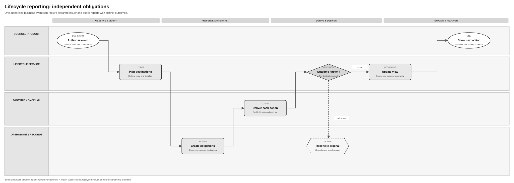

# Invoice Lifecycle Status Solution Specification

Terminology follows the [shared e-invoicing glossary](../context/GLO-SEI-001-e-invoicing-terminology.md). Local terms explain this feature; exact technical IDs, fields and source codes keep their stated meanings.

An **exchange action** is one separately tracked action to deliver an invoice, submit a public copy, or report an invoice event. Each action has its own result. For example, invoice delivery can succeed while public-copy submission still needs attention.

## Part 1 Feature Solution Summary

### Reader guide

Part 1 explains the scope, outcomes, people involved and open decisions. Start here for a stakeholder review. [Part 2](#part-2-logical-feature-specification) describes behaviour and controls. [Part 3](#part-3-logical-service-interactions-and-data-inventory) describes service interactions and records. [Part 4](#part-4-assurance-and-traceability-view) links the design to acceptance checks and release evidence.

This is a proposed design. The acceptance scenarios describe checks still to run; they do not prove that an implementation is ready. External status codes, country rules, service ownership and provider contracts require the evidence identified below.

### Plain-language terms

| Term | Meaning |
|---|---|
| Raw event | The original information received from a platform, product or authorised person, including its code, source and time. Keep it before interpreting its meaning. |
| Derived status | The current view calculated from saved events and approved rules. Keep the source events and rule version so the view can be explained or rebuilt. |
| Reporting obligation | A required report to a particular destination. Saving a buyer decision or payment fact does not prove that the report was delivered. |
| Presumed acceptance | Acceptance inferred under an approved country rule. Label it as derived; it is separate from an explicit buyer decision. |
| Outcome unknown | An external action may have happened, but reliable evidence of its result is missing. Check the original action before deciding whether a repeat is safe. |
| Country pack / provider binding | The selected country rules and provider-specific interpretation used for this event. A similar status label in another country does not establish the same meaning. |

### 1 Purpose, authority and scope

This **proposed logical design** turns authenticated invoice and network observations into an explainable lifecycle history and current customer view. It also coordinates any independent issuer/counterparty or public reporting obligations created by an authorised commercial or payment event. [PRD-SEI-224](../prds/PRD-SEI-224-lifecycle-rejection-payment-reporting.md) owns the Spain lifecycle outcome; [PRD-SEI-232](../prds/PRD-SEI-232-country-lifecycle-status-mapping.md) owns source-preserving country mapping; [PRD-SEI-242](../prds/PRD-SEI-242-peppol-lifecycle-feedback.md) supplies a source-specific Peppol feedback contract. [SPEC-SEI-007](SPEC-SEI-007-invoice-sending-solution.md) hands off outbound action evidence; [SPEC-SEI-006](SPEC-SEI-006-invoice-receiving-solution.md) hands off inbound receipt evidence. This spec owns the resulting event history, interpretation, obligations, recovery and product views.

The design distinguishes raw external vocabulary from Sage canonical events, derived status and ERP workflow state. Final Annex II and the supplied public catalogue now establish eight public communication codes. Their fields, local mapping and implemented calendar still need qualification. This design does not approve private-provider APIs, a universal status sequence, Peppol signal availability, payment authority, post-switch actor or retention period. Country pack, provider binding, endpoint and payload choices remain review gates.

### Public source baseline

The public catalogue and final Annex II now supply eight exact event codes and actor-specific fields. The lifecycle pack must use those meanings rather than earlier logical labels. Legal rollout dates, prepaid exception and source-date meanings remain separate from local payment facts and successful reporting.

See [REF Source references](#ref-source-references) for the original files, exact locations and source limits. The [technical evidence guide](../context/RES-SEI-002-spain-public-platform-technical-evidence.md) tracks shared source conflicts. The constraints below align this feature with the supplied public evidence; Sage implementation and activation remain gated.

### Where status information comes from

The **E-Invoice Service receives status information from public or private platforms**, and also receives authorised business events from the customer, ERP or a supporting payment service. These inputs have different sources and meanings.

| Journey | Direction and responsibility |
|---|---|
| Receive platform status information | Public/private platform → qualified connector or adapter → E-Invoice Service → ERP/customer. Save the original response, match it to the invoice and update only the status dimensions supported by that evidence. |
| Record a customer or ERP event | Customer/ERP → E-Invoice Service. Check authority and save the decision or payment fact. A supporting payment service can supply evidence under the approved payment rules. |
| Report an event when required | E-Invoice Service → required platform destinations → reporting result back to the E-Invoice Service. Track each report separately from the original business event. |

**Official evidence, checked 8 October 2026:** [AEAT's SPFE guidance](https://sede.agenciatributaria.gob.es/Sede/iva/factura-electronica/cuestiones-generales/solucion-publica-facturacion-electronica.html) confirms that invoices and their states are made available. [Order HAC/1028/2026, Article 10.2–10.3](https://www.boe.es/eli/es/o/2026/10/02/hac1028) provides status and payment consultation through web services or a form; technical conditions remain with AEAT. [AEAT's private-platform guidance](https://sede.agenciatributaria.gob.es/Sede/iva/factura-electronica/cuestiones-generales/plataformas-privadas-intercambio.html) includes payment-state communication in interconnection. This establishes the information flow, without approving a particular provider API.

For the public platform, the proposed integration includes authorised **status queries** through [SPEC-SEI-011](SPEC-SEI-011-public-platform-connector-solution-specification.md). Automatic platform notifications are used only if a confirmed contract supports them. Private-platform queries or notifications depend on the selected provider contract. Query cadence, filters, pagination, source freshness and supported status meanings need qualification. File retrieval under SPEC-SEI-010 and status consultation are separate activities; downloading an invoice is not a status update or buyer decision.

For example, a delivery update changes delivery information; it does not establish buyer acceptance or payment. A platform's acceptance of a payment report confirms that reporting action, while the payment fact retains its original actor and evidence. Receiving an already reported fact must not automatically report it again.

### Overview handoffs and historical context

The [responsibility overview](../assets/diagrams/spain-end-to-end-responsibility-overview.drawio) separates receiving facts, updating invoice status, sending required reports and recording each reporting result. Platform delivery information, buyer acceptance/rejection and payment facts keep their distinct actor, source and meaning. The E-Invoice Service updates the customer view from saved evidence and identifies applicable obligations; qualified adapters transmit each report and return its own result. A report can remain pending or outcome-unknown while the original business fact and supported invoice status are already visible. Receiving an already reported fact does not trigger another report.

The overview's LIF nodes are navigation IDs; LCS-01–10 remain this spec's activity IDs. LIF-01/03 map to LCS-01–04; LIF-07 maps to LCS-05/07/08; LIF-10/06/11 map to LCS-09/10 and per-destination evidence; LIF-09 maps to LCS-06. Reporting outcomes update the view independently and do not change buyer or payment facts.

The [shared connectivity and routing spec](SPEC-SEI-014-shared-platform-connectivity-and-routing-solution-specification.md) supplies qualified current/historical connection and executor context (SPC-06–08). This spec retains authority, interpretation and reporting ownership. After a platform change, resolve each earlier invoice's recorded operator and approved current actor/channel; do not send its reports through the new customer route by default.

### Spain use and reuse boundaries

This is a **Spain reference design**. Reuse classifications describe proposed behaviour, not proof that existing code is ready. **Reusable unchanged** means the design pattern can stay the same. **Reusable with country binding** needs approved local policies or adapters. **Country-specific** rules stay in the country pack. **Unknown** means implementation fitness or coverage still needs evidence.

This follows the [shared platform and country-pack direction](../prds/PRD-SEI-227-e-invoicing-as-a-service.md) and [country lifecycle mapping](../prds/PRD-SEI-232-country-lifecycle-status-mapping.md). Spain pilot or production use still depends on this spec’s approval and evidence gates. Another country needs its own event and reporting assessment.

| Area | Intended use in Spain | Reuse classification | Condition and owner |
|---|---|---|---|
| Raw history and independent views | Keep original source events, versions, duplicate/conflict links and separate status dimensions. | Reusable unchanged | Reuse the event-ledger, audit and derived-view patterns. Lifecycle, Records and Product. |
| Mapping and reporting orchestration | Interpret source events and create independently tracked reporting obligations. | Reusable with country binding | Bind local event catalogues, provider namespaces, actor authority, destination, calendar and deadline rules. Country owner, lifecycle and adapters. |
| Spain lifecycle and historical follow-up | Resolve Spain Article 10/12 events, public reporting and post-switch actors/channels. | Country-specific | Public raw codes and rollout dates now have source evidence. Field/authority binding, presumed-view policy, correction/replay, event deadlines and implementation conformance remain gates. Do not reuse French codes or another country’s legal meaning for Spain. Spain Legal/Tax and technical owner. |
| Existing lifecycle implementation | Assess event capture, projection, reporting and provider feedback support. | Unknown | No complete deployed lifecycle implementation is proven here. Peppol signals are source-specific inputs, not proof of the Spain reporting contract. Architecture and lifecycle/provider owners. |

### 2 Outcome dimensions and handoffs

The underlying projection keeps **technical processing, document validation, recipient delivery, commercial decision, payment information and reporting** independently queryable. Product UX may group the first three as “exchange”, then show commercial and payment separately; reporting progress and pending actions remain visible. One event may affect zero, one or several dimensions under a versioned rule. A technical acknowledgement never sets commercial acceptance or payment. An absent response is not an explicit approval; a presumed view, where approved, is labelled derived.

| Outcome | Observable result | Boundary |
|---|---|---|
| Event accepted | Authenticated source fact is durable with raw code/term, actor, route and version | Current customer status may still be unresolved |
| View derived | Independent dimensions, evidence age/source, conflicts and next actions are available | View is rebuildable, not the legal raw event record |
| Reporting pending/complete | One obligation per required event/destination, with deadline and outcome | Originating customer action is separate from delivery of its report |
| Unknown/conflicting | Raw observations persist; unsafe derivation or reporting pauses for owned reconciliation | No silent overwrite or false terminal state |
| Historical follow-up | Old invoice uses its recorded network context and approved actor/channel | Current route for new invoices is not substituted |

### 3 Process diagrams and text equivalent

Diagram step names use plain-language actions. The smaller activity references link to the detailed behaviour and checks below.

**Receive status information, interpret and update the view:** 

[Editable Draw.io](../assets/diagrams/lifecycle-event-derivation-process.drawio) · [PNG preview](../assets/diagrams/lifecycle-event-derivation-process.png). Text equivalent: a public/private platform supplies a status-query response or a supported notification; separately, a customer/ERP supplies an authorised business event → LCS-01 receives either input → LCS-02 authenticates actor, invoice and source namespace → LCS-03 adds the exact original fact to the record and duplicate/conflict link → LCS-04 applies the effective country/provider catalogue → LCS-05 derives independent dimensions with explicit source and rule evidence → LCS-06 notifies product after commit. Unknown code, unmatched invoice or conflict is preserved for LCS-10 rather than mapped to a guessed success.

**Report and reconcile obligations:** 

[Editable Draw.io](../assets/diagrams/lifecycle-reporting-reconciliation-process.drawio) · [PNG preview](../assets/diagrams/lifecycle-reporting-reconciliation-process.png). Text equivalent: a customer/ERP supplies an authorised rejection/payment fact → LCS-02/04 verifies it → LCS-07 calculates applicable historical-route destinations and approved deadline → LCS-08 creates one saved reporting obligation per destination → LCS-09 transmits each independently with stable identity → the public/private destination returns its reporting result when available; a missing or uncertain result after a possible external effect enters LCS-10, which observes the original operation before any repeat → LCS-05/06 update the view with per-destination evidence.

The existing [lifecycle and reporting overview](../assets/diagrams/e-invoicing-lifecycle-reporting.drawio) shows the cross-service relationship among technical, commercial and payment information. These two process diagrams show the detailed handoffs and exception paths.

### 4 Ordered lifecycle

| Activity | Trigger and postcondition | Owner |
|---|---|---|
| LCS-01 Receive | Public/private status-query response or supported notification, or a separate authorised product fact, enters saved intake with its source identity | Connector/adapter or product → E-Invoice Service |
| LCS-02 Verify | Invoice, tenant/entity, actor/role, source namespace and historical route correlate | Identity / lifecycle |
| LCS-03 Preserve | Immutable raw event and provenance/duplicate/conflict relation commit | Event ledger |
| LCS-04 Interpret | Effective country pack and provider binding yield canonical effects or unknown | Country pack / lifecycle |
| LCS-05 Derive | Independent status dimensions and pending actions are rebuilt with source/rule evidence | Projection |
| LCS-06 Publish | Customer-safe view/history and change notification become available | Product API / lifecycle |
| LCS-07 Plan obligations | Applicable actor, destination, historical route, deadline and rule version resolved | Country pack / lifecycle |
| LCS-08 Create obligations | One event/destination record persists with idempotency and dependency | Lifecycle |
| LCS-09 Deliver | Each destination action records attempt, raw result and observed state independently | Provider/public adapter |
| LCS-10 Reconcile | Unknown, late, duplicate, conflicting or missing outcomes get safe action and owner | Operations / lifecycle |

### 5 Decisions and risk controls

| Decision / impact | Owner and gate |
|---|---|
| Spain event catalogue, optional variants, technical codes, applicability and statutory deadline calendar | Spain Legal/Tax + local technical owner; country-pack approval |
| Public status-query contract and rejection/payment reporting, including query/idempotency semantics | Public-platform technical owner + Operations; external integration |
| Authority for recipient events and payment facts, including ERP/bank/operator conflict precedence | Product, Accounting, Legal, Banking Domain Service; design/pilot |
| Presumed acceptance rule and wording | Spain Legal + Product UX; design |
| Peppol process and actual MLR/MLS/Invoice Response signals by AP/provider | AP owner + Product; pilot |
| Historical Article 10/12 actor/channel after provider switch | Compliance/Tax + providers; migration/exit pilot |
| Event correction/supersession wire contract and raw/evidence retention | Local technical/Legal/Privacy; production |

Principal risks are “accepted” meaning several different things, missing callbacks hiding a status, duplicate public reports, late payment information falsely closing an invoice, and current-route data replacing the original network context. The append-only ledger, namespaced mapping, per-destination obligation ledger and source-qualified projection address these risks.

## Part 2 Logical Feature Specification

### 1 Identity, dimensions and invariants

The proposed aggregate key is (tenant, legalSubject, environment, invoiceBusinessIdentity, originalExchangeContext). The original exchange context contains route/operator/provider, direction, profile/process, source message and action identifiers, and effective plan/binding versions. External source event identity is (producer namespace, message type/profile/version, external event ID, invoice/action correlation, payload hash). Where no reliable external event ID exists, a governed fingerprint is used only to propose a duplicate; conflicting payloads are never discarded.

| ID | Invariant |
|---|---|
| LCS-I01 | Raw source code/term, reason, actor, source time, observed time, namespace and payload integrity reference remain immutable. |
| LCS-I02 | Mapping and current view are interpretations. They never replace raw evidence or collapse all dimensions to one linear state. |
| LCS-I03 | Country/provider codes, Peppol message codes, Sage canonical events, workflow states and internal IDs occupy separate namespaces. |
| LCS-I04 | A technical/admission/delivery observation cannot by itself prove explicit commercial approval, payment or authority reporting. |
| LCS-I05 | Presumed acceptance or overdue state is a labelled derived view with rule/time/evidence; it is not a fabricated source event. |
| LCS-I06 | One business event may create several independent reporting obligations; success or uncertainty of one cannot mutate another. |
| LCS-I07 | Duplicate observations retain provenance, while conflicting facts are held for authority/precedence review. |
| LCS-I08 | A route or mapping upgrade applies prospectively; an old invoice's follow-up uses original context unless approved country rules say otherwise. |
| LCS-I09 | Correcting an accepted fact appends an authorised superseding event and separate required reports; it never deletes the first fact. |

### 2 Detailed behaviour

**LCS-01 Receive.** Receive status information from the public platform through an authorised query via SPEC-SEI-011, or from a private platform through its qualified adapter. A supported platform notification is another intake path; automatic public notifications are not established by the official sources reviewed here. The E-Invoice Service owns status-refresh work for the authorised invoice scope and its original exchange context. Query scheduling, limits and progress follow the confirmed source contract. Preserve the query identity and observation time; a repeated unchanged query result does not create a new business event. A query failure or missing result leaves the last evidenced view with its freshness and next action; it does not imply success, buyer acceptance or payment.

Separately accept an authorised recipient/customer action, ERP accounting fact, or qualified banking/payment observation. Capture source network/producer, message type and profile/version, raw code/term/reason, exact payload reference/hash, occurredAt and observedAt, invoice and action references, actor role, environment and idempotency key. A bank observation is evidence for the banking service; it does not independently decide legal invoice payment status. Persist ingress intent before downstream mapping; retries with same identity/hash return the existing observation. A missed platform notification is recovered through a qualified source query where supported. A missed product notification is recovered by reading Sage lifecycle history; reading that history alone cannot discover an external update Sage has never received.

**LCS-02 Verify and correlate.** Authenticate source or user, then check legal entity, actor authority, event type, producer role, invoice identity, original route/process/action and applicable country-pack capability. For a customer command, authority and required data are rechecked before any external reporting. For an external observation, preserve even an unmatched or unrecognised event in restricted quarantine with source evidence; no arbitrary invoice is chosen. Cross-tenant and wrong-environment attempts are denied and audited. If a provider omits a signal type, record that capability gap; absence of a signal cannot be mapped to a positive outcome.

**LCS-03 Preserve and relate.** Append the raw event before mapping. Attach source/binding version, receipt sequence, original payload hash and relationship to duplicate-of, corrects, supersedes, disputes or derives-from as appropriate. Exact duplicate observations can share one business event while retaining delivery/provenance references. Distinct payloads with same asserted identity become a conflict case; earlier facts remain. Out-of-order events are stored with both occurrence and observation times. The ledger does not reorder or delete source truth to force a preferred current state.

**LCS-04 Interpret.** Resolve an effective-dated country lifecycle pack by country, process/document, direction, route, source namespace, producer role and event time. Apply a versioned provider binding that translates only transport shape and qualified raw source vocabulary; it cannot change country meaning. A Peppol MLS AP, Invoice Response AP and MLR AP remain distinct because message type/version and actor differ. A Spanish statutory event may have a term without a technical code; no French or Sage number is substituted. An unmapped value stays RAW_UNKNOWN and enters catalogue review. Map one raw event to zero or more independent dimension effects and obligation candidates with rule IDs/evidence.

**LCS-05 Derive projection.** Rebuild technical processing, document validation, recipient delivery, commercial, payment and reporting dimensions from accepted event effects, corrections, precedence and approved chronology. Retain latest relevant event IDs, source, evidence time/freshness, confidence, unresolved conflicts and next action for each dimension. Explicit acceptance and presumed acceptance are distinct. Full payment must follow an authorised source/effective date rule; repeated partial payments retain amount/currency and do not close the invoice merely because one event exists. A later rejection after delivery leaves delivery fact intact. Governed re-derivation after a mapping change records old/new mapping version and reason; historical source facts stay unchanged.

**LCS-06 Expose view and history.** Authorised product/API callers read current dimensions, raw/source-qualified history, supersession/conflict links and obligations with separate customer-safe and operations detail. Return view version and evidence freshness so a product can recover after missing a notification. Emit a change event only after durable ledger/projection commit; at-least-once consumers deduplicate by invoice/view version. A callback or event notification is not the authoritative history. Product wording says whether a buyer response is not expected, awaited or unknown only when selected process/capability evidence supports that distinction.

**LCS-07 Calculate obligation.** For an authorised event, country pack determines which issuer/counterparty, provider and public-solution destinations apply; it also calculates the approved deadline from event occurrence, country calendar/version and applicable rule. The invoice's original route/provider and access path are inputs. If the post-switch execution actor or technical channel is unconfirmed, create a blocked obligation with owner; do not send via the customer's current route by default. Optional event types are disabled until Product/Legal and provider capability approve them. Deadline calculation is versioned and auditable; no fixed delay is invented in this spec.

**LCS-08 Create independent obligations.** Persist one obligation per (source business event, destination, rule version, purpose) with stable identity, payload version, historical route, deadline, expected authority and state. A full rejection or full payment can therefore create issuer/counterparty and public obligations without creating a second commercial/payment event. An incoming platform update or repeated query result must not create another report merely because it was received. The approved source, actor and reporting rule determine whether a new obligation is needed. State is proposed PENDING, READY, SUBMITTED, ACKNOWLEDGED, COMPLETED, REJECTED_CORRECTABLE, RETRY_PENDING, OUTCOME_UNKNOWN, RECONCILING, BLOCKED or SUPERSEDED. A duplicate source event cannot create duplicate obligations. Correcting an already reported event creates a new supersession event and its own obligations under the approved external contract.

**LCS-09 Deliver and observe.** Before each external mutation, persist operation ID, exact event/payload hash, destination, adapter/contract version, idempotency scope and correlation. Execute only when actor/channel/capability and required data are approved. Record raw acknowledgement/reference and normalised delivery result at its actual evidence level. One destination's success cannot complete another. A definite validation rejection gives a correction owner; safe retry follows proved idempotency/read semantics and a versioned budget. Reporting acceptance is separate from invoice business status. Monitor approaching/missed deadline risk per obligation.

**LCS-10 Reconcile.** A timeout after possible mutation marks only that obligation OUTCOME_UNKNOWN; query authoritative state using original correlation before retry. Proven success commits once; proven absence permits retry only if the provider contract makes it safe. Unresolved/unsupported query opens a manual operations case. Unknown, late, conflicting or regressive source events also open a case where authority, chronology or mapping cannot be decided automatically. Preserve all observations; append resolution/correction evidence. After route switch, reconcile through the original invoice/provider context, retaining purpose-bound access under [offboarding controls](SPEC-SEI-003-offboarding-solution-specification.md).

### 3 Requirements and quality controls

| ID | Requirement / source |
|---|---|
| LCS-R01 | Preserve raw source events with namespace, actor, time, identity, hash and versions before mapping; PRD-SEI-224 FR1–3 and PRD-SEI-232 LS-FR1/14. |
| LCS-R02 | Map only through effective country pack/provider binding; unknown codes stay raw and cannot advance status; PRD-SEI-232 LS-FR2/12/16. |
| LCS-R03 | Keep independent technical, document, delivery, commercial, payment and reporting dimensions; explicit versus derived distinct; PRD-SEI-224 FR3–4/18. |
| LCS-R04 | Validate actor/authority, event applicability and required data before reporting; PRD-SEI-224 FR1/5. |
| LCS-R05 | Calculate destinations/deadlines from approved policy and historical invoice context; PRD-SEI-224 FR6–10. |
| LCS-R06 | Persist and deliver each event/destination obligation independently and idempotently; PRD-SEI-224 FR8/11–13. |
| LCS-R07 | Preserve duplicate, late, conflicting and superseding evidence; pause unsafe projection/reporting; PRD-SEI-224 FR14–17. |
| LCS-R08 | Expose current view, full authorised history, pending actions, obligation outcomes and missed-notification recovery; PRD-SEI-224 FR18–23, PRD-SEI-242 PEP-FR9. |
| LCS-R09 | Interpret Peppol transport, MLR, MLS and Invoice Response only in their qualified namespaces; PRD-SEI-242 PEP-FR2–6. |
| LCS-R10 | Retain original route/process/mapping context after provider change; PRD-SEI-224 FR9 and PRD-SEI-242 PEP-FR10. |
| LCS-R11 | Receive public/private platform status evidence through qualified queries or supported notifications. Separate source refresh from Sage history reads, file retrieval and outgoing reports; Order HAC/1028/2026 Article 10 and PRD-SEI-242. |

Encrypt sensitive invoice, payment and authority evidence; enforce tenant/legal-entity/environment and delegated-access checks on commands, reads, subscriptions and operations actions. Logs and broad metrics use redacted references, never raw bank/payment payloads or credentials. Version mapping, calendar, provider binding and derivation rules for historical reproduction. Monitor source lag, event-to-product lag, unknown mapping, duplicate/conflict rate, obligation age/deadline risk, missed notification recovery, unknown outcome and historical-route failures. Targets require approved volumes and baselines.

### SPFE source contract binding

The following raw codes and field meanings come from final Annex II and the public catalogue. Each report also carries the stated invoice series/number, issue date, seller NIF and seller-name fields. Keep these separate from the authenticated caller and local event/obligation IDs. The table defines source meaning; executable mapping and ambiguous wire fields still require qualification.

| Actor / raw `ResponseCode` | Meaning and required content | Conditional content or correction rule | REF |
|---|---|---|---|
| Recipient / `PAYMENT` | Effective payment in full. `cbc:EffectiveDate` is payment date; `DueDate` is required. No public partial-payment amount. | Relevant `ShipmentDate`/`ReceptionDate`; source `CorrectedInvoice`/`NegativeAmountInvoice` indicators. Article 7.4 prepaid exception is a separate obligation rule. | SPFE-S02 pp. 36–37; SPFE-S03 pp. 16–17. |
| Recipient / `CANCELPAYMENT` | Cancels the earlier payment communication for the referenced invoice. | Qualify cancellation before corrected reporting; preserve the payment fact and cancellation lineage separately. | SPFE-S02 p. 37; SPFE-S03 p. 17. |
| Recipient / `REJECTION` | Rejection date and `ConditionCode`: `01` commercial rejection; `02` private consumption or not related to business activity. | Mutually exclusive with recipient PAYMENT. Rejection reason is a source value, not a free-form replacement code. | SPFE-S02 pp. 38–39/42; SPFE-S03 pp. 16–17. |
| Recipient / `CANCELREJECTION` | Cancels the earlier commercial rejection communication. | Return only the supported presumed/source view; do not fabricate explicit buyer acceptance. | SPFE-S02 pp. 38–39; SPFE-S03 p. 17. |
| Issuer / `SETTLEMENT` | Effective collection in full; `cbc:EffectiveDate` is collection date. | Due date, relevant receipt dates and `FinancingArrangement` under the stated conditions; exact indicator serialization remains open. | SPFE-S02 pp. 39–40; SPFE-S03 pp. 18–19. |
| Issuer / `CANCELSETTLEMENT` | Cancels the earlier collection communication. | Reconcile cancellation before a corrected collection report. | SPFE-S02 p. 40; SPFE-S03 pp. 18–19. |
| Issuer / `DEFAULT` | Non-payment information; `cbc:EffectiveDate` means the payment due date. | Relevant receipt dates; mutually exclusive with issuer SETTLEMENT. A local observation time is not the due date. | SPFE-S02 pp. 41–42; SPFE-S03 pp. 18–19. |
| Issuer / `CANCELDEFAULT` | Cancels the earlier non-payment communication. | Retain historical report and current business facts; no invoice withdrawal. | SPFE-S02 p. 42; SPFE-S03 p. 19. |

The source facts below govern the public binding. Recovery, storage and qualification actions are proposed Sage controls where stated. Apply them through LCS-01–05, LCS-07–10. Source conflicts stay open under country event/field/calendar and correction gates; SPFE-Q07/Q13/Q15/Q16/Q17/Q18; they are not resolved by a local default.

| ID | Constraint and required behaviour | Source reference |
|---|---|---|
| LCS-SPFE-R01 Preserve the eight external codes and their actors | The Spain public binding uses recipient PAYMENT/CANCELPAYMENT/REJECTION/CANCELREJECTION and issuer SETTLEMENT/CANCELSETTLEMENT/DEFAULT/CANCELDEFAULT. Preserve the raw code and source; never use a cancellation code to withdraw the invoice or infer a new buyer/payment fact from report admission. | SPFE-S02 Annex II; SPFE-S03 sections 6.8–6.9; [REF](#ref-source-references). |
| LCS-SPFE-R02 Bind each event field to its source meaning | LCS-02/04 require the Annex II invoice references and each communication's fields. PAYMENT requires payment and due dates; REJECTION requires date and reason 01/02; SETTLEMENT requires collection date; DEFAULT EffectiveDate means due date. Preserve conditional receipt/financing and correction/negative-invoice indicators. An absent or conflicting wire binding holds the report with its owner. | SPFE-S02 Annex II; SPFE-Q16; [REF](#ref-source-references). |
| LCS-SPFE-R03 Correct reports without collapsing business facts | PAYMENT and REJECTION are mutually exclusive; SETTLEMENT and DEFAULT are mutually exclusive within the issuer view. Report only full payment/collection to these public actions, while retaining internal partial-payment facts. Qualify prior-report cancellation before its correction/replacement; reconcile an uncertain cancellation before sending another mutation. | SPFE-S03 sections 6.8–6.9; proposed recovery control; [REF](#ref-source-references). |
| LCS-SPFE-R04 Apply the correct obligation and calendar | LCS-07 selects the source-backed recipient reporting obligation, optional issuer information, Article 7.4 prepaid exception and customer transition separately. Keep the 2027/2028/2029 rollout dates distinct from event deadlines. Article 8.4 exceptional outage handling needs attributed SPFE incident evidence and its working-day calendar. A prepaid field alone or a later app connection change cannot close the duty. | SPFE-S02 Articles 7.2/7.4/8.4; REF-CAL; [REF](#ref-source-references). |

## Part 3 Logical Service Interactions and Data Inventory

### Spain and reuse boundary in contracts

Keep the raw-event, independent-dimension and reporting-obligation models shared. Select interpretation and destinations through approved country packs and provider bindings. Raw source codes and Peppol message namespaces remain separate from Sage’s common events; a matching label does not establish the same business or legal meaning.

Spain Article 10/12 reporting, presumed acceptance, deadlines and historical actors/channels must not become universal defaults. Keep mapping, calendar and binding versions with each result. Reuse assessment must record the existing implementation or design pattern, local changes, missing functions, owner and qualification evidence before the dependent release gate passes. Exact physical APIs remain proposed.

### 1 Interaction contracts

These are proposed logical operations, not approved endpoints. Each command/observation carries eventId or idempotencyKey, tenant/legalSubject/environment, invoice and original route/action references, source namespace/type/version, actor/source authority, occurredAt, observedAt, payload reference/hash and expectedVersion as applicable. Responses distinguish accepted fact, mapped effect, obligation state and current view.

| ID | Caller → owner | Contract and failure semantics |
|---|---|---|
| LCS-INT-01 | Public connector/private adapter/exchange/receiving/product → E-Invoice Service lifecycle intake | Submit a source status-query result, supported platform notification or authorised fact; immutable receipt, duplicate-safe; unmatched/conflicting retained for review. |
| LCS-INT-02 | Lifecycle → identity/invoice registry | Resolve invoice, legal entity, actor/producer role, original route/process and access; unknown/denied blocks action. |
| LCS-INT-03 | Lifecycle → country pack/provider binding | Interpret namespaced source event with effective versions; returns dimension effects/obligation candidates or RAW_UNKNOWN. |
| LCS-INT-04 | Lifecycle → projection | Rebuild dimensions and source-qualified current view from ledger/version; returns view ID/version and conflicts. |
| LCS-INT-05 | ERP/product → lifecycle | Record supported rejection/acceptance/payment fact or supersession; authority/version checks; returns event and obligations. |
| LCS-INT-06 | Lifecycle → obligation planner | Calculate destination, historical actor/channel and approved deadline; unresolved gate returns BLOCKED with owner. |
| LCS-INT-07 | Lifecycle → provider/public adapter | Execute one obligation with frozen payload/idempotency identity; returns raw response or OUTCOME_UNKNOWN. |
| LCS-INT-08 | Operations → adapter/lifecycle | Reconcile original external operation or resolve conflict with source evidence/approval; no blind replay. |
| LCS-INT-09 | Product/operations → lifecycle | Read current dimensions, history and obligations with pagination/version and redacted role-specific fields. |
| LCS-INT-10 | Lifecycle → product | Publish committed view/obligation change at least once; consumer deduplicates and can recover missed events by authoritative read. |
| LCS-INT-11 | E-Invoice Service → public connector/private adapter → platform | Query supported invoice status/payment information within authorised entity, environment and original invoice context. Return raw source evidence, query correlation and observation time; an unsupported query or failed read leaves status freshness visible. Exact APIs, cadence and limits remain open. |

Proposed notifications are LIFECYCLE_EVENT_RECORDED, LIFECYCLE_VIEW_CHANGED, LIFECYCLE_OBLIGATION_CHANGED and LIFECYCLE_RECONCILIATION_REQUIRED. They contain stable IDs, versions and safe status, not raw invoice/payment content. Provider callbacks may arrive out of order; the ledger is authoritative.

### 2 Data inventory

| ID | Record / owner | Essential fields and handling | Consumer |
|---|---|---|---|
| LCS-D01 | Raw lifecycle event / lifecycle ledger | External term/code/reason, namespace/message/profile, producer/actor, query/notification correlation, occurred/observed time, invoice/action, route, payload hash/ref, binding version; immutable/restricted | LCS-01–06/10 |
| LCS-D02 | Event relationship / lifecycle | Duplicate-of, corrects/supersedes, disputes, derives-from, conflict group and resolution; append-only | LCS-03–06/10 |
| LCS-D03 | Invoice network context / exchange/receiving | Original route/operator/provider, message IDs, issue/receipt identity, direction, process/profile and versions; immutable | LCS-02/07–10 |
| LCS-D04 | Country catalogue/binding / country owner + adapter | Source namespace, raw vocabulary, actor/phase, effective period, mapping effects, obligations, deadline/calendar rules and approved version | LCS-04/05/07 |
| LCS-D05 | Mapped event effect / lifecycle | Raw event ID, mapping/binding version, dimension effects, confidence, rule IDs and unknown flag; versioned | LCS-05–08 |
| LCS-D06 | Current projection / lifecycle | Independent dimension facts, source event IDs, derivation version/time, evidence age, conflict and next action; rebuildable | LCS-05/06 |
| LCS-D07 | Reporting obligation / lifecycle | Event/destination/purpose, actor/channel, historical route, rule/deadline/version, payload hash and state; restricted | LCS-07–10 |
| LCS-D08 | Delivery attempt/observation / adapter | Operation/idempotency ID, destination, raw response, external ref, safety class and observed state; append-only | LCS-09/10 |
| LCS-D09 | Reconciliation case / operations | Conflicting/unknown refs, evidence, owner, deadline, unsafe actions, manual approval and resolution; restricted | LCS-10 |
| LCS-D10 | Product notification cursor / lifecycle/product | Invoice/view version, event ID, delivery/replay state; rebuildable | LCS-06/10 |

Payment facts and authority evidence have tighter access than generic technical status. Exact retention is an approved legal/privacy policy by country and data class; route exit cannot delete an unfinished obligation's required evidence. A projection can be rebuilt, but D01/D03/D07/D08 preserve the historic interpretation and external outcome.

### Annex II event field traceability

The table records all 52 source field/group occurrences for this feature. Each trace ID identifies one row in the [field ledger](../assets/regulatory/spain/spfe/field-traceability.json). The ledger retains the original Spanish description, conditional rules, semantic type, literal UBL path and exact BOE XML row locator. Repeated source IDs remain separate occurrences. English names aid reading; the Spanish source controls the meaning.

Each listed requirement applies the source meaning, type, presence conditions, cardinality and controlled values through the selected customer/supplier event path. Cardinality is evaluated within its selected parent group, not as a universal invoice requirement. Preserve applicable content and reject unsupported mappings. For each row, the positive case uses an approved applicable fixture and tests valid content and permitted absence. The negative case violates an applicable source condition, type, cardinality or controlled value and must fail safely. These are specified acceptance cases, not executed tests. Actual ERP/API bindings, business schemas, executable rules and DTS coverage remain unqualified under SPFE-Q04/Q16 and the event/authority qualification gates. A recorded source path is not proof of a valid implementation path.

| Trace / source ID | Logical fact or group | Source cardinality | Requirement | Acceptance: positive / negative |
|---|---|---|---|---|
| `AXII-PAYMENT-01` / `PAYMENT` | Effective payment date | `1..1` | `LCS-AXII-PAYMENT-R01` | `LCS-AXII-PAYMENT-A01P` / `LCS-AXII-PAYMENT-A01N` |
| `AXII-PAYMENT-02` / `PAYMENT` | Payment due date | `1..1` | `LCS-AXII-PAYMENT-R02` | `LCS-AXII-PAYMENT-A02P` / `LCS-AXII-PAYMENT-A02N` |
| `AXII-PAYMENT-03` / `PAYMENT` | Goods/services receipt date | `0..1` | `LCS-AXII-PAYMENT-R03` | `LCS-AXII-PAYMENT-A03P` / `LCS-AXII-PAYMENT-A03N` |
| `AXII-PAYMENT-04` / `PAYMENT` | Invoice receipt date | `0..1` | `LCS-AXII-PAYMENT-R04` | `LCS-AXII-PAYMENT-A04P` / `LCS-AXII-PAYMENT-A04N` |
| `AXII-PAYMENT-05` / `PAYMENT` | Corrected invoice indicator | `0..1` | `LCS-AXII-PAYMENT-R05` | `LCS-AXII-PAYMENT-A05P` / `LCS-AXII-PAYMENT-A05N` |
| `AXII-PAYMENT-06` / `PAYMENT` | Negative corrective invoice indicator | `0..1` | `LCS-AXII-PAYMENT-R06` | `LCS-AXII-PAYMENT-A06P` / `LCS-AXII-PAYMENT-A06N` |
| `AXII-PAYMENT-07` / `PAYMENT` | Referenced invoice group | `1..1` | `LCS-AXII-PAYMENT-R07` | `LCS-AXII-PAYMENT-A07P` / `LCS-AXII-PAYMENT-A07N` |
| `AXII-PAYMENT-08` / `PAYMENT` | Invoice series and number | `1..1` | `LCS-AXII-PAYMENT-R08` | `LCS-AXII-PAYMENT-A08P` / `LCS-AXII-PAYMENT-A08N` |
| `AXII-PAYMENT-09` / `PAYMENT` | Invoice issue date | `1..1` | `LCS-AXII-PAYMENT-R09` | `LCS-AXII-PAYMENT-A09P` / `LCS-AXII-PAYMENT-A09N` |
| `AXII-PAYMENT-10` / `PAYMENT` | Seller NIF in the invoice reference | `1..1` | `LCS-AXII-PAYMENT-R10` | `LCS-AXII-PAYMENT-A10P` / `LCS-AXII-PAYMENT-A10N` |
| `AXII-PAYMENT-11` / `PAYMENT` | Seller name | `1..1` | `LCS-AXII-PAYMENT-R11` | `LCS-AXII-PAYMENT-A11P` / `LCS-AXII-PAYMENT-A11N` |
| `AXII-CANCELPAYMENT-01` / `CANCELPAYMENT` | Invoice series and number | `1..1` | `LCS-AXII-CANCELPAYMENT-R01` | `LCS-AXII-CANCELPAYMENT-A01P` / `LCS-AXII-CANCELPAYMENT-A01N` |
| `AXII-CANCELPAYMENT-02` / `CANCELPAYMENT` | Invoice issue date | `1..1` | `LCS-AXII-CANCELPAYMENT-R02` | `LCS-AXII-CANCELPAYMENT-A02P` / `LCS-AXII-CANCELPAYMENT-A02N` |
| `AXII-CANCELPAYMENT-03` / `CANCELPAYMENT` | Seller NIF in the invoice reference | `1..1` | `LCS-AXII-CANCELPAYMENT-R03` | `LCS-AXII-CANCELPAYMENT-A03P` / `LCS-AXII-CANCELPAYMENT-A03N` |
| `AXII-CANCELPAYMENT-04` / `CANCELPAYMENT` | Seller name | `1..1` | `LCS-AXII-CANCELPAYMENT-R04` | `LCS-AXII-CANCELPAYMENT-A04P` / `LCS-AXII-CANCELPAYMENT-A04N` |
| `AXII-REJECTION-01` / `REJECTION` | Rejection date | `1..1` | `LCS-AXII-REJECTION-R01` | `LCS-AXII-REJECTION-A01P` / `LCS-AXII-REJECTION-A01N` |
| `AXII-REJECTION-02` / `REJECTION` | Rejection reason code | `1..1` | `LCS-AXII-REJECTION-R02` | `LCS-AXII-REJECTION-A02P` / `LCS-AXII-REJECTION-A02N` |
| `AXII-REJECTION-03` / `REJECTION` | Referenced invoice group | `1..1` | `LCS-AXII-REJECTION-R03` | `LCS-AXII-REJECTION-A03P` / `LCS-AXII-REJECTION-A03N` |
| `AXII-REJECTION-04` / `REJECTION` | Invoice series and number | `1..1` | `LCS-AXII-REJECTION-R04` | `LCS-AXII-REJECTION-A04P` / `LCS-AXII-REJECTION-A04N` |
| `AXII-REJECTION-05` / `REJECTION` | Invoice issue date | `1..1` | `LCS-AXII-REJECTION-R05` | `LCS-AXII-REJECTION-A05P` / `LCS-AXII-REJECTION-A05N` |
| `AXII-REJECTION-06` / `REJECTION` | Seller NIF in the invoice reference | `1..1` | `LCS-AXII-REJECTION-R06` | `LCS-AXII-REJECTION-A06P` / `LCS-AXII-REJECTION-A06N` |
| `AXII-REJECTION-07` / `REJECTION` | Seller name | `1..1` | `LCS-AXII-REJECTION-R07` | `LCS-AXII-REJECTION-A07P` / `LCS-AXII-REJECTION-A07N` |
| `AXII-CANCELREJECTION-01` / `CANCELREJECTION` | Invoice series and number | `1..1` | `LCS-AXII-CANCELREJECTION-R01` | `LCS-AXII-CANCELREJECTION-A01P` / `LCS-AXII-CANCELREJECTION-A01N` |
| `AXII-CANCELREJECTION-02` / `CANCELREJECTION` | Invoice issue date | `1..1` | `LCS-AXII-CANCELREJECTION-R02` | `LCS-AXII-CANCELREJECTION-A02P` / `LCS-AXII-CANCELREJECTION-A02N` |
| `AXII-CANCELREJECTION-03` / `CANCELREJECTION` | Seller NIF in the invoice reference | `1..1` | `LCS-AXII-CANCELREJECTION-R03` | `LCS-AXII-CANCELREJECTION-A03P` / `LCS-AXII-CANCELREJECTION-A03N` |
| `AXII-CANCELREJECTION-04` / `CANCELREJECTION` | Seller name | `1..1` | `LCS-AXII-CANCELREJECTION-R04` | `LCS-AXII-CANCELREJECTION-A04P` / `LCS-AXII-CANCELREJECTION-A04N` |
| `AXII-SETTLEMENT-01` / `SETTLEMENT` | Effective collection date | `1..1` | `LCS-AXII-SETTLEMENT-R01` | `LCS-AXII-SETTLEMENT-A01P` / `LCS-AXII-SETTLEMENT-A01N` |
| `AXII-SETTLEMENT-02` / `SETTLEMENT` | Payment due date | `0..1` | `LCS-AXII-SETTLEMENT-R02` | `LCS-AXII-SETTLEMENT-A02P` / `LCS-AXII-SETTLEMENT-A02N` |
| `AXII-SETTLEMENT-03` / `SETTLEMENT` | Financing arrangement indicator | `0..1` | `LCS-AXII-SETTLEMENT-R03` | `LCS-AXII-SETTLEMENT-A03P` / `LCS-AXII-SETTLEMENT-A03N` |
| `AXII-SETTLEMENT-04` / `SETTLEMENT` | Goods/services receipt date | `0..1` | `LCS-AXII-SETTLEMENT-R04` | `LCS-AXII-SETTLEMENT-A04P` / `LCS-AXII-SETTLEMENT-A04N` |
| `AXII-SETTLEMENT-05` / `SETTLEMENT` | Invoice receipt date | `0..1` | `LCS-AXII-SETTLEMENT-R05` | `LCS-AXII-SETTLEMENT-A05P` / `LCS-AXII-SETTLEMENT-A05N` |
| `AXII-SETTLEMENT-06` / `SETTLEMENT` | Referenced invoice group | `1..1` | `LCS-AXII-SETTLEMENT-R06` | `LCS-AXII-SETTLEMENT-A06P` / `LCS-AXII-SETTLEMENT-A06N` |
| `AXII-SETTLEMENT-07` / `SETTLEMENT` | Invoice series and number | `1..1` | `LCS-AXII-SETTLEMENT-R07` | `LCS-AXII-SETTLEMENT-A07P` / `LCS-AXII-SETTLEMENT-A07N` |
| `AXII-SETTLEMENT-08` / `SETTLEMENT` | Invoice issue date | `1..1` | `LCS-AXII-SETTLEMENT-R08` | `LCS-AXII-SETTLEMENT-A08P` / `LCS-AXII-SETTLEMENT-A08N` |
| `AXII-SETTLEMENT-09` / `SETTLEMENT` | Seller NIF in the invoice reference | `1..1` | `LCS-AXII-SETTLEMENT-R09` | `LCS-AXII-SETTLEMENT-A09P` / `LCS-AXII-SETTLEMENT-A09N` |
| `AXII-SETTLEMENT-10` / `SETTLEMENT` | Seller name | `1..1` | `LCS-AXII-SETTLEMENT-R10` | `LCS-AXII-SETTLEMENT-A10P` / `LCS-AXII-SETTLEMENT-A10N` |
| `AXII-CANCELSETTLEMENT-01` / `CANCELSETTLEMENT` | Invoice series and number | `1..1` | `LCS-AXII-CANCELSETTLEMENT-R01` | `LCS-AXII-CANCELSETTLEMENT-A01P` / `LCS-AXII-CANCELSETTLEMENT-A01N` |
| `AXII-CANCELSETTLEMENT-02` / `CANCELSETTLEMENT` | Invoice issue date | `1..1` | `LCS-AXII-CANCELSETTLEMENT-R02` | `LCS-AXII-CANCELSETTLEMENT-A02P` / `LCS-AXII-CANCELSETTLEMENT-A02N` |
| `AXII-CANCELSETTLEMENT-03` / `CANCELSETTLEMENT` | Seller NIF in the invoice reference | `1..1` | `LCS-AXII-CANCELSETTLEMENT-R03` | `LCS-AXII-CANCELSETTLEMENT-A03P` / `LCS-AXII-CANCELSETTLEMENT-A03N` |
| `AXII-CANCELSETTLEMENT-04` / `CANCELSETTLEMENT` | Seller name | `1..1` | `LCS-AXII-CANCELSETTLEMENT-R04` | `LCS-AXII-CANCELSETTLEMENT-A04P` / `LCS-AXII-CANCELSETTLEMENT-A04N` |
| `AXII-DEFAULT-01` / `DEFAULT` | Payment due date | `1..1` | `LCS-AXII-DEFAULT-R01` | `LCS-AXII-DEFAULT-A01P` / `LCS-AXII-DEFAULT-A01N` |
| `AXII-DEFAULT-02` / `DEFAULT` | Goods/services receipt date | `0..1` | `LCS-AXII-DEFAULT-R02` | `LCS-AXII-DEFAULT-A02P` / `LCS-AXII-DEFAULT-A02N` |
| `AXII-DEFAULT-03` / `DEFAULT` | Invoice receipt date | `0..1` | `LCS-AXII-DEFAULT-R03` | `LCS-AXII-DEFAULT-A03P` / `LCS-AXII-DEFAULT-A03N` |
| `AXII-DEFAULT-04` / `DEFAULT` | Referenced invoice group | `1..1` | `LCS-AXII-DEFAULT-R04` | `LCS-AXII-DEFAULT-A04P` / `LCS-AXII-DEFAULT-A04N` |
| `AXII-DEFAULT-05` / `DEFAULT` | Invoice series and number | `1..1` | `LCS-AXII-DEFAULT-R05` | `LCS-AXII-DEFAULT-A05P` / `LCS-AXII-DEFAULT-A05N` |
| `AXII-DEFAULT-06` / `DEFAULT` | Invoice issue date | `1..1` | `LCS-AXII-DEFAULT-R06` | `LCS-AXII-DEFAULT-A06P` / `LCS-AXII-DEFAULT-A06N` |
| `AXII-DEFAULT-07` / `DEFAULT` | Seller NIF in the invoice reference | `1..1` | `LCS-AXII-DEFAULT-R07` | `LCS-AXII-DEFAULT-A07P` / `LCS-AXII-DEFAULT-A07N` |
| `AXII-DEFAULT-08` / `DEFAULT` | Seller name | `1..1` | `LCS-AXII-DEFAULT-R08` | `LCS-AXII-DEFAULT-A08P` / `LCS-AXII-DEFAULT-A08N` |
| `AXII-CANCELDEFAULT-01` / `CANCELDEFAULT` | Invoice series and number | `1..1` | `LCS-AXII-CANCELDEFAULT-R01` | `LCS-AXII-CANCELDEFAULT-A01P` / `LCS-AXII-CANCELDEFAULT-A01N` |
| `AXII-CANCELDEFAULT-02` / `CANCELDEFAULT` | Invoice issue date | `1..1` | `LCS-AXII-CANCELDEFAULT-R02` | `LCS-AXII-CANCELDEFAULT-A02P` / `LCS-AXII-CANCELDEFAULT-A02N` |
| `AXII-CANCELDEFAULT-03` / `CANCELDEFAULT` | Seller NIF in the invoice reference | `1..1` | `LCS-AXII-CANCELDEFAULT-R03` | `LCS-AXII-CANCELDEFAULT-A03P` / `LCS-AXII-CANCELDEFAULT-A03N` |
| `AXII-CANCELDEFAULT-04` / `CANCELDEFAULT` | Seller name | `1..1` | `LCS-AXII-CANCELDEFAULT-R04` | `LCS-AXII-CANCELDEFAULT-A04P` / `LCS-AXII-CANCELDEFAULT-A04N` |

Each code-table occurrence has a separate domain. The linked ledger preserves every source code and description. The listed requirement accepts only values in the applicable source domain; its positive/negative cases test a valid value and a value outside that domain. Identical code text in another domain does not grant validity. Namespace and executable rule bindings remain open.

| Code-table trace | Source context | Requirement | Acceptance: positive / negative |
|---|---|---|---|
| `AX-CODE-15` | L1 – Motivos de rechazo | `LCS-CODE-R15` | `LCS-CODE-A15P` / `LCS-CODE-A15N` |

## Part 4 Assurance and Traceability View

| Scenario | Requirement → activity / interaction / data | Expected evidence |
|---|---|---|
| LCS-A01 Delivery without buyer decision | R01–03 → LCS-01–06, INT-01–04/09, D01/05/06 | Delivery fact shown; explicit acceptance and payment remain unset. |
| LCS-A02 Peppol code collision | R02/09 → LCS-03/04, INT-03, D01/04/05 | MLS AP and Invoice Response AP retain distinct namespaces and effects. |
| LCS-A03 Explicit rejection | R04–06 → LCS-02–09, INT-05–07, D01/07/08 | One source rejection; independently tracked issuer and public obligations when required. |
| LCS-A04 Full payment versus bank observation | R03–06 → LCS-02/04/07, INT-01/05/06, D01/05/07 | Approved actor/effective date determine event; bank movement alone does not settle legal view. |
| LCS-A05 Presumed acceptance | R03 → LCS-05/06, INT-04/09, D05/06 | Labelled derived rule/time; no explicit acceptance event fabricated. |
| LCS-A06 Duplicate and conflicting facts | R07 → LCS-03/10, INT-01/08, D01/02/09 | Provable duplicate links; conflicting payment pauses unsafe closure/reporting. |
| LCS-A07 Late or out-of-order event | R07 → LCS-03–05/10, INT-03/04/08, D01/05/06 | Raw chronology retained; governed projection, no silent regression. |
| LCS-A08 One reporting action times out | R06 → LCS-08–10, INT-07/08, D07–09 | Known action stays complete; only unknown original action reconciles. |
| LCS-A09 Provider switch | R05/10 → LCS-02/07–10, INT-02/06–08, D03/07/08 | Old invoice uses original actor/channel; current new-invoice route does not overwrite. |
| LCS-A10 Missed platform or product notification | R08/11 → LCS-01/06, INT-01/09–11, D01/06/10 | A missed platform update is recovered from a qualified source query. A missed product notification is recovered from Sage history. Neither path duplicates the business event or its reports. |
| LCS-A11 Unknown Spain/provider code | R02/07 → LCS-03/04/10, INT-03/08, D01/04/09 | Raw code preserved, projection not falsely advanced, mapping review owned. |
| LCS-A12 Superseding payment/rejection | R07 → LCS-03/07–09, INT-05–07, D01/02/07 | Original event remains; approved new event and obligations carry correction link. |
| LCS-A13 Country mapping and reporting isolation | R01–05/09/10 → LCS-03–05/07, INT-03/04/06, D01/03–07 | The shared ledger preserves source vocabulary while each country uses its own approved mapping, actor, calendar and reporting rules. France or Peppol labels do not imply Spain equivalence. A pack change does not affect another country or overwrite earlier source events. |
| LCS-A14 Reused lifecycle implementation | R01–03/06–09 → LCS-03–10, INT-03–10, D01/D04–D10 | Record the selected source capability and build, Spain changes, gaps, owner and qualification evidence. Prove the selected event capture, mapping, reporting and recovery contracts before enabling them. An unavailable or unqualified capability remains blocked; reuse of a proposed design pattern is separate from reuse of a tested implementation. |
| LCS-A15 Public status consultation | R01–03/11 → LCS-01–06, INT-01–04/09/11, D01/03–06 | An authorised public query returns source status/payment evidence for the correct invoice. Preserve the response and update the qualified dimensions. A denied or failed query leaves evidence age visible without inventing a status. |
| LCS-A16 Incoming update versus outgoing report | R01/03/06/11 → LCS-01–09, INT-01/05–07/11, D01/05–08 | Public/private updates and customer/ERP events enter separately. Repeated source evidence cannot trigger duplicate reports. A report acknowledgement updates reporting progress without fabricating buyer acceptance or payment. |
| LCS-A17 Overview status and reporting separation | R01–06/08; SPEC-SEI-014 SPC-06–08; LCS-01–10 | Platform delivery evidence cannot set buyer acceptance/payment. An authorised business fact updates supported status while its separate report is pending; per-destination success/failure/unknown is visible without reporting the incoming fact again or switching an earlier invoice to the new route. |

**Review gate:** agree country event catalogue, actor authority, mapping namespaces/precedence, deadline calendar, optional scope and response expectations. **Pilot gate:** prove source authenticity, duplicate/out-of-order/conflict, full rejection/payment, independently failing destinations, unknown mutation, missed callback and historical-route cases with actual provider/public contracts. **Production gate:** approved Spain technical rules and external APIs, named e-invoicing and banking domain owners where relevant, support/operations runbooks, measurable monitoring/deadline headroom, privacy/retention and conformance evidence. Until the open decisions in Part 1 are resolved, affected reporting or derived acceptance paths remain disabled or visibly manual.

### SPFE evidence acceptance

The field and code-table acceptance IDs in Part 3 also form required evidence coverage. Execute them with approved fixtures and pinned rules before activation. The ledger records their current status as not executed; row coverage alone does not close implementation qualification.

These are required evidence scenarios, not executed implementation tests. The source-binding gate is country event/field/calendar and correction gates; SPFE-Q07/Q13/Q15/Q16/Q17/Q18. A source-backed review does not establish that this feature is ready for production.

| ID | Scenario | Required result | Requirement coverage |
|---|---|---|---|
| LCS-SPFE-A01 | All eight codes plus an unknown code or wrong actor | Preserve source vocabulary and field requirements; hold unknown/wrong-role reports. No invoice withdrawal or fabricated payment from technical response. | LCS-SPFE-R01/LCS-SPFE-R02; LCS-01–05, LCS-07–10; [REF](#ref-source-references). |
| LCS-SPFE-A02 | PAYMENT, REJECTION, SETTLEMENT and DEFAULT dates and reasons | Check the distinct mandatory fields and meanings, including DEFAULT due date, 01/02 reasons and no public partial-payment report. Conflicting optional bindings stay held. | LCS-SPFE-R02/LCS-SPFE-R03; LCS-01–05, LCS-07–10; [REF](#ref-source-references). |
| LCS-SPFE-A03 | A correction cancellation times out | Retain the original reporting operation for reconciliation; no fresh replacement or deletion of the business fact/history. | LCS-SPFE-R03; LCS-01–05, LCS-07–10; [REF](#ref-source-references). |
| LCS-SPFE-A04 | Small natural person, legal entity and prepaid invoice during an incident | Apply the correct rollout group and qualified prepaid exception; keep invoice and reporting dates separate and require evidence before the exceptional extension. | LCS-SPFE-R04; LCS-01–05, LCS-07–10; [REF](#ref-source-references). |

## REF Source references

For public-platform legal and external-contract facts, the original official sources below take precedence over earlier assumptions in linked PRDs and internal notes. PRDs retain product scope and are unchanged by this review. A source conflict remains an explicit gate; this spec cannot approve a local substitute.

Use the original files for the claims they establish. Final published regulation governs legal requirements; technical files supply their stated contract facts. Examples are illustrative. Missing or conflicting evidence remains a named gate. Product requirements and Sage design controls have separate authority. The English guide and extracts are reading aids.

| REF ID | Source and version | Exact location | Supported information and limit |
|---|---|---|---|
| SPFE-S02 | [BOE-A-2026-20587.pdf](<../context/BOE-A-2026-20587.pdf>); Final order; published 5 October 2026. | Articles 7–8 and Annex II, pp. 36–42 | Exact communication fields/codes, rejection reasons, prepaid exception, CSV and exceptional outage rule. |
| SPFE-S03 | [CatalogoServicios.pdf](<../context/Descripción servicios web/Catálogo de servicios/20261013/CatalogoServicios.pdf>); 0.1.0; cover 9 October 2026. | sections 6.4–6.5 and 6.8–6.9; pp. 12–14, 16–19 | Status consultation, event exclusivity, full-payment/collection and communication correction. |
| SPFE-S11 | [CustomerInvoiceEvents.wsdl](<../context/WSDL servicios web - PRE/20261013/CustomerInvoiceEvents.wsdl>); Supplied 13 October 2026; SHA-256 in source manifest. | CustomerInvoiceEvents operation and service ports | Recipient report transport, not a proven complete business schema. |
| SPFE-S17 | [SupplierInvoiceEvents.wsdl](<../context/WSDL servicios web - PRE/20261013/SupplierInvoiceEvents.wsdl>); Supplied 13 October 2026; SHA-256 in source manifest. | SupplierInvoiceEvents operation and service ports | Issuer report transport; numeric batch limit not stated. |
| SPFE-S08 | [FormatosEntradaSalida.pdf](<../context/Descripción servicios web/Formatos entrada y salida/20261013/FormatosEntradaSalida.pdf>); 0.1.0; cover 9 October 2026. | response description p. 14 and pending event formats pp. 14–15 | Structured request/item meanings and missing complete wire formats. |
| REF-CAL | [AEAT implementation calendar](https://sede.agenciatributaria.gob.es/Sede/iva/factura-electronica/calendario-implantacion.html); checked 13 October 2026. | Invoice, status/payment and private-platform dates; RD 238/2026 final provision 4 and transitional provision 3. | Invoice duties start 6 October 2027 or 2028 by customer group; reporting for remaining natural persons/income-attribution entities starts 6 October 2029. Customer classification and event deadlines remain separately governed. |
| REF-PRD | [PRD-SEI-224](../prds/PRD-SEI-224-lifecycle-rejection-payment-reporting.md); [PRD-SEI-232](../prds/PRD-SEI-232-country-lifecycle-status-mapping.md); [PRD-SEI-242](../prds/PRD-SEI-242-peppol-lifecycle-feedback.md); [shared platform and country-pack direction](../prds/PRD-SEI-227-e-invoicing-as-a-service.md); [country lifecycle mapping](../prds/PRD-SEI-232-country-lifecycle-status-mapping.md). | Product scope and requirement IDs cited in Parts 1–4. | Canonical product requirements. Earlier external-contract assumptions are reconciled with the supplied sources; an unresolved PRD difference needs a product decision, not silent approval. |
| REF-FIELDS | [Complete source-field ledger](../assets/regulatory/spain/spfe/field-traceability.json); [original BOE XML](../assets/regulatory/spain/BOE-A-2026-20587.xml). | Exact XML row locators and original cells in the ledger; trace IDs in Part 3. | Complete source-row inventory, logical controls and required acceptance cases. Actual wire/ERP mappings and execution remain unqualified. |
| REF-CONTEXT | [RES-SEI-002](../context/RES-SEI-002-spain-public-platform-technical-evidence.md); [source manifest](../assets/regulatory/spain/spfe/source-manifest.json); [shared glossary](../context/GLO-SEI-001-e-invoicing-terminology.md). | Source register, shared conflicts and terminology. | Reading and traceability aids. Hashes identify snapshots; they do not prove live service acceptance or implementation readiness. |
