# Consult and download UBL from public platform for einvoices received

Terminology follows the [shared e-invoicing glossary](../context/GLO-SEI-001-e-invoicing-terminology.md). Local terms explain this feature; exact technical IDs, fields and source codes keep their stated meanings.

## Part 1 Feature Solution Summary

### Reader guide

Part 1 explains the scope, people involved, workflow and open decisions. Start here for a stakeholder review. [Part 2](#part-2-logical-feature-specification) gives the detailed behaviour and rules. [Part 3](#part-3-logical-service-interactions-and-data-inventory) describes service interactions and data. [Part 4](#part-4-assurance-and-traceability-view) links requirements to the checks and evidence needed before release.

The design remains a draft. **Confirmed** means supported by the cited source, within its stated limits. **Proposed** choices still need review. **Open** decisions still need an owner’s recorded answer. **Out of scope** identifies work excluded from this proposal or handled by another feature. Service names describe logical responsibilities; they do not establish deployed services or approved API endpoints. Technical IDs and state names are kept so engineering, testing and stakeholders can refer to the same item.

### 1 Purpose, authority and boundaries

This **proposed logical design** explains how Sage finds invoices received through Spain’s public platform (SPFE), operated by AEAT. Sage saves the exact file returned by the platform and makes it available to an authorised customer for the required records period. It also passes a stable reference to the receiving service for further processing.

The saved source file remains available if later mapping or ERP delivery fails. Those failures must not lose the file or force retrieval to start again. ERP means the business software that owns invoice data and accounting work.

[PRD-SEI-211](../prds/PRD-SEI-211-public-platform-invoice-consultation-structured-review.md), FR1–FR55, defines the product requirements. [SPEC-SEI-006](SPEC-SEI-006-invoice-receiving-solution.md) owns validation, duplicate-invoice checks, transformation and delivery to Sage products after the source file has been saved. [SPEC-SEI-009](SPEC-SEI-009-invoice-lifecycle-status-solution-specification.md) owns public/private status consultation and interpretation, plus separate authorised buyer decisions and payment facts. A status query refreshes source information; a saved-file download reads stored bytes. These are distinct operations, even when one connector supports both. Viewing or downloading a file does not mean that the buyer accepts the invoice.

The [final Order HAC/1028/2026](https://www.boe.es/eli/es/o/2026/10/02/hac1028), Articles 9–11, confirms automated recovery, immediate availability for conservation, consultation/download channels and third-party representation requirements. The [source snapshot and evidence note](../research/spain-public-platform-order-evidence.md) records provenance and limits. The order does not provide the complete new-invoice discovery API or establish UBL 2.5 acceptance.

### Scope and important distinctions

| Capability | Initial proposed scope | Evidence or limit |
|---|---|---|
| Automatic discovery and retrieval | Scheduled collection for every active, authorised public receiving scope; manual refresh joins the same queue. | Required recovery in the applicable operating model; cadence and API mechanics open. |
| Source storage | Exact recovered bytes, identity, classification, hash and source context in durable protected storage. | Physical storage service and retention values open. An external immutable reference is acceptable only after its access, integrity, retention and exit guarantees are approved. |
| Customer conservation access | Authorised download of a stored structured invoice or faithful copy, clearly labelled. | Available independently of mapping/ERP completion; unsafe content follows a separately approved controlled access path. |
| Multiple recovered invoices | Collect multiple results safely over successive requests/pages. | Automated collection is distinct from a user export feature. |
| Single call across customers | Open; no dependency on such an operation. | AEAT must confirm whether this exists. Each represented entity keeps separate authority and progress. |
| Multi-file ZIP/export | Out of scope for the initial proposal. | Product must validate demand and cost. France coverage and expected Spanish usage are unverified stakeholder inputs. |
| Rendering or canonical representation | Optional derived artefacts linked to their generator/version. | No derived file is labelled as the recovered original. |
| Business processing and lifecycle reporting | Delegated to SPEC-SEI-006 and SPEC-SEI-009. | Download does not imply technical validation, ERP delivery, commercial acceptance or payment. |

### Plain-language terms

| Term | Meaning |
|---|---|
| Legal entity / legal subject | The business to which the invoice or action belongs. Technical fields use `legalSubject` for this business. |
| Authority | Permission to perform a specific action for that business. Logging in or holding a certificate does not by itself give this permission. |
| Capability | A supported function, such as receiving invoices or signing them. |
| Route | The time-bound selection of platform and connection for a defined invoice scope and direction. A ready connection does not activate a route or rewrite earlier invoice plans. |
| Idempotency | Repeating the same logical request adds no effect within the contract’s defined scope and retention window. The contract binds request identity and input and defines conflict handling. |
| Reconciliation | Check the original operation against a reliable source to establish what actually happened before deciding the next action. |
| Gate | A condition, decision or evidence check that must pass before the next step can proceed. |
| Tenant | The customer account boundary used to keep one customer’s data and access separate from another’s. |
| Immutable / append-only | Immutable means a saved record cannot be changed. Append-only means later information is added as another record. Neither means indefinite retention. |
| Provenance | The record of where data came from and which versions, checks and changes produced the result. |
| Contract | The agreed inputs, outputs, behaviour and responsibilities between services or parties. |
| Durable | Saved through the agreed recovery boundary so the record survives a process restart or worker failure. Long-term retention is a separate policy. |
| Public platform / SPFE / AEAT | SPFE is the Spain public e-invoicing platform. AEAT is the authority operating it. Other AEAT services do not automatically have the same contract. |
| Conservation | Keeping invoices available for the required records period. A download alone does not prove the customer has kept the file. |
| Recovered source file / faithful public copy | The exact file returned by the source; a separately classified public-platform copy of an invoice exchanged through another route. A public copy keeps role `PUBLIC_COPY` and does not replace the private-route original. |
| Canonical representation / ERP | A shared internal form derived from the source invoice; the business software receiving or processing it. The derived form does not replace the source file. |
| Checkpoint / coverage | Saved retrieval progress; evidence of which source range and items have been accounted for. A failed item cannot be skipped when progress is saved. |
| Quarantine / lease | Restricted storage for a file requiring investigation; temporary permission for one worker to handle a defined scope. A replacement worker must prevent the previous worker from saving stale results. |
| Scope / classification / capture receipt | The customer, legal entity, environment and action covered by work; the saved outcome for an item, such as duplicate or quarantined; confirmation that source bytes and metadata have been saved and verified. |

### Spain use and reuse boundaries

This is a **Spain reference design**. **Reusable unchanged** means the proposed design pattern can stay the same. **Reusable with country binding** means shared behaviour needs approved country rules or adapters. **Country-specific** rules stay in the Spain country pack. **Unknown** means that the existing implementation’s suitability or coverage still needs evidence. These labels do not prove production readiness. Another country needs its own assessment. See the [shared e-invoicing glossary](../context/GLO-SEI-001-e-invoicing-terminology.md#reuse-vocabulary).

| Area | Intended use in Spain | Reuse classification | Condition and owner |
|---|---|---|---|
| Queue fairness, resumable progress, durable capture, access audit | Support reliable public retrieval and downloads. | Reusable unchanged; proposed design pattern | Actual shared implementation coverage is unknown. Platform Owner must demonstrate contracts, isolation, failure behaviour and operational readiness. |
| Stored-file roles, hashing, conservation access | Keep recovered UBL distinct from copies and derived files. | Reusable with country binding | Records/Security Owners must bind retention, authority, safe-file rules and deletion policy to each country. |
| AEAT adapter and registered representation | Retrieve for the correct represented Spanish entity. | Country-specific | Spain Technical Owner and Compliance must supply the exact API and power-of-attorney procedure. |
| Public invoice code, copy indicator and UBL profile | Preserve Spanish identity and public-source classification. | Country-specific | Format Owner must bind final annexes to the published technical schema. No default for other countries. |
| DTS transformation/validation | Produce or validate a derived representation where required by receiving. | Unknown; existing implementation reuse candidate | DTS Owner must prove the exact inbound profile and lossless mapping. DTS temporary staging is not the permanent invoice archive. |
| France collection or download implementation | Possible source of platform patterns. | Unknown | Record capability, required local changes, gaps, owner and test evidence before activation. Do not infer Spain availability from France. |

### Actors and responsibility

A customer or Sage product can request a refresh or read a saved file. The Retrieval Owner checks eligibility, schedules calls and tracks progress. The Records Owner saves the source files, checks their integrity and manages retention and historical access. The Receiving Owner classifies invoices and manages later processing.

Security owns file-access checks and safe handling of unsafe content. Compliance owns representation, record-keeping duties and applicability rules. Operations owns recovery and incident evidence. Named individuals and support targets remain open.

### Process and continuity

[Editable Draw.io](../assets/diagrams/e-invoicing-public-consultation-reconciliation.drawio) · [PNG preview](../assets/diagrams/e-invoicing-public-consultation-reconciliation.png). This existing process diagram is reused. Its “check scope”, “schedule and lease”, “query”, “classify and persist”, “boundary durable” and “commit progress” steps map to RSD-01, RSD-02, RSD-03, RSD-04/05 and RSD-06 below. “Publish availability” separates conservation file access from the later business-invoice view. Download activity RSD-07 reads saved files without starting another public query.

The proposed sequence is: check permission and scope → request a page within approved limits → save each source file → save each item’s processing outcome → update the checkpoint only for the range fully accounted for. The saved file can become available to the customer before mapping or ERP delivery completes.

If a page is incomplete, the worker resumes from the saved files and outcomes. It must not reset the checkpoint to the current time or skip missing items.

## Part 2 Logical Feature Specification

### Activity lifecycle

Every activity records the tenant, represented legal entity, country, environment, route/version and correlation context. Missing authority stops new calls to the public platform. Reading a previously stored file needs a separate check of current records-access permission. Suspending onboarding does not by itself decide whether the customer may still access historical files.

| ID / trigger and actor | Preconditions and decision inputs | Operation and postcondition | Error and recovery owner |
|---|---|---|---|
| RSD-01 Check eligibility / scheduler, refresh or recovery request | The public inbound scope is active. Credential references and registered authority are valid for the legal entity/action; the policy is effective. | Save the eligible scope and policy version, or a reason and next action. Recheck before calls and before saving progress if the scope changed. | Retrieval/Authority Owners: expired credentials, missing/revoked authority or suspension stop new calls. Keep history and the checkpoint. |
| RSD-02 Schedule / eligible due scope | RSD-01 passes; provider and tenant capacity is available; no worker holds a valid lease. | Combine identical triggers into one run. Take a numbered lease and save the run ID, trigger, limits and policy. Give other tenants a fair share of capacity. | Retrieval/Operations: return the current run for a busy scope. After worker loss, take over only under lease-expiry rules; the previous worker cannot save stale progress. |
| RSD-03 Discover and fetch / worker with current lease | The adapter contract and authority are confirmed. Use the saved checkpoint or approved starting limits. | Query a page or time window within approved limits. Save the provider correlation and continuation evidence. Fetch exact files separately if the contract requires it. An empty result is different from a failed request. | Adapter Owner: follow approved throttling and retry waits. An invalid cursor opens a limited gap-recovery case. Check uncertain read/ack effects before repeating the call. |
| RSD-04 Capture source / each recovered item | The entity and environment match the requested scope. Check size/type policy, source identity and available file classification. | Save exact bytes or an approved immutable reference, hash, role, media/profile, source and retrieval time. Return a capture receipt only after the file and metadata agree. A safe saved file can become available for conservation before business processing. | Records/Security: incomplete writes, mismatches and unsafe content cannot be offered as ordinary downloads. Keep restricted evidence and retry using the saved item identity. Do not skip an item whose source has not been saved. |
| RSD-05 Register durable outcome / captured item | RSD-04 returned a receipt. The observation key/hash is stable. Receiving is available, or a recoverable handoff request can be saved. | Save the receiving receipt and classification, or a pending handoff with an owner. Receiving classifies the item as ingested, duplicate, approved ignored or quarantined. A pending handoff can be retried but does not complete the page. | Receiving/Records: the same key/hash returns the previous receipt. Changed content or an uncertain original/copy relationship enters quarantine. Later mapping or ERP failure does not undo saved capture and classification. |
| RSD-06 Commit covered progress / completed boundary | The worker still owns the current lease. Every covered item has a saved source and classification, or approved evidence explaining why it was ignored. No item is missing. | Save page/item coverage and the checkpoint together, or use a proven recovery protocol. Record the successful consultation time. ERP acknowledgement is not required to advance this retrieval checkpoint. | Retrieval Owner: after a crash, reuse saved receipts and check whether the save completed. Reject an old worker’s update. An incomplete page keeps the previous checkpoint. |
| RSD-07 Read stored file / customer, authorised ERP or operator | Current permission covers the legal entity, action, invoice and file role. Retention and safe-access rules permit the read. | Return the selected, clearly labelled file with safe content handling. Audit actor, role, purpose, result and correlation. A download attempt does not prove the customer kept the file. | Access/Records Owners: deny unauthorised or unsafe ordinary reads. A missing file or hash mismatch opens an integrity incident. Quarantine export needs approved elevated permission and audit. |
| RSD-08 Reconcile gaps / authorised operations or recovery policy | The entity/time range, authority and recovery limits are approved. Recovery has separate progress from routine retrieval. | Repeat RSD-03–06 for that range. Reuse capture and receiving identities, compare covered items and record resolved or remaining gaps. Keep the routine checkpoint. | Operations/Adapter: unavailable provider history needs an explicit recovery case and customer-impact assessment. Do not claim completeness without evidence. |
| RSD-09 Retain, transfer or delete / records policy event | Check the policy version, retention basis, holds, record owner and permission for the action. | Keep authorised historical downloads available through route/provider changes. Verify export before exit. Record deletion evidence only when deletion is allowed. | Records/Compliance: a hold prevents deletion; incomplete export prevents disposal. Restore or integrity failures open a records incident. |

### Invariants and state separation

- A retrieved file has a source-observation identity; a business invoice has its own receiving identity. Two routes or two polls can observe the same business invoice. Capture must not cause another business invoice or ERP delivery.
- Provider identity and issuer NIF/series/number/issue date are preserved. The exact public-code encoding is an API/profile gate, not an invented string concatenation rule in Sage.
- Every page item has an explicit saved outcome. Approved ignore rules require policy version and reason. Quarantine is a durable outcome only when source/evidence, owner and recovery action are preserved.
- `DISCOVERED`, `CAPTURED`, `QUARANTINED`, `CLASSIFIED` and `PROGRESS_COMMITTED` are proposed retrieval states. `CONSERVATION_ACCESSIBLE` is a separate access property; `BUSINESS_AVAILABLE` and `ERP_DELIVERED` belong to receiving. Their timestamps and failure reasons remain distinct.
- A faithful copy stays `PUBLIC_COPY`. If the private-route original later arrives, receiving decides the business link; neither artefact is overwritten. Unknown classification remains restricted pending evidence.
- XML parsing disables external entity/network resolution. Resource limits, file name/header handling and safe XML serving are required controls; exact limits and implementation need Security approval.
- Changing a credential, route, mapper or country policy does not rewrite the saved source or historical evidence. New attempts record the newly selected policy/version.
- A download is a read. Whether AEAT recovery also changes provider state is open. If a call has a possible mutation, save intent and reconcile the authoritative result before an unsafe repeat.

### Requirements and failure handling

| ID | Observable requirement | Source |
|---|---|---|
| RSD-R01 | Automated retrieval checks entity/action authority separately from valid transport credentials. | PRD211 FR1–6, FR54; order Article 11. |
| RSD-R02 | Scheduled retrieval and combined refresh requests use approved limits, fair capacity and saved progress. Old workers cannot save stale results. | FR7–20. |
| RSD-R03 | Exact recovered source and context are durable before advancing progress; original/copy/derived roles remain explicit. | FR21–28, FR43–46. |
| RSD-R04 | Every committed boundary has durable item classification and recoverable coverage evidence. | FR17–18, FR23, FR36–38. |
| RSD-R05 | Safe source-file conservation access remains independent of ERP success; download enforces current authority and records audit. | FR47–53; order Article 9. |
| RSD-R06 | Business identity, quarantined conflicts and failed downstream delivery reuse receiving contracts. | FR24–29, FR49–50. |
| RSD-R07 | Retention, holds, restore, exit and deletion are bound to artefact role and country; suspension does not erase historical source evidence. | FR5, FR51–52. |
| RSD-R08 | Automated multi-invoice collection works without a ZIP/export; aggregated provider scopes are enabled only with confirmed support and separate entity authority. | FR55. |
| RSD-R09 | Spain-specific identity, profile, representation and public routing cannot become another country's defaults. | Reuse boundaries; PRD-SEI-226/236. |

| Failure | Required saved outcome and safe action |
|---|---|
| Public API timeout, throttle or unavailability | Run failure class and provider correlation; bounded backoff. No fabricated empty result or freshness success. |
| Recovery call may change provider state and its response is lost | Preserve the original connector operation as outcome unknown. Check its authoritative result before a repeat, unless the qualified contract proves that repeating the same request is safe. Keep the prior checkpoint until every covered item has a saved outcome; an unknown call does not prove an empty page or completed recovery. |
| File recovered but storage failed | Item remains incomplete; retry capture or refetch under confirmed read semantics. Prior checkpoint remains. |
| Metadata saved but object absent, or orphan object | Recover using capture identity/hash and incomplete receipt; object is not downloadable until verified. Records Owner reconciles/cleans orphans under policy. |
| Receiving service unavailable | Durable pending handoff; retry without refetching source. Do not claim final item classification or completed page. |
| Unsafe or malformed file | Restricted quarantine; owned investigation and approved conservation-access procedure. Do not execute or display raw content in the product. |
| Changed bytes under the same identity | Preserve both observations and restrict conflicting files. Receiving/Records reconcile; no silent overwrite. |
| Worker crashes around progress commit | Resume from saved item outcomes and lease generation; reconcile commit result, avoiding lost coverage. |
| Route switched or authority revoked during run | Stop further public calls; re-evaluate any commit against saved scope version. Preserve captured evidence and use approved historical access rights. |
| Product distribution fails | SPEC-SEI-006 retries its existing distribution identity. Retrieval/source file remains available under its policy. |
| Expired provider history or storage loss | Records/Operations recovery case; restore/reconcile against trustworthy evidence where available. Mark the gap until proved repaired. |

## Part 3 Logical Service Interactions and Data Inventory

### Contracts

These contracts describe the information services exchange and the expected behaviour. They are **proposed**. Architecture must still agree the API endpoints, payload schemas, how related records are saved together, and service ownership. Each result identifies its scope, correlation, version and safe outcome or error. Pass protected credential references; never put credentials in request logs.

| ID / direction | Request and result | Activity |
|---|---|---|
| RSD-INT01 Product/Operations → Retrieval | Refresh/recovery scope and actor; returns saved current freshness plus stable queued operation or actionable denial. No synchronous AEAT dependency. | RSD-01/02/08 |
| RSD-INT02 Retrieval → Authority/Credentials | Entity/action/environment, credential and authority references; returns effective eligibility/version. Provider representation is separate from local subscription. | RSD-01/03/06 |
| RSD-INT03 Retrieval → AEAT adapter | Explicit represented scope, bounds and continuation evidence; returns discovery items/files and provider correlation or classified failure. Exact contract open. | RSD-03/08 |
| RSD-INT04 Retrieval → Records | Capture identity, exact bytes or approved reference, classification and context; returns durable verified receipt or incomplete capture. | RSD-04 |
| RSD-INT05 Retrieval → Receiving | Durable source reference/hash, observation and public-route/page context; returns stable intake receipt and saved item classification, or pending/error. | RSD-05/06 |
| RSD-INT06 Worker → Progress store | Lease generation, scope version and complete item-outcome coverage; returns committed boundary or conflict. Idempotent commit/recovery required. | RSD-06 |
| RSD-INT07 Product/ERP → File access → Records | Actor, invoice, entity, artefact role and purpose; returns authorised labelled bytes or safe denial. If temporary access links are chosen, restrict scope/expiry and redact bearer values. | RSD-07 |
| RSD-INT08 Records → Audit/Operations | Capture, access, gap, integrity, export and deletion outcomes with evidence references; durable/auditable notification and recovery ownership. | RSD-04/07/08/09 |

### Data and ownership

All invoice and identity data is sensitive. Audit uses identifiers/references rather than full invoice bodies. Encryption, least privilege, environment separation and approved storage locations apply. No customer invoice files belong in this repository.

| ID / record and system of record | Minimum logical information | Policy / consumer |
|---|---|---|
| RSD-D01 Eligibility / Authority service | Tenant, entity, country, environment, route/version, actions, registered-authority reference/status, credential reference and effective period. | Restricted; authority retention/revocation policy. RSD-01/03/06. |
| RSD-D02 Run / Retrieval | Run/operation ID, trigger/actor, scope, lease generation/expiry, bounds, provider correlation, attempts and safe failure class. | Operational retention open. RSD-02/03/08. |
| RSD-D03 Coverage/checkpoint / Retrieval | Committed bounds/continuation evidence, page identity, item-outcome references, scope/policy version, last successful query and recovery gap state. | Never silently overwritten by rescan. RSD-03/06/08. |
| RSD-D04 Source artefact / Records | Immutable object/reference, capture ID, hash algorithm/value, bytes/size, media type, source and retrieval time, public identity, invoice components, role/copy indicator, profile and integrity evidence. | Sensitive immutable source; approved role/country retention and holds. RSD-04/05/07/09. |
| RSD-D05 Observation/intake link / Receiving with Retrieval reference | Observation key/hash, artefact ID, page/item identity, intake receipt, business link if known, saved item classification, rule version and quarantine owner. | Receiving owns business deduplication; Retrieval owns coverage. RSD-05/06/08. |
| RSD-D06 Derived artefact / Receiving or rendering owner | Source link, canonical/rendered role, generator/mapping/profile version, hash and creation time. | Separate retention and access; cannot replace D04. RSD-07/09. |
| RSD-D07 File access audit / Audit | Actor, represented entity, invoice/artefact role, purpose, time, policy version, correlation and allowed/denied/read outcome. | No credentials, bearer links or raw invoice bodies. RSD-07. |
| RSD-D08 Recovery/records case / Operations and Records | Gap/integrity evidence, affected scope, hold/retention/export decision, owner, permitted actions and resolution references. | Preserve until approved resolution and retention action. RSD-08/09. |

### Spain and reuse boundary in contracts

Shared contracts explicitly identify the country and environment. The Spain adapter rules define AEAT representation, public invoice identity, copy classification, schema and recovery behaviour. Records rules define retention and historical access for each country and file role. If a future API can query several entities at once, every result must still identify the represented entity. Quarantine results whose entity cannot be established.

Before using an existing implementation, record the source capability, Spain changes, missing controls, accountable owner and acceptance evidence. DTS is a candidate only for creating or validating derived files; its temporary storage lifetime does not determine invoice conservation. The physical storage service, file streaming versus protected download links, and the protocol for saving related records across services remain open.

## Part 4 Assurance and Traceability View

### Acceptance scenarios

| ID | Scenario and expected evidence | Requirement |
|---|---|---|
| RSD-A01 | Valid certificate, missing registered customer authority: public calls are blocked; saved reason names the required action without exposing credentials. | R01 |
| RSD-A02 | Login and scheduled refresh coincide: one scoped operation continues; another tenant still receives capacity. | R02 |
| RSD-A03 | Page has three items; the second cannot be stored: committed progress does not skip it. Restart resumes saved outcomes without another business invoice. | R03/R04 |
| RSD-A04 | Source capture succeeds but mapping or ERP delivery fails: permitted conservation download succeeds and remains distinct from business availability. | R05/R06 |
| RSD-A05 | Public faithful copy and private original represent one invoice: artefact roles and bytes remain separate; receiving creates one business identity. | R03/R06 |
| RSD-A06 | Same observation has changed bytes: both source observations remain traceable; conflict is restricted and owned. | R03/R06 |
| RSD-A07 | Worker takeover occurs before commit: old lease generation cannot advance progress; new worker resumes/reconciles safely. | R02/R04 |
| RSD-A08 | Wrong tenant, entity, role or environment requests a file: no bytes are returned and denial is audited without revealing invoice details. | R05/R09 |
| RSD-A09 | Unsafe file is quarantined: ordinary access and ERP processing stop; an approved authorised conservation/recovery procedure remains available and audited. | R05 |
| RSD-A10 | Cursor expires or history is missing: bounded rescan preserves routine progress; unresolved loss is visible rather than reported as empty/successful. | R02/R04 |
| RSD-A11 | Provider/route changes or retention hold applies: historical access follows approved entitlement; held files cannot be deleted; exit export is verified before disposal. | R07 |
| RSD-A12 | No multi-entity API and no ZIP feature exist: automated collection still retrieves multiple invoices with independent entity authority and progress. | R08 |
| RSD-A13 | Another country uses the shared collector/store: Spain identity, UBL/copy rules and representation are selected only for Spain; missing country binding blocks activation. | R09 |
| RSD-A14 | Object is missing or hash mismatch is detected during file read: no corrupted file is served; integrity incident and restore/reconciliation evidence are recorded. | R03/R07 |
| RSD-A15 | For each reused collector, records, file-access or selected DTS capability, record the source build, Spain changes, gaps, owner and qualification evidence. Prove capture/checkpoint recovery, retained-file access and any selected inbound mapping for the actual Spain scope. Missing evidence blocks the dependent capability; France support or a proposed pattern does not prove Spain readiness. | R03–R07/R09; G06/G08 |
| RSD-A16 | A qualified recovery operation may change provider state, and its response is lost after possible transmission: the original connector operation is held for reconciliation. No unsafe repeat, successful freshness claim or checkpoint advance occurs. A repeat requires authoritative evidence or the contract's proven repeat-safety guarantee. | R02–R04; G01/G06 |

### Open decisions and production gates

| ID | Decision/evidence needed | Owner | Effect and required gate |
|---|---|---|---|
| RSD-G01 | New-invoice discovery, request-per-entity or aggregation, filters, ordering, pagination, notification capability, identifiers, history and read/ack side effects. | Spain Public Platform Technical Owner | Blocks physical adapter design and complete recovery tests. Obtain official AEAT artefacts; SII/VERI*FACTU APIs are not substitutes. |
| RSD-G02 | Accepted certificate contract and registered representation procedure/code, verification, expiry/revocation and action scope. | Compliance, Security and Spain Technical Owner | Blocks live customer retrieval; integrate onboarding/certificates. |
| RSD-G03 | Meaning and measurable target for immediate availability; safe conservation access for failed/unsafe files. | Compliance, Product, Security and Records Owner | Blocks production availability promise. Cannot defer access until ERP success by default. |
| RSD-G04 | Durable storage implementation or approved immutable reference, retention by role/country, holds, historic access, deletion, restore and provider exit. | Records Owner, Legal and Security | Blocks production storage/access. No retention duration invented. |
| RSD-G05 | Exact UBL profile/version, Annex I field binding, copy indicator and public-code encoding. | Format Owner and Spain Technical Owner | Blocks profile activation and exact identity/classification tests. |
| RSD-G06 | Capture/outcome/checkpoint commit protocol, stale-worker protection and crash consistency. | Retrieval, Receiving and Architecture Owners | Blocks implementation baseline until failure tests prove no gaps or duplicate business delivery. |
| RSD-G07 | Fairness, throughput, provider quotas, freshness targets, backlog alerting and recovery limits. | Product, Adapter Owner and Operations | Blocks load/pilot approval; establish targets from customer/provider evidence. |
| RSD-G08 | Reuse assessment and named build/run owners for collector, records, access and DTS-derived processing. | Platform and DTS Owners | Blocks claims of existing implementation readiness; record gaps and local changes. |
| RSD-G09 | Evidence for user multi-file export: customer scenarios, demand, cost and security design. | Product Owner | Blocks adding ZIP/export to scope; does not block automated recovery. |

### Operational evidence and readiness

Track successful consultation age separately from the age of recovered files and the time until conservation access. Observe per-entity pending pages, capture failures, intake backlog, quarantine age, access denial/failure, integrity incidents and unrepaired gaps. Provider rate limits, support targets and alert thresholds are open in G07; no numeric SLA is asserted.

Operations may request bounded retry, rescan or restore through audited workflows. They cannot edit a checkpoint directly, overwrite original bytes, bypass registered authority, or release an unsafe file through an ordinary product read. Escalation follows the owner named for the affected gate and record.

**Readiness:** reviewable logical proposal with the final-order evidence incorporated. Physical adapter contracts, records policy, measurable conservation-access target and reuse evidence remain production gates. The Confluence page is a child of **Public Platform - Invoice Consultation and Retrieval** (page `837610662`), with links from the UBL Download and inbound-receiving topics. Publication is authorised for the validated Spain solution-spec set. Publication keeps this design in draft status and does not approve implementation or activation.
