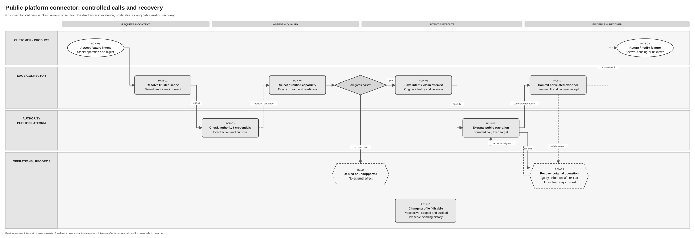

# Public Platform Connector Solution Specification

Terminology follows the [shared e-invoicing glossary](../context/GLO-SEI-001-e-invoicing-terminology.md). Local terms explain this feature; exact technical IDs, fields and source codes keep their stated meanings.

## Part 1 Feature Solution Summary

### Reader guide and design status

This **proposed logical design** defines a connector to Spain's public electronic invoicing platform, AEAT/SPFE. The connector gives Sage feature services a controlled way to call the platform, record what happened and recover uncertain results. It is separate from the invoice-consultation feature and from recipient discovery.

Part 1 covers purpose and boundaries. [Part 2](#part-2-logical-feature-specification) gives behaviour; [Part 3](#part-3-logical-service-interactions-and-data-inventory) defines contracts and records; [Part 4](#part-4-assurance-and-traceability-view) gives acceptance and release gates.

**Confirmed** identifies a cited source requirement within its limits. **Proposed** identifies design choices, including service boundaries, states and logical fields. **Open** identifies missing decisions or contracts. **Out of scope** identifies another feature's responsibility. No physical endpoint, authentication protocol, timeout or deployed implementation is approved here.

### 1 Purpose, sources and boundary

The connector owns public-platform protocol access: select an approved environment and contract; enforce caller and represented-business scope; obtain purpose-bound credentials; execute only an activated operation; preserve request/response evidence; and expose a safe known, pending or unknown result.

[PRD-SEI-214](../prds/PRD-SEI-214-connections-registration-routing-structured-review.md), FR2–6/19–23/27, separates connections, registration, capability readiness and routes. [PRD-SEI-105](../prds/PRD-SEI-105-public-platform-environment-isolation.md), FR1–18, owns environment isolation. [PRD-SEI-211](../prds/PRD-SEI-211-public-platform-invoice-consultation-structured-review.md) and [PRD-SEI-212](../prds/PRD-SEI-212-public-platform-invoice-submission-structured-review.md) supply retrieval and submission safety requirements. These are canonical product requirements, not evidence of a deployed public adapter.

| Evidence | Supported fact | Limit |
|---|---|---|
| [Order HAC/1028/2026, Articles 9–11](https://www.boe.es/eli/es/o/2026/10/02/hac1028), checked 6 October 2026 | Public recovery/consultation access and authentication/representation requirements exist. Third-party recovery and Article 10 consultation require registered representation. | Exact operations, credential profiles, limits and technical access are governed by AEAT specifications. Do not extend one action's authority automatically to another. |
| [Existing evidence note](../research/spain-public-platform-order-evidence.md) | Records the supplied order snapshot and limits of the retrieval evidence. | Does not supply a production transport contract or prove a central recipient directory. |
| SPEC-SEI-001/002/004 | Trust, onboarding and uncertain onboarding-operation designs. | Draft logical contracts; qualification and external evidence remain necessary. |

| Responsibility | Owner and handoff |
|---|---|
| Customer identity, authority and readiness | [Onboarding](SPEC-SEI-002-onboarding-solution-specification.md) and identity/authority services; connector checks effective evidence before each operation. |
| Certificate custody and purpose-specific use | [Certificate management](SPEC-SEI-001-certificate-management-solution-specification.md); connector receives protected references and results, not private keys. |
| Public discovery, polling, source archive and checkpoint | [Retrieval/storage/download](SPEC-SEI-010-public-platform-invoice-retrieval-storage-and-download-solution-specification.md); connector returns correlated source responses and files. |
| Issued invoice, validation, exchange plan and independent legs | [Outbound](SPEC-SEI-007-spain-invoice-preparation-and-outbound-solution-specification.md) and PRD-SEI-212; connector executes one approved public operation. |
| Commercial/payment interpretation | [Lifecycle](SPEC-SEI-009-invoice-lifecycle-status-solution-specification.md); connector preserves source observations without deriving buyer acceptance. |
| Recipient receiving destination | [Recipient lookup](SPEC-SEI-012-public-platform-recipient-lookup-solution-specification.md); uses this connector only if an approved public lookup contract exists. |

The connector does not issue invoices, change customer routes, interpret absence of a private destination, create public-copy duties, own statutory archive retention, or provide a generic proxy to arbitrary URLs. Onboarding/registration mutations, if required by the final contract, remain owned by their feature service and must use this same operation-safety boundary.

### 2 Outcomes and terms

| Outcome | Meaning | Does not prove |
|---|---|---|
| Capability qualified | Exact operation, environment, contract and evidence are enabled for a defined cohort. | Every public function is supported or a customer route is active. |
| Known result | Correlated response/evidence durably recorded at its actual meaning. | Buyer acceptance, ERP consumption or completion of unrelated invoice legs. |
| Pending | Work is saved and waiting for capacity, a response, local evidence recovery or owner action. | External success or invoice absence. |
| Outcome unknown | External effect may have happened; original operation must be reconciled. | Permission to create a fresh operation or switch environment. |
| Denied/unsupported | Scope, authority, capability or contract is insufficient; no new external effect is initiated. | Permanent business ineligibility. |

A **connection** is configuration for communication. A **capability** is a supported function; the connector qualifies each operation used to provide it. A **contract profile** binds operation, protocol/schema, environment and safety rules. **Idempotency** means repetition has no additional effect within a proven scope. **Reconciliation** checks what happened to the original operation. A **durable intent** is a saved request identity and immutable payload reference before a possible external effect. A **circuit breaker** temporarily stops calls after defined failures; it cannot change invoice routing.

### Spain use and reuse boundaries

Reuse labels follow the [shared e-invoicing glossary](../context/GLO-SEI-001-e-invoicing-terminology.md#reuse-vocabulary). **Reusable unchanged** describes a design pattern; **Unknown** records unverified implementation fitness. Scope exclusions are marked **Out of scope**.

| Area | Intended Spain use | Reuse classification | Condition and owner |
|---|---|---|---|
| Operation ledger, correlation and recovery | Preserve intent, evidence and safe retries for public operations. | Reusable unchanged; proposed design pattern | Connector/Architecture: qualify actual implementation and crash recovery. |
| Environment, credentials, capacity and diagnostics | Isolate operations and protect material. | Reusable with country binding | Security/Operations: bind endpoint, trust, quotas, error catalogue and retention policy. |
| AEAT protocol and representation | Call the selected SPFE service for the authorised business/action. | Country-specific; adapter and rules | Spain technical/Compliance owners: final contract, registered authority and conformance evidence. |
| Existing public adapter | Reuse any proven Sage connector functions. | Unknown; existing implementation coverage | Record build, contracts, gaps and build/run owner before activation. |
| DTS | No invoice transformation within connector. | Out of scope; preferred candidate upstream where transformation is required | Outbound/Receiving and DTS owners qualify exact mapping under [SPEC-SEI-008](SPEC-SEI-008-spain-ubl-mapper-migration-to-dts-solution-specification.md) or the owning feature. DTS is not the public transport or archive. |

### 3 Process and ordered lifecycle

[Editable Draw.io](../assets/diagrams/public-platform-connector-process.drawio) · [PNG preview](../assets/diagrams/public-platform-connector-process.png).

Text equivalent: PCN-01 accepts feature intent → PCN-02 resolves trusted scope → PCN-03 checks authority/credentials → PCN-04 checks the activated capability and contract → PCN-05 saves operation/attempt intent → PCN-06 executes the bounded public call → PCN-07 commits response evidence → PCN-08 returns/notifies the owning feature. Denied checks return a safe hold without sending. Unknown external effects or evidence gaps enter PCN-09 recovery using the original identity. PCN-10 manages prospective configuration/disablement without deleting history.

| Activity / trigger and actor | Required result | Failure owner and safe handoff |
|---|---|---|
| PCN-01 Feature request / owning feature service | Stable feature operation, payload reference/digest and correlation registered. | Connector/feature: changed input under same key conflicts. |
| PCN-02 Scope resolution / connector | Tenant, represented entity, country and environment resolved from trusted bindings. | Identity/Security: ambiguous context denied before access. |
| PCN-03 Authority/trust / connector and specialist services | Effective action authority and purpose/environment-bound credential references. | Authority/Trust: missing/revoked permission holds new calls. |
| PCN-04 Capability selection / connector | Activated operation and exact contract/version, safety class and readiness evidence. | Integration owner: unsupported combination disabled. |
| PCN-05 Intent/attempt / connector | Durable ledger plus unique execution claim; immutable input and target context. | Connector/Records: persistence failure prevents new external mutation. |
| PCN-06 External execution / adapter | Bounded request under correct credential, contract and quota. | Adapter/Operations: record transmission boundary; uncertain effect reconciles. |
| PCN-07 Evidence commit / connector | Raw protected evidence, safe normalised result and item correlations saved. | Records/connector: recover external response without a fresh mutation. |
| PCN-08 Handoff / connector | Scoped result/query and recoverable notification to owning feature. | Feature/connector: repeated notification deduplicated. |
| PCN-09 Recovery / operations or approved policy | Original-operation outcome established, or owned unresolved hold. | Operations/adapter: manual-only where safe query/retry is unproven. |
| PCN-10 Configuration event / authorised integration owner | New prospective profile/cohort state, impact evidence and audit. | Integration/Security: preserve in-flight/history and unrelated environments. |

### 4 Material decisions

Open decisions PCN-Q01–Q08 in Part 4 gate exact APIs, custody/authority, operation safety, evidence durability, service targets, deployment and rollout. A successful connection check is not blanket readiness. No live platform configuration is changed by this document.

## Part 2 Logical Feature Specification

### 1 Model and invariants

Logical operation identity includes tenant, legal entity, country, environment, capability, owning feature operation and idempotency identity. Every attempt freezes contract profile, endpoint reference, credential binding, authority decision, payload digest and expected record version. Idempotency retention and scope must be agreed with each consumer/provider.

| ID | Rule that must always hold |
|---|---|
| PCN-I01 | Trusted environment and credential binding must agree; production cannot fail over to simulation or TEST. |
| PCN-I02 | Authentication, business authority, capability readiness, registration and route activation are separate facts. |
| PCN-I03 | Only a qualified operation/profile may execute; one successful call does not qualify all capabilities. |
| PCN-I04 | Same scoped key and digest returns/resumes the original operation; changed input conflicts. |
| PCN-I05 | Save immutable intent before any possible external effect; uncertainty uses original identity and context. |
| PCN-I06 | Transport success and request-level success do not establish missing per-item business results. |
| PCN-I07 | Evidence and notification follow a recoverable commit; local save failure cannot justify fresh submission. |
| PCN-I08 | Contract/credential changes preserve historical context and apply prospectively to eligible work. |
| PCN-I09 | Retry is controlled at one external execution owner; feature and connector retries cannot multiply public effects. |
| PCN-I10 | Credentials, raw invoices and bearer access values never appear in client events or diagnostic logs. |

### 2 Behaviour by activity

**PCN-01 Accept feature intent.** Authenticate the calling workload and check its permitted capability. Accept the feature operation reference, scoped entity, requested logical action, immutable payload/query reference, digest and idempotency key. Requests are not caller-selected URL/protocol commands. Save a stable connector operation; identical repeats return current saved state, while changed digest/context conflicts. Feature cancellation before execution may close pending work; after possible external effect it cannot erase history or undo that effect.

**PCN-02 Resolve scope.** Compare caller scope with the connection's legal entity, country and trusted deployment/account environment. Resolve environment profile and governed destination from protected configuration. Reject missing, cross-tenant or conflicting scope before secret access. Simulation uses labelled synthetic fixtures; official TEST is enabled only against its confirmed contract. Neither produces production readiness or public acceptance evidence.

**PCN-03 Check authority and credentials.** Verify local permission and external represented-business authority for the exact action. Article 9/10 access uses its own registered-authority checks; other actions use their approved authority matrix. Retrieve protected credential handles through SPEC-SEI-001. Validate purpose, environment, expiry/status and represented party under current policy. Recheck before external execution if authority/credential version changed while queued. Unavailability of required authority evidence holds new calls; certificate possession cannot resolve it. No private-key export is required.

**PCN-04 Select qualified capability.** Resolve an activated registry entry for logical action, country, environment and cohort. It names protocol/schema versions, allowed destination, request/response limits, response semantics, side-effect class, provider idempotency/query support, timeout/retry policy and evidence owner. Unknown fields block activation rather than inherit an unrelated AEAT service. SII, VERI*FACTU and FACe contracts are not substitutes for SPFE evidence.

Use only approved non-mutating readiness checks or contract conformance evidence. Never send a real or empty invoice as a connectivity probe. DNS/TLS/network reachability proves transport only. Expose separate configuration, authentication/authority, operation qualification and current service health. Public registration remains UNKNOWN/NOT_APPLICABLE unless the confirmed operating model supplies a registration fact; do not invent an enrolment endpoint or claim registration from a ping.

**PCN-05 Save intent and acquire execution.** Persist the operation, immutable payload/query reference, exact scope/profile, feature correlation and safety classification. One execution owner acquires a lease/generation or equivalent concurrency control; stale workers cannot commit or initiate a later duplicate attempt. Save attempt identity and transmission boundary before sending. Queue acceptance and operation-ledger writes use a recoverable outbox or equivalent protocol. Missing payload/object/hash prevents execution.

A lease alone does not prove that a previous worker stopped transmitting. After lease loss or worker takeover around a possible external effect, hold the original operation for reconciliation or proven provider idempotent resume. Do not start another mutation merely because a local lease expired. Claim checks immediately before transmission and stale-generation commit protection must be tested together with external-operation safety.

Coalesce only identical operations under the approved consumer contract. Capacity admission is bounded and fair across tenants and capability classes; reconciliation and retrieval cannot be starved by submission backlog. Exact quotas and priorities are PCN-Q05 decisions.

**PCN-06 Execute public operation.** Build protocol data only from the qualified contract and validated feature intent. Use bounded resources, transport identity verification, safe XML handling and governed destinations; redirects or returned URLs cannot bypass destination/credential policy. Do not transform signed invoice bytes or repair invoice facts in the connector. Save whether failure happened before transmission, after possible transmission or after a correlated response.

An operation proven to have no external side effect can repeat under its read/retry contract; a name such as “consult” does not prove this. A mutating or potentially stateful operation with a lost response becomes OUTCOME_UNKNOWN. Provider throttling/unavailability does not fabricate an empty result or successful freshness. A circuit breaker holds affected work without switching route, environment or another invoice leg. No numeric wait/limit is asserted here.

**PCN-07 Commit evidence.** Save protected response bytes/reference and digest, received time, external request/item references, contract/error catalogue version and evidence meaning. Match every item to its request; partial or missing item results remain explicit. A provider request success cannot mark all items admitted. Unknown error codes retain their external value in restricted evidence and create a maintenance signal; safe caller output carries a stable category and owner.

Streamed files/results need a verified durable capture handoff before temporary data can expire. SPEC-SEI-010 owns permanent invoice capture; connector staging is not an archive. If external effect is known but evidence saving fails, record an evidence-recovery hold. Recover from the original response/operation or query rather than repeat a mutation. The deployment must prove how this state survives worker loss.

**PCN-08 Return and notify.** The owning feature can query the saved connector result under its scope. Notifications carry connector/feature IDs, event ID, version, known/pending/unknown state and safe evidence references. Delivery is at least once; consumer deduplication and version checks prevent regression. Feature services interpret admission, source freshness, checkpoints, lifecycle and customer messaging. The connector cannot advance a retrieval checkpoint or mark a buyer accepted.

**PCN-09 Recover.** One owner applies SAFE_RETRY, IDEMPOTENT_RESUME, RECONCILE_FIRST or MANUAL_ONLY according to evidence, not error-name heuristics. Reconciliation queries the original operation/reference, payload digest and contract/environment. A query failure leaves outcome unknown. Proven absence permits resubmission only under the approved contract. Changed route or credential cannot make an old outcome disappear; a replacement credential may be used only through an approved recovery binding to the original represented party/action/environment, with the new attempt evidenced.

If no outcome query or proven idempotency contract exists, open an owned manual case and hold unsafe repeats. A feature request to resume the same key cannot bypass this hold. Operations inspection, recovery and profile activation are distinct audited permissions. Cancellation after transmission is a separate externally qualified operation, if supported, owned by the feature.

**PCN-10 Change configuration and capability.** Validate profile/endpoint changes with compare-and-set version controls and record actor, reason, impact and approval evidence. Deploy inactive, qualify in TEST/simulation with correct labels, then enable only the approved production cohort. Credential rotation does not rewrite old attempts. Disablement stops new affected execution and assesses queued/in-flight/reconciliation impacts; it preserves evidence and other capabilities/environments. Rollback restores a qualified profile for eligible new work, without replaying completed or unknown operations.

### 3 Requirements and operational controls

| ID | Observable requirement / source |
|---|---|
| PCN-R01 | Enforce trusted tenant/entity/country/environment and qualified credential binding before calls; PRD105 FR1–9/14/17, PRD214 FR6. |
| PCN-R02 | Check action authority separately from authentication and readiness; PRD101 FR22/24, PRD211 FR54, PRD226. |
| PCN-R03 | Activate exact operation contracts independently; no probe may issue an invoice or change routes; PRD214 FR3–5/19–21. |
| PCN-R04 | Persist idempotent intent, immutable payload and controlled attempt ownership; PRD212 FR22–28, PRD214 FR22. |
| PCN-R05 | Classify external-effect uncertainty and reconcile original operation before unsafe repeat; PRD212 FR25–27/36–40. |
| PCN-R06 | Preserve correlated raw/item evidence and safe errors without overclaiming success; PRD212 FR29–35, PRD214 FR23/27. |
| PCN-R07 | Recover local evidence/handoff failure and deliver versioned deduplicated notifications; PRD212 FR34/37, PRD211 adapter/checkpoint requirements. |
| PCN-R08 | Bound fair capacity and expose health, backlog, unknown outcomes and safe actions; PRD211 scheduling, PRD212 FR38–39. |
| PCN-R09 | Preserve in-flight/history through credential/profile change, suspension and rollback; PRD105 FR15–16, PRD214 FR16–18/25–26. |
| PCN-R10 | Isolate Spain rules and qualify reused implementation before activation; PRD214 FR19–21 and repository reuse controls. |

Encryption, least privilege and purpose-bound source access protect PCN-D01–D09. Metrics distinguish attempts before/after transmission, provider and local latency, throttle, authority denial, evidence gaps, unknown-operation age and notification backlog. Avoid legal-subject identifiers as public metric labels. Security owns destination restrictions and XML/resource limits; Operations/Product approve service objectives from provider terms and measured volumes. No numeric SLA or retention period is invented.

## Part 3 Logical Service Interactions and Data Inventory

### 1 Interaction contracts

These are logical operations, not endpoint names. Commands carry requestId, connector/feature operation IDs, trusted scope, capability, contractProfileRef, payload/query reference and digest, idempotency key, correlation and expectedVersion as appropriate. Protected values stay references. Responses distinguish known outcome, pending work, denial, unsupported capability, conflict, temporary failure, outcome unknown and evidence-recovery hold.

| ID / caller → owner | Inputs, result and authority | Correlation, failure and evidence | Activities |
|---|---|---|---|
| PCN-INT-01 Feature → connector | Submit/query/cancel unsent intent; permitted workload and scope. | Scoped key/digest returns prior operation; conflict on change; D03/D09. | PCN-01/08/09 |
| PCN-INT-02 Connector → identity/authority | Resolve entity/action permission and effective version. | Denied/undetermined holds new calls; decision reference D02. | PCN-02/03/06 |
| PCN-INT-03 Connector → protected trust service | Obtain/use credential handle for purpose/environment/principal. | No key export; invalid binding denied; protected evidence D02/D04. | PCN-03/06/09 |
| PCN-INT-04 Connector → profile/connection registry | Resolve activated capability, destination and safety contract. | Versioned profile/readiness; unsupported held; D01. | PCN-02/04/05/10 |
| PCN-INT-05 Connector → public adapter → AEAT | Execute exact approved operation with fixed intent and credential handle. | Save attempt boundary; known/item results or unknown; D03–D06. | PCN-05–07 |
| PCN-INT-06 Connector/Operations → reconciliation adapter | Query original external operation under approved authority. | Query evidence/absence/unresolved; no invented endpoint; D04/D05/D07. | PCN-09 |
| PCN-INT-07 Connector → Records/owning feature | Save response and file capture receipt; publish versioned result event. | Verify scoped hash/ref before completion; recover save/notification failure; D05/D06/D08. | PCN-07/08 |
| PCN-INT-08 Authorised owner → connector/audit | Inspect/recover/disable/update profile with reason and expected version. | Reject stale/unauthorised action; preserve original operation and audit D07/D09. | PCN-09/10 |

Proposed events: PUBLIC_CONNECTOR_RESULT_RECORDED, PUBLIC_CONNECTOR_RECOVERY_REQUIRED and PUBLIC_CONNECTOR_CAPABILITY_CHANGED. Each follows durable evidence and carries eventId/version, affected scope/capability, state and safe references. A capability-change event is not route activation.

### 2 Data inventory and systems of record

| ID / record and owner | Minimum logical information and handling | Consumers |
|---|---|---|
| PCN-D01 Connection/capability profile / registry | Stable connection, country/environment, operation/protocol/schema, governed destination, activation/cohort, read/mutation semantics, idempotency/query rules, limits, source/effective version; restricted/versioned. | PCN-02/04–10 |
| PCN-D02 Eligibility snapshot / authority/trust owners | Entity/action, actor/workload, policy/authority and credential references, principal/environment/purpose, validity/check time; restricted/append-only evidence. No credentials copied. | PCN-02/03/05/06/09 |
| PCN-D03 Operation intent / connector | Scoped key, feature/connector IDs, digest, immutable payload/query reference, safety class, cancellation and current operation version; restricted, immutable input. | PCN-01/05–09 |
| PCN-D04 Execution attempt / connector | Attempt/lease generation, fixed profile/destination/bindings, pre/post-transmission markers, correlation/times and safe result; append-only. | PCN-05–09 |
| PCN-D05 External response / connector + Records | Raw protected reference/hash, per-item correlations, external codes/references, observed state and evidence meaning, catalogue version; sensitive/immutable. | PCN-07–09 |
| PCN-D06 File handoff / connector + Records | Temporary source/reference/hash/expiry, durable capture receipt and owner; sensitive, bounded staging. Permanent archive belongs to feature/Records. | PCN-06–09 |
| PCN-D07 Recovery case / Operations | Original operation, reason/safety, evidence/last query, owner, approved next action and escalation; restricted/versioned. | PCN-09/10 |
| PCN-D08 Notification outbox / connector | Event ID, operation/result version, target owner, delivery attempts/receipt and evidence refs; restricted/replayable. | PCN-07/08/09 |
| PCN-D09 Action audit / audit owner | Actor, scope/action/reason/time, versions and before/after state, evidence references and retention/hold class; restricted/append-only. | PCN-01–10 |

The public platform is authoritative for its external results; connector records are authoritative for Sage intent/attempts. Feature services own business interpretation. Retention, idempotency windows, evidence holds and staging expiry are PCN-Q04 decisions by data class; connector cleanup cannot dispose of a feature's archived invoice or unresolved-case evidence.

### 3 Reuse qualification

Assess existing Sage public transport, credential access, operation/outbox and monitoring capabilities. Record source build/design pattern, retained behaviour, Spain changes, missing operations, accountable owner and qualification evidence. The same adapter library, gateway or service deployment are alternative physical choices under PCN-Q06; whichever is selected must have one execution/idempotency owner and durable recovery. Capability selection must not copy Spain authority, error or routing rules into another country. No DTS transformation is introduced in this contract.

## Part 4 Assurance and Traceability View

### Acceptance and traceability

These scenarios specify evidence to obtain; they are not executed implementation tests.

| ID / scenario | Requirements → activities / interactions / data | Required result |
|---|---|---|
| PCN-A01 Wrong tenant/environment or untrusted override | R01 → PCN-01–03, INT-01–04, D01/D02/D09 | Denial before credential/public access; no production-to-TEST fallback. |
| PCN-A02 Valid certificate, missing/revoked action authority | R02 → PCN-03/06, INT-02/03, D02/D04/D09 | New call held; represented subject/action evidenced; other grants not inferred. |
| PCN-A03 Network check succeeds, operation unqualified | R03 → PCN-04, INT-04, D01 | Capability stays unsupported; no invoice probe or route activation. |
| PCN-A04 Duplicate and changed intent | R04 → PCN-01/05, INT-01/05, D03/D04 | Same key/digest resumes original; changed context conflicts; concurrent workers produce one effective execution claim. |
| PCN-A05 Pre-send failure versus lost response | R04/05 → PCN-05/06/09, INT-05/06, D03/D04/D07 | Proven pre-send retry permitted; possible effect becomes unknown and reconciles original operation. |
| PCN-A06 No reliable query/idempotency contract | R05 → PCN-09, INT-06/08, D03–D05/D07/D09 | Manual-only hold; repeated feature request cannot bypass it. |
| PCN-A07 Partial response/unknown error | R06 → PCN-07/08, INT-05/07, D04/D05/D08 | Missing items remain unresolved; protected source code retained; safe message does not claim blanket admission. |
| PCN-A08 External success, local persistence failure | R05/07 → PCN-07/09, INT-06/07, D03–D07 | Original outcome/evidence reconstructed without fresh mutation; crash evidence proves recovery. |
| PCN-A09 Capture/notification delayed | R07 → PCN-07–09, INT-07, D05/D06/D08 | Temporary file durably handed off before expiry; repeated/out-of-order events do not regress consumer state. |
| PCN-A10 Throttle/outage and competing tenants | R08 → PCN-05/06/09, INT-05/08, D01/D03/D04/D07 | Bounded fair backlog and safe breaker; no false empty result, freshness or route switch. |
| PCN-A11 Rotation/disablement/rollback during work | R09 → PCN-03/05/09/10, INT-03/04/06/08, D01–D04/D07/D09 | Original context preserved; stale worker rejected; replacement authority checked; unaffected cohorts continue. |
| PCN-A12 Unsafe content/destination and support access | R01/06/09 → PCN-02/06/09/10, INT-05/08, D04–D07/D09 | XML/resource and destination controls enforced; no credentials/raw bodies in errors/logs; unauthorised recovery denied. |
| PCN-A13 Country isolation and reuse qualification | R10 → PCN-02–06/10, INT-02–05/08, D01/D02/D04/D09 | Selected build/contracts proved; missing country binding blocks activation; Spain authority/error rules do not affect another country. |

### Open decisions and release gates

| ID / decision | Owner | Effect, evidence and gate |
|---|---|---|
| PCN-Q01 Exact SPFE operation catalogue, protocol, destinations, schemas and official TEST support | Spain Technical/Integration owners | Blocks physical adapter design/activation; obtain official AEAT artefacts separately per operation. Recipient directory support is not assumed. |
| PCN-Q02 Action authority and accepted credential contracts | Compliance/Identity/Security | Blocks represented-business calls; bind procedure, verification/revocation and credential purpose/principal to every capability. |
| PCN-Q03 Side effects, idempotency scope/window, outcome queries and cancellation | Adapter/Operations/feature owners | Blocks automatic retry/reconciliation rules; absent evidence means manual-only after possible effect. |
| PCN-Q04 Ledger/evidence/capture durability, retention/holds and consumer replay windows | Architecture/Records/Security | Blocks implementation baseline/production; prove crash recovery and custody, especially external success with local save failure. |
| PCN-Q05 Quotas, fairness, retry budgets, breaker policy and measured objectives | Product/Operations/adapter owners | Blocks capacity/pilot sign-off; use provider terms and measured cohort volumes. |
| PCN-Q06 Physical deployment and existing implementation fit | Architecture/Connector owner | Choose library/gateway/service and single execution owner; record source build, gaps, owners and isolation/recovery evidence before reuse. |
| PCN-Q07 Safe error catalogue, per-item correlation and feature handoffs | Integration/feature owners | Blocks conformance; preserve external semantics, source hashes and durable capture/result receipts. |
| PCN-Q08 Activation, rotation/disablement and operational support | Security/Operations/Connector owner | Blocks production; named on-call, audited actions, cohort/rollback drills and pending-work handling. |

**Design review:** agree boundaries and PCN-Q01–Q04/06/07, leaving unavailable interfaces explicit. **Pilot:** activate only qualified operations and exercise A01–A13 against the selected test contract and owning features. **Production:** resolve Q05/Q08, custody/retention and outstanding action-specific contracts; require conformance, security, crash/recovery evidence and measured support objectives. This is a **reviewable logical proposal**, not an approved design or live connector deployment.
