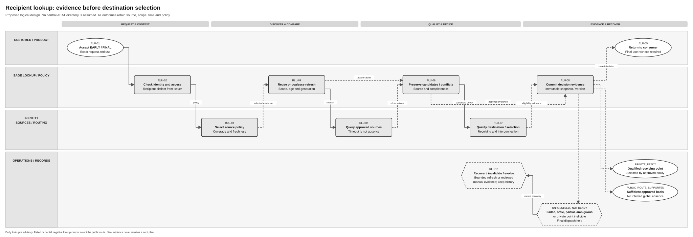

# Consult public platform for recipient information

Terminology follows the [shared e-invoicing glossary](../context/GLO-SEI-001-e-invoicing-terminology.md). Local terms explain this feature; exact technical IDs, fields and source codes keep their stated meanings.

An **exchange action** is one separately tracked action to deliver an invoice, submit a public copy, or report an invoice event. Each action has its own result. For example, invoice delivery can succeed while public-copy submission still needs attention.

## Part 1 Feature Solution Summary

### Reader guide

Part 1 explains the scope, people involved, workflow and open decisions. Start here for a stakeholder review. [Part 2](#part-2-logical-feature-specification) gives the detailed behaviour and rules. [Part 3](#part-3-logical-service-interactions-and-data-inventory) describes service interactions and data. [Part 4](#part-4-assurance-and-traceability-view) links requirements to the checks and evidence needed before release.

The design remains a draft. **Confirmed** means supported by the cited source, within its stated limits. **Proposed** choices still need review. **Open** decisions still need an owner’s recorded answer. **Out of scope** identifies work excluded from this proposal or handled by another feature. Service names describe logical responsibilities; they do not establish deployed services or approved API endpoints. Technical IDs and state names are kept so engineering, testing and stakeholders can refer to the same item.

### 1 Purpose, authority and boundaries

This **proposed logical design** helps Sage establish where an invoice recipient can receive an invoice. It provides an early indication during preparation and current evidence when the final exchange plan is created. It does not establish that AEAT provides a central recipient-directory API.

[PRD-SEI-223](../prds/PRD-SEI-223-interoperability-routing-transformation.md), FR1/3/5/29, requires evidence explaining the recipient route and an invoice representation supported by that route. [SPEC-SEI-007](archive/SPEC-SEI-007-invoice-sending-solution.md), OUT-03/09/10, uses the early indication and checks current route evidence before final dispatch. [PRD-SEI-214](../prds/PRD-SEI-214-connections-registration-routing-structured-review.md) separately governs the issuer's own connections and routes. The issuer's connection does not reveal the recipient's destination.

| Evidence | Confirmed basis | Limit and consequence |
|---|---|---|
| [RD 238/2026, Article 6.1/6.3/6.4](https://www.boe.es/eli/es/rd/2026/03/25/238), checked 6 October 2026 | Defines the public receipt model, publication of private entry points and open operator consultation systems. More than one private entry point is possible. | Does not establish a central AEAT directory, a universal identifier query, or a precedence rule for competing sources. |
| [Order HAC/1028/2026](https://www.boe.es/eli/es/o/2026/10/02/hac1028), checked 6 October 2026 | Describes public invoice access services and their technical-contract dependency. | Invoice consultation is not evidence of recipient-directory support. Its third-party invoice-access permission cannot simply be applied to public directory lookup. |
| [Identity/tenancy PRD](../prds/PRD-SEI-231-country-identifiers-tenancy-and-delegated-accountants.md), [addressing PRD](../prds/PRD-SEI-233-peppol-multi-address-and-endpoint-routing.md) | Separate legal identity, tenancy, delegated actor and network address. | Country-qualified identities and network-specific endpoint semantics still require selected-source qualification. |

The proposed public-route decision follows OUT-09's safety rule: failed, stale, partial or ambiguous lookup is not proof that no private point exists. “Proven absence” means evidence sufficient under an approved Spain source/coverage policy, not an assumption that all directories can be exhaustively searched. RLU-Q01/Q03 must define how this condition can actually be met.

| In scope | Owning boundary |
|---|---|
| Exact recipient identity, action scope and source selection | Lookup with Identity/Spain policy owners. |
| Lookup execution, source observations and freshness | Lookup; [SPEC-SEI-011 connector](SPEC-SEI-011-public-platform-connector-solution-specification.md) only for qualified public-platform operations. Other operator sources use their own approved adapters. |
| Published destination candidates, private operational eligibility and public/unresolved classification | Lookup supplies versioned evidence; route/exchange services own final selection and plan. |
| Reuse of cached results, combining identical refresh requests, conflicts and controlled manual evidence | Lookup/Operations under source and country rules. |
| Draft versus final usage and historical evidence | Early result is advisory; final dispatch requires evidence meeting the current planning policy. |

**Out of scope:** invoice discovery/download; NIF/name census verification; onboarding or publishing/changing a recipient's entry point; customer route transitions; invoice validation/mapping/signing; dispatch, public-copy duties and buyer status. Tax identity matching does not establish receiving capability. This initial feature handles exact scoped lookup, not an unrestricted recipient search or directory export.

### Public source baseline

The supplied public operations query invoices already held by SPFE. They do not identify a recipient's chosen private receiving platform. The recipient-directory capability therefore remains unsupported by this bundle, while the invoice-query contracts are now known within their documented limits.

See [REF Source references](#ref-source-references) for the original files, exact locations and source limits. The [technical evidence guide](../context/RES-SEI-002-spain-public-platform-technical-evidence.md) tracks shared source conflicts. The constraints below align this feature with the supplied public evidence; Sage implementation and activation remain gated.

### Plain-language terms

| Term | Meaning |
|---|---|
| Legal entity / legal subject | The business to which the invoice or action belongs. Technical fields use `legalSubject` for this business. |
| Authority | Permission to perform a specific action for that business. Logging in or holding a certificate does not by itself give this permission. |
| Capability | A supported function, such as receiving invoices or signing them. |
| Route | The time-bound selection of platform and connection for a defined invoice scope and direction. A ready connection does not activate a route or rewrite earlier invoice plans. |
| Idempotency | Repeating the same logical request adds no effect within the contract’s defined scope and retention window. The contract binds request identity and input and defines conflict handling. |
| Reconciliation | Check the original operation against a reliable source to establish what actually happened before deciding the next action. |
| Gate | A condition, decision or evidence check that must pass before the next step can proceed. |
| Tenant | The customer account boundary used to keep one customer’s data and access separate from another’s. |
| Immutable / append-only | Immutable means a saved record cannot be changed. Append-only means later information is added as another record. Neither means indefinite retention. |
| Provenance | The record of where data came from and which versions, checks and changes produced the result. |
| Contract | The agreed inputs, outputs, behaviour and responsibilities between services or parties. |
| Durable | Saved through the agreed recovery boundary so the record survives a process restart or worker failure. Long-term retention is a separate policy. |
| Entry point | The published receiving destination for a legal entity. It need not be a raw URL. Publication does not by itself prove operational eligibility for a particular invoice. |
| Recipient / candidate | The buyer or legal party receiving the invoice; a receiving destination observed in a source but not yet approved for this operation. |
| Freshness / coverage | Whether evidence is current enough for the intended use; what the source’s positive or negative answer actually covers. |
| Snapshot / negative caching | Saved source, time, scope and policy for one decision; temporarily reusing a prior absence observation under the same coverage and freshness rules. |
| Source precedence / proven absence | The approved rule for choosing between source evidence; sufficient evidence that no applicable private entry point exists under the selected Spain policy. A failed lookup does not prove absence. |
| EARLY / FINAL | An advisory result for preparation; evidence checked for final exchange planning. An old EARLY result cannot simply be renamed FINAL. |
| Cache / refresh generation / TTL | Previously saved results reused under policy; the version of a refresh used to reject stale worker results; time to live, the permitted cache lifetime. Exact TTL values remain open. |
| Scope / qualification | The recipient, customer, environment and invoice capability covered by the lookup; evidence that the selected source or destination supports that use. |

### 2 Outcomes and handoffs

| Proposed outcome | Required evidence | Consumer behaviour |
|---|---|---|
| PRIVATE_READY | Published scoped destination plus qualified receiving/interconnection evidence and approved selection policy. | Supply destination/evidence to final planning; outbound still checks its own authority/profile. |
| PUBLIC_ROUTE_SUPPORTED | Approved policy establishes sufficient absence of an applicable private point under the approved absence-based public-receipt policy. Includes source/coverage and policy evidence. | Corresponds to OUT-09 PROVEN_NONE for its approved absence path. Final public execution still needs a qualified connector. |
| PRIVATE_OBSERVED_NOT_READY | Private point is evidenced, but required interoperability/capability is unsupported or unavailable. | Hold; public fallback is not inferred from a private outage. |
| UNRESOLVED | Lookup FAILED, STALE, AMBIGUOUS, PARTIAL, UNSUPPORTED or EVIDENCE_INSUFFICIENT. | Hold final dispatch; provide safe reason, owner and next action. |
| DENIED / INVALID_REQUEST | Actor, scope or qualified identity is invalid. | No unauthorised external lookup or destination disclosure. |

ERP/preparation requests the early indication; exchange requests final evidence. Identity validates qualified recipient keys. Lookup/source adapters collect observations. Routing/Interoperability qualifies destination capability. Compliance owns Spain public-default and source precedence rules. Operations resolves source/conflict incidents without overriding authority or forging absence evidence.

### Spain use and reuse boundaries

This is a **Spain reference design**. **Reusable unchanged** means the proposed design pattern can stay the same. **Reusable with country binding** means shared behaviour needs approved country rules or adapters. **Country-specific** rules stay in the Spain country pack. **Unknown** means that the existing implementation’s suitability or coverage still needs evidence. These labels do not prove production readiness. Another country needs its own assessment. See the [shared e-invoicing glossary](../context/GLO-SEI-001-e-invoicing-terminology.md#reuse-vocabulary).

| Area | Intended Spain use | Reuse classification | Condition and owner |
|---|---|---|---|
| Observation, cache and decision evidence | Keep source scope, timestamp, freshness and conflict history. | Reusable unchanged; proposed design pattern | Lookup/Architecture: qualify actual store, isolation, concurrency and invalidation. |
| Identity, source precedence and destination selection | Resolve exact party and document/receiving capability. | Reusable with country binding | Identity/Routing: bind scheme, lookup key, agreements, profiles and interconnection evidence. |
| Public/private receipt policy | Apply Spain's approved publication/default and coverage rules. | Country-specific | Compliance/Spain technical owner: evidence sufficient for public-route decision, multi-point selection and applicability. |
| Existing recipient discovery or AEAT directory | Assess available Sage/source implementation. | Unknown; implementation coverage | Record exact source/build/contract, gaps, owner and tests; no central directory is proven here. |
| DTS | No transformation performed by lookup. | Out of scope | Exchange uses DTS as preferred qualified transformation candidate when needed. A mapper cannot establish directory or destination support. |

### 3 Process and lifecycle

Diagram step names use plain-language actions. The smaller activity references link to the detailed behaviour and checks below.

[Editable Draw.io](../assets/diagrams/public-platform-recipient-lookup-process.drawio) · [PNG preview](../assets/diagrams/public-platform-recipient-lookup-process.png).

Text equivalent: RLU-01 accepts early/final intent → RLU-02 checks identity/authority → RLU-03 fixes source/coverage/freshness policy → RLU-04 reuses qualifying evidence or combines identical refresh requests → RLU-05 queries approved sources → RLU-06 saves candidates and conflicts → RLU-07 checks capability and approved selection → RLU-08 saves private/public-supported/unresolved decision → RLU-09 hands evidence to the consumer. Failure, incomplete negative evidence and competing points remain held; RLU-10 performs bounded recovery/version changes while keeping earlier plans unchanged.

| Activity / trigger | Preconditions, operation and result | Owner/error recovery |
|---|---|---|
| RLU-01 Lookup request / ERP or exchange | Save permitted workload scope, request/operation identity, EARLY or FINAL use, digest and correlation. | Lookup: the same key/digest returns the current result; changed input conflicts. |
| RLU-02 Identity/authority / accepted request | Check recipient identity, actor and purpose. Keep recipient, issuer and delegate separate. | Identity/Security: deny invalid or cross-tenant context. |
| RLU-03 Source policy / valid scope | Select enabled country/environment/capability rules and approved source, precedence, coverage and freshness versions. | Spain/Routing: without a policy, keep the operation unsupported. |
| RLU-04 Cache/refresh / source policy selected | Reuse evidence valid for this use, or start a numbered refresh that rejects stale worker results. | Lookup: stale or negative evidence does not qualify by default. |
| RLU-05 Query / authorised refresh | Read through the approved source contract within limits. Save correlation, results or the failure category. | Adapter: timeout does not prove absence. Check uncertain external effects before a repeat. |
| RLU-06 Interpret / source responses | Keep every candidate, its scope, coverage and conflicts. Do not choose arbitrarily. | Lookup/Compliance: hold contradictory or incomplete evidence. |
| RLU-07 Qualify destination / candidates | Check receiving, interconnection and format support. Apply the approved rule for selecting among several points. | Routing/provider owner: hold a published point that lacks support. |
| RLU-08 Decide / sufficient evidence | Save the fixed decision reference/version, or an unresolved result with an owner. | Lookup: changed refresh generation or policy prevents a stale save. |
| RLU-09 Consumer handoff / decision saved | Return reason, source/time, freshness, limits and recheck condition. | Exchange: retain the final snapshot. An early result cannot authorise a send. |
| RLU-10 Recover/change / owner action or invalidation | Refresh the same scope, add authorised manual evidence, or audit rule changes for future work. | Operations/Lookup: keep historical routes and source truth intact. |

### 4 Key decisions and risks

The largest risks are assuming a central directory exists, treating a local negative response as global absence, selecting an arbitrary point, confusing identity match with capability, or dispatching on stale evidence. RLU-Q01–Q08 name owners and gates for these matters in Part 4.

## Part 2 Logical Feature Specification

### 1 Model and invariants

Proposed request scope includes tenant, issuer legal entity, recipient identifier scheme/value, country, environment, invoice document/process capability, direction, decision time, use EARLY/FINAL and any evidenced agreement reference. Exact physical fields remain open. A country-qualified identifier is not a Sage tenant ID. The initial implementation needs only dimensions supported by the selected sources and use case; state clearly when the source cannot support the requested level of detail.

| ID | Rule that must always hold |
|---|---|
| RLU-I01 | Recipient party, issuer connection, delegated actor and receiving address are separate identities. |
| RLU-I02 | A positive source observation needs capability/selection qualification; an empty response needs coverage evidence before public-route use. |
| RLU-I03 | Failed, partial, denied, stale or unqualified negative results cannot become proven absence. |
| RLU-I04 | Evidence contains exact source, scope, observation time, effective interval/freshness, policy and version. |
| RLU-I05 | Early lookup is advisory; final dispatch references evidence qualified for the final use and time. |
| RLU-I06 | Multiple/conflicting entry points require an approved deterministic selection or remain ambiguous. |
| RLU-I07 | Public fallback is a Spain policy decision; private unavailability cannot trigger it automatically. |
| RLU-I08 | Later lookup/country-policy changes cannot overwrite historical plan snapshots or reroute an operation already sent. |
| RLU-I09 | Caller scope and cache partition prevent disclosure across tenant/entity/environment/country boundaries. |
| RLU-I10 | Lookup cannot mutate recipient registration, create a route or sign/submit an invoice. |

### 2 Detailed behaviour

**RLU-01 Accept an early or final lookup request.** Authenticate the caller and check the action it may perform. Save the exact scope, consumer operation, digest, EARLY/FINAL use and idempotency identity. A repeat with the same identity and digest returns the current result. A changed recipient, scope or use returns a conflict.

EARLY results support preparation and state their limitations. FINAL results must meet the current exchange-planning policy. An old EARLY result cannot simply be relabelled FINAL. Cancellation can stop unsent local work or suppress the handoff, while retaining observations. It cannot assume that a network call already started has been cancelled.

**RLU-02 Check recipient identity and lookup permission.** Resolve the recipient using the approved identifier scheme and country rules. Any normalisation must preserve its meaning. Reject missing or ambiguous identifiers; do not substitute a name, user ID or free text. PRD-SEI-101/231 own structural identity checks. A tax census match does not establish a receiving destination.

Check workload/tenant and the actor’s purpose separately from permission to access an external source. A directory may be open or require authentication under its confirmed contract. Do not impose invoice-access power of attorney on recipient lookup just because invoice consultation needs it. RLU-Q02 must establish the authority needed for each lookup source.

**RLU-03 Select approved sources and evidence rules.** Select the versioned source rules for country, environment and EARLY/FINAL use. These rules identify the approved source type and operation/schema, supported identifiers and capabilities, freshness, invalidation, coverage, source precedence and evidence owner. Use SPEC-SEI-011 for a public-platform lookup only after that operation is qualified.

The initial public-route path follows the absence rule in OUT-09. Any other basis for choosing the public route needs a recorded decision and an aligned outbound contract before activation. Consult an operator source or evidenced recipient publication through its approved access path. Do not scrape arbitrary sites or follow caller-supplied URLs. Manual evidence needs an approved source, provenance and reviewer controls.

The policy must explain why the evidence is sufficient for this recipient and invoice. One operator’s “not registered here” usually establishes only that operator’s result; it does not prove absence across the network. Account for evidenced receiving agreements. An empty lookup cannot override an applicable private receiving agreement for convenience.

**RLU-04 Reuse a valid result or refresh it.** Cache keys identify trusted tenant/access scope, recipient scheme/key, country, environment, document/process capability, source/coverage policy and result version. The proposed default keeps results within one tenant. Sharing genuinely public data across tenants needs separate Security/Privacy approval and must not share private authority evidence or business relationships.

Before reuse, check freshness for the requested use, source validity and invalidation. Refresh expired absence evidence; a failed refresh cannot extend its validity. Combine identical active queries into one numbered refresh while retaining each consumer request. A waiting consumer that times out cannot overwrite a newer worker result. Keep earlier successful evidence with its actual age and current degraded status. Exact TTL, final-use freshness and invalidation rules remain RLU-Q04 decisions.

**RLU-05 Query the selected sources.** Read within the approved contract, scope and limits. Save source/request correlation, observation time and evidence of which results or pages were returned. Enforce access, transport, resource and destination controls. Throttling or an unavailable source returns a failure category, never a false empty result. Incomplete pages cannot prove absence.

If a query may change external state, apply SPEC-SEI-011 or equivalent source-adapter reconciliation rules before an unsafe repeat. Final lookup refresh must share capacity fairly and stay within approved limits. It must not query every platform without limits. RLU-Q01/Q03 define the selected sources and whether their combined evidence is sufficient. A multi-recipient request is not proven or required.

**RLU-06 Save observations and candidate destinations.** Save each source observation and every returned entry point. Preserve scheme/operator/reference, declared direction, supported document/process/profile, effective period and source evidence. Missing fields remain UNKNOWN; they do not mean support. Repeated observations may share an evidence reference while preserving source history. An address alone gives no authority to send an invoice or fetch content from it.

Apply approved precedence only within the source’s proven coverage. Two valid points may coexist. List order and last response time do not decide between them. Conflicting ownership, publication/withdrawal or effective periods remain AMBIGUOUS until approved evidence resolves them; keep earlier conflicting observations. A partial positive result can identify a candidate but cannot prove that all destinations are known or that none compete with it.

**RLU-07 Check destination support and selection.** Check receiving direction/process, environment, format/profile compatibility and direct/interconnection or bridge support against qualified provider evidence. A published address, reachable website or successful TLS connection is insufficient. Exchange owns format conversion. Lookup may reference an enabled conversion path but cannot assume an existing mapper supports this route. Label source observations separately from Sage’s capability decisions.

If several points are eligible, use an evidenced receiving arrangement or an approved deterministic selection rule for this invoice scope. An invalid caller preference cannot override that rule. Missing precedence or unsupported required scope returns AMBIGUOUS/UNSUPPORTED. A known private destination that is temporarily unavailable returns PRIVATE_OBSERVED_NOT_READY. It does not trigger automatic public fallback.

**RLU-08 Save the decision and its evidence.** Save the request, candidate/absence observations, selected policy, support/selection evidence, outcome/reason and immutable decisionRef/version. PRIVATE_READY requires a qualified point. PUBLIC_ROUTE_SUPPORTED requires the approved public-receipt basis; the absence path must provide the PROVEN_NONE evidence required by OUT-09. Otherwise save UNRESOLVED with a reason and owner. Do not reduce every source result to one “is registered” flag.

Before saving, check the active refresh generation and policy version. An old worker cannot overwrite a newer observation. A simultaneous source or selection-rule change requires a new check or a hold. If saving fails, recover the saved source observations; an unsaved result cannot be treated as authoritative. New country rules must not change past evidence.

**RLU-09 Return evidence to preparation or exchange.** Return decisionRef, outcome, qualified destination if available, exact scope, source/time, freshness/recheck condition, evidence limits, safe next action and owner. Include the version expected when the exchange plan is created.

Immediately before fixing the plan, exchange checks final evidence against its current applicability, freshness and execution rules. A material change before the first external effect requires validation and planning again. Lookup cannot save a Sage plan and freeze an external directory as one transaction. RLU-Q04 must approve the final-use freshness window and the remaining risk of a source change.

After an action has been sent, a later lookup adds evidence but cannot change the original destination or reconciliation identity. Customer wording should say “destination unresolved” with a safe reason, rather than “recipient cannot invoice”. Internal events use protected evidence references without unrestricted endpoint URLs or full tax identifiers.

**RLU-10 Recover and change rules safely.** Refresh only the approved scope after an outage, source invalidation or approved conflict resolution. Operations may inspect safe metadata or attach authorised manual evidence. Record its source, verifier, applicability, expiry/recheck condition and audit. Operations cannot invent global absence, replace source results or grant missing authority.

Withdrawn or revoked source evidence prevents new use under the agreed invalidation rules; earlier observations remain. Deploy source/profile changes disabled and enable only an approved consumer group after qualification. Rollback restores a qualified source/policy for eligible future decisions and keeps original operation identities and sent plans. Suspension stops new affected queries or handoffs where required. Permitted users retain historical evidence under the retention policy.

### 3 Requirements and operational controls

| ID | Requirement / source |
|---|---|
| RLU-R01 | Separate qualified recipient identity, issuer connection and action authority; PRD101/231/226. |
| RLU-R02 | Activate only evidenced source/coverage contracts; a central public directory is an open capability; PRD223 FR1/3 and source limits. |
| RLU-R03 | Preserve source observations, coverage, candidate scope, conflicts and effective time; PRD223 FR1/3, PRD214 FR23. |
| RLU-R04 | Reuse cached evidence only under approved scope/freshness; failures cannot renew positive or negative validity; PRD223 FR1 and OUT-09. |
| RLU-R05 | Require receiving/interconnection/profile qualification and deterministic multi-point selection; PRD223 FR5/29 and RD238 Article 6 model. |
| RLU-R06 | Distinguish private ready, public supported, private not-ready and unresolved; failed/partial lookup cannot select public by inference; OUT-09. |
| RLU-R07 | Make early result advisory and bind final evidence/version to immutable plan; OUT-03/09/10, PRD214 FR14/16. |
| RLU-R08 | Recover concurrent refresh/commit/query failures without stale overwrite, unsafe side effect or arbitrary selection; PRD223 resilience principles. |
| RLU-R09 | Protect access, audit manual evidence, bound queries and expose truthful freshness/ownership; PRD105/226, PRD214 FR23–27. |
| RLU-R10 | Isolate country rules and qualify reused source/build contracts before activation; PRD223/227 and repository reuse controls. |

Least privilege, encryption and data minimisation protect party keys, addresses and business relationships. Restrict exact-recipient queries; enumeration/rate controls, safe errors and purpose checks reduce directory abuse. Mask personal identifiers in ordinary logs and metrics. Track source availability, latency, cache reuse by use, aged negative evidence, ambiguous/multi-point results, unresolved final plans, invalidations and manual cases. Product/Operations agree volume/freshness/capacity and retry targets under RLU-Q04/Q08; no numeric objective is asserted here.

### SPFE source contract binding

The source facts below govern the public binding. Recovery, storage and qualification actions are proposed Sage controls where stated. Apply them through RLU-02–07. Source conflicts stay open under RLU-Q01/Q03/Q05; source adapter remains unqualified; they are not resolved by a local default.

| ID | Constraint and required behaviour | Source reference |
|---|---|---|
| RLU-SPFE-R01 Keep invoice consultation out of directory lookup | Do not bind GetInvoices, GetRegisteredInvoice or either download operation to recipient entry-point discovery. Their response, empty result, denial or outage cannot establish PROVEN_NONE or PRIVATE_READY. Record the exact purpose and coverage of any separately qualified directory source. | SPFE-S03/SPFE-S14/SPFE-S15; [REF](#ref-source-references). |
| RLU-SPFE-R02 Keep final routing held without sufficient evidence | Use only a qualified recipient source or approved evidence path under RLU-Q01/Q03. The public technical bundle does not close the receiving-agreement, multiple-entry-point or source-precedence decision. A public API address or known taxpayer identifier is insufficient routing evidence. | SPFE-S03; proposed source-coverage control; [REF](#ref-source-references). |

## Part 3 Logical Service Interactions and Data Inventory

### 1 Logical contracts

Logical commands use requestId, consumerOperationId, tenant/issuer scope, qualified recipient reference, country/environment, capability/direction, EARLY/FINAL use, decision time, policy version, digest, idempotency key and correlation. The approved source contract supplies exact fields. Responses retain operation safety separately from route outcome. DENIED, INVALID_REQUEST, CONFLICT, TEMPORARY_FAILURE and PENDING are operation states; UNRESOLVED reasons must not become private-absence evidence.

| ID / caller → owner | Contract, authority and result | Failure/correlation evidence | Activities |
|---|---|---|---|
| RLU-INT-01 Preparation/exchange → lookup | Submit/query/cancel local request; scoped EARLY/FINAL result with decisionRef and recheck condition. | Same key/digest returns operation; changed input conflicts; D01/D07. | RLU-01/09 |
| RLU-INT-02 Lookup → identity/authority | Resolve qualified party and purpose/source permission; effective decision refs. | Invalid/denied/undetermined before external access; D02. | RLU-02/05 |
| RLU-INT-03 Lookup → source policy/cache | Resolve activated source/coverage/freshness; read scoped evidence or claim refresh generation. | Stale/partial/negative checked explicitly; compare-and-set; D03/D04. | RLU-03/04/08/10 |
| RLU-INT-04 Lookup → approved source adapter | Exact recipient/capability read; public source via SPEC-SEI-011 only if qualified. | Save source correlation, candidates, coverage or failure; timeout not absence; D04/D05. | RLU-05/06 |
| RLU-INT-05 Lookup → routing/interoperability | Qualify candidate receiving scope and approved selection; source facts remain separate. | Ready/not-ready/ambiguous/unsupported with evidence/version; D05/D06. | RLU-07 |
| RLU-INT-06 Lookup → decision store/consumer | Commit immutable result and publish safe versioned evidence notification. | Stale generation/policy rejected; outbox recovery; D07/D08. | RLU-08/09 |
| RLU-INT-07 Operations → lookup/audit | Inspect/refresh/attach approved manual evidence/change source profile with reason/version. | Separate permissions; cannot forge absence/route change; D03/D09. | RLU-10 |

Proposed events: RECIPIENT_LOOKUP_DECISION_RECORDED, RECIPIENT_LOOKUP_EVIDENCE_INVALIDATED and RECIPIENT_LOOKUP_RECOVERY_REQUIRED. They contain scoped request/decision IDs, result version, reason, time and safe evidence references. Notifications follow durable commit and are at least once; consumers deduplicate and cannot regress to an older result. A latest invalidation prevents new use under policy but does not edit an existing sent plan.

### 2 Data inventory

| ID / record and owner | Essential fields and handling | Consumers |
|---|---|---|
| RLU-D01 Request / lookup | Scoped caller/consumer, exact recipient/capability/use/time, digest/key/correlation and cancellation; restricted, immutable request. | RLU-01–10 |
| RLU-D02 Identity/access decision / Identity | Scheme/key normalisation version, issuer/recipient distinction, action/source permissions and effective policy; sensitive, append-only references. | RLU-02–05/09/10 |
| RLU-D03 Source/country policy / registry | Source contracts, coverage/precedence, allowed scope/use, freshness/negative caching, selection/manual-evidence rules and activation/version; restricted/versioned. | RLU-03–10 |
| RLU-D04 Refresh/cache / lookup | Exact cache partition, generation/lease, source operation IDs, bounds/continuation, last observation/expiry/invalidation and safe failure; restricted/versioned. | RLU-04–06/08/10 |
| RLU-D05 Source/candidate observation / lookup + Records | Immutable response ref/hash, candidate scheme/operator/address reference, scope/effective interval, source/time, positive/negative/completeness meaning and conflict evidence; sensitive/append-only. | RLU-05–10 |
| RLU-D06 Eligibility/selection / Routing | Candidate refs, receiving/interconnection/profile evidence, agreement/selection policy/version and known/unknown reason; restricted/append-only. | RLU-07–10 |
| RLU-D07 Decision snapshot / lookup | Request/scope, candidate or approved public basis, source/coverage/time, policy/version, outcome, limitations/recheck, owner/next action; immutable. Exchange plan references it. | RLU-08–10 |
| RLU-D08 Result outbox / lookup | Event/decision/version, target consumer, delivery attempts/receipt and safe refs; restricted/replayable. | RLU-08–10 |
| RLU-D09 Recovery/manual/audit case / Operations + audit | Fault, actor/action/reason/version, source provenance/verifier and validity for manual evidence, owner/resolution/retention class; restricted/append-only evidence. | RLU-01/10 |

Sources are authoritative only within their approved coverage. Lookup owns its observations/decisions; Routing owns capability assessment; exchange owns the frozen plan. Cache expiry does not delete evidence used by historical invoices. Records/Privacy approve retention, holds, authorised historical access and deletion by data class under RLU-Q07.

### 3 Reuse qualification

Assess existing Sage recipient/discovery/cache services before creating a new physical service. Record actual build, supported country/key/capability, source contracts, retained shared behaviour, Spain changes, gaps, build/run owner and qualification evidence. A Peppol resolver, identity verifier or AEAT invoice-consultation adapter is not automatically a Spain B2B directory implementation. Any shared country engine needs separate policy packs; missing Spain source/absence policy blocks activation rather than inheriting another country's defaults. DTS remains a downstream transformation candidate, not recipient discovery.

## Part 4 Assurance and Traceability View

### Acceptance scenarios

| ID / scenario | Requirements → activities / interactions / data | Expected evidence and result |
|---|---|---|
| RLU-A01 Wrong identity/tenant/environment | R01/09 → RLU-01/02, INT-01/02, D01/D02/D09 | Denied before external lookup/disclosure; issuer/delegate identity not substituted for recipient. |
| RLU-A02 Source/capability unverified | R02/10 → RLU-03/05, INT-03/04, D03/D05 | Unsupported/held; invoice consultation or census success cannot invent directory support. |
| RLU-A03 One private candidate qualified | R03/05/06 → RLU-05–09, INT-04–06, D05–D08 | PRIVATE_READY with exact source/interval/capability and selected receiving point evidence. |
| RLU-A04 Sufficient absence/public basis | R02/03/06 → RLU-03/05/06/08, INT-03/04/06, D03/D05/D07 | PUBLIC_ROUTE_SUPPORTED only under approved coverage/policy; OUT-09 receives its PROVEN_NONE evidence for the absence path. |
| RLU-A05 One operator empty, other scope unknown | R02/03/06 → RLU-05/06/08, INT-04/06, D03/D05/D07 | Local absence retained; final result EVIDENCE_INSUFFICIENT, not global public-route inference. |
| RLU-A06 Timeout, throttle or incomplete pages | R03/06/08 → RLU-05/06/10, INT-04/07, D04/D05/D09 | Failed/partial result and bounded recovery; no false negative or renewed freshness. |
| RLU-A07 Expired positive/negative cache | R04/07 → RLU-04/05/09, INT-03/04/01, D03–D05/D07 | Refresh required by use; failed refresh leaves stale evidence explicit and final dispatch held. |
| RLU-A08 Multiple points/contradictory sources | R03/05/06 → RLU-06–08, INT-04–06, D05–D07 | Approved agreement/selection evidence or AMBIGUOUS; no first-row/latest-response selection. |
| RLU-A09 Published point lacks eligible capability | R05/06 → RLU-07/08, INT-05/06, D05–D07 | PRIVATE_OBSERVED_NOT_READY or unresolved; reachable URL/mapper alone insufficient; no public outage fallback. |
| RLU-A10 Early result differs before final plan | R04/07 → RLU-04/08/09, INT-01/03/06, D04/D07/D08 | Final-use policy reevaluated; stale EARLY result cannot authorise send; new plan references qualified snapshot. |
| RLU-A11 Concurrent refresh and stale worker | R04/08 → RLU-04/08/10, INT-03/06/07, D04/D05/D07 | Identical requests share one scoped refresh; old generation cannot overwrite new result; crash recovers saved observations. |
| RLU-A12 Source changes after sending | R07/09 → RLU-09/10, INT-06/07, D05–D09 | New evidence/invalidation recorded; original sent plan/destination and reconciliation identity unchanged. |
| RLU-A13 Cache isolation/enumeration/manual evidence | R01/09 → RLU-02/04/10, INT-02/03/07, D02/D04/D09 | Cross-tenant/private sharing and unauthorised enumeration/recovery denied; manual evidence retains verifier/provenance without forged absence. |
| RLU-A14 Country reuse and source rollback | R02/08/10 → RLU-03/08/10, INT-03/06/07, D03–D07/D09 | Actual source/build and country packs qualified; rollback preserves history; Spain public-default rules cannot apply to another country. |
| RLU-A15 Stateful query uncertainty and cancellation | R08/09 → RLU-01/05/10, INT-01/04/07, D01/D04/D05/D09 | Saved source operation reconciled before unsafe repeat; cancellation does not claim remote undo or absence. |
| RLU-A16 Duplicate intent and notification loss | R07/08 → RLU-01/08/09, INT-01/06, D01/D07/D08 | Same key returns saved operation; changed request conflicts; replayed/late notifications preserve newest decision. |

### Open decisions and release gates

| ID / question | Owner | Impact and evidence gate |
|---|---|---|
| RLU-Q01 Does an approved AEAT/SPFE recipient lookup exist, and which alternative sources cover the selected Spain scope? | Spain Technical/Integration owners | Blocks source adapter activation; obtain exact official/operator contracts, identifiers, query/completeness and environments. No asserted central directory. |
| RLU-Q02 What lookup purpose/access authority applies to each source? | Compliance/Identity/Security | Blocks live access; distinguish open directory consultation from represented invoice access, protect recipient personal/business data. |
| RLU-Q03 What evidence/precedence establishes private selection or sufficient public-receipt basis, including multiple entry points and receiving agreements? | Spain Compliance/Routing/Product | Blocks public-default and multi-point decision activation. Incomplete sources leave unresolved; agree relationship to OUT-09 PROVEN_NONE. |
| RLU-Q04 What freshness, negative-cache, invalidation and final-use window is acceptable? | Product/Routing/Operations/Compliance | Blocks automatic final planning on cached results; define limits from source guarantees and accepted change risk, not invented TTL. |
| RLU-Q05 What interconnection, receiving/process and profile capability makes a point eligible? | Interoperability/provider/Format owners | Blocks PRIVATE_READY; qualify exact evidence and selection scope, including required conversion paths outside lookup. |
| RLU-Q06 Which existing implementation and physical service boundary can be reused? | Architecture/Lookup owner | Blocks implementation readiness claim; record build, contracts, local changes, gaps, tenancy/generation safety and support owner. |
| RLU-Q07 What retention, shared-cache and manual-evidence controls apply? | Records/Privacy/Security/Operations | Blocks shared public-data cache/manual override/production evidence handling; approve purpose, provenance, holds and historic access. |
| RLU-Q08 What quotas, recovery limits, alert/service targets and on-call ownership apply? | Product/Operations/source owners | Blocks production capacity/support promise; baseline volumes, runbooks and source outage/conflict drills. |

**Design review:** establish Q01–Q06 and source/decision boundaries with outbound. **Pilot:** qualify selected sources and exercise A01–A16, especially incomplete absence, multiple points, stale negatives and final-use changes. **Production:** resolve Q07/Q08 and outstanding scope-specific contracts; require source/capability conformance, isolation, recovery/rollback evidence and named operations. The readiness is **reviewable logical proposal**; central-directory availability, production readiness and implementation tests are not claimed.

### SPFE evidence acceptance

These are required evidence scenarios, not executed implementation tests. The source-binding gate is RLU-Q01/Q03/Q05; source adapter remains unqualified. A source-backed review does not establish that this feature is ready for production.

| ID | Scenario | Required result | Requirement coverage |
|---|---|---|---|
| RLU-SPFE-A01 | Invoice query returns no results for a known recipient | Retain recipient-route uncertainty; no automatic public fallback or false proof that no private receiving point exists. | RLU-SPFE-R01; RLU-02–07; [REF](#ref-source-references). |
| RLU-SPFE-A02 | A contract registry attempts to classify an invoice query as a recipient directory | Reject activation for that purpose and name the missing source/coverage evidence. | RLU-SPFE-R02; RLU-02–07; [REF](#ref-source-references). |

## REF Source references

For public-platform legal and external-contract facts, the original official sources below take precedence over earlier assumptions in linked PRDs and internal notes. PRDs retain product scope and are unchanged by this review. A source conflict remains an explicit gate; this spec cannot approve a local substitute.

Use the original files for the claims they establish. Final published regulation governs legal requirements; technical files supply their stated contract facts. Examples are illustrative. Missing or conflicting evidence remains a named gate. Product requirements and Sage design controls have separate authority. The English guide and extracts are reading aids.

| REF ID | Source and version | Exact location | Supported information and limit |
|---|---|---|---|
| SPFE-S03 | [CatalogoServicios.pdf](<../context/Descripción servicios web/Catálogo de servicios/20261013/CatalogoServicios.pdf>); 0.1.0; cover 9 October 2026. | sections 6.1, 6.4–6.7; pp. 10, 12–15 | Invoice queries and downloads; no receiving-platform directory operation. |
| SPFE-S14 | [GetInvoices.wsdl](<../context/WSDL servicios web - PRE_29:10:2026/GetInvoices.wsdl>); PRE release 29 October 2026; SHA-256 in source manifest. | GetInvoices operation and service ports | Invoice identity/status query, not recipient routing. |
| SPFE-S15 | [GetRegisteredInvoice.wsdl](<../context/WSDL servicios web - PRE_29:10:2026/GetRegisteredInvoice.wsdl>); PRE release 29 October 2026; SHA-256 in source manifest. | GetRegisteredInvoice operation and service ports | Presentation-date invoice discovery, not a recipient directory. |
| REF-PRD | [PRD-SEI-223](../prds/PRD-SEI-223-interoperability-routing-transformation.md); [PRD-SEI-214](../prds/PRD-SEI-214-connections-registration-routing-structured-review.md); [Identity/tenancy PRD](../prds/PRD-SEI-231-country-identifiers-tenancy-and-delegated-accountants.md); [addressing PRD](../prds/PRD-SEI-233-peppol-multi-address-and-endpoint-routing.md). | Product scope and requirement IDs cited in Parts 1–4. | Canonical product requirements. Earlier external-contract assumptions are reconciled with the supplied sources; an unresolved PRD difference needs a product decision, not silent approval. |
| REF-CONTEXT | [RES-SEI-002](../context/RES-SEI-002-spain-public-platform-technical-evidence.md); [source manifest](../assets/regulatory/spain/spfe/source-manifest.json); [shared glossary](../context/GLO-SEI-001-e-invoicing-terminology.md). | Source register, shared conflicts and terminology. | Reading and traceability aids. Hashes identify snapshots; they do not prove live service acceptance or implementation readiness. |
