# Provider API through the E-Invoicing Global API Solution Specification

Terminology follows the [shared e-invoicing glossary](../context/GLO-SEI-001-e-invoicing-terminology.md). Local terms explain this feature; exact technical IDs, fields and source codes keep their stated meanings.

## Part 1 Feature Solution Summary

### Reader guide

Part 1 explains the scope, people involved, workflow and open decisions. Start here for a stakeholder review. [Part 2](#part-2-logical-feature-specification) gives the detailed behaviour and rules. [Part 3](#part-3-logical-service-interactions-and-data-inventory) describes service interactions and data. [Part 4](#part-4-assurance-and-traceability-view) links requirements to the checks and evidence needed before release.

The design remains a draft. **Confirmed** means supported by the cited source, within its stated limits. **Proposed** choices still need review. **Open** decisions still need an owner’s recorded answer. **Out of scope** identifies work excluded from this proposal or handled by another feature. Service names describe logical responsibilities; they do not establish deployed services or approved API endpoints. Technical IDs and state names are kept so engineering, testing and stakeholders can refer to the same item.

### 1 Purpose and source authority

This **proposed logical design** lets Sage products and authorised partners use one E-Invoicing Global API contract. **Provider API** names the provider-facing capabilities within that contract. A **provider-owned API** is a different interface operated by an external provider; Sage may need an adapter to call it.

The purpose is to reduce duplicated development and maintenance. The design keeps the existing rules for customer authority, separate connection and route records, controlled route changes, and continued work on earlier invoices. Products and partners still have different permissions. The proposal does not approve an API contract, prove that the implementation exists, or establish a cost saving.

| Source | Authority for this design | Limit or decision required |
|---|---|---|
| User's Provider API brief, 6 October 2026 | Confirms the request to challenge a separate API and assess one shared Global API. | Does not approve an architecture, cost saving, endpoint or production launch. |
| [PRD-SEI-213 — Private Platform Connectivity](../prds/PRD-SEI-213-private-platform-connectivity-structured-review.md), FR1–30 and DR1–8 | Connections remain separate from routes; directions are independent; changes are controlled; existing invoices keep original network context. | Umbrella PRD, not a provider HTTP contract. Per-invoice provider selection and some inbound transition mechanics remain open. |
| [Complete explorer](../work/e-invoice-complete-explorer.html), connection view and `fields.connect`, `fields.send`, `fields.receive` | Illustrates reused legal-entity/authority context, independent connection checks, final exchange evidence and separate lifecycle outcomes. | Prototype and field catalogue, not approved API or legal evidence. Its selectable provider in Send cannot close PRD-SEI-213 DR2. |
| [PRD-SEI-235 — Provider API](../prds/PRD-SEI-235-provider-api-for-e-invoicing-service.md), PA-FR1–20 and PA-NFR1–5 | Provider identity, customer authority, single/batch exchange, retrieval, status/history, events, reconciliation, interconnection and exit controls. | Its Sage-owned provider-facing contract can be implemented as part of the Global API; deployment separation is not established. |
| [Shared platform PRD](../prds/PRD-SEI-227-e-invoicing-as-a-service.md), [routing/transformation PRD](../prds/PRD-SEI-223-interoperability-routing-transformation.md) | Shared capabilities with country/network bindings and preferred DTS transformation assessment. | Does not qualify an existing Global API, DTS build or provider integration for Spain. |
| [Connection/routing review](../prds/PRD-SEI-214-connections-registration-routing-structured-review.md), [resilience review](../prds/PRD-SEI-215-resilience-recovery-reconciliation-structured-review.md) | Owning domains for route transitions and provider recovery. | This API exposes those capabilities; it does not introduce a second route engine. |

No existing Global API contract, deployed build, partner-access policy or conformance results were supplied or identified in these sources. Design review must compare the proposal with the actual service contract. Spain legal claims, time limits, permitted formats and external technical codes remain evidence checks with named owners; this document does not establish new regulatory facts.

### Shared connectivity across the two integration roles

The [shared connectivity and routing spec](SPEC-SEI-014-shared-platform-connectivity-and-routing-solution-specification.md) is the logical owner of connection/profile qualification, deterministic route selection, platform-change commit and historical-context handoffs (SPC-01–08). This Global API exposes those capabilities to authorised products and partners. It does not create another connection registry, route engine or invoice store for Sage's operator role.

`PROVIDER_API`, `SAGE_ADAPTER` and `HYBRID` remain integration modes per capability; customer-provider integration and platform interconnection are separately qualified roles. The same common API/domain contracts can serve both roles, while an external provider may require another interface, account or trust binding. GPA-02/09 use the shared foundation. GPA-05 keeps one executor per exchange action. GPA-10 records an interconnection case, which neither grants operator eligibility nor proves technical readiness. Existing provider connections and invoice history remain intact when the new role is added.

### 2 Proposed API decision and alternatives

| Option | Result and tradeoff | Proposed treatment |
|---|---|---|
| One Global API contract for products and partners | Common invoice identity, operation receipts, errors, lifecycle, versioning and support. Partner-only capabilities need scoped permissions and external conformance. | Preferred starting point, subject to API/security/compatibility qualification. |
| Separate product and provider API products | Independent releases and exposure policies, but risk duplicate models, mapping, documentation, testing and operation ownership. | Require a demonstrated constraint that the shared contract cannot meet safely or compatibly. |
| One contract with distinct exposure or deployment controls | Shared behaviour and version ownership; gateways, credentials, quotas or runtimes may be separated where justified. | Permitted implementation choice under GPA-Q02; one API contract does not require one deployment or host. |

**Proposed decision rule:** add a second API product only after documenting the exact security, compatibility, legal or operational constraint; the shared-contract alternatives considered; the cost; and the accountable owner. Do not infer a second API solely from the word “provider”. Do not promise savings until the baseline and incremental partner work are measured.

The integration modes in PRD-SEI-235 still apply per capability:

| Source mode | Meaning under the Global API proposal | Ownership rule |
|---|---|---|
| `PROVIDER_API` | Provider consumes authorised capabilities of the Sage Global API. | Sage owns API resources; the provider may own an assigned external delivery action. |
| `SAGE_ADAPTER` | Sage calls an evidenced provider-owned API, mailbox, callback or file interface. | Adapter executes the named operation through the shared domain services. |
| `HYBRID` | Different capabilities use different boundaries. | Each mutation has one execution owner and one reconciliation owner. Both paths cannot send the same delivery action. |

Bidirectional invoice exchange describes business direction. It does not require both parties to host APIs or initiate calls. Partner pull plus partner submission can provide both directions; callbacks and adapter calls are separate, qualified choices.

### 3 Scope, outcomes and terms

In scope: checking consumers and their capabilities; customer access and provider connections; single or batch invoice intake; assigned partner delivery; inbound receiving and authorised retrieval; lifecycle history, events and reconciliation. The API also exposes authorised route changes, Spain interconnection cases, suspension, exit and controlled version changes.

Out of scope: building/deploying the API, defining provider-specific endpoints, issuing invoices in the ERP, implementing transformation/signing, or creating another invoice store or route engine. This proposal also excludes unrestricted directory search, approval of Spain legal rules, automatic failover, Private A → Private B transition and final retention/deletion policy. Per-invoice route override stays disabled before DR2 approval. The responsible features retain these decisions.

### Plain-language terms

| Term | Meaning |
|---|---|
| Legal entity / legal subject | The business to which the invoice or action belongs. Technical fields use `legalSubject` for this business. |
| Authority | Permission to perform a specific action for that business. Logging in or holding a certificate does not by itself give this permission. |
| Capability | A supported function, such as receiving invoices or signing them. |
| Route | The time-bound selection of platform and connection for a defined invoice scope and direction. A ready connection does not activate a route or rewrite earlier invoice plans. |
| Idempotency | Repeating the same logical request adds no effect within the contract’s defined scope and retention window. The contract binds request identity and input and defines conflict handling. |
| Reconciliation | Check the original operation against a reliable source to establish what actually happened before deciding the next action. |
| Gate | A condition, decision or evidence check that must pass before the next step can proceed. |
| Tenant | The customer account boundary used to keep one customer’s data and access separate from another’s. |
| Immutable / append-only | Immutable means a saved record cannot be changed. Append-only means later information is added as another record. Neither means indefinite retention. |
| Provenance | The record of where data came from and which versions, checks and changes produced the result. |
| Contract | The agreed inputs, outputs, behaviour and responsibilities between services or parties. |
| Durable | Saved through the agreed recovery boundary so the record survives a process restart or worker failure. Long-term retention is a separate policy. |
| Readiness | The current result of capability checks for a stated legal entity, actor, environment and route/profile, with evidence, limitations and a recheck condition. Readiness is separate from authority, route activation and invoice outcomes. |
| Global API / Provider API | The proposed shared E-Invoicing Global API contract; its Sage-owned provider-facing capabilities. A provider-owned API is an external provider’s separate interface. |
| Consumer / authenticated principal / represented party | A product application or partner service calling the API; its trusted caller identity; the legal entity or person on whose behalf it acts. These are separate identities. |
| Provider / partner | A provider operates an invoice-network capability. A partner may instead be a delegate or product integrator. Partner status alone does not give provider execution rights. |
| Authority grant | Recorded permission for a named actor to perform a capability for a legal entity, scope and time. Authentication or a certificate does not supply this permission. |
| Connection / registration / route | Configuration for communication; external enrolment or reachability recorded under the provider contract; the time-bound selection for new invoice work. Their outcomes remain separate. |
| Exchange action | One separately tracked action to deliver an invoice, submit a public copy, or report an invoice event. Each action has its own result. For example, invoice delivery can succeed while public-copy submission still needs attention. |
| Work item / execution owner | The assigned work for an exchange action; the party permitted to carry it out. |
| Representation / durable receipt | A specific invoice file or data form; confirmation that the service saved the operation for recovery. Neither a receipt nor a file download proves delivery or buyer acceptance. |
| Cursor / outbox / claim generation | A reference identifying the next page or change position; a saved event waiting for delivery; the version of a worker’s execution claim. These support recovery without creating another business action. |
| Scope / intent / conformance | The customer, entity, environment, action and objects a request covers; the caller’s requested action, such as draft preparation or final send; evidence that the consumer follows the selected contract. |

Here, **authenticated principal** means the trusted caller identity. The represented party is the separately verified legal entity or client. Existing logical records retain `principal` wording pending Identity/API owner confirmation of actual field mappings; this wording does not rename them.

| Observable outcome | Meaning and boundary |
|---|---|
| Consumer ready for a named capability | Qualified identity, contract and sandbox/production evidence; no automatic customer or route access. |
| Connection ready for a direction/profile | That capability is available for the customer; active routes remain unchanged. |
| Operation accepted or rejected | Saved receipt/per-item result, or safe error with owner; asynchronous acceptance is not external success. |
| Invoice available within permitted scope | Stable identity, original/derived representation references and history; retrieval/acknowledgement is not buyer acceptance. |
| Delivery/lifecycle evidence recorded | Original source and independent action/state outcome retained; unknown outcome is a recovery state. |
| Access suspended/ended | New protected actions stop under policy; unresolved work and historical evidence have explicit continuity owners. |

### 4 Spain use and reuse qualification

This is a **Spain reference design**. **Reusable unchanged** means the proposed design pattern can stay the same. **Reusable with country binding** means shared behaviour needs approved country rules or adapters. **Country-specific** rules stay in the Spain country pack. **Unknown** means that the existing implementation’s suitability or coverage still needs evidence. These labels do not prove production readiness. Another country needs its own assessment. See the [shared e-invoicing glossary](../context/GLO-SEI-001-e-invoicing-terminology.md#reuse-vocabulary).

| Capability/source | Intended Spain use | Reuse classification and local changes | Gap, owner and activation evidence |
|---|---|---|---|
| Global API | Products and approved partners share resources and operation behaviour. | Unknown; existing implementation reuse candidate. Add partner permissions/operations only where actual gaps exist. | API owner + Architecture: deployed contract/build, current consumers, identity model, compatibility and external exposure proof. |
| Receipts, authority, audit and event recovery | Isolate consumers/entities and recover repeats or missed outcomes. | Reusable unchanged; proposed design pattern; no deployed coverage claimed. | Service owners + Security: actual store/outbox, concurrency, revocation during work, replay and isolation tests. |
| [Outbound SPEC-SEI-007](archive/SPEC-SEI-007-invoice-sending-solution.md), [inbound SPEC-SEI-016](archive/SPEC-SEI-016-invoice-receiving-retrieval-and-download-solution-specification.md), [lifecycle SPEC-SEI-009](archive/SPEC-SEI-009-invoice-lifecycle-status-solution-specification.md) | Reuse the proposed invoice, action, representation and evidence boundaries. | Reusable with country binding; proposed design patterns. API delegates to these owners. | Domain owners: actual contracts/builds and gaps; qualify profile, execution owner, mapping and acknowledgement meaning. |
| Existing DTS; [SPEC-SEI-008](SPEC-SEI-008-spain-ubl-mapper-migration-to-dts-solution-specification.md) | Preferred transformation candidate when an authorised exchange needs a supported source/target representation. | Unknown; existing DTS implementation reuse candidate plus proposed Spain mapper migration pattern. No blanket inbound, four-syntax or signed-document support assumed. | DTS + Spain mapping owners: build, input/output contracts, mappings, rule packs, semantic preservation, custody, limits and on-call evidence for each selected pair. |
| Provider adapters and public connector | Execute capabilities not owned by a partner through the shared API. | Unknown; each provider/network needs its own adapter or contract qualification. | Provider owners + [SPEC-SEI-011](SPEC-SEI-011-public-platform-connector-solution-specification.md): exact interface, initiator, credentials, registration, query/replay and operations evidence. |
| Identity, routing and lifecycle/reporting policy | Apply approved Spain rules for the selected entity, network and capability. | Reusable with country binding; Spain-specific identifiers, route/public-copy/reporting duties and interconnection calendar remain local. | Spain Product/Compliance: approved rule/version and applicability evidence; no Spain default in another country. |

A reusable design pattern is not an existing implementation. Every candidate needs the actual source capability/build, local changes, missing coverage, accountable owner and acceptance evidence before activation. GPA-A17/A18 test country isolation and reuse qualification.

### 5 Process diagrams and lifecycle

Diagram step names use plain-language actions. The smaller activity references link to the detailed behaviour and checks below.

[Editable Draw.io](../assets/diagrams/global-api-access-and-route-process.drawio) · [PNG preview](../assets/diagrams/global-api-access-and-route-process.png).

Text equivalent: GPA-01 qualifies the product or partner consumer → GPA-02 associates existing legal-entity authority and tests a connection by capability → GPA-03 authorises each request through the common API. Ready connection leaves current routes unchanged. A separate GPA-09 transition checks authority, direction, conflicts and effective time; uncertain external activation checks the original result before saving the change. GPA-10 records an interconnection case where required. GPA-11 independently controls suspension, grants, routes and continuity; GPA-12 owns recovery/version changes.

[Editable Draw.io](../assets/diagrams/global-api-exchange-and-reconciliation-process.drawio) · [PNG preview](../assets/diagrams/global-api-exchange-and-reconciliation-process.png).

Text equivalent: GPA-03 checks trusted identity and current authority → GPA-04 validates operation intent and saves one saved receipt per accepted invoice/item → GPA-05 delegates customer send or inbound receipt to its owning service. A final exchange plan assigns each action to an adapter or partner executor. GPA-06 records source evidence and independent outcomes. A possible external mutation with no result is held for GPA-08 reconciliation before repeating the action. GPA-07 supplies authorised retrieval/history and separate acknowledgements. GPA-08 publishes saved events and supports missed-event recovery. GPA-12 resolves faults without changing original route or business data.

| Activity / actor and trigger | Preconditions, operation and postcondition | Exception and recovery owner |
|---|---|---|
| GPA-01 Consumer administrator requests access | Review contract, identity, environment and capability. Save qualification evidence and consumer state. | API/Security: an incomplete or incompatible consumer needs action; no route is activated. |
| GPA-02 Customer/product/delegate associates provider | Verify existing legal subject and authority. Save the connection and separate readiness evidence. | Identity/provider owner: missing grant or profile holds only that capability. |
| GPA-03 Product/partner calls API | Check trusted caller identity, current grant, country/environment, action and permitted objects. | API/Identity: deny and audit without exposing another entity or provider. |
| GPA-04 Caller submits invoice(s) | Check requested action, exact revision/source, scope and repeated-request identity. Save acceptance or rejection per item. | API/intake: changed input conflicts; invalid input or incomplete save cannot become acceptance. Recover the original receipt. |
| GPA-05 Domain executes accepted intent | Receiving handles inbound files. Outbound fixes final route/profile/actions and assigns one executor per external action. | Domain/executor: hold missing readiness, uncertain outcomes or conflicting claims. Do not send through an automatic fallback. |
| GPA-06 Provider/adapter supplies outcome | Match authorised evidence to the original invoice/action. Add the raw event and derive status views. | Lifecycle: hold unknown references for reconciliation. Duplicate or late events cannot blindly replace the current state. |
| GPA-07 Consumer retrieves or acknowledges | Check access to current/historical invoices, representations and cursors. Save the specified acknowledgement separately. | Records/distribution: use scoped recovery for a missing object, expired cursor or revoked grant. |
| GPA-08 Event worker/consumer observes change or gap | Save events, deliver/replay within limits and use authoritative reads. Close a gap only with evidence. | Events/Operations: retry notifications safely. Check uncertain business effects before repeating them. |
| GPA-09 Authorised actor requests route transition | Check target readiness, direction, expected route version and effective time. The route service controls cutover. | Route owner: cancel only while safe. Check uncertain activation; rollback is a new controlled transition. |
| GPA-10 Authorised actor requests interconnection | Save parties, entity scope, evidence, owner and approved Spain deadline rule where available. | Spain/Operations: missing deadline or capability evidence prevents a readiness claim. |
| GPA-11 Owner changes or ends access | Identify the credential, grant, capability, subscription, route or registration action. Keep approved continuity. | Security/domain/Operations: assign unfinished work a recovery owner. Revocation cannot widen access. |
| GPA-12 Support/release owner acts | Check permission, evidence and versions for reconciliation, correction, migration or rollback. | API/domain owner: prevent unsafe replay, retroactive route changes and unapproved compatibility breaks. |

### 6 Ownership, dependencies and risks

The Domain Service Product Owner owns the shared product/partner proposition and scope. The Global API owner owns contract, external documentation and compatibility. Identity/Security owns consumer identity and customer-authority checks. Connection/Routing owns readiness and transitions. Exchange/Receiving owns invoice processing and action assignment. Lifecycle owns evidence interpretation. DTS/Trust owns qualified transformations and protected signing. Provider owners own interface evidence; Operations owns support and reconciliation; Spain Product/Compliance owns local policy and interconnection evidence. Named individuals remain GPA-Q01.

The main risks are role confusion, exposing another customer's data, duplicate transmission across API/adapter paths, callbacks treated as truth, shared-model changes breaking products, and Spain rules becoming global defaults. Gates in Part 4 must resolve them before pilot or production.

## Part 2 Logical Feature Specification

### 1 Shared contract and permission model

**Proposed:** one API contract catalogue, shared resource identities, error vocabulary and version policy. Products and partners call only operations permitted to their authenticated principal and current customer grant. Separate credentials, quotas, access policies and documentation views may be needed. A common contract does not make all consumers trusted equally.

| Capability | Product application | Delegated partner | Qualified provider executor |
|---|---|---|---|
| Consumer onboarding/configuration | Product administration under approved control-plane policy. | Partner administration of its own identity/subscriptions. | Same partner administration, plus provider conformance. |
| Customer connection/readiness | Named customer-admin permission. | Explicit customer-admin delegation only. | May supply account/capability evidence; cannot grant itself customer authority. |
| Draft preparation/final customer send | Issuer/customer authority; ERP retains issuance ownership. | Explicit issuer/delegate authority and qualified input contract. | Same rule if acting as issuer delegate; execution assignment alone is insufficient. |
| Inbound invoice ingest | An approved product ingestion role, if needed; not implicit in send permission. | Only if expressly qualified for source delivery. | Named receiving/source capability, matched entity and origin connection. |
| Retrieve invoice/status/history | Granted product/dataset/entity scope. | Granted customer/direction/history scope. | Own assigned work or approved retrieval scope; not every invoice for the customer. |
| Claim delivery work/report network evidence | Denied unless separately registered as executor. | Denied unless separately qualified as executor. | Explicit action assignment, direction/profile and environment qualification. |
| Report buyer rejection/payment | Explicit business-actor authority. | Explicit relevant delegation. | Network evidence permission alone cannot invent buyer decisions. |
| Route change/interconnection case | Separate administration permission. | Explicit administration delegation. | Own technical evidence only, unless separately granted administration. |
| Route/readiness read and recipient lookup | Approved entity/purpose scope. | Explicit lookup/read delegation. | Approved country/provider lookup scope; no unrestricted directory access. |
| Audit/support/recovery | Separately authorised safe view. | Own scoped view, where approved. | Own scoped view; broad Operations access is separately controlled. |

Do not implement a single role test that grants every provider all partner operations. Capability and customer authority are independent dimensions. An accountant's portfolio login is evaluated per client; neither a portfolio mandate nor a provider certificate supplies universal invoice access/signing rights.

Direction is relative to the represented legal entity: OUTBOUND means the entity is issuer; INBOUND means it is recipient. Network origin and the calling application's location do not define business direction. Where a provider also represents another party, that is a separate authority context.

### 2 Invariants and state boundaries

| ID | Required rule |
|---|---|
| GPA-R01 | A provider-facing capability belongs to the proposed Global API contract; any separate API needs a recorded justification and decision. |
| GPA-R02 | Authenticate the caller in the selected environment and independently authorise customer, action, direction, object and effective time on every protected operation. |
| GPA-R03 | Consumer readiness, grant, connection, registration and route are separate records; no general CONNECTED flag or implicit route switch. |
| GPA-R04 | Same scoped request identity and digest resume one logical operation; changed content/intent conflicts; no duplicate effect across execution paths. |
| GPA-R05 | Acceptance, validation, recipient delivery, public copy, buyer acceptance, payment and notification acknowledgement have separate outcomes. |
| GPA-R06 | Exactly one execution owner and reconciliation owner are bound to each external mutation; possible mutation with unknown outcome cannot be blindly repeated. |
| GPA-R07 | Original bytes/evidence, revisions, source and final route/profile/contract versions remain explainable after later changes. |
| GPA-R08 | Retrieval, paging, product distribution and executor work claims have distinct purposes; reads do not authorise delivery. |
| GPA-R09 | Evidence/events stay within their permitted scope, recognise repeats and keep source history. Authoritative reads recover missing notifications. |
| GPA-R10 | Route transitions use the owning route service, direction scope and concurrency checks; existing invoices keep original context. |
| GPA-R11 | Customer data, credentials, environments, countries and consumer workloads remain isolated with authorised audit. |
| GPA-R12 | Spain rules and provider capabilities are explicit versioned bindings, not global defaults or inferred production readiness. |
| GPA-R13 | Suspension, credential/grant removal, route deactivation, deregistration, subscription termination and retention are independent controlled actions. |
| GPA-R14 | Partner extension/version rollout preserves supported product contracts; service limits and compatibility targets need measured evidence and owners. |

Proposed consumer states are DRAFT → VALIDATING → READY_FOR_CAPABILITY, with ACTION_REQUIRED, SUSPENDED or REVOKED as applicable. Connection readiness is a matrix of capability/direction/profile/environment and evidence validity. A disabled capability does not erase an independently ready one.

Operation state is distinct from invoice state: RECEIVED is local intake; ACCEPTED means a recoverable operation was committed; PROCESSING, BLOCKED or OUTCOME_UNKNOWN describe subsequent work; COMPLETED or REJECTED require evidence for the specific operation. Unknown is not rejection. Events and receipts include the stage and action they describe. Cancellation stops only work that can still be safely stopped; already executed or uncertain external work follows its original recovery path.

### 3 Lifecycle behaviour

**GPA-01 Check a consumer before allowing access.** A product administrator or partner requests sandbox access. Record organisation identity, requested capabilities, contract version, environment and support responsibility. API/Security checks identity and permissions. Engineering records conformance results separately for submission, retrieval, executor work, evidence, events and reconciliation. Production activation needs its own evidence.

Store protected credential references. Do not return private keys or reuse a product secret for a partner. Authentication, trust material and how the API is exposed remain GPA-Q02/Q03 decisions. Credential rotation uses only an approved overlap period. Revocation stops use under the agreed enforcement target. Expose safe configuration and readiness information, not secrets. Consumer onboarding does not create a customer or activate a route.

**GPA-02 Link the consumer to customer authority and connection checks.** An authorised administrator or delegate associates the consumer/provider with an existing tenant, legal subject, environment and intended directions. Reuse verified identity and authority from onboarding; adding a provider does not require onboarding the company again. Check the grant evidence and effective period. A provider cannot approve its own customer grant.

Check account/registration, authentication, format/mapping, signing where required, direction, reachability, optional callbacks and reconciliation support separately. An approved pull/reconciliation mode can work without callbacks. Save limitations and observation time. A missing profile, failed credential or insufficient signer authority holds only the affected capability and scope.

Changes check the expected configuration version and are audited. A successful connection check does not change public routes. If an external registration change has an unclear result, the responsible provider owner must establish what happened before repeating it.

**GPA-03 Check permission for every operation.** Establish trusted consumer identity, environment and permitted contract version. Use server-owned records to resolve tenant/legal subject, grant, country/network rules, action/direction and visible objects. IDs supplied by the caller select records; they do not prove permission.

Check actor authority separately from service authentication and certificate/trust readiness. Check whether permission is effective, suspended or revoked at intake and again before protected execution or data disclosure. Apply the same checks to every page read, work claim, event replay, acknowledgement, download and manual recovery.

A denied request returns a safe error and correlation without confirming whether another customer’s object exists. Audit safely; exclude bearer tokens, full invoice bodies and restricted raw provider diagnostics.

**GPA-04 Accept one invoice operation or a limited batch.** The caller states whether it wants to prepare a draft, send an issued invoice or deliver a received invoice. These are separate capabilities using shared resources. An inbound provider delivery cannot invoke an issuer send and create a loop. SPEC-SEI-007 owns draft/final issuance behaviour; API intake does not issue an invoice.

Preserve source identity, exact revision/content digest, representation/profile, authority context and idempotency identity. Use an approved upload or reference mechanism with limits. Do not fetch arbitrary caller URLs.

Idempotency covers environment, consumer, entity, logical operation/intent and caller key. Save the digest and receipt. The same key and digest returns the existing operation. Changed content, intent or entity conflicts when it addresses that existing scope. A new key does not permit another send of the same business invoice. Domain duplicate checks use stable source invoice/revision, origin/provider references and content evidence. Checks across consumers must not disclose an invoice to a caller without access. Credit/correction documents remain separate, with the links required by their lifecycle rules.

Save the accepted operation, idempotency result and work/event request together, or through a proven recovery protocol. Do not return ACCEPTED after an incomplete save. Storage/outbox design remains GPA-Q05. After an acceptance timeout, resume the original key/receipt rather than inventing another invoice identity.

Batch limits remain GPA-Q09. Invalid batch structure may reject the whole batch. A valid batch request gives each item its own authority check, digest, receipt and outcome, so some items may succeed while others fail. Replaying the batch resumes accepted items and keeps failed-item evidence. Correct a rejected item through a new linked request/revision. Do not replace accepted input under its original key.

**GPA-05 Process the request and assign one executor.** SPEC-SEI-016 handles received invoices, keeping original/source evidence, identity, duplicate/quarantine outcome and product-delivery context. SPEC-SEI-007 handles final issued sends, including final validation, recipient evidence from SPEC-SEI-012, trust checks and a fixed exchange plan.

The plan records route/connection/provider/direction, rule/profile/mapping versions, exact file references and separate recipient/public-copy/reporting actions where applicable. The Global API does not add a transformation or signing engine. Qualify DTS and Trust for the selected use.

Assign each external action to `SAGE_ADAPTER` or a qualified partner under `PROVIDER_API`. A hybrid explicitly assigns different capabilities to different paths. In the **proposed pull model**, the provider queries assigned work, then claims an item using its current version and a time-limited claim token. Only the current claimant may obtain execution content and report that generation’s results. Retrieving an invoice alone does not claim work or authorise another send.

Save the execution owner and send request before transmission. The provider must support original-reference queries or evidence-based reconciliation. Claim, renewal, expiry and cancellation details remain GPA-Q04/Q05 decisions.

If a claim times out or a worker crashes after possible transmission, the outcome is unknown. Claim expiry cannot automatically authorise another worker to send again. Reconcile the original action first. Grant execution again only after evidence of non-execution or a proven provider idempotency contract makes it safe. A callback/push model needs equivalent saved ownership and receipt rules. The Sage adapter follows the same rule and cannot take over a partner-owned action automatically.

Do not repeat successful recipient delivery when a separate copy/reporting action fails. Recheck authority before first execution. If authority is revoked after transmission, keep the outstanding action and assign an authorised reconciliation path.

**GPA-06 Save source evidence and update lifecycle views.** A provider executor or adapter submits source event identity, invoice/action/correlation, external reference, raw state/code, occurrence/observation time, evidence reference and contract/mapping version. Verify its permission for that invoice and original operation.

Save evidence before deriving a status or publishing an event. A repeat returns the original receipt. The same event identity with changed evidence is a conflict requiring investigation. Hold unknown invoices/references, unsupported codes or unmatched actions in restricted reconciliation records. Do not match them by invoice number alone. Keep raw evidence and expose only safe views under policy.

SPEC-SEI-009 interprets separate technical, validation, delivery, commercial, payment and reporting outcomes. Late events must not blindly replace a newer view. Corrections add a new record linked to the earlier evidence; they do not overwrite history. Transport receipt does not prove buyer acceptance or payment. Business rejection and payment reporting need their own actor authority and country rules. After a provider switch, resolve events using the invoice’s original provider/connection rather than the current default route.

**GPA-07 Retrieve files/history and record the named acknowledgement.** Authorised consumers can query invoices, status/history and operation/work outcomes within their scope. Qualified filters cover entity, direction, environment, source and update/change position. Use stable, opaque cursors tied to consumer/access scope, filters and snapshot/change position. Define a consistent order and tie-breaker; the exact paging model remains GPA-Q06.

Keep source event time separate from the change position so late events can still be found. Recheck authority on each page and file access. An expired or revoked cursor cannot widen rights. An empty authorised page means no matching records in that query scope, rather than global absence, denied access or a source outage. Expose coverage, freshness and cursor expiry safely.

Historical invoices need explicit current permission, independently of the active route. The historical grant scope is an open decision; changing a route does not give an old provider indefinite access. A download returns a permitted original/derived file reference within approved limits, or a safe unavailable/quarantined outcome. Do not return secrets or unrestricted evidence references.

Product receipt, provider work claim/completion, notification receipt and buyer response remain separate operations. Save the specified acknowledgement and return it on a repeat. Keep its meaning/version and authorised actor visible. Advance a consumer checkpoint only when every covered item has a saved acknowledgement or explicit saved exception. A provider cannot obtain a forbidden item by acknowledging an adjacent page. Cursor expiry gives a controlled restart/reconciliation action that keeps duplicate-detection identity.

**GPA-08 Notify consumers and recover missing results.** Save the event with the domain change or through a recoverable outbox. Include stable event ID, type/version, invoice/operation reference, entity/environment, relevant action, source occurrence time, publication/change position and a safe permitted payload. Event types cover operation results, invoice availability, lifecycle changes, available work and capability/transition changes. Delivery attempts have separate IDs. Subscription and event delivery do not widen invoice access.

If callbacks are selected, use approved authenticated transport and validated endpoints. Reject arbitrary endpoints and unapproved redirects. Recheck subscription, grant and revocation before disclosure. Consumers recognise duplicates and out-of-order events, save receipt before acknowledging, and use authoritative state/history reads to recover gaps. Notification receipt does not prove processing or buyer acceptance.

Use approved limits for retry, retention, waits and rate. If delivery retries are exhausted, give the operational queue a responsible owner; source history remains available under policy. Exact intervals and retention are open.

Recover missed events through an authorised change cursor and current object/history reads. Allow overlap, recognise duplicates and explicitly report an expired recovery window. For an unknown external change, query the original executor/provider reference and evidence. Confirmed success records the result; proven non-execution permits a controlled retry. An unknown result stays held and escalates. Manual closure needs evidence and an authorised actor. Missing or stale notifications do not permit business work to run again.

**GPA-09 Request a controlled route change or read route evidence.** A separately authorised actor identifies legal entity, direction, source/target, expected route version and effective time. The responsible route service checks readiness, grant, competing transitions and effects on earlier invoices. It performs reversible preparation, records the point after which external effects cannot simply be undone, reconciles external changes and saves the effective route atomically for that scope.

Cancel only while the work can still be stopped safely. Rollback after activation is a new checked transition. An unknown activation result cannot expose conflicting active routes. At cutover, invoice planning uses and retains one consistent route decision/version. Keep existing plans unchanged. Do not automatically deregister the old connection or widen inbound permission because outbound is ready. The explorer’s per-invoice selector remains disabled until PRD-SEI-213 DR2 resolves precedence, permission and audit.

Authorised products/partners can also read permitted connections/effective routes and request scoped recipient lookup where approved. SPEC-SEI-012 owns lookup. Return source, scope, observed time, rule version, freshness and private/public-supported/unresolved outcome. Do not expose other customers’ credentials or private configuration. Early lookup is advisory. Missing, stale, partial or competing evidence stays unresolved; it cannot select an arbitrary provider or establish public fallback.

**GPA-10 Track a Spain interconnection request.** Record requester, participating platforms, represented entity/scope, capability/profile, evidence, request/effective/observed times, owner, case state, actions and escalation.

Use only a Compliance-approved deadline rule. It must define the trigger, calendar, pauses/extensions and evidence. Until approval, show missing-rule/action-required rather than claim a compliant deadline. A tracked or closed case does not prove technical interconnection, Sage’s operator approval or provider completion. Link conformance and route-readiness evidence; the case does not change routes.

**GPA-11 Suspend, revoke or end access safely.** An administrator states whether the change affects consumer credentials, a customer grant, capability, subscription, route, connection or registration. Check expected version, effective time, authority and reason. Record each action’s outcome separately. Credential compromise may require an immediate block before outstanding business work finishes.

Stop new protected reads, changes and execution under the suspension/revocation rule. Distinguish accepted but unexecuted work, executed work, unknown outcomes and historical work. Cancellation or compensation depends on the original activity and external evidence. Revocation does not automatically delete data or cause retransmission.

Keep required evidence and unresolved reconciliation. Assign an authorised continuity owner or hold the case with a support action. Historical access requires a remaining grant and policy. Old links/cursors cannot bypass revoked authority. Stop event disclosure under its separate policy. Do not disable or deregister a connection needed by unfinished invoices unless an approved continuity exception exists. [SPEC-SEI-003](archive/SPEC-SEI-003-offboarding-solution-specification.md) owns final offboarding; record its dependencies without implementing retention/deletion here.

**GPA-12 Recover operations and change the API safely.** Support actions need permission for their scope and an audit of expected state/version, reason and evidence. Checking an uncertain result, redelivering a notification and retrying a business action proven safe are different actions.

Correct input through a linked new request/revision under the domain rules. Never change an issued invoice in place. Accepted operations/events retain their contract versions. Configuration and country-rule updates apply to future work. Supported product consumers must continue to work during a partner pilot.

Before retiring an interface, inventory consumers, agree compatibility, approve the notice/transition period and exercise migration/rollback. Rollback changes future work; it does not move existing operations to another executor or erase history. Capacity controls keep provider/customer backlogs separate. Show the responsible owner when a service is degraded; do not silently switch paths.

Permitted audit/health reads return only safe information within the consumer’s scope: capability health and limitations, applicable limits, age of pending/unknown operations, event/reconciliation freshness and action owner. Broad Operations access needs separate permission. A partner view cannot expose restricted diagnostics or another provider/customer’s data.

### 4 Error and recovery contract

Logical error categories are proposed; exact HTTP mapping, public codes and message schemas require GPA-Q02. Each safe response includes category, stage, correlation/operation reference where authorised, retry/reconcile/correct action and responsible owner. Detailed diagnostics remain restricted. No error tells a client to retry an uncertain mutation blindly.

| Category | Effect and safe next action | Owner |
|---|---|---|
| Authentication/authority denied | No protected operation/disclosure; renew identity or obtain approved scoped authority. | Consumer admin / Identity. |
| Contract/input/profile invalid | No unsupported processing; correct through linked request/revision. | Consumer / API / country/profile owner. |
| Idempotency/version conflict | Preserve original result; query it or submit an approved distinct operation. | Consumer / API / domain. |
| Not ready/unresolved route | Hold affected work with failed gate/evidence; no automatic route substitution. | Connection / Routing / provider owner. |
| Capacity limit / work delayed | Explain delay/retry within approved limits. Keep the accepted receipt; a rejected request creates no accepted work. | API Operations / consumer. |
| Unavailable with proven non-execution | Controlled retry under operation policy, original identity retained. | Service/executor owner. |
| Outcome unknown | Preserve original intent/correlation and reconcile authoritative state before replay. | Original reconciliation owner. |
| Cursor/event window expired | Rebuild authorised checkpoint with overlap/current history and deduplication; expose remaining coverage limits. | Records / Events / consumer. |
| Evidence mismatch or security concern | Restricted hold/investigation; safe reason to the authorised consumer. | Lifecycle / Security / Operations. |

### 5 Security, service quality and audit

**Required security controls:** give each actor only the permissions it needs. Encrypt transport and storage under the approved policy. Keep sandbox and production identities, credentials, data and subscriptions separate. Qualify secret custody and isolate tenants, legal entities, providers, countries and consumer workloads. Protect original and derived files. Audit must exclude secrets and unnecessary business data.

Bind each work claim to the authenticated principal, operation and claim generation. Downloads and callbacks must check current authority. Apply approved upload/parser limits and quarantine unsafe files under the receiving service. Exact file/profile/security controls still need qualification. A provider administrator cannot create customer grants or approve its own production readiness.

Audit actor/authenticated principal, action/scope, source/expected/new version, safe result, reason, policy/contract version, event/operation/action correlation and recovery evidence. Existing invoice and evidence stores remain the systems of record; API caches and notifications are views of those records.

Retention, deletion, audit and the idempotency/event-recovery periods are separate policies under GPA-Q10. If approved policy removes required bytes or versions, recovery may become unavailable. Do not promise permanent replay.

| Measure / control | Definition and approval gate |
|---|---|
| Contract/maintenance effort | Baseline existing API/adapters, new partner-only work, duplicated models/tests, support and release effort; API Product owns comparison before claiming savings. |
| Service quality | Measure API durable-acceptance latency separately from domain validation, each delivery action and lifecycle freshness. API/domain Operations set targets by capability. |
| Capacity/fairness | Bound payload, batch, page, concurrency, backlog and provider/customer quotas; prove one noisy consumer does not starve others. |
| Recovery | Measure oldest unknown operation, event gap, retry backlog and reconciliation age; accountable owner and alerts before production. |
| Security/continuity | Measure revocation enforcement, stale-authority disclosure prevention and historical grant coverage; Security/domain owners approve thresholds. |
| Compatibility | Consumer inventory, conformance pass rate, migration completion and rollback evidence; API owner approves supported versions and deprecation window. |

Numeric limits, latency, service levels, retention and statutory deadline rules remain open. Required evidence is measured capacity, selected partner/product workloads and approved operating objectives, not assumed global values.

## Part 3 Logical Service Interactions and Data Inventory

### 1 Logical operation catalogue

These are capability names for contract review, not invented production URL paths. GPA-Q02 will map them to the actual Global API resource/schema catalogue and produce a versioned API definition. Extend existing equivalent operations before creating duplicates. Admin operations may use a separately secured control-plane exposure under the same contract ownership.

| Interaction / lifecycle | Caller → owner; logical input → output | Authority, repeat and recovery |
|---|---|---|
| GPA-INT-01 / GPA-01 | Consumer administrator → API registry; identity, environment, capability/version and conformance → consumer/readiness reference. | Admin role; versioned/idempotent configuration; incomplete evidence stays unready. |
| GPA-INT-02 / GPA-02/03/11 | API/domain → Identity; principal, entity, action, direction, environment and time → grant/decision/version. | Trusted service context; no credential-as-authority substitution; deny revoked or stale scope. |
| GPA-INT-03 / GPA-02 | Authorised administrator → Connection; legal subject, provider account/secure references, direction/profile/environment → connection and readiness matrix. | Customer-admin grant; request/config version; reconcile uncertain registration, no implicit route change. |
| GPA-INT-04 / GPA-04 | Product/partner → API intake; declared invoice intent, exact revision/source/artefact, scope and key → durable operation/receipt or per-item errors. | Intent-specific grant; scoped key/digest and domain duplicate policy; recover original receipt after timeout. |
| GPA-INT-05 / GPA-05 | API worker → Exchange/Receiving; accepted receipt and pinned scope/input → intake result or plan with actions/executors. | Service plus current action authority; repeat original operation; domain hold/unknown keeps original context. |
| GPA-INT-06 / GPA-05 | Exchange → qualified DTS/Validation/Trust; source/target profile, rule/mapping/trust versions and references → qualified representation/evidence. | Protected service/custody scope; version-pinned transform/request identity; no unqualified default mapping or signing. |
| GPA-INT-07 / GPA-05 | Assigned provider → Work service; scoped query, claim/version and operation → permitted work, claim and exact content reference. | Qualified executor/action assignment; generation-controlled claim; expiry after possible effect requires reconciliation. |
| GPA-INT-08 / GPA-05/08 | Exchange/reconciler → Sage adapter/provider contract; original action/reference/profile → external receipt, query evidence or unknown result. | Selected execution/reconciliation owner only; proven provider repeat contract or authoritative query; no automatic second executor. |
| GPA-INT-09 / GPA-06 | Provider/adapter → Lifecycle evidence intake; event/source/action/reference/state/time/evidence → durable evidence receipt and later projection. | Original-invoice source scope; event identity/digest; mismatched/unknown evidence held. |
| GPA-INT-10 / GPA-07 | Product/partner → Records/Lifecycle; permitted filters, invoice/operation and cursor → scoped page, history, representation or outcome. | Recheck grant per read/page/download; deterministic cursor; expiry gives bounded restart, not unrestricted history. |
| GPA-INT-11 / GPA-07 | Permitted consumer → Distribution/Work/Events owner; named receipt purpose, object/version and evidence → acknowledgement result. | Purpose-specific authority; deduplicate acknowledgement; no implied buyer decision or external transmission. |
| GPA-INT-12 / GPA-08 | Events → qualified callback / authorised consumer → Events change read; scoped subscription/change cursor → stable events, delivery receipt or gap/expiry. | Subscription/grant check before disclosure; durable event, attempt identity, replay/overlap; current object/history remains authoritative. |
| GPA-INT-13 / GPA-08/12 | Reconciler → original operation owner; invoice/action/external reference, event gap or receipt key → evidenced outcome/retry permission/held case. | Recovery role plus original scope; no changed identity or blind replay; append decision evidence. |
| GPA-INT-14 / GPA-09 | Authorised product/partner → Routing/Lookup; scoped route/readiness read or recipient lookup → evidence/version/freshness/decision; separately, expected route, target, effective time or cancel/rollback intent → transition result. | Read/lookup and route-admin grants differ; country/source scope, owning concurrency/reconciliation contract; old invoice context retained. |
| GPA-INT-15 / GPA-10 | Authorised actor/Operations → Spain case service; parties, scope, request/evidence, rule reference → case/action/deadline status. | Case-admin scope; versioned updates; absent approved rule does not produce a compliant clock. |
| GPA-INT-16 / GPA-11/12 | Security/domain/release administrator → relevant control owner; revoke/suspend/exit/version action, expected version, reason/evidence → independent result and continuity actions. | Separate administrative permissions; idempotent/versioned; unresolved work remains owned and audited. |
| GPA-INT-17 / GPA-12 | Authorised consumer/Operations → Audit/Health; permitted consumer/entity/capability and operation scope → safe audit, health, limits, unknown/pending age and freshness. | Scope-specific audit/health entitlement; no mutation, secret, restricted diagnostic or cross-consumer data; stale/unavailable health is explicit. |

All protected interactions carry trusted authenticated principal/environment context and safe correlation. The API forwards requests to the existing responsible service where it has been qualified. This logical inventory does not require separate deployments.

### 2 Shared request, receipt and event meaning

The **proposed request structure** identifies correlation, the requested action, legal-subject/access context, environment/country, idempotency key for changes, expected object version where needed and payload/profile references. Check caller claims against trusted identity and server records. Required fields and permitted defaults depend on the operation. Missing country rules must not silently select Spain.

A receipt records stable operation ID, request identity/digest reference, accepted/rejected/pending state, accepted time and a permitted result reference. Batches include an outcome for each item. Evidence responses identify stage, action, source event time, observed time, contract/rule/mapping version and the safe-action owner. Status views show separate outcomes and their source history; they do not reduce every stage to SENT.

The **proposed event structure** identifies stable event ID/type/schema version, change position, safe entity/environment and resource references, operation/action correlation, source/observed/published times and the permitted evidence/state summary. Do not include full invoices, credentials or restricted raw evidence by default. Schema changes and signed access links remain GPA-Q02/Q03/Q06 decisions. Replay retains the same event ID and creates a new delivery-attempt ID.

### 3 Data inventory and systems of record

Logical records below may belong to existing stores. Creating another API invoice ledger or another authority database is not implied. Retention periods and permitted deletion depend on GPA-Q10 and the owning legal/security policy; versioned records preserve only the evidence that policy allows.

| Data ID / owner | Contents and classification | Lifecycle consumers and persistence controls |
|---|---|---|
| GPA-D01 Consumer registry / API | Principal/organisation/product-or-partner role, environment, contract/capabilities, support/readiness and secure credential reference; restricted operational data. | GPA-01/03/11/12; versioned state and qualification; protected credentials remain in secret custody. |
| GPA-D02 Authority/access association / Identity | Tenant, legal subject, principal/delegate, grant evidence, capability/direction/country/environment/history scope, interval/revocation and version; restricted legal/access evidence. | GPA-02/03/05/07–12; authoritative grants referenced, not duplicated; effective state rechecked. |
| GPA-D03 Connection/readiness and execution binding / Connection/Exchange | Provider/account, protected trust refs, direction/profile, mode, executor/reconciler, capability checks/evidence validity; restricted configuration. | GPA-02/05/08–12; versioned by capability; route separate; original bindings retained on invoices/actions. |
| GPA-D04 Acceptance/idempotency/batch journal / Intake | Scope/key/digest/intent, source invoice/revision, operation/item/receipt, acceptance/outbox repair status; restricted operational evidence. | GPA-04/05/08/12; recoverable atomic acceptance; retention covers approved retry/reconciliation window. |
| GPA-D05 Invoice/representations/provenance / Records + owning domain | Stable invoice/revision/source, original/exact sent/derived refs and hashes, profile/mapping/trust versions, context and evidence; sensitive business data. | GPA-04–09/11/12; immutable bytes/revisions; download/quarantine/access policy; retention owned by Records. |
| GPA-D06 Delivery work and action outcomes / Exchange | Original plan/route/connection, independent action IDs, owner, claim/generation/send intent, external refs and known/unknown outcomes; restricted. | GPA-05/06/08/09/11/12; conditional ownership; expired claim never proves non-execution. |
| GPA-D07 Lifecycle evidence/history / Lifecycle | Stable source event, raw code/status, mapping version, source/observed time, correlation and derived dimensions; sensitive evidence. | GPA-06–09/11/12; append-only correction links, source provenance and safe projections. |
| GPA-D08 Retrieval/distribution/checkpoints / Records/Distribution | Scope/filter-bound cursor, change/snapshot position, representation entitlement, receipt purpose/version and gaps; restricted consumer data. | GPA-07/08/11/12; re-authorise each page/action; independent consumer checkpoints and durable exception outcomes. |
| GPA-D09 Event/outbox/subscription / Events | Stable event/change position, safe payload, subscription scope, delivery attempts, acknowledgement and replay limits; restricted. | GPA-04/06/08/11/12; durable source/outbox recovery; current access check before disclosure; no indefinite replay promise. |
| GPA-D10 Route transition / Routing | Source/target, entity/direction/environment/time, expected/current version, external steps, conflict and activation evidence; restricted control record. | GPA-02/05/09/11/12; owning transition service; historical plans are unchanged. |
| GPA-D11 Interconnection case / Spain owner | Parties, scope/request/effective time, rule/calendar, evidence, owner, state/deadline/escalation; restricted case evidence. | GPA-02/09/10/11/12; approved rule required for clock; versioned updates, no implicit readiness. |
| GPA-D12 Audit/recovery and compatibility qualification / respective control owners | Safe actor/action/state versions/correlation, evidence/owner/next action, build/contract/consumer inventory, conformance and gate decisions; restricted operational records. | GPA-01–12; immutable audit and controlled release records; no secrets/customer raw exports in repository evidence. |

## Part 4 Assurance and Traceability View

### 1 Acceptance and source traceability

These are **future acceptance scenarios**, not claims that implementation tests have run. IDs in abbreviated columns share the `GPA-` prefix. A design review needs both a product consumer and a partner reference consumer; success for one role does not qualify the other.

| Acceptance ID / scenario | Source and requirements | Activity; interactions; data | Required observable evidence |
|---|---|---|---|
| GPA-A01 Shared product/partner contract | User brief; R01/14 | 01/03/12; INT-01/02/16; D01/12 | Both reference consumers use one supported resource/receipt/error model; permitted differences are explicit; separate API exception justified if required. |
| GPA-A02 Cross-customer/object denial | PA-FR1/3/5/15; R02/11 | 02/03/07/08; INT-02/10/12; D01/02/08/09/12 | Valid provider credentials cannot submit, enumerate, download, replay or acknowledge for an ungranted entity; no existence/data leakage. |
| GPA-A03 Independent capability readiness | PA-FR2; 213 FR1–4; R03 | 01/02/09; INT-01/03/14; D01/03/10 | Outbound ready/inbound unready is visible; no route activation on consumer/connection readiness; optional callback does not block approved pull mode. |
| GPA-A04 Repeat, conflict and restart | PA-FR4/7/8; R04/06 | 04/05/08; INT-04/05/13; D04/06/12 | Same key/digest returns original receipt; changed request conflicts; restart/acceptance timeout recovers durable work; alternate keys/paths do not duplicate effects. |
| GPA-A05 Partial batch | PA-FR6/7; R02/04/05 | 03/04/05; INT-02/04/05; D02/04/05 | Valid batch request with permitted, denied and invalid items yields independent outcomes; replay preserves accepted items; corrected item cannot replace accepted input. |
| GPA-A06 Intent and direction separation | PA-FR3/10; R02/05/08 | 03–05; INT-02/04/05; D02/04/05 | Inbound provider delivery cannot issue an outbound send or loop; issuer/delegate send authority differs from executor/source evidence permission. |
| GPA-A07 One executor under race/crash | PA-FR8; R04/06 | 05/08/12; INT-07/08/13; D03/06/12 | Competing claims/API/adapter paths cannot transmit one action twice; expiry after possible send stays held until authoritative reconciliation. |
| GPA-A08 Independent delivery/copy outcomes | PA-FR7/10/11; R05/07 | 05/06/08; INT-05/08/09/13; D05/06/07 | Recipient success and separate copy/reporting failure remain distinct; recovery of failed action does not resend the successful one; API receipt is not buyer acceptance. |
| GPA-A09 Source evidence integrity | PA-FR11–13; R05/07/09 | 06/08; INT-09/12/13; D06/07/09 | Duplicate/out-of-order evidence does not regress view; same event ID changed payload conflicts; unknown refs held; transport event cannot manufacture buyer/payment state. |
| GPA-A10 Retrieval, paging and historical grants | PA-FR9/10/12; 213 FR7/22/23; R07/08/11 | 07/09/11; INT-10/11/14; D02/05/07/08/10 | Stable paging/change position finds late updates; purpose-specific acknowledgements; empty/denied/unavailable differ; old invoice remains available only to currently authorised history scope. |
| GPA-A11 Notification loss and replay | PA-FR13/14; R09 | 06–08; INT-09/10/12/13; D07/08/09 | Duplicate/lost callback, restart and expired cursor have bounded recovery with durable event/original history; event receipt is separate from business processing. |
| GPA-A12 Cutover, conflict, cancel and rollback | 213 FR3/5–8/11/13–24; R03/10 | 05/09/12; INT-05/14/16; D03/05/06/10/12 | Cutover freezes one deterministic route; overlapping transition rejected; safe pre-boundary cancellation; uncertain activation reconciles; rollback affects new work only. |
| GPA-A13 Explorer scope guard | 213 DR2/J9; R10/12 | 03/05/09; INT-02/05/14; D02/03/10 | Unapproved per-invoice provider override is rejected/disabled despite prototype selector; approved future binding proves precedence, scope and audit. |
| GPA-A14 Revocation and outstanding work | PA-FR20; 213 FR9/25/30; R02/06/13 | 03/05/07/08/11; INT-02/07/10/12/16; D02/03/06/08/09/12 | Revocation races with read/page/download/dispatch disclose or execute no newly forbidden work; already transmitted/unknown work gets an authorised continuity owner. |
| GPA-A15 Interconnection rule missing/approved | PA-FR17; R12 | 02/09/10; INT-03/14/15; D03/10/11 | Missing approved Spain clock is action-required; qualified rule records trigger/calendar/evidence and escalation; case closure alone cannot activate a route. |
| GPA-A16 Compatibility, limits and support | PA-FR15/18/19; PA-NFR2/4/5; R11/14 | 01/04/08/12; INT-01/04/12/16/17; D01/04/09/12 | Old supported product works after partner extension; bounded workloads and noisy-consumer isolation proved; scoped audit/health reads omit secrets and other-consumer data; version rollback and incident runbook exercised. |
| GPA-A17 Country-rule isolation | Shared-platform direction; R11/12 | 02–06/09/10; INT-02–06/09/14/15; D02/03/05/07/10/11 | Synthetic second-country binding cannot inherit Spain identity, public-route/copy/reporting or deadline rules; missing country policy holds work; Spain change leaves other binding unaffected. |
| GPA-A18 Implementation reuse qualification | PRD-SEI-223/227; R07/12/14 | 01/02/05/12; INT-01/03/05/06/16; D01/03/05/12 | Actual API/domain/DTS build/contracts and gaps recorded; selected mapping/profile/operations pass; absent inbound/four-syntax/signing coverage is explicit and cannot activate by assumption. |
| GPA-A19 Scoped route/discovery access | PA-FR16; 213 FR26/27; R02/03/10/12 | 03/09; INT-02/03/14; D02/03/10/12 | Authorised route/connection reads expose no secrets; lookup retains rule/source/time/freshness and unresolved outcomes; an advisory result cannot authorise final dispatch or expand provider access. |
| GPA-A20 Shared foundation across customer and operator roles | R03/05/06/10/12/14 | GPA-02/05/09/10; D01/03/05/06/10/11; SPEC-SEI-014 SPC-A01/02/05/08/11 | Products and partners use the same connection/route contract. New operator qualification preserves existing connections/history and does not activate routes, close an interconnection gate or assign a second executor. |

Security evidence also covers authenticated principal/role tampering, provider self-grant, forged work claim, callback endpoint abuse, unsafe file/reference input, evidence replay, unrestricted audit access and sandbox/production crossover under GPA-A02/06/07/09/14/16. Findings need owners and closure evidence before production.

### 2 Open decisions and accountable gates

Owners below are accountable roles awaiting named individuals. Do not close a question merely by choosing a value in an API draft.

| Decision ID | Question and proposed direction | Owner / gate | Consequence if unresolved |
|---|---|---|---|
| GPA-Q01 | Who owns the common API and which product/partner capability forms the reference cohort? Prefer one contract owner with domain/provider owners. | Domain Service Product Owner + Global API owner / design | Cannot approve scope, maintenance comparison or conformance responsibility. |
| GPA-Q02 | What existing Global API build/resources/schemas exist; which extensions, exposure topology, HTTP/error mapping and API definition are needed? Prefer equivalent existing operations and one contract. | API Architecture/Engineering + consumer owners / design | Cannot promise implementation reuse or issue a build-ready endpoint specification. A required separate API must document its constraint. |
| GPA-Q03 | What authentication/trust protocol, organisation verification, customer grant evidence, revocation enforcement and external data policy apply? | Security/Identity + Privacy/Compliance / sandbox exit | Partner access, callbacks/downloads and credential rotation cannot activate. |
| GPA-Q04 | Which capabilities use partner pull/push or Sage adapters; who executes/reconciles each action; which provider is actually ready? Proposed pull work is a candidate, not a commitment. | Architecture + provider/domain owners / design/pilot | Cannot enable provider execution or hybrid delivery; retain only qualified paths. |
| GPA-Q05 | What acceptance/outbox, idempotency retention, claim/lease, concurrency and unknown-outcome contracts are proven? | API/Exchange Engineering + provider owners / sandbox exit | Durable acceptance, duplicate prevention and safe retry are unqualified. |
| GPA-Q06 | What paging/change/replay model, history scope, acknowledgement meanings, event versions and cursor expiry limits are supported? | Records/Lifecycle/Events + consumer owners / pilot | Retrieval and missed-event recovery cannot claim complete coverage. |
| GPA-Q07 | Which Spain scopes/profiles, authority/signing roles, transformation pairs, route/copy/reporting rules and interconnection clock have primary evidence and approval? | Spain Product/Compliance + provider/Trust/DTS owners / Spain production | Keep country-dependent capabilities disabled or held; no legal time/format assumptions. |
| GPA-Q08 | Does PRD-SEI-213 DR2 permit per-invoice provider selection; what are precedence, granularity, authority and transition mechanics? Keep initial scope within the PRD. | Spain Product + Routing/Architecture / affected scope approval | Explorer selector cannot become an implementation requirement; unresolved inbound switching stays gated. |
| GPA-Q09 | What payload/batch/page/concurrency/rate limits, service levels, measured targets, backpressure and support responsibilities are affordable? | API/domain Operations + Product / production | No numeric commitments or unbounded workloads; isolate pilots within approved limits. |
| GPA-Q10 | What retention/deletion, audit, idempotency/event windows, grant history scope and revocation/exit continuity policy apply? | Records + Security/Privacy/Compliance + Operations / production | Cannot promise indefinite history/replay; suspended/revoked work needs explicit handling. |
| GPA-Q11 | Which actual DTS/API/domain/adapter implementations can be reused; what local changes/gaps and on-call contracts remain? | Architecture + service/DTS/provider owners / pilot | A proposed pattern cannot certify production readiness; unsupported profile/mapping remains disabled. |
| GPA-Q12 | What contract compatibility/deprecation policy, product/partner inventory, migration and rollback evidence supports one API? | Global API Product/Engineering + consumer owners / production/expansion | Partner launch cannot break supported products or retire interfaces without an approved migration. |

### 3 Readiness and review result

**Design review:** agree the shared-contract decision, reference consumers, existing API inventory and logical operation ownership (GPA-Q01/Q02/Q04). Resolve or explicitly exclude per-invoice selection and unsupported transition scope. Publish a versioned contract definition for review only after actual API/schema evidence is available.

**Sandbox exit:** prove identity/authority isolation, intent separation, durable single/batch acceptance, duplicate/concurrency safety, original-executor reconciliation and independent capability readiness (GPA-A02–09; GPA-Q03/Q05).

**Pilot:** use a qualified product and partner cohort with retrieval, events, missed-event recovery, country bindings, selected transformation/profile evidence and compatibility (GPA-A01/10–13/17/18; GPA-Q04/Q06/Q08/Q11).

**Production/expansion:** require approved Spain policies/interconnection evidence; measured limits/service objectives; on-call/runbooks and incident/exit recovery; retention/access policy; and consumer compatibility/migration evidence (GPA-A14–18; GPA-Q07/Q09/Q10/Q12). Additional providers and countries need their own qualification rather than inheriting the pilot's readiness.

Current result: **reviewable logical proposal for provider capabilities through one E-Invoicing Global API**. PRD-SEI-213 supplies the routing/control foundation; PRD-SEI-235 supplies provider-facing exchange requirements. The explorer informs the journey while its open scope choices remain identified. Existing source documents are preserved; no implementation, lifecycle approval or Confluence publication is implied.
