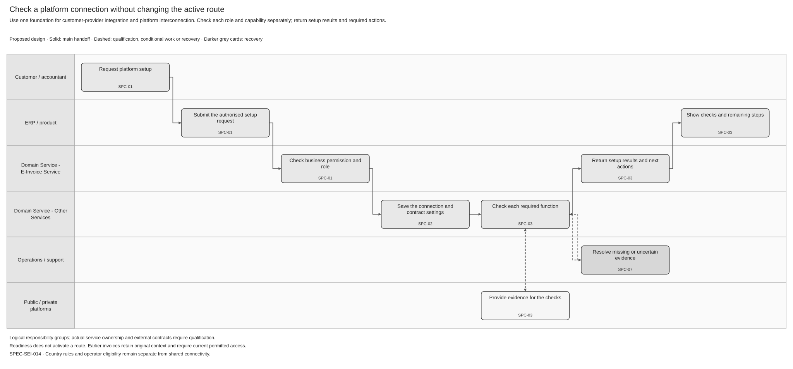
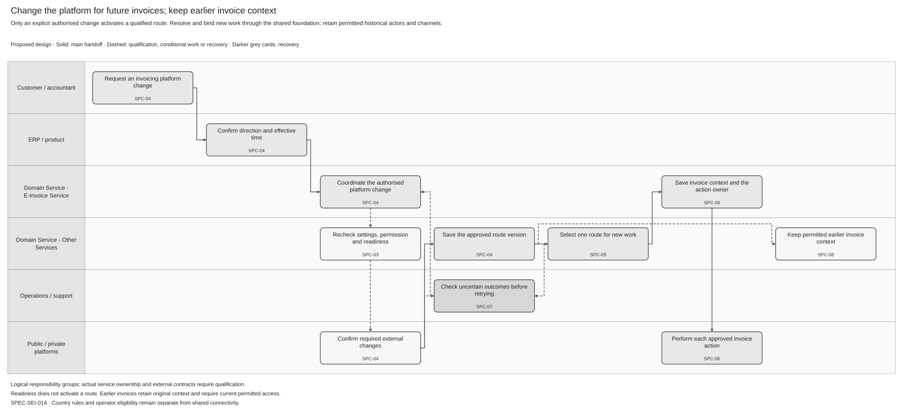

# Shared Platform Connectivity and Routing Solution Specification

Terminology follows the [shared e-invoicing glossary](../context/GLO-SEI-001-e-invoicing-terminology.md). This is a **proposed logical design**. It establishes a reviewable shared foundation, not a deployed service, an approved external interface or permission for Sage to launch as an operator.

## Part 1 Feature Solution Summary

### 1 Purpose, evidence and scope

Implement one shared connection and routing foundation for two uses in Spain: Sage software connects a business to its external private provider; later, the Sage private-platform proposition exchanges with public and other private platforms. Products and partners use the common access contract; selected adapters execute the supported external interfaces. Adding an operator role must not create a second connection registry, route engine or invoice history.

“Build once” describes reuse of shared behaviour. It does not mean one credential, endpoint, connection record or deployment can serve every role. A provider's customer interface and platform-interconnection interface may have different permissions, trust, registration and transport requirements. Qualify each separately and reuse an adapter only where its actual contract fits.

| Source | Authority and limit |
|---|---|
| [PRD-SEI-214 — Connections, registration and routing](../prds/PRD-SEI-214-connections-registration-routing-structured-review.md), FR1–27 | Primary connection, readiness, route, concurrency and historical-context requirements. Initial scope is legal entity, direction, environment and effective time; advanced routing is not approved. |
| [PRD-SEI-213 — Private connectivity](../prds/PRD-SEI-213-private-platform-connectivity-structured-review.md) and [PRD-SEI-235 — Provider API](../prds/PRD-SEI-235-provider-api-for-e-invoicing-service.md) | Customer-provider integration and qualified Provider API, Sage adapter or hybrid modes. A mode name does not establish provider readiness. |
| [PRD-SEI-210 — Sage as a private platform](../prds/PRD-SEI-210-sage-private-platform-reuse-and-operator-expansion.md), capability/reuse boundaries | Proposed operator expansion using the earlier foundation. Investment, accountable operator and build/partner route remain open. |
| [PRD-SEI-223 — Exchange](../prds/PRD-SEI-223-interoperability-routing-transformation.md), FR1–5/12–26 | Recipient evidence, immutable exchange plans, independent actions, interconnection and safe recovery. Exchange owns the invoice/action plan, rather than this foundation creating another one. |
| [PRD-SEI-221 — Operator readiness](../prds/PRD-SEI-221-operator-readiness-regulatory-governance.md), [PRD-SEI-215 — Recovery](../prds/PRD-SEI-215-resilience-recovery-reconciliation-structured-review.md) | Operator eligibility and recovery evidence gates; no new legal clock or external API is defined here. |
| [PRD-SEI-227 — Shared platform](../prds/PRD-SEI-227-e-invoicing-as-a-service.md) and [FP-SEI-001 — Reuse assessment](../feature-proposals/FP-SEI-001-phase3-existing-capability-reuse-gap-assessment.md) | Shared design direction and implementation qualification. Written requirements do not prove a production implementation. |

In scope: role-qualified connection profiles, separate registration observations and capability checks, controlled activation, deterministic route selection, adapter handoffs, suspension, migration qualification and historical dependencies. **Open/gated expansion:** operator interconnection, direct private exchange and a public bridge use the same model only after applicable evidence and approval. Connecting to providers first is a delivery sequence, not a technical prerequisite to operating a platform.

Out of scope: legal invoice issuance, a new Global API product, a new invoice store, provider endpoint design, approval of operator launch, general routing optimisation, per-invoice caller override, automatic failover, approval of Private A → Private B customer switching, signing/transformation implementation and final retention/deletion. Platform-to-platform invoice exchange is different from changing a customer's selected platform.

### Public source baseline

The supplied public WSDLs can qualify the SPFE adapter portion of a connection profile. They do not qualify private-provider interfaces, operator accreditation, customer enrolment or receiving-point publication. This review changes only the public binding of the shared model.

See [REF Source references](#ref-source-references) for the original files, exact locations and source limits. The [technical evidence guide](../context/RES-SEI-002-spain-public-platform-technical-evidence.md) tracks shared source conflicts. The constraints below align this feature with the supplied public evidence; Sage implementation and activation remain gated.

### 2 Terms, roles and responsibility

| Term | Meaning |
|---|---|
| Connection / registration / readiness / route | Communication configuration; observed external enrolment or reachability; evidence for a selected capability; time-bound platform selection for a defined invoice scope. These are separate facts. |
| Integration role | The capacity in which Sage uses an interface: customer-provider integration or platform interconnection. The role selects qualified contracts and controls; it does not grant customer authority. |
| Contract profile | Selected operation, protocol/schema, environment, destination and safety rules. It is separate from invoice format and operator eligibility. |
| Exchange action | One separately tracked delivery, public-copy submission or event report, with its own result. |
| Cutover / historical continuity | The boundary when future eligible work changes platform; the permitted actors, access and evidence retained for earlier invoices. |
| Authenticated principal / represented party | Trusted caller identity; business or person on whose behalf the action is performed. They are checked separately. |

| Responsibility | Owner and handoff |
|---|---|
| Shared connection records, profiles, checks and route versions | Proposed Connection / Routing logical owners within Domain Services. Actual service/build ownership stays open under SPC-Q01. |
| Customer setup and platform-change journey | [SPEC-SEI-002](SPEC-SEI-002-onboarding-solution-specification.md) owns customer intent and journey results; uses this foundation for readiness and route commit. [SPEC-SEI-003](SPEC-SEI-003-offboarding-solution-specification.md) owns exit and dependency release. |
| Common API access | [SPEC-SEI-013](SPEC-SEI-013-provider-api-through-the-e-invoicing-global-api-solution-specification.md) exposes authorised operations and results; it does not implement a second route engine. |
| Public protocol access | [SPEC-SEI-011](SPEC-SEI-011-public-platform-connector-solution-specification.md) owns public operation execution and evidence. This foundation supplies qualified connection/route context, not a replacement public connector. |
| Invoice exchange and recipient resolution | [SPEC-SEI-007](SPEC-SEI-007-invoice-sending-solution.md) owns the final exchange plan/actions; [SPEC-SEI-012](SPEC-SEI-012-consult-public-platform-for-recipient-information.md) supplies recipient evidence; [SPEC-SEI-016](SPEC-SEI-016-invoice-receiving-retrieval-and-download-solution-specification.md) owns trusted intake and product delivery. |
| Status facts and required reports | [SPEC-SEI-009](SPEC-SEI-009-invoice-lifecycle-status-solution-specification.md) interprets events and owns reporting obligations. Resolve permitted historical context here without changing the fact or replaying a report. |
| Trust and transformation | [SPEC-SEI-001](SPEC-SEI-001-certificate-management-solution-specification.md) owns protected credentials/trust. Existing DTS is the preferred transformation reuse candidate; [SPEC-SEI-008](SPEC-SEI-008-spain-ubl-mapper-migration-to-dts-solution-specification.md) does not qualify every input/output pair. |

### 3 Spain use and reuse qualification

| Source capability | Intended Spain use | Reuse classification / local changes | Gap, owner and evidence before activation |
|---|---|---|---|
| Connection/readiness/route patterns in PRD-SEI-214 | Keep public and private connections; select independently for sending/receiving. | Reusable unchanged: proposed design pattern, extended with separately qualified roles. | Architecture + Connection/Routing: actual build, contracts, concurrency and migration coverage remain unknown. |
| Global API and identity services | Common scoped access for products and partners. | Unknown implementation coverage; bind consumer roles and represented-party authority. | API/Identity owners: build, grants, revocation, compatibility and tenant/environment tests. |
| Provider adapter and public connector | Use customer integration and operator interconnection through the same domain handoffs. | Reusable with country/provider binding; external interfaces may need different adapters and trust. | Integration owners: exact operation, role, protocol, credentials, query/replay and conformance evidence. No role inherits another role's readiness. |
| Existing DTS | Transform a representation requested by Exchange/Receiving. | Unknown implementation coverage; preferred reuse candidate, outside route selection. | DTS/Spain mapping owners: selected build, input/output contracts, mappings, rule packs, semantic preservation and operations. No blanket inbound or syntax coverage. |
| Identity, recipient selection, public-copy and reporting policy | Apply approved Spain identity, destination, copy and reporting rules. | Spain-specific policy; shared orchestration needs a country binding. | Spain Product/Compliance: applicable rule/version and contracts; do not make Spain rules another country's defaults. |
| Operator controls and platform interconnection | Enable the proposed Sage-platform role. | Proposed extension; legal operator readiness is separate from technical connection readiness. | Operator/Compliance/Integration: accountable entity, trust, test results, support and activation evidence under PRD-SEI-221. |

For every candidate record its source implementation or design pattern, retained behaviour, local changes, missing coverage, owner and evidence. Reusing an implementation requires actual build/contract results; copying a proposed pattern does not establish production readiness.

### 4 Process diagrams and lifecycle

Diagram step names use plain-language actions. The smaller activity references link to the detailed behaviour and checks below.

[Editable Draw.io](../assets/diagrams/shared-platform-connection-qualification-process.drawio) · [PNG preview](../assets/diagrams/shared-platform-connection-qualification-process.png).

Text equivalent: authorised customer/administrator request → SPC-01 establish business and role → SPC-02 save connection/profile independently from the active route → SPC-03 check each capability and observed external state → return setup result with passed checks, limitations and required actions. Missing evidence blocks only the affected capability; an uncertain external change goes to SPC-07 before repetition. Even a fully qualified connection cannot change the customer's platform without SPC-04.

[Editable Draw.io](../assets/diagrams/shared-platform-route-and-continuity-process.drawio) · [PNG preview](../assets/diagrams/shared-platform-route-and-continuity-process.png).

Text equivalent: explicit platform-change request → SPC-04 prepare and commit the authorised direction/effective boundary after current qualification and external confirmation → SPC-05 resolve a single route for new work → SPC-06 bind the route/profile to the owning invoice/action before external processing. A conflict or uncertain external change goes to SPC-07. SPC-08 preserves permitted historical work and applies suspension/release checks. A qualified future route does not replace earlier invoice context.

| Activity | Trigger and observable result | Logical owner |
|---|---|---|
| SPC-01 Establish scope and role | Request identifies caller, represented party, tenant, country, environment, direction/capability and integration role; authority and operator eligibility are checked separately. | Identity / Connection |
| SPC-02 Configure connection/profile | Authorised administrator saves versioned configuration and protected references; external registration and routes remain unchanged. | Connection / Trust |
| SPC-03 Qualify capability | Non-mutating checks or approved conformance evidence return supported operations, observed state, freshness, limitations and required actions per role/capability. | Connection / adapter |
| SPC-04 Change e-invoicing platform | Explicit request commits a scope-specific route version at an agreed boundary only after readiness, authority, concurrency and required external checks. | Onboarding/exit coordinator → Routing |
| SPC-05 Resolve route | New work selects exactly one eligible customer route; recipient evidence and country policy remain separate Exchange inputs. | Routing → Exchange/Receiving |
| SPC-06 Bind and hand off | Owning feature saves the route/profile, permitted executor and correlation before external processing; returns independent action evidence. | Exchange/Receiving / adapter |
| SPC-07 Reconcile and recover | Unknown, conflicting or stale evidence is checked under the original operation; safe continuation or an owned unresolved case is returned. | Feature owner / adapter / Operations |
| SPC-08 Preserve continuity and suspend/release | Suspension controls new work; prior invoices retain permitted context. Dependency release occurs only through the owning exit controls. | Routing / lifecycle / exit coordinator |

### 5 Material decisions

SPC-Q01–Q07 gate actual component reuse, external contracts, country/operator controls, incoming reachability, continuity, operating limits and delivery scope. This spec changes no live route. A customer sees **setup result and required actions** or **platform-change result**; an internal readiness label never promises that a route is already active.

## Part 2 Logical Feature Specification

### 1 Model, outcomes and invariants

The proposed logical records use existing concepts: connection, registration observation, capability qualification, route/version, transition, immutable invoice context and continuity dependency. Add integration role and contract-profile references rather than parallel Phase 2/Phase 3 record families. Logical field names here are proposed; actual mappings need SPC-Q01. Preserve existing contracts until compatibility is proven.

Connection configuration, qualification, selected route and operator eligibility remain independently visible. Keep `UNKNOWN` for unproven registration and `OUTCOME_UNKNOWN` for a possible external effect with no reliable result. A failed probe is not evidence that registration ended. Do not introduce a customer-wide readiness flag or a universal external state mapping.

1. Every access and mutation checks tenant, represented party, authenticated caller, environment, capability and current authority. Operator approval cannot replace customer authority.
2. Readiness is qualified for the exact role, contract/profile and capability. Customer-interface success cannot activate platform interconnection.
3. Preparing or qualifying a connection never changes a route. Route activation and external registration are separate operations with separate evidence.
4. A scoped route has one eligible connection for each decision time. Reject overlapping effective periods or ambiguous matches; do not use database order or invent fallback.
5. Before external processing, the owning feature saves the effective route/profile and the action's execution owner. A route change cannot rewrite that record or move an uncertain action to a second executor.
6. Earlier work uses recorded context and separately verified current historical authority. Old credentials or provider access are not retained indefinitely merely because records exist.
7. Required public copies and event reports have independent actions/results under country policy. Connection readiness does not create these obligations.

### 2 Behaviour by activity

**SPC-01 — Establish scope and role.** On a product/partner request, verify the authenticated principal's capability and represented-party grant. Resolve tenant/legal entity, country, trusted environment and requested direction. Reject caller-supplied conflicting identity/environment or unauthorised role selection before exposing records. Operator administration may qualify a platform profile without access to customer invoice data; customer route activation still needs the customer's authority and entitlement. Save decision source/version and rejection reason with sensitive values removed.

**SPC-02 — Configure the connection.** Validate the chosen provider/network and supported integration mode (`PROVIDER_API`, `SAGE_ADAPTER` or qualified `HYBRID`). Save configuration under expected version and request identity; protect credential references through SPEC-SEI-001. The profile identifies role, operation, protocol/schema version, approved destination reference, trust/authority requirements, accepted representation/profile, limits, idempotency/query support and execution/reconciliation owners. Do not accept arbitrary caller URLs. Same request identity/content returns the prior result; changed content conflicts. Multiple roles may share proven adapter code, but require distinct bindings where authority, accounts or interfaces differ. Updating a credential/profile invalidates affected qualification until checked; it cannot mutate existing invoice context.

**SPC-03 — Qualify each capability.** Adapter/Connection owners assess incoming, outgoing, status, notification and reconciliation paths independently. Use approved checks that do not issue invoices or mutate registration. Store check result, source, observed time, rule/profile/credential version, expiry/recheck condition and limitations. Where enrolment or receiving-point publication requires a mutation, its feature owns a durable operation and independent observation; configured, acknowledged and observed reachable remain separate results. Ambiguous publication enters SPC-07. Missing provider observation requires an approved manual evidence gate, not inferred success. No global READY promotion is allowed from one successful call. Return passed/failed/unknown checks and named required actions; expose no credentials.

For platform interconnection, also qualify operator eligibility, peer identity, selected trust/transport, supported invoice/status operations, test evidence and responsible support owner. An interconnection case being opened or closed is not technical readiness. No legal deadline or protocol is asserted by this spec; the applicable rule and external artefacts remain SPC-Q02/Q03 gates.

**SPC-04 — Change e-invoicing platform.** On an explicit authorised customer/delegate request, identify sending, receiving or both; display current and proposed platform, effective boundary, limitations and historical impact. Onboarding/exit owns this customer journey; Routing owns the single route commit. Recheck current authority, entitlement, role qualification, dependency validity and expected route version. Prevent overlapping active/scheduled scopes and serialise competing changes through the existing Routing owner.

Prepare any required external receiving-point change with durable request identity and observed result before declaring activation. There is no distributed atomicity assumption: save preparation state, reconcile a possible external effect, and hold affected work where external and local selections disagree. Commit the local route with an expected-version check only when the contract-specific ordering and reachability checks pass. Return result per direction, actual boundary and remaining historical tasks. Unaffected directions continue. Cancellation before external effect leaves the old route; after a possible effect it requires reconciliation. Restoration after cutover is a new authorised transition, not deletion of evidence or a rewrite of the previous boundary. Private A → Private B customer switching remains disabled until the source product decision and its transition contract are approved.

**SPC-05 — Resolve new work.** For new work, apply the route's effective interval to the trusted decision time and implemented scope: legal entity, direction and environment within tenant/country. Exclude ineligible capabilities using current role/profile evidence. Return exactly one route/version with selection reason. No match returns an owned hold under the approved no-route policy; several matches return a configuration conflict. A timeout is not proof of no private destination. Outbound Exchange separately resolves recipient evidence and applies Spain delivery/copy policy through SPEC-SEI-012/007. A customer-provider route and the recipient's destination are different selections; do not merge them. For incoming traffic, Receiving matches the authenticated source and permitted receiving interval, rather than treating the current outbound route as authorisation.

**SPC-06 — Bind and hand off.** Return connection/profile version, permitted executor, protected references and decision evidence to the owning feature. Exchange/Receiving stores immutable invoice context before external processing. Exchange plans independent delivery/copy/reporting actions where applicable, each with one execution and reconciliation owner. A partner work claim under SPEC-SEI-013 and an adapter under SPEC-SEI-011 must not execute the same action concurrently. The selected executor validates current authority and credential safety immediately before transmission, while preserving the original action identity/profile; a changed contract requires explicit recovery, not silent replacement. Receiving validates the actual source/file under SPEC-SEI-016. Record external references and exact acknowledgement meaning through the owning feature. Transport success is not buyer acceptance, payment or report completion.

**SPC-07 — Reconcile and recover.** The operation owner records whether an external change may have happened. For a lost response, claim expiry, conflicting observation or stale commit, use the original operation/profile/reference to query authoritative state where supported. Repeat a mutation only under a proven repeat contract; otherwise retain an owned unresolved case with escalation. Do not switch to a new platform or credential merely because a worker lease expired. Safe read rechecks may refresh qualification under approved limits. Manual action needs scoped permission, evidence, reason and audit; it cannot invent external completion. After correction, requalify only the affected capability and separately request route activation if needed. Feature-specific recovery remains in SPEC-SEI-002/007/009/011/013/016; this foundation owns connection/route discrepancy recovery without duplicating their action stores.

**SPC-08 — Preserve continuity and suspend/release.** Before disablement, list active/scheduled routes and in-flight/historical dependencies. Revoked authority or unsafe trust stops protected actions; keeping a record does not retain permission. Route historical work using the original invoice/operator context and an approved current actor/channel. Missing historical authority opens a continuity case rather than silently using the new platform. A contract-approved replacement channel is an append-only handoff with evidence and owner, not a rewrite of the original invoice snapshot. SPEC-SEI-003 coordinates deregistration, credential release, export, retention and deletion at their own gates. Rollout of the operator role must preserve existing customer-provider connections; qualifying the new role does not activate it or migrate customers.

### 3 Requirements and controls

| Requirement | Testable behaviour / source |
|---|---|
| SPC-R01 | Use one connection/route model across both roles with separate bindings where needed; PRD214 FR1/2/19–21, PRD210 reuse constraint. |
| SPC-R02 | Isolate caller, represented party, tenant, country, environment and capability; PRD214 FR6/27 and PRD235 authority controls. |
| SPC-R03 | Separate configuration, external registration, capability readiness, operator eligibility and active route; PRD214 FR3–5/23. |
| SPC-R04 | Commit only explicitly authorised, current, non-overlapping, version-controlled route changes; PRD214 FR7–13. |
| SPC-R05 | Resolve one explainable route and persist immutable context before external processing; PRD214 FR10/14–18, PRD223 FR1–3/14. |
| SPC-R06 | Each exchange action has one executor and independent evidence; no second path or fallback resends an uncertain/completed action; PRD223 FR12/15/16/22/23. |
| SPC-R07 | Mutation identity binds input and expected version; uncertain external effects reconcile before unsafe repeat; PRD214 FR22/25 and PRD215. |
| SPC-R08 | Suspension and dependency release preserve history and enforce current permission; PRD214 FR13/17/18/26, SPEC003 exit controls. |
| SPC-R09 | Customer results explain passed checks, limitations, required action/owner and platform-change scope; PRD214 FR23/24. |
| SPC-R10 | Keep Spain policy separate and record implementation reuse gaps, owners and qualification evidence; PRD227/FP001 and repository controls. |

Encrypt protected records and transport under approved policy; return credential handles, never secrets. Restrict endpoints and parser/file access in the owning adapter/receiving service. Audit actor, reason, before/after version, correlation and evidence reference without raw invoice content. Operations views require separate permission. Measure qualification freshness, transition age, conflicting/unknown operations, historical dependencies, backlog and provider health without business identifiers in metric labels. SPC-Q06 gates quotas, expiry/recheck, retention, retry budgets and service targets; no numeric commitment is invented.

### SPFE source contract binding

The source facts below govern the public binding. Recovery, storage and qualification actions are proposed Sage controls where stated. Apply them through SPC-02–03, SPC-06–07. Source conflicts stay open under SPC-Q02/Q03/Q04; SPFE-Q09/Q12; they are not resolved by a local default.

| ID | Constraint and required behaviour | Source reference |
|---|---|---|
| SPC-SPFE-R01 Qualify only the evidenced public profile | SPC-02/03 records the exact SPFE operation, WSDL version/port, certificate class, represented-party authority and environment. Public readiness cannot qualify a private provider or operator role, publish an entry point or activate a customer route. PRE addresses remain separate from production evidence. | SPFE-S03/SPFE-S16; [REF](#ref-source-references). |
| SPC-SPFE-R02 Preserve owning-feature public action rules | SPC-06 passes the frozen action to one public executor. OUT owns the Article 3/4 copy decision and LCS owns reporting. Public interconnection must not create a redundant faithful copy. Invoice-query absence cannot become recipient-routing evidence or permission to switch routes. | SPFE-S02/SPFE-S03; proposed execution boundary; [REF](#ref-source-references). |

## Part 3 Logical Service Interactions and Data Inventory

### 1 Interaction contracts

All mutations carry scoped caller/represented-party context, request identity, input digest and expected version. Save a stable local operation receipt before possible external change. Read results state observation time and uncertainty. These are logical contracts, not approved endpoints.

| Interaction | Caller → owner; input / output | Authority, recovery and data | Activities |
|---|---|---|---|
| SPC-INT-01 | Global API/journey → Identity/Connection; scope/role/grant → permitted context or denial. | Current customer grant and separate operator eligibility; no object-existence leakage; D01/D07. | 01–04/08 |
| SPC-INT-02 | Connection → profile registry/Trust; provider/role/environment → protected references and versioned operation contract. | Administrator scope; no arbitrary endpoint/key export; changed binding invalidates affected checks; D01/D02. | 02/03/06 |
| SPC-INT-03 | Connection → qualified adapter/provider; approved check/query → observed registration/capability evidence. | Operation-specific authority; read/check limits; possible external changes use owned mutation receipt and reconcile; D02/D03/D06. | 03/07 |
| SPC-INT-04 | Onboarding/exit → Routing; authorised platform-change intent/expected version/boundary → preparation, scoped commit or hold. | Current role readiness, observed receiving state and conflict control; cancellation/restoration retain evidence; D03/D04/D06/D07. | 04/07/08 |
| SPC-INT-05 | Exchange/Receiving → Routing; new work scope/time → one route/version/reason or owned hold. | Tenant/entity/environment/country checks; recipient lookup is separate; D03/D04/D05. | 05 |
| SPC-INT-06 | Routing → Exchange/Receiving → selected executor; route/profile/evidence → bound invoice/action context and external evidence. | Owning feature persists context; one executor per action, current authority before send; independent results; D02/D04/D05. | 06/07 |
| SPC-INT-07 | Feature/Operations → original adapter/reconciler; operation/reference → authoritative result or unresolved case. | Original action context and approved query/repeat contract; never a new executor by default; D05/D06/D07. | 07 |
| SPC-INT-08 | Lifecycle/exit → Routing/continuity; earlier invoice/dependency/suspension → permitted historical context, impact and release hold. | Current authority and approved continuity channel; SPEC003 owns final release; D04/D05/D07/D08. | 08 |
| SPC-INT-09 | Connection/Routing → Global API/product; committed outcome → safe result and recoverable notification. | Scoped reads/events, deduplicated notifications after durable save; no business-operation replay; D03/D04/D06/D07. | 03/04/07/08 |

### 2 Data inventory and systems of record

All records are partitioned by tenant/legal entity/country/environment where applicable. Retention, legal holds and deletion follow approved data-class policy and exit gates; this spec sets no period.

| Data | Logical owner; contents and classification | Consumers and lifecycle |
|---|---|---|
| SPC-D01 Connection binding | Connection; stable identity, provider/account reference, integration role/mode, environment, protected credential reference, configuration version; restricted/versioned. | 01/02/03/06; never expose credential material. |
| SPC-D02 Contract/operator profile | Profile registry; operation, role, trust, destination reference, protocol/schema, safe-repeat/query support, executor/reconciler and separate operator evidence; restricted/versioned. | 02/03/06/07; each role qualified separately. |
| SPC-D03 Registration/qualification observations | Connection; intended/observed state, source/time, capability, profile/credential/policy versions, limitations, expiry/recheck and required action; append observations. | 03/04/05 and INT-09 result publication; no implicit route activation. |
| SPC-D04 Route and transition | Routing; direction/scope, selected connection/profile, effective period, expected/new version, authority/approval, preparation/commit/cancellation/restoration evidence; restricted. | 04/05/06/08; unique eligible selection and concurrency checks. |
| SPC-D05 Invoice/action context reference | Exchange/Receiving remains system of record; original route/operator/profile, decision time, external references and execution owner; immutable origin with later evidence appended. | 05/06/07/08; foundation references this record rather than creating a second invoice store. |
| SPC-D06 Connection/transition operation | Owning Connection/Routing feature; request identity/input digest, attempts, external-effect boundary, result/unknown, observation and safe continuation; restricted/durable. | 03/04/07/09; invoice actions stay in their existing owners' stores. |
| SPC-D07 Authority/audit/case references | Identity/Audit/Operations; grant/version, actor/reason, before/after state, correlation, evidence, case owner/action; restricted with redaction. | 01–04/07/08/09; invoice/API permission and operator approval remain distinguishable. |
| SPC-D08 Continuity dependencies | Exit/Records with Routing references; invoice/connection dependency, permitted actor/channel, access limits and release evidence; restricted/versioned. | 08; ownership gap blocks unsafe release, not a proven unrelated direction. |

## Part 4 Assurance and Traceability View

### 1 Acceptance and evidence

The scenarios below are checks to run, not claims that they passed on a deployed implementation. Activity numbers refer to SPC-01–08; interaction/data numbers refer to the inventories above.

| Acceptance | Requirement → activities / interactions / data | Observable acceptance evidence |
|---|---|---|
| SPC-A01 Add operator role without replacing the foundation | R01/03/05/10 → 01–06/08; INT01–06/08/09; D01–05/08 | An existing customer-provider connection keeps identity, selected routes and history when a separately qualified operator profile is added. Shared owner/model/contracts are evidenced; no duplicate route engine or invoice store. |
| SPC-A02 No qualification inheritance between roles | R01–03 → 01–03; INT01–03; D01–03/07 | Customer-interface success leaves operator interconnection unqualified until its own trust, contract and operator checks pass; incompatible credentials cannot cross roles. |
| SPC-A03 Configure/check without platform change | R03/09 → 02–04; INT02–04/09; D01–04/06 | Setup returns passed, failed and unknown checks with required action/owner; public/private routes remain unchanged. No test issues an invoice. |
| SPC-A04 Scope and isolation denial | R02/10 → 01–08; INT01–09; D01–08 | Cross-tenant/entity/country/environment, forged role and revoked grant requests fail before protected access/send; no credential or object-existence leakage. |
| SPC-A05 Independent direction and concurrency | R04/05 → 04/05; INT04/05; D03/D04/D06 | Private sending/public receiving coexist. Competing or overlapping changes cannot both commit; unaffected directions continue and results state the actual scope. |
| SPC-A06 Ambiguous publication, cancellation and restoration | R04/07 → 03/04/07; INT03/04/07; D03/D04/D06/D07 | Lost external response holds affected activation and observes the original operation before repeat. Pre-effect cancellation keeps the old route; post-effect cancellation reconciles; restoration appends a new authorised boundary. |
| SPC-A07 Deterministic selection and separate recipient lookup | R05 → 05/06; INT05/06; D03–05 | Zero/multiple matches return owned hold/conflict. Recipient lookup failure does not invent public fallback or override the customer's provider. Route/profile context persists before processing. |
| SPC-A08 Single executor and unknown-action recovery | R06/07 → 06/07; INT06/07; D02/D05/D06 | Partner claim and adapter cannot send one action twice; expiry or timeout does not move it to a second executor. Public-copy/report failure does not resend successful invoice delivery. |
| SPC-A09 Historical continuity and suspension | R05/08 → 07/08; INT07/08; D04–08 | After a platform change, earlier delivery/status/reporting uses original context plus current permission. Revocation blocks unsafe access; an unresolved actor/channel prevents dependent release and stays visible. |
| SPC-A10 Country isolation and implementation qualification | R10 → 01–08; INT01–09; D01–08 | A separate country binding does not inherit Spain identity, recipient, copy or reporting rules. Existing build/contracts/mappings/operations and gaps are recorded; unsupported role/profile/DTS pair stays disabled. |
| SPC-A11 Operator exchange is distinct from customer switching | R01/03/04 → 01–05; INT01–05; D01–04 | Qualifying a peer interconnection does not migrate customers, enable Private A → Private B switching or activate the Sage proposition. Evidence gates remain explicit. |
| SPC-A12 Durable results and permitted operations view | R07/09 → 03/04/07/08; INT07–09; D03/D04/D06/D07 | A crash after save permits result/notification recovery without repeating a mutation. Scoped support sees intended/observed state, evidence age and safe owner/action; secrets and other customers' data remain hidden. |

### 2 Open decisions and release gates

| Decision | Accountable owner / evidence | Impact and gate |
|---|---|---|
| SPC-Q01 Actual Connection/Routing/API build, record mappings, service owners and migration fit | Architecture + Connection/Routing/API owners: contracts/builds, baseline, gaps and compatibility proof. | Blocks build-ready physical design and implementation-reuse claims; select existing owners before adding components. |
| SPC-Q02 External interface per provider, role and capability | Integration/provider/public-connector owners: exact operation, initiator, profile, credentials, conformance and query/repeat semantics. | Blocks affected adapter/profile activation; common provider identity does not prove common interface. |
| SPC-Q03 Spain country rules and operator eligibility | Spain Product/Compliance + accountable operator: approved identity/routing/copy/reporting rules, interconnection applicability and operator evidence. | Blocks country-dependent/operator activation; no new legal interpretation is established here. |
| SPC-Q04 Incoming reachability and external/local cutover ordering | Routing/Onboarding + provider owners: publication observations, expiry, mismatch recovery, cancellation and restoration tests. | Blocks affected receiving cutover; outbound qualification cannot substitute for it. |
| SPC-Q05 Historical actor/channel and dependency release | Lifecycle/exit/Records + Compliance/providers: current authority, approved replacement channel, continuity and release evidence. | Blocks unsafe historical execution or release; preserve an owned unresolved case. |
| SPC-Q06 Operational and data-policy targets | Operations/Security/Records + Product: measured volume, provider limits, freshness/retry policy, monitoring, retention and support/runbooks. | Blocks production sign-off and numeric commitments. |
| SPC-Q07 First delivery cohort and expansion scope | Spain Product + Architecture/operator owners: provider/role/direction matrix, approved product scope and controlled rollout. | Pilot only qualified capabilities; per-invoice override, automatic failover and Private A → Private B customer switching remain outside initial scope. |

### 3 Readiness

**Reviewable logical proposal.** Design review can assess one foundation and its separate role/country bindings. Pilot requires SPC-Q01/Q02/Q04 plus applicable SPC-Q03 decisions, isolation/concurrency/unknown-outcome acceptance and continuity owners. Production and operator expansion additionally require actual operator approval, implementation qualification, measured operating controls and supported historical/exit paths. No publication, status change, operator investment or live activation is implied.

### SPFE evidence acceptance

These are required evidence scenarios, not executed implementation tests. The source-binding gate is SPC-Q02/Q03/Q04; SPFE-Q09/Q12. A source-backed review does not establish that this feature is ready for production.

| ID | Scenario | Required result | Requirement coverage |
|---|---|---|---|
| SPC-SPFE-A01 | A public SendInvoice profile passes checks while private/operator profiles are unknown | Enable only the independently qualified public capability; no registration, publication, route activation or private readiness is fabricated. | SPC-SPFE-R01; SPC-02–03, SPC-06–07; [REF](#ref-source-references). |
| SPC-SPFE-A02 | Public interconnection or an empty public invoice query enters the shared routing model | Retain the owning feature's exact action set; no extra copy, recipient absence inference or automatic route switch. | SPC-SPFE-R02; SPC-02–03, SPC-06–07; [REF](#ref-source-references). |

## REF Source references

For public-platform legal and external-contract facts, the original official sources below take precedence over earlier assumptions in linked PRDs and internal notes. PRDs retain product scope and are unchanged by this review. A source conflict remains an explicit gate; this spec cannot approve a local substitute.

Use the original files for the claims they establish. Final published regulation governs legal requirements; technical files supply their stated contract facts. Examples are illustrative. Missing or conflicting evidence remains a named gate. Product requirements and Sage design controls have separate authority. The English guide and extracts are reading aids.

| REF ID | Source and version | Exact location | Supported information and limit |
|---|---|---|---|
| SPFE-S02 | [BOE-A-2026-20587.pdf](<../context/BOE-A-2026-20587.pdf>); Final order; published 5 October 2026. | Articles 3.4, 4 and 11 | Public-copy distinction and public action authority; no private adapter implementation. |
| SPFE-S03 | [CatalogoServicios.pdf](<../context/Descripción servicios web/Catálogo de servicios/20261013/CatalogoServicios.pdf>); 0.1.0; cover 9 October 2026. | sections 4.3 and 6.1–6.10; pp. 8, 10–20 | Public operations and limits, not a recipient directory or private service contract. |
| SPFE-S16 | [SendInvoice.wsdl](<../context/WSDL servicios web - PRE/20261013/SendInvoice.wsdl>); Supplied 13 October 2026; SHA-256 in source manifest. | certificate/seal service ports and PRE addresses | Public environment/credential-class binding. |
| REF-PRD | [PRD-SEI-214 — Connections, registration and routing](../prds/PRD-SEI-214-connections-registration-routing-structured-review.md); [PRD-SEI-213 — Private connectivity](../prds/PRD-SEI-213-private-platform-connectivity-structured-review.md); [PRD-SEI-235 — Provider API](../prds/PRD-SEI-235-provider-api-for-e-invoicing-service.md); [PRD-SEI-210 — Sage as a private platform](../prds/PRD-SEI-210-sage-private-platform-reuse-and-operator-expansion.md); [PRD-SEI-223 — Exchange](../prds/PRD-SEI-223-interoperability-routing-transformation.md); [PRD-SEI-221 — Operator readiness](../prds/PRD-SEI-221-operator-readiness-regulatory-governance.md); [PRD-SEI-215 — Recovery](../prds/PRD-SEI-215-resilience-recovery-reconciliation-structured-review.md); [PRD-SEI-227 — Shared platform](../prds/PRD-SEI-227-e-invoicing-as-a-service.md). | Product scope and requirement IDs cited in Parts 1–4. | Canonical product requirements. Earlier external-contract assumptions are reconciled with the supplied sources; an unresolved PRD difference needs a product decision, not silent approval. |
| REF-CONTEXT | [RES-SEI-002](../context/RES-SEI-002-spain-public-platform-technical-evidence.md); [source manifest](../assets/regulatory/spain/spfe/source-manifest.json); [shared glossary](../context/GLO-SEI-001-e-invoicing-terminology.md). | Source register, shared conflicts and terminology. | Reading and traceability aids. Hashes identify snapshots; they do not prove live service acceptance or implementation readiness. |
