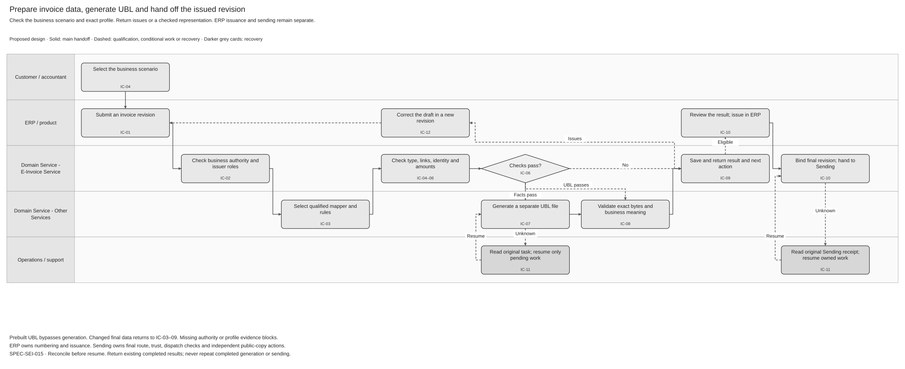
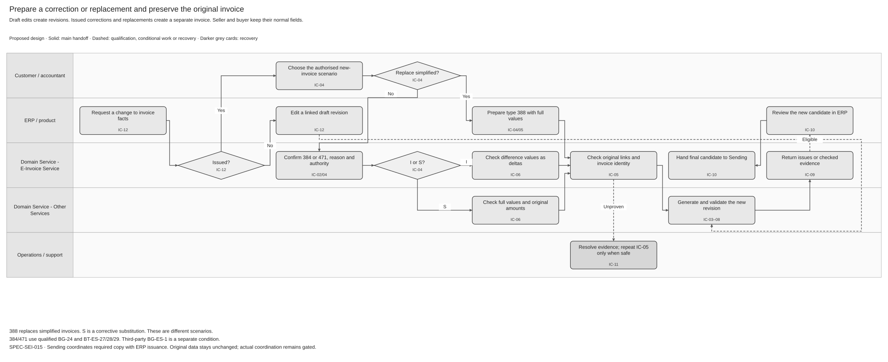

# Invoice Creation Solution Specification

Terminology follows the [shared e-invoicing glossary](../context/GLO-SEI-001-e-invoicing-terminology.md). This is a **reviewable logical proposal for Spain**. The proposed service contracts and controls require design review. Regulatory content is distinguished from internal source assumptions. No implementation or public-platform acceptance is claimed.

## Part 1 Feature Solution Summary

### Reader guide

Part 1 explains the scope, owners, process and evidence. Part 2 defines invoice types, fields, identity, validation and recovery. Part 3 defines logical service interactions and data. Part 4 connects the requirements to acceptance scenarios and open decisions.

### 1 Purpose and scope

Give Sage products one controlled way to prepare Spain invoice data, select the correct invoice type, generate a UBL representation and obtain validation evidence. Support standard invoices, seller corrections, replacements of simplified invoices, buyer-issued invoices and buyer-issued corrections. Preserve the invoice identity across the recipient representation, any faithful public copy and later lifecycle references.

**Creation has two separate meanings.** The ERP creates and issues the business invoice. Domain Services creates a derived electronic representation and checks it. A generated file or a validation `PASS` does not establish legal issuance, submission, recipient delivery, buyer acceptance or payment.

In scope: product type selection, explicit issuer roles, versioned source intake, profile selection, type-driven validation, original-invoice references, corrective methods, regime keys, monetary reconciliation, unique-code inputs, qualified UBL generation, safe issues, immutable evidence and the handoff of issued data to sending.

Out of scope: ERP numbering allocation, approval of legal issuance, external submission, recipient-directory implementation, signing implementation, public-copy dispatch, buyer status decisions, payment reporting, cancellation of an issued invoice and a new invoice archive. Creation supplies facts to those owners. It does not implement their operations.

### Public source baseline

The new technical formats document selects public UBL 2.5 Invoice, including the five invoice type codes. Final Annex I still governs field meanings and fixed identifiers. Both supplied invoice examples conflict with its ProfileID, so example presence cannot close profile or mapper qualification.

See [REF Source references](#ref-source-references) for the original files, exact locations and source limits. The [technical evidence guide](../context/RES-SEI-002-spain-public-platform-technical-evidence.md) tracks shared source conflicts. The constraints below align this feature with the supplied public evidence; Sage implementation and activation remain gated.

### 2 Evidence, authority and source differences

The user supplied five internal articles. They establish the requested product context. The final public-platform order is the regulatory baseline for public invoices and copies. Read its Annex I together with the selected technical contract. A public profile is not a universal profile for every private exchange.

| Evidence ID | Source | Authority and limit |
|---|---|---|
| IC-E01 | [Handling Different Invoice Types in Spain](https://confluence.sage.com/spaces/DNBU/pages/837610750/Handling+Different+Invoice+Types+in+Spain) | User-supplied article. Defines the five-type requirement, type-driven checks and correction journey. Source date is absent. |
| IC-E02 | [Invoice format — Spain](https://confluence.sage.com/spaces/DNBU/pages/837610729/Invoice+format+-+Spain) | User-supplied article. Defines central generation and compliance intent. Several identifiers and field meanings differ from the final order. |
| IC-E03 | [SPFE Unique Invoice Code Generation](https://confluence.sage.com/spaces/DNBU/pages/837610674/SPFE+Unique+Invoice+Code+Generation) | User-supplied article. Defines cross-message consistency. Its concatenation sketch is not an encoding contract or permission to add a UUID. |
| IC-E04 | [Field-Level Comparison of Invoice Types](https://confluence.sage.com/spaces/DNBU/pages/837610807/Field-Level+Comparison+of+Invoice+Types+Spain+CIUS-ES) | User-pasted matrix. Several BT/BG meanings require correction against Annex I. |
| IC-E05 | [Validation Rules Matrix](https://confluence.sage.com/spaces/DNBU/pages/837610816/Validation+Rules+Matrix+%E2%80%93+Spain+Invoice+Types) | User-pasted matrix. Some field IDs are truncated. Do not convert incomplete rows into executable rules. |
| IC-E06 | [Order HAC/1028/2026, Articles 3–6 and Annex I](https://www.boe.es/eli/es/o/2026/10/02/hac1028); [local BOE XML](../assets/regulatory/spain/BOE-A-2026-20587.xml); [repository evidence note](../research/spain-public-platform-order-evidence.md) | Final published regulatory text. Live BOE identity and relevant annex rows checked on 12 October 2026. Detailed field analysis uses the existing user-supplied XML. Exact schemas, executable rules and API acceptance still need qualification. |
| IC-E07 | [RD 238/2026, Article 7.5](https://www.boe.es/buscar/act.php?id=BOE-A-2026-7295#a7) | Requires the unique identifier to include issuer NIF, series/number and issue date. It does not define delimiter, escaping or normalisation rules. |
| IC-E08 | [European Commission EN 16931 rule source](https://github.com/ConnectingEurope/eInvoicing-EN16931/blob/master/ubl/schematron/abstract/EN16931-model.sch) and [supporting-artefact registry](https://ec.europa.eu/digital-building-blocks/sites/spaces/DIGITAL/pages/467108974/Registry%2Bof%2Bsupporting%2Bartefacts%2Bto%2Bimplement%2BEN16931) | Primary source for core monetary checks. A mutable branch is a research reference. Release requires a pinned compatible artefact, not an automatic latest-version download. |
| IC-E09 | [PRD-SEI-236 — UBL profile](../prds/PRD-SEI-236-ubl-format-profile.md), [PRD-SEI-241 — Validation](../prds/PRD-SEI-241-ubl-validation-service.md), [PRD-SEI-246 — Preparation and outbound](../prds/PRD-SEI-246-spain-invoice-preparation-and-outbound-flow.md) | Canonical product and handoff context. ERP issuance, profile activation and final dispatch validation remain separate. These documents remain at their current status. |

**Confirmed** below means supported by the cited regulatory or repository evidence. **Proposed** means a reviewable product or design choice. **Open** means the named owner must resolve the stated gate. A confirmed regulatory field does not prove an implementation supports it.

| Difference ID | Supplied internal context | Final-order baseline / design treatment |
|---|---|---|
| IC-C01 | BT-23 omits `profile`; BT-24 uses a `CIUS-ES-SPFE` URN. | Annex I gives BT-23 `urn:aeat:names:specification:ubl:schema:profile:B2B` and BT-24 `urn:cen.eu:en16931:2026#conformant#urn:aeat.es:spfe:1.0.0:extended`. Preserve these exact public-profile values. Technical bundle compatibility remains IC-Q01. |
| IC-C02 | `BG-ES-1` and `BT-ES-2/3/4/5/6` describe corrections. | Annex I places correction type, method and amounts in specialised `BG-24` groups using `BT-ES-27/28/29`. `BG-ES-1` describes third parties; `BT-ES-2` is effective payment date; `BT-ES-3/4/5` describe the third party. Never translate old field IDs by position. |
| IC-C03 | BT-32 and BT-48 are mandatory on every invoice. | Annex I allows seller BT-31 or BT-32, and buyer BT-47 or BT-48, with conditional identity requirements. Validate the scheme and role, not only field presence. |
| IC-C04 | BT-113 must be zero if present. | Annex I permits paid amounts with a restriction on advances that have caused VAT accrual under Article 75.Dos. The zero-only rule must not enter the final-order pack. |
| IC-C05 | Amount due is total less unspecified adjustments, or total less paid amount plus charges. | Core BR-CO-16 uses total with VAT minus paid amount plus rounding. The final public profile also includes separately classified collection and deduction amounts under BT-179. IC-Q06 must qualify the complete public-profile arithmetic. |
| IC-C06 | 388 replaces a previous invoice generally. | List L1 defines 388 as replacement of simplified invoices. It is separate from corrective substitution method `S`. Do not use 388 to avoid correction controls. |
| IC-C07 | Every correction/replacement must reference a valid existing local invoice. | BG-3 is `0..n`; BT-25 and BT-26 are mandatory within each supplied group. Proposed product policy requires identifiable originals for supported individual corrections/replacements. Local storage is not a legal prerequisite. Aggregate or permitted reference exceptions need IC-Q03. |
| IC-C08 | At least one REGI per line; only VAT is assumed. | Annex I specifies `1..2` regime groups per line, `BT-160=REGI`, BT-161 from L3A/L3B/L3C and national tax qualifier BT-ES-24. Isolate IVA, IGIC and IPSI rules. |
| IC-C09 | Optional embedding of the composite code in `cbc:UUID` or an extension. | Article 6 defines a composite identity from invoice fields. No standalone UUID mapping is approved here. Return derived identity only through the qualified API contract. |
| IC-C10 | Seller NIF is used without qualifying buyer issuance. | Keep seller, buyer, material issuer and authenticated caller separate. Annex II invoice references describe issuer NIF as the seller's NIF. Qualify the cross-message binding for 389/471 under IC-Q04; do not substitute the caller's or buyer's ID automatically. |
| IC-C11 | Corrected amount groups have one assumed maximum. | Annex I BT-3 text says up to three amount groups; the detailed `IMPORTES RECTIFICADOS` row says `0..5`. Some XPath spellings also need technical checking. IC-Q02 requires official schema/rule clarification; do not select a limit or repair an official path by guesswork. |

The Word compliance guide linked inside IC-E01 was not supplied. Its full content and approval status are unverified. It cannot close a legal or technical gate. The source articles also describe different MVP/pilot scopes. IC-Q08 must settle the release sequence; this spec describes all five requested types without claiming all are launch-ready.

### 3 Terms and responsibility

| Term | Meaning in this feature |
|---|---|
| Business invoice creation / representation generation | ERP preparation and issuance of the business document; creation of an electronic file derived from a stated source revision. |
| Seller / buyer / material issuer | Supplier; recipient of the supply; party that prepares and issues the document in practice. Buyer-issued invoices keep seller and buyer in their normal structural roles. |
| Authenticated principal / represented party | Trusted caller; business on whose behalf the action occurs. Neither automatically determines the invoice's issuer identifier. |
| Corrective invoice / correction method | A separate issued invoice that rectifies earlier invoice facts; `I` for difference or `S` for substitution under the selected Spain profile. |
| Replacement of simplified invoices | Type 388. It is a distinct business scenario from corrective substitution. |
| Unique invoice code | Spain composite invoice identity under the selected country contract. It is separate from a Sage invoice ID, operation ID, DTS task ID and request-idempotency key. |
| REGI | The fixed property code identifying a regime entry. Its value contains the selected regime code; REGI itself is not the regime value. |
| Capability bundle | Fixed input, mapper, syntax, invoice profile, rule and output versions for the selected generation scope. |
| Preflight / final validation | Draft or preview check; check of the exact final representation and current dispatch context. A preflight pass does not authorise dispatch. |

| Responsibility | Accountable logical owner and boundary |
|---|---|
| Business facts, invoice numbering, issuer choice and issuance evidence | ERP/product. The authorised finance user or delegate confirms the business scenario. Domain Services never silently changes totals or issues on the product's behalf. |
| Creation orchestration, source lineage, role consistency and result | E-Invoice Service. Component allocation and deployed contract remain IC-Q07. |
| Authority and identity checks | Identity/authority owner. Verify caller permission and represented-party scope separately from tax-ID format checks. |
| Public-profile and country-rule approval | Spain technical and Compliance owners. Own applicability, field meaning, code lists, exceptions and technical-contract evidence. |
| UBL transformation | Existing DTS is the preferred implementation reuse candidate. [SPEC-SEI-008](SPEC-SEI-008-spain-ubl-mapper-migration-to-dts-solution-specification.md) owns migration and qualification. |
| Validation and issues | [SPEC-SEI-005](SPEC-SEI-005-ubl-validation-and-correction-solution-specification.md). Reuse its result semantics and layered checks. |
| Signing, recipient delivery and public-copy actions | [SPEC-SEI-001](SPEC-SEI-001-certificate-management-solution-specification.md) and [SPEC-SEI-007](SPEC-SEI-007-invoice-sending-solution.md). Creation supplies exact issued source and representation evidence. |
| Later correction relationships and payment/reporting interpretation | ERP and [SPEC-SEI-009](SPEC-SEI-009-invoice-lifecycle-status-solution-specification.md). A creation result alone never changes payment or commercial status. |
| Durable invoice conservation | Existing product/records owner. DTS temporary output is not an archive. Exact custody and retention need IC-Q09. |

### 4 Spain use and reuse qualification

| Source capability | Intended Spain use | Reuse classification / local changes | Gap, owner and evidence before activation |
|---|---|---|---|
| Source revision, evidence and safe recovery patterns in SPEC-SEI-005/007 | Preserve draft/final lineage and reconcile uncertain work. | Reusable unchanged: proposed design patterns. | E-Invoice/ERP owners: qualify actual contracts, concurrency, persistence and issue presentation. No deployed creation implementation is established. |
| Existing DTS and proposed Spain mapper migration in SPEC-SEI-008 | Generate a lossless target representation from each approved ERP source. | Unknown implementation coverage: preferred existing implementation candidate. Add qualified Spain mappings and target support where absent. | DTS/Spain mapper owners: actual build, source contracts, Invoice/CreditNote coverage, extensions, rule packs, completion/read APIs, XML retrieval and support evidence. |
| Validation service design in SPEC-SEI-005 | Check source semantics and exact generated bytes. | Reusable with country binding. | Validation/Spain owners: pinned compatible schemas, core/extended rules, code lists, negative cases and complete field preservation. |
| Global API, identity and records capabilities | Expose scoped creation/check/read operations; retain approved evidence. | Unknown implementation coverage; shared capabilities need contract and country bindings. | API/Identity/Records owners: actual builds, authority, isolation, input/read safety, recoverable acceptance and custody. |
| Type codes, correction references, national tax/regime rules and composite identity | Apply the approved Spain public or bilateral profile. | Country-specific. | Spain Product/Compliance/technical owners: final-order mapping, permitted exceptions, code encoding and public-copy/reporting continuity. These rules cannot become another country's defaults. |

Qualify each source-to-target pair independently. The supplied formats select public UBL 2.5 Invoice. That target and UBL 2.1 in an existing DTS path do not prove the deployed public mapping or its complete rule coverage. The final-order BT-24 value also does not by itself qualify a particular EN 16931 executable rule release. Keep identity, routing, public-copy and reporting country rules outside shared orchestration.

### 5 Process diagrams and lifecycle



[Editable Draw.io](../assets/diagrams/invoice-creation-preparation-process.drawio) · [PNG preview](../assets/diagrams/invoice-creation-preparation-process.png).

Text equivalent: the customer provides a business scenario; the ERP sends IC-01 source data. The service checks scope in IC-02 and selects the exact bundle in IC-03. IC-04–06 check type, references, identity, lines and amounts. A blocked check returns IC-09 issues. Valid data enters IC-07 qualified generation and IC-08 validation of the generated file. IC-09 returns the representation and evidence. The ERP decides whether to issue. IC-10 binds the actual issued revision and hands it to sending, which performs its own final checks. IC-11 reconciles uncertain operation or handoff results before repetition. No public-platform mutation occurs in creation.



[Editable Draw.io](../assets/diagrams/invoice-creation-correction-process.drawio) · [PNG preview](../assets/diagrams/invoice-creation-correction-process.png).

Text equivalent: the ERP identifies whether the source is an unissued draft, an individual issued invoice to correct, or a simplified invoice to replace. Draft edits create a new source revision through IC-12. An issued correction uses 384 or 471 and selects `I` or `S` in IC-04; an eligible simplified-invoice replacement uses 388. IC-05 checks references and the unchanged seller/buyer roles. IC-06 checks the selected amounts. IC-07/08 produce and validate a separate representation. IC-09 returns issues or evidence; IC-10 accepts ERP issuance evidence for the new invoice. The original remains unchanged. Unsupported aggregate exceptions and uncertain original outcomes return to IC-11 for owned resolution.

| Activity ID | Trigger, precondition and result | Logical owner |
|---|---|---|
| IC-01 Capture source revision | Authorised product submits draft facts or exact prebuilt UBL with revision and requested scenario. Save immutable input and request identity. | ERP / E-Invoice |
| IC-02 Establish authority and roles | Determine caller, represented party, seller, buyer and material issuer before evaluating protected records. Reject invalid scope or unsupported authority. | E-Invoice / Identity |
| IC-03 Select capability bundle | Resolve country, use, source contract and exact target/rules. Return unsupported or undetermined where no qualified selection exists. | E-Invoice / profile owner |
| IC-04 Select type and correction method | Confirm business scenario and exact type. For 384/471 select reason and `I`/`S`; for 388 prove simplified-invoice replacement. | ERP / E-Invoice |
| IC-05 Check identity and references | Validate identity schemes, unique-code inputs and original references using authorised evidence. Preserve all party roles. | E-Invoice / country rules |
| IC-06 Check fields, regimes and amounts | Run base, type and cross-field checks. Reconcile lines, tax breakdowns and payable amounts without altering facts. | Validation / country rules |
| IC-07 Generate target representation | Use the qualified mapper and pinned input/bundle. Save separate exact target bytes and provenance. Prebuilt input bypasses generation. | DTS / E-Invoice |
| IC-08 Validate generated representation | Run safety, schema, compatible core and country/profile checks on exact bytes. Verify preservation of business meaning. | Validation |
| IC-09 Return evidence and next action | Persist result and safe issues before notification. ERP displays correction actions, qualification gaps or a checked representation. | E-Invoice / ERP |
| IC-10 Bind ERP-issued revision and hand off | ERP supplies final issued identity/revision. Reject changed or unverified evidence; reuse IC-03–09 where needed. Save handoff intent for SPEC-SEI-007. | ERP / E-Invoice / Sending |
| IC-11 Reconcile uncertain work | On timeout, partial persistence, ambiguous original status or lost handoff response, query the original operation/evidence before retry. | Owning service / Operations |
| IC-12 Correct draft or start new invoice | Before issuance, create a linked source revision. After issuance, start a separate correction/replacement under applicable rules. | ERP / authorised user |

### 6 Material decisions and customer outcomes

IC-Q01–Q10 gate profile artefacts, correction mappings, reference exceptions, issuer identity, code encoding, arithmetic, actual service contracts, release scope, operations and safe classification. Product users see the selected type, identified original, correction method, safe field issues and the next action. Internal rule hashes and transport details remain in evidence and developer diagnostics.

Successful preparation returns a **checked representation**, with validation outcome, source revision and limitations. A business-data failure returns **correction required**. A missing capability returns **unsupported**. A missing rule or uncertain service result returns **Sage action required**. None of these results records external acceptance.

## Part 2 Logical Feature Specification

### 1 Source, operation and outcome model

Accept two logical input modes: business facts under a qualified source contract; or exact prebuilt UBL bytes under a declared profile. Both carry tenant, represented party, environment, source product/reference/revision, lifecycle phase, requested type/scenario and request-idempotency identity. Business facts also carry party roles, header, lines, tax breakdowns, totals and conditional references. The API paths and actual field schema remain IC-Q07. Do not infer a provider's public operation from these logical names.

Keep operation processing separate from document issuance and validation. Proposed processing outcomes are `PENDING`, `COMPLETED`, `FAILED` and `CANCELLED`; exact deployed mappings need IC-Q07. An uncertain acceptance or commit stays under IC-11 reconciliation. DTS task/transformation states keep their existing contract meanings; they do not become invoice statuses.

Use the SPEC-SEI-005 validation outcomes `PASS`, `WARNINGS`, `BLOCKED`, `UNSUPPORTED` and `UNDETERMINED`. A layer that cannot run is `NOT_EVALUATED`. `WARNINGS` may permit preparation only under the approved policy. It cannot bypass a blocking rule. An infrastructure failure cannot become a content rejection or a `PASS`.

1. One operation binds one immutable source revision and one capability bundle. Historical results keep these bindings after upgrades.
2. Seller and buyer stay in their legal invoice positions. Material issuer and authenticated caller have separate records.
3. A draft may lack a final number or date. Return a preview limitation; no final unique code or issue-ready result exists until required identity is fixed.
4. The service does not allocate invoice numbers or infer correction intent from a negative amount alone.
5. The service does not change totals, signs, original references, regime codes or tax identities silently.
6. A correction has its own invoice identity. Its links point to originals without reusing their code as the correction's code.
7. Generated bytes remain distinct from source bytes. Prebuilt bytes are never silently edited to match another profile.
8. Code identity, request idempotency and content equivalence are independent controls. Same invoice identity with different final content is a conflict requiring review.
9. A validated draft does not authorise issuance or sending. Sending rechecks exact final bytes and current route/profile/trust context.
10. Preservation is subject to approved retention and deletion. Immutability does not mean indefinite storage.

### 2 Invoice-type behaviour

The five L1 values below are **confirmed from IC-E06**. The role, reference and activation policies are **proposed**, except where the table cites a specific final-order field rule. Support is activated per type, source contract and target profile. A disabled type remains visible as unsupported; never downgrade it to 380.

| BT-3 | Intended business scenario | Material issuer and authority | References and corrective content | Amount treatment |
|---|---|---|---|---|
| `380` | Standard invoice under the applicable invoice rules. | Normally seller; an authorised third party may perform material issuance. | BG-3 may be present for a legitimate relationship. Do not add corrective `RECT:*` groups without corrective type. Applicable third-party BG-ES-1 is independent. | Full transaction values. Negative or zero values follow the active profile; the code alone is not a sign rule. |
| `384` | Seller-side corrective invoice. | Seller or authorised delegate. | Identify affected original(s) under IC-Q03; require `RECT:TIPO` and `RECT:MODALIDAD`. Amount-reference groups depend on method and approved scenario. | `I`: changes; `S`: corrected invoice values with the required original-amount information. |
| `388` | Replacement of simplified invoice(s). | Seller or authorised delegate. Confirm original eligibility. | Proposed product policy requires the simplified-invoice references. No corrective `RECT:*` groups. Do not use it for ordinary issued-invoice amendment. | Full values for the replacement business scenario. It does not apply the difference method. |
| `389` | Invoice issued by the recipient. | Buyer performs material issuance; supplier remains seller. Require the applicable self-billing agreement/authority evidence. | No corrective groups. BG-3 is conditional on a genuine previous-invoice relationship. Third-party data applicability needs IC-Q04. | Full transaction values. The buyer's issuance role does not change supplier/customer fields. |
| `471` | Corrective invoice issued by the recipient. | Buyer performs material issuance under the applicable authority. The code alone grants no correction rights. | Apply correction groups and reference policy as for 384, with buyer-issued authority. | `I` or `S`, with the same distinction between new invoice amounts and referenced original amounts. |

**IC-04 — Type selection.** The ERP offers the supported scenarios in plain language. It may suggest a type from explicit scenario facts. Standard is a default only when those facts establish a normal invoice and there is no correction, replacement or buyer-issuance conflict. Ambiguous data requires a user/product decision. A plain credit/debit label, payment refund or negative total cannot select the legal type or method. Record the selected scenario, supplied type, material issuer and decision source. Reject inconsistent combinations before generation. IC-Q10 gates any automatic selection policy.

**Corrective content.** Map a logical correction reason to BT-ES-27 using L2.A (`R1`–`R4`). Map the logical method to BT-ES-28 using L2.B (`I`, `S`). The country owner, not the generator, determines the legal reason. Preserve exact raw values and the mapping version.

| Final-order group | Required fields and meaning | Mapping rule / qualification |
|---|---|---|
| BG-24 correction type | BT-122 `RECT:TIPO`; BT-ES-27 code from L2.A; optional BT-123 description. | Required for 384/471 by BT-3 description. Do not use legacy BT-ES-2 for reason. |
| BG-24 correction method | BT-122 `RECT:MODALIDAD`; BT-ES-28 `I` or `S`; optional BT-123 description. | Required for 384/471. Keep method separate from invoice type 388. |
| BG-24 rectified amounts | BT-122 `RECT:IMPORTES`; BT-123 amount of the rectified original; BT-ES-29 `Base`, `Cuota` or `CuotaRecargo` from L2.C. | Applies to the stated substitution scenario with a single corrected invoice. Amounts describe the rectified original, not automatically the new document total. Cardinality conflict and exact applicable amounts need IC-Q02. |

The confirmed identifiers above come from the local IC-E06 Annex I. Exact UBL cardinality, allowed amount lexical form and binding require a qualified schema and rule pack. Do not interpret an `AdditionalDocumentReference` as permission to embed a file.

**Difference `I`.** Document lines and totals express the adjustment to the original. Positive and negative adjustments are allowed only as the active profile permits. Do not send a full corrected amount in a field meant for a delta. Do not compute or apply the delta twice. Preserve original identity and independent correction identity.

**Substitution `S`.** Document lines and totals express the full corrected invoice facts under the chosen procedure. Required `RECT:IMPORTES` entries describe original values being rectified. Do not copy the new taxable base into a field that requires the old base. Alternative substitution procedures require their own qualification; do not assume every `S` case has the same reference-group rules.

Illustrative business arithmetic: original base 100.00 plus VAT 21.00; intended corrected base 80.00 plus VAT 16.80. A difference invoice expresses base −20.00 and VAT −4.20. A single-invoice substitution expresses new base 80.00 and VAT 16.80, with applicable original-amount information 100.00 and 21.00. This illustrates the distinction only. It does not establish an accepted UBL payload, reason code or numbering rule.

### 3 Field and conditional-rule inventory

The table is a review inventory for the **final public profile**, not a complete machine-readable schema. IC-Q01 requires a complete Annex I coverage manifest, source mappings, code lists, rule IDs and approved exceptions before activation. Unqualified mandatory or applicable optional content cannot be silently dropped.

| Field/group | Presence or condition | Required behaviour and evidence |
|---|---|---|
| BT-1, BT-2, BT-3, BT-5 | Final invoice: series/number, issue date, type and currency. | Preserve product-issued values. Draft omissions produce preview limitations. Use allowed currency and L1 codes. |
| BT-23, BT-24 | Fixed values for the selected public-profile bundle. | Use the exact values in IC-C01. A private bilateral profile selects its own identifiers. Reject contradictory prebuilt declarations. |
| BT-27, BT-44 | Seller and buyer names. | Required in Annex I. Do not interchange names for buyer issuance. |
| BT-31 / BT-32 | Seller VAT ID or tax ID. | At least the permitted valid identity alternative. Bind `VAT` for BT-31, or `LOC` with `schemeID=FC` for BT-32 as the annex states. Confirm matching identities when both are supplied. |
| BT-47 / BT-48 | Buyer tax identity or VAT identity. | Apply the final public-profile alternatives and scheme binding. The BT-48 description includes seller wording despite its buyer heading/path; IC-Q04 must confirm the contract meaning. Do not copy seller data into buyer fields. |
| Seller and buyer address groups | Address fields under their selected country. | For a Spain address, require municipality, postal code and province: BT-37/38/39 or BT-52/53/54. Preserve country codes and applicable remaining mandatory address fields. |
| BT-6, BT-111 | Invoice currency is not EUR. | Annex I requires EUR accounting currency and the additional tax amount in EUR. Preserve exchange-rate evidence and applicable surcharge handling. Do not mix currencies in one arithmetic check. |
| BT-7; BT-9 / BT-20 | Operation date differs; payment due date/terms as applicable. | Apply final-profile conditions and compatible core rules. Do not infer statutory dates from a caller timestamp. |
| BG-3, BT-25, BT-26 | Each preceding-invoice reference. | Annex I allows multiple groups. Each group carries original series/number and date. Product reference policy is scoped by IC-Q03. |
| BT-ES-1 | Copy indicator. | Annex I: true means copy; false or absent means original. Draft preview is not automatically a public copy. Sending owns creation/dispatch of `PUBLIC_COPY` and its validated mapping. |
| BG-ES-1, BT-ES-3/4/5 | Applicable third-party material issuer. | Record third-party name, NIF and role. Final-order source value is `FacturaciónPorTercero` for the stated third-party issuer. This group is not restricted to corrective types. Buyer issuance binding needs IC-Q04. |
| BG-24 corrective groups | BT-3 is 384 or 471. | Use the final mappings in Part 2.2. Reject corrective groups on a non-corrective type under the proposed product policy. Other BG-24 uses remain separately valid. |
| BG-24 fiscal QR / billing authorisation | Applicable fiscal or authorisation condition. | Preserve QR/AUT references and BT-ES-25/26 under their qualified rules. No generation of VERI*FACTU or TICKETBAI fiscal records is implied. Gate unsupported applicable content. |
| BG-25 and normal line fields | At least one invoice line under the active profile. | Check stable line ID, quantity, unit, price, net amount, item details, allowances/charges and tax category/rate. A required zero rate is distinct from a missing rate. |
| BG-32 REGI branch | Every line, `1..2` regime entries. | BT-160 `REGI`; BT-161 permitted regime code; BT-ES-24 national tax qualifier. Validate IVA/IGIC/IPSI and category consistency through L3A/L3B/L3C. Preserve all entries. |
| Other BG-32 branches | Applicable line information or property transaction. | Keep INFO and RCAT separate from REGI. A property reference does not satisfy regime presence. Apply source-specific conditions. |
| BT-151 and VAT/tax breakdowns | Each line and applicable breakdown. | Use L4 categories and the active country rules for national tax/regime combinations, exemptions and tax rates. No guessed standard rate. |
| BT-106/107/108/109/110/112/114/115 | Monetary totals and conditional adjustments. | Use exact decimal arithmetic, precision and rounding from the pinned pack. Retain supplied and calculated values for safe reconciliation diagnostics. |
| BT-113, BT-ES-2 | Paid amount and optional effective payment date. | Apply the final-order advance restriction. Do not enforce zero-only. A supplied effective date cannot precede the operation date under the stated rule. These fields do not prove payment reporting. |
| BG-ES-2/3/4 and collection/withholding groups | Applicable non-VAT taxes, charges, deductions or withholding. | Preserve group-specific BT-179 amounts and exact tax codes. Unsupported applicable content blocks generation. Do not confuse document charges with amounts collected on behalf of a third party. |
| Embedded files | Public-profile original or faithful copy. | Articles 3–4 prohibit embedded files. Reject them. A safe external reference is separately qualified; do not discard an attachment silently. ERP source-custody files are a different concept. |

### 4 Identity, unique code and original references

**IC-02 — Authority.** Authenticate the caller, then check its permission for the represented party, operation and environment. Establish seller, buyer and material issuer from explicit facts and permitted evidence. Standard and seller correction need seller-side authority. Buyer issuance/correction need the applicable buyer-side authority and self-billing/correction evidence. Third-party material issuance needs its applicable delegation. A credential or generic API grant cannot supply that legal authority. IC-Q04 determines exact proof and revocation rules.

**IC-05 — Invoice identity.** Store the legal invoice identity tuple separately from its encoding: issuer-tax-ID role/scheme/value, original product series and number, issued BT-1 value and date. Preserve original strings and leading zeros. Do not strip punctuation, merge series twice, trim meaningful characters or replace a date with a UTC timestamp without an approved country rule. Where the ERP supplies only combined BT-1, preserve it; do not reverse-parse series heuristically.

The code function is conceptually `encode(countryRuleVersion, issuerNIF, seriesAndNumber, issueDate)`. Its exact output, ordering, separators, escaping, date normalisation and use of separate series remain **open under IC-Q05**. The article's bare concatenation is insufficient: series `A1` plus number `23` and series `A` plus number `123` must not accidentally become the same internal identity. Structured storage can distinguish them while the official encoding is qualified.

For 389/471, do not switch the code to the buyer NIF merely because the buyer performs material issuance. Annex II references use the seller's NIF for the reported invoice. IC-Q04 must confirm the mapping across invoice, copy and reports. Do not use the caller, signing-certificate holder, tenant ID or provider ID as issuer NIF. A code without qualified role or encoding cannot authorise a production handoff.

Persist the derived code and its rule version as correlation evidence once qualified. Persisting it does not turn it into the ERP's numbering authority or an EN 16931 business term. Keep the same identity for representations of one invoice. A correction/replacement has a new identity and separately stored original links. Expose only authorised scoped reads/searches; knowledge of a code grants no access.

**Original-reference checking.** Verify each reference's BT-25, BT-26, supplier context, relation type and evidence. Where an authorised local original exists, compare to its immutable issued identity and prevent self-reference, cycles, a wrong supplier and conflicting duplicate references. A buyer can hold an authorised received-invoice record without access to the seller's tenant.

Where an original exists outside Sage, accept only the product/reference evidence allowed by the approved policy. No public query endpoint is assumed. Missing local storage is different from invalid identity or an unproven original. Return the required evidence action or unsupported exception. Do not disclose whether another tenant holds the reference. Aggregate correction, original-date exceptions, repeated correction chains and multiple simplified-invoice replacement require IC-Q03 before activation. The relationship does not automatically mark the original corrected, replaced, unpaid or cancelled.

### 5 Monetary and layered validation

**IC-06 — Validate source facts.** Evaluate the known base fields, type and issuer rules, references, line/regime/tax rules and totals. Type drives applicable checks but does not replace base or cross-field validation. Preserve stable rule IDs, field location, blocking effect, rule version and correction owner. Early checks may return several useful independent issues. A prerequisite failure marks dependent checks `NOT_EVALUATED`.

For a core case without the public profile's additional collection/deduction groups, apply the following relationships from IC-E08:

```text
BT-106 = sum(line net amounts BT-131)
BT-109 = BT-106 - document allowances BT-107 + document charges BT-108
BT-112 = BT-109 + BT-110
BT-115 = BT-112 - paid amount BT-113 + rounding BT-114
```

Absent optional amounts are treated according to the selected rule, not through a universal null-to-zero edit. Core VAT breakdowns and currency-specific amounts must also reconcile. Use decimal values and approved precision; binary floating-point approximations cannot define the payable amount. The service compares the ERP's totals with rule-derived expected totals. It returns the mismatch for authorised correction instead of fixing it silently.

For the final public extended profile, group-specific collection amounts, deductions and withholding can affect BT-115 without changing the taxable base. Annex I repeats BT-179 across these groups. IC-Q06 must bind each group, sign, surcharge and rounding rule to the qualified executable pack and examples. Never add normal document charges twice. Never subtract withholding twice through both the collection group and its detailed breakdown. The core formula above is not claimed as sufficient for invoices with these extensions.

Negative, positive and zero values require type, method, field and tax-rule context. A negative amount due does not by itself prove a corrective invoice. Do not apply an absolute value, reverse the parties or turn a negative Invoice into a CreditNote automatically. The supplied public formats select Invoice, including corrections. CreditNote root selection is independently qualified only for another route/profile under IC-Q01/02. Corrective scenarios retain original and adjustment amounts separately.

**IC-07 — Generation.** Preserve source bytes/facts and select only the qualified pinned mapper. Submit the original operation identity to DTS. Correlate its task/transformation references without replacing the invoice ID. Prebuilt UBL follows the same validation path but bypasses generation. A required extension, type or source field without a qualified mapping returns unsupported. Do not silently remove it, lower the syntax version or fall back to an old mapper.

Save candidate bytes, digest, media type, source/bundle lineage and comparison of business meaning. A mapper's successful completion alone does not prove a compliant invoice. Verify that type, issuer roles, identities, dates, references, method, all regime entries, currencies and financial meaning survive transformation. Missing content is a mapper fault, not a customer content error where the source was valid.

**IC-08 — Validate output.** Use the SPEC-SEI-005 order: file safety/parse; exact syntax/schema; controlled values; compatible core rules; selected public/bilateral profile and Spain rules; semantic-preservation checks. No external XML resolution is permitted. Missing or incompatible resources yield `UNDETERMINED` or `UNSUPPORTED`, as appropriate. The final-order public pack must have compatible extended-rule coverage; an older core validator cannot silently ignore an incompatible declaration.

**IC-09 — Result.** Persist the authoritative result before notification. Return operation ID, source revision/digest, target reference/digest when available, invoice/type/issuer-role summary, profile/bundle versions, qualified unique-code evidence, validation outcome and safe issues. Each issue contains a stable issue/rule ID, stage, field or line, severity, blocking effect, safe customer text, correction owner and next action. Customer diagnostics omit tax IDs, raw line descriptions, secrets and file-access tokens. Developer access is separately scoped. An issue can identify a path without exposing its value.

### 6 Issuance, correction and recovery

**IC-10 — Issued handoff.** The ERP records issuance under its controls and supplies final BT-1, BT-2, type, parties, source revision/digest and issue evidence. Recheck current authority and identity. Compare the actual issued source with the checked draft. Any relevant change requires new generation/check evidence for the final revision. A preview with missing identity can never be promoted by changing a status label.

Prepare a durable handoff record before calling sending. SPEC-SEI-007 receives final issued facts, exact representation evidence, qualified identity and reference lineage. It selects the final route, trust and required independent actions, then validates exact dispatch bytes under current rules. Creation's profile or preview destination cannot freeze that exchange plan. Sending owns final public-copy classification and cross-representation identity checks. Later payment reports use the same invoice identity under SPEC-SEI-009; creation does not mark them reported.

**IC-12 — Correction.** Before issuance, an authorised ERP edit creates a new immutable source revision linked to the earlier check. Recheck it; preserve old bytes and results. A final invoice-number collision or stale draft update requires an explicit conflict. After issuance, reject an attempted overwrite. The ERP starts a separately numbered corrective invoice or an eligible simplified-invoice replacement. Selecting a type does not itself update the original's lifecycle. Later relationship events are handled by the owning product/lifecycle service using issued evidence.

| Failure or race | Owner and required recovery |
|---|---|
| Same scoped request key and same input/bundle | Return the original operation and result. Within the agreed retry window, do not start a second transformation or handoff. |
| Same request key with changed content or selection | Return conflict. Require a deliberate new source revision/request. Do not replace the first operation. |
| New key but same final invoice identity and different content | Hold conflicting final preparation/handoff for ERP review. Preserve both observations; do not invent renumbering or dispatch either as a harmless duplicate. Draft revisions remain valid distinct inputs. |
| Acceptance response lost | E-Invoice/API owner reads the original key/operation before resubmission. No new key merely to escape uncertainty. |
| DTS response, queue completion or result access lost | Reconcile the original task/transformation and exact candidate digest through SPEC-SEI-008. Retry only under its qualified contract. A lost download does not require regeneration. |
| Candidate saved but result commit fails | Records/E-Invoice owner repairs the operation using the saved digest and validation evidence. Never report completion from an orphan object alone. |
| Duplicate worker, delayed event or concurrent result commit | Owning service uses an expected-version/claim control. Only one authoritative commit wins. A stale worker cannot overwrite the saved result. Exact mechanism needs IC-Q07. |
| Service/profile/rule fault | Return Sage-owned action with `UNDETERMINED` or processing failure. Repair the pinned resources; re-evaluation under a new bundle creates separate evidence. |
| Customer facts fail | ERP corrects a linked draft revision, or starts the governed issued correction. Preserve original failure evidence. |
| Original outcome uncertain | ERP/Sending owner reconciles the original issue/send evidence. Creation cannot decide that an invoice never existed from a timeout. |
| Final handoff response lost | Query the durable sending receipt/action before repeating. Do not resend an invoice or generate a public copy inside creation. |
| Authority revoked during work | Prevent new protected processing, reads or handoff as policy requires. Retain permitted audit and resolve custody through the accountable owners. A historical grant does not authorise new actions. |
| Customer cancels preparation | Before an irreversible ERP issuance or external effect, stop eligible work and prevent handoff. A running worker may finish only into protected staged evidence; it cannot reopen cancellation. Cancelled preparation does not cancel a legal invoice. |
| Bundle upgrade, rollback or delayed request | Existing operations retain their pinned bundle. New work selects the approved new/previous bundle. Do not rewrite old results or retry an old job with a latest-version default. |
| Bulk request contains mixed outcomes | Each invoice has its own identity, authority, operation and result. Resume only unresolved items. Aggregate progress cannot convert blocked items into success. Batch limits/contract need IC-Q09. |

Request idempotency scope is proposed as tenant, represented party, environment, operation kind and caller-supplied key. Include source revision/digest, scenario and selected bundle in the bound request evidence. Scope, retention and delayed-retry behaviour need IC-Q07/09. A deduplication key is not the legal unique invoice code.

### 7 Requirements, protection and service quality

The requirements below define the proposed solution. Regulatory identifiers and conditions have the evidence limits stated above.

| Requirement ID | Testable requirement |
|---|---|
| IC-R01 | Preserve exact source revision, caller request identity and input mode; distinguish draft preparation, representation generation and ERP issuance. |
| IC-R02 | Check tenant, represented party, environment, operation authority and material issuer; preserve seller and buyer roles. |
| IC-R03 | Select an activated source/type/target bundle with exact versions and reject unsupported or conflicting declarations. |
| IC-R04 | Support all five requested type scenarios through separately qualified capabilities; require explicit correction/replacement intent and reject inconsistent classification. |
| IC-R05 | Validate original references, local or approved external evidence, eligible simplified originals and immutable relationship lineage. |
| IC-R06 | Map corrective reason, method and original amounts through final-order BG-24/BT-ES-27/28/29; keep difference and substitution semantics distinct. |
| IC-R07 | Apply exact mandatory/conditional fields, final identifiers, identity alternatives, address, currency, third-party and attachment rules. |
| IC-R08 | Validate each line, `1..2` REGI entries, national tax qualifiers, code lists and cross-field consistency without guessing regime values. |
| IC-R09 | Reconcile lines, tax breakdowns, totals, paid amounts and extended payable adjustments under compatible pinned arithmetic rules. |
| IC-R10 | Generate and persist qualified composite invoice identity; keep it distinct from request/service IDs and consistent across representations and lifecycle handoffs. |
| IC-R11 | Use a qualified mapper; preserve required business meaning and exact target-byte provenance; prebuilt bytes remain unchanged. |
| IC-R12 | Validate exact output through all applicable layers and return the SPEC-SEI-005 outcomes with safe owned issues. |
| IC-R13 | Bind the actual ERP-issued revision; perform necessary renewed checks and hand off through the existing sending owner. |
| IC-R14 | Correct a draft by new revision; after issuance create a separate governed invoice and never overwrite the original. |
| IC-R15 | Make acceptance, generation and handoff recoverable; enforce request conflict, concurrency, cancellation and reconciliation controls. |
| IC-R16 | Protect invoice data and file references; deny unauthorised cross-party/tenant/environment access and unsafe XML or file retrieval. |
| IC-R17 | Pin and isolate country rules; qualify actual implementation reuse and retain version/custody continuity during release or rollback. |
| IC-R18 | Expose per-invoice results and measurable operational evidence; obtain limits, retention and service targets before activation. |

Classify invoice payloads, names, tax IDs, amounts and original references as sensitive business data. Authorise every source, task, result and original-reference read. Restrict access to approved storage references; do not fetch caller-provided URLs. Protect against oversized input, unsafe XML and resource exhaustion under approved limits. Logs and metrics contain opaque correlation and safe issue codes, not invoice XML, access URLs or personal data. Production samples cannot enter this repository.

Measure generation and validation latency by qualified input/type/bundle, processing failure rates, issue rates by rule, time waiting for reconciliation, lost handoffs, semantic-loss failures and scoped duplicate conflicts. Track eventual external rejection separately through Sending; a local pass rate is not an SPFE acceptance rate. High-volume work needs per-item progress and measured capacity. IC-Q09 sets actual limits, retention, latency/capacity, recovery and support targets; none are invented here.

### SPFE source contract binding

The source facts below govern the public binding. Recovery, storage and qualification actions are proposed Sage controls where stated. Apply them through IC-03–08, IC-11. Source conflicts stay open under IC-Q01/Q02/Q04/Q05/Q06; SPFE-Q03/Q04/Q13/Q14; they are not resolved by a local default.

| ID | Constraint and required behaviour | Source reference |
|---|---|---|
| IC-SPFE-R01 Select the public Invoice family from supplied evidence | For the SPFE target, IC-03 binds UBL 2.5 Invoice and the qualified 380/384/388/389/471 fields. Corrections do not switch to CreditNote by generic UBL assumptions. Bilateral/private document families remain separately qualified. This source version selection does not prove a deployed mapper. | SPFE-S02/SPFE-S08; [REF](#ref-source-references). |
| IC-SPFE-R02 Use the final identifiers and preserve conflicting examples | Final Annex I BT-23 requires ProfileID urn:aeat:names:specification:ubl:schema:profile:B2B. BT-24 uses the exact extended CustomizationID already listed in IC-C01. The example omits ubl:; preserve its bytes and report the conflict. Generate a separate candidate only under a qualified mapping; never silently repair a supplied file. | SPFE-S02/SPFE-S01/SPFE-S09; [REF](#ref-source-references). |
| IC-SPFE-R03 Complete applicable field coverage before activation | The Creation/Format owners record every supported core and Spain field/group, presence condition, source row, code list, target path, rule and positive/negative case. Include BT-ES-1–29 and distinguish repeated group uses. Keep cardinality, identity wording and extended monetary conflicts open. Unsupported applicable content prevents generation rather than disappearing from the result. | SPFE-S02/SPFE-S01; proposed coverage gate IC-Q01/Q02/Q04/Q06; [REF](#ref-source-references). |

## Part 3 Logical Service Interactions and Data Inventory

### 1 Interaction inventory

These are proposed logical handoffs. IC-Q07 selects actual components, operation schemas and synchronous/asynchronous behaviour. Reuse the existing Global API, DTS, validation and sending contracts where qualified. No new public-platform endpoint is defined.

| Interaction ID / activities | Caller → owner; purpose | Input → output | Authority, failure and recovery |
|---|---|---|---|
| IC-INT-01 / IC-01/02 | ERP → E-Invoice via authorised API; prepare/check revision | Source facts or exact UBL, scoped identity, scenario and request key → durable operation receipt or safe rejection. | Authenticate and verify represented-party action before protected reads. Lost receipt resolves through original request identity. |
| IC-INT-02 / IC-02/05/10 | E-Invoice → Identity/authority; establish roles | Caller, represented party, party-role facts and required scope → permitted/denied/undetermined evidence. | Service identity plus scoped business authority. Unavailable authority cannot permit handoff; refresh where required. |
| IC-INT-03 / IC-03/06/08 | E-Invoice/Validation → capability/country registry; select rules | Country/use/source/type/effective context → immutable bundle, field/code/arithmetic coverage and gates. | Controlled configuration read. Missing or incompatible selection returns unsupported/undetermined; no latest-version fallback. |
| IC-INT-04 / IC-05/12 | E-Invoice → authorised product/records source; verify original | Exact scoped reference and relation type → issued identity/evidence or owned missing/conflict result. | No cross-tenant inference. External evidence follows approved product policy; no assumed public query. |
| IC-INT-05 / IC-06/08 | E-Invoice → Validation; check source/output | Exact facts or bytes/digest, context and pinned bundle → layers, safe issues and semantic evidence. | Safe parse and authorised source retrieval. Missing pack is service-owned; deterministic replay keeps bytes/bundle. |
| IC-INT-06 / IC-07/11 | E-Invoice → DTS; generate and inspect work | Immutable source reference, supported pair, bundle and operation identity → existing task/transformation result, target reference/digest or classified fault. | Qualify actual DTS contract under SPEC-SEI-008. Timeout reads the same task; no automatic new transformation. |
| IC-INT-07 / IC-01/07/09/11/12 | Owning service → Records/state; save evidence | Input, candidate, result, request binding and expected version → committed record/receipt. | Scoped writes/reads, conditional commit, protected bytes. Repair partial persistence before completion. |
| IC-INT-08 / IC-09/11 | ERP → E-Invoice; read result / optional notification | Authorised operation identity → current result and protected retained artefact access. | Repeated read safe. Notification is advisory; renew eligible access to the same bytes without regeneration. |
| IC-INT-09 / IC-10/11 | ERP/E-Invoice → Sending; bind and hand off issued revision | ERP issuance evidence, exact final revision, representation/identity/references → durable sending receipt. | Recheck current authority. Sending owns final route, validation, trust and exchange actions. Reconcile lost receipt before repeat. |
| IC-INT-10 / IC-11/12 | ERP/Operations → owning service; cancel/reconcile | Original operation, permitted action and evidence → audited repair, cancellation or explicit next action. | Separate support rights from customer business decisions. Cancellation cannot undo issuance or external effects. |

### 2 Events and cross-feature handoffs

Proposed logical events are IC-EVT-01 **preparation result committed**, IC-EVT-02 **issued handoff recorded** and IC-EVT-03 **recovery action required**. These descriptions are not approved wire names. Each carries opaque operation/invoice/source-version identifiers, result version and safe outcome references. Event transport and delivery contract remain IC-Q07. A consumer reads the authoritative committed record and tolerates duplicates or reordered events. Events contain no raw invoice, tax ID or file-access token.

Creation records the relation in the prepared invoice. After the ERP issues it, the existing lifecycle owner may record the governed correction/replacement fact. Creation emits no buyer acceptance, invoice payment or successful report. A public copy retains the original invoice identity but its own representation role and external action under SPEC-SEI-007. Event loss cannot make a completed preparation disappear or authorise a second send.

### 3 Data inventory

These are logical records, not a proposed second invoice ledger. Use qualified existing stores where possible. IC-Q09 sets retention and conservation ownership separately from temporary DTS storage.

| Data ID | Record / accountable owner | Content and classification | Consumers, versioning and custody |
|---|---|---|---|
| IC-D01 | Source revision / ERP; approved capture custodian | Exact facts/bytes, product reference/revision, lifecycle phase, digest and scope. Sensitive. | IC-01/03–10/12; immutable revision, corrections link to prior revision. ERP remains business system of record. |
| IC-D02 | Role and authority evidence / Identity + E-Invoice | Caller and represented party, seller/buyer/material issuer bindings, grant/evidence reference and check time. Restricted. | IC-02/04/05/10/11; retain permitted proof without credentials. Recheck current authority for new actions. |
| IC-D03 | Capability bundle / profile, Spain and DTS owners | Build/input/mapper/syntax/profile/rule/code/arithmetic versions, digests, supported scope, source evidence and activation. Controlled configuration. | IC-03–08/11; immutable release bindings; country/use isolation. |
| IC-D04 | Operation and request binding / E-Invoice | Scoped request key, bound digest/scenario/bundle, state/version, DTS correlation and recoverable acceptance. Restricted. | IC-01/07/09–12; preserves request conflict and cancellation history. Expiry needs approved retry policy. |
| IC-D05 | Invoice identity and code evidence / ERP + E-Invoice | Internal ID; original series/number/BT-1/date; qualified issuer identity; encoded code/rule version. Sensitive. | IC-05/09/10/12; one final identity with conflict control. Not an authorisation token or numbering service. |
| IC-D06 | Original relationship / ERP + existing records | Referenced BT-25/26, supplier context, original/evidence reference, relation type, reason/method and original amounts. Sensitive. | IC-04–06/09/10/12; append-only links; no automatic original-status rewrite. |
| IC-D07 | Target representation / qualified records custodian | Exact bytes, digest, media type, source and bundle, document root and role. Sensitive. | IC-07–11; DTS staging then approved custody. Keep source, recipient representation and public copy distinct. |
| IC-D08 | Validation and semantic evidence / Validation | Layer outcomes, issues/rule versions, field/line locations, checks/digests and safe ownership. Restricted. | IC-06/08–12; bind to exact input/result. Re-evaluation appends evidence; customer and support views are scoped. |
| IC-D09 | Issuance and sending handoff / ERP + Sending | Final issued identity/revision/evidence, durable handoff identity/receipt and result versions. Restricted. | IC-10/11/12; no handoff before qualified evidence. Retain original action correlation on recovery. |
| IC-D10 | Recovery, qualification and operational evidence / service owners | Safe failure categories, attempts, cancellations, claim/commit evidence, synthetic conformance and support/runbook references. Internal/restricted. | IC-03/07–12 and release gates; audit support actions, redact business data and preserve approved continuity. |

Temporary access expiry, object deletion, deduplication expiry, records conservation and mapper/rule retention have separate policies. Renew only authorised access to retained identical bytes. If policy has removed required input or artefacts, return unavailable recovery explicitly; do not regenerate and claim the old file. Metrics and notifications cannot substitute for custody evidence.

## Part 4 Assurance and Traceability View

### 1 Acceptance and evidence matrix

These are **required future acceptance scenarios**. They are not implementation tests claimed to have run. `R`, `INT` and `D` below use the `IC-` prefix. The activities refer to Part 1.5.

| Acceptance ID / scenario | Requirements | Activities / interactions / data | Required evidence and expected result |
|---|---|---|---|
| IC-A01 Standard invoice | R01/03/04/07/11/12 | IC-01–09; INT-01/03/05/06/07; D01/03/07/08 | Qualified 380 source produces the selected exact profile, preserves facts and passes all applicable layers. No issuance/send result. |
| IC-A02 All five types and disabled type | R03/04 | IC-03/04/09; INT-03/05; D03/08 | Positive corpus for each type; disabled/unknown type returns unsupported; no fallback to 380. |
| IC-A03 Seller corrective difference | R05/06/09 | IC-04–08; INT-04/05/06; D06/07/08 | Delta values, allowed signs, L2 reason/method and original links survive generation; full-value/delta mismatch blocks. |
| IC-A04 Seller corrective substitution | R05/06/09 | IC-04–08; INT-04/05/06; D06/07/08 | New full corrected values and required original amounts stay distinct; approved cardinality/amount formatting passes. |
| IC-A05 Simplified-invoice replacement | R04/05/06/14 | IC-04–10/12; INT-04/09; D05/06/09 | Eligible 388 replaces identified simplified originals without corrective groups. Ordinary issued amendment as 388 blocks. |
| IC-A06 Buyer-issued invoice | R02/04/07/10 | IC-02/04/05/08; INT-02/05; D02/05/08 | Qualified 389 agreement/authority; seller/buyer stay in place; issuer-key mapping matches approved cross-message cases. |
| IC-A07 Buyer-issued correction | R02/05/06/09/10 | IC-02/04–08; INT-02/04/05/06; D02/05/06/08 | 471 covers both `I` and `S`; wrong party or missing rights blocks; code and totals follow qualified rules. |
| IC-A08 Third-party and corrective-field collision | R02/06/07 | IC-02/04/06/08; INT-02/03/05; D02/03/08 | Applicable BG-ES-1 on 380 is retained. Legacy corrective BT-ES-3/4/5 interpretation is rejected. `RECT:*` groups cannot satisfy third-party data. |
| IC-A09 Identity alternatives and Spain address | R02/07 | IC-05/06/08; INT-02/05; D02/08 | Seller BT-31/32 and buyer BT-47/48 alternatives/schemes pass when qualified; missing, conflicting or role-swapped identity and incomplete Spain address block. |
| IC-A10 References, chains and external original | R05/14/16 | IC-05/11/12; INT-04/10; D06/10 | Multiple valid references and approved external evidence work; self-reference, cycle, wrong supplier and cross-tenant access fail safely. Ungated aggregate exceptions cannot pass. |
| IC-A11 Line regimes and national tax isolation | R08/09/17 | IC-03/06/08; INT-03/05; D03/08 | One/two valid REGI groups pass; zero/three groups, invalid qualifier, incompatible code/category or RCAT-as-regime block. IVA/IGIC/IPSI rules remain distinct. |
| IC-A12 Monetary reconciliation | R09/12 | IC-06/08; INT-05; D03/08 | Precision, allowances/charges, breakdowns, zero/negative cases and rounding reconcile under the selected compatible pack; no silent edits. |
| IC-A13 Prepayment, extensions and currency | R07/09 | IC-06/08; INT-03/05; D03/08 | Permitted nonzero BT-113, VAT-accrual restriction, EUR accounting tax, surcharge, collection and withholding cases match approved examples. Zero-only and double-counted adjustments fail. |
| IC-A14 Code stability, roles and collision | R02/10/15 | IC-05/09/10; INT-03/07/09; D04/05/09 | Approved vectors preserve zeros, series/date/scheme and role across repeated calls, original/copy/report references. Ambiguous encoding and changed final content under one identity conflict. |
| IC-A15 Prebuilt UBL, wrong profile and attachments | R03/07/11/12/16 | IC-01/03/07/08; INT-01/03/05; D01/03/07/08 | Exact prebuilt bytes remain unchanged; contradictory/disabled profile and public embedded files block. Unsafe XML/external access and oversized input follow approved limits. |
| IC-A16 Missing rules or mapping; semantic loss | R03/11/12/17 | IC-03/07/08/11; INT-03/05/06; D03/07/08/10 | XSD-valid but country-invalid file fails; lost correction/regime/amount data is mapper-owned; missing pack is undetermined, never PASS. |
| IC-A17 Draft edit and actual issued change | R01/13/14 | IC-09/10/12; INT-01/05/09; D01/08/09 | Changed final number/date/amount/party triggers renewed evidence. Issued original stays unchanged; new correction gets independent identity. |
| IC-A18 Creation, issuance and exchange outcomes | R01/10/13 | IC-09/10; INT-08/09; D05/08/09 | Preparation success cannot claim issuance, external admission, public-copy submission, delivery or payment. Sending receives evidence and performs final checks. |
| IC-A19 Request replay and conflict | R15 | IC-01/07/09/11; INT-01/06/07; D04/10 | Same scoped key/content returns original; changed request conflicts; different tenants/environments remain separate; new key cannot hide uncertain earlier work. |
| IC-A20 Lost response, split persistence and duplicate worker | R15/18 | IC-07/09–11; INT-06/07/09/10; D04/07/09/10 | Failure at acceptance, candidate, commit and handoff boundaries resolves original work; stale worker cannot overwrite; no duplicate sending effect. |
| IC-A21 Cancellation, revocation and read isolation | R02/15/16 | IC-02/09–12; INT-02/08/10; D02/04/07/10 | Cancelled preparation cannot hand off; revocation applies before new protected action; code/result reference cannot bypass scope. |
| IC-A22 Country isolation and reuse qualification | R03/11/17 | IC-03/07/08; INT-03/05/06; D03/10 | Qualified Spain corpus and actual DTS build/contracts pass; existing France/UBL 2.1 workloads retain approved behaviour. Spain IDs, regime, copy and reporting rules do not become global defaults. |
| IC-A23 Upgrade, rollback and historical custody | R11/15/17/18 | IC-03/07/09/11; INT-03/06/07/08; D03/04/07/10 | Delayed work keeps old bundle; rollback affects eligible new work; original reads/custody remain available under approved retention. Expired URL renews access to the same file. |
| IC-A24 Mixed batch, notifications and operations | R12/15/18 | IC-01/09/11; INT-01/08/10; D04/08/10 | Per-item blocked/complete results survive event loss and duplicate notifications; measured capacity and recovery targets pass; resume only unresolved items. |

### 2 Open decisions and activation gates

Owners below are responsible roles, not named approvals. Record the approved decision and evidence link before clearing a gate. A missing contract does not permit an invented default.

| Decision ID | Open decision | Responsible role / gate | Impact and proposed holding position |
|---|---|---|---|
| IC-Q01 | Exact public and bilateral UBL versions, Invoice/CreditNote support, input schemas, compatible core/extended validation artefacts and complete Annex I coverage? | Spain technical/profile + DTS/Validation owners / design and activation | Determines accepted inputs, output root/version and unsupported fields. Fixed public URNs and the supplied UBL 2.5 Invoice target are known. Resolve the conflicting sample ProfileID; business schemas, compatible extended rules and build fitness remain unproven. No old-core or production qualification is inferred. |
| IC-Q02 | Corrective-group binding, amount lexical form, required original amounts and the three-versus-five cardinality discrepancy? | Spain Compliance/technical + Validation owners / corrective activation | Determines safe `I`/`S` mapping and acceptance corpus. Obtain official schema/rules or clarification. Hold affected capabilities; do not select the convenient limit. |
| IC-Q03 | Required original references and permitted aggregate/date exceptions, correction chains and multi-original simplified replacements? | Spain Compliance + ERP Product / reference-policy activation | Determines evidence, local/external verification and supported scenarios. Initially qualify individually identified originals; do not promise all legal exceptions. |
| IC-Q04 | Legal/material issuer role mapping for 389/471; code issuer NIF; self-billing/third-party authority and BG-ES-1; buyer identity wording discrepancy? | Spain Compliance/Identity + ERP/Sending/Lifecycle owners / buyer-issued and delegation activation | Determines scope and cross-message identity. Preserve seller/buyer fields; never derive the invoice issuer from the caller/certificate. Require role-specific approved examples and authority evidence. |
| IC-Q05 | Official unique-code encoding, series/number normalisation, escaping, date format, collision handling and wire placement? | Spain technical + API/Sending/Lifecycle owners / external handoff | Determines interoperability. Keep structured identity and original strings. No guessed separator, hash, UUID field or production code activation. |
| IC-Q06 | Complete monetary rules for the final extended profile, prepayment tax treatment, surcharge, BT-179 groups, withholding and rounding? | Spain tax/Compliance + Validation/ERP owners / financial conformance | Determines payable reconciliation and core-rule compatibility. Approve examples and executable rules; support only qualified combinations. |
| IC-Q07 | Actual service/build ownership; API fields/result semantics; DTS request/task contract; recoverable acceptance, idempotency and conditional commits? | E-Invoice/API/DTS/Records Architecture + consumer owners / design and pilot | Determines deployable boundaries and retry safety. Preserve existing contracts. Proposed processing/event names here are not wire contracts. |
| IC-Q08 | Release sequence for five types, products, public/bilateral uses and non-VAT/optional extensions? | Spain Product + Compliance + service owners / pilot scope | Internal sources disagree on MVP/pilot coverage. Describe all requested scenarios; activate only named qualified capabilities with explicit unsupported results elsewhere. |
| IC-Q09 | Custody, legal retention/deletion, deduplication window, payload/batch limits, capacity, latency/recovery targets and named support? | Records/Privacy/Security + ERP/DTS Operations / production | Determines useful retrieval, safe replay and operating envelope. Approve measured targets and runbooks. DTS temporary URLs are not conservation. |
| IC-Q10 | Which explicit scenario facts permit automatic type suggestion/default, and who confirms an ambiguous classification? | ERP Product + Spain Compliance / customer-flow release | Determines safe UI/API behaviour. No automatic inference from negative totals, credit/debit labels or absence of optional fields. |

### 3 Readiness and review evidence

**Design review:** confirm source differences IC-C01–C11, complete the field coverage manifest, assign actual component owners and settle the logical input/result contract. Align reference, authority, invoice identity and arithmetic with the canonical validation, sending and lifecycle owners. The existing specs are dependencies, not proof of build readiness.

**Pilot:** select explicit products, types, input/output pairs and profile uses. Approve the corresponding IC-Q01–Q08/10 decisions. Retain actual DTS build/contract, mapping and rule hashes; synthetic positive/negative corpus; buyer-issued and correction evidence; safe retry and handoff tests; country-isolation results and named recovery owners. A passed standard-invoice pilot cannot qualify corrections or self-billing automatically.

**Production:** approve IC-Q09 policies and measured service targets. Verify durable custody, recovery, cancellation, access revocation, old-result lookup, bundle rollback and cross-feature identity continuity. All applicable scenarios in IC-A01–A24 require recorded evidence. Additional profiles, country rules and permitted legal exceptions need independent qualification.

Current readiness: **reviewable logical proposal**. The spec and diagrams define the requested creation design. They do not approve a lifecycle status change, publish to Confluence, qualify a live external API or activate an implementation.

### SPFE evidence acceptance

These are required evidence scenarios, not executed implementation tests. The source-binding gate is IC-Q01/Q02/Q04/Q05/Q06; SPFE-Q03/Q04/Q13/Q14. A source-backed review does not establish that this feature is ready for production.

| ID | Scenario | Required result | Requirement coverage |
|---|---|---|---|
| IC-SPFE-A01 | Five public invoice types, generic CreditNote and an old public declaration | Qualify the Invoice/type cases with final fields; hold unsupported root or profile. Old/private profiles retain their separate contracts. | IC-SPFE-R01; IC-03–08, IC-11; [REF](#ref-source-references). |
| IC-SPFE-A02 | Generate from facts and validate the unchanged supplied invoice example | Generated candidates use the qualified final declaration; the source example remains unchanged and its conflicting declaration is visible. | IC-SPFE-R02; IC-03–08, IC-11; [REF](#ref-source-references). |
| IC-SPFE-A03 | Applicable Spain extension, repeated conditional group or monetary rule is unqualified | Return unsupported/undetermined with the correct owner; no success or lost fields. Retain field-to-rule and country-isolation evidence. | IC-SPFE-R03; IC-03–08, IC-11; [REF](#ref-source-references). |

## REF Source references

Use the original files for the claims they establish. Final published regulation governs legal requirements; technical files supply their stated contract facts. Examples are illustrative. Missing or conflicting evidence remains a named gate. Product requirements and Sage design controls have separate authority. The English guide and extracts are reading aids.

| REF ID | Source and version | Exact location | Supported information and limit |
|---|---|---|---|
| SPFE-S02 | [BOE-A-2026-20587.pdf](<../context/BOE-A-2026-20587.pdf>); Final order; published 5 October 2026. | Articles 3–6; Annex I pp. 13–34, BT-23/24 p. 14 | Final invoice fields, fixed identifiers, five types, copy and unique-code components. |
| SPFE-S01 | [Anexo-1-Proyecto-OM-FE.pdf](<../context/Anexo I/20261013/Anexo-1-Proyecto-OM-FE.pdf>); Supplied 13 October 2026; SHA-256 in source manifest. | pp. 4–34, especially pp. 6 and 25–28 | Separate invoice field table and codes; exact binding and discrepancies need qualification. |
| SPFE-S08 | [FormatosEntradaSalida.pdf](<../context/Descripción servicios web/Formatos entrada y salida/20261013/FormatosEntradaSalida.pdf>); 0.1.0; cover 9 October 2026. | section 5.1.1, p. 8 | UBL 2.5 InvoiceType, not CreditNote, for public invoice submission. |
| SPFE-S03 | [CatalogoServicios.pdf](<../context/Descripción servicios web/Catálogo de servicios/20261013/CatalogoServicios.pdf>); 0.1.0; cover 9 October 2026. | section 6.2, pp. 10–11 | Validation layers, identity components and disputed size. |
| SPFE-S09 | [factura.xml](<../context/Ejemplos/20261013/factura.xml>); Supplied 13 October 2026; SHA-256 in source manifest. | ProfileID, CustomizationID and InvoiceTypeCode | Original example ProfileID omits ubl:; not a passing public conformance case. |
| REF-PRD | [PRD-SEI-236 — UBL profile](../prds/PRD-SEI-236-ubl-format-profile.md); [PRD-SEI-241 — Validation](../prds/PRD-SEI-241-ubl-validation-service.md); [PRD-SEI-246 — Preparation and outbound](../prds/PRD-SEI-246-spain-invoice-preparation-and-outbound-flow.md). | Product scope and requirement IDs cited in Parts 1–4. | Canonical product requirements. Earlier external-contract assumptions are reconciled with the supplied sources; an unresolved PRD difference needs a product decision, not silent approval. |
| REF-CONTEXT | [RES-SEI-002](../context/RES-SEI-002-spain-public-platform-technical-evidence.md); [source manifest](../assets/regulatory/spain/spfe/source-manifest.json); [shared glossary](../context/GLO-SEI-001-e-invoicing-terminology.md). | Source register, shared conflicts and terminology. | Reading and traceability aids. Hashes identify snapshots; they do not prove live service acceptance or implementation readiness. |
