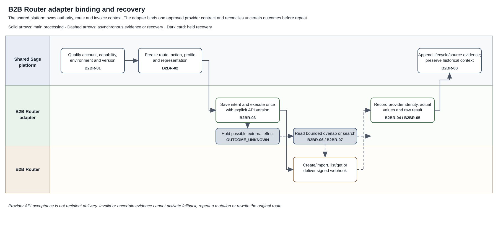

# B2B Router Provider Adapter Binding Solution Specification

Terminology follows the [shared e-invoicing glossary](../context/GLO-SEI-001-e-invoicing-terminology.md). This document is a **proposed provider binding**. It does not approve B2B Router as the Phase 2 pilot, select a contracted API version, or prove that Sage has production entitlement.

## Part 1 Feature Solution Summary

### 1 Purpose and reading route

This specification binds B2B Router to the shared Phase 2 connection, routing, invoice and recovery design. It defines what a Sage-managed B2B Router adapter must prove before pilot and production. It does not copy the shared platform design or make B2B Router concepts the Sage domain model.

[Part 2](#part-2-logical-feature-specification) defines the logical behaviour. [Part 3](#part-3-logical-service-interactions-and-data-inventory) defines interactions and data. [Part 4](#part-4-assurance-and-traceability-view) defines acceptance evidence and release gates. [REF Source references](#ref-source-references) identifies the exact source and its limits.

The labels in this document have these meanings:

| Label | Meaning |
|---|---|
| **Confirmed** | The cited source supports the statement within its stated scope. |
| **Proposed** | The design is reviewable but needs approval or implementation evidence. |
| **Open** | A named owner must supply a decision or evidence before the affected gate can pass. |
| **Out of scope** | Another feature owns the behaviour or the first adapter release excludes it. |

### 2 Source authority and evidence update

| Source | Authority for this specification | Limit |
|---|---|---|
| [PRD-SEI-216](../prds/PRD-SEI-216-b2b-router-integration-structured-review.md) | Product outcomes, provider discovery requirements, business rules, acceptance expectations and gates. | Consultation-ready, not delivery-ready. Public documentation does not prove Sage entitlement or Spain production eligibility. |
| [SPEC-SEI-014](SPEC-SEI-014-shared-platform-connectivity-and-routing-solution-specification.md) | Connection/profile qualification, route selection, handoff, recovery and historical continuity. | Logical proposal. Actual services and record mappings remain open. |
| [SPEC-SEI-013](SPEC-SEI-013-provider-api-through-the-e-invoicing-global-api-solution-specification.md) | Global API access, authority, durable receipts, executor assignment and partner/adapter separation. | Does not define the provider-owned API. |
| [SPEC-SEI-016](archive/SPEC-SEI-016-invoice-receiving-retrieval-and-download-solution-specification.md), [SPEC-SEI-007](archive/SPEC-SEI-007-invoice-sending-solution.md) and [SPEC-SEI-009](archive/SPEC-SEI-009-invoice-lifecycle-status-solution-specification.md) | Invoice ownership, source capture, action evidence, lifecycle interpretation and retrieval. | This binding supplies B2B Router observations. It does not create parallel invoice or lifecycle stores. |
| B2B Router public documentation, rechecked 14 October 2026 | Public API operations, versioning, environments, import behaviour, webhooks, invoice listing and error examples. | Public behaviour can change and can exceed Sage's contracted subscription. It is not a Spain private-platform approval or SLA. |
| Spain final regulation and public-platform technical evidence | Spain legal/public-platform rules where material to route separation and public-copy actions. | No cited public source defines the B2B Router private contract. Provider and local-team evidence remain required. |

The current public documentation is newer than the provider PRD review. It documents API version `2026-06-26`, received-invoice webhook events, new import behaviour and revised environment guidance [B2BR-S02–S05]. This specification treats that version as an **evidence candidate**, not the selected build version. The selected version remains B2BR-Q01.

### 3 Scope and boundaries

In scope:

- bind one B2B Router account scope to one authorised Sage connection scope;
- qualify outbound, inbound, lifecycle, document retrieval and reconciliation separately;
- execute an approved JSON-create or structured-file import strategy;
- receive authenticated webhooks and recover missed observations through bounded reads;
- preserve requested and actual provider transport/document-type facts;
- keep route change, credential change, provider deregistration and historical release as separate actions;
- preserve raw provider states and derive Sage lifecycle views under a versioned mapping.

Open for the first delivery cohort: contracted product/version, Spain registration and reachability, account/legal-entity cardinality, payload strategy, supported directions and formats, status provenance, idempotency, retention, service targets and exit sequence.

Out of scope: VeriFactu and other tax-report operations; provider commercial contracting; automatic route failover; per-invoice caller override; Private A → Private B customer switching; provider-side implementation; and direct B2B Router integration in each Sage ERP.

### 4 Terms, ownership and provider binding

| Term | Meaning in this specification |
|---|---|
| Provider connection | Sage configuration that references an approved B2B Router account scope, credential, environment and API version. It is not the active route. |
| Account scope | The stable B2B Router account, group or other contracted resource that owns the operation. The exact mapping is open. |
| Contract profile | The approved operation, API version, environment, authentication, payload, transport/document rules and recovery behaviour. |
| Provider observation | A response, webhook or retrieved record from B2B Router. It is stored with source, time, version and provenance. |
| Actual exchange values | The transport and document type returned or observed after provider processing. They can differ from requested values and must be checked. |
| Reconciliation window | A bounded, overlapping invoice-list query used to detect missed observations. Its checkpoint advances only after durable classification. |

| Responsibility | Owner and boundary |
|---|---|
| Customer authority and route activation | Shared Identity, Onboarding and Routing owners. The adapter cannot activate itself. |
| Connection/profile qualification | Shared Connection owner with the B2B Router adapter owner. |
| Provider credential protection | Trust/credential owner under SPEC-SEI-001. Adapter contracts use a credential reference only. |
| Outbound invoice/action | SPEC-SEI-007 owner. The adapter executes only its assigned exchange action. |
| Inbound source capture | SPEC-SEI-016 owner. The adapter supplies authenticated source bytes and metadata. |
| Raw event and derived lifecycle | SPEC-SEI-009 owner. The adapter preserves provider facts and does not define customer meaning alone. |
| Unknown outcome and missed event recovery | Adapter + shared resilience/Operations owners. One operation has one reconciliation owner. |
| Spain product scope and provider acceptance | Spain Product/Compliance plus provider owner. Public API availability is insufficient. |

### 5 Spain use and reuse qualification

| Capability/source | Intended Spain use | Reuse classification | Local change, gap, owner and activation evidence |
|---|---|---|---|
| Shared connection/routing foundation | Hold B2B Router connection/profile facts and select it for approved new work. | Reusable with country binding; proposed pattern. | Spain Product + Routing must approve scope, registration/reachability evidence and cutover behaviour. Actual service reuse remains B2BR-Q08. |
| Global API | Give Sage products one stable access boundary. | Unknown existing implementation reuse candidate. | API owner must prove actual contracts, permission model and compatibility. No ERP calls B2B Router directly. |
| B2B Router adapter | Translate qualified shared operations to the selected provider contract. | Provider-specific. | Provider owner must select version, capability subset and fixtures. |
| DTS | Preferred transformation candidate for an approved representation pair. | Unknown existing implementation reuse candidate. | DTS owner must prove exact input/output, mapping, signature preservation, limits and operations for each selected pair. |
| Lifecycle/reconciliation patterns | Preserve raw observations, unknown outcomes and replay-safe recovery. | Reusable unchanged as a proposed pattern. | Lifecycle/Operations must qualify actual stores, mappings, checkpoints and runbooks. |
| Spain identity, routing, public-copy and reporting rules | Bind the provider action to the Spain country pack. | Country-specific. | They must not become provider defaults or another country's rules. B2B Router tax-report features remain separate. |

Reuse of a proposed pattern is not proof that a deployed implementation is fit. Every candidate needs an actual build, contract, owner, gap record and test evidence before activation.

### 6 Process diagram and lifecycle

[Editable Draw.io](../assets/diagrams/b2b-router-adapter-binding-process.drawio) · [PNG preview](../assets/diagrams/b2b-router-adapter-binding-process.png).

The flow starts when the shared platform supplies an authorised and version-bound action. B2BR-01 checks the provider binding. B2BR-02 freezes the selected provider operation and payload. B2BR-03 executes it once. A known response goes to B2BR-04. A possible external effect with no reliable result goes to B2BR-07 before any repeat. Webhooks accelerate observation through B2BR-05, while B2BR-06 performs independent bounded reconciliation. B2BR-08 preserves historical access after route change. Tax reporting stays outside the binding.

| Activity | Trigger, operation and postcondition | Failure and recovery owner |
|---|---|---|
| B2BR-01 Qualify provider binding | Connection owner checks account scope, environment, API version, credential reference and each requested capability. It saves evidence without changing a route. | Connection/adapter owner records failed or unknown checks and required action. |
| B2BR-02 Prepare provider action | Exchange/Receiving supplies immutable route/action context. Adapter selects the approved operation, representation and requested transport/document values. | Adapter rejects missing or mismatched profile data before an external call. |
| B2BR-03 Execute provider operation | Adapter records durable intent, then performs the selected read or mutation with explicit version and correlation. | A pre-transmission failure can retry within policy. A possible external effect enters B2BR-07. |
| B2BR-04 Record provider response | Adapter saves request ID, provider invoice ID, returned state, actual transport/document type and redacted errors. Owning feature records the independent result. | Unknown or incompatible returned values create a discrepancy; they do not silently complete the action. |
| B2BR-05 Process provider webhook | Ingress authenticates, timestamps, deduplicates and correlates the raw event before lifecycle interpretation. | Invalid, expired or uncorrelated events enter quarantine. They do not change customer state. |
| B2BR-06 Reconcile missed observations | Scheduled or incident-triggered worker reads a bounded overlapping window. It captures missing provider facts and advances the checkpoint after durable classification. | Pagination ambiguity or provider outage keeps the previous safe checkpoint and raises an owned backlog. |
| B2BR-07 Resolve unknown outcome | Reconciler searches the original account/version/context. It links one proven match, repeats only after proven absence and safe-repeat evidence, or leaves an owned unresolved case. | Operations owns manual decision and evidence. It cannot choose a new provider or operation silently. |
| B2BR-08 Preserve continuity and release | Route changes stop new selection. Earlier invoices retain provider context and permitted retrieval/status access until approved release. | Exit/Records blocks deregistration or credential destruction while dependencies remain. |

### 7 Material risks and decisions

The most material risks are wrong account scope, silent provider fallback, duplicate mutation, webhook gaps, overstatement of provider states, cross-environment key use, coupling to tax reporting and loss of historical access. Part 4 contains the blocking decisions. No implementation commitment should precede B2BR-Q01–Q04.

## Part 2 Logical Feature Specification

### 1 Invariants and state boundaries

| ID | Invariant |
|---|---|
| B2BR-I01 | A validated connection does not activate a route. |
| B2BR-I02 | Authenticated caller, represented party, B2B Router account scope and credential scope are separate facts. |
| B2BR-I03 | Each capability and direction is qualified independently for one environment and contract version. |
| B2BR-I04 | The adapter uses an explicit approved API version. It does not rely on a mutable group default. |
| B2BR-I05 | The owning feature saves immutable invoice/action context before the adapter can create an external effect. |
| B2BR-I06 | One exchange action has one execution owner and one reconciliation owner. |
| B2BR-I07 | Provider API acceptance, asynchronous processing, provider send, recipient delivery, buyer decision, payment and reporting are separate outcomes. |
| B2BR-I08 | Requested and actual provider transport/document values are preserved. An incompatible substitution blocks progression. |
| B2BR-I09 | A possible external effect is not repeated until reconciliation or proven idempotency makes the action safe. |
| B2BR-I10 | Raw provider facts remain available after mapping. Unknown states remain unmapped until approved. |
| B2BR-I11 | Webhooks are not the only source of completeness. Independent reconciliation is required. |
| B2BR-I12 | Route change does not rewrite old invoice context or automatically revoke historical access. |
| B2BR-I13 | Provider tax-report identifiers remain separate and cannot activate tax reporting. |
| B2BR-I14 | Spain rules remain in the Spain binding and cannot become shared or provider defaults. |

Proposed internal operation states are `PREPARED`, `IN_PROGRESS`, `OUTCOME_UNKNOWN`, `OBSERVED_SUCCEEDED`, `OBSERVED_FAILED`, `HELD` and `CLOSED`. These are Sage recovery states, not B2B Router values. The actual implementation owner must map them to existing stores under B2BR-Q08 rather than create a duplicate operation store.

### 2 Behaviour by activity

**B2BR-01 — Qualify provider binding.** The request names tenant, represented legal entity, environment, integration role, direction and capability. The Connection owner verifies the authenticated principal and current authority. The adapter checks only approved, non-mutating provider operations unless a separately owned setup mutation exists. It records the intended and observed account scope, explicit API version, credential version, supported operation, provider codes, observation time, limitation and recheck condition. A successful list/read call does not prove Spain registration, inbound reachability or production entitlement.

**B2BR-02 — Prepare provider action.** The owning invoice feature supplies the original invoice/action identity, route/profile version, direction, representation reference/hash and approved execution owner. The adapter selects either JSON creation or structured-file import for that profile. It must not choose between them dynamically. It records requested transport and document type. If provider defaults can apply, the profile defines permitted equality or compatibility checks. Missing, stale or contradictory evidence returns a hold before transmission.

**B2BR-03 — Execute provider operation.** The adapter saves a durable attempt before a mutation. It sends the protected API key through the approved secret boundary and sends the explicit `X-B2B-API-Version`. It records safe correlation data and the returned `X-B2B-API-Request-Id` where supplied [B2BR-S06]. It never logs a key, webhook secret, invoice body or presigned/private document URL. A local timeout before confirmed transmission can retry under policy. A timeout after possible transmission enters `OUTCOME_UNKNOWN`.

For structured import, `send_after_import=true` can queue asynchronous sending for sending transports. A `201` import response proves provider creation/import, not final delivery. The documented provider may replace invalid or incompatible requested transport/document codes with defaults [B2BR-S03]. The adapter therefore compares returned/observed values with the approved profile before reporting progress.

**B2BR-04 — Record provider response.** The adapter saves the provider invoice ID, account ID, API version, request ID, returned state, actual transport/document type, source time and redacted diagnostic. It then hands the observation to the owning invoice/lifecycle feature. `401`/`403` becomes an access or scope failure; `404` remains resource absent-or-inaccessible unless a stronger contract distinguishes it; `409` is a state conflict; `422` is input/catalogue validation; and `429` is throttling. These categories do not establish retry safety for a mutation [B2BR-S06].

**B2BR-05 — Process provider webhook.** The ingress uses the exact raw request body required by the selected contract. It verifies `X-B2Brouter-Signature`, timestamp and HMAC before deserialised data can affect state. It applies the approved replay window and secret version. It stores event code, provider event identity where supplied, invoice/account identity, triggered time, observed time, payload digest, API/event schema version and verification result. Duplicate delivery returns the prior processing result. An older event can add evidence but cannot blindly regress a derived state. Public version `2026-06-26` documents `received_invoice.created` and `received_invoice.state_change`; the selected subscription and fixture tests must prove availability [B2BR-S02/S04].

**B2BR-06 — Reconcile missed observations.** Reconciliation uses the original account and contract profile. Invoice listing is paginated and supports date/update filters in public documentation, but public evidence does not prove a gap-free cursor [B2BR-S05]. The proposed strategy uses bounded overlap, deterministic ordering where available, stable provider invoice identity and durable deduplication. It records requested range/pages, observed maximum, classification count, unresolved pages and completion time. The checkpoint advances only when the covered range is durably classified. Provider outage, rate limit or changing pages pauses advancement.

**B2BR-07 — Resolve unknown outcome.** The reconciler searches with stable account, invoice business identity, request correlation and content/reference evidence allowed by the selected contract. Exactly one proven match links the original operation. Proven absence permits repeat only if the approved repeat policy also prevents a late original effect. Several or weak matches remain unresolved. Manual resolution needs separate permission, reason and evidence. It cannot delete or replace the original attempt.

**B2BR-08 — Preserve continuity and release.** A route transition changes selection for eligible new work only. Existing invoices keep B2B Router account, provider invoice, version, transport/document and lifecycle context. The exit coordinator identifies retrieval, webhook, reconciliation, audit and records dependencies before deregistration, key revocation or secret destruction. Current authority is rechecked for every historical action. Where the original channel cannot remain active, an approved replacement channel is appended with provenance.

### 3 Provider operation binding

The table is a binding candidate, not an approved endpoint allow-list. B2BR-Q01 selects the exact version and operation catalogue.

| Capability | Publicly evidenced candidate | Proposed adapter use | Required qualification |
|---|---|---|---|
| List account scope | `GET /accounts` | Validate that a credential sees the intended stable account. | Ownership/cardinality, pagination, least privilege and wrong-account denial. |
| Configure/observe transport | Account transport operations | Setup or observe a capability under a separate setup mutation. | Spain transport codes, prerequisites, repeat/update/delete semantics. |
| Resolve directory entry | Country/identifier directory operation | Supporting recipient evidence only. | Spain authority, coverage, freshness and negative-result meaning. |
| Create JSON invoice | `POST /accounts/{account}/invoices` | One candidate outbound strategy. | Exact field mapping, correction/credit support, returned identity and provider defaults. |
| Import structured invoice | `POST /accounts/{account}/invoices/import` | One candidate outbound or controlled inbound strategy. | Format/media type, schema/profile, signature handling, `send_after_import` semantics and returned identity. |
| List invoices | `GET /accounts/{account}/invoices` | Inbound discovery and lifecycle reconciliation. | Selected-version filters, stable ordering, pagination concurrency and retention. |
| Get invoice/document | Invoice and document retrieval operations | Retrieve provider record and approved source/legal representation. | Exact bytes, redirect/access control, integrity, retention and trusted-copy meaning. |
| Configure webhooks | Webhook configuration operation | Register only approved callback destinations and event set. | Secret lifecycle, ownership, update/delete, retry/replay, event availability and environment isolation. |

### 4 Error, duplicate and concurrency behaviour

| Condition | Required treatment | Safe next action |
|---|---|---|
| Invalid/revoked key or wrong environment | Suspend affected capabilities; preserve connection/history. Do not expose provider detail across tenants. | Authorised credential replacement and requalification. |
| Credential sees wrong account | Keep connection non-ready and quarantine any returned unrelated data reference. | Security review and corrected account binding. |
| Provider validation error | Retain redacted provider code/path and map to a correctable Sage category. | Customer corrects input; unchanged input is not auto-repeated. |
| Provider silently changes transport/document type | Record requested and actual values; stop incompatible progression. | Correct configuration/profile or obtain an approved compatibility decision. |
| Throttling or provider outage on read | Apply bounded backoff and keep the previous safe checkpoint. | Resume from the saved checkpoint within provider limits. |
| Timeout after possible mutation | Set `OUTCOME_UNKNOWN`; prohibit automatic resend/fallback. | B2BR-07 reconciliation. |
| Duplicate webhook | Return prior result and do not duplicate business effects. | No customer action; monitor abnormal volume. |
| Out-of-order or unknown state | Preserve raw observation; do not regress or coerce derived meaning. | Lifecycle mapping review or later authoritative evidence. |
| Concurrent route/profile change | Existing action keeps frozen profile. New work uses the committed new version after its boundary. | Finish/reconcile old action; never rewrite it. |
| Deregistration/key revocation with dependencies | Block or sequence destructive action. | Exit owner proves replacement/historical release before completion. |

### 5 Requirements and controls

| ID | Requirement |
|---|---|
| B2BR-R01 | The adapter must implement only the capability subset approved for one contracted product, API version, environment and Spain scope. |
| B2BR-R02 | The adapter must bind every request to tenant, represented legal entity, stable provider account, environment, credential version and explicit API version. |
| B2BR-R03 | Provider connection readiness must not activate or change a Sage route. |
| B2BR-R04 | Outbound, inbound, lifecycle, document retrieval, webhook and reconciliation readiness must be recorded independently. |
| B2BR-R05 | The adapter must use one approved outbound payload strategy per contract profile and retain the exact representation reference/hash. |
| B2BR-R06 | The adapter must persist durable intent and immutable action context before an external mutation. |
| B2BR-R07 | The adapter must retain requested and actual provider transport/document values and hold incompatible substitution. |
| B2BR-R08 | A provider `201`, queued state or API acknowledgement must not be reported as recipient delivery, buyer acceptance or reporting success. |
| B2BR-R09 | A possible external effect with unknown outcome must reconcile before repeat unless the selected operation has proven idempotency for the same identity/input/window. |
| B2BR-R10 | Webhook ingress must verify the selected contract's signature, timestamp/replay policy and secret version before state use. |
| B2BR-R11 | Webhooks must be deduplicated and correlated using stable provider identity or an approved composite; delivery time alone is insufficient. |
| B2BR-R12 | Reconciliation must tolerate overlapping pages/windows and must not advance its checkpoint before durable classification. |
| B2BR-R13 | Raw provider state, code, actor/provenance, source time, observation time and mapping version must remain available. |
| B2BR-R14 | Protected credentials and webhook secrets must use approved custody, rotation and redaction controls; application contracts expose references only. |
| B2BR-R15 | Sandbox, staging and production configuration and keys must remain isolated. The same base URL for sandbox/production does not weaken key/environment validation [B2BR-S01]. |
| B2BR-R16 | Route/profile/API-version changes must apply prospectively. Historical invoices retain original provider context. |
| B2BR-R17 | VeriFactu/tax-report configuration, IDs and outcomes must remain separate from private invoice exchange. |
| B2BR-R18 | Metrics and logs must exclude secrets and customer invoice content and must not use customer identifiers as metric labels. |
| B2BR-R19 | Numeric limits, service levels, retry budgets, replay windows and retention periods require contracted or measured evidence and an owner. |
| B2BR-R20 | Country-rule isolation tests must prove that Spain identity, routing, public-copy and reporting rules do not become defaults for another country. |

## Part 3 Logical Service Interactions and Data Inventory

### 1 Logical interactions

| ID | Interaction and purpose | Authority, correlation and recovery | Consumer activities |
|---|---|---|---|
| B2BR-INT-01 | Global API/Onboarding → Connection: configure and qualify a B2B Router binding. | Customer/delegate authority; expected connection version; no route mutation. | 01/08 |
| B2BR-INT-02 | Connection → Trust: resolve a protected API-key or webhook-secret reference. | Least-privilege service identity; secret value never enters business response/log. Rotation invalidates affected qualification. | 01/03/05 |
| B2BR-INT-03 | Connection/adapter → B2B Router read surface: observe account/capability. | Explicit environment/version/account; bounded read; record provider request ID and freshness. | 01/06/07 |
| B2BR-INT-04 | Exchange → adapter: execute one outbound action. | Frozen action/profile, one executor, durable attempt and input digest; unknown mutation reconciles. | 02/03/04/07 |
| B2BR-INT-05 | Adapter → B2B Router create/import surface: create the selected provider invoice operation. | Protected credential, explicit version, account and provider correlation; no blind repeat. | 03/04/07 |
| B2BR-INT-06 | B2B Router → webhook ingress → Lifecycle: submit a raw provider observation. | HMAC/timestamp verification, event identity/dedupe and invoice/account correlation; quarantine failure. | 05 |
| B2BR-INT-07 | Reconciliation worker → B2B Router list/get surface: recover missed or unknown outcomes. | Original account/profile, bounded overlap, stable invoice identity and safe checkpoint. | 06/07 |
| B2BR-INT-08 | Adapter → Receiving/Records: deliver an authenticated provider source file and metadata. | Source identity, digest, media/profile, capture receipt and access control; notification alone is insufficient. | 04/05/06 |
| B2BR-INT-09 | Adapter → Lifecycle: append raw provider status/error evidence. | Provider version, provenance and mapping version; no destructive overwrite or inferred actor. | 04/05/06/07 |
| B2BR-INT-10 | Exit/Records → adapter: assess and release historical provider dependencies. | Separate authority, dependency list and provider confirmation; route change alone does not revoke access. | 08 |

Logical error categories are `INVALID_INPUT`, `UNAUTHORISED_SCOPE`, `CREDENTIAL_INVALID`, `CAPABILITY_NOT_READY`, `PROVIDER_VALIDATION`, `PROVIDER_CONFLICT`, `PROVIDER_THROTTLED`, `PROVIDER_UNAVAILABLE`, `OUTCOME_UNKNOWN`, `EVIDENCE_UNTRUSTED`, `MAPPING_UNDETERMINED` and `HISTORICAL_ACCESS_BLOCKED`. The actual API owner must map these to the existing common error contract rather than create a second vocabulary.

### 2 Data inventory and systems of record

| ID | Record, owner and key content | Classification, versioning and consumers |
|---|---|---|
| B2BR-D01 | Provider binding; Connection owner; tenant/entity, provider/account, environment, integration mode, credential reference, selected API version and configuration version. | Restricted and versioned; activities 01–08. No secret value. |
| B2BR-D02 | Capability qualification; Connection owner; direction/operation, status, source, observed time, limitations, recheck and evidence. | Restricted, append observations; activities 01/02/08. Does not activate route. |
| B2BR-D03 | Contract profile; Profile/adapter owner; operations, payload strategy, transport/document rules, event set, query/repeat support and owners. | Restricted/versioned; activities 01–08. Historical actions pin the version. |
| B2BR-D04 | Adapter operation; owning invoice/adapter service; action identity, input digest, attempt, transmission boundary, request ID, outcome and recovery state. | Restricted/durable; activities 02–04/07. Append attempts; never store API key. |
| B2BR-D05 | Provider invoice context; owning invoice service; account ID, provider invoice ID, direction, requested/actual exchange values, source representation and API version. | Restricted; immutable origin with appended observations; activities 04–08. |
| B2BR-D06 | Raw provider observation; Lifecycle owner; event/status/error, producer, actor/provenance, source/observed time, payload digest/reference and verification. | Restricted/append-only; activities 04–07. Retention follows approved evidence policy. |
| B2BR-D07 | Reconciliation checkpoint/run; Operations owner; account/profile, covered window/pages, prior/new checkpoint, counts, freshness and unresolved items. | Restricted/versioned; activities 06/07. Advance only after durable classification. |
| B2BR-D08 | Source document evidence; Receiving/Records owner; exact bytes or immutable object reference, digest, media/profile, provider/source identity and capture result. | Confidential/controlled; activities 04–06/08. Conservation is separate from provider retention. |
| B2BR-D09 | Status/error mapping; Lifecycle owner; provider version/code/state/provenance to canonical event and customer wording. | Versioned configuration; activities 04–07. Unknown entries remain visible. |
| B2BR-D10 | Continuity dependency; Exit/Records owner; invoice/provider dependency, permitted actor/channel, historical access, release condition and evidence. | Restricted/versioned; activity 08. Route transition cannot delete it. |

Data retention, residency, legal hold, provider archive status and access after deactivation remain B2BR-Q05. The adapter must not treat a provider-rendered document as the legal original or a trusted copy without approved source evidence.

## Part 4 Assurance and Traceability View

### 1 Acceptance and traceability

| ID | Demonstrable acceptance scenario | Coverage and required evidence |
|---|---|---|
| B2BR-A01 | Valid non-production credentials can access only the intended account. Qualification records the account/version/capabilities and leaves routes unchanged. | R01–04/15; activities 01; INT01–03; D01–03; synthetic sandbox evidence. |
| B2BR-A02 | Credentials for a wrong account/environment are denied before invoice data or mutations are exposed. | R02/14/15; activities 01/03; INT02–05; D01/D04; isolation and negative tests. |
| B2BR-A03 | An approved outbound action creates/imports one provider invoice and records provider ID, request ID, initial state and actual exchange values as non-terminal evidence. | R05–08; activities 02–04; INT04/05/09; D03–06; selected-version fixtures. |
| B2BR-A04 | An incompatible provider default is observed. The adapter holds progression and exposes a configuration discrepancy without claiming delivery. | R07/08; activity 04; INT05/09; D04–06; provider fallback fixture. |
| B2BR-A05 | A validation error returns actionable field/category detail. The unchanged invalid content is not automatically repeated. | R05/13; activities 03/04; INT05/09; D04/D06/D09; error catalogue fixtures. |
| B2BR-A06 | A post-transmission timeout enters `OUTCOME_UNKNOWN`. Exactly one proven provider match links to the original action; an ambiguous match does not resend. | R06/09; activities 03/07; INT04/05/07; D04/05/07; fault injection. |
| B2BR-A07 | A valid signed received-invoice event is stored once. Invalid, expired, duplicated and reordered events cannot create duplicate/regressed customer effects. | R10–13; activity 05; INT02/06/09; D05/06/09; signed synthetic fixtures. |
| B2BR-A08 | A missed webhook is recovered by a bounded overlapping invoice read. Checkpoint advancement occurs only after all covered observations are durably classified. | R11/12; activity 06; INT07/09; D05–07/09; concurrent-arrival test. |
| B2BR-A09 | A received notification without source bytes remains notification-only. Product receipt occurs only after authenticated source capture and validation. | R04/13; activities 04–06; INT06–09; D05/06/08/09; inbound retrieval fixture. |
| B2BR-A10 | A route/API/profile version changes while older work exists. New work uses the approved new version; old invoices continue with original context. | R16; activities 02/08; INT04/07/10; D03–05/10; transition test. |
| B2BR-A11 | Deregistration or key revocation is requested while historical dependencies exist. The release is blocked or sequenced and audited. | R14/16/19; activity 08; INT02/10; D01/D05/D10; exit contract test. |
| B2BR-A12 | Provider tax-report fields appear in a response. They remain separately classified and do not create a Phase 2 reporting action. | R17; activities 03/04; INT05/09; D04–06; scope-isolation test. |
| B2BR-A13 | The same shared adapter pattern is configured for another country. Spain identifiers, routing, public-copy and reporting rules are absent until that country binding supplies them. | R20; all activities/data; country-isolation regression. |
| B2BR-A14 | An existing Global API, Connection, Lifecycle, DTS or adapter component is proposed for reuse. The review records actual build/contract coverage, gaps, owner and evidence before enablement. | R01/04/19/20; B2BR-Q08; implementation qualification record. |

### 2 Security, operations and service evidence

Pilot evidence must include tenant/account isolation, secret rotation, callback destination control, raw-body signature verification, replay and duplicate handling, parser/file limits, malware controls, unknown-outcome recovery, pagination under concurrent arrival, throttling/backpressure and historical access after route change. Tests use synthetic parties and identifiers only.

Operations views must show capability qualification age, provider/API version, credential health without secret values, webhook freshness, reconciliation coverage/backlog, unknown outcomes, mapping gaps, throttling, provider incidents and continuity dependencies. Numeric alert thresholds and service objectives remain open until provider commitments and pilot measurements exist.

### 3 Open decisions and release gates

| Decision/gate | Accountable owner and required evidence | Impact |
|---|---|---|
| B2BR-Q01 Contracted product, entitlement and API version | Commercial/provider owner + Architecture: signed scope, selected version, deprecation policy, approved API/OpenAPI pack and storage permission. | Blocks engineering commitment and endpoint allow-list. Public `2026-06-26` remains a candidate only. |
| B2BR-Q02 Spain provider role and capability scope | Spain Product/Compliance + provider: private B2B role, customer segments, registration/reachability, directions, formats, corrections, lifecycle and coexistence. | Blocks Spain production scope and route activation. |
| B2BR-Q03 Identity, account and credential model | Security/Identity + provider: legal entity/account/group/office mapping, delegation, key owner/scope/rotation and wrong-account behaviour. | Blocks connection implementation and tenancy approval. |
| B2BR-Q04 Payload, exchange and recovery contract | Exchange/DTS/Lifecycle + provider: JSON versus import, exact profiles, provider defaults, idempotency, query identity, event catalogue, signature/replay/retry/order and pagination tests. | Blocks adapter build for each affected capability. |
| B2BR-Q05 Data, service and exit terms | Legal/Security/Records/Operations + provider: residency, retention, document status, historical access, limits, SLA, incidents, support and deregistration. | Blocks production and final credential/dependency release. |
| B2BR-Q06 Synthetic fixture and conformance pack | QA/Engineering + provider: approved positive, validation, timeout, duplicate, reorder, missed-event, throttle, migration and exit fixtures. | Blocks delivery approval. |
| B2BR-Q07 First pilot cohort and stop criteria | Product + Engineering + Operations: reference ERP/customers, capabilities, volume, success/stop measures, rollback and support owners. | Blocks pilot activation. Selection of B2B Router as reference provider remains open. |
| B2BR-Q08 Existing implementation reuse | Architecture + actual service owners: deployed Global API/Connection/adapter/DTS/Lifecycle builds, contracts, mappings, rule packs, operations, gaps and compatibility evidence. | Blocks claims that the proposed design reuses a production implementation. |

### 4 Readiness result

**Reviewable provider-binding proposal; blocked for build commitment.** Architecture, product, security, provider and operations teams can review the intended boundary and evidence plan. The adapter can enter implementation planning only after B2BR-Q01–Q04 identify the contracted interface and first capability subset. Pilot also requires Q05–Q08, passed isolation/unknown-outcome/reconciliation tests and named continuity owners. Production requires measured operating evidence and approved Spain/provider scope.

No publication, status change, provider selection, commercial commitment or live activation is implied.

## REF Source references

External sources support only the claims stated below. Public documentation is not the contracted Sage interface. The final published Spain regulation governs legal requirements. Provider technical material governs only its stated API behaviour. Examples do not define a complete contract.

| REF ID | Source and version/date | Exact location or contract element | Supported claim and limit |
|---|---|---|---|
| B2BR-S01 | [B2B Router environments](https://docs.b2brouter.net/en/developers/testing/environments/); last updated 6 October 2026; accessed 14 October 2026. | Environment table and Sandbox/Staging/Production sections. | Documents sandbox/staging/production base URL and key-prefix behaviour. It does not prove Sage access, parity, subscription or production approval. |
| B2BR-S02 | [B2B Router API v2026-06-26 changelog](https://docs.b2brouter.net/en/developers/changelog/v2026-06-26/); version 2026-06-26; accessed 14 October 2026. | Version header; Changes overview; Received invoice webhook events. | Documents explicit version selection, breaking changes and `received_invoice.created`/`received_invoice.state_change`. It does not select the version for Sage or establish delivery guarantees. |
| B2BR-S03 | [Import an invoice from a file](https://developer.b2brouter.net/reference/import-invoice); current public reference accessed 14 October 2026. | `POST /accounts/{account}/invoices/import`; `send_after_import`; `issue_after_import`; transport/document selection; responses. | Documents import, asynchronous queue behaviour, provider fallback and `201`. Exact selected schema/profile, entitlement, idempotency and Spain route remain open. |
| B2BR-S04 | [New received invoice webhook](https://developer.b2brouter.net/reference/getnewreceivedinvoicecreated); current public reference accessed 14 October 2026. | Event code/payload; `X-B2Brouter-Signature`; HMAC-SHA256 description; `200` response. | Documents event and signature shape. It does not define secret lifecycle, replay window, retries, ordering or retention. |
| B2BR-S05 | [List invoices](https://developer.b2brouter.net/v2025-10-13/reference/get-invoices); versioned public reference accessed 14 October 2026. | `GET /accounts/{account}/invoices`; offset/limit; type and update/state filters. | Documents paginated listing and filters for that version. It does not prove a gap-free incremental cursor or the selected-version behaviour. |
| B2BR-S06 | [B2B Router error codes](https://docs.b2brouter.net/en/developers/essential-guides/error-codes/); last updated 23 September 2026; accessed 14 October 2026. | Error table; examples; request tracing. | Documents public error examples and `X-B2B-API-Request-Id`. Error category alone does not prove mutation retry safety. |
| SPFE-S02 | [BOE-A-2026-20587.pdf](<../context/BOE-A-2026-20587.pdf>); final order published 5 October 2026. | Articles 3.4, 4 and 11. | Supports separation of public-copy/public actions where applicable. It does not define B2B Router's private contract or approve it as Sage's provider. |
| REF-PRD | [PRD-SEI-216](../prds/PRD-SEI-216-b2b-router-integration-structured-review.md), [PRD-SEI-213](../prds/PRD-SEI-213-private-platform-connectivity-structured-review.md), [PRD-SEI-214](../prds/PRD-SEI-214-connections-registration-routing-structured-review.md), [PRD-SEI-215](../prds/PRD-SEI-215-resilience-recovery-reconciliation-structured-review.md), [PRD-SEI-223](../prds/PRD-SEI-223-interoperability-routing-transformation.md), [PRD-SEI-226](../prds/PRD-SEI-226-security-trust-identity-data-audit.md), [PRD-SEI-235](../prds/PRD-SEI-235-provider-api-for-e-invoicing-service.md). | Requirements and gates cited in Parts 1–4. | Canonical product requirements. This specification must not silently close their open decisions. |
| REF-CONTEXT | [RES-SEI-002](../context/RES-SEI-002-spain-public-platform-technical-evidence.md), [B2B Router research index](../research/provider-apis/b2b-router/README.md), [shared glossary](../context/GLO-SEI-001-e-invoicing-terminology.md). | Source inventory, research limits and common terms. | Reading and traceability aids. Inventory completeness does not prove field mapping, contract entitlement or implementation readiness. |
