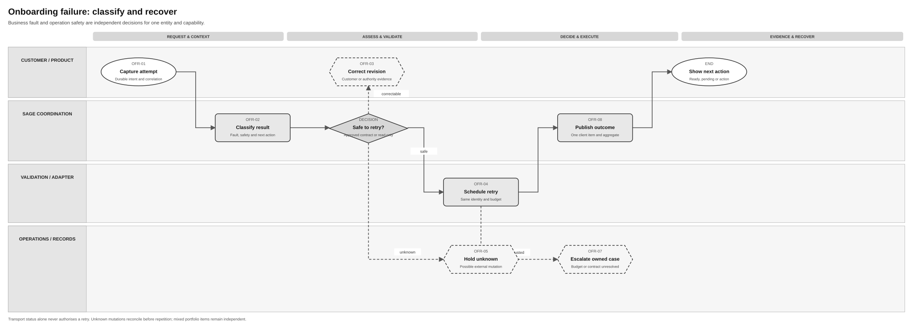
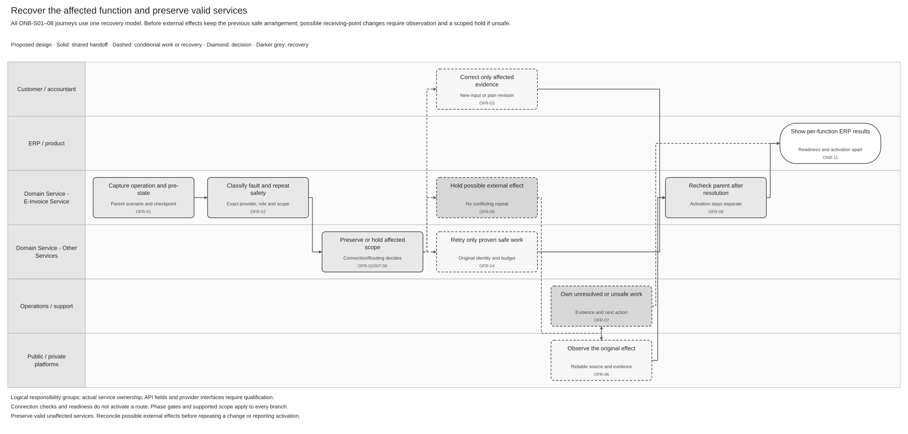

# Onboarding Failure and Reconciliation Solution Specification

> **Historical specification.** Recovery is now included in [SPEC-SEI-002 — Customer Onboarding](SPEC-SEI-002-onboarding-solution-specification.md#onb-08-recovery). The earlier requirements and permanent IDs remain available here. Publication is disabled; lifecycle status and the historical Confluence page ID are unchanged.

Terminology follows the [shared e-invoicing glossary](../../context/GLO-SEI-001-e-invoicing-terminology.md). Local terms explain this feature; exact technical IDs, fields and source codes keep their stated meanings.

## Part 1 Feature Solution Summary

### Reader guide

Part 1 explains the scope, people involved, workflow and open decisions. Start here for a stakeholder review. Part 2 gives the detailed behaviour and rules. Part 3 describes service interactions and data. Part 4 links requirements to the checks and evidence needed before release.

The design remains a draft. **Proposed** choices still need review; **open** decisions still need an owner’s recorded answer. Technical IDs and state names are kept so engineering, testing and stakeholders can refer to the same item.

### 1 Purpose and design status

This **proposed logical design** defines failure handling for the ONB-S01–08 journeys in [SPEC-SEI-002](SPEC-SEI-002-onboarding-solution-specification.md). It covers first setup, existing public or private services, combined setup, confirmation or extension, and supported platform changes. The E-Invoice Service classifies failures, coordinates correction, retries safely and reconciles uncertain effects. SPEC-SEI-002 defines the parent journey, readiness and final ERP result. [PRD-SEI-107](../../prds/PRD-SEI-107-public-onboarding-failure-recovery.md) owns public recovery requirements. [PRD-SEI-222](../../prds/PRD-SEI-222-customer-onboarding-entry-point-migration.md) supplies private setup and transition constraints. [PRD-SEI-225](../../prds/PRD-SEI-225-operations-resilience-support-reconciliation.md) supplies shared operations principles.

**Confirmed ownership direction:** the E-Invoice Service owns setup and recovery coordination. **Onboarding** and **recovery** name workflow responsibilities within that service. They do not name separate services. **Proposed:** an internal onboarding component could implement setup and recovery coordination. Its need and implementation remain open. Existing scheduling, saved-operation and case capabilities must be assessed before new component work is agreed. Operations owns assigned manual cases; adapters and dependency services execute their qualified operations.

Use the existing Tax/certificate capability under [SPEC-SEI-001](../SPEC-SEI-001-certificate-management-solution-specification.md) where its contract supports the selected purpose. The E-Invoice Service retains protected references and safe results. Certificate material, validation, protected use and lifecycle controls stay with the qualified certificate owner. The actual Tax Service, Connections Service or AFL source and supported operations still need owner confirmation. Status feedback does not establish authentication or signing capability.

The [shared connectivity spec](../SPEC-SEI-014-shared-platform-connectivity-and-routing-solution-specification.md) owns connection/route discrepancy handling and route commit. This recovery model supplies operation classification, safe retry, correction and original-effect observations to that owner; it does not create a second route engine or automatically activate, switch or restore a platform. [The Global API](../SPEC-SEI-013-provider-api-through-the-e-invoicing-global-api-solution-specification.md) exposes committed recovery results to the ERP.

This design does not assign any unverified public-platform operation a safe retry class or assert an external endpoint, timeout, rate limit or retry count.

Private-provider operations need the same contract-specific qualification. Unsupported providers/functions are capability limitations, not transient failures to retry until connection succeeds. B2G, B2C, international support and gated Private A → Private B changes are not enabled by extending this recovery model.

Each business and capability gets an accurate status and a clear next action. A network or HTTP status alone cannot prove success, failure or whether retry is safe. An accountant’s portfolio shows mixed results, while each client recovers independently.

If an external change may have happened, the result stays unresolved until a reliable source confirms it or an authorised person makes an approved decision supported by evidence.

### Public source baseline

The new public catalogue and WSDLs provide operation evidence, but they do not supply a safe public onboarding-mutation or universal resend contract. This feature continues to recover the failed setup check. Invoice submission and event recovery remain with their owning features and the public connector.

See [REF Source references](#ref-source-references) for the original files, exact locations and source limits. The [technical evidence guide](../../context/RES-SEI-002-spain-public-platform-technical-evidence.md) tracks shared source conflicts. The constraints below align this feature with the supplied public evidence; Sage implementation and activation remain gated.

### Recovery across the entry journeys

Use one recovery model with different affected scopes and parent checkpoints. Record the original ONB scenario/intent, activity, provider/service role, direction, scope, connection/route versions and known pre-operation state. Scenario labels help explain the case; the exact operation and dependency evidence determine safety.

**Common behaviour:** the E-Invoice Service captures the original operation, classifies the fault and retry safety, preserves independent valid functions, and returns owned actions. **Scenario-specific work:** select the affected function, source contract and exact parent checkpoint. **Conditional work:** retries, external-state queries and manual escalation run only when their contract permits them. Certificate lookup failure uses this model; it does not start a new certificate-management flow by default.

Certificate-based readiness needs both a verified business NIF and a valid, suitable certificate, plus effective action authority. Recovery of one check cannot override a failure in another. If approved policy records NOT_REQUIRED for the certificate, preserve that evidenced exception. The NIF and authority checks still apply. The NIF belongs to the represented business; a delegate's identity or certificate cannot replace it.

Opening a setup case is separate from readiness, as defined in SPEC-SEI-002. Pending NIF or certificate checks do not themselves prove an external failure or unknown mutation. Return the actual prerequisite state and required action. Recover only failed or uncertain operations. A credential accepted for a public web form cannot resolve an unqualified automated API, signing, retrieval or reporting path.

| Parent journey | Failure or uncertainty | Preserve and resume |
|---|---|---|
| ONB-S01/02 First setup or existing public service | Invalid or unverified business NIF, missing authority, invalid trust or uncertain public operation. | Correct only the affected check. Both NIF and required-certificate checks must pass before readiness. Reconcile the original effect before resuming ONB-03/04. Public readiness alone cannot activate a route. |
| ONB-S03 Existing private provider | Account binding fails, provider capability unsupported or required external setup is uncertain. | Keep the current provider and valid prior arrangement. Do not create another account or switch provider; resume ONB-05/06 after evidence and required authority. |
| ONB-S04 Public/private combination | One function fails while another is valid. | Preserve unaffected configuration; hold only dependent actions. A required public-copy/reporting dependency may still block an invoice action under the owning feature's policy. |
| ONB-S05 Confirm/extend Sage setup | A read fails, evidence is stale or the added function fails. | Failed observation is unknown, not proof of deregistration. Do not renew stale readiness; refresh the affected check and preserve independently valid functions. |
| ONB-S06 Platform change | Failure before external effect, possible external receiving-point change, or post-activation discrepancy. | Before external effect retain the previous route. After a possible effect, establish actual reachability and hold affected traffic if unsafe. Route owner coordinates any authorised restoration; earlier invoices keep their actual origin. |
| ONB-S07/08 B2G context, unsupported or unknown setup | Wrong service evidence, unsupported integration or unresolved setup lookup. | Return the precise limitation or owned action; do not promote B2G to B2B readiness, force migration or infer that an empty/failed lookup means no setup. |

The previous route may continue only when it is still evidenced safe. A possible external receiving-point change can affect traffic before local route commit. Recovery must report that uncertainty rather than promise that all existing traffic continues.

### Spain use and reuse boundaries

This is a **Spain reference design**. The classifications below describe proposed reuse of behaviour, not proof that existing code is ready for use. **Reusable unchanged** means the design pattern can stay the same. **Reusable with country binding** means the shared behaviour needs approved local policies or adapters. **Country-specific** rules stay in the country pack. **Unknown** means implementation fitness or coverage still needs evidence.

This follows the [shared platform and country-pack direction](../../prds/PRD-SEI-227-e-invoicing-as-a-service.md). Spain pilot or production use still depends on this spec’s approval and evidence gates. Reuse in another country needs that country’s own assessment.

| Area | Intended use in Spain | Reuse classification | Condition and owner |
|---|---|---|---|
| Capture, classify and hold unknown results | Record the original attempt, separate problem category from retry safety, and show each client’s actual result. | Reusable unchanged | Reuse the evidence and safety patterns; an unknown external effect stays unresolved. E-Invoice Service owner and Operations. |
| Retry and reconciliation | Retry safe Spain onboarding operations or check the original external result before repeating a change. | Reusable with country binding | Bind the exact provider operation, idempotency guarantee, query support, budgets and approved error mapping. Integration owner and Operations. |
| Spain public-platform recovery | Map the confirmed public-solution errors, authority corrections and cancellation rules. | Country-specific | Official operation and response semantics remain an evidence gate. Spain technical owner, Compliance and Product. |
| Existing recovery implementation | Assess scheduler, error catalogue, case handling and adapter observation support. | Unknown | Architecture and integration owners qualify the actual E-Invoice Service recovery implementation. This logical model does not prove that the component is deployed. |
| Scenario and service continuity | Apply the same failure model to public/private setup and existing-service confirmation. | Reusable with country/provider binding | E-Invoice Service and Routing owners qualify actual pre-state, observation, dependency and resume contracts per role. Public retry evidence does not qualify a private provider. |
| E-Invoice Service recovery coordination | Reuse saved-operation, scheduling and case patterns within the E-Invoice Service. | Proposed design pattern; implementation unknown | The E-Invoice Service owner and Architecture identify source capabilities, local changes, gaps and evidence under OFR-Q03. A separate recovery deployment is not established. |
| Existing Tax/certificate recovery dependency | Refresh protected-reference readiness or query the original protected operation where supported. | Existing implementation reuse candidate; selected-purpose coverage unknown | Tax Service, Connections Service and AFL owners qualify actual contracts, build, code mapping and observation support under SPEC-SEI-001 and OFR-Q04. No credential copy or unqualified repeat operation is permitted. |

### Plain-language terms

| Term | Meaning |
|---|---|
| Legal entity / legal subject | The business to which the invoice or action belongs. Technical fields use `legalSubject` for this business. |
| Authority | Permission to perform a specific action for that business. Logging in or holding a certificate does not by itself give this permission. |
| Capability | A supported function, such as receiving invoices or signing them. |
| Route | The time-bound selection of platform and connection for a defined invoice scope and direction. A ready connection does not activate a route or rewrite earlier invoice plans. |
| Idempotency | Repeating the same logical request adds no effect within the contract’s defined scope and retention window. The contract binds request identity and input and defines conflict handling. |
| Reconciliation | Check the original operation against a reliable source to establish what actually happened before deciding the next action. |
| Gate | A condition, decision or evidence check that must pass before the next step can proceed. |
| Tenant | The customer account boundary used to keep one customer’s data and access separate from another’s. |
| Immutable / append-only | Immutable means a saved record cannot be changed. Append-only means later information is added as another record. Neither means indefinite retention. |
| Provenance | The record of where data came from and which versions, checks and changes produced the result. |
| Contract | The agreed inputs, outputs, behaviour and responsibilities between services or parties. |
| Durable | Saved through the agreed recovery boundary so the record survives a process restart or worker failure. Long-term retention is a separate policy. |
| External mutation | An operation that changes another system, such as registering a business. A timeout may leave its result unknown. |
| Retry budget / backoff / jitter | Limits on retry attempts and elapsed time; waiting between attempts; and varying that wait to avoid many retries at once. |
| Portfolio item | One client’s work item. Other clients do not share its permission, retry limits or result. |
| Correlation / input digest | A reference linking related requests and results; a fingerprint used to detect changes in the input. |

### 2 Outcomes and responsibility

| Outcome | Meaning | Owner |
|---|---|---|
| Corrected and ready | A new input/evidence revision passes the relevant parent checks; activation remains separate | Customer/delegate corrects; E-Invoice Service decides |
| Waiting safe retry | Approved read-only or contractually idempotent operation is scheduled under a versioned budget | E-Invoice Service (retry scheduling) |
| Outcome unknown / reconciling | Original mutation may have occurred; readiness is unconfirmed and repetition blocked | Integration + operations |
| Action required | Validation, authority, authentication or policy issue has a specific actor and action | Customer, credential custodian or policy owner |
| Escalated recoverable | Retry budget exhausted or authoritative state unavailable, with owned case and preserved intent | Operations/provider |
| Cancelled | Pending safe work stopped and no unresolved external mutation is hidden | E-Invoice Service |
| Unsupported function/connection | Requested capability has no qualified integration; retry is not a remedy | Product/Integration explains available options; E-Invoice Service returns limitation |
| Existing service preserved or affected scope held | Unaffected valid functions continue; uncertain or invalid dependent work is held with its owner | Connection/Routing and owning invoice feature; E-Invoice Service returns per-function result |

### 3 Process diagrams

Diagram step names use plain-language actions. The smaller activity references link to the detailed behaviour and checks below.

Use the Common, Scenario-specific and Conditional meanings in [SPEC-SEI-002's diagram guide](SPEC-SEI-002-onboarding-solution-specification.md#3-process-diagrams-and-text-equivalent). Capture, classification, scope protection and result publication are common recovery behaviour. The failed operation selects its source and parent checkpoint. Correction, safe retry, original-effect observation and escalation are conditional. Shared behaviour does not qualify a provider contract or an existing implementation.

The **Domain Service - E-Invoice Service** lane owns setup and recovery coordination. The proposed internal onboarding component stays within that lane. Other Services covers qualified certificate, identity and connection dependencies. Operations handles manual cases. The diagrams keep their existing layouts; their labels do not imply separate onboarding or recovery services.

**Classify and recover:** 

[Editable Draw.io](../../assets/diagrams/onboarding-failure-classification-process.drawio) · [PNG](../../assets/diagrams/onboarding-failure-classification-process.png). Text equivalent: OFR-01 records the failed operation and saved request intent → OFR-02 classifies fault and operation safety separately → correctable findings go to OFR-03, approved safe retries to OFR-04, uncertain mutations to OFR-05, and security violations to an incident. Exhausted safe retries go to an owned escalation, never to a false permanent rejection.

**Reconcile an uncertain effect:** 

[Editable Draw.io](../../assets/diagrams/onboarding-uncertain-outcome-process.drawio) · [PNG](../../assets/diagrams/onboarding-uncertain-outcome-process.png). Text equivalent: OFR-05 freezes the original operation and blocks repeats → OFR-06 queries an authoritative source using the original correlation and environment → proven success is committed once, proven absence may permit OFR-04 under the approved contract, and unresolved state becomes OFR-07 with owner, evidence and deadline → OFR-08 updates only the affected client/capability and the portfolio aggregate.

**Preserve services and resume the parent journey:** 

[Editable Draw.io](../../assets/diagrams/onboarding-service-continuity-recovery-process.drawio) · [PNG](../../assets/diagrams/onboarding-service-continuity-recovery-process.png). Text equivalent: OFR-01/02 capture original scenario, operation and pre-state → determine which functions depend on the failure → preserve independently valid functions, and send invalid/uncertain scope to its Connection/Routing owner → OFR-03/04 handles correction or approved safe retry, while possible effects use OFR-05/06 and unresolved work uses OFR-07 → OFR-08 returns the result to the exact parent ONB gate → parent ONB-11 returns per-function ERP results. Recovered external success does not itself mean an active route; supported activation still requires ONB-07/SPC-04.

The [public sequence](SPEC-SEI-002-onboarding-solution-specification.md#3-process-diagrams-and-text-equivalent) shows certificate reuse, correction and unavailable-evidence alternatives under ONB-03. The private sequence uses the same alternatives under ONB-06. The table below maps their findings to recovery. It is a checkpoint map, not a new error catalogue or state model.

| Finding or operation | Recovery action and owner | Parent checkpoint after resolution |
|---|---|---|
| Invalid or unverified represented-business NIF | OFR-03 links corrected identity evidence. Identity owns verification. | ONB-02 Check business identity and authority; refresh the affected ONB-10 plan. |
| Missing, expired or unknown action authority | Identity/authority resolves the scoped grant. OFR-03 handles correction; failed safe observations use OFR-04/07. | ONB-02, or the ONB-07 authority recheck for activation. |
| Confirmed missing, expired, revoked or unsuitable required certificate | The qualified SPEC-SEI-001 owner provides correction and a protected reference/version. OFR-03 links the evidence. E-Invoice Service does not issue or copy credentials. | ONB-03/06 Check access and trust requirements, including fresh CERT-05 readiness. |
| Certificate lookup unavailable, stale or ambiguous | OFR-02 retains the actual source reason. OFR-04 permits only proven safe-read retry; OFR-07 assigns unresolved work. No missing-material inference or repeat-upload prompt. | The affected ONB-03/06 readiness check. |
| Certificate policy unknown or purpose unqualified | Policy or source-contract owner resolves the evidence gap. Return an owned limitation; transport retry cannot approve policy or execution coverage. | ONB-03/06 policy and selected-purpose qualification. |
| Possible protected-source or platform mutation | OFR-05/06 retains original source, purpose, version and operation identity. The qualified operation owner supplies reliable observation; OFR-07 owns unresolved work. | The original ONB-03/05/06 operation gate; separately recheck any later activation. |
| Activation conflict or post-change discrepancy | Connection/Routing establishes actual version and reachability. OFR-08 supplies evidence; restoration requires a new authorised transition. | ONB-10 requalification or ONB-07/SPC-04 as specified by the route owner. No automatic commit. |

OFR-08 returns each finding and action owner to the parent. **Return results and required actions** remains ONB-11 in both process and sequence views. Resolving one finding cannot override a failed business NIF, required certificate or authority check. A pending prerequisite alone is not an unknown external effect.

### 4 Ordered lifecycle

| Activity | Trigger and required result | Primary owner |
|---|---|---|
| OFR-01 Capture | Operation intent, attempt, correlation and input digest are durable before possible side effect | E-Invoice Service / integration |
| OFR-02 Classify | Stable fault category, operation safety, business result and safe action are distinct | E-Invoice Service (recovery policy) |
| OFR-03 Correct | New customer/authority/policy evidence revision is linked; unchanged input is not retried | Product + relevant actor |
| OFR-04 Retry safely | Same logical identity under approved contract, budget and cancellation check | E-Invoice Service (retry scheduling) / adapter |
| OFR-05 Hold unknown | Possible mutation is marked OUTCOME_UNKNOWN; no duplicate mutation or readiness claim | Integration |
| OFR-06 Reconcile | Authoritative observed state is linked to original attempt | Adapter/operations |
| OFR-07 Escalate | Unresolved or exhausted work gets owner, evidence, deadline and manual gate | Operations |
| OFR-08 Publish | Item and parent aggregate reflect actual mixed outcomes; notification with sensitive values removed follows commit | E-Invoice Service / product |

### 5 Open decisions

| Decision and effect | Owner / gate |
|---|---|
| Official public-solution operations, idempotency scope, state query and response semantics determine the safety class | Spain technical/regulatory owner; integration design |
| Approved attempt and elapsed budgets, provider guidance, concurrency and freshness targets determine scheduling | Platform Operations + provider; pilot |
| Legal/authority rules for correction and cancellation after an external effect determine terminal handling | Spain Legal/Compliance + Product; design |
| Which client-visible reasons and support diagnostics are safe determine the error catalogue | Product, Privacy/Security, Support; UX/security review |
| Manual proof and approval threshold where no authoritative query exists determine whether a capability can be automated | Operations + Compliance; pilot |
| OFR-Q01 Per-function dependency and resume mapping for ONB-S01–08 determines what can continue, what must be held and which parent gate rechecks | E-Invoice Service, Connection/Routing, Exchange/Receiving and API owners; scenario pilot |
| OFR-Q02 Provider-specific receiving-point observation and pre/post-change evidence determines whether the previous route remains safe | Integration, Routing and Operations; before enabling that transition |
| OFR-Q03 Internal recovery implementation determines which existing E-Invoice Service scheduling, saved-operation and case capabilities can be reused | E-Invoice Service owner and Architecture; component design before build |
| OFR-Q04 Tax/certificate observation and error mapping determines safe reads, correction owners and original-operation reconciliation; lookup failure cannot prove missing material | Tax Service, Connections Service, AFL, E-Invoice Service and Security owners; selected-purpose pilot under SPEC-SEI-001 |

## Part 2 Logical Feature Specification

This part explains the proposed behaviour step by step. An invariant is a rule that must always hold, including during failures and recovery.

### 1 Scope model and invariants

The existing recovery key is (tenant, legalSubject, environment, onboardingCase, capability, operationKind, inputRevision). Bind each operation additionally to its provider/service, integration role, direction, scope, connection/profile version and original idempotency domain so concurrent public/private operations cannot share a retry or reconciliation identity. Exact storage/key mapping is proposed and requires compatibility review. A portfolio batch is only an aggregate; it cannot lend authority, credentials, retry budget or success to another client. Proposed operation safety classes are LOCAL_DETERMINISTIC, EXTERNAL_READ_ONLY, CONTRACT_IDEMPOTENT_MUTATION, RECONCILABLE_MUTATION and UNKNOWN_MUTATION. Only an approved, versioned external contract can place an operation in the latter three classes.

| ID | Rule that must always hold |
|---|---|
| OFR-I01 | A 4xx/5xx, timeout or closed socket is evidence about transport, not a complete business outcome. |
| OFR-I02 | Automatic retry requires a proven safety class, unchanged logical identity, current authority/environment and an approved policy budget. |
| OFR-I03 | A possible external mutation remains OUTCOME_UNKNOWN until original-state observation or approved manual disposition; no fresh mutation or READY state is inferred. |
| OFR-I04 | Correcting data/authority creates a new revision; original request, attempt and decision remain reproducible. |
| OFR-I05 | Cancellation stops queued safe work but cannot erase an uncertain external side effect. |
| OFR-I06 | One client/capability failure cannot roll back or promote another portfolio item. |
| OFR-I07 | Error payloads, metrics, logs and notifications contain no full tax identifiers, names, credentials or raw confidential provider body. |
| OFR-I08 | A failed observation cannot erase registration or route history, renew stale readiness or prove external absence. Preserve observations with their source and time. |
| OFR-I09 | Recovery holds only affected/dependent work; independently valid functions stay intact. Possible external route changes require actual reachability evidence before previous traffic continues. |
| OFR-I10 | Corrected or reconciled success returns to the exact parent gate; recovery does not commit a route, activate exchange or switch providers automatically. |

### 2 Detailed behaviour

**OFR-01 Capture durable intent.** Before calling an external system, save the case and item, tenant, business, environment, capability, actor and authority snapshot. Also save the operation kind, safety-policy version, request fingerprint, idempotency key and correlation reference.

Link the parent ONB scenario, intent/plan revision, activity and resume checkpoint. Save the provider/service, role, direction/scope, connection/profile version, expected route version and evidenced pre-operation state by reference. These identify the operation and dependencies, not a second connection or route store. Read-only confirmation has no invented external registration attempt. No-change confirmation can complete without a recovery case; a failed read retains its actual fault/safety class.

If saving fails before transmission, classify INTERNAL with no external effect only when a control proves that the request could not have been sent. If transmission may have happened, recover the saved intent, outbox or adapter correlation and enter OFR-05. A duplicate request returns the existing item. The same key with a different fingerprint returns a conflict.

**OFR-02 Classify.** Classify two things separately: the problem and whether the operation can safely be repeated. Problem categories are VALIDATION, AUTHENTICATION, AUTHORITY, POLICY, CONFLICT, THROTTLE, TRANSIENT_DEPENDENCY, OUTCOME_UNKNOWN, INTERNAL and SECURITY.

Keep business NIF verification, certificate readiness and action authority as separate findings. A confirmed invalid NIF or unsuitable required certificate returns ACTION_REQUIRED with the correction owner. Preserve the source code and approved mapping. An unavailable, stale or ambiguous certificate lookup leaves readiness unconfirmed. Do not report the certificate missing or ask for another upload from that result. Approved safe-read retry or escalation can refresh evidence; neither grants readiness.

Keep the original provider code in controlled storage with the mapping version. Return a stable Sage reason, responsible actor and safe next action. A definite validation or authority problem produces ACTION_REQUIRED. An unclassified provider result must not be treated as safe to retry. Deny and audit a security or environment mismatch; do not queue it.

Unsupported integration/function is a POLICY or applicable stable capability reason with owned guidance, not TRANSIENT_DEPENDENCY by default. Establish affected function/direction and dependencies with the parent and Connection/Routing owner. Do not widen a partial setup failure to the whole business, and do not treat B2G evidence as B2B success. Failed setup discovery returns unknown current facts without deleting previously observed state.

**OFR-03 Correct.** A customer or validated delegate can amend only their own entity/capability item. New subject data, mandate, credential reference or policy evidence increments inputRevision and triggers the relevant parent onboarding gate again. Unchanged invalid data cannot enter an automatic loop. If old revision has an uncertain external effect, it remains under OFR-05/06 while the new revision is held from conflicting mutation. Preserve the original failure and correction lineage for support.

After correction, refresh the affected ONB-10 plan and evidence checks. Reuse independently valid prior decisions; do not start every setup step again or replace an existing provider/account. Parent route version changes require requalification and a conflict decision from the route owner before any activation. Changing intent from connection to migration is a new authorised plan, not a retry of account binding.

For a certificate correction, use the approved SPEC-SEI-001 process and obtain the resulting protected reference/version. The E-Invoice Service must not issue a certificate, retain key bytes or change signer to resolve a setup failure. Recheck the affected NIF, certificate and authority decisions before returning to ONB-03/06. If a protected operation may already have occurred, reconcile its original identity before another mutation.

**OFR-04 Retry safely.** Eligible reads or contractually idempotent mutations use the same operation identity/key and approved adapter semantics. The E-Invoice Service coordinates retry scheduling. Before dispatch, it checks cancellation, current authority, environment, provider guidance, attempt/elapsed budget, load and the affected-scope lock. Bounded backoff/jitter values are configuration, not guessed compliance constants. An exhausted budget creates OFR-07; it does not prove external absence. Manual retry is subject to the same checks and audit.

**OFR-05 Hold unknown.** A timeout after possible mutation, lost response, uncertain provider code or persistence failure after possible success records OUTCOME_UNKNOWN on that operation and blocks dependent readiness or terminal cancellation. Freeze original request hash, operation ID, provider reference if known, policy/adapter version and transmission timing. A lock prevents concurrent correction/retry from creating a second effect for overlapping scope.

**OFR-06 Reconcile.** Check reliable provider or public-platform state using the same business, environment and original correlation reference. Compare the intended and observed values under the applicable contract.

CONFIRMED_SUCCESS records the original effect once and resumes onboarding checks. CONFIRMED_ABSENT permits a controlled retry only when the provider contract accepts that evidence as sufficient proof of absence. CONFLICT and UNRESOLVED stay on hold, with evidence and an escalation owner.

An empty or failed query does not prove that nothing happened. Save a versioned reconciliation result and ensure repeated checks do not create an additional effect.

Compare observed registration/reachability with the recorded pre-state and intended state. Connection/Routing owns any discrepancy hold or permitted continuation; recovery supplies the observation. A confirmed external effect resumes the original ONB check and fresh authority evaluation, not automatic ONB-07. Post-cutover restoration is a new authorised transition using actual external state. Earlier invoice origins and previous operation evidence remain unchanged.

For a Tax/certificate operation, query the qualified source under SPEC-SEI-001. Preserve the original material version, purpose and operation identity. The protected-operation owner supplies the observation. If no reliable query exists, retain an owned unresolved case. A successful lookup or certificate correction resumes readiness checks; it does not execute authentication, sign an invoice or activate a route.

**OFR-07 Escalate.** Open a case when a safe budget expires, no authoritative query exists, observed state conflicts or age breaches the approved objective. Include affected item, fault domain, deadline exposure, original operation, last observation, unsafe actions, provider contact and message safe to show to the customer. An authorised manual decision must cite evidence and approver; it cannot overwrite actual external state. Security incidents use the incident path.

**OFR-08 Publish.** Persist state before emitting item-change notification. The customer sees ACTION_REQUIRED, WAITING_RETRY, OUTCOME_UNKNOWN/RECONCILING, READY_WITH_LIMITATIONS or READY with next action, without raw identifiers. A portfolio aggregate counts each state and never collapses unknown into failed or complete. Notification consumers deduplicate by item version; loss of notification is repaired by querying the authoritative item.

Return the recovery outcome, affected provider/function/direction/scope, observed evidence and parent resume checkpoint. Parent ONB-11 composes the per-function result through the Global API, keeping recovery state, readiness and activation separate. For example, a recovered public-access check can coexist with private sending active and receiving pending. These are illustrative messages, not new technical states. Missing or stale activation evidence remains explicit; no overall recovered/connected flag hides a partial result.

Return each NIF, certificate and authority finding with its evidence, limitation and action owner. A recovered certificate cannot produce READY while the business NIF or authority check still fails. A verified NIF cannot produce READY while a required certificate remains unsuitable or unknown. Apply the same rule to every scenario and each accountant client.

### 3 Requirements and quality controls

| ID | Requirement / source |
|---|---|
| OFR-R01 | Classify business category and operation safety separately; PRD-SEI-107 FR1–4. |
| OFR-R02 | Version retry policy and preserve idempotency/correlation across safe attempts; FR5–7. |
| OFR-R03 | Hold and reconcile ambiguous mutations before retry/success; FR8–9/12. |
| OFR-R04 | Escalate exhausted/unresolvable work without false terminal conclusion; FR10. |
| OFR-R05 | Deduplicate requests and version concurrent revisions; FR11/13. |
| OFR-R06 | Isolate portfolio recovery and cancellation by item; FR14–15. |
| OFR-R07 | Apply tenant, authority, environment, security and audit controls to manual action; FR16–17. |
| OFR-R08 | Provide stable safe customer/support status, correlation and policy version; FR18–20. |
| OFR-R09 | Bind failures to original scenario/operation, provider/role/direction and resume checkpoint; preserve independent valid functions and enforce real dependencies; SPEC-SEI-002 ONB-R11–14 and PRD-SEI-222, proposed scenario extension. |
| OFR-R10 | Resume parent checks after recovery without duplicate enrolment, forced migration or automatic activation; failed discovery cannot establish absence; SPEC-SEI-002 ONB-R08/12/13 and SPEC-SEI-014 SPC-07. |
| OFR-R11 | The E-Invoice Service owns recovery coordination. An internal onboarding component remains proposed. Preserve dependency and manual-case owners. Sources: SPEC-SEI-002 ONB-R15 and OFR-Q03. |
| OFR-R12 | Keep NIF, required-certificate and authority findings separate. Failed lookup cannot trigger repeat upload or establish absence. Reuse qualified protected references and original-operation observations. Sources: SPEC-SEI-002 ONB-R16/17, SPEC-SEI-001 and OFR-Q04. |

Durable intent and idempotency records must survive restart and cover the approved duplicate window. Monitoring covers unknown age, retries, reconciliation lag, partial batches and missing owners without high-cardinality personal identifiers. Targets and retention follow approved operational/legal policy and measured pilot baselines.

### SPFE source contract binding

The source facts below govern the public binding. Recovery, storage and qualification actions are proposed Sage controls where stated. Apply them through OFR-02–08. Source conflicts stay open under OFR-Q01/Q04 and retry-safety decision; SPFE-Q01/Q07/Q12; they are not resolved by a local default.

| ID | Constraint and required behaviour | Source reference |
|---|---|---|
| OFR-SPFE-R01 Recover the setup check without submitting an invoice | OFR-02 names the actual failed contract and its owner. Recover a public credential, authority or readiness observation through the qualified read/check path. Do not call SendInvoice or CancelInvoice as an onboarding probe, rollback or registration repair. | SPFE-S03/SPFE-S16; proposed non-mutating setup control; [REF](#ref-source-references). |
| OFR-SPFE-R02 Classify source failures before retry | Keep HTTP result, SOAP fault, structured request result and per-item result distinct. The catalogue's generic resend instruction is insufficient after a possible external effect. Resume the original operation only with proven repeat safety or authoritative reconciliation; otherwise retain an owned hold. | SPFE-S03/SPFE-S08; [REF](#ref-source-references). |

## Part 3 Logical Service Interactions and Data Inventory

This part describes what each service asks for, returns and stores. The technical field names support design review; they do not by themselves define an approved API.

### Spain and reuse boundary in contracts

Share the error categories, original-operation record and recovery-state model. Select retry safety, code mapping, budgets and observation support by the approved external contract, country and environment. A read or mutation proven safe for one provider does not establish safety for another. Keep an unverified operation on hold or under a named manual gate.

The relevant country and policy context may be resolved from trusted context or versioned references. Exact field names, service placement and physical APIs remain proposed. Reuse assessment must record the source implementation or design pattern, retained behaviour, local changes, missing functions, owner and qualification evidence before its dependent release gate passes.

### 1 Interaction contracts

These are logical operations, not approved endpoints. Commands carry caseId, itemId, tenant/entity/environment, actor, inputRevision, operationId, idempotencyKey, expectedVersion and correlation as applicable. Results include stable category, safety class, state, owner, next action, evidence reference and mapping/policy version.

Setup-to-recovery and recovery-to-setup handoffs are internal E-Invoice Service interactions. Retry scheduling is a logical responsibility whose actual implementation needs OFR-Q03. These entries do not establish separate service APIs. Calls to adapters or Tax/certificate capabilities use their qualified contracts.

| ID | Caller → owner | Contract and meaning of failures and recovery rules |
|---|---|---|
| OFR-INT-01 | E-Invoice Service (setup → recovery) | Save intent and attempt before a possible effect. Return a durable operation identity or reject dispatch. |
| OFR-INT-02 | Adapter → E-Invoice Service | Report the transport/provider result, original code, transmission phase and safety evidence. Apply the approved mapping to classify the result. |
| OFR-INT-03 | Product → E-Invoice Service | Submit corrected input/evidence or cancel. Enforce the expected version and authority. Hold any uncertain earlier effect. |
| OFR-INT-04 | E-Invoice Service (retry scheduling) → adapter | Retry only under approved safety and budget, using the same idempotency scope. Return a definitive or unknown result. |
| OFR-INT-05 | E-Invoice Service → adapter | Query the original mutation by operation or reference. Return observed value, source, time and confidence. |
| OFR-INT-06 | Operations → E-Invoice Service | Record a manual reconciliation or escalation decision. Include approver, evidence and permitted action. |
| OFR-INT-07 | E-Invoice Service (recovery → setup) / product | Publish the committed item or aggregate change. Events arrive at least once; consumers deduplicate by item/version. |
| OFR-INT-08 | E-Invoice Service (recovery ↔ setup) and Connection/Routing | Exchange the original scenario, plan, checkpoint, dependencies, pre-state and reconciliation evidence. The route owner decides hold or continuation. Resume exact parent checks with current authority and expected versions. Recovery cannot commit a route. OFR-02/03/06/08 consume this result. |
| OFR-INT-09 | E-Invoice Service → qualified Tax/certificate capability | Refresh protected-reference readiness or query the original protected operation under SPEC-SEI-001. Return exact source reasons, observation/evidence, freshness and owner. No key material is returned. Missing observation remains unknown. OFR-02–06/08 consume this result; actual contract requires OFR-Q04. |

Proposed events are ONBOARDING_ATTEMPT_CLASSIFIED, ONBOARDING_RECONCILIATION_REQUIRED, ONBOARDING_ITEM_RECOVERED and ONBOARDING_RECOVERY_ESCALATED. An event is a notification, not evidence that an external mutation completed.

### 2 Data inventory

| ID | Record / owner | Key fields, classification and consumers |
|---|---|---|
| OFR-D01 | Recovery item / E-Invoice Service | Tenant/entity/environment, capability, state/version, parent batch, owner, next action; restricted; OFR-01–08. |
| OFR-D02 | Operation intent/attempt / E-Invoice Service | Immutable operation ID, input hash, authority snapshot, safety class/policy, adapter version, transmission phase, timestamps; restricted; OFR-01/04–06. |
| OFR-D03 | Error catalogue/mapping / policy | Stable Sage code, provider code mapping, fault domain, safe guidance, version/effective period; controlled; OFR-02/08. |
| OFR-D04 | Retry schedule / E-Invoice Service | Same idempotency scope, attempt/elapsed budget, next eligibility, lease, cancellation flag; restricted; OFR-04/07. |
| OFR-D05 | Reconciliation observation / adapter | Original operation, authoritative source, observed value, time, reference, conclusion and evidence; append-only; OFR-05/06. |
| OFR-D06 | Correction lineage / E-Invoice Service | Prior/new input revision, changed evidence reference, actor, authority, reason; restricted; OFR-03. |
| OFR-D07 | Escalation case / operations | Fault, owner, deadline, unsafe actions, provider contact, manual approval and audit; restricted; OFR-07. |
| OFR-D08 | Aggregate/notification / E-Invoice Service | Child counts/versions and redacted event ID; derived/rebuildable; OFR-08. |
| OFR-D09 | Parent recovery context / E-Invoice Service | ONB scenario/intent/plan revision, parent activity/checkpoint, provider/service role, direction/scope, connection/profile/route references and versions, pre-state evidence, affected dependencies and continuation/hold decision owner; restricted/versioned; OFR-01–03/05–08 and INT-08. |

For certificate recovery, D02/D05/D06/D09 retain protected source and material-version references, purpose, safe observations and correction lineage. The confirmed certificate custodian retains material and protected-operation evidence under SPEC-SEI-001. The E-Invoice Service must not create another credential store. Existing record fields and exact physical mapping remain subject to contract review.

Exact retention periods are open; preserve D02/D05/D06 sufficiently to explain outcomes and avoid duplicate effects under the approved legal/operational policy. Store references rather than credentials or raw provider bodies in user-facing records.

## Part 4 Assurance and Traceability View

This part shows how requirements connect to activities, interfaces, data and acceptance checks. The scenarios describe evidence still needed; they are not a claim that implementation tests have passed.

| Scenario | Requirement → activity / interaction / data | Expected evidence |
|---|---|---|
| OFR-A01 Local invalid data | R01/07 → OFR-02/03, INT-02/03, D03/06 | No external call or unchanged retry; safe correction action. |
| OFR-A02 Safe read throttled | R01/02 → OFR-02/04, INT-02/04, D02/04 | Same correlation; approved budget/provider guidance; other clients fair. |
| OFR-A03 Mutation timeout | R03 → OFR-05/06, INT-05, D02/05 | OUTCOME_UNKNOWN, no repeat or READY claim until observed. |
| OFR-A04 External success, local persistence failure | R03 → OFR-01/05/06, INT-01/05, D02/05 | Original effect committed once from durable intent/observation. |
| OFR-A05 Budget exhausted | R04 → OFR-07, INT-06, D04/07 | Owned recoverable case, no false external absence. |
| OFR-A06 Duplicate and stale revision | R05 → OFR-01/03, INT-01/03, D01/06 | Existing result or explicit conflict; no second effect. |
| OFR-A07 Mixed accountant portfolio | R06/08 → OFR-08, INT-07, D01/08 | Independent child outcomes and accurate aggregate. |
| OFR-A08 Cancel while unknown | R03/06 → OFR-05/06/08, INT-03/05, D01/05 | Safe queued work stops; case remains reconcilable. |
| OFR-A09 Manual retry and redaction | R07/08 → OFR-07/08, INT-06/07, D03/07 | Authority/environment enforced; support view lacks raw identity/secrets. |
| OFR-A10 Provider and country safety isolation | R01–03/07/08 → OFR-02/04–06, INT-02/04/05, D02–05 | A safe retry class for one approved contract is not inherited by another country or provider. Missing local safety evidence prevents automatic repeat; the original operation remains traceable and the next action has an owner. |
| OFR-A11 Reused recovery implementation | R01–05/07/08 → OFR-01–08, INT-01–07, D01–08 | Record the source recovery capability and build, Spain changes, gaps, owner and qualification evidence. Prove its saved-intent, error-mapping, safe-retry and original-operation query contracts for the selected provider. Missing evidence prevents automatic recovery; a proposed pattern alone is not proof that an existing implementation is ready. |
| OFR-A12 Existing provider binding fails, S03 | R01/03/09/10 → OFR-01–03/05/06/08, INT-01–03/05/07/08, D01/02/05/06/09 | No second account, duplicate enrolment or provider switch; original uncertain effect remains reconcilable and parent resumes ONB-05/06. |
| OFR-A13 Combined setup partially fails, S04 | R03/06/08–10 → OFR-02/05/06/08, INT-02/05/07/08, D01/02/05/08/09 | Valid independent private/public functions retain their context; dependent invoice actions remain held under owning policy. ERP shows separate results, not overall connected. |
| OFR-A14 Failed confirmation or extension, S05 | R01/05/09/10 → OFR-02–04/08, INT-02–04/07/08, D01/03/06/09 | Failed read cannot deregister a business, renew stale readiness or reset valid functions; refreshed evidence resumes the affected check only. |
| OFR-A15 Transition uncertainty before/after cutover, S06 | R03/07/09/10 → OFR-01/05–08, INT-01/05–08, D02/05/07/09 | Before any external effect the prior route remains selected. Possible receiving-point change causes an evidenced safety decision/hold even before local commit; post-cutover restoration is separately authorised and historical origins persist. |
| OFR-A16 Recovery is not activation | R03/08–10 → OFR-06/08, INT-05/07/08, D05/09; parent ONB-07/11 | CONFIRMED_SUCCESS records the original effect once and returns to fresh parent gates; it cannot commit a route or claim sending/receiving active by itself. |
| OFR-A17 Provider/direction and scenario correction isolation | R02/03/05/09/10 → OFR-01/03–06, INT-01/03–05/08, D02/04–06/09 | Same operation kind across public/private providers or directions retains separate identities. New intent cannot replay old uncertain work; stale plan/route version conflicts before mutation. |
| OFR-A18 Unsupported or wrong service evidence, S07/08 | R01/08–10 → OFR-02/08, INT-02/07/08, D03/09 | Unsupported capability is an owned limitation, not a retry loop. Failed lookup stays unknown; B2G evidence cannot promote B2B readiness or trigger forced migration. |
| OFR-A19 Internal E-Invoice Service recovery | R11 → OFR-01–08, INT-01–08, D01–09; parent ONB-01–11 | Setup, retry coordination and parent resumption remain inside the E-Invoice Service. ERP uses the existing API. Record existing component/build coverage and gaps before implementing new work; no separate deployed recovery service is inferred. |
| OFR-A20 NIF, certificate and authority isolation | R03/08/12 → OFR-02/03/06/08, INT-03/07–09, D01/05/06/09; parent ONB-02/03/06/11 | Correcting the certificate does not produce READY while NIF verification fails. Correcting the NIF does not override an unsuitable required certificate. Both passing cannot override missing action authority. An evidenced NOT_REQUIRED exception preserves NIF and authority checks. |
| OFR-A21 Certificate lookup unavailable or ambiguous | R01–03/08/12 → OFR-02/04/07/08, INT-02/04/07/09, D02–05/07/09 | Readiness remains unconfirmed. No false missing-certificate result, repeat-upload prompt or credential copy is created. Retry uses only proven read safety and approved budgets; unresolved work gets an owner. |
| OFR-A22 Protected-source correction and reconciliation | R03/05/07/12 → OFR-03/05/06/08, INT-03/05/07–09, D02/05/06/09; SPEC-SEI-001 | Correction returns a qualified protected version. Unknown protected effects use the original source, purpose and operation identity. Do not issue a certificate, substitute a signer or repeat a possible effect. A recovered result resumes parent checks without authentication, signing or activation. |
| OFR-A23 Pending setup and operation-specific recovery | R01/03/08/12 → OFR-02/03/06/08, INT-03/07–09, D01/05/06/09; parent ONB-R18 | A scoped case can retain pending prerequisites without inventing an unknown external effect. Recovery resumes the exact function and actor checks. A web-form credential or recovered authentication result cannot qualify unsupported API access, invoice signing or unrelated retrieval/reporting authority. |
| OFR-A24 Process and sequence recovery checkpoints | R01–08/12 → OFR-01–08, INT-01–09, D01–09; parent ONB-A28 | Inject confirmed certificate problems, failed read-only lookup, unknown policy and a possible mutation into the public/private sequence groups. Each result selects the matching checkpoint above. Safe reads do not become unknown mutations; corrected or observed success rechecks the parent and cannot activate a route. Shared action names and IDs match both views. |

**Review gate:** confirm operation inventory, safety classes, external state-query evidence and error catalogue. **Pilot gate:** prove correction, safe retry, uncertain mutation, persistence loss, cancellation, partial portfolio and manual-action drills against the selected integration. **Production gate:** approved budgets, monitoring/ownership, redaction, retention and measurable recovery objectives. Until official semantics are proven, mutation automation stays disabled or uses a named manual gate.

**Scenario extension gate:** qualify OFR-Q01/02, provider-specific operation identities, affected dependencies and parent resume mapping across ONB-S01–08. Include failed existing-service observation, no-change confirmation, partial combined setup, unsupported functions, receiving-point uncertainty and recovered-effect-without-activation drills. Public recovery evidence alone does not qualify private-provider or migration recovery.

**Component and certificate recovery gate:** resolve OFR-Q03/04 with the E-Invoice Service and certificate owners. Prove internal workflow recovery, independent NIF/certificate/authority results, safe source lookup and correction lineage. Prove original-effect reconciliation for any supported protected mutation. Feedback-only source coverage cannot enable an unqualified protected operation.

### SPFE evidence acceptance

These are required evidence scenarios, not executed implementation tests. The source-binding gate is OFR-Q01/Q04 and retry-safety decision; SPFE-Q01/Q07/Q12. A source-backed review does not establish that this feature is ready for production.

| ID | Scenario | Required result | Requirement coverage |
|---|---|---|---|
| OFR-SPFE-A01 | A public readiness check fails and the catalogue says resend | Retry only a qualified repeat-safe check; no invoice submission, withdrawal or route mutation is introduced. | OFR-SPFE-R01/OFR-SPFE-R02; OFR-02–08; [REF](#ref-source-references). |
| OFR-SPFE-A02 | A lost response follows a possibly executed owning-feature mutation | Return the original connector/feature operation to its recovery owner. Do not fabricate setup success or start a new public operation. | OFR-SPFE-R02; OFR-02–08; [REF](#ref-source-references). |

## REF Source references

For public-platform legal and external-contract facts, the original official sources below take precedence over earlier assumptions in linked PRDs and internal notes. PRDs retain product scope and are unchanged by this review. A source conflict remains an explicit gate; this spec cannot approve a local substitute.

Use the original files for the claims they establish. Final published regulation governs legal requirements; technical files supply their stated contract facts. Examples are illustrative. Missing or conflicting evidence remains a named gate. Product requirements and Sage design controls have separate authority. The English guide and extracts are reading aids.

| REF ID | Source and version | Exact location | Supported information and limit |
|---|---|---|---|
| SPFE-S03 | [CatalogoServicios.pdf](<../../context/Descripción servicios web/Catálogo de servicios/20261013/CatalogoServicios.pdf>); 0.1.0; cover 9 October 2026. | section 5.1, p. 9; sections 6.1–6.10 | Legacy fault/resend guidance and public operations; no automatic safe-retry guarantee. |
| SPFE-S08 | [FormatosEntradaSalida.pdf](<../../context/Descripción servicios web/Formatos entrada y salida/20261013/FormatosEntradaSalida.pdf>); 0.1.0; cover 9 October 2026. | sections 4.3 and 5.2–5.9; pp. 7, 12–15 | Protocol conflict, response levels and pending formats. |
| SPFE-S16 | [SendInvoice.wsdl](<../../context/WSDL servicios web - PRE_16/10/2026/20261013/SendInvoice.wsdl>); Supplied 13 October 2026; SHA-256 in source manifest. | SOAP binding, fault and service ports | Operation-specific SOAP 1.2 contract; no onboarding mutation. |
| REF-PRD | [PRD-SEI-107](../../prds/PRD-SEI-107-public-onboarding-failure-recovery.md); [PRD-SEI-222](../../prds/PRD-SEI-222-customer-onboarding-entry-point-migration.md); [PRD-SEI-225](../../prds/PRD-SEI-225-operations-resilience-support-reconciliation.md); [shared platform and country-pack direction](../../prds/PRD-SEI-227-e-invoicing-as-a-service.md). | Product scope and requirement IDs cited in Parts 1–4. | Canonical product requirements. Earlier external-contract assumptions are reconciled with the supplied sources; an unresolved PRD difference needs a product decision, not silent approval. |
| REF-CONTEXT | [RES-SEI-002](../../context/RES-SEI-002-spain-public-platform-technical-evidence.md); [source manifest](../../assets/regulatory/spain/spfe/source-manifest.json); [shared glossary](../../context/GLO-SEI-001-e-invoicing-terminology.md). | Source register, shared conflicts and terminology. | Reading and traceability aids. Hashes identify snapshots; they do not prove live service acceptance or implementation readiness. |
