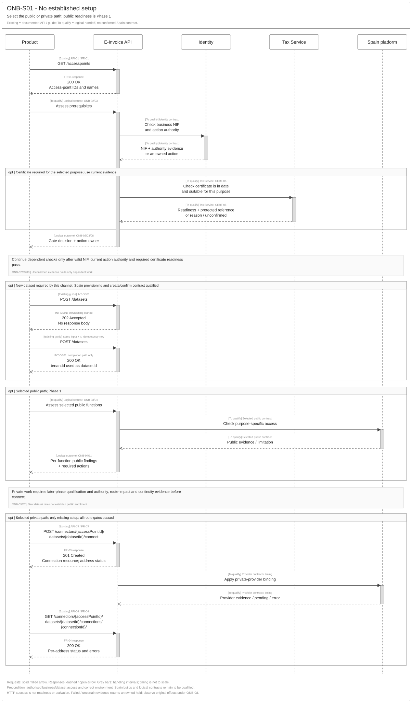
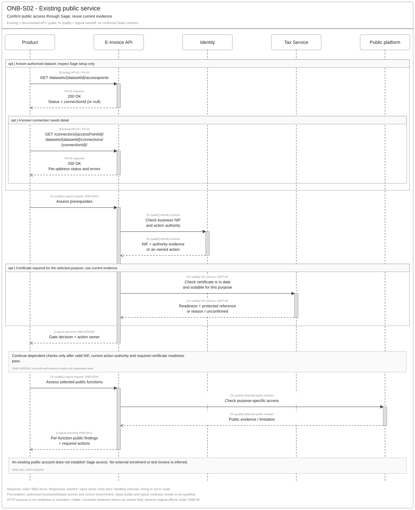
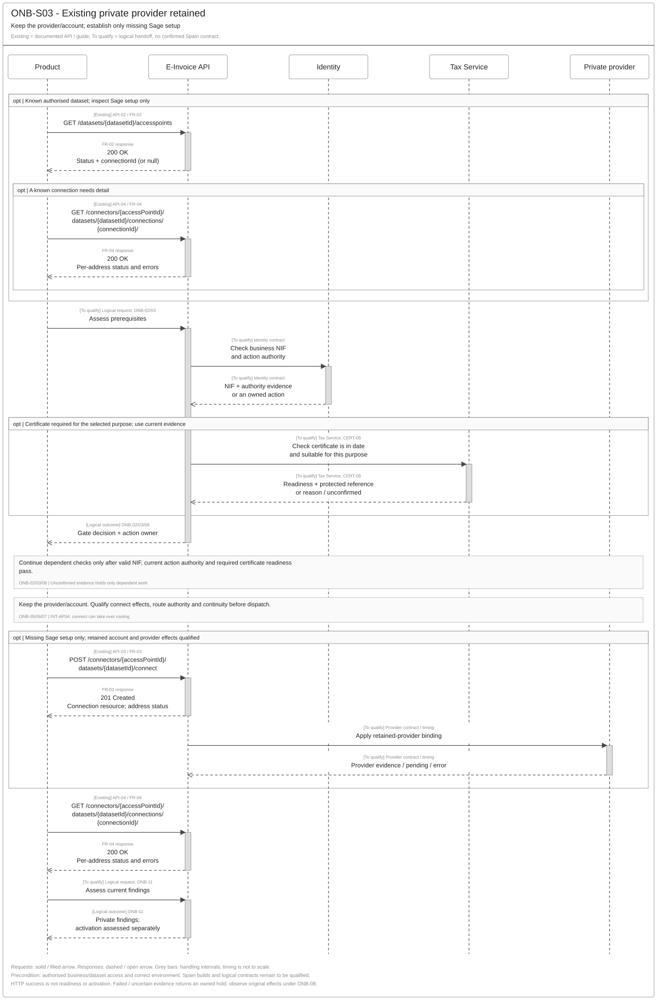
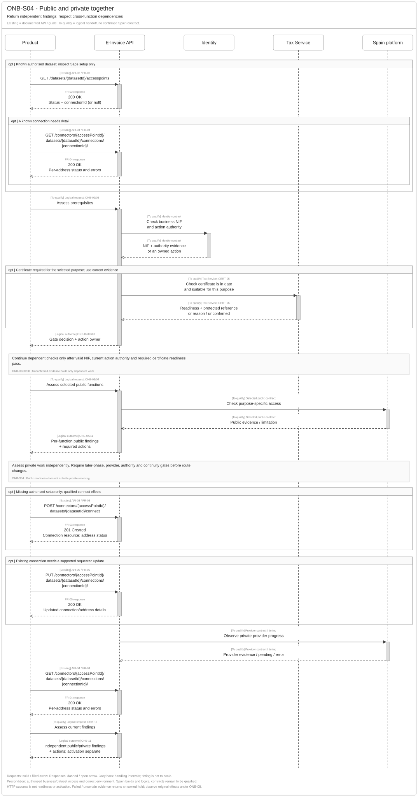
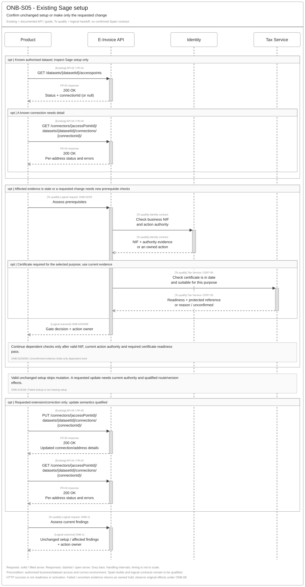
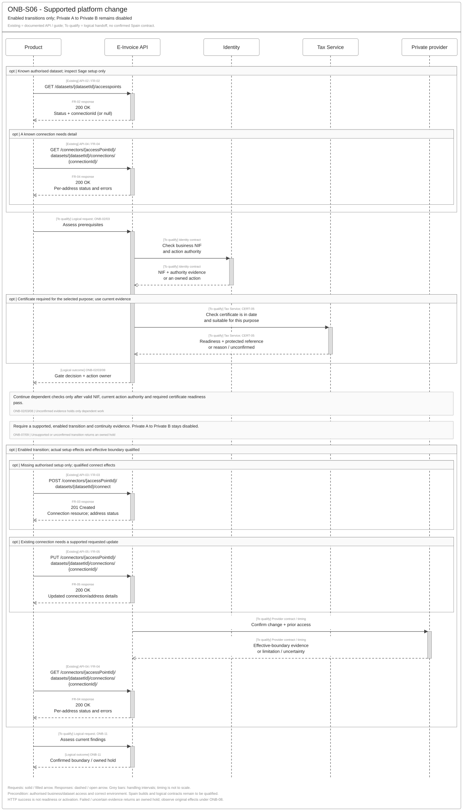
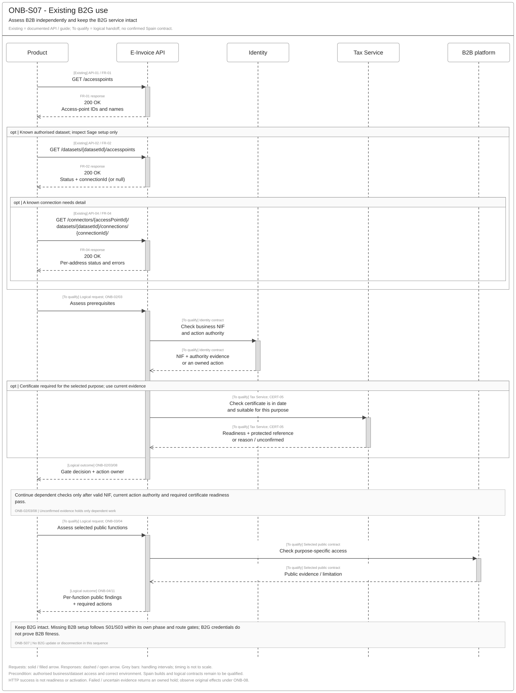
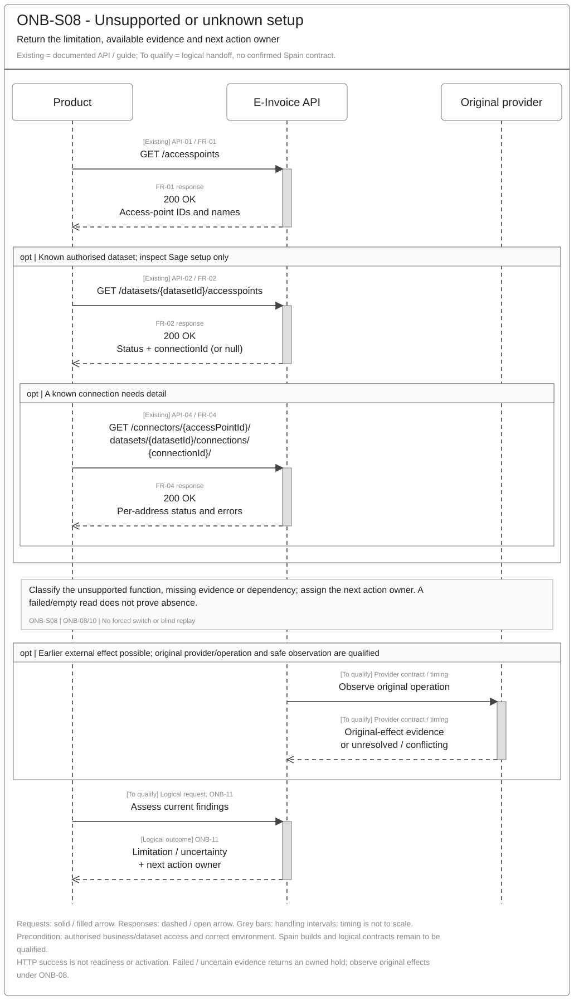

# Customer Onboarding API Reuse Assessment

> **Archived supporting reference.** [SPEC-SEI-021](../onboarding/SPEC-SEI-021-customer-onboarding-sequence-and-reuse-assessment.md) is the main engineering view. Detailed API-A01–16, source conflicts and earlier analysis remain here. Publication is disabled; the permanent ID and draft lifecycle status are retained. Archiving does not close implementation gates.

[Solution Summary](../onboarding/SPEC-SEI-018-customer-onboarding-solution-summary.md) · [Logical Feature Specification](../onboarding/SPEC-SEI-019-customer-onboarding-logical-feature-specification.md) · [Feature landing page](../onboarding/README.md)

## Revision overview

This companion to [SPEC-SEI-002](SPEC-SEI-002-onboarding-solution-specification.md) assesses existing FR capabilities, Spain changes, product impact and coverage gaps by public and private platform. Business requirements, phase gates and ONB/OFR meanings remain in SPEC-SEI-019. Eight proposed scenario sequences now link the existing operations and Spain qualification gates. The predecessor, source contracts and publication selection remain unchanged.

## 1 Engineering decision summary

**Audience: architects and engineers.** Assess what existing capabilities can be reused, what Spain needs to change, and what evidence remains open. Start with [public solution](#41-public-platform-mvp), [private solutions](#43-private-platforms) and [shared Spain differences](#5-common-spain-changes-and-open-evidence). Use the [scenario sequences](#proposed-scenario-sequences) to review the proposed interactions. Operation/source detail supports the assessments; new API design remains outside scope.

**Agreed direction, 22 October 2026: reuse the existing FR APIs and tailor Spain through the country pack.** The scenario sequences below propose reuse of documented operations and explicitly unbound logical handoffs. New endpoint and payload design remains outside scope. Engineering must establish whether each Spain difference needs configuration, a country/provider binding, a shared capability change or a contract extension. REF-REUSE; REF-COUNTRY.

The intended Spain use is to confirm or establish selected public/private functions for a business through Sage. Phase 1 remains public readiness. Later private setup and activation retain their existing gates; Private A to Private B remains disabled. REF-LOGICAL sections 3 and 6.

### Reuse and Spain tailoring by delivery scope

| Scope | Existing reuse starting point | Spain change or consideration | Product integration impact |
|---|---|---|---|
| Public platform MVP | Discovery and existing-connection inspection: API-01/02/04; Tax Service certificate capability is the intended supporting source. | Qualify Spain service availability, valid NIF, current authority, in-date suitable certificate and per-function readiness. Decide whether an internal connection record is needed; external public enrolment is not established. Section 4.1. | Keep the discovery/read approach. Use available business evidence; ask only for missing or invalid inputs. Show the affected function and action owner. Exact caller changes remain open. |
| Public platform nice-to-haves | Reads and FR completion events offer reuse candidates; Spain public notification/reminder coverage is unverified. | Qualify the selected core completion mechanism; assess extra product guidance/reminders separately. Section 4.2. | Optional richer presentation. Core owned actions and safe recovery remain MVP needs. |
| Private platforms | API-01–05 and INT-AP01–06 document France/Sovos connection setup, address updates, potential ownership transfer and completion observations. | Qualify each Spain provider's account linkage, address/authority rules, Embedded UI eligibility, route effects, removal support and readiness. Section 4.3. | Reuse existing connections for changes. A connect can change an existing route; gate handover before dispatch and preserve earlier invoice obligations. |
| Other shared changes | Dataset provisioning, connection resources, per-address events and platform-managed retry guidance are documented. | Qualify product-owned address/dataset/client mapping, country rules, version differences, event delivery and recovery. Approval/portfolio coverage remains unknown. Sections 2 and 5. | Retain dataset/connection references. Observe existing in-progress work; avoid duplicate connect. Assess event/read coverage and actual caller changes. |

**Evidence basis:** FR-01–05 document five access-point operations. INT-DS01 adds dataset provisioning; INT-AP01–06 add connect/update, disconnection, ownership, errors, addresses, environments and events. These supplied guides describe partner/internal integration behaviour, not replacement OpenAPI contracts. Ownership and error attachments were duplicated; each identical pair is counted once. Tax/Connections/AFL are implementation reuse candidates under SPEC-SEI-001. The shared onboarding flow is a proposed design pattern. Deployed builds, provider coverage and Spain compatibility remain **Unknown** until qualified.

## 2 Shared capabilities and reuse boundaries

Use the [shared glossary](../../context/GLO-SEI-001-e-invoicing-terminology.md). Shared behaviour is **Reusable with country binding** unless the evidence establishes otherwise. Spain rules are **Country-specific**. Implementation fitness remains **Unknown** until the owner supplies evidence.

| Capability already described | Reuse assessment and Spain consideration | Evidence / owner |
|---|---|---|
| M2M bearer authentication; optional `traceparent`/`tracestate`; JSON:API media type | Retain established integration conventions. Application authentication does not establish permission for a represented business or delegated client. | FR-01–05; Identity/API; GAP-03. |
| Dataset, connection and address mapping | INT-AP01 says one connection per dataset/access point; later address work uses update. The integrating product owns intended dataset/client/address mapping; Enablement and Engineering qualify supported limits. One-per-entity guidance is not a proven dataset-wide constraint. Retain INT-DS01 `tenantId` as `datasetId`; product/Tax mappings remain open. | FR-01–05; INT-DS01; INT-AP01/06; product/API/Identity/Enablement; GAP-01. |
| Partner-account ownership | INT-DS01 permits one M2M credential set to manage the creating partner account’s datasets; another partner account receives `403 Forbidden`. This technical access does not grant client/action authority. Confirm the selected product/account relationship. | INT-DS01 Ownership and access; Identity/API; GAP-01/03. |
| Status, events and errors | Guides document per-address completed/updated events, detail reads and platform-managed retries. Reuse their observation pattern; qualify exact event names, partial/absent-address meanings, retry owner and evidence lifetime in section 5. Protect credentials and sensitive diagnostics. | FR-02/04/05; INT-AP01–06; REF-LOGICAL ONB-NFR01–03; GAP-04/05/06. |
| Approval, portfolio and recovery patterns | Reuse the proposed behaviour in SPEC-SEI-019. User fields, address arrays and a create key do not establish existing implementation coverage for these functions. | REF-LOGICAL ONB-08/12/13; E-Invoice Service and dependency owners; GAP-04/06/08. |
| Transformation for later invoice operations | Existing DTS remains the preferred reuse candidate where relevant. Onboarding connection APIs provide no evidence of format readiness. Selected builds, mappings, Spain rule packs and operations still need qualification. | [SPEC-SEI-008](../SPEC-SEI-008-spain-ubl-mapper-migration-to-dts-solution-specification.md); DTS/exchange owners. Outside onboarding API changes. |

Proposed shared problem categories remain VALIDATION, AUTHENTICATION, AUTHORITY, POLICY, CONFLICT, THROTTLE, TRANSIENT_DEPENDENCY, OUTCOME_UNKNOWN, INTERNAL and SECURITY (REF-BASE). Engineering must map exact provider/HTTP codes and retry ownership without changing the business outcomes in SEI019.

## 3 Existing operation reuse assessment

FR-01–05 retain their supplied method/path and operation IDs. INT-DS01 adds the preceding dataset-provisioning capability; it supplies no operation ID. The access-point guides add lifecycle and provider effects to the five contracts; dataset provisioning precedes connection work. Guide-only capabilities and version differences below remain separate from the saved snapshots. Full internal/external contract equivalence is not established.

| ID / source operation | Existing method and path | Existing documented capability | Public-platform reuse | Private-platform reuse |
|---|---|---|---|---|
| Dataset provisioning / INT-DS01; operation ID not supplied | POST `/datasets` | Guide: start with `202 Accepted`, no body; repeat identical input under the same idempotency semantics until completion returns `200 OK`. Required header is `X-Idempotency-Key`; request media type is `application/json`. | Reuse candidate for the selected direct API channel. Spain public applicability and supported business types remain open; dataset creation is not public-platform enrolment. | The guide supports sending/receiving in one dataset; address and represented-business scope still need qualification. Existing provider or native-product account linkage still needs qualification. |
| API-01 / FR-01 `Get-AccessPoints` | GET `/accesspoints` | Lists access-point IDs and names. | Candidate for offering the Spain public option. Country filtering, availability and capabilities are not established. | Candidate for offering qualified private providers. Listing alone does not establish provider support for Spain. |
| API-02 / FR-02 `Get-Dataset-AccessPoints` | GET `/datasets/{datasetId}/accesspoints` | Lists dataset access points, CONNECTED/DISCONNECTED and nullable `connectionId`. | Inspect existing Sage setup where applicable. Does not prove NIF, certificate, authority or public readiness. | Find existing Sage connections before new setup. Does not prove an account outside Sage is absent or receiving is active. |
| API-03 / FR-03 `New-AccessPoint-Connection` | POST `/connectors/{accessPointId}/datasets/{datasetId}/connect` | Creates an AccessPointConnection; requires company/user/address inputs and `Idempotency-Key`. | **Applicability open:** use only if public access needs an internal connection record. This is not evidence of an external public registration operation. | France guides describe registration, pre-registration linking and product-to-product ownership takeover. Treat connect as potentially routing-changing. Spain/provider effects, authority and conflict behaviour need qualification before dispatch. |
| API-04 / FR-04 `Get-AccessPoint-Connection` | GET `/connectors/{accessPointId}/datasets/{datasetId}/connections/{connectionId}/` | Reads connection/address details, source status, errors and creation/modification metadata. | Inspect internal setup where it exists. Certificate/readiness evidence still comes from its qualified owner. | Inspect setup and provider observations within their proven scope. A read is not automatically a fresh external readiness or original-operation check. |
| API-05 / FR-05 `Put-AccessPoint-Connection` | PUT `/connectors/{accessPointId}/datasets/{datasetId}/connections/{connectionId}/` | Updates supported connection/address details; source describes date-limited address updates. | **Applicability open:** only for a confirmed internal configuration need. | Reuse an existing connection for address changes. INT-AP02 describes usage updates and versioned removal beyond FR-05; reconcile the selected build. These changes do not by themselves qualify migration or authority withdrawal. |
| Guide notification subscription / INT-AP01–03; operation ID not supplied | POST `/internal/events/subscriptions` | Guides subscribe to completed/updated events; full versioned subscription/delivery contract is not supplied. | Existing capability to assess; no Spain public event contract is established. | Candidate for observing partial address outcomes and completed changes. Confirm surface, event library, environment, access and authoritative reads; no new subscription API is proposed. |
| Guide disconnection / INT-AP03; operation ID not supplied | DELETE `/connectors/{accessPointId}/datasets/{datasetId}/connections/{connectionId}` | Legacy guide: `202 Accepted`, no body, followed by an updated event and detail confirmation. | No Spain public disconnection operation is established. | Evidence of a candidate capability, not universal permission. Reconcile whole-connection DELETE, v1.1.0 address `remove` and France handover limits; SPEC-SEI-003 owns full exit. |

API-01/02/04 support assessment under ONB-10/11. API-03/05 may support missing setup under ONB-05/06 after their actual effects are qualified. Existing valid unchanged setup should need no mutation. REF-LOGICAL ONB-A15/38.

### Internal-guide additions and source differences

| Added evidence | Reuse implication / remaining limit |
|---|---|
| Dataset, represented business and access-point addresses | FR-03/04/05 allow multiple addresses. INT-AP01/06 assign mapping responsibility to the integrating product and recommend one dataset/official registration per entity wherever possible. FR-OBS01 shows one SIREN with its SIRET; multiple distinct SIRENs remain unproven. FR-05 restricts one update array, not proven dataset-wide cardinality. |
| `tenantId` is the subsequent `datasetId`; no external global dataset list. | Store the confirmed ID against the customer. The example’s `data.id` differs from `attributes.tenantId`; the owner must confirm their meanings. The prose selects `tenantId`; do not infer equality or substitute `data.id`. |
| Asynchronous create/confirm uses the same `POST /datasets`. | `202` confirms provisioning started, not readiness or a usable ID. Qualify in-progress responses, repeat limits, payload/key binding and lost-result recovery. Preserve `X-Idempotency-Key` for this operation; FR-03 separately documents `Idempotency-Key`. |
| Dataset deletion is not exposed externally; the prerequisites nevertheless mention keys for delete operations. | Retain a source inconsistency for clarification. Do not infer a delete API or use deletion as onboarding cancellation/rollback. The guide identifies Sage support as the current route for deletion needs. |
| API-created datasets and Sage Connect/native-product channels are separate unless architecture is confirmed. | Confirm mapping and hybrid-channel support with Sage Enablement. Re-registering an existing official address can change active routing; discovery/registration plans need the existing authority and route gates. |

### Proposed scenario sequences

These are **proposed reuse views for architects and engineers**, one per ONB-S01–08. SEI019 remains authoritative for business behaviour. The participants are Product, E-Invoice API, Identity, Tax Service and the selected platform. Each view omits unused participants. The platform lane represents the selected public or private platform for that step. These are logical responsibility groups; the diagrams do not approve service placement. Spain country rules appear as condition notes.

**Read the labels:** **Existing** shows the documented HTTP method, complete path and success response from FR-01–05 or INT-DS01. Line breaks only wrap a path; they do not change it. Spain deployment/compatibility still needs evidence. **To qualify** marks a logical handoff with no confirmed contract. Its request and return labels describe intended behaviour; they are not endpoint or payload designs.

Solid arrows are requests. Dashed arrows are paired responses. Grey activation bars show handling intervals, with no promised duration or synchronous provider completion. HTTP success does not establish readiness or activation. Provider timing, events and observation freshness remain subject to section 5.

Each diagram assumes authorised business/dataset access and the correct environment. `opt` marks conditional work. Steps after a gate run only if its prerequisites pass; failed or unknown evidence returns an owned hold under ONB-08. Dataset creation is conditional on the channel and is never public-platform enrolment. INT-DS01's two POST requests show the successful create/confirm path with the same input and `X-Idempotency-Key`; repeat limits and recovery still need qualification.

| Scenario | Main path / reading focus |
|---|---|
| [ONB-S01 — No established setup](#onb-s01-new-setup) | Selected public/private path; Phase 1 is public only. |
| [ONB-S02 — Existing public service](#onb-s02-existing-public) | Sage access, NIF/authority and required Tax trust; public readiness. |
| [ONB-S03 — Existing private provider retained](#onb-s03-retained-private) | Existing account and only missing Sage setup; pre-dispatch route gates. |
| [ONB-S04 — Public and private together](#onb-s04-combined) | Independent findings and actual dependencies; no duplicate executor. |
| [ONB-S05 — Existing Sage setup](#onb-s05-existing-sage) | No mutation for valid unchanged setup; requested changes are conditional. |
| [ONB-S06 — Supported platform change](#onb-s06-platform-change) | Enabled transitions only; Private A to Private B stays disabled. |
| [ONB-S07 — Existing B2G use](#onb-s07-existing-b2g) | Assess B2B independently and preserve the B2G service. |
| [ONB-S08 — Unsupported or unknown setup](#onb-s08-unsupported-unknown) | Owned limitation or original-effect observation; no blind mutation. |

#### ONB-S01 New setup

**No established setup.** Select supported functions, establish missing prerequisites, then use the applicable branch. Dataset provisioning runs only if the qualified channel requires it; public-only setup does not inherit private registration calls. [Full-size SVG](../../assets/diagrams/onboarding-api-s01-new-setup-sequence.svg) · [Editable Draw.io](../../assets/diagrams/onboarding-api-s01-new-setup-sequence.drawio) · [PNG](../../assets/diagrams/onboarding-api-s01-new-setup-sequence.png).

#### ONB-S02 Existing public

**Existing public service.** Reuse valid public-access evidence, check business authority and required Tax certificate readiness, and return per-function findings. A public check runs only under a qualified contract; no invoice probe or enrolment is inferred. [Full-size SVG](../../assets/diagrams/onboarding-api-s02-existing-public-sequence.svg) · [Editable Draw.io](../../assets/diagrams/onboarding-api-s02-existing-public-sequence.drawio) · [PNG](../../assets/diagrams/onboarding-api-s02-existing-public-sequence.png).

#### ONB-S03 Retained private

**Existing private provider retained.** Keep the selected provider/account. Apply route-impact, authority and continuity gates before any connect that can take over an address. Use only qualified events/detail observations; configuration and activation remain separate. [Full-size SVG](../../assets/diagrams/onboarding-api-s03-retained-private-sequence.svg) · [Editable Draw.io](../../assets/diagrams/onboarding-api-s03-retained-private-sequence.drawio) · [PNG](../../assets/diagrams/onboarding-api-s03-retained-private-sequence.png).

#### ONB-S04 Combined

**Public and private together.** Assess public and private functions independently. Reuse valid evidence and perform only authorised missing private work. Preserve valid partial results and let the owning invoice features enforce delivery, public-copy and reporting dependencies. [Full-size SVG](../../assets/diagrams/onboarding-api-s04-combined-sequence.svg) · [Editable Draw.io](../../assets/diagrams/onboarding-api-s04-combined-sequence.drawio) · [PNG](../../assets/diagrams/onboarding-api-s04-combined-sequence.png).

#### ONB-S05 Existing Sage

**Existing Sage setup.** The unchanged path reads and confirms existing setup with no mutation or new route version. Stale checks or requested extensions select only their affected work; an uncertain update stays with its original operation. [Full-size SVG](../../assets/diagrams/onboarding-api-s05-existing-sage-sequence.svg) · [Editable Draw.io](../../assets/diagrams/onboarding-api-s05-existing-sage-sequence.drawio) · [PNG](../../assets/diagrams/onboarding-api-s05-existing-sage-sequence.png).

#### ONB-S06 Platform change

**Supported platform change.** The optional change runs only for an enabled, qualified transition. Gate routing-changing calls before dispatch and confirm actual effects/boundary. Unsupported transitions and unknown effects return a hold; Private A to Private B remains disabled. [Full-size SVG](../../assets/diagrams/onboarding-api-s06-platform-change-sequence.svg) · [Editable Draw.io](../../assets/diagrams/onboarding-api-s06-platform-change-sequence.drawio) · [PNG](../../assets/diagrams/onboarding-api-s06-platform-change-sequence.png).

#### ONB-S07 Existing B2G

**Existing B2G use.** Existing B2G use does not establish B2B access, authority or trust. Keep B2G intact; missing B2B work follows the appropriate S01/S03 path within its own phase and route gates. [Full-size SVG](../../assets/diagrams/onboarding-api-s07-existing-b2g-sequence.svg) · [Editable Draw.io](../../assets/diagrams/onboarding-api-s07-existing-b2g-sequence.drawio) · [PNG](../../assets/diagrams/onboarding-api-s07-existing-b2g-sequence.png).

#### ONB-S08 Unsupported unknown

**Unsupported or unknown setup.** Read only permitted known resources, classify the limitation and return its owner. If an earlier effect is possible, ask its qualified owner for original-operation evidence. Do not infer absence, force a provider switch or repeat uncertain work. [Full-size SVG](../../assets/diagrams/onboarding-api-s08-unsupported-unknown-sequence.svg) · [Editable Draw.io](../../assets/diagrams/onboarding-api-s08-unsupported-unknown-sequence.drawio) · [PNG](../../assets/diagrams/onboarding-api-s08-unsupported-unknown-sequence.png).

## 4 Spain tailoring by platform

### 4.1 Public platform MVP

Required behaviour: REF-LOGICAL ONB-02–04.

| Spain need | What we already have or can assess for reuse | What must change or be considered for Spain | Coverage / owner |
|---|---|---|---|
| Public service choice and existing setup | API-01/02/04 provide discovery and inspection. | Qualify the Spain public service choice and test/production availability. Confirm whether the selected public channel needs Network dataset provisioning and/or an internal connection. INT-DS01 does not prove either is available for Spain public use; private setup cannot determine that need. | Unknown public binding; API/Integration and Product; GAP-02/06/08. |
| Valid business NIF | Existing business context can avoid repeated entry; Identity is the owning capability in REF-LOGICAL ONB-02. The five FR contracts do not prove NIF verification. | Qualify the business NIF and applicable NIF/NIE mapping, evidence source and correction owner. Keep the represented business separate from the certificate caller. A certificate or populated identifier cannot substitute for this check. | Country-specific identity rules; Identity/Spain Product; GAP-01/02/03/06; ONB-A03/25. |
| In-date, suitable certificate | **Intended source: existing Tax Service certificate capability**, following REF-TRUST. Reuse eligible protected material without another upload. REF-SAGE-CERT is the internal supporting reference. | Qualify actual Tax/Connections/AFL custody and lookup/readiness coverage. Establish current validity interval, revocation, subject, purpose, environment and evidence freshness. Expired/unsuitable material needs correction; unavailable/stale feedback remains unknown. Later protected authentication/signing needs separate qualification. | Existing implementation candidate; coverage Unknown. Tax Service, trust and Security; SPEC-SEI-001 G1/G9/G10; GAP-06/08; ONB-A22–25. |
| Direct/delegated action authority | M2M and request `user` are available, but do not establish effective authority. Reuse the Identity/authority capability where qualified. | Apply the selected Spain action's representation rules. Third-party recovery/consultation needs the registered-authority evidence in SPFE-S02 Article 11. Do not carry tax-only authority or certificate possession into public B2B use without validation. | Country-specific rules; Identity/Spain Compliance; GAP-03/06; ONB-SPFE-A03. |
| Per-function readiness and safe correction | Existing status/error observations can contribute; they do not cover all readiness findings. | Establish which owner supplies each finding and whether existing product results can express readiness, limitation, correction owner and recheck needs. NIF, certificate and authority remain independent. Failed/unknown prerequisites hold dependent work. | Result coverage Unknown; E-Invoice Service/API and dependency owners; GAP-05/06; ONB-A25/42. |
| Evidence of public access | Supplied public catalogue and formats describe invoice operations, not an onboarding enrolment command. | Qualify only supported access checks. Do not assume a customer-enrolment operation, invent its fields or use invoice submission/cancellation as an onboarding probe. Web-form access does not establish automated ERP access. | Spain technical binding; Integration/connector owner; SPFE-S02/S03/S08; ONB-SPFE-R02/03, ONB-A27. |

Public readiness records qualified selected-function checks; it does not activate a route or establish an actual invoice exchange/reporting outcome. REF-LOGICAL ONB-04/11. NIF and certificate checks above also apply to private functions when the selected policy requires them; private credentials and signing arrangements remain provider-specific.

### 4.2 Public platform nice-to-haves

These are reuse candidates for optional product improvements, not added MVP commitments.

| Capability | Existing evidence | Spain consideration and owner |
|---|---|---|
| Proactive product progress and renewal/remediation reminders | FR guides now document provider completion events and read-based tracking; no Spain public progress/reminder contract is supplied. | Qualify completion observation for the selected core flow. Extra customer notifications and reminders remain optional product improvements; existing event capability is not proof of Spain coverage. |
| Richer setup guidance and prefilled correction | SPEC-SEI-019 ONB-R24 already requires use of qualified current information and only necessary input. | ERP Product can assess additional local guidance and help content. Core owned actions and safe recovery remain MVP requirements; richer presentation is optional. |

### 4.3 Private platforms

Assess **each selected provider**. No provider-specific Spain onboarding contract is supplied with FR-01–05, so provider support and local effects remain Unknown. Requirements stay in REF-LOGICAL ONB-05–09.

| Spain need / scenario | Existing reuse starting point | What must change or be considered for Spain | Coverage / owner |
|---|---|---|---|
| New private setup, ONB-S01 | FR guides describe the real Sage PA France/Sovos connector, a demo connector, direct connect and an Embedded UI alternative. | Confirm Spain provider and environment support. Assess reuse of either qualified registration experience; Embedded UI needs partner enablement. Demo or Sovos UAT evidence cannot prove Spain/live directory effects. | Spain coverage Unknown; Product/API/Integration/Enablement; INT-AP01/06; GAP-02/06/08. |
| Keep an existing provider, ONB-S03 | API-02/04 can identify a known Sage connection; API-03 may support missing Sage setup. | Assess the retained account and Network/native-product mapping. INT-AP04 describes pre-registration linking and product-to-product takeover; INT-AP05 also documents duplicate/conflict cases. Establish the exact supported path before connect; do not assume harmless linking or universal last-one-wins. | Unknown linking coverage; provider/API owner; GAP-04/06/08; ONB-A13. |
| Provider credentials and trust | Existing Tax Service capability may provide reusable material for a qualified purpose; FR connection fields are not proof of credential fitness. | Confirm the provider's credential, authentication and signing arrangements separately. Tax-valid material cannot automatically satisfy private B2B use. A customer certificate upload is conditional on the selected arrangement. | Unknown selected-purpose coverage; trust/provider and Security; REF-TRUST G9/G10; ONB-A22/24. |
| Sending and receiving readiness | API-04 exposes connection/address status and errors. | Qualify evidence separately for sending, receiving and any required receiving destination. Determine which observation proves actual provider state and its freshness. Local CONNECTED or successful transport is insufficient by itself. | Unknown readiness/observation coverage; Integration/provider owner; GAP-05/06; ONB-06. |
| Public and private together, ONB-S04 | Connection resources can identify separate setups; common assessment can reuse valid evidence. | Qualify independent public access, public-copy and reporting dependencies for selected functions through their owning specs. Private setup cannot imply public readiness or create a second delivery executor. | Country/provider binding; Product/Integration and invoice-operation owners; ONB-A14. |
| Activation or supported platform change, ONB-S06 | API-03/05 offer setup changes; route capability is outside the supplied five contracts. | Before a routing-changing connect, require separate route authority, supported scope/boundary and historical access under SPEC-SEI-014/016. Reconcile takeover, offboard-first and usage-conflict guidance for the selected provider. France guide behaviour cannot enable gated Spain transitions; Private A to Private B stays gated. | Unknown route implementation coverage; Routing/Receiving and Product; GAP-06/08; ONB-A05/08/16. |

For confirmed or extended existing Sage setup (ONB-S05), preserve valid matching references and recheck only affected evidence. Unsupported or unknown provider coverage returns an owned limitation (ONB-S08); it cannot force a provider switch. Existing B2G use is assessed independently for B2B (ONB-S07).

### 4.4 Spain NIF, establishments and dataset mapping

France identifies a legal unit with SIREN and an establishment with SIRET, which contains that SIREN plus an establishment identifier. FR-OBS01 therefore shows two addresses for the same SIREN, not evidence of two legal units. REF-FR-IDS.

| Spain identity concern | Source finding and reuse implication |
|---|---|
| Taxpayer versus establishment | Article 22 assigns NIF to legal persons/entities. Its composition identifies entity category, a number and a control character; it does not define a SIRET-style establishment suffix. Local/premises details are recorded separately in the census. Keep establishment or provider-routing references separate from NIF; do not invent a child-NIF format. REF-ES-NIF, REF-ES-NIF-FORM, REF-ES-LOCALES. |
| Separately identified permanent establishment | A nonresident entity’s permanent establishments with clearly different activities and separate management must obtain NIFs distinct from the nonresident entity under Article 22(2). These are independent identifiers, not a prefix-derived hierarchy. Qualify this scope explicitly; do not infer parent/child relationships from matching NIF characters. REF-ES-NIF. |
| Accountant, company group and dataset | A commercial group or accountant portfolio is separate from the represented taxpayer and address. **Open:** one NIF/multiple addresses and multiple NIFs under a dataset need actual country/provider and isolation evidence. NIF rules do not choose dataset cardinality. Keep authority, certificate purpose and results scoped to the represented business; no portfolio-wide grant follows from shared technical access. GAP-01/02/03; REF-LOGICAL ONB-R04/19. |

## 5 Common Spain changes and open evidence

### Country and contract differences

This is the shared tailoring list for the platform assessments above. **Required tailoring** identifies a known FR/Spain difference. It does not select an API design or prove a breaking change.

| Existing evidence / difference | Spain tailoring or qualification needed | Owner / gate |
|---|---|---|
| INT-DS01 lists only France `businessTypeCode` values and Enablement-set `platform`. INT-AP01/06 place intended address/dataset/client mapping with the integrating product. | Obtain Spain type codes and platform enablement. Qualify one-NIF/multiple-address and multiple-NIF mappings against supported limits and client isolation. Do not invent ES-prefixed values or adopt one dataset per NIF as an established rule. | Spain Product/Identity/API/Enablement; GAP-01/02/08. |
| FR-03 requires company, `user` and an address array. INT-AP01 says SIREN plus other required addresses and permits updated audit context. | Confirm the minimum inputs for the selected Spain public/private channel. Audit fields are not legal authority. Reconcile guide requirements, alternate authentication and media types with the selected OpenAPI; retain caller compatibility. | Product/Identity/API; GAP-02/03/07. |
| Four FR address types and FR-05 same-base-SIREN update array; INT-AP06 adds legal/internal formats and recommends official registration plus internal routes where needed. | Keep NIF, establishment and provider address separate (section 4.4). Define Spain bindings with the provider; internal suffix/routing addresses cannot become official Spain identity or directory rules. | Spain Product/Identity/Integration; GAP-01/02. |
| `mandateNumber` is France opt-in evidence. INT-AP04 describes last-one-wins takeover; INT-AP05 has global duplicates, offboard-first Peppol and first-successful-usage conflicts. | Qualify the exact route/account transfer behaviour and Spain authority. Registration can alter traffic before local activation; obtain approved handover scope before dispatch. Never change a genuine tax ID merely to evade a duplicate error. | Product/Identity/Routing/Integration; GAP-02/03/04. |
| INT-AP06 lists `RECEIVE`; FR-03/04/05 and other guide tables list only SEND/EREPORTING, at most one explicit value. Omitted/null permits all supported FR operations. | Resolve supported enum, combined modes and defaults for the selected build. Spain permissions remain explicit country/provider decisions; do not add RECEIVE to a saved schema without evidence. | API/Product/Identity; GAP-02/07. |
| FR-05 limits address update to dates and `usage` to add. INT-AP02 later permits updating usage/endDate and names API v1.1.0 for address `remove`; its own earlier table differs. INT-AP03 shows whole-connection DELETE linked to 0.1.7. | Pin the contract/build and establish supported edits/removal, omission semantics, partial effects and safe observation. Dataset deletion, address removal, connection disconnection and full exit are different scopes. Do not infer delete/recreate or rollback support. | API/Integration/Routing; GAP-04/07/08. |
| FR date format/minimum, France-only endDate guidance, and expired/removed-address disappearance. The update table also mentions COMPLETED; schemas/status guide use CONNECTED. A failed Peppol address may also be absent while connection is CONNECTED. | Qualify Spain/provider dates, timezone, actual effective boundary and status meanings. Absence alone cannot prove successful removal, no earlier effect or receiving readiness. Require correlated action/result evidence. | API/Routing/Integration; GAP-02/05/07; ONB-Q09. |
| Completed/updated events and per-address partial notifications are documented. Event names, source URLs and field casing vary across guide prose/examples. | Reuse event/read patterns after exact library/environment/authentication qualification. Preserve source address results, deduplicate/re-read within the actual contract, and separate completion from readiness/activation. No blanket customer-complete event is established. | API/event owner/E-Invoice Service; GAP-05/06/07. |
| INT-AP06 describes platform RETRYING for up to 24 hours; INT-AP05 ERR-408 advises support after 6 days. Embedded upstream ERR-401/403/400 can be platform-retryable. Error observations are retained for 7 days. | Establish build/provider-specific retry ownership, budget, escalation threshold and observation availability. Product must not duplicate platform work or promise automatic retry for an unknown error. Distinguish upstream codes from caller HTTP errors. Source error lifetime does not set audit retention. | Integration/Operations/API; GAP-04/05/07. |
| FR-03 requires `Idempotency-Key`; INT-DS01 uses `X-Idempotency-Key`. FR-05 has no equivalent/version parameter; guide headers differ, including a key on GET. | Qualify duplicate windows, payload binding, concurrency and original-operation recovery per operation. A guide omission does not relax the saved contract. Do not normalise headers or infer idempotency from HTTP methods. | API/Integration/Operations; GAP-04/07. |
| FR input/output address maxima are 114/50; INT-AP06 declares routing length 125 and SIRET length 14 while its legal form is longer. FR-01 still has an unmatched path parameter. Guides reference 0.1.7, 0.1.9, 1.1.0 and 1.10.0. | Resolve full formatted-address limits, canonical signatures and actual version/build coverage. A linked version is not proof of deployment. Preserve source snapshots and record owner-confirmed compatibility decisions. | FR API/Enablement; GAP-07/08. |
| Real France connector uses Sovos UAT in INT/SBX without a France directory; Demo has reduced validation and no Sovos/directory/Peppol. The guide excludes load/stress testing. | Separate mock, provider-UAT, live-directory and capacity evidence. Select Spain environments and conformance criteria with its owners; France/demo availability cannot establish Spain readiness. | Integration/Operations/Architecture; GAP-02/08. |

France requests, source meanings and country rules must remain compatible. Country-pack changes may leave caller contracts unchanged. New required inputs or unsupported result meanings may require product or shared-contract work; that impact needs evidence rather than assumption. REF-COUNTRY; API-A07/13.

### Evidence gates

Existing gate IDs and ONB-Q/OFR-Q ownership remain. Each outcome must identify the reused capability, local change, remaining gap and evidence.

| Gate | Evidence needed to finish the assessment | Owner / existing reference |
|---|---|---|
| GAP-01 Dataset and resource identity | Confirm dataset-to-business-to-address cardinality: same-SIREN multiple addresses versus distinct SIRENs/NIFs, including accountant use. Retain the guide’s `tenantId`/`datasetId` mapping; qualify product/Tax/channel/account/environment isolation and the differing example `data.id`. | API/Identity/Tax Service and Enablement; ONB-Q01/04/08. |
| GAP-02 Country binding | Approved Spain rules and selected public/private coverage, including dataset business-type codes and platform enablement; classify configuration, country/provider work or a contract gap. | Spain Product/Compliance/API/Integration; ONB-Q02/03/09. |
| GAP-03 Actor and authority | Existing direct/delegated access, firm/client checks, eligible approvals and accepted Spain authority evidence. | Identity/Security/Product; ONB-Q06/07/08. |
| GAP-04 Mutation safety | Actual create/update duplicate, concurrency, partial-effect and original-operation observation guarantees; include INT-DS01 create/confirm replay and unresolved provisioning. Keep dataset/connection key semantics separate. | API/Integration/Operations; OFR-Q01/02. |
| GAP-05 Result meanings | Per-address/source-to-function mapping, partial/absent-address semantics, error lifetime, exact event library and independent activation evidence; product result coverage and gaps. | API/E-Invoice Service/Routing; ONB-Q04/09. |
| GAP-06 Companion capabilities | Existing NIF/Tax certificate coverage; qualify documented subscription and optional Embedded UI access for the selected scope. Case, approval, batch and route coverage remains open; these guides do not establish those capabilities. | E-Invoice Service/Architecture/dependency owners; ONB-Q04–08, OFR-Q03/04; SPEC-SEI-001 G1/G9/G10. |
| GAP-07 Source inconsistencies | Owner-confirmed resolution of section 5 differences: RECEIVE, update/remove/DELETE, takeover/conflicts, statuses/events, retry horizons, lengths/auth/headers and source versions; retain INT-DS01 identifier/deletion questions. | FR API and dataset owners; before build/client reuse. |
| GAP-08 Selected implementation qualification | Named reused build, retained behaviour, Spain/provider changes, known gaps, tests, monitoring and support ownership. | Architecture/API/Integration/Operations; ONB-Q05, OFR-Q03. |

## 6 Reuse assurance

These checks assess reuse against existing behaviour. Acceptance IDs retain their meanings; detailed scenarios remain in REF-LOGICAL.

| Check | Evidence required | Trace |
|---|---|---|
| API-A01 Resource access | Dataset/connection and client isolation, including cross-partner-account `403` from INT-DS01, removed relationships and safe denials. | ONB-A29/33/36; GAP-01/03. |
| API-A02 Unchanged setup | Valid matching setup is reused without create/update or a new route version. | ONB-A15/38. |
| API-A03 Create duplicates | Evidence of actual same-key replay, conflicting input, in-flight behaviour and duplicate window. | OFR-A04/06; GAP-04/08. |
| API-A04 Lost create response | Original operation can be recovered or held as unknown without another account/connection effect. | ONB-A06; OFR-A03/05. |
| API-A05 Update concurrency and uncertainty | Existing change controls prevent stale overwrite and blind repeat/rollback after possible effects. | ONB-A07/08; OFR-A15/17. |
| API-A06 Status interpretation | Address partial results and failed/removed/expired absence are classified from evidence. Resource CONNECTED, HTTP completion or an event cannot become blanket readiness or activation. | ONB-A20/24/42; GAP-05. |
| API-A07 Country isolation | Spain identifiers, dataset business-type codes, authority, usage and dates remain isolated from France and other countries. | ONB-A09/19/37; OFR-A10; GAP-02. |
| API-A08 Retry classification | Distinguish platform-managed retry, embedded upstream code and caller HTTP error. No duplicate product connect during RETRYING; unknown codes cannot imply actual retry. Qualify 24-hour/six-day escalation and seven-day observation limits; failure/404 cannot establish absence. | OFR-A01/02/09/21; GAP-04. |
| API-A09 Missing companion coverage | An uncovered trust, authority, batch or route need remains a named gap with an owner, not presumed FR coverage. | ONB-A25/31/34/35; GAP-03/06. |
| API-A10 Public boundary | No invented public enrolment, test-invoice setup check or automatic activation; automated access is separately qualified. | ONB-SPFE-A01–03; OFR-SPFE-A01/02; SPFE-S02/S03/S08. |
| API-A11 Source correlation | All five operation IDs/paths match FR-01–05. Diagram HTTP calls and success responses match FR-01–05 or INT-DS01. Each request has a return. Eight views retain ONB-S01–08 meanings, evidence limits and pre-dispatch route gates; logical handoffs imply no new endpoint. | Source snapshots; GAP-07. |
| API-A12 Reuse and operations | Actual build, scope, local changes, gaps, operations and recovery evidence are recorded before enabling a function. | ONB-A19/21; OFR-A11/19; GAP-08. |
| API-A13 Existing product compatibility | FR regressions pass; any required Spain caller change is evidenced against the section 1 impact assessment. | REF-REUSE/COUNTRY; GAP-02/05/07/08. |
| API-A14 NIF and certificate result composition | Independent findings survive invalid NIF, expired/revoked/wrong-purpose material and unavailable Tax Service feedback. Verify protected-reference reuse and later-use rechecks. | ONB-A22–25; OFR-A20/21; REF-TRUST; GAP-03/05/06. |
| API-A15 Dataset provisioning and channel reuse | Confirm the documented `202`/`200` distinction, retained `tenantId`, operation-specific key headers and multiple-address scope. The guide’s sending/receiving reuse does not prove one-to-one legal-entity mapping; qualify any multiple-NIF use and client isolation. Lost confirmation stays unresolved; native-channel linkage and existing-address routing effects require evidence before new setup. | INT-DS01; ONB-A15/19/26/38; OFR-A03/05; GAP-01/02/04/07/08. |
| API-A16 Guide capability qualification | Reconcile the selected RECEIVE/update/remove/DELETE contract and event names with the actual build. Exercise address takeover/conflict, partial notifications, absent failed address, removal confirmation and lost events. Demo success cannot qualify live/Spain behaviour; gated migration remains held. | INT-AP01–06; ONB-A04/06/08/19/20; OFR-A03/13; GAP-02/04/05/07/08. |

## 7 Confluence presentation

Keep one engineering view alongside the summary and logical specification. Lead with platform-specific reuse and the common tailoring table. Link source contracts for schema detail. The [local preview](../../work/onboarding-api-review/index.html) reflects this focus. The [landing page](../onboarding/README.md#confluence-presentation) retains the publication boundary.

## REF Source references

INT-DS01 and INT-AP01–06 were supplied on 22 October 2026. Their canonical URLs/revisions and deployed builds are unverified. Technical extracts omit tokens, personal data and operational identifier examples; identical duplicate attachments are counted once. FR files remain supplied OpenAPI 3.1.0 snapshots, each declaring `info.version: 1.0.0`, reviewed 21 October 2026. No contract publication date, actual build version or completeness of the wider service is established. Source files remain unchanged. JSON names and paths below are exact; review excludes generated code samples and sample personal data.

| Source ID | Original file | Exact contract element | Supported claim and limit |
|---|---|---|---|
| REF-REUSE | Product/architecture review feedback recorded in [section 1](#1-engineering-decision-summary), 22 October 2026 | Direction to reuse FR APIs and tailor Spain through country packs; focus this assessment on existing coverage and Spain changes | Confirms the reuse choice. Does not approve exact schema changes, release priorities or production fitness. |
| REF-COUNTRY | [PRD-SEI-227](../../prds/PRD-SEI-227-e-invoicing-as-a-service.md), canonical product proposal | Shared core and country-pack boundary; FR11; country-pack governance | Source design pattern for isolating local rules and preserving product contracts. Its broader proposal status is unchanged by this onboarding reuse decision. |
| INT-DS01 | [Network Onboarding: Create a datasetId (tenantId), supplied technical extract](<../../context/FR API/Onboarding/network-onboarding-create-dataset-guide-extract.md>); received 22 October 2026; canonical URL/revision not supplied | What is a dataset?; Partner tenancy model / Ownership and access; Multi-product and existing Sage channels; Steps 1–2; French business type codes | Adds partner-owned datasets, one-per-entity provisioning guidance, `tenantId` used as `datasetId`, create/confirm and channel/routing limits. Does not establish enforced dataset cardinality. Describes an external partner flow. No full OpenAPI or Spain enablement proof; example ID and deletion wording need confirmation. |
| INT-AP01 | [Connect guide extract](<../../context/FR API/Onboarding/access-point-guides-evidence-extract.md#int-ap01-connect-and-channel-selection>), supplied 22 October 2026; revision/build unknown | Connection model; API/Embedded UI; authority/audit; partner routing; steps 0–5 | One dataset/access-point connection, product-owned mapping, registration effects and completion observations. France flow does not prove Spain coverage. |
| INT-AP02 | [Update guide extract](<../../context/FR API/Onboarding/access-point-guides-evidence-extract.md#int-ap02-update-and-removal>), supplied 22 October 2026; removal text names v1.1.0 | Steps 1–4; Update addresses safely | Existing update, updated event and versioned address removal. Usage/edit/action/status tables conflict; selected OpenAPI/build still needed. |
| INT-AP03 | [Disconnection guide extract](<../../context/FR API/Onboarding/access-point-guides-evidence-extract.md#int-ap03-connection-disconnection>), supplied 22 October 2026; linked API 0.1.7 | Remove connection; updated event; detail confirmation | Documents DELETE/202 as a candidate; does not prove current provider support, safe rollback or full exit. |
| INT-AP04 | [Ownership guide extract](<../../context/FR API/Onboarding/access-point-guides-evidence-extract.md#int-ap04-address-ownership-transfer>), supplied twice identically; linked API 0.1.9 | Scenarios A/B; Implementation Steps; Confirm connection details | Describes pre-registration/product takeover and possible routing effects. Duplicate/usage/provider errors limit a universal last-one-wins interpretation. |
| INT-AP05 | [Error guide extract](<../../context/FR API/Onboarding/access-point-guides-evidence-extract.md#int-ap05-error-handling-and-retry-ownership>), supplied twice identically; endpoint link contains 1.10.0 | Retention window; Error Object; dictionary; unknown errors; ERR-PPL002-3 | Exact upstream code scopes, platform/product actions, seven-day observation window and failed-absent-address case. Retry/escalation claims need build alignment. |
| INT-AP06 | [Inline catalogue/address/status extract](<../../context/FR API/Onboarding/access-point-guides-evidence-extract.md#int-ap06-catalogue-address-mapping-and-environments>), supplied 22 October 2026; revision unknown | Dataset listing; environments; address design/types; usage; retry/status/notifications | Product mapping ownership, real/demo limits, per-address events and 24-hour retry guidance. Does not resolve enum/length/version conflicts or establish Spain rules. |
| FR-OBS01 | [Abstracted user observation](<../../context/FR API/Onboarding/network-onboarding-create-dataset-guide-extract.md#review-clarification-dataset-entity-and-address-scope>), supplied 22 October 2026 | Two rows sharing dataset/client/mandate, with `fr.siren` and `fr.sirensiret` addresses sharing the same base SIREN; raw values omitted | Supports multiple addresses under one dataset. Does not establish multiple distinct SIRENs or authority/ownership; confirm that separate case with the FR owner. |
| REF-FR-IDS | INSEE [SIREN](https://www.insee.fr/fr/metadonnees/definition/c2047), updated 21 October 2025; [SIRET](https://www.insee.fr/fr/metadonnees/definition/c1841), updated 4 December 2019; checked 22 October 2026 | Definition sections: legal-unit identifier; establishment identifier and SIREN/NIC composition | Establishes French identifier meanings, not Sage dataset cardinality or Spain rules. |
| REF-ES-NIF | [RD 1065/2007, original BOE](https://www.boe.es/eli/es/rd/2007/07/27/1065); [current Article 22](https://www.boe.es/buscar/act.php?id=BOE-A-2007-15984#a22), consolidated update 7 October 2026; checked 22 October 2026 | Article 22(1)–(2) | Entity NIF assignment/composition and distinct NIFs for specified nonresident permanent establishments. Does not define a SIRET-style suffix, dataset mapping or e-invoicing routing contract. |
| REF-ES-NIF-FORM | [Order EHA/451/2008, original BOE](https://www.boe.es/buscar/doc.php?id=BOE-A-2008-3580), published 26 February 2008; checked 22 October 2026 | Article 2(a)–(c) | Corporate/entity NIF composition: category letter, seven-digit number and control character. No establishment hierarchy is encoded by these fields; other taxpayer identifier forms need their own rules. |
| REF-ES-LOCALES | [AEAT Model 036: activities and premises changes](https://sede.agenciatributaria.gob.es/Sede/censos-nif-domicilio-fiscal/tramites-censales-relacionados-empresarios-profesionales-retenedores/preguntas-frecuentes-modelos-036-037/modificaciones-censales/datos-relativos-actividades-economicas-locales.html), page revision unspecified; checked 22 October 2026 | Questions on changes to activities/premises and change of location | Premises/activity records change through census declarations. Does not assign a public-platform routing identifier or prove dataset scope. |
| FR-01 | [get-accesspoints.md](<../../context/FR API/Onboarding/get-accesspoints.md>) | `paths["/accesspoints"].get`, `GetAccessPointsResponse`, `AccessPointsResponse`, `parameters.datasetId` | Discovery path, response and signature inconsistency. No capability/readiness contract or Spain deployment proof. |
| FR-02 | [get-dataset-accesspoints.md](<../../context/FR API/Onboarding/get-dataset-accesspoints.md>) | `paths["/datasets/{datasetId}/accesspoints"].get`, `DatasetAccessPointsResponse` | Dataset listing, binary status and nullable connection reference; no proven original-operation recovery semantics. |
| FR-03 | [new-accesspoint-connection.md](<../../context/FR API/Onboarding/new-accesspoint-connection.md>) | `paths["/connectors/{accessPointId}/datasets/{datasetId}/connect"].post`; `Idempotency-Key` parameter; `AccessPointConnectionRequest/Response` | Create contract, required inputs, FR constraints and 201/address states. Key scope/retention/replay and external effects remain unqualified. |
| FR-04 | [get-accesspoint-connection.md](<../../context/FR API/Onboarding/get-accesspoint-connection.md>) | `paths["/connectors/{accessPointId}/datasets/{datasetId}/connections/{connectionId}/"].get`; `AccessPointConnectionResponse`; `Assigned-Keys` | Detail read, address states/metadata and FR mandate description. Does not establish fresh authoritative external observation or authority. |
| FR-05 | [put-accesspoint-connection.md](<../../context/FR API/Onboarding/put-accesspoint-connection.md>) | Same connection path `.put`; `PutAccessPointConnectionRequest`; `UpdateAccessPointConnectionRequest/Response` | Update actions, country grouping/date/usage rules and response shape. No supplied idempotency/version header; actual repeat/atomicity semantics need qualification. |
| REF-LOGICAL | [SPEC-SEI-019](../onboarding/SPEC-SEI-019-customer-onboarding-logical-feature-specification.md), draft, updated 22 October 2026 | ONB/OFR requirements, activity blocks, NFRs and acceptance | Canonical proposed behaviour for assessing reuse. This assessment does not change scope or allocate new APIs. |
| REF-BASE | [SPEC-SEI-002](SPEC-SEI-002-onboarding-solution-specification.md), updated 20 October 2026 | Interaction/data inventories and decision/release-gate record | Original technical analysis and existing open decisions. Preserved unchanged; not implementation evidence. |
| REF-TRUST | [SPEC-SEI-001](../SPEC-SEI-001-certificate-management-solution-specification.md), draft, updated 20 October 2026 | Part 2 section 6 CERT-04/05; Part 3 INT-04/05; Part 4 G1/G9/G10 | Canonical proposed certificate validation, scoped readiness and source/operation qualification. Logical handoffs do not establish deployed Tax Service endpoints or B2B compatibility. |
| REF-SAGE-CERT | [Sage certificate management](https://confluence.sage.com/spaces/CCLD/pages/759615024/Sage+certificate+management), internal Confluence page; version/date unverified | CCLD page ID 759615024; exact content/section not verified because access was unavailable on 22 October 2026 | User-supplied internal certificate-management reference, also recorded in SPEC-SEI-001. Does not independently establish NIF validation, live Tax Service contracts, Spain legal requirements or public-platform acceptance. |
| SPFE-S02 | [BOE-A-2026-20587.pdf](../../context/BOE-A-2026-20587.pdf), Order HAC/1028/2026, published 5 October 2026 | Article 11(1)–(2); source baseline in REF-SPAIN | Certificate access and representation, including registered third-party recovery/consultation authority. Does not establish a Sage implementation or Tax Service contract. |
| SPFE-S03 | [Original public service catalogue](<../../context/Descripción servicios web/Catálogo de servicios/20261013/CatalogoServicios.pdf>), 0.1.0, 9 October 2026 | Sections 4.3, 5.1 and 6.1–6.10, pp. 8–20 | Public operation inventory and fault guidance; no supplied external onboarding registration command or blanket safe-retry guarantee. |
| SPFE-S08 | [Original input/output formats](<../../context/Descripción servicios web/Formatos entrada y salida/20261013/FormatosEntradaSalida.pdf>), 0.1.0, 9 October 2026, draft | Sections 5.1–5.9, pp. 8–15 | Operation/request/item response distinctions and supplied formats; no onboarding payload. Pending formats/conflicts remain gates. |
| REF-SPAIN | [SPEC-SEI-019 REF](../onboarding/SPEC-SEI-019-customer-onboarding-logical-feature-specification.md#ref-source-references), [RES-SEI-002](../../context/RES-SEI-002-spain-public-platform-technical-evidence.md), [glossary](../../context/GLO-SEI-001-e-invoicing-terminology.md) | Original legal/contract locators, shared conflicts and qualified identity/outcome terms | Existing Spain evidence route. This engineering assessment introduces no new legal rule; final BOE evidence retains its authority. |
