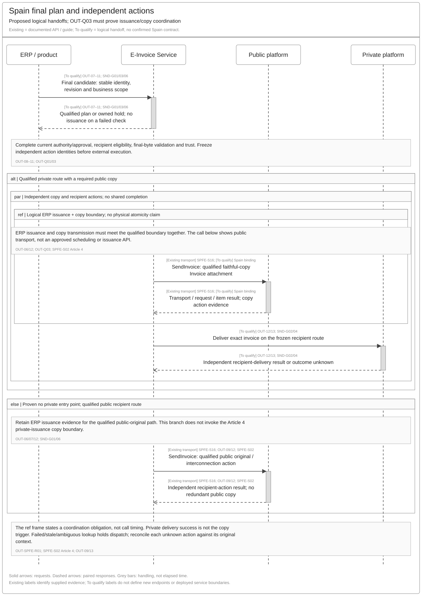
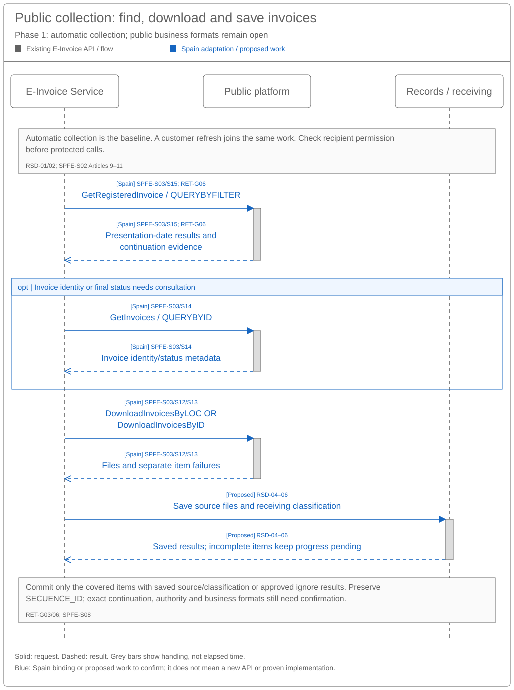
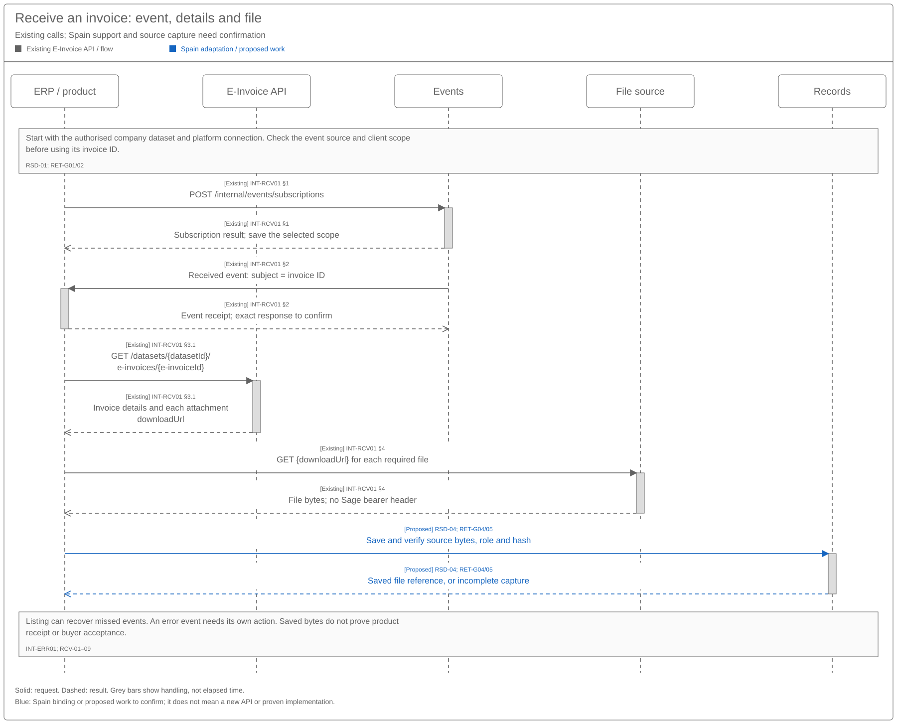

# Provider Connectivity Sequence and Reuse Assessment

[Solution Summary](SPEC-SEI-034-provider-connectivity-solution-summary.md) · [Logical Feature Specification](SPEC-SEI-035-provider-connectivity-logical-feature-specification.md) · [Folder](README.md)

## Revision overview

This engineering view develops the initial SPEC-SEI-034 assessment into sequences, contract/format comparisons and reuse gates. SPEC-SEI-035 owns the combined scenarios; existing PCN, GPA, B2BR and journey IDs retain their meanings. The three source specifications remain unchanged, including detailed inventories and unresolved decisions.

This is a Spain design proposal. It does not approve API endpoints, deployment boundaries, provider selection or production coverage. The [glossary](../../../context/GLO-SEI-001-e-invoicing-terminology.md) distinguishes the Sage-owned Provider API from a provider-owned external API.

## 1 Engineering direction and product impact

Assess the E-Invoicing Global API contract for public/private capabilities. Qualify the public platform connector and private-provider bindings independently. If one external provider can execute both, it must supply evidence for each action; it cannot inherit public coverage from private sending or generic format support. REF-BASE.

| Scope | Proposed assessment / possible change | Product integration impact |
|---|---|---|
| Shared access | Compare actual API/build with caller authority, representation references, receipts and action results. | Existing contract compatibility is unknown. No breaking change is established. |
| Spain public send/receive | Qualify public operation purpose, credentials, payload and source result levels. | Product needs public capability and action results; current submission support cannot be assumed sufficient. |
| Private send/receive | Qualify provider account, direction, format strategy, observation and historical access. | One product contract can hide transport differences while exposing unsupported capabilities and correct outcomes. |
| Files and transformation | Assess each source/target pair and one accountable conversion owner. Prefer existing DTS where qualified. | Product must distinguish source and derived files. Unsupported pairs remain visible. |
| Recovery and continuity | Bind safe retries, original-operation queries, missed-event coverage and original route context. | A timeout, missing event or provider switch must not create another invoice/action. |

`PROVIDER_API`, `SAGE_ADAPTER` and `HYBRID` retain their meanings from 013 and apply per capability. Products and partners can use common domain contracts with distinct permissions or exposure controls. Each external mutation has one execution and reconciliation owner. Call initiator and business direction are separate decisions. Physical services, hosts and gateways remain open. REF-BASE.

## 2 Proposed reuse sequences

The sequences below are reused unchanged from the sending and receiving sets. Their existing participants, methods, paths, activity IDs, request/response arrows and qualification labels retain the same meanings. They show how the common Global API proposal uses existing invoice features; they do not define another service model.

### 2.1 Sending through public and private routes

[Full-size SVG](../../../assets/diagrams/invoice-sending-spain-actions-sequence.svg) · [Editable Draw.io](../../../assets/diagrams/invoice-sending-spain-actions-sequence.drawio) · [PNG](../../../assets/diagrams/invoice-sending-spain-actions-sequence.png).

This is the existing sequence in SPEC-SEI-024 §2.2. The E-Invoice Service uses the approved exchange plan. Private delivery and a required public copy retain separate actions and results. The alternative public recipient route does not create a redundant copy. The issuance/copy frame states the existing coordination requirement; it does not make private delivery success the copy trigger or approve physical timing. Public execution follows 011. B2B Router-specific operation and payload qualification remain in 017 and §3.1 below. REF-JOURNEYS; REF-BASE; SPFE-S16.

### 2.2 Public consultation and download

[Full-size SVG](../../../assets/diagrams/invoice-retrieval-spain-public-sequence.svg) · [Editable Draw.io](../../../assets/diagrams/invoice-retrieval-spain-public-sequence.drawio) · [PNG](../../../assets/diagrams/invoice-retrieval-spain-public-sequence.png).

This is the existing sequence in SPEC-SEI-027 §2.2. Use `GetRegisteredInvoice` / `QUERYBYFILTER` for consultation by date filter (using the presentation date), and `GetInvoices` / `QUERYBYID` for consultation by identifier and final state. Download source bytes separately through `DownloadInvoicesByLOC` or `DownloadInvoicesByID` after the required authority checks. Preserve item results and safe progress. No public notification interface is inferred. SPFE-S03/S08/S12–15; REF-JOURNEYS.

### 2.3 Private receiving and existing API reuse

[Full-size SVG](../../../assets/diagrams/invoice-retrieval-fr-notification-sequence.svg) · [Editable Draw.io](../../../assets/diagrams/invoice-retrieval-fr-notification-sequence.drawio) · [PNG](../../../assets/diagrams/invoice-retrieval-fr-notification-sequence.png).

This is the existing FR reuse sequence in SPEC-SEI-027 §2.1. It separates event receipt, invoice detail, file download and verified capture. It is candidate API behaviour for the selected Spain private provider; it does not prove B2B Router uses the same event, API, credentials or file roles. B2B Router observations and recovery remain B2BR-05–07 in 017. A missing event needs qualified reads; a notification alone cannot complete source capture. INT-RCV01; B2BR-S04; REF-BASE.

If public and private sources expose the same business invoice, apply the Duplicate observations scenario in 035 and the receiving set's recipient, trust, profile and equivalence checks. Preserve both source observations. Existing DTS remains the preferred transformation candidate for a selected source/target pair; these diagrams do not establish an available mapping. REF-JOURNEYS; REF-DTS.

## 3 Contract and format assessment

### 3.1 Operation evidence

Public service names below follow the original AEAT catalogue in context; WSDL operation names and ebXML Action values retain their exact spelling. The FR guides define only their own Sage API resource, event and format terms. Private provider terms remain with the provider contract. Obtain selected contracts and builds before deriving schemas from examples. SPFE-S03/S08/S12–16.

| Capability and evidenced operation | Source | Reuse, local difference and gap |
|---|---|---|
| Sage submission: `POST /datasets/{datasetId}/e-invoices`, then `PUT {uploadUrl}` | INT-SND01 steps 2–3; supplied FR guide. | Candidate common intake/file upload. Qualify Spain manifest, action purpose, authority, upload completion and lost-response recovery. `201` is not external delivery. |
| Sage list/detail: `GET /datasets/{datasetId}/e-invoices` and `GET /datasets/{datasetId}/e-invoices/{e-invoiceId}`; `GET {downloadUrl}` for files | INT-RCV01 §§3.1–4. | Candidate product read/file pattern. Confirm direction filters, source-file roles, temporary URLs, history and complete recovery. Supplied FR list limits are not Spain or archive guarantees. |
| Sage events: `POST /internal/events/subscriptions` | INT-SND01 step 1; INT-RCV01 §1. | Confirm exposure, tokens, casing, event names, authentication and replay/completeness. Guide conflicts remain open. |
| Invoice submission — Remisión de facturas electrónicas: `SendInvoice` / `SUBMITINVOICE` | SPFE-S03 §6.2; SPFE-S16. | PRE SOAP 1.2, ebMS header and MIME business attachments. Qualify submission purpose, authority, environment, business schemas and repeat safety. Submission is separate from recipient delivery and a commercial response. |
| Consultation by date filter — Consulta por filtro de fechas: `GetRegisteredInvoice` / `QUERYBYFILTER` | SPFE-S03 §6.5; SPFE-S15. | Filter by presentation date. Preserve exact continuation field `SECUENCE_ID`; qualify pagination and safe progress. This consultation does not download invoice bytes. |
| Consultation by identifier — Consulta por identificador: `GetInvoices` / `QUERYBYID` | SPFE-S03 §6.4; SPFE-S14. | Consult invoice identity and final state. This is separate from date-filter consultation and file download. |
| Download by locator — Descarga por localizador: `DownloadInvoicesByLOC` / `DOWNLOADBYLOC` | SPFE-S03 §6.7; SPFE-S13. | Acquire source bytes by locator after qualifying the operation-specific authority. Preserve item outcomes; do not infer production access or a generic limit. |
| Download by identifier — Descarga por identificador: `DownloadInvoicesByID` / `DOWNLOADBYID` | SPFE-S03 §6.6; SPFE-S12. | Qualified alternative using invoice identity. Preserve per-item success/failure separately from the consultation result. |
| Private import: `POST /accounts/{account}/invoices/import` | B2BR-S03. | The sending-import profile explicitly requests `send_after_import=true` and a qualified sending transport. Preserve actual transport/document values and check provider defaults; qualify account, version, profiles and repeat safety. Import success is not delivery. |
| Private received observation: `received_invoice.created` | B2BR-S04. | Notification/signature evidence. Qualify selected-version list/detail/source-file reads, replay protection and independent completeness. Notification is not source capture. |
| Lifecycle, public copy and reporting results | 011/013/017 and the owning invoice feature sources. | Qualify raw source provenance and independent action meaning. No universal status mapping, public-report endpoint or combined obligation is established here. |

Current authority is checked for the represented business and each action, separately from caller authentication and credential possession. Protect secrets, signed/private URLs and sensitive invoice content from logs and events. Bind original input and correlation before a possible effect. A failed query does not prove absence; retry requires the selected safe-repeat contract or original-outcome reconciliation. PCN-02–09; GPA-03/08; B2BR-03/07.

### 3.2 Files, syntax and transport

One Sage API can carry metadata and references to multiple file types. The API metadata schema, external transport envelope and invoice syntax/profile are separate contracts. Business direction alone does not determine the syntax.

| Boundary / representation | Evidence | Qualification needed |
|---|---|---|
| Product files in supplied FR sending flow | UBL 2.1 XML with optional PDF, or a Factur-X hybrid PDF; Demo rules differ. INT-SND01 prerequisites and step 3. | Actual Spain input profiles, file generation ownership and qualified manifest. Do not apply Demo attachment requirements globally. |
| Public business documents | Draft v0.1.0 §5.1.1 names UBL 2.5: `InvoiceType` (not `CreditNote`) for invoices; `ApplicationResponse` for cancellation, actions/states, consultation and download requests; `DocumentStatus` for service responses except download. SPFE-S08. | Selected Spain document mappings and validators. Changing a MIME label cannot turn UBL 2.1 into the public profile. Pending §§5.3–5.9 remain a gate. |
| Public envelope | SOAP 1.2/ebMS and MIME wrap business files; WSDL payloads are opaque. SPFE-S16/S14/S12. | Packaging and source-result correlation. Shared REST/JSON access does not remove the external envelope. |
| Private outbound file/data | 017 assesses JSON-create versus structured import. B2BR-S03 documents possible transport/document defaults. | Choose the contracted strategy and exact document/transport profile. Retain requested and actual values; hold incompatible substitution. |
| Inbound source versus product representation | Supplied FR receiving guide distinguishes `Original_Document`, UBL and `Human_Readable`, and describes UBL after a Factur-X source. INT-RCV01 §3.1 and format notes. | Source-file role and preservation for each Spain/provider profile. This is pattern evidence, not B2B Router or Spain implementation coverage. |
| Optional rendering | FR `format=facturx` can generate a persisted representation. INT-SND01 step 5; INT-RCV01 §3.1. | Separate observation from generation, including permissions and source identity. A rendered file is not automatically the exchanged original. |

For each selected mapping, record direction and operation; country/network; environment/contract version; source and target syntax/version/profile; document type; original or derived role; attachment limits; mapping/validation versions; signature evidence; owner and conformance result. These are evidence needs, not approved API fields.

A private delivery and a separate public copy can need different qualified representations of one invoice. Preserve both file references and independent action results. The owning invoice feature determines copy applicability and semantic equivalence. Do not assume every input/output combination or signed-file path is supported.

## 4 Reuse qualification

| Capability/source | Spain use and reuse classification | Local change / unknown coverage | Accountable role and activation evidence |
|---|---|---|---|
| Authority, receipts, correlation and recovery patterns | Reusable unchanged as proposed patterns. | Actual stores, contracts and concurrency/replay behaviour unknown. | API/Identity/Operations: selected build, business isolation, lost-result and crash-recovery proof. |
| Existing Global API, files and events | Unknown existing implementation coverage; preferred common access candidate. | FR guides do not prove Spain action, profile or partner support. | API owner + Architecture: OpenAPI/build, permissions, consumer impact, gaps and conformance. |
| Connection and routing under 014 | Reusable with country binding. | Spain registration, direction, public-copy/reporting applicability and cutover evidence. | Routing + Spain Product: approved scope and actual service mapping; no parallel registry or route engine. |
| Public platform connector under 011 | Country-specific Spain contract. | PRE conflicts, business schemas, accepted authority, credential purposes and outcome queries. | Public integration/Security: selected contracts, access and per-operation proof; PCN-Q01–08. |
| B2B Router binding under 017 | Reusable binding pattern with provider-specific rules. | Contracted version, entitlement, account model, directions, files and recovery. | Provider owner: B2BR-Q01–08 evidence; no combined public/private entitlement assumed. |
| Existing DTS; SPEC-SEI-008 | Unknown existing implementation coverage; preferred transformation candidate. | Exact mapping pairs, rule packs, semantic/signature preservation and run support. | DTS + Spain mapping owners: actual build/contracts, mapping fixtures, validation, limits and operating evidence. |
| Spain identity, route, public-copy and reporting policy | Country-specific rules. | Must be explicitly bound and isolated from shared defaults. | Spain Product/Compliance + QA: rule/version evidence and another-country isolation checks. |

If provider conversion is selected, record its owner and source/target evidence. Prevent two untracked conversions. A reusable design pattern, a supplier format list and a document inventory each remain separate from proof that an existing build is fit. REF-BASE; REF-DTS.

## 5 Decisions and qualification checks

| Decision/gap | Accountable role and required evidence | Effect and linked functional acceptance |
|---|---|---|
| Shared API coverage and compatibility | API owner + Architecture: selected build/OpenAPI, caller model, operation and action coverage, current-consumer regression evidence. Carry forward GPA-Q01/Q02. | Blocks claims of unchanged integration. Check 035 Qualification/Access and country/reuse acceptance. |
| One provider for public and private work | Provider owner + Spain Product/Compliance: contracted matrix for public submission/copy/retrieval/reporting; authority, credential model, per-item public evidence, original-outcome queries and exit. | Combined SPFE coverage stays unproved. Test each action independently; a different authority interface or tax-report capability is insufficient. |
| Representations and transformation ownership | DTS/Exchange/Receiving + provider: profile pairs, actual mappings/rules, source access, semantic/signature evidence and conversion owner. | Holds unsupported pairs. Check 035 Representation and incompatible-substitution acceptance. |
| Recovery and observation completeness | Integration/Operations + provider/public owner: idempotency scope/input binding/window, original-action queries, notification security and bounded read/page coverage. | No blind retries or assumed complete polling. Check 035 Unknown outcome, Duplicate observations and both receive scenarios. |
| First delivery subset and continuity | Product + Engineering + Operations: route, direction, document types, environment, pilot cohort and operating/exit owners. | Independent capability readiness; check 035 Continuity and historical dependencies. |

Retain PCN-Q01–08, GPA decisions and B2BR-Q01–08. This set closes none of them. For a reviewable design, map each selected capability to its actual contract/build and resolve its blocking gaps. Pilot/production additionally require the source gates and functional acceptance, operations evidence and approval for activation.

Qualification should demonstrate: per-item public response correlation; requested/actual provider profile checks; safe lost-response handling without a second executor; incomplete page and missing-notification recovery; identifiable original/derived files; consumer compatibility; Spain-rule isolation; and qualified DTS/build coverage. These are evidence checks, not executed implementation tests or permission to activate.

## REF Source references

Sources support only the claims and elements stated below. Product requirements and proposed Sage controls have separate authority from external contracts. The [Spain evidence guide](../../../context/RES-SEI-002-spain-public-platform-technical-evidence.md) records the baseline and unresolved conflicts.

| REF ID | Original source and version/date | Exact location, supported claim and limit |
|---|---|---|
| REF-BASE | [SPEC-SEI-011](../../SPEC-SEI-011-public-platform-connector-solution-specification.md), [013](../../SPEC-SEI-013-provider-api-through-the-e-invoicing-global-api-solution-specification.md), [017](../../SPEC-SEI-017-b2b-router-provider-adapter-binding-solution-specification.md), updated 20 October 2026; [014](../../SPEC-SEI-014-shared-platform-connectivity-and-routing-solution-specification.md), current repository source. | 011 Part 1 §§1–2 and Part 4 gates; 013 Part 1 §§1–4 and GPA-05/08; 017 Parts 1–4; 014 SPC-01–08. Canonical draft design and scope references. Not approved external contracts or build evidence. |
| REF-JOURNEYS | [Sending assessment, SPEC-SEI-024](../../invoice-sending/SPEC-SEI-024-invoice-sending-sequence-and-reuse-assessment.md) and [receiving assessment, SPEC-SEI-027](../../invoice-receiving/SPEC-SEI-027-invoice-retrieval-sequence-and-reuse-assessment.md), repository review set, 22 October 2026. | Sequences and reuse gaps; their linked logical specs retain detailed behaviour. Product/BA sources, not external contract proof. |
| SPFE-S16 | [SendInvoice.wsdl](<../../../context/WSDL servicios web - PRE/20261013/SendInvoice.wsdl>), supplied PRE snapshot, 13 October 2026. | `wsdl:documentation`, `SendInvoicePortType/SendInvoice`, `SendInvoiceSoapBinding`, certificate/seal ports. Establishes SOAP 1.2, ebMS/MIME and opaque business payloads; not a business validator or proof of live access. |
| SPFE-S14 / SPFE-S12 | [GetInvoices.wsdl](<../../../context/WSDL servicios web - PRE/20261013/GetInvoices.wsdl>) and [DownloadInvoicesByID.wsdl](<../../../context/WSDL servicios web - PRE/20261013/DownloadInvoicesByID.wsdl>), supplied PRE snapshot, 13 October 2026. | Corresponding `portType/operation`, bindings and documentation. Query/download operations and packaging; not complete business schemas, push delivery or gap-free recovery. |
| SPFE-S08 | [FormatosEntradaSalida.pdf](<../../../context/Descripción servicios web/Formatos entrada y salida/20261013/FormatosEntradaSalida.pdf>), v0.1.0, 9 October 2026, marked `BORRADOR`. | §5.1.1, p. 8: UBL 2.5 document types; §§5.3–5.9, pp. 14–15: pending service formats. Draft technical evidence; no blanket production or cross-profile compatibility claim. |
| B2BR-S03 | [Import an invoice from a file](https://developer.b2brouter.net/reference/import-invoice), public live reference checked 23 October 2026; header candidate `2026-06-26`. | `POST /accounts/{account}/invoices/import`, `send_after_import`, transport/document parameters and `201`. Supports import, asynchronous processing and possible defaults. Not Sage's selected contract, SPFE coverage or idempotency proof. |
| B2BR-S04 | [New received invoice](https://developer.b2brouter.net/reference/getnewreceivedinvoicecreated), public live reference checked 23 October 2026. | `received_invoice.created`, `X-B2Brouter-Signature`. Establishes a notification and signature description; not source capture, complete reconciliation or contracted Spain entitlement. |
| INT-SND01 / INT-RCV01 | [Supplied FR sending guide extract](<../../../context/FR API/Sending/send-e-invoice-guide-extract.md>) and [receiving guide extract](<../../../context/FR API/Receiving/receive-e-invoice-guide-extract.md>), received 22 October 2026; original attachment hashes recorded there. | Sending prerequisites and steps 2–5; receiving §§3.1–4 and format notes. Reading aids for supplied API evidence; original canonical URLs, OpenAPI revisions and deployed builds are unavailable. They establish reuse candidates and conflicts, not Spain support. |
| REF-DTS | [SPEC-SEI-008 — Spain mapper migration to DTS](../../SPEC-SEI-008-spain-ubl-mapper-migration-to-dts-solution-specification.md), current repository source. | Reuse qualification and migration scope. Preferred existing transformation candidate; selected builds, mappings, rule packs and operations still require evidence. |
| SPFE-S03 | [CatalogoServicios.pdf](<../../../context/Descripción servicios web/Catálogo de servicios/20261013/CatalogoServicios.pdf>), 0.1.0, 9 October 2026 | §6.1, p. 10; §6.2 and §§6.4–6.7, pp. 10–15. Original service names, `SUBMITINVOICE`, `QUERYBYID`, `QUERYBYFILTER`, `DOWNLOADBYID`, `DOWNLOADBYLOC`, presentation date, `SECUENCE_ID`, limits and authority branches. Exact encoding/ordering/recipient-authority reconciliation remain open. |
| SPFE-S13 | [DownloadInvoicesByLOC.wsdl](<../../../context/WSDL servicios web - PRE/20261013/DownloadInvoicesByLOC.wsdl>), supplied 13 October 2026 | `DownloadInvoicesByLOC` portType/binding, MIME parts and service ports. Locator-download PRE transport; no inferred production address, LOC batch size or recipient authority. |
| SPFE-S15 | [GetRegisteredInvoice.wsdl](<../../../context/WSDL servicios web - PRE/20261013/GetRegisteredInvoice.wsdl>), supplied 13 October 2026 | Singular `GetRegisteredInvoice` operation; generic payload documentation and service ports. Exact transport/name. Reconcile catalogue `MessageProperties` filters with WSDL payload description before client design. |
