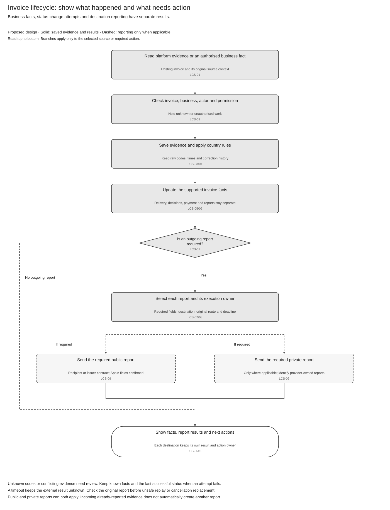

# Invoice Lifecycle Solution Summary

[Logical specification](SPEC-SEI-029-invoice-lifecycle-logical-feature-specification.md) · [API reuse assessment](SPEC-SEI-030-invoice-lifecycle-sequence-and-reuse-assessment.md) · [Feature folder](README.md)

## Revision overview

This view summarises [SPEC009](../archive/SPEC-SEI-009-invoice-lifecycle-status-solution-specification.md), which stays unchanged and remains the selected Confluence source. Existing LCS IDs, country rules and release boundaries remain. These three views are unpublished drafts; Spain API coverage and implementation readiness are open.

## 1 Problem and intended outcomes

**What:** show what happened to an invoice, who reported it and who must act next. **Why:** a status-change request or completed API call cannot prove buyer acceptance, payment or completion of every report. **Reuse:** assess the existing E-Invoice status-update, notification and history APIs before adding product calls. REF-PRODUCT; INT-LCS01–05.

Keep business facts, action attempts and destination reports separate. If a transition fails, retain the last successful status and the failed attempt. SPEC029 owns these rules; SPEC030 owns reuse and contract gaps.

## 2 Scope and actors

| Situation | Required outcome |
|---|---|
| Platform sends status evidence | Save its source/code and update only the facts it proves. |
| Buyer/seller/accountant records an allowed decision or payment fact | Save the authorised fact and assess the reports it requires. |
| Transition or report fails | Preserve earlier success; show the failed/pending action and owner. |
| Several destinations require a report | Track each result independently and avoid duplicate senders. |
| Correction, late event or provider change occurs | Preserve original evidence and invoice route; check uncertain earlier effects before repeating. |
| Product misses an update | Recover saved history; use a qualified platform query for evidence Sage has not received. |

The business/accountant supplies authorised facts. The ERP displays results. The E-Invoice Service maintains the view and reporting work; public/private platforms return their results. Operations resolves uncertain actions. Responsibility labels do not approve service boundaries.

PRD224 keeps Phase 1 public consultation, Phase 2 provider mapping and Phase 3 recipient actions/reporting. Optional actions need Product approval. Payment initiation, dispute decisions and automatic rectifying-invoice creation remain outside scope.

## 3 End-to-end flow

[Draw.io](../../assets/diagrams/invoice-lifecycle-overview-process.drawio) · [PNG](../../assets/diagrams/invoice-lifecycle-overview-process.png).

Start with an existing invoice and its authorised source context. Save the evidence before applying country rules. An incoming status does not automatically trigger another report. When reporting applies, keep each destination’s result separate. A timeout stays unresolved until the original result is checked.

## 4 Reuse direction and product impact

| Existing capability / pattern | Spain work to confirm |
|---|---|
| E-Invoice status POST, notification and invoice GET/history | Confirm the actual build, Spain action identifiers/fields, result correlation and supported read/write actions. |
| Shared history and recovery | Keep successful status, failed attempts, source evidence and destination reports separate. Implementation coverage is unknown. |
| Country/provider rules | Bind actors, directions, reasons, deadlines and historical routes without changing another country’s behaviour. |
| Spain public reporting | Qualify Annex II codes, dates, full payment/collection, rejection and cancellation. No automatic mapping from France statuses is approved. |
| Existing DTS — preferred XML mapping candidate | Prove ApplicationResponse support, field mappings, rules and operations. Invoice UBL support alone is insufficient. |

## 5 New Annex II review

The supplied [Annex II comparison](<../../context/Anexo II/annex-ii-review.md>) found the same eight event codes and 52 field/group occurrences as the final BOE baseline. No reviewed material field change was found. The filename does not establish a formal revision or legal amendment. Final regulation remains authoritative; field-path ambiguities and missing executable formats remain open. SPFE-S02/S22; REF-FIELDS.

## 6 Decisions that affect delivery

| Decision / owner | Evidence required |
|---|---|
| LIF-G01/02 — API/Architecture | Running build, country selection, independent results and complete history. |
| LIF-G03 — API owner | Resolve conflicting France transition/actor rules against the selected contract. |
| LIF-G04 — Spain, DTS, Legal/Tax | Spain action/field bindings, event XML and cancellation recovery. |
| LIF-G05/06 — API, Events, Operations | Attempt correlation, repeat safety, missed events and original-result lookup. |
| LIF-G07/08 — Identity, Integration, Product | Business/actor authority, historical provider, applicable calendars and enabled scope. |

[SPEC030](SPEC-SEI-030-invoice-lifecycle-sequence-and-reuse-assessment.md#4-source-conflicts-and-qualification-gates) holds the detailed gates. A documented capability does not enable a release or prove a working Spain integration.

## REF Source references

| Source ID | Original source and version/date | Exact location | Supported claims and limits |
|---|---|---|---|
| REF-BASE | [SPEC-SEI-009](../archive/SPEC-SEI-009-invoice-lifecycle-status-solution-specification.md), updated 20 October 2026 | Parts 1–4; LCS controls and REF | Existing draft design, full provider assessment and preserved IDs; no runtime proof. |
| REF-PRODUCT | [PRD-SEI-224](../../prds/PRD-SEI-224-lifecycle-rejection-payment-reporting.md), updated 7 October 2026; [PRD-SEI-232](../../prds/PRD-SEI-232-country-lifecycle-status-mapping.md); [PRD-SEI-242](../../prds/PRD-SEI-242-peppol-lifecycle-feedback.md) | Phase table; FR1–23; LS-FR and PEP-FR controls | Canonical product scope in recorded discovery/draft states; not new approval. |
| INT-LCS01–05 | [Supplied guide evidence](<../../context/FR API/Lifecycle/lifecycle-api-guides-evidence-extract.md>), received 22 October 2026, revision unknown | Five named sections | API patterns and supplied transition outcomes; Spain support and build unknown. |
| SPFE-S02 | [Final BOE order](../../context/BOE-A-2026-20587.pdf), published 5 October 2026 | Articles 7–11; Annex II pp. 36–42 | Legal communication, authority and field baseline; not a complete runnable API. |
| SPFE-S22 | [Supplied Annex II](<../../context/Anexo II/A2-Proyecto-OM-FE 21-10-26.pdf>), filename dated 21 October 2026, formal revision unknown | Sections I.1–4 pp. 4–14; II/L1 p. 15 | Technical field snapshot and comparison; does not establish a legal amendment. |
| REF-FIELDS | [Original field ledger](../../assets/regulatory/spain/spfe/field-traceability.json); [comparison note](<../../context/Anexo II/annex-ii-review.md>) | AXII rows; per-message page comparison | Inventory and review evidence. Field bindings and acceptance execution remain unqualified. |
