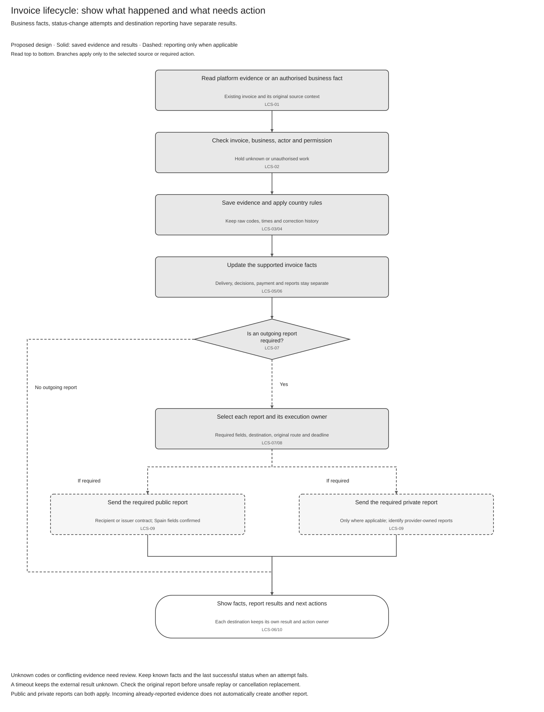

# Invoice Lifecycle Solution Summary

[Logical specification](SPEC-SEI-029-invoice-lifecycle-logical-feature-specification.md) · [API reuse assessment](SPEC-SEI-030-invoice-lifecycle-sequence-and-reuse-assessment.md) · [API examples — 041](api-reference/SPEC-SEI-041-existing-e-invoice-lifecycle-api-reference.md)

**Business stakeholder view.** Read this file for the customer outcomes, scope, main journey and decisions that affect delivery. Engineering starts with the [logical specification](SPEC-SEI-029-invoice-lifecycle-logical-feature-specification.md). This remains a draft proposal; the rules and API examples still require engineering verification.

## Revision overview

This view summarises [SPEC009](../archive/SPEC-SEI-009-invoice-lifecycle-status-solution-specification.md), which stays unchanged in Git. SPEC-SEI-028 is selected for stable Confluence page `923861398`; SPEC-SEI-029, 030 and 041 are companion views. Publication is authorised; all four remain drafts. Existing LCS IDs, country rules and release boundaries remain. Spain API coverage and implementation readiness are open.

## 1 Problem and intended outcomes

Customers need to know what happened to an invoice, which actions are available and who must act next. An invoice update, a customer decision and a report to a platform can each have a different result. The product must make those results understandable.

For example, a buyer can record that an invoice was paid while the report to SPFE fails. Keep the payment fact and show that its report still needs attention. A failed report must not make the invoice appear unpaid. A failed requested status change also retains the earlier successful status. The [detailed scenarios](SPEC-SEI-029-invoice-lifecycle-logical-feature-specification.md#2-scenarios-and-safe-next-actions) define these outcomes and recovery rules. REF-PRODUCT; INT-LCS05.

Assess reuse of the existing invoice-update and history capabilities before adding product calls. Whether those capabilities support each Spain action remains an engineering question.

## 2 Scope and actors

| Situation | Customer or business outcome |
|---|---|
| An invoice update arrives | Show what the update proves, where it came from and when it happened. |
| A buyer, seller or authorised accountant records a decision or payment fact | Save the authorised fact and identify any reports it requires. |
| An action or report fails | Keep earlier successful results; show the outstanding work and who must resolve it. |
| Several platforms need a report | Show each platform's result separately. One success cannot hide another failure. |
| A report needs correction, an update arrives late or the provider changes | Keep the earlier evidence and original route; check uncertain earlier results before repeating work. |
| The product misses an update | Recover the saved history. A separate platform check may be needed for information Sage has not yet received. |

The business or authorised accountant supplies decisions and payment facts. The ERP presents the invoice and available actions. Sage checks permissions, applies the selected country rules and tracks each required report. Support/Operations owns unresolved technical recovery. Detailed responsibilities and contracts remain in the engineering views.

[PRD224's phase table](../../prds/PRD-SEI-224-lifecycle-rejection-payment-reporting.md#phase-and-outcome) owns the product scope: public-platform reporting, external private providers and later Sage private-platform responsibilities. Each phase needs its own release evidence. Optional actions need Product approval. Payment initiation, deciding a commercial dispute and automatically creating a rectifying invoice remain outside this feature.

## 3 End-to-end flow

[Draw.io](../../assets/diagrams/invoice-lifecycle-overview-process.drawio) · [PNG](../../assets/diagrams/invoice-lifecycle-overview-process.png).

Start with an existing invoice and its authorised source context. Save the evidence before applying country rules. An incoming status does not automatically trigger another report. When reporting applies, keep each destination’s result separate. A timeout stays unresolved until the original result is checked.

For issuer cancellation or rectification, use the [SPEC-SEI-022 combined Send / Correct / Cancel overview](../invoice-sending/SPEC-SEI-022-invoice-sending-solution-summary.md#4-end-to-end-workflow). Sending owns cancellation request, response and recovery; [SPEC-SEI-029 proposed states](SPEC-SEI-029-invoice-lifecycle-logical-feature-specification.md#proposed-spain-invoice-states) owns the resulting cancelled state and the rectifying invoice's independent lifecycle. Cancelling an earlier business report remains a separate reporting action.

## 4 Reuse direction and product impact

| Proposed direction | Business impact / what must be confirmed |
|---|---|
| Reuse existing invoice-update and history capabilities | Aim to keep a consistent product interaction. Engineering must confirm that Spain actions, required information and readable results are supported. |
| Keep business facts and report results separate | Customers can see what is true about the invoice and which communications still need attention. |
| Apply Spain rules through the shared platform's supported extension model | Keep a consistent platform while preserving Spain-specific actions, permissions and dates. Other countries retain their own behaviour. |
| Support the eight documented public reporting actions | The proposal covers payment, rejection, collection and non-payment reports and their cancellations. Individual outgoing actions remain subject to enabled scope and engineering verification. |
| Assess existing DTS for message generation | Prefer reuse where suitable. Engineering must demonstrate that the selected build preserves the required Spain information and handles failures safely. |

[SPEC030](SPEC-SEI-030-invoice-lifecycle-sequence-and-reuse-assessment.md#1-reuse-decision-and-product-impact) owns the reuse assessment. [SPEC041](api-reference/SPEC-SEI-041-existing-e-invoice-lifecycle-api-reference.md#2-spain-changes-to-qualify) owns the proposed API changes and examples.

## 5 New Annex II review

The latest supplied business rules add checks before reports are sent: the invoice must be known to SPFE, the reporting party and service must match, required information and dates must be valid, and reports must not repeat or conflict with earlier reports. A report cancellation also needs the invoice references and qualified evidence that the invoice exists and has not been cancelled. These checks add detail to the existing eight actions. SPFE-S27.

The product must preserve the customer's valid decision or payment fact when its report is held or fails. It must show an owned next action. Cancelling a report remains separate from cancelling the invoice.

Three source questions affect when a report can be enabled: which invoice amount the negative-amount check refers to, whether rejection on the invoice issue date is allowed, and how the payment indicators apply. These require clarification; the summary does not select an interpretation. [SPEC029's Annex II rules](SPEC-SEI-029-invoice-lifecycle-logical-feature-specification.md#521-annex-ii-business-rules) owns the exact behaviour. The [evidence review](../../context/RES-SEI-002-spain-public-platform-technical-evidence.md#annex-ii-business-rules-reviewed-23-november-2026) records the source limits.

## 6 Decisions that affect delivery

| Question | Why it matters | Responsible stakeholders |
|---|---|---|
| Which actions and customer groups are enabled in each phase? | Documented or readable information does not automatically make an outgoing action available. | Product and Spain business/compliance owners |
| How should the disputed amount, rejection-date and payment-indicator rules apply? | The affected reports need a confirmed rule before release. | Spain Tax/Compliance and Format, with the AEAT liaison |
| Can the selected platform/API and DTS build support the required actions and information? | Determines implementation work and which scenarios can be released. | Engineering, API and DTS owners |
| Can customers see and recover the exact failed or uncertain report? | Prevents lost reporting work and duplicate actions. | Lifecycle, API and Operations |
| Are business authority, provider responsibilities and applicable dates confirmed? | Determines who may report, which party sends it and when reporting applies. | Identity, Integration, Product and Spain business/compliance owners |

[SPEC030's detailed decisions](SPEC-SEI-030-invoice-lifecycle-sequence-and-reuse-assessment.md#4-source-conflicts-and-qualification-gates) retain the engineering evidence and owners. Business review can agree outcomes and scope; release still requires the relevant source decisions and implementation evidence.

## REF Source references

| Source ID | Original source and version/date | Exact location | Supported claims and limits |
|---|---|---|---|
| REF-BASE | [SPEC-SEI-009](../archive/SPEC-SEI-009-invoice-lifecycle-status-solution-specification.md), updated 20 October 2026 | Parts 1–4; LCS controls and REF | Existing draft design, full provider assessment and preserved IDs; no runtime proof. |
| ARCH-LCS01/02 | [Service/connector overview](../../assets/architecture/b22496cd-5719-45a2-ae1a-27d91f69f11c.png); [detailed status flow](../../assets/architecture/711539a8-ff4e-4723-9181-b21c71f389af.png), reviewed 28 October 2026; original design date/version/approval unrecorded | Shared e-Invoicing Service, provider connectors, status-request and status-update routing | Architecture supports the country-binding reuse assessment. Pack registry, configuration-only delivery and Spain runtime coverage are not established. SPEC030 §3.5 owns detail. |
| REF-PRODUCT | [PRD-SEI-224](../../prds/PRD-SEI-224-lifecycle-rejection-payment-reporting.md), updated 9 November 2026; [PRD-SEI-232](../../prds/PRD-SEI-232-country-lifecycle-status-mapping.md); [PRD-SEI-242](../../prds/PRD-SEI-242-peppol-lifecycle-feedback.md) | Phase table; FR1–23; LS-FR and PEP-FR controls | Canonical product scope in recorded discovery/draft states; not new approval. |
| INT-LCS01–05 | [Supplied guide evidence](<../../context/FR API/Lifecycle/lifecycle-api-guides-evidence-extract.md>), received 22 October 2026, revision unknown | Five named sections | API patterns and supplied transition outcomes; Spain support and build unknown. |
| FR-LIF01 | [Supplied status POST OpenAPI](<../../context/FR API/Lifecycle/update-e-invoice-status.openapi.json>), received 28 October 2026; API `1.0.0` | `LifecycleChange-Document`; request/response schemas and parameters | POST contract and open attributes; no nested Spain validation or deployed-support proof. Detailed analysis is in SPEC041. |
| SPFE-S02 | [Final BOE order](../../context/BOE-A-2026-20587.pdf), published 5 October 2026 | Articles 7–11; Annex II pp. 36–42 | Legal communication, authority and field baseline; not a complete runnable API. |
| SPFE-S22 | [Supplied Annex II](<../../context/Anexo II/A2-Proyecto-OM-FE 21-10-26.pdf>), filename dated 21 October 2026, formal revision unknown | Sections I.1–4 pp. 4–14; II/L1 p. 15 | Technical field snapshot and comparison; does not establish a legal amendment. |
| REF-FIELDS | [Original field ledger](../../assets/regulatory/spain/spfe/field-traceability.json); [comparison note](<../../context/Anexo II/annex-ii-review.md>) | AXII rows; per-message page comparison | Inventory and review evidence. Field bindings and acceptance execution remain unqualified. |
| SPFE-S27 | [Annex II business rules](<../../context/Reglas de negocio ES/ReglasNegocio_AnexoDos.pdf>); version 0.1, 19 November 2026, `Borrador`; supplied 23 November | §1/§2.1 p. 3; §§2.2–2.5 pp. 4–6 | Draft technical checks for report eligibility, fields, dates and cancellation. The final BOE remains legal authority. Amount, rejection-date and indicator questions stay open in SPEC029 and the evidence review. |
