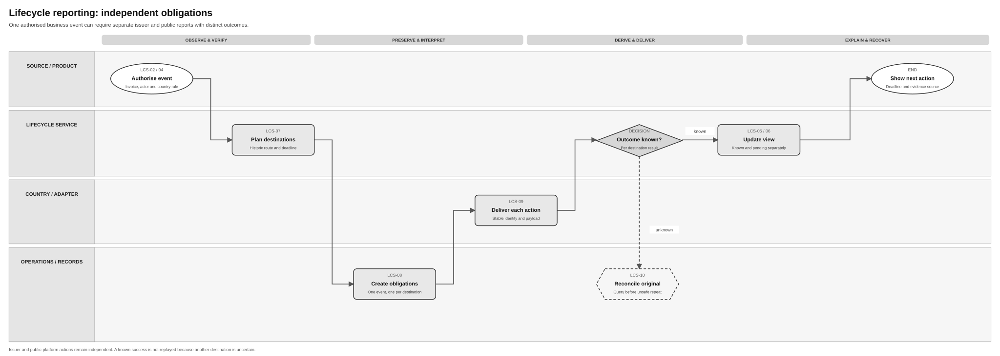

# Invoice Lifecycle Logical Feature Specification

[Solution summary](SPEC-SEI-028-invoice-lifecycle-solution-summary.md) · [API reuse assessment](SPEC-SEI-030-invoice-lifecycle-sequence-and-reuse-assessment.md) · [API examples — 041](api-reference/SPEC-SEI-041-existing-e-invoice-lifecycle-api-reference.md)

## Revision overview

This view preserves [SPEC009](../archive/SPEC-SEI-009-invoice-lifecycle-status-solution-specification.md) and its LCS/SPFE/AXII meanings. LCS-R14 and LCS-A26/27 cover the supplied transition-outcome rule. Release scope, authority, full/partial payment and historical routes are unchanged. These drafts do not enable customer actions.

## 1 Purpose, terms and authority

Show the buyer, seller or authorised accountant the invoice facts, action results and outstanding reports. A **transition attempt** requests a status change. Its result is separate from the invoice’s last successful status and every external report. Use the [glossary](../../context/GLO-SEI-001-e-invoicing-terminology.md). INT-LCS05; REF-PRODUCT.

Before a command or report, check the caller, represented business, actor role and invoice action. Reuse onboarding’s dataset/platform binding and credential references where qualified. A token or connection does not grant business authority. SPFE-S02 Article 11; LCS-R04.

## 2 Scenarios and safe next actions

**Review and take action** continues from **Select and open invoice** in the [SPEC025 presentation overview](../invoice-receiving/SPEC-SEI-025-invoice-retrieval-solution-summary.md#4-end-to-end-workflow). Download is a separate choice. The customer or authorised accountant selects a permitted invoice action in the ERP. The ERP submits the action to the Domain Service using the same business and invoice identity, then shows its attempt result and each communication result separately. [§4.1](#general-status-comparison) owns the SPFE state meanings and draft platform mapping; [SPEC041 §1.2](api-reference/SPEC-SEI-041-existing-e-invoice-lifecycle-api-reference.md#12-documented-status-inputs) owns exact documented command UUIDs and required fields. Apply LCS-R04/12–14 before offering or sending an action. These links do not enable unqualified Spain commands.

| Trigger / actor | Required result / safe alternative | Existing coverage |
|---|---|---|
| Platform supplies evidence | Save source meaning; update only supported facts. Hold unknown/unmatched codes for review. | LCS-01–05; R01–03/09/11; A01/02/11/15 |
| Buyer records acceptance/rejection | Save the authorised decision/date and assess required communications. Missing authority/fields holds the command. Presumed acceptance stays derived. | LCS-02/04/07–09; R04–06/12; A03/05/18 |
| Customer leaves the decision for later | Create no decision or transition. Keep the current status and any existing obligations visible; deferral does not remove an applicable duty. | LCS-R03/06/08/12 |
| Buyer pays; seller records collection | Keep actor, dates, amounts and evidence. Assess full payment and each report separately; partial/bank evidence cannot prove public full payment. | LCS-02–05/07–10; A04/06/20 |
| Product requests a transition | Show its attempt result separately. Failure retains the previous successful status and corrective action. | R14; A26/27 |
| Several destinations require reporting | One owner/result per destination. Keep known successes; check the original uncertain attempt before repeating. | LCS-07–10; R05/06; A08/16/24 |
| Buyer/seller corrects a report | Preserve cancellation/replacement history. Uncertain cancellation blocks replacement; it does not withdraw the invoice. | LCS-03/07–10; SPFE-R03; A12; SPFE-A03 |
| Product misses an event | Read saved history. Query the platform separately for evidence Sage has not received. | R08/11; A10/15/23 |
| Late/conflicting evidence or provider switch | Preserve chronology and original route. Hold unsafe changes; a new route does not rebind old reports. | R07/10; A06/07/09 |
| Optional/provider-specific action requested | Check enabled scope, direction, actor and fields. Keep valid incoming evidence even when its outgoing command is disabled. | R12/13; A19/21/22/25 |

Invoice-submission withdrawal (`CancelInvoice`) belongs to [SPEC-SEI-023 OUT-SPFE-R02](../invoice-sending/SPEC-SEI-023-invoice-sending-logical-feature-specification.md#withdrawal-and-correction-boundaries). Use that rule for the issuer action, its boundary outside Article 10 statuses and its linked-instance safeguards; [SPEC-SEI-024 §2.4](../invoice-sending/SPEC-SEI-024-invoice-sending-sequence-and-reuse-assessment.md#24-proposed-withdrawal-interaction) assesses execution. [FP-SEI-002](../../feature-proposals/FP-SEI-002-global-api-submission-withdrawal.md#analysis-and-proposed-direction) retains the contract and Compliance questions. This lifecycle view owns cancellation of the earlier business report; that action preserves the invoice and business fact.

## 3 Activity order and process support

| Activity | Required result |
|---|---|
| LCS-01 Receive | Scoped platform evidence or an authorised business fact, with source/query/event identity. |
| LCS-02 Verify | Invoice, business, caller, actor, environment and original route checked. |
| LCS-03 Preserve | Raw evidence and duplicate/correction/conflict relationship saved. |
| LCS-04 Interpret | Effective country/provider rules applied; unknown values held with an owner. |
| LCS-05 Derive | Separate views with rule version, evidence age and next action. |
| LCS-06 Publish | Saved view/history readable; notification follows the saved change. |
| LCS-07 Plan obligations | Required destinations, historical actor/channel and deadlines selected. |
| LCS-08 Create obligations | One saved reporting obligation per event, destination and purpose; stable identity through recovery. |
| LCS-09 Deliver | Each attempt/result recorded; no second sender for provider-owned reporting. |
| LCS-10 Reconcile | Original uncertain result or conflict resolved before an unsafe new action. |

[Draw.io](../../assets/diagrams/lifecycle-reporting-reconciliation-process.drawio) · [PNG](../../assets/diagrams/lifecycle-reporting-reconciliation-process.png).

The business fact remains saved while reports complete independently. A known success stays complete when another destination fails. Check an uncertain cancellation before replacement. The [summary](SPEC-SEI-028-invoice-lifecycle-solution-summary.md#3-end-to-end-flow) shows evidence collection; SPEC030 shows proposed calls.

## 4 Functional requirements and invariants

| ID | Required behaviour | Authority |
|---|---|---|
| LCS-R01 | Preserve source code/namespace, actor, times, identity and integrity/version evidence before mapping. | PRD224 FR1–3; PRD232 LS-FR1/14 |
| LCS-R02 | Apply effective country/provider rules; unknown codes cannot advance status. | PRD232 LS-FR2/12/16 |
| LCS-R03 | Keep processing, validation, delivery, commercial, payment and reporting results separately readable; distinguish explicit/derived facts. | PRD224 FR3–4/18 |
| LCS-R04 | Before a command/report, verify actor authority, applicability and required data. | PRD224 FR1/5 |
| LCS-R05 | Select destinations/deadlines using approved rules and the invoice’s historical context. | PRD224 FR6–10 |
| LCS-R06 | Save/deliver each obligation independently; safe repetition cannot add a duplicate effect. | PRD224 FR8/11–13 |
| LCS-R07 | Keep duplicate, late, conflicting and superseding evidence; hold unsafe progression. | PRD224 FR14–17 |
| LCS-R08 | Let authorised callers read views, history, next actions and report results to recover missed notifications. | PRD224 FR18–23; PRD242 PEP-FR9 |
| LCS-R09 | Interpret Peppol transport, MLR, MLS and Invoice Response only in their source namespaces. | PRD242 PEP-FR2–6 |
| LCS-R10 | Keep original route, process and mapping context after provider change. | PRD224 FR9; PRD242 PEP-FR10 |
| LCS-R11 | Separate platform consultation, supported notifications, saved-history reads, file retrieval and reporting. | SPFE-S02 Article 10; PRD242 |
| LCS-R12 | Record mandatory/optional/correction/technical classification and destinations. Separate legal duty, provider support and enabled release. | ES-RD10; SPFE-S02; proposed control |
| LCS-R13 | Qualify provider/version, direction, actor, fields, correction and automatic reports before sending. Keep valid incoming evidence; hold unqualified commands. | PRD224 FR10; proposed control |
| LCS-R14 | Show transition attempts separately. Pending/failed attempts retain the latest successful status; save failure with `operationStatus = ERROR`. Advance only on qualified success. | INT-LCS05; proposed Spain control |

[LCS-I01–09](../archive/SPEC-SEI-009-invoice-lifecycle-status-solution-specification.md#1-identity-dimensions-and-invariants) retain immutable sources, independent results, evidence limits, correction history and separate obligations. Apply business/tenant/environment/delegate checks to reads, writes, subscriptions and support. Protect payment evidence and credentials; monitor stale/unknown facts, deadlines, conflicts and uncertain reports. Targets/retention remain open.

### 4.1 SPFE lifecycle states and draft platform mapping

This section owns the business meanings and reporting classification. Labels describe the documented meaning; they do not create API statuses. [§5.1](#51-destination-and-obligation-rules) owns destination, timing and exception details. [§5.2](#52-public-event-contract) owns exact external codes and fields. Keep technical codes and UUIDs in the [source catalogue](<../../context/FR API/Lifecycle/lifecycle-api-guides-evidence-extract.md#int-lcs03-status-catalogue-and-blocked-transitions>) and [SPEC041 API reference](api-reference/SPEC-SEI-041-existing-e-invoice-lifecycle-api-reference.md#spfe-action-mapping).

#### 4.1.1 SPFE lifecycle states and reporting actions — documented baseline

The table covers all eight reporting actions in the reviewed Annex II, plus presumed acceptance. A cancellation is an action on an earlier communication, not another payment or commercial state. **Mandatory** applies only when the reporting duty is effective for the business and invoice. **Conditional correction** identifies a correction path for an earlier report, not a routine report for every invoice. SPFE-S02 Articles 7–8 and Annex II; ES-RD10 Article 12; SPFE-S22.

| SPFE state or action | Actor / basis | Meaning | Reporting requirement | Source |
|---|---|---|---|---|
| Presumed accepted | Derived view | Acceptance is presumed in the absence of rejection or a later rectifying invoice, under the applicable rule. | No separate acceptance report. Preserve the distinction from explicit buyer approval. | SPFE-S02 Article 7.1 |
| Paid in full | Recipient | Recipient reports full effective payment. | Mandatory when the recipient reporting duty applies; the qualifying prepaid-invoice exception is in §5.1. | SPFE-S02 Articles 7.1/7.4; Annex II I.1 |
| Rejected | Recipient | Recipient reports rejection with the required date and reason. | Mandatory when rejection occurs and the recipient reporting duty applies. | SPFE-S02 Article 7.1; Annex II I.2 |
| Collected in full | Issuer | Issuer reports full collection. | Optional. Customer action requires enabled product scope. | SPFE-S02 Article 7.2; Annex II I.3; LCS-R12/13 |
| Unpaid | Issuer | Issuer reports non-payment. | Optional. Customer action requires enabled product scope. | SPFE-S02 Article 7.2; Annex II I.4; LCS-R12/13 |
| Cancel payment report | Recipient | Retract an earlier payment communication. | Conditional correction action. | SPFE-S02 Article 8.5; Annex II I.1 |
| Cancel rejection report | Recipient | Retract an earlier rejection communication. | Conditional correction action. | SPFE-S02 Article 8.5; Annex II I.2 |
| Cancel collection report | Issuer | Retract an earlier collection communication. | Conditional correction action. | SPFE-S02 Article 8.5; Annex II I.3 |
| Cancel non-payment report | Issuer | Retract an earlier non-payment communication. | Conditional correction action. | SPFE-S02 Article 8.5; Annex II I.4 |

Completeness here concerns the reviewed business-reporting set, not every possible query state, validation error or transport result. Services **07 — CustomerInvoiceEvents** and **08 — SupplierInvoiceEvents** report recipient and issuer actions respectively. Services 03–04 consult invoice information and states; services 05–06 retrieve files; service 09 performs PRE validation. [SPEC011's operation bindings and response matrix](../SPEC-SEI-011-public-platform-connector-solution-specification.md#spfe-source-contract-binding) distinguish their results. Invoice withdrawal remains with [SPEC023 OUT-SPFE-R02](../invoice-sending/SPEC-SEI-023-invoice-sending-logical-feature-specification.md#withdrawal-and-correction-boundaries). SPFE-S03 §§6.4–6.10; SPFE-S02 Articles 3.5/5.5/10.

#### 4.1.2 Draft mapping to existing platform lifecycle

**Draft — not an approved API mapping or evidence of Spain implementation.** Existing platform names and actor meanings come from INT-LCS03/04; the Spain relationships below are proposed analysis. Qualified incoming evidence may be retained even when the matching outgoing action is unavailable. LCS-R13.

Journey use assumes an ordinary seller-issued invoice. Sent and received are relative to the represented business. In self-billing or delegated cases, apply the actual actor role and action authority; invoice direction does not grant authority. Use the [glossary's sending, receiving and invoice roles](../../context/GLO-SEI-001-e-invoicing-terminology.md#sending-receiving-and-invoice-roles). Viewing evidence and performing actions both require qualified support.

| Existing platform status | Who records it | Meaning | Related SPFE state or action / draft assessment | Journey use |
|---|---|---|---|---|
| New | Domain Services | Internal initial status. | No corresponding public reporting action established. | Sent: view processing progress. |
| File Uploaded | Domain Services | Internal file-upload status. | No corresponding public reporting action established. | Sent: view upload progress. |
| Submitted | Seller platform | Invoice submitted to the sending platform. | Invoice submission belongs to Sending; it is not a lifecycle report. | Sent: track submission. |
| Issued by platform | Seller platform | Sending platform has transmitted the invoice. | Preserve delivery evidence; no corresponding public reporting action established. | Sent: track transmission. |
| Received by platform | Buyer platform | Receiving platform has received the invoice. | Platform receipt does not establish buyer acceptance. | Both: view platform-receipt evidence. |
| Made Available | Buyer platform | Invoice made available to the buyer. | Availability does not establish buyer acceptance. | Received: access the invoice. Sent: view availability evidence. |
| In Hand | Buyer | Buyer has taken the invoice for processing. | No corresponding public reporting action established. | Received: record processing. Sent: view response. |
| Approved | Buyer | Buyer explicitly accepts the invoice in full. | Different from presumed acceptance. No explicit public acceptance action is established. | Received: record acceptance. Sent: view response. |
| Partially Approved | Buyer | Buyer accepts part of the invoice. | A private communication needs its own contract; no corresponding public reporting action established. | Received: record partial acceptance. Sent: view response. |
| Disputed | Buyer | Buyer disputes the invoice. | No corresponding public reporting action established. | Received: record dispute. Sent: review response. |
| Suspended | Buyer | Processing waits for missing information. | No corresponding public reporting action established. | Received: record suspension. Sent: review the information request. |
| Completed | Actor unresolved: buyer in catalogue; supplier in explanation | Missing information supplied after suspension. | No corresponding public reporting action established. It does not mean paid or fully reported. Actor qualification remains LIF-G03. | Follow the qualified information-recovery flow. |
| Refused | Buyer | Buyer refuses the invoice for business reasons. | Conditional reuse candidate for recipient rejection; qualify actor, date, reason and required reports. | Received: record refusal. Sent: view response. |
| Payment Sent | Buyer | Payment instruction or transfer flow sent. | Insufficient by itself for paid in full. Qualify full effective payment and required dates before reporting. | Received: record payment progress. Sent: view supplied evidence. |
| Payment Received | Seller | Seller records partial or full collection. | Conditional reuse only for full collection and enabled optional scope. | Sent: record collection. Received: view supplied evidence. |
| Rejected | Platform in catalogue; actor conflict remains open | Platform rejects the invoice on technical grounds. | Must not generate recipient business rejection. | Both: inspect the technical issue and recovery action. |
| Inadmissible | Technical source | Initial flow is technically inadmissible. | No equivalent public reporting action or published Sage status UUID established. | Both: inspect qualified technical evidence. |
| No documented equivalent | Issuer | Non-payment declaration. | New action binding needs qualification. | Sent: report non-payment where enabled. |
| No documented equivalent | Recipient | Cancel an earlier payment report. | New action binding needs qualification. | Received: correct the report. |
| No documented equivalent | Recipient | Cancel an earlier rejection report. | New action binding needs qualification. | Received: correct the report. |
| No documented equivalent | Issuer | Cancel an earlier collection report. | New action binding needs qualification. | Sent: correct the report. |
| No documented equivalent | Issuer | Cancel an earlier non-payment report. | New action binding needs qualification. | Sent: correct the report. |

[SPEC041 §2.1](api-reference/SPEC-SEI-041-existing-e-invoice-lifecycle-api-reference.md#spfe-action-mapping) owns the three conditional reuses, five missing action bindings and exact technical identifiers. The numeric catalogue value is not the UUID accepted by POST `statusCode`.

`operationStatus` describes a transition attempt: `IN_PROGRESS` means underway, `COMPLETED` means successful and `ERROR` means failed. Under LCS-R14, failure retains the latest successful invoice status. Operational `COMPLETED` differs from lifecycle Completed and each external report's result. INT-LCS05; LCS-A26/27.

### 4.2 Blocked transitions

SPFE applicability remains unconfirmed. The API owner must resolve transition and actor conflicts under [LIF-G03](SPEC-SEI-030-invoice-lifecycle-sequence-and-reuse-assessment.md#lif-g03) before applying a transition model.

### 4.3 SPFE reporting-action restrictions

External restrictions and proposed shared controls have separate authority below. §5.2 retains exact action codes and fields.

| Reporting context | Restriction / required behaviour | Authority |
|---|---|---|
| Recipient payment — service 07 | Report full effective payment; partial payments cannot generate this report. | SPFE-S03 §6.8; SPFE-S02 Annex II I.1 |
| Recipient payment or rejection — service 07 | Payment and rejection cannot be active together for the same invoice. | SPFE-S03 §6.8 |
| Correct recipient payment — service 07 | Cancel the earlier payment communication before sending a changed replacement. | SPFE-S03 §6.8 |
| Correct recipient rejection — service 07 | Cancel the earlier rejection communication before sending a changed replacement. | SPFE-S03 §6.8 |
| Issuer collection — service 08 | Report full collection; partial collection cannot generate this report. | SPFE-S03 §6.9; SPFE-S02 Annex II I.3 |
| Issuer collection or non-payment — service 08 | Collection and non-payment cannot be active together for the same invoice. | SPFE-S03 §6.9 |
| Correct issuer collection — service 08 | Cancel the earlier collection communication before sending a changed replacement. | SPFE-S03 §6.9 |
| Cancel issuer non-payment — service 08 | Use the corresponding cancellation to retract the earlier non-payment communication. | SPFE-S02 Article 8.5; Annex II I.4 |
| Recipient and issuer communications | Do not mix recipient and issuer actions in one `ApplicationResponse`. | SPFE-S03 §6.8 |
| Action availability | Check actor authority, required information and enabled scope before reporting. Optional customer actions require Product approval. | Shared controls LCS-R04/12/13 |
| Uncertain cancellation | Reconcile the original attempt before sending its replacement. | Shared controls LCS-R06/07 |
| Any cancellation | Preserve invoice facts and reporting history. Cancelling a report does not withdraw the invoice. | Shared controls LCS-R03/07 |

## 5 Spain rules and Annex II

### 5.1 Destination and obligation rules

The [§4.1.1 baseline](#spfe-lifecycle-states) owns mandatory, optional and correction classifications. This section adds destinations, applicability and exceptions. Duties depend on the invoice, actor and effective customer group. LCS-R12/13; ES-RD10 Articles 10/12; SPFE-S02 Article 7.

| Situation | Destination / applicability | Rule or source |
|---|---|---|
| Recipient decision | Communicate the decision and date to the issuer where the recipient duty applies. Public reporting is assessed separately under §4.1.1. | ES-RD10 Article 10; SPFE-S02 Article 7 |
| Recipient full effective payment | Assess communication to the issuer and the public platform separately, with their applicable dates and exceptions. | ES-RD10 Articles 10/12; SPFE-S02 Article 7 |
| Partial decision/payment or assignment | A permitted optional counterparty communication needs its selected contract and fields. No corresponding public action is established. | ES-RD10 Article 10; LCS-R12/13 |
| Issuer full collection/non-payment | Public reporting uses service 08. A private contract must establish any counterparty communication. | SPFE-S03 §6.9; LCS-R12/13 |
| Correction | The selected private provider's procedure governs its destination. Public corrections follow §4.3. | LCS-R05/06/10; SPFE-S02 Article 8.5 |

The [existing destination table](../archive/SPEC-SEI-009-invoice-lifecycle-status-solution-specification.md#spain-events-mandatory-and-optional-reporting-by-destination) retains exact applicability, separate issuer/public calendars and special correction cases. Optional actions remain disabled until Product approves them.

For the prepaid exception, the invoice or faithful copy must include a payment date before or on the issue date and equal to the operation or tax-point date, as Article 7.4 requires. The exception does not apply when the recipient expressly communicates payment status. Apply the effective customer-group calendar and qualifying public-platform outage procedure retained in the linked destination table. No revised rollout or deadline follows from this reorganisation. SPFE-S02 Articles 7.4/8.4; LCS-SPFE-R04.

### 5.2 Public event contract

Every event references the invoice’s series/number, issue date, seller NIF and seller name. The seller is not automatically the caller or represented reporting actor. `ResponseCode` uses `ApplicationResponse/cac:DocumentResponse/cac:Response/cbc:ResponseCode`. SPFE-S02 Annex II; SPFE-S22.

| Actor / exact code | Required meaning / fields | Source locator |
|---|---|---|
| Recipient `PAYMENT` | Full effective payment; `EffectiveDate` and `DueDate` required. Shipment/receipt dates and correction/negative indicators are conditional. | SPFE-S22 pp. 4–6; SPFE-S03 §6.8 |
| Recipient `CANCELPAYMENT` | Cancel the earlier payment report; retain the payment fact. | SPFE-S22 p. 6; SPFE-S03 §6.8 |
| Recipient `REJECTION` | Rejection date and L1 reason `01` commercial / `02` private consumption required. Apply §4.3's recipient-action restrictions. | SPFE-S22 p. 7/L1 p. 15; SPFE-S03 §6.8 |
| Recipient `CANCELREJECTION` | Cancel earlier rejection; do not manufacture explicit acceptance. | SPFE-S22 p. 8; SPFE-S03 §6.8 |
| Issuer `SETTLEMENT` | Full collection date required; due/financing/shipment/receipt fields conditional. | SPFE-S22 pp. 9–10; SPFE-S03 §6.9 |
| Issuer `CANCELSETTLEMENT` | Cancel the earlier collection report. | SPFE-S22 p. 11; SPFE-S03 §6.9 |
| Issuer `DEFAULT` | `EffectiveDate` means payment due date; shipment/receipt dates conditional. Apply §4.3's issuer-action restrictions. | SPFE-S22 pp. 12–13; SPFE-S03 §6.9 |
| Issuer `CANCELDEFAULT` | Cancel the earlier non-payment report; retain facts/history. | SPFE-S22 p. 14; SPFE-S03 §6.9 |

Cancellation retains the four invoice-reference fields and links to the earlier report. Apply [§4.3's cancellation and recovery rules](#spfe-reporting-action-restrictions). [LCS-SPFE-R01–04/A01–04](../archive/SPEC-SEI-009-invoice-lifecycle-status-solution-specification.md#public-platform-lifecycle-events-and-reporting-requirements) and the [52-row AXII matrix](../archive/SPEC-SEI-009-invoice-lifecycle-status-solution-specification.md#annex-ii-event-field-traceability) retain exact paths, cardinalities and positive/negative checks. The [comparison](<../../context/Anexo II/annex-ii-review.md>) found no material field change; it does not qualify XML generation.

### 5.3 Source limits and country isolation

Literal UBL-path conflicts and optional indicator semantics remain LIF-G04/SPFE-Q16/17 gates. Do not silently repair source paths or map France reason codes to Spain `ConditionCode`. SPFE-S08/S22.

**Source freshness gate:** web review on 13 November 2026 identified catalogue 0.1.5 dated 3 November 2026 and formats 0.1.2 dated 20 October 2026. The registered SPFE-S03/S08 originals remain 0.1.0. Public Platform Integration and Lifecycle owners must preserve and register the newer files, compare affected contracts and rules, and update the evidence register before declaring this specification current. The tables use the reviewed business-reporting baseline; WSDL currency and runtime coverage remain separate qualification questions. REF-SPFE-WEB; [RES-SEI-002 release review](../../context/RES-SEI-002-spain-public-platform-technical-evidence.md#how-to-use-this-context).

Shared behaviour preserves evidence, independent views and safe recovery. Spain rules supply actors, events, fields, duties and calendars. Prefer existing DTS for required ApplicationResponse mapping, subject to build/mapping/operations proof. Another country keeps its own rules; saved history keeps its original versions. LCS-A13/14; LIF-API-A01/04/08.

## 6 Functional acceptance

These are required checks, not executed implementation tests. The [original assurance table](../archive/SPEC-SEI-009-invoice-lifecycle-status-solution-specification.md#part-4-assurance-and-traceability-view) retains detailed traceability.

| Existing checks | Required proof |
|---|---|
| LCS-A01/02/11/22 | Delivery, Peppol codes, unknown/technical/payment-processing states affect only their supported result. |
| LCS-A03/04/05/18 | From an opened invoice, permit qualified decisions without requiring download. Deferral creates no transition or acceptance and leaves obligations visible. Check current action authority; preserve numeric catalogue code versus UUID input and business refusal versus technical rejection. Authorised rejection/full payment; bank-evidence limit; explicit versus presumed acceptance; no invented public acceptance code. |
| LCS-A06/07/12 | Duplicate, conflicting, late and corrected evidence keeps history and holds unsafe progression. |
| LCS-A08/09/24 | Independent reports, timeout recovery, historical routes and provider-owned execution avoid duplicate effects. |
| LCS-A10/15/16/17/23 | Separate source consultation/history; no reporting loops or clearing facts omitted from partial events. |
| LCS-A13/14 | Actual reused build and country rules pass isolated France/Spain checks. |
| LCS-A19/20/21/25 | Optional scope, conditional fields, partial payments, corrected totals, assignment and read/write limits retain owned results. |
| LCS-SPFE-A01–04 | Cover all eight reporting actions and the separate presumed-acceptance view in §4.1.1. Check conditional recipient duties, optional issuer reports and correction-only actions without treating cancellations as invoice states. Retain actors, dates/reasons, uncertain cancellations and rollout/prepaid/outage conditions under §§4.3/5.1/5.2. SPFE-S02/S03/S22. |
| LCS-AXII-* pairs | All 52 field/group occurrences retain valid/applicable and invalid-content checks. REF-FIELDS. |

| Added check | Required result / link |
|---|---|
| LCS-A26 | Pending then failed transition retains the last successful status; history records `operationStatus = ERROR`, correlation and next action. Report failure cannot erase a saved business fact. R03/06/08/14; INT-LCS05. |
| LCS-A27 | Distinguish lifecycle Completed (`209`), operational `COMPLETED`, `ERROR` and an unknown external result. None alone creates payment, acceptance or public admission. R02/03/07/14; INT-LCS03/05. |

## REF Source references

| Source ID | Original source and version/date | Exact locator | Supported claim and limit |
|---|---|---|---|
| REF-BASE / REF-PRODUCT | [SPEC-SEI-009](../archive/SPEC-SEI-009-invoice-lifecycle-status-solution-specification.md), updated 20 October; [PRD224](../../prds/PRD-SEI-224-lifecycle-rejection-payment-reporting.md), [PRD232](../../prds/PRD-SEI-232-country-lifecycle-status-mapping.md), [PRD242](../../prds/PRD-SEI-242-peppol-lifecycle-feedback.md), current repository drafts/discovery | LCS requirements/invariants/acceptance; PRD FR1–23, LS-FR and PEP-FR | Existing product/design baseline and preserved IDs; not approved architecture or runtime evidence. |
| ES-RD10 | [Original RD 238/2026](https://www.boe.es/diario_boe/txt.php?id=BOE-A-2026-7295), published 31 March 2026; source identity retained from baseline | Articles 8.3, 10 and 12 | Recipient/issuer and public duties remain separate; no private API catalogue supplied. |
| SPFE-S02 | [Original final order](../../context/BOE-A-2026-20587.pdf), published 5 October 2026; [official publication](https://www.boe.es/eli/es/o/2026/10/02/hac1028), checked 22 October | Articles 7–11; Annex II pp. 36–42 | Legal duties, authority and event fields; not complete wire contract. |
| SPFE-S03 | [Original catalogue](<../../context/Descripción servicios web/Catálogo de servicios/20261013/CatalogoServicios.pdf>), 0.1.0, 9 October 2026 | §§6.4–6.5 pp. 12–14; §§6.8–6.9 pp. 16–19 | Consultation, exclusivity, full payment/collection and cancellation; no tested integration. |
| SPFE-S08 | [Original formats](<../../context/Descripción servicios web/Formatos entrada y salida/20261013/FormatosEntradaSalida.pdf>), 0.1.0, 9 October, BORRADOR | Response description p. 14; §§5.8–5.9 pp. 14–15 | Missing complete event formats remain a gate. |
| SPFE-S22 | [New supplied Annex II](<../../context/Anexo II/A2-Proyecto-OM-FE 21-10-26.pdf>), filename dated 21 October, formal revision unknown | I.1 pp. 4–6; I.2 pp. 7–8; I.3 pp. 9–11; I.4 pp. 12–14; II/L1 p. 15 | Same reviewed field semantics and codes as baseline; no legal amendment or implementation proof. |
| REF-FIELDS | [Original field ledger](../../assets/regulatory/spain/spfe/field-traceability.json); [new comparison note](<../../context/Anexo II/annex-ii-review.md>) | All AXII traces and their source locators | Row inventory and unchanged source meaning; executable mapping and test results unverified. |
| INT-LCS01–05 | [User-supplied lifecycle evidence](<../../context/FR API/Lifecycle/lifecycle-api-guides-evidence-extract.md>), received 22 October, revision unknown | Named guide sections; especially INT-LCS05 | France documentation and supplied attempt-result rule. Application to Spain is a proposed control; build coverage is unknown. |
| INT-LCS03 | [Original Invoice Statuses guide](https://internaldeveloper.sage.com/domain-services/docs/v1.0.0/solutions/e-invoicing/status-updates/invoice-statuses), user-supplied extract received 29 October 2026; URL version `v1.0.0`, publication date unknown; [retained catalogue evidence](<../../context/FR API/Lifecycle/lifecycle-api-guides-evidence-extract.md#int-lcs03-status-catalogue-and-blocked-transitions>) | Status catalogue: Code, Status, French, Identifier, Set by and Description columns; Blocked Transitions table | Existing source names, actors and meanings support the draft analysis in §4.1.2. Numeric codes and UUIDs remain in source/API references. France source rules do not establish Spain support. Transition conflicts remain LIF-G03; linked matrix not reviewed. |
| INT-LCS04 | [Original Lifecycle Reason Codes guide](https://internaldeveloper.sage.com/domain-services/docs/v1.0.0/solutions/e-invoicing/status-updates/lifecycle-status-fields), user-supplied extract received 29 October 2026; URL version `v1.0.0`, publication date unknown | CDAR-only status codes; Rejected; Deposited / Submitted; Inadmissible | Technical/business distinctions; Inadmissible `501` has no published Sage UUID. French reasons do not establish Spain codes or enabled actions. |
| REF-SPFE-WEB | [Online AEAT catalogue](https://www.agenciatributaria.es/static_files/AEAT_Desarrolladores/EEDD/Facturacion-electronica/CatalogoServicios.pdf), 0.1.5, 3 November 2026; [online formats](https://www.agenciatributaria.es/static_files/AEAT_Desarrolladores/EEDD/Facturacion-electronica/FormatosEntradaSalida.pdf), 0.1.2, 20 October 2026; observed 13 November 2026 | Catalogue cover/revisions, §§6.4–6.10; formats cover/revisions | Newer remote versions identified during the review. Original bytes are not registered or fully compared with SPFE-S03/S08. Records the freshness gate; does not replace the reviewed baseline or qualify runtime behaviour. |
