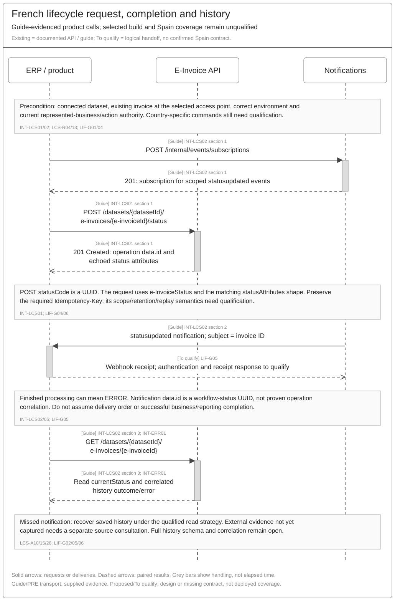
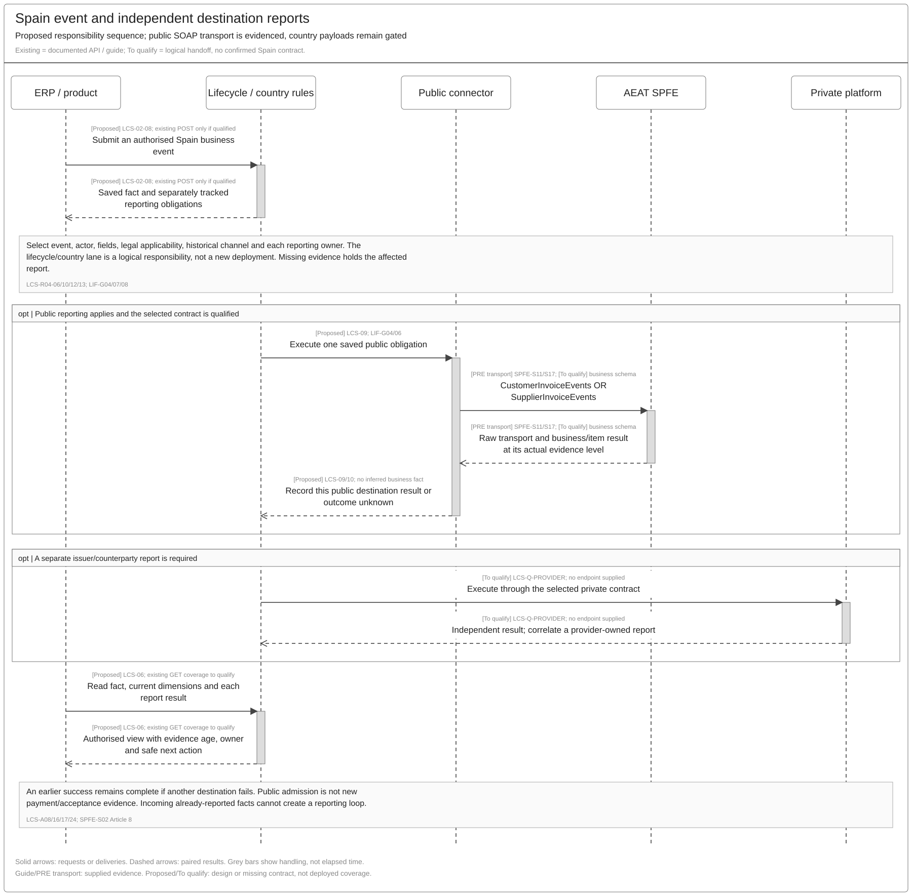
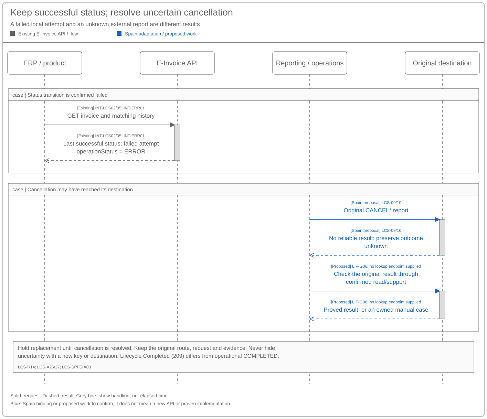

# Invoice Lifecycle Sequence and Reuse Assessment

[Solution summary](SPEC-SEI-028-invoice-lifecycle-solution-summary.md) · [Logical specification](SPEC-SEI-029-invoice-lifecycle-logical-feature-specification.md) · [API examples and Spain changes — 041](api-reference/SPEC-SEI-041-existing-e-invoice-lifecycle-api-reference.md)

## Revision overview

This view assesses reuse against [SPEC009](../archive/SPEC-SEI-009-invoice-lifecycle-status-solution-specification.md), which stays unchanged and remains the Confluence source. It owns sequences, product impact and LIF-G01–08. SPEC041 owns call details, examples and the proposed SPFE API/XML mapping. The binding proposal covers all eight actions and 52 source rows; engineering qualification and implementation readiness remain open. No new endpoint or breaking change is approved.

## 1 Reuse decision and product impact

Assess the existing status POST → notification → invoice GET/history pattern first. Retain it where the selected build supports Spain actors, fields and independent reporting results. FR-LIF01 defines an open `statusAttributes` object; this proves schema flexibility, not processing support for Spain fields. [SPEC029](SPEC-SEI-029-invoice-lifecycle-logical-feature-specification.md) owns required behaviour.

**Recommendation:** reuse the current lifecycle API and assess a **Spain lifecycle country pack with qualified connectors** as the preferred extension model. The architecture separates the shared service and event flow from provider connectors; §3.5 assesses that evidence. The supplied API contract does not establish complete Spain coverage. Check existing country-extension mechanisms before classifying missing coverage as shared API development. Keep business facts, report commands and destination results distinct. SPEC041's `spfe` payload is a candidate country binding, not a confirmed pack interface. ARCH-LCS01/02; FR-LIF01; SPFE-S02/S03.

| Delivery scope | Reuse / Spain work | Product impact / gates |
|---|---|---|
| Public consultation — Phase 1 | Map qualified public evidence to saved invoice views. | Reuse invoice reads if fields suffice; no AEAT webhook is established. LIF-G01/02/05. |
| Private mapping — Phase 2 | Qualify each provider’s status, actor, direction, original route and automatic reports. | Keep common calls where supported; expose separate reporting results. LIF-G02/07. |
| Recipient actions/reporting — Phase 3 | Bind documented SPFE actions/fields to qualified product commands; confirm report ownership and cancellation execution. | Products supply the selected action fields and retain operation/report results. LIF-G04/06. |
| Optional issuer/customer actions | Select enabled scope and qualify collection/default/cancellation. | Read support does not imply a writable command. LIF-G04/08. |
| Shared history and recovery | Correlate exact attempts, notifications and destination results; prove safe replay. | Recover missed events through reads. No confirmed breaking change. LIF-G02/05/06. |

These are PRD224's lifecycle delivery phases; onboarding's platform phases have different meanings. The supplied payment examples use status POST. No separate payment endpoint or revised invoice UBL is established. Spain reporting coverage remains LIF-G04.

Shared evidence/history and recovery are **Reusable unchanged** design patterns; actor/provider selection is **Reusable with country binding**. Spain public events, identity, reasons and calendars are **Country-specific**. Existing API/DTS implementation coverage is **Unknown** until the relevant LIF gates pass. These classifications do not establish production readiness.

## 2 Proposed reuse sequences

Grey: documented existing calls. Blue: proposed Spain work. Red text: unresolved evidence or decisions. Lanes show responsibilities, not approved service boundaries.

### 2.1 Existing request, notification and history read

[Draw.io](../../assets/diagrams/invoice-lifecycle-fr-update-sequence.drawio) · [PNG](../../assets/diagrams/invoice-lifecycle-fr-update-sequence.png).

Save the returned operation ID. The completion event prompts a result read; it cannot prove transition success. A missed event uses qualified history recovery. LIF-G02/05/06.

### 2.2 Spain business event and independent public reporting

[Draw.io](../../assets/diagrams/invoice-lifecycle-spain-reporting-sequence.drawio) · [PNG](../../assets/diagrams/invoice-lifecycle-spain-reporting-sequence.png).

Save the authorised fact, select required destinations and execute each report through its qualified contract. Public and private results stay independent; correlate provider-owned reporting instead of sending it again. Responsibility lanes do not approve new services.

### 2.3 Failed transition and uncertain cancellation

[Draw.io](../../assets/diagrams/invoice-lifecycle-recovery-sequence.drawio) · [PNG](../../assets/diagrams/invoice-lifecycle-recovery-sequence.png).

A failed transition retains the last successful status. A timeout/local error does not prove external rejection or non-execution. Hold replacement while checking the original cancellation; without a qualified lookup, keep an owned manual case. LCS-R14; LIF-G06.

## 3 Contract details that affect reuse

[SPEC041](api-reference/SPEC-SEI-041-existing-e-invoice-lifecycle-api-reference.md) holds request/response examples, status inputs and HTTP errors. The table below assesses their fit to this feature.

| Existing operation / source | Request → result | Reuse / Spain gap |
|---|---|---|
| [LIF-API-01 — Status POST](api-reference/SPEC-SEI-041-existing-e-invoice-lifecycle-api-reference.md#lif-api-01) — FR-LIF01; LCS-R04/13/14 | UUID `statusCode`, selected attributes → `201`, operation `data.id`. | Reuse envelope/attempt pattern. Spain UUIDs, field validation, actors and corrections remain unconfirmed. LIF-G03/04/06. |
| [LIF-API-02 — Subscribe](api-reference/SPEC-SEI-041-existing-e-invoice-lifecycle-api-reference.md#lif-api-02) — INT-LCS02; LCS-R08 | Scoped `einvoice` status-updated subscription. | Qualify service/environment, dataset, webhook security, delivery and replay. LIF-G01/05. |
| [LIF-API-03 — Notification](api-reference/SPEC-SEI-041-existing-e-invoice-lifecycle-api-reference.md#lif-api-03) — INT-LCS02; LCS-R08/14 | Invoice subject and status UUID → prompt a result read. | Finished processing may mean `ERROR`. Prove event-to-operation/history correlation. LIF-G05. |
| [LIF-API-04 — Invoice GET](api-reference/SPEC-SEI-041-existing-e-invoice-lifecycle-api-reference.md#lif-api-04) — INT-LCS02/INT-ERR01; LCS-R03/08/14 | Existing IDs → saved current status and history. | Prove complete/fresh reads and the matching attempt's outcome/error. LIF-G02/05. |
| `GetInvoices` / `GetRegisteredInvoice` — SPFE-S03/S14/S15 | Identity or presentation-date query → public observations. | Separate external discovery from saved-history reads. Qualify fields, scope and continuation. LIF-G01/02. |
| `CustomerInvoiceEvents` — SPFE-S11 | Recipient PAYMENT, REJECTION or cancellation → public result. | Supplied SOAP transport; body/envelope, actor/fields and result correlation still gated. LIF-G04/06. |
| `SupplierInvoiceEvents` — SPFE-S17 | Issuer SETTLEMENT, DEFAULT or cancellation → public result. | Qualify contract and enabled optional scope. LIF-G04/08. |

SOAP operations belong to the public connector boundary in [SPEC011](../SPEC-SEI-011-public-platform-connector-solution-specification.md). Their supplied PRE WSDLs do not prove production support, complete event schemas or batch limits.

### 3.1 Identifiers, payloads and outcome domains

| Meaning that must remain separate | Reuse consequence / gate |
|---|---|
| Business, caller and seller | Reuse saved IDs after current action-authority checks; preserve historical routes. LIF-G01/07. |
| Command UUID and external event code | France numeric `200` identifies three UUIDs. AEAT `PAYMENT` is a separate namespace; no automatic mapping is approved. LIF-G02/04. |
| Event date and processing timestamp | Guide `lifecycleMetadata.statusDateTime`, resource creation and webhook time cannot replace distinct Spain legal dates. LIF-G04. |
| Operation, invoice, status and notification IDs | [041 §1](api-reference/SPEC-SEI-041-existing-e-invoice-lifecycle-api-reference.md#1-existing-calls-and-results) retains their fields. Repeated status UUIDs cannot identify one attempt. LIF-G05. |
| Request acknowledgement, attempt result and destination result | POST `201` does not prove success. Read the matching attempt; expose each report separately. LIF-G02/05. |
| Lifecycle `Completed` and operational `COMPLETED` | The first is France status `209`; the second means processing succeeded. Neither alone proves payment or all reports complete. LCS-A27. |

Detailed LCS-D01–10 and interaction inventories remain in [SPEC009](../archive/SPEC-SEI-009-invoice-lifecycle-status-solution-specification.md#1-interaction-contracts). Qualify existing fields before proposing additions.

### 3.2 Spain field coverage against the French guide

**SPFE definition baseline: available for specification work.** Final Annex II and the supplied supplement define all eight event codes, their actors, 52 field/group occurrences and L1 reasons `01`/`02`. The recorded comparison found no field differences. Catalogue §§6.8–6.9 and both event WSDLs establish the reporting operations and PRE transport. SPFE-S02/S03/S11/S17/S22; REF-FIELDS.

The [SPEC041 mapping](api-reference/SPEC-SEI-041-existing-e-invoice-lifecycle-api-reference.md#spfe-action-mapping) owns the proposed command/field bindings and payloads. [SPEC029 §5.2](SPEC-SEI-029-invoice-lifecycle-logical-feature-specification.md#52-public-event-contract) and the AXII ledger own exact Spain meanings/cardinalities. The WSDLs carry opaque UBL attachments; SPFE-S08 §§5.8–5.9 still mark detailed event formats pending in the supplied snapshot.

| Mapping area | Proposal / product impact | Remaining evidence |
|---|---|---|
| Eight actions | Conditional reuse: PaymentSent → PAYMENT, PaymentReceived → SETTLEMENT, Refused → REJECTION. DEFAULT and four cancellations need registered action bindings. Other workflow statuses create no direct public report. | Confirm action registry, country isolation and enabled scope. LIF-G01/03/04/08. |
| Invoice references | Resolve four fields from saved invoice context for all eight actions; construct four source invoice groups. Products need not re-enter those facts. | Exact stored seller/number/date binding and missing-data recovery. LIF-G04/07. |
| Event-specific content | Proposed `statusAttributes.spfe` inputs cover the remaining 16 occurrences. [The 52-row mapping](../../assets/mappings/spfe-lifecycle-api-mapping.json) retains source conditions and acceptance IDs. | Typed validation, full-payment evidence, indicator/path decisions and actual XML fixtures. LIF-G03/04. |
| Results and correction | Reuse operation/history pattern; expose stable report references for cancellation and separate destination results. | Exact result/read schema, provider-report ownership and safe reconciliation. LIF-G02/05/06/07. |

Spain field meanings come from SPFE-S02 Annex II / SPFE-S22; existing API coverage comes from FR-LIF01 and INT-LCS01. LIF-API-A04/06 verify mapping and report isolation. Source coverage is complete; executable conformance is unqualified.

Assess existing DTS first for ApplicationResponse generation. Qualify its actual build, contract, mappings, rules, country versions and operations. Transformation cannot provide missing event facts or authority. LIF-G04.

**Coverage interpretation:** the 52 source rows are repeated field/group occurrences, not 52 new caller inputs. SPEC041's proposal resolves 32 invoice-reference occurrences from four saved facts, constructs four invoice groups, and maps 16 event-specific occurrences to ten distinct input keys. Its `eventCode` and `originalReportId` are additional proposed controls, outside the source-row count. This is mapping coverage, not proof that the current API supplies those facts or executes the reports. REF-FIELDS; SPEC041 §2.2.

### 3.3 Authentication, retries and completion

Use [041 §1.1](api-reference/SPEC-SEI-041-existing-e-invoice-lifecycle-api-reference.md#lif-api-01) for POST authentication/headers and [§3](api-reference/SPEC-SEI-041-existing-e-invoice-lifecycle-api-reference.md#3-errors-and-safe-follow-up) for HTTP errors. Qualify public certificate authentication/representation separately; product M2M authentication does not establish external credentials or authority. SPFE-S02 Article 11; SPFE-S11/S17.

| Condition | Required handling / gate |
|---|---|
| Repeated command | Keep original identity/content; a changed correction is a linked action. Prove key scope, retention, conflicts and concurrency. LIF-G06. |
| `201` or completion notification | Save/correlate the operation and read the result. Neither proves business/public success. LIF-G05. |
| Confirmed transition `ERROR` | Retain successful status and failed history; expose correction/owner. A report’s external result remains separate. LCS-R14/A26/27. |
| Timeout or uncertain cancellation | Check the original effect before unsafe replay, new key, replacement or route fallback. LIF-G06. |
| `429`, missing event or concurrent changes | Honour `Retry-After`; still apply mutation-safety rules. Read qualified history or consult uncaptured source evidence. LIF-G02/05/06. |

[INT-ERR01](<../../context/FR API/Shared/invoice-flow-error-handling-guide-extract.md>) retains `ERR-SENDING-STATUS-*` actions for mapping, unsupported status, update and notification failures. Platform retries do not authorise product resends. Its code-specific six-day support guidance is not a Spain deadline.

### 3.4 Contract fit and recommendation

The Annex II comparison establishes agreement between the supplied SPFE sources. The WSDLs establish reporting transport. Neither comparison tests the Sage lifecycle API. Assess fit at the boundaries below. SPFE-S02/S03/S08/S11/S17/S22; FR-LIF01.

| Boundary | Finding from supplied evidence | Consequence for reuse |
|---|---|---|
| Status meaning | PaymentSent/PaymentReceived/Refused are candidates for PAYMENT/SETTLEMENT/REJECTION. The guide allows partial PaymentReceived; SPFE SETTLEMENT requires full collection. | No unconditional status-to-report mapping. Require the authorised fact, event-specific conditions and applicable reporting rule. INT-LCS01; SPFE-S03 §§6.8–6.9. |
| Command catalogue | No documented DEFAULT or four cancellation commands; the response enum also lacks these values. | Qualify five action bindings and response compatibility. New UUIDs alone do not establish execution semantics. FR-LIF01. |
| Data contract | Payment examples contain amounts/currency/VAT. Spain needs distinct dates, reasons and conditional indicators. Open JSON attributes have no typed event schema. | Resolve saved facts and add qualified inputs/validation where needed. An accepted JSON shape cannot prove a complete SPFE report. FR-LIF01; SPEC041 §2.2. |
| State and correction | The current API requests a lifecycle transition. SPFE cancellation retracts an earlier communication while retained business evidence remains. | Prove that the action model can represent a report command without replacing the invoice's business facts. If it cannot, assess a contract extension before forcing cancellation into a status. LCS-R03/06/07/14. |
| Completion and recovery | POST `201` identifies an operation; notification/history describes handling. Separate SPFE destination results and original-report lookup are not established. | Correlate operation, business event and each report. Public receipt, failed transmission and cancellation remain independently recoverable. INT-LCS02/05; LIF-G02/05/06. |

For example, an existing PaymentReceived event for a partial collection cannot become SETTLEMENT. A full-collection event may produce SETTLEMENT after actor, dates, optional-scope and reporting checks pass. Later CANCELSETTLEMENT retracts that public communication; it does not state that the money was never collected. LCS-R03/04/12/13; SPFE-S02/S03.

Retaining the current endpoint is reasonable if Engineering demonstrates country-scoped action validation, compatible responses, separate report state and safe correction. If the implementation requires every successful POST to replace one invoice status, that limitation must be resolved first. The API owner must then assess a compatible extension or another command mechanism. This analysis recommends reuse; it does not approve a particular registry, `spfe` namespace, new service or endpoint. LIF-G01–07.

### 3.5 Spain lifecycle country pack and architecture reuse

**Preferred direction:** bind Spain rules and mappings to the shared lifecycle capability, with a qualified SPFE connector. Use the [glossary's country-pack meaning](../../context/GLO-SEI-001-e-invoicing-terminology.md#invoices-representations-and-rules): versioned local rules and resources, selected through a country binding. A country pack is not necessarily a separate service or configuration-only delivery.

| Architecture evidence | What it establishes / limit |
|---|---|
| ARCH-LCS01 — [service and connector overview](../../assets/architecture/b22496cd-5719-45a2-ae1a-27d91f69f11c.png): central e-Invoicing Service/Provider API, Notifications Service, Network Connector, Sovos France PDP Connector and additional connector position. | The design separates common invoice/lifecycle access from connector-specific execution and routes events by access point. It supports assessing Spain through the same extension boundary. It does not identify an implemented country-pack registry or a Spain connector. |
| ARCH-LCS02 — [detailed invoice/status flow](../../assets/architecture/711539a8-ff4e-4723-9181-b21c71f389af.png): `PostStatus`, `eInvoicesTable`, stream/event bus, `InvoiceStatusDeliveryRule`/Handler and `InvoiceStatusNotifierRule`/Handler. | Separate paths publish `e-invoice.statuschangerequested` for work and `e-invoice.statusupdated` after the depicted delivery outcome. This supports reuse of asynchronous request/result handling. It does not establish configurable transition rules, independent destination reports, cancellation semantics or pack-version selection. |

Both images are unversioned supplied architecture evidence. They show design boundaries, not a verified deployment. Their status POST labels omit the invoice path segment present in FR-LIF01. Their `deliveryStatus` labels and internal event names must not replace the guide's `operationStatus` fields or public event contracts without confirmation. ARCH-LCS01/02; FR-LIF01; INT-LCS02/05.

The proposed allocation below keeps the existing architecture as the starting point. Architecture and service owners must confirm the actual extension points before assigning implementation work.

| Scope | Proposed pack/shared split | Qualification / owner |
|---|---|---|
| Shared lifecycle | Reuse invoice/operation identity, status intake, saved history, request/result events and recovery where the build supports them. | Lifecycle/API: prove actual build and separate fact, attempt and report results. Missing generic report-state or recovery behaviour is shared capability work, not hidden Spain configuration. LIF-G01/02/05/06. |
| Spain lifecycle country pack | Eight SPFE action bindings; recipient/issuer authority rules; dates, reasons and indicators; applicability/calendars; reporting destinations; correction/exclusivity rules; versioned validation and mapping resources. SPEC041 owns the proposed action/field mapping. | Architecture, Lifecycle/API and Spain/Compliance: confirm native rule/schema/action registration, trusted country selection, retained rule versions and enabled scope. An access-point ID alone does not establish the country or business authority. LIF-G01/03/04/07/08. |
| SPFE connector | Bind qualified country actions to CustomerInvoiceEvents/SupplierInvoiceEvents, public credentials, SOAP/ebMS transport, source outcomes and reconciliation. Private providers retain their own bindings. | Public Integration/Operations: qualify real operations, errors, correlation and recovery. This may require adapter code; pack rules cannot create missing transport support. LIF-G04/06/07. |
| XML transformation | Supply the pack's Annex II mappings, profile/rules and qualified indicator/path decisions to the selected transformation capability. Assess existing DTS first. | DTS/Format: confirm build, contracts, executable mappings and fixtures; country resources do not prove ApplicationResponse support. LIF-G04. |

First ask Architecture/Lifecycle Engineering to demonstrate one existing country binding: how the build selects it, registers actions/attributes/transitions, invokes the connector and retains its version in history. Then apply the Spain mapping and identify which changes are configuration, country-specific code, connector work or shared enhancements. SPEC041's five missing action bindings may fit an existing catalogue; they do not by themselves prove a new endpoint or core redesign is needed. LIF-G01/04.

Qualification must show that adding/changing the Spain pack leaves France payloads, reason lists, transitions and saved history unchanged. A missing or unsupported binding must hold the affected action. Original invoices/reports retain their qualified country/rule/provider context during retries or later pack updates. Test recipient/issuer separation, report cancellation without erasing facts, and independent report outcomes through the shared request/result path. LCS-R03/07/10/13; LIF-API-A01/06/07/08.

## 4 Source conflicts and qualification gates

This is the authoritative LIF-G01–08 register. Implementation qualification remains open for the affected Spain scope. The documented SPFE baseline in §3.2 is available; these gates concern its integration and execution.

| ID | Gap / required evidence | Owner | Affected outcome |
|---|---|---|---|
| **LIF-G01** | Map ARCH-LCS01/02 to the selected build. Demonstrate an existing country binding and its action/schema/transition registration, connector selection, version retention and country isolation. Confirm access-point mapping and Spain entitlement; reconcile FR-LIF01 `1.0.0` with guide-linked `1.13.0`. | API/Architecture, Integration | Country-pack reuse is preferred; configuration-only support and deployed Spain coverage remain unconfirmed. |
| **LIF-G02** | Exact attempt/history schema, latest-success handling, independent views/reports, concurrency and retained rule versions. | Lifecycle/API | Reads may omit required results or identify the wrong attempt. |
| **LIF-G03** | Resolve guide transition/actor conflicts: Payment Received terminal/nonterminal, Disputed → Refused, Submitted → Rejected, Completed/Rejected actor. Confirm tracing requiredness, nested validation, `Submitted` response-only evidence, response required fields and error-example/schema mismatch in [041](api-reference/SPEC-SEI-041-existing-e-invoice-lifecycle-api-reference.md). Require selected schema/matrix/fixtures. | API owner | Cannot infer writable actions, validation or transition rules from examples. |
| **LIF-G04** | Validate [041's proposed eight-action/52-row mapping](api-reference/SPEC-SEI-041-existing-e-invoice-lifecycle-api-reference.md#spfe-field-mapping) through the selected country-extension model: three conditional UUID reuses, five unassigned action bindings and typed Spain inputs. Reuse native pack/schema mechanisms before selecting the illustrative `spfe` namespace. Confirm XML schema, literal-path/indicator decisions, DTS build/contracts/mappings/rules/operations and cancellation/result fixtures. | Spain, DTS, API, Legal/Tax | Proposal complete; hold commands until binding/execution is qualified. Keep valid incoming facts. |
| **LIF-G05** | Event security/identity, operation/history correlation, replay and complete reads. Resolve `DIS-001`, `SUP-001`, `PA-001` and placeholder `REASON-CODE` against qualified reason lists. | Notifications/API | Events cannot safely establish completion or exact-attempt recovery. |
| **LIF-G06** | Key scope/retention/conflicts, repeat/concurrency rules, original-result lookup, uncertain cancellation and owned manual fallback. | API, Connector, Operations | Unsafe repeats or replacements remain held. |
| **LIF-G07** | Represented business/actor authority, original provider/channel, selected private contract and automatic-report ownership. Retain LCS-Q-PROVIDER. | Identity/Spain, provider owners | A connection/token cannot enable actions or a second report sender. |
| **LIF-G08** | Enabled release/optional actions, legal applicability and calendars. Retain LCS-Q-OPTIONAL and valid incoming optional evidence. | Product/Spain | Readable evidence does not enable an outgoing optional command. |

[Existing provider assessments](../archive/SPEC-SEI-009-invoice-lifecycle-status-solution-specification.md#lifecycle-statuses-and-actions-by-provider) retain B2B Router, Banqup, SERES, EDICOM and ZeroComa evidence limits. No new private contract is established. The [Annex II comparison](<../../context/Anexo II/annex-ii-review.md>) does not close runtime gaps.

## 5 API qualification acceptance

These checks supplement LCS-A01–27; none is claimed as executed implementation testing.

| Check | Required proof / functional link |
|---|---|
| LIF-API-A01 | Demonstrate selected country-pack/binding and version handling. Adding/updating Spain leaves France payloads, codes, reasons, transitions, duties, authority and history unchanged. A missing binding holds work; retries retain original country/rule/provider context. LCS-A13/14; ARCH-LCS01/02; G01/02/04. |
| LIF-API-A02 | POST, events and history correlate the exact attempt despite repeated UUIDs/missed events; pending/failure preserves success. LCS-A10/26; G02/05. |
| LIF-API-A03 | Separate lifecycle Completed, operational COMPLETED, technical Rejected, business Refused and external unknown. Resolve guide/schema conflicts with versioned fixtures; a response enum alone cannot enable a command. LCS-A01/22/27; FR-LIF01; G03/05. |
| LIF-API-A04 | Check every [mapped AXII row](../../assets/mappings/spfe-lifecycle-api-mapping.json) against its existing positive/negative acceptance IDs. Verify actors, distinct dates, string reasons `01`/`02`, conditional indicators, saved invoice references and no SPFE partial-payment amount. Reject action/code mismatch and invalid/missing applicable fields before mutation. LCS-SPFE-A01/02; G04. |
| LIF-API-A05 | Same-key replay, changed content, concurrent commands, timeout and `429` follow qualified safe rules without duplicate effects. LCS-A06–08; G06. |
| LIF-API-A06 | Independent destination results and provider-owned reports avoid duplicates; uncertain cancellation holds replacement. LCS-A08/12/24; SPFE-A03; G04/06. |
| LIF-API-A07 | Wrong client/actor/environment denied; historical invoice reports retain their permitted route without automatic fallback. LCS-A09/15/19; G07. |
| LIF-API-A08 | Record actual build, schema, DTS/rules, positive/negative fixtures and operations owner for enabled scope. Prove missing/invalid Spain fields are rejected before mutation even where FR-LIF01 permits open attributes. Unqualified actions remain held. LCS-A14/25; G01–08. |

## REF Source references

| Source ID | Original source and version/date | Exact locator | Supported claims and limits |
|---|---|---|---|
| REF-BASE | [SPEC-SEI-009](../archive/SPEC-SEI-009-invoice-lifecycle-status-solution-specification.md), updated 20 October 2026; [functional successor view](SPEC-SEI-029-invoice-lifecycle-logical-feature-specification.md), draft 22 October | LCS-INT-01–11; D01–10; provider catalogues; LCS requirements/acceptance | Canonical draft requirements and logical contracts; no physical allocation approval. |
| ARCH-LCS01 | [Supplied service/connector architecture PNG](../../assets/architecture/b22496cd-5719-45a2-ae1a-27d91f69f11c.png), reviewed 28 October 2026; title, author, design date, revision and approval not recorded in the image | Network API → e-Invoicing Service/Provider API; Notifications Service; Network/Sovos/additional connector positions; access-point event routes | Common service and connector design boundary. Supports the country-binding reuse assessment; not proof of a pack loader, Spain implementation or exact current API paths. |
| ARCH-LCS02 | [Supplied detailed flow PNG](../../assets/architecture/711539a8-ff4e-4723-9181-b21c71f389af.png), reviewed 28 October 2026; title, author, design date, revision and approval not recorded in the image | PostStatus → eInvoicesTable/stream/event bus; InvoiceStatusDeliveryRule/Handler; InvoiceStatusNotifierRule/Handler; France connector callbacks | Depicted status-request/result flow and connector separation. Does not prove runtime behaviour, country-pack configuration, per-destination outcomes or schema compatibility. Diagram event/field labels remain source-specific. |
| FR-LIF01 | [Supplied status POST OpenAPI](<../../context/FR API/Lifecycle/update-e-invoice-status.openapi.json>), received 28 October 2026; OpenAPI `3.1.0`, API `1.0.0` | `LifecycleChange-Document`; status POST; request/response schemas, parameters, security and responses | Exact POST schema and nine examples. Open attributes do not establish Spain semantics; no read/event contract or runtime proof. |
| INT-LCS01 | [Supplied send-status guide extract](<../../context/FR API/Lifecycle/lifecycle-api-guides-evidence-extract.md#int-lcs01-send-a-status-update>), received 22 October, revision unknown | §1 request/response, headers and per-status examples; linked API `1.13.0` | Exact product POST and documented payloads; not Spain schema or deployed build evidence. |
| INT-LCS02 | [Supplied receive/history guide extract](<../../context/FR API/Lifecycle/lifecycle-api-guides-evidence-extract.md#int-lcs02-receive-notifications-and-read-history>), same receipt/version limit | §§1–3; linked Notifications `6.3.0`; webhook example; invoice GET | Completion event and history read; full correlation/history contract absent. |
| INT-LCS03/04/05 | [Supplied status, reason and outcome evidence](<../../context/FR API/Lifecycle/lifecycle-api-guides-evidence-extract.md>), same receipt/version limit | Status list; blocked table; status-specific reasons; user transition note | Exact France UUIDs, conflicts and attempt outcomes. Matrix/Schematron not independently verified; no Spain defaults. |
| INT-ERR01 | [Existing supplied FR error-guide extract](<../../context/FR API/Shared/invoice-flow-error-handling-guide-extract.md>), received 22 October 2026; revision/build unknown | Processing and error fields; Processing status change; Recovery interpretation | Exact history/currentStatus/error paths and code-specific actions. No complete correlation contract, Spain error mapping or product-side resend permission. |
| SPFE-S02 | [Final BOE order](../../context/BOE-A-2026-20587.pdf), published 5 October 2026; [official publication](https://www.boe.es/eli/es/o/2026/10/02/hac1028), checked 22 October | Articles 7–11; Annex II pp. 36–42 | Legal/event/authority baseline; not proof of an activated wire contract. |
| SPFE-S03 | [Original catalogue](<../../context/Descripción servicios web/Catálogo de servicios/20261013/CatalogoServicios.pdf>), 0.1.0, 9 October 2026 | §§6.4–6.5 and 6.8–6.9, pp. 12–14 and 16–19 | Query/report names, actor/event meaning, exclusivity and correction; not complete request formats. |
| SPFE-S08 | [Original formats](<../../context/Descripción servicios web/Formatos entrada y salida/20261013/FormatosEntradaSalida.pdf>), 0.1.0, 9 October, BORRADOR | §§5.4–5.5/5.8–5.9, pp. 14–15 | Pending business formats; source-response levels need qualification. |
| SPFE-S11/S17 | [CustomerInvoiceEvents.wsdl](<../../context/WSDL servicios web - PRE_29:10:2026/CustomerInvoiceEvents.wsdl>); [SupplierInvoiceEvents.wsdl](<../../context/WSDL servicios web - PRE_29:10:2026/SupplierInvoiceEvents.wsdl>), PRE release 29 October 2026 | Corresponding operations, SOAP bindings, certificate/seal service ports | Recipient/issuer PRE transport contracts; no production or complete event-body claim. |
| SPFE-S14/S15 | [GetInvoices.wsdl](<../../context/WSDL servicios web - PRE_29:10:2026/GetInvoices.wsdl>); [GetRegisteredInvoice.wsdl](<../../context/WSDL servicios web - PRE_29:10:2026/GetRegisteredInvoice.wsdl>), PRE release 29 October 2026 | Operations and ports; catalogue QUERYBYID/QUERYBYFILTER | Consultation transport; does not prove every required event or recovery lookup is exposed. |
| SPFE-S22 | [Supplied Annex II](<../../context/Anexo II/A2-Proyecto-OM-FE 21-10-26.pdf>), filename dated 21 October, formal revision unknown | I.1–4 pp. 4–14; II/L1 p. 15; [review](<../../context/Anexo II/annex-ii-review.md>) | Source fields, dates, cardinalities and codes; existing path ambiguities remain. |
| REF-FIELDS / REF-DTS | [Original AXII ledger](../../assets/regulatory/spain/spfe/field-traceability.json); [DTS specification](../SPEC-SEI-008-spain-ubl-mapper-migration-to-dts-solution-specification.md); [shared evidence baseline](../../context/RES-SEI-002-spain-public-platform-technical-evidence.md) | AXII rows and SPFE-Q gates; DTS reuse/qualification | Preferred transformation candidate and source inventory; neither proves ApplicationResponse implementation readiness. |
