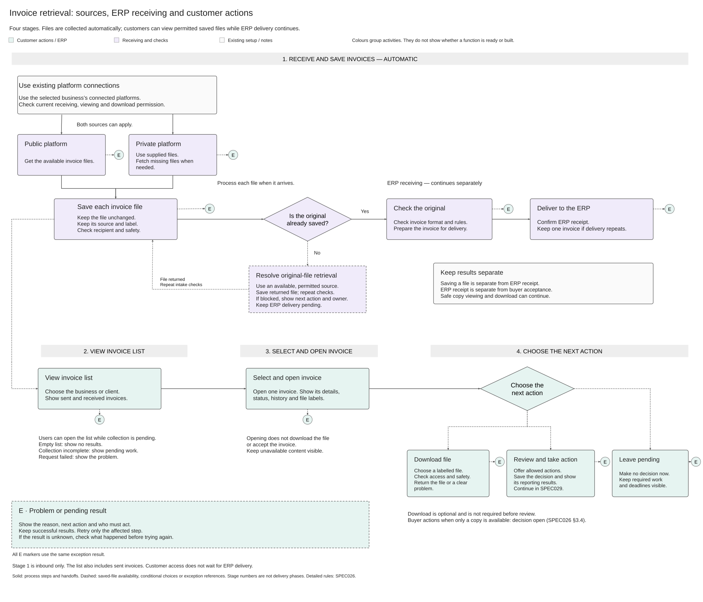

# Invoice Retrieval Solution Summary

[Logical specification](SPEC-SEI-026-invoice-retrieval-logical-feature-specification.md) · [API reuse assessment](SPEC-SEI-027-invoice-retrieval-sequence-and-reuse-assessment.md) · [API calls and Spain changes](api-reference/SPEC-SEI-042-existing-e-invoice-retrieval-api-reference.md) · [Feature folder](README.md)

Confluence views: [Summary](https://confluence.sage.com/pages/viewpage.action?pageId=933331276) · [Required behaviour](https://confluence.sage.com/pages/viewpage.action?pageId=943980648) · [Sequences and reuse](https://confluence.sage.com/pages/viewpage.action?pageId=943980652) · [API reference](https://confluence.sage.com/pages/viewpage.action?pageId=943980662)

## Revision overview

This view summarises [SPEC016](../archive/SPEC-SEI-016-invoice-receiving-retrieval-and-download-solution-specification.md). Its RRI, PRI, RSD and RCV IDs and source-file controls remain unchanged. The 11 November 2026 scope decision requires public/private view and user download, replacing the earlier private-download TBD. SPEC016 stays unchanged. Following publication approval on 2 November 2026, SPEC025 is the selected source for its stable Confluence page; SPEC026, SPEC027 and SPEC042 supply distinct detail views. All retain draft status. Provider support and implementation coverage remain open. REF-SCOPE.

## 1 Purpose and intended outcomes

Customers and authorised accountants need to view the business’s sent and received e-invoices through the ERP and download permitted files. Sage collects incoming files from Spain’s public platform (SPFE) and enabled private platforms. Users need access to safe saved files even when collection, processing or ERP delivery has a problem. REF-PRODUCT; REF-SCOPE.

Assess the existing E-Invoice list, detail, file and records capabilities before adding new ones. Assess existing DTS only for the conversion defined in SPEC026 RCV-06. Documented API calls do not prove that a Spain implementation is available. INT-RCV01.

SPEC026 owns scenarios and required behaviour; SPEC027 owns reuse and engineering gaps; SPEC042 supplies API fields, examples and Spain changes.

## 2 Terms used

[Shared glossary](../../context/GLO-SEI-001-e-invoicing-terminology.md): **view** shows permitted invoice information or a readable representation. **Source-file download** gets a file from a platform. **Stored-file download** returns a saved file to the user. In this summary, *capture* means saving the source file with its source and file role. Viewing, capture, ERP receipt and buyer acceptance have separate results.

## 3 Scope and actors

| Situation | Required outcome |
|---|---|
| SPFE public platform — Phase 1 | **Automatic collection, view and user download required.** Sage must initiate queries and file downloads. The supplied evidence establishes no SPFE webhook or WebSocket interface. [SPEC027 §3.1](SPEC-SEI-027-invoice-retrieval-sequence-and-reuse-assessment.md#31-query-coverage-and-recovery) assesses scheduling and a proposed refresh when an out-of-date list opens. SPFE-S03; REF-PRODUCT; REF-API. |
| External private providers — Phase 2 | **View and user download required.** Confirm each provider’s file intake and saved-file access. If complete files are already supplied, do not fetch them again. REF-SCOPE. |
| Sage private-platform offering — Phase 3 | **View and user download required.** Confirm the shared capabilities, provider contracts and operational support before enabling them. REF-SCOPE. |
| Public faithful copy and private original | Preserve both files. Link them to one business invoice only after their relationship is proved. |
| Customer/accountant views the list, opens an invoice and chooses a next action | Follow the [SPEC026 §2 customer journey](SPEC-SEI-026-invoice-retrieval-logical-feature-specification.md#customer-list-open-and-download). Check current access for each action. Keep original, faithful-copy and derived-file labels clear. |
| Processing, product delivery or collection fails | Keep completed work; show the affected item, next action and owner. |

The customer or authorised accountant selects a business or client. The ERP uses the existing E-Invoice API to request lists, invoice details and file choices from the Domain Service – E-Invoice Service. Separately, the ERP receives eligible incoming invoices and confirms receipt. Source platforms supply files and results. Operations resolves assigned failures. The detailed diagram proposes responsibilities; it does not confirm which components are implemented.

Reuse the business setup and permissions established through [onboarding](../onboarding-and-connectivity/SPEC-SEI-038-customer-onboarding-and-connectivity-logical-feature-specification.md#4-feature-wide-functional-requirements-and-rules). Missing or unclear setup keeps the affected work pending. RRI-Q02 and RET-G10 require evidence of provider support before rollout. ZIP export, sending and invoice lifecycle actions retain their separate scope.

## 4 End-to-end workflow

[Four-stage summary — Draw.io](../../assets/diagrams/invoice-retrieval-summary-process.drawio) · [PNG](../../assets/diagrams/invoice-retrieval-summary-process.png).

Stage 1 collects and saves incoming files automatically. Public and private sources can both apply; each file continues when it arrives. Stages 2–4 let the user view the list, open one invoice and choose a next action. The list covers sent and received invoices. Stage numbers describe the journey, not delivery Phases 1–3. [SPEC026 §2](SPEC-SEI-026-invoice-retrieval-logical-feature-specification.md#retrieval-setup-context) defines the existing setup and permission checks.

If the original is not already saved, **Resolve original-file retrieval** follows the [SPEC026 source decision](SPEC-SEI-026-invoice-retrieval-logical-feature-specification.md#original-file-retrieval). Check each returned file before continuing. If retrieval is blocked, show the reason, next action and owner. ERP delivery stays pending until an original passes the required checks. Safe, permitted faithful-copy viewing and download can continue. REF-COPY-POLICY.

Users can open the list while collection or ERP delivery is pending. The dashed path shows that saved files are available; it is not a trigger for opening the list. At **Choose the next action**, the user can choose **Download file**, **Review and take action**, or leave the decision pending. Download is optional. [SPEC029](../invoice-lifecycle/SPEC-SEI-029-invoice-lifecycle-logical-feature-specification.md#review-and-take-action) defines allowed decisions and reports. Which buyer actions are allowed when only a copy is available remains [open in SPEC026](SPEC-SEI-026-invoice-retrieval-logical-feature-specification.md#copy-only-actions).

The [SPEC026 detailed process](SPEC-SEI-026-invoice-retrieval-logical-feature-specification.md#retrieval-detailed-process) shows handoffs, checks and recovery. **E** marks a shared problem or pending result. [SPEC027](SPEC-SEI-027-invoice-retrieval-sequence-and-reuse-assessment.md#24-required-view-and-user-download) describes the API sequence; [SPEC042](api-reference/SPEC-SEI-042-existing-e-invoice-retrieval-api-reference.md#document-types-and-status-values) defines exact document types and status codes.

## 5 Reuse direction and Spain boundaries

| Existing capability / pattern | Spain work to confirm |
|---|---|
| E-Invoice list/detail and file download; optional notifications | Confirm public/private support, identity, file roles and recovery after missed events. The guide documents operations; Spain implementation coverage remains unknown. |
| Shared capture, duplicate handling and records access | Test the selected build for current permissions, integrity, retention and recovery. |
| Existing DTS — Phase 3 format conversion only | Follow [SPEC026 RCV-06](SPEC-SEI-026-invoice-retrieval-logical-feature-specification.md#32-receiving-handoff). Test the supported non-UBL 2.5 input, UBL 2.5 output, tax/extension fields and recovery. Existing sending support does not prove this conversion. REF-DTS-SCOPE. |
| Spain public collection | Confirm the discovery/download contracts, recipient authority and UBL profile. Keep Spain rules separate from shared behaviour. SPFE-S02/S03/S08. |

## 6 Material decisions and dependencies

| Decision | Evidence / owner |
|---|---|
| Setup mapping and enabled access — RRI-Q01/02; RET-G01/06 | Architecture, API, Identity and Tax/Connections: resolve how the business/NIF, certificate, datasets and platform connections relate under [RET-G01](SPEC-SEI-027-invoice-retrieval-sequence-and-reuse-assessment.md#ret-g01) and onboarding GAP-01/02/06. Product/Compliance and Integration confirm permitted sources and the public contract. |
| Complete collection — RSD-G01/06/07; RET-G03 | Architecture, API and Operations, with Product: decide the collection schedule, how current the list must be, API limits, proposed list-open refresh, page boundaries and gap recovery. |
| Correct files and mapping — RET-G04/07 | Records, Security and Format: source, safety and invoice meaning. DTS joins only for the conversion defined in RCV-06. |
| Saved access and ERP receipt — RET-G05/09 | Records and Product: prove historical access, retention/holds, delivery identity and receipt. |
| Private user download — RRI-Q02; RET-G10 | Records, API and provider integration, with Product/Compliance: prove private saved-file access, roles, permissions and recovery before enabling it. Required scope is settled in SPEC026 §1. |
| Copy-only access — selected; recovery and buyer actions remain open | Product aligns the canonical PRD with REF-COPY-POLICY. Integration/Identity decide public recovery triggers; Receiving/Records prove how a later original is matched. Product/Compliance and Lifecycle must decide [copy-only action eligibility](SPEC-SEI-026-invoice-retrieval-logical-feature-specification.md#copy-only-actions). See [SPEC026 §3.4](SPEC-SEI-026-invoice-retrieval-logical-feature-specification.md#34-process-review-proposal). |

SPEC027 records the full evidence gates and owners. Existing query windows, temporary links and optional renderings do not set Spain retention or release scope. Newer SPFE catalogue and formats files still need registration and comparison; see the [source freshness gate in SPEC029 §5.3](../invoice-lifecycle/SPEC-SEI-029-invoice-lifecycle-logical-feature-specification.md#53-source-limits-and-country-isolation).

## 7 Completion and assurance

Collection progress is complete only when each covered item has a saved source file and receiving classification, or an approved reason to ignore it. Processing, ERP receipt and source acknowledgement remain separate. PRD211 also requires evidence that invoices are available to users and that collection is up to date. RSD-05/06; RCV-07; REF-PRODUCT.

Use [SPEC026 recovery](SPEC-SEI-026-invoice-retrieval-logical-feature-specification.md#33-failure-and-recovery-decisions) and acceptance for failure coverage. Readiness requires tested contracts, a working build, mappings and operational evidence. This document review does not establish readiness.

## REF Source references

| REF ID | Source and version/date | Exact location | Supported claim and limit |
|---|---|---|---|
| REF-SCOPE | [SPEC026 scope and customer journey](SPEC-SEI-026-invoice-retrieval-logical-feature-specification.md#customer-list-open-and-download), user direction, 11 and 13 November 2026 | §§1–2; REF-SCOPE | Public/private view and user download required. Customer sent/received list → selected invoice → optional file download through the ERP and Domain Service. Product direction, not a legal or implementation claim. |
| REF-DTS-SCOPE | [SPEC026 RCV-06](SPEC-SEI-026-invoice-retrieval-logical-feature-specification.md#32-receiving-handoff), user direction, 13 November 2026 | Conversion scope and acceptance; REF-DTS-SCOPE | Phase 3 conversion of received formats other than UBL 2.5. Product decision; actual input/output mapping and build remain unqualified. |
| REF-COPY-POLICY | [SPEC026 selected copy-only policy](SPEC-SEI-026-invoice-retrieval-logical-feature-specification.md#34-process-review-proposal), user direction, 13 November 2026 | Selected policy and acceptance coverage; REF-COPY-POLICY | Authorised faithful-copy view/download can proceed; ERP delivery stays pending until the original is available and passes required checks. Product decision; recovery triggers and implementation qualification remain open. |
| REF-BASE | [SPEC-SEI-016](../archive/SPEC-SEI-016-invoice-receiving-retrieval-and-download-solution-specification.md), updated 20 October 2026 | Parts 1–4; RRI/PRI/RSD/RCV controls and REF | Combined draft baseline and existing IDs; not implementation evidence. |
| REF-PRODUCT | [PRD-SEI-211](../../prds/PRD-SEI-211-public-platform-invoice-consultation-structured-review.md), updated 20 October 2026; [PRD-SEI-223](../../prds/PRD-SEI-223-interoperability-routing-transformation.md), updated 7 October 2026; [PRD-SEI-213](../../prds/PRD-SEI-213-private-platform-connectivity-structured-review.md) | PRD211 Phase 1, retrieval/download boundary, FR1–55; PRD223 receiving FR17–20 and DTS FR43–44; private capability boundaries | Canonical product sources with their recorded draft/discovery status. Does not approve added release scope. |
| INT-RCV01 | [Supplied FR receiving guide extract](<../../context/FR API/Receiving/receive-e-invoice-guide-extract.md>), received 22 October 2026; revision unknown | Sections 1–4; Polling, formats, and extracted data | Documented guide flow and limits; schema, build and Spain coverage unverified. |
| SPFE-S02 | [Final Order HAC/1028/2026](../../context/BOE-A-2026-20587.pdf), published 5 October 2026 | Articles 3(4), 4(1)–(3), 5(2)/(5), PDF pp. 6–8; Articles 9–11, pp. 9–11 | Original/faithful-copy distinction, public exchange and copy duties; recovery, conservation access and representation. No private-provider API contract or implementation proof. |
| SPFE-S03 | [Original catalogue](<../../context/Descripción servicios web/Catálogo de servicios/20261013/CatalogoServicios.pdf>), 0.1.0, 9 October 2026 | Sections 6.4–6.7, pp. 12–15 | Public discovery, queries and downloads are distinct operations; incomplete wire semantics remain open. |
| SPFE-S08 | [Original formats](<../../context/Descripción servicios web/Formatos entrada y salida/20261013/FormatosEntradaSalida.pdf>), 0.1.0, 9 October 2026, BORRADOR | Section 5.1.1 p. 8; sections 5.4–5.7 pp. 14–15 | Supplied UBL 2.5 selection; query/download formats pending. Not a full activated profile. |
| REF-API | [SPEC027](SPEC-SEI-027-invoice-retrieval-sequence-and-reuse-assessment.md#ref-source-references) and [SPEC042](api-reference/SPEC-SEI-042-existing-e-invoice-retrieval-api-reference.md#ref-source-references), drafts, updated 13 November 2026 | Operation sources, request/response examples, local changes and qualification gates | Engineering analysis and original-contract links. Proposed controls have separate authority from external sources. |
