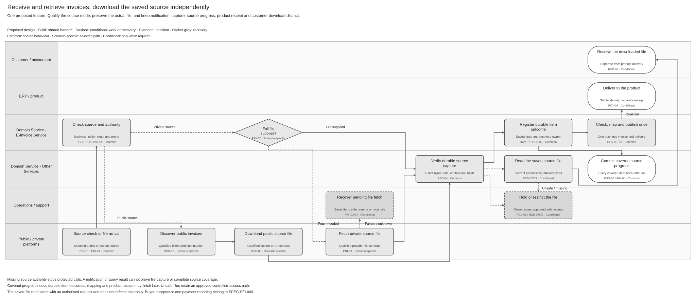

# Invoice Retrieval Solution Summary

[Logical Feature Specification](SPEC-SEI-026-invoice-retrieval-logical-feature-specification.md) · [Sequence and Reuse Assessment](SPEC-SEI-027-invoice-retrieval-sequence-and-reuse-assessment.md) · [Feature landing page](README.md)

## Revision overview

This separate overview develops [SPEC-SEI-016](../archive/SPEC-SEI-016-invoice-receiving-retrieval-and-download-solution-specification.md) into the same three reading views as onboarding and sending. It adds the supplied FR receiving guide to the reuse assessment. The predecessor stays unchanged, including its receiving, private-intake, retrieval and records controls.

Retrieval is the focus within the combined receiving feature. Existing RRI, PRI, RSD and RCV IDs retain their meanings. Public Phase 1 scope, separate file roles, current action authority and safe recovery remain unchanged. Provider rollout, complete query coverage, Spain contract details and implementation fitness remain open. These companions are unpublished drafts; SPEC-SEI-016 remains the selected source for Confluence page `933331276`.

## 1 Purpose and intended outcomes

Help a Spanish business obtain invoices addressed to it, retain their exact source files and make them available to the correct product and authorised users. A direct customer or accountant must see what was found, what was captured, what needs attention and who must act next. Missing notifications and downstream failures must not silently lose invoices. REF-PRODUCT; REF-BASE.

**Audience: local Product teams, directors and cross-functional stakeholders.** Use this page for outcomes and decisions. SPEC-SEI-026 owns functional scenarios and checks; SPEC-SEI-027 assesses API sequences, country differences and engineering evidence.

## 2 Terms used

Use the [shared glossary](../../context/GLO-SEI-001-e-invoicing-terminology.md). Discovery identifies a candidate. Retrieval obtains its actual file. Verified capture means the file and its identifying evidence are saved consistently. A stored-file download returns already captured bytes to a currently authorised actor.

Source capture, product availability, product receipt, technical acknowledgement, internal invoice approval and buyer acceptance are separate outcomes. A file can be safely accessible while mapping or product delivery needs repair. RRI-R02/06; RCV-I10/14.

## 3 Scope and actors

| Situation | Intended outcome and boundary |
|---|---|
| Spain public-platform collection | Automated discovery and separate file recovery for the eligible recipient. Login or refresh can accelerate collection; they are not the completeness mechanism. SPFE-S02 Articles 9–11; RSD-R01/02. |
| Private-provider notification or polling | Download the required invoice file through the selected qualified provider contract. A notification, metadata response or file link alone is insufficient. PRI-03; RRI-A02/03. |
| Private provider supplies complete bytes | Capture once and enter the same receiving controls. Downstream delay is not a reason to fetch again. RRI-A01. |
| Customer or accountant downloads a saved file from a public or private source | Return the permitted, labelled file under current authority, safety and records policy. After verified capture, this read does not fetch the file from the platform again. RRI-R06. |
| Public copy and private original both arrive | Preserve both sources and qualify one business-invoice relationship. Do not create two product invoices. RCV-04; RSD-A05. |
| Accountant works across clients | Keep authority, progress, files and results separate for each client. No portfolio membership implies permission. RCV-I13/16. |

PRD-SEI-211 Phase 1 covers public retrieval. The combined design also assesses private intake; it does not add private collection to that release. Product selects enabled modes under RRI-Q02. ZIP export remains outside the initial scope under RSD-G09. Sending, public-copy submission, buyer decisions and payment reporting retain their owning features.

| Party | Outcome or handoff |
|---|---|
| Business or authorised accountant | Request an allowed refresh or download; provide a missing purpose-specific decision. |
| ERP / product | Integrate notifications and reads where supported; show separate file, processing and next-action results. |
| E-Invoice Service | Coordinate collection, receiving and recovery using the selected source context. This is a logical responsibility, not a new deployment decision. |
| Identity, connections, trust, records and transformation owners | Supply qualified authority, source access, safe capture, file access and selected inbound mapping. |
| Public connector or private provider | Execute the qualified source contract and return scoped evidence. |
| Operations / support | Resolve assigned gaps, conflicts and integrity incidents with an evidenced safe next action. |

## 4 End-to-end workflow

[Editable Draw.io](../../assets/diagrams/receiving-retrieval-and-download-intake-process.drawio) · [PNG](../../assets/diagrams/receiving-retrieval-and-download-intake-process.png).

The existing overview joins public recovery and private intake at verified source capture. It separates authorised stored-file access from receiving and product delivery. A failed file fetch keeps the item incomplete. Later processing failure preserves captured evidence and its permitted access. SPEC-SEI-026 gives the activity order, exceptions and recovery checks.

## 5 Reuse direction and Spain boundaries

Assess the existing FR subscription, list, detail and attachment-download APIs before proposing another product interface. The guide supplies a reuse candidate, not evidence of Spain deployment. The engineering assessment identifies changes and gates without asserting a breaking API change. INT-RCV01; REF-API.

| Classification | Intended use and qualification |
|---|---|
| Reusable design patterns | Scoped collection, verified capture, independent progress, duplicate handling and recovery. Source code coverage remains unknown. |
| Shared capability needing country/provider rules | Existing APIs, identity/route binding, records access, trust and inbound mapping. Qualify the actual build, contracts, local changes and run owner. |
| Spain-specific | Public discovery/download operations, registered representation, NIF/business identity, original/copy rules and public UBL profile. Do not make these defaults for another country. SPFE-S02/S03/S08. |
| Preferred transformation candidate | Existing DTS, where inbound mapping is required. Outbound generation and France UBL support do not qualify Spain inbound mapping. RRI-R05; RCV-Q09. |

The FR guide states 20 results per page, a 90-day creation query window, short-lived attachment links and a separate optional Factur-X representation request. These facts affect missed-event recovery and file handling; they are not Spain public limits or retention rules. INT-RCV01 sections 3.1–4 and Polling.

## 6 Material decisions and dependencies

| Decision / existing gate | Consequence and accountable roles |
|---|---|
| Enabled modes and entry points — RRI-Q01/02 | Product and Integration must select public/private cohorts and qualify what refresh, query and download mean. A private guide cannot establish AEAT notifications. |
| Query completeness and recovery — RSD-G01/06/07 | Public connector, API and Operations must prove page boundaries, saved progress and gap recovery. The FR 90-day list cannot establish all-history recovery. |
| Source files and inbound mapping — RSD-G05/08; RCV-Q03/09 | Format, DTS and Security owners must qualify exact source roles, Spain profile and mapping coverage. A derived PDF or transformed UBL cannot stand in for missing original bytes. |
| Authority and historical access — RSD-G02/04; RCV-Q06/12 | Identity, Spain Compliance and Records must qualify each action and historical access. A valid token, certificate or client relationship alone is insufficient. |
| Product receipt and acknowledgement — RCV-Q05/07/08 | Product, Integration and Architecture must prove the receiving-to-product result and each source response's meaning. Event publication does not prove product consumption. |

## 7 Completion and assurance

A collection boundary is complete only when all covered items have the required durable source and classification, or an approved ignore outcome. Final mapping and ERP receipt are separately tracked. Overall consultation still requires evidenced product distribution and freshness under PRD-SEI-211; checkpoint completion alone does not prove that outcome. REF-PRODUCT; RSD-05/06; RCV-07.

The [failure and recovery table](SPEC-SEI-026-invoice-retrieval-logical-feature-specification.md#33-failure-and-recovery-decisions) identifies safe actions, owners and resume evidence. SPEC-SEI-026 retains functional acceptance and SPEC-SEI-027 adds API qualification evidence. Provider error meanings, partial-file recovery, retry limits and operational closure still need qualification; these documents do not claim that implementation tests have passed.

## REF Source references

| REF ID | Source and version/date | Exact location | Supported claim and limit |
|---|---|---|---|
| REF-BASE | [SPEC-SEI-016](../archive/SPEC-SEI-016-invoice-receiving-retrieval-and-download-solution-specification.md), updated 20 October 2026 | Parts 1–4; RRI/PRI/RSD/RCV controls and REF | Combined draft baseline and existing IDs; not implementation evidence. |
| REF-PRODUCT | [PRD-SEI-211](../../prds/PRD-SEI-211-public-platform-invoice-consultation-structured-review.md), updated 20 October 2026; [PRD-SEI-223](../../prds/PRD-SEI-223-interoperability-routing-transformation.md), updated 7 October 2026; [PRD-SEI-213](../../prds/PRD-SEI-213-private-platform-connectivity-structured-review.md) | PRD211 Phase 1, retrieval/download boundary, FR1–55; PRD223 receiving FR17–20 and DTS FR43–44; private capability boundaries | Canonical product sources with their recorded draft/discovery status. Does not approve added release scope. |
| INT-RCV01 | [Supplied FR receiving guide extract](<../../context/FR API/Receiving/receive-e-invoice-guide-extract.md>), received 22 October 2026; revision unknown | Sections 1–4; Polling, formats, and extracted data | Documented guide flow and limits; schema, build and Spain coverage unverified. |
| SPFE-S02 | [Final Order HAC/1028/2026](../../context/BOE-A-2026-20587.pdf), published 5 October 2026 | Articles 9–11, PDF pp. 9–11 | Recovery, conservation access and representation within the order's scope; no numeric Sage service objective or private API contract. |
| SPFE-S03 | [Original catalogue](<../../context/Descripción servicios web/Catálogo de servicios/20261013/CatalogoServicios.pdf>), 0.1.0, 9 October 2026 | Sections 6.4–6.7, pp. 12–15 | Public discovery, queries and downloads are distinct operations; incomplete wire semantics remain open. |
| SPFE-S08 | [Original formats](<../../context/Descripción servicios web/Formatos entrada y salida/20261013/FormatosEntradaSalida.pdf>), 0.1.0, 9 October 2026, BORRADOR | Section 5.1.1 p. 8; sections 5.4–5.7 pp. 14–15 | Supplied UBL 2.5 selection; query/download formats pending. Not a full activated profile. |
| REF-API | [SPEC-SEI-027](SPEC-SEI-027-invoice-retrieval-sequence-and-reuse-assessment.md#ref-source-references), draft 22 October 2026 | Operation sources, local changes and qualification gates | Engineering analysis and original-contract links. Proposed controls have separate authority from external sources. |
