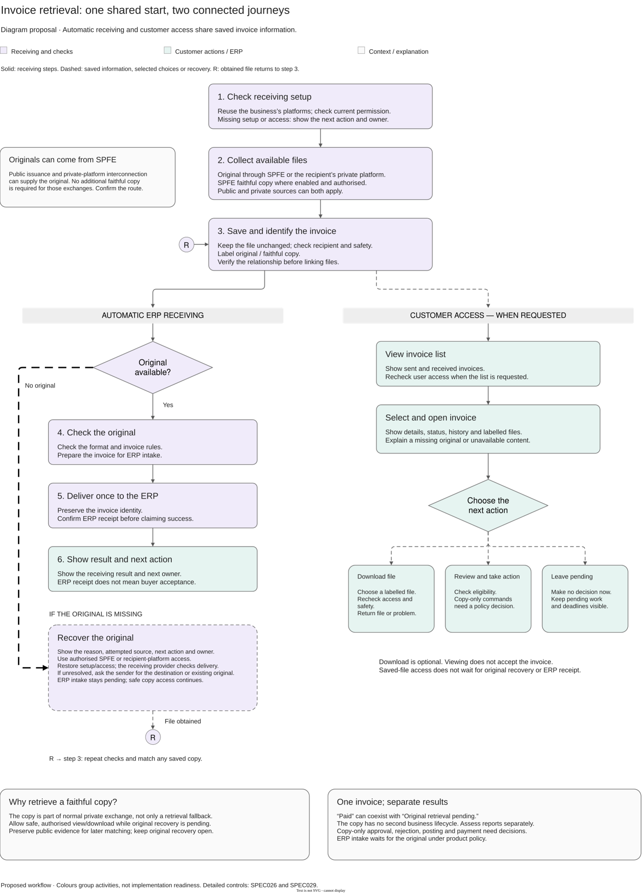

# Invoice Retrieval Solution Summary

[Logical specification](SPEC-SEI-026-invoice-retrieval-logical-feature-specification.md) · [API reuse assessment](SPEC-SEI-027-invoice-retrieval-sequence-and-reuse-assessment.md) · [API calls and Spain changes](api-reference/SPEC-SEI-042-existing-e-invoice-retrieval-api-reference.md) · [Feature folder](README.md)

Confluence views: [Summary](https://confluence.sage.com/pages/viewpage.action?pageId=933331276) · [Required behaviour](https://confluence.sage.com/pages/viewpage.action?pageId=943980648) · [Sequences and reuse](https://confluence.sage.com/pages/viewpage.action?pageId=943980652) · [API reference](https://confluence.sage.com/pages/viewpage.action?pageId=943980662)

## Revision overview

This view summarises [SPEC016](../archive/SPEC-SEI-016-invoice-receiving-retrieval-and-download-solution-specification.md). Its RRI, PRI, RSD and RCV IDs and source-file controls remain unchanged. The 11 November 2026 scope decision requires public/private view and user download, replacing the earlier private-download TBD. SPEC016 stays unchanged. Following publication approval on 2 November 2026, SPEC025 is the selected source for its stable Confluence page; SPEC026, SPEC027 and SPEC042 supply distinct detail views. All retain draft status. Provider support and implementation coverage remain open. REF-SCOPE.

## 1 Purpose and intended outcomes

Customers and authorised accountants need to view the business’s sent and received e-invoices through the ERP and download permitted files. Sage collects incoming files from Spain’s public platform (SPFE) and enabled private platforms. Users need access to safe saved files even when collection, processing or ERP delivery has a problem. REF-PRODUCT; REF-SCOPE.

Assess the existing E-Invoice list, detail, file and records capabilities before adding new ones. Assess existing DTS only for the conversion defined in SPEC026 RCV-06. Documented API calls do not prove that a Spain implementation is available. INT-RCV01.

SPEC026 owns scenarios and required behaviour; SPEC027 owns reuse and engineering gaps; SPEC042 supplies API fields, examples and Spain changes.

## 2 Terms used

[Shared glossary](../../context/GLO-SEI-001-e-invoicing-terminology.md): **view** shows permitted invoice information or a readable representation. **Source-file download** gets a file from a platform. **Stored-file download** returns a saved file to the user. In this summary, *capture* means saving the source file with its source and file role. Viewing, capture, ERP receipt and buyer acceptance have separate results.

**Original, faithful copy and invoice status**

The **original** is the invoice issued or exchanged with the recipient. A **faithful copy** is the separately marked UBL representation sent to SPFE when the invoice is exchanged outside SPFE. It contains information derived from an already-issued invoice. It is not a draft awaiting a final version, and it remains a faithful copy after the original becomes available. The original may use another permitted format. REF-AEAT-COPY; [SPEC026 Spain file roles](SPEC-SEI-026-invoice-retrieval-logical-feature-specification.md#spain-original-and-faithful-copy-scenarios).

SPFE can supply an original or a faithful copy. When SPFE handles issuance or interconnection, no additional faithful copy is required. Check the file role and exchange evidence; the platform name alone does not establish the role. SPFE-S02 Articles 3(4), 4; ES-RD10 Article 11(9).

After their relationship is proved, both files belong to **one business invoice**. Keep the following information separate. [SPEC029's lifecycle rules](../invoice-lifecycle/SPEC-SEI-029-invoice-lifecycle-logical-feature-specification.md#general-status-comparison) own business-state meanings and reporting behaviour.

| Information | Example | What it tells the user |
|---|---|---|
| File role | Original / faithful copy | Which representation Sage holds. |
| Invoice business status | Paid / commercially rejected | What happened to the invoice. |
| Submission or reporting result | Copy admitted by SPFE / payment report failed | Whether a particular communication succeeded. SPFE rejecting the copy does not itself mean that the buyer rejected the invoice. |
| Sage processing result | Original retrieval pending / ERP delivery pending | Which work Sage still needs to complete. |

SPFE can hold payment and rejection information for an invoice represented there by a faithful copy. A private platform and SPFE can show different information while reporting is pending or has failed. Preserve each source's evidence and time; do not assume automatic synchronisation. A downloaded copy is not proof that Sage has the latest status. Consult the qualified status source separately. ES-RD10 Article 12; SPFE-S02 Articles 5(6), 7–10; [SPEC029 LCS-R03/07/11](../invoice-lifecycle/SPEC-SEI-029-invoice-lifecycle-logical-feature-specification.md#4-functional-requirements-and-invariants).

**Example — paid invoice, missing original:** assume the customer received INV-100 for EUR 1,000 through a private platform. Sage's connection has expired, but separately authorised SPFE access provides the faithful copy and confirmed payment information. Once the invoice identity is verified, Sage can show **“Paid — original retrieval pending.”** Restore the connection and recover the same original. Missing file access does not make the invoice unpaid. This illustrates the intended behaviour; provider access and file/status matching still need qualification.

## 3 Scope and actors

| Situation | Required outcome |
|---|---|
| SPFE public platform — Phase 1 | **Automatic collection, view and user download required.** Sage must initiate queries and file downloads. The supplied evidence establishes no SPFE webhook or WebSocket interface. [SPEC027 §3.1](SPEC-SEI-027-invoice-retrieval-sequence-and-reuse-assessment.md#31-query-coverage-and-recovery) assesses scheduling and a proposed refresh when an out-of-date list opens. SPFE-S03; REF-PRODUCT; REF-API. |
| External private providers — Phase 2 | **View and user download required.** Confirm each provider’s file intake and saved-file access. If complete files are already supplied, do not fetch them again. REF-SCOPE. |
| Sage private-platform offering — Phase 3 | **View and user download required.** Confirm the shared capabilities, provider contracts and operational support before enabling them. REF-SCOPE. |
| Public faithful copy and private original | Preserve both files. Link them to one business invoice only after their relationship is proved. |
| Customer/accountant views the list, opens an invoice and chooses a next action | Follow the [SPEC026 §2 customer journey](SPEC-SEI-026-invoice-retrieval-logical-feature-specification.md#customer-list-open-and-download). Check current access for each action. Keep original, faithful-copy and derived-file labels clear. |
| Processing, product delivery or collection fails | Keep completed work; show the affected item, next action and owner. |

The customer or authorised accountant selects a business or client. The ERP uses the existing E-Invoice API to request lists, invoice details and file choices from the Domain Service – E-Invoice Service. Separately, the ERP receives eligible incoming invoices and confirms receipt. Source platforms supply files and results. Operations resolves assigned failures. The detailed diagram proposes responsibilities; it does not confirm which components are implemented.

Reuse the business setup and permissions established through [onboarding](../onboarding-and-connectivity/SPEC-SEI-038-customer-onboarding-and-connectivity-logical-feature-specification.md#4-feature-wide-functional-requirements-and-rules). Missing or unclear setup keeps the affected work pending. RRI-Q02 and RET-G10 require evidence of provider support before rollout. ZIP export, sending and invoice lifecycle actions retain their separate scope.

## 4 End-to-end workflow

[Combined workflow — Draw.io](../../assets/diagrams/invoice-retrieval-combined-workflow.drawio) · [PNG](../../assets/diagrams/invoice-retrieval-combined-workflow.png). [Previous summary diagram](../../assets/diagrams/invoice-retrieval-summary-process.svg) retained for comparison.

Steps 1–3 check receiving setup, collect available files and identify the invoice. Public and private sources can both apply; each file continues when it arrives. The flow then separates automatic ERP receiving from customer access when requested. Step numbers describe the workflow, not delivery Phases 1–3. [SPEC026 §2](SPEC-SEI-026-invoice-retrieval-logical-feature-specification.md#retrieval-setup-context) defines the existing setup and permission checks.

The ERP path requires the original under the selected product policy. If it is missing, **Recover the original** follows the [SPEC026 source decision](SPEC-SEI-026-invoice-retrieval-logical-feature-specification.md#original-file-retrieval). Show the reason, next action and owner while ERP intake remains pending. The matching **R** markers return an obtained file to step 3 for checks and matching. Apply the [copy-only access and action distinction in §6](#copy-only-access-and-actions). REF-COPY-POLICY.

Users can open the sent/received list while collection or ERP delivery is pending. The dashed path shows that saved files are available; it is not a trigger for opening the list. At **Choose the next action**, the user can choose **Download file**, **Review and take action**, or leave the decision pending. Download is optional. [SPEC029's customer decision journey](../invoice-lifecycle/SPEC-SEI-029-invoice-lifecycle-logical-feature-specification.md#review-and-take-action) defines action controls; copy-only buyer commands remain subject to the open decisions in §6.

The [SPEC026 detailed process](SPEC-SEI-026-invoice-retrieval-logical-feature-specification.md#retrieval-detailed-process) shows handoffs, checks and recovery. **E** marks a shared problem or pending result. [SPEC027](SPEC-SEI-027-invoice-retrieval-sequence-and-reuse-assessment.md#24-required-view-and-user-download) describes the API sequence; [SPEC042](api-reference/SPEC-SEI-042-existing-e-invoice-retrieval-api-reference.md#document-types-and-status-values) defines exact document types and status codes.

**Retrieval use cases**

These examples explain the proposed receiving behaviour. They apply to incoming files; the customer's invoice list still covers sent and received invoices. Public originals and private-platform exchange through SPFE appear first. Provider support and recovery methods need confirmation before use. REF-CLARIFICATION; [SPEC026 source cases and recovery](SPEC-SEI-026-invoice-retrieval-logical-feature-specification.md#34-process-review-proposal).

| # | Situation in plain English | What Sage retrieves or keeps | Next action / result |
|---|---|---|---|
| 1 | **The original is available from SPFE.** The supplier used SPFE to issue or exchange the invoice. | The public original, through authorised SPFE access or the confirmed recipient-side connection. | Complete receiving checks. A private-platform subscription does not turn this file into a faithful copy or require a second copy. SPFE-S02 Article 3(4). |
| 2 | **Two private platforms exchange the invoice through SPFE.** They chose this route, or use it while their requested connection is being established. | The receiving private platform retrieves the original from SPFE. Sage obtains it through the confirmed receiving connection or separately authorised SPFE recovery. | Treat it as the original for this exchange. No additional faithful copy is required. The legal route is established; specific provider implementations remain unconfirmed. ES-RD10 Articles 8(2), 9(5), 11(9). |
| 3 | The supplier sends directly between private platforms. | The original from the recipient's platform or supplied files; the SPFE faithful copy where enabled and available. | Prove that both files represent one invoice before linking them. For example, Zerocoma → SOVOS follows this case only if the exchange stays private and the connection is supported. If it uses SPFE for exchange, use case 2. |
| 4 | The customer's receiving account or Sage connection is not ready. | Any independently authorised public copy; the reason the original cannot yet be retrieved. | Complete missing account activation, permission or Sage connection setup. Restore an expired connection. Do not infer that the whole platform is inactive. |
| 5 | The faithful copy becomes available before Sage can obtain the original. | The labelled copy and its source evidence. | Keep original recovery open. When the original arrives, check it and prove the relationship before continuing with the same invoice. Do not create a second ERP invoice. |
| 6 | The private platform is temporarily unavailable. | The failed attempt, verified saved files and any independently permitted copy. | Retry within confirmed safe limits. Show the reason, next action and owner. Do not bypass a permission or safety failure by changing sources. |
| 7 | The provider or Sage integration is not yet operational. | The confirmed limitation and any files Sage can independently access lawfully. | Show who must resolve the limitation and any agreed, supported way to obtain the original. Repeated retries cannot fix a capability that does not exist yet. |
| 8 | Sage missed the notification that an invoice was available. | Missing invoices found through the provider's supported list or reconciliation process. | Recover the missing period using existing invoice identities. Show any gap that cannot be checked. |
| 9 | The original and faithful copy disagree about important details, such as the recipient or total. | Both files and the conflicting evidence. | Hold affected processing and investigate with the relevant provider or sender. Do not overwrite one file or assume that either file resolves the conflict. |
| 10 | The customer changed receiving providers, but an older invoice remains with the previous provider. | The original through the earlier receiving path, where current permission still allows access. | Use the invoice's historical context. A new provider selection does not automatically move older invoices or grant access to the old account. |
| 11 | Sage has saved the verified original, but the ERP is unavailable or its delivery reply was lost. | The saved original and the earlier delivery result. | Check what happened and recover ERP delivery safely with the same identity. Do not create another invoice or fetch the source again solely because ERP delivery failed. |

**Why Sage retrieves a faithful copy**

The faithful copy is part of normal private exchange; it is not created only because Sage cannot retrieve the original. Where collection is enabled and authorised, Sage keeps it for available invoice information, labelled download and source evidence for later matching. This access remains useful while the original is delayed or inaccessible. It does not complete original recovery or replace the original under the selected ERP intake policy. Current business status comes from the separate status source in §2. The trigger for fetching a public copy after private retrieval fails remains open. SPFE-S02 Article 4; REF-COPY-POLICY; [SPEC026 recovery decisions](SPEC-SEI-026-invoice-retrieval-logical-feature-specification.md#34-process-review-proposal).

**How Sage finds the problem before asking the sender**

A faithful copy identifies invoice information and its copy role. The reviewed evidence does not establish a field that proves the recipient's platform, account or Sage connection is currently ready. Invoice and third-party identifiers can provide clues; they do not grant retrieval access. REF-AEAT-COPY; SPFE-S02 Annex I; REF-EVIDENCE.

| What is blocking the original? | What Sage checks | How the customer gets the original / who acts next |
|---|---|---|
| The original is held in SPFE. | The file role, invoice identity and current public-access authority. | Sage retrieves it through the qualified public path. The customer supplies missing approval or authority if prompted. |
| The original is held by the recipient's private platform. | The selected receiving account, connection and current permission. | Sage retrieves it through the recipient's own supported connection. The customer follows any account-activation or reconnection prompt. Knowing the sender's provider is not a download permission. |
| The receiving account or Sage connection is inactive, expired or unclear. | Onboarding results, a confirmed provider response and the actual access failure. | The customer completes missing setup or restores access with the receiving provider or support. Sage then retries the confirmed source; the copy alone cannot diagnose readiness. |
| Access works, but this invoice cannot be found or delivery is unclear. | The receiving platform's invoice record and delivery evidence. | The receiving provider investigates first where appropriate. If unresolved, the customer asks the sender to confirm the destination or make the existing original available through the agreed channel. |
| Sage has no supported connection to the original's source. | The confirmed integration limitation and any other independently authorised source. | Product/Integration or support identifies an agreed, supported way to get the original. The customer follows that instruction; repeated retries or knowing a provider name cannot create access. |

The combined diagram groups these checks under **Recover the original**. Sender confirmation alone does not turn the copy into an original or complete retrieval. Once a file is returned, the **R** markers lead back to step 3 for recipient, safety, role and matching checks before ERP intake. [SPEC026 original-file retrieval](SPEC-SEI-026-invoice-retrieval-logical-feature-specification.md#original-file-retrieval) owns those checks.

A retrieval failure alone does not establish that the invoice needs cancellation or correction. Incorrect invoice information follows the applicable correction process. An invoice for an operation that never happened may need issuer cancellation. [SPEC023's withdrawal and correction rules](../invoice-sending/SPEC-SEI-023-invoice-sending-logical-feature-specification.md#withdrawal-and-correction-boundaries) own those decisions. SPFE-S02 Articles 3(5), 5(5)–(6).

## 5 Reuse direction and Spain boundaries

| Existing capability / pattern | Spain work to confirm |
|---|---|
| E-Invoice list/detail and file download; optional notifications | Confirm public/private support, identity, file roles and recovery after missed events. The guide documents operations; Spain implementation coverage remains unknown. |
| Shared capture, duplicate handling and records access | Test the selected build for current permissions, integrity, retention and recovery. |
| Existing DTS — Phase 3 format conversion only | Follow [SPEC026 RCV-06](SPEC-SEI-026-invoice-retrieval-logical-feature-specification.md#32-receiving-handoff). Test the supported non-UBL 2.5 input, UBL 2.5 output, tax/extension fields and recovery. Existing sending support does not prove this conversion. REF-DTS-SCOPE. |
| Spain public collection | Confirm the discovery/download contracts, recipient authority and UBL profile. Keep Spain rules separate from shared behaviour. SPFE-S02/S03/S08. |

## 6 Material decisions and dependencies

**Copy-only access and actions**

Under the [selected policy in SPEC026](SPEC-SEI-026-invoice-retrieval-logical-feature-specification.md#34-process-review-proposal), safe authorised viewing and downloading of a labelled faithful copy can proceed. Automatic delivery into the ERP's incoming-invoice processing waits until the original is available and passes the required checks. The customer can therefore see the copy on screen before the invoice enters that processing flow. REF-COPY-POLICY.

This ERP-delivery restriction is a **product policy**. It does not establish a general legal rule that every business action must wait for the original. Approval, commercial rejection, accounting posting and payment need separate eligibility decisions under [SPEC026's open copy-only action decision](SPEC-SEI-026-invoice-retrieval-logical-feature-specification.md#copy-only-actions) and [SPEC029's action controls](../invoice-lifecycle/SPEC-SEI-029-invoice-lifecycle-logical-feature-specification.md#4-functional-requirements-and-invariants). Product/Compliance and Lifecycle own those decisions; this summary does not enable unqualified commands.

[SPEC026's engineering behaviour table](SPEC-SEI-026-invoice-retrieval-logical-feature-specification.md#copy-only-engineering-behaviour) lists the expected behaviour for copy access, ERP intake, recovery, later-original arrival, conflicts and reporting. [NOTE-SEI-003 Q14.2–Q14.6](NOTE-SEI-003-receiving-questions-and-decisions.md#q14-2) records the research, source limits, product decision and remaining questions. It does not treat **“view/download confirmed”** as **“all other actions legally prohibited.”**

Obtaining the original remains important: the invoice rules require delivery of originals to recipients and preservation of received invoice evidence. VAT deduction has its own supporting-document requirements. Do not automatically accept an SPFE faithful copy as an equivalent accounting or VAT document. Compliance must confirm the evidence needed for the affected use. REF-INVOICE-EVIDENCE; REF-VAT-DOCUMENTS.

Keep verified invoice facts visible under the [status distinction in §2](#original-faithful-copy-and-status). An ERP-delivery hold does not extend a statutory reporting deadline. Assess each report using its own required data, authority and qualified process. ES-RD10 Article 12; SPFE-S02 Articles 6–8.

| Decision | Evidence / owner |
|---|---|
| Setup mapping and enabled access — RRI-Q01/02; RET-G01/06 | Architecture, API, Identity and Tax/Connections: resolve how the business/NIF, certificate, datasets and platform connections relate under [RET-G01](SPEC-SEI-027-invoice-retrieval-sequence-and-reuse-assessment.md#ret-g01) and onboarding GAP-01/02/06. Product/Compliance and Integration confirm permitted sources and the public contract. |
| Complete collection — RSD-G01/06/07; RET-G03 | Architecture, API and Operations, with Product: decide the collection schedule, how current the list must be, API limits, proposed list-open refresh, page boundaries and gap recovery. |
| Correct files and mapping — RET-G04/07 | Records, Security and Format: source, safety and invoice meaning. DTS joins only for the conversion defined in RCV-06. |
| Saved access and ERP receipt — RET-G05/09 | Records and Product: prove historical access, retention/holds, delivery identity and receipt. |
| Private user download — RRI-Q02; RET-G10 | Records, API and provider integration, with Product/Compliance: prove private saved-file access, roles, permissions and recovery before enabling it. Required scope is settled in SPEC026 §1. |
| Copy-only access — selected; recovery and buyer actions remain open | Product aligns the canonical PRD with REF-COPY-POLICY. Integration/Identity decide public recovery triggers; Receiving/Records prove later-original and file/status matching. Product/Compliance and Lifecycle must close the [separate action and document-evidence decisions above](#copy-only-access-and-actions) before enabling the affected work. |

SPEC027 records the full evidence gates and owners. Existing query windows, temporary links and optional renderings do not set Spain retention or release scope. Newer SPFE catalogue and formats files still need registration and comparison; see the [source freshness gate in SPEC029 §5.3](../invoice-lifecycle/SPEC-SEI-029-invoice-lifecycle-logical-feature-specification.md#53-source-limits-and-country-isolation).

## 7 Completion and assurance

Collection progress is complete only when each covered item has a saved source file and receiving classification, or an approved reason to ignore it. Processing, ERP receipt and source acknowledgement remain separate. PRD211 also requires evidence that invoices are available to users and that collection is up to date. RSD-05/06; RCV-07; REF-PRODUCT.

Use [SPEC026 recovery](SPEC-SEI-026-invoice-retrieval-logical-feature-specification.md#33-failure-and-recovery-decisions) and acceptance for failure coverage. Review all [11 retrieval cases](#retrieval-use-cases), including copy-first arrival, current access, one ERP invoice and separate file, business and reporting results. Readiness requires tested contracts, a working build, mappings and operational evidence. These examples and this document review do not establish readiness or settle the open action decisions.

## REF Source references

| REF ID | Source and version/date | Exact location | Supported claim and limit |
|---|---|---|---|
| REF-SCOPE | [SPEC026 scope and customer journey](SPEC-SEI-026-invoice-retrieval-logical-feature-specification.md#customer-list-open-and-download), user direction, 11 and 13 November 2026 | §§1–2; REF-SCOPE | Public/private view and user download required. Customer sent/received list → selected invoice → optional file download through the ERP and Domain Service. Product direction, not a legal or implementation claim. |
| REF-DTS-SCOPE | [SPEC026 RCV-06](SPEC-SEI-026-invoice-retrieval-logical-feature-specification.md#32-receiving-handoff), user direction, 13 November 2026 | Conversion scope and acceptance; REF-DTS-SCOPE | Phase 3 conversion of received formats other than UBL 2.5. Product decision; actual input/output mapping and build remain unqualified. |
| REF-COPY-POLICY | [SPEC026 selected copy-only policy](SPEC-SEI-026-invoice-retrieval-logical-feature-specification.md#34-process-review-proposal), user direction, 13 November 2026 | Selected policy and acceptance coverage; REF-COPY-POLICY | Authorised faithful-copy view/download can proceed; ERP delivery stays pending until the original is available and passes required checks. Product decision; recovery triggers and implementation qualification remain open. |
| REF-CLARIFICATION | User review and instruction, 23 November 2026, recorded in §§2, 4 and 6 | Original/copy explanation, status distinction, all 11 use cases with public originals and SPFE interconnection first | Authorised plain-English summary and illustrative recovery cases. Preserves REF-COPY-POLICY and open copy-only action decisions; not provider support, new API contracts or a general legal prohibition. |
| REF-AEAT-COPY | [AEAT participant obligations](https://sede.agenciatributaria.gob.es/Sede/iva/factura-electronica/cuestiones-generales/obligaciones-intervinientes-sistema-factura-electronica.html), page version/date unstated; checked 23 November 2026 | Faithful-copy explanation under the second obligation; recipient reporting bullets | AEAT describes derived tax information, a separately marked copy and an original that may use another syntax. Does not qualify a provider, prove receiving readiness or determine every copy-only buyer action. |
| ES-RD10 | [Original RD 238/2026](https://www.boe.es/buscar/doc.php?id=BOE-A-2026-7295), published 31 March 2026; checked 23 November 2026 | Articles 8(2), 9(5), 11(9), 12(1)–(6) | Chosen and temporary public interconnection, receiving-platform retrieval responsibility, no additional copy for public issuance/interconnection, and public reporting/consultation for private exchanges. Supports one invoice with source-specific status evidence; no automatic synchronisation or provider implementation proof. |
| REF-INVOICE-EVIDENCE | [RD 1619/2012 consolidated text](https://www.boe.es/buscar/act.php?id=BOE-A-2012-14696), update 31 March 2026; checked 23 November 2026 | Articles 14, 17, 19–21 | Delivery of originals, permitted statutory duplicates and preservation of received invoice evidence. Does not establish that a faithful SPFE copy is a statutory duplicate or that all actions must wait for a file fetch. |
| REF-VAT-DOCUMENTS | [VAT Law 37/1992 consolidated text](https://www.boe.es/buscar/act.php?id=BOE-A-1992-28740#a97), update 7 October 2026; checked 23 November 2026 | Article 97(1)–(2) | Formal supporting-document requirements for VAT deduction, including the original for ordinary supplier invoices. Does not establish automatic faithful-copy equivalence or a blanket ban on approval, commercial rejection or payment. |
| REF-EVIDENCE | [RES-SEI-002 current source review](../../context/RES-SEI-002-spain-public-platform-technical-evidence.md#pre-wsdl-and-supporting-evidence-reviewed-23-november-2026), reviewed local PRE folder 23 November 2026 | Release comparison, supporting-evidence limits and original-source register | Current local transport/source baseline; business-field, executable-rule, provider and runtime qualification remain open. Source completeness is not receiving-readiness evidence. |
| REF-BASE | [SPEC-SEI-016](../archive/SPEC-SEI-016-invoice-receiving-retrieval-and-download-solution-specification.md), updated 20 October 2026 | Parts 1–4; RRI/PRI/RSD/RCV controls and REF | Combined draft baseline and existing IDs; not implementation evidence. |
| REF-PRODUCT | [PRD-SEI-211](../../prds/PRD-SEI-211-public-platform-invoice-consultation-structured-review.md), updated 20 October 2026; [PRD-SEI-223](../../prds/PRD-SEI-223-interoperability-routing-transformation.md), updated 7 October 2026; [PRD-SEI-213](../../prds/PRD-SEI-213-private-platform-connectivity-structured-review.md) | PRD211 Phase 1, retrieval/download boundary, FR1–55; PRD223 receiving FR17–20 and DTS FR43–44; private capability boundaries | Canonical product sources with their recorded draft/discovery status. Does not approve added release scope. |
| INT-RCV01 | [Supplied FR receiving guide extract](<../../context/FR API/Receiving/receive-e-invoice-guide-extract.md>), received 22 October 2026; revision unknown | Sections 1–4; Polling, formats, and extracted data | Documented guide flow and limits; schema, build and Spain coverage unverified. |
| SPFE-S02 | [Final Order HAC/1028/2026](../../context/BOE-A-2026-20587.pdf), published 5 October 2026; [official original](https://www.boe.es/buscar/doc.php?id=BOE-A-2026-20587), checked 23 November 2026 | Articles 3(4)–(5), 4(1)–(3), 5(2)/(5)/(6), PDF pp. 6–8; Articles 6–11, pp. 8–11; Annex I BT-ES-1, p. 13 | File roles, public exchange, copy duties, separate copy-admission outcomes, invoice identity, status/payment communications, access and representation. No private-provider API contract, automatic synchronisation or implementation proof. |
| SPFE-S03 | [Original catalogue](<../../context/Descripción servicios web/Catálogo de servicios/20261013/CatalogoServicios.pdf>), 0.1.0, 9 October 2026 | Sections 6.4–6.7, pp. 12–15 | Public discovery, queries and downloads are distinct operations; incomplete wire semantics remain open. |
| SPFE-S08 | [Original formats](<../../context/archive/original-technical-baseline/Descripción servicios web/Formatos entrada y salida/20261013/FormatosEntradaSalida.pdf>), 0.1.0, 9 October 2026, BORRADOR | Section 5.1.1 p. 8; sections 5.4–5.7 pp. 14–15 | Supplied UBL 2.5 selection; query/download formats pending. Not a full activated profile. |
| REF-API | [SPEC027](SPEC-SEI-027-invoice-retrieval-sequence-and-reuse-assessment.md#ref-source-references) and [SPEC042](api-reference/SPEC-SEI-042-existing-e-invoice-retrieval-api-reference.md#ref-source-references), drafts, updated 13 November 2026 | Operation sources, request/response examples, local changes and qualification gates | Engineering analysis and original-contract links. Proposed controls have separate authority from external sources. |
