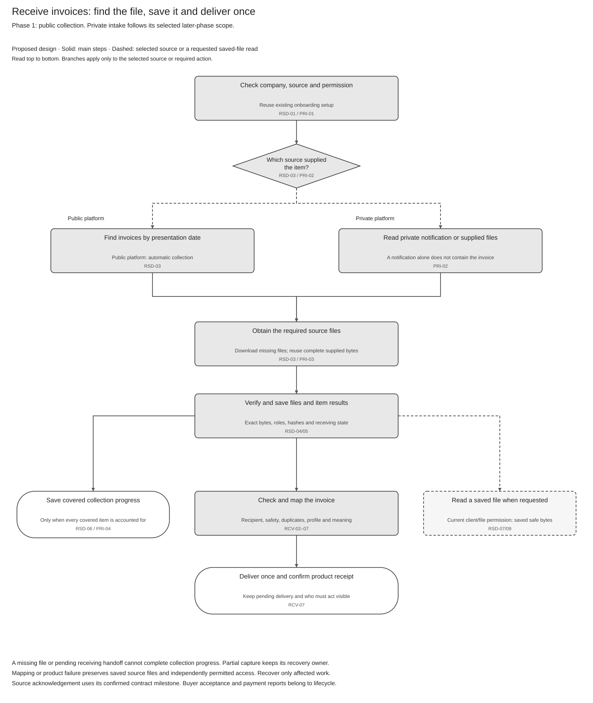

# Invoice Retrieval Solution Summary

[Logical specification](SPEC-SEI-026-invoice-retrieval-logical-feature-specification.md) · [API reuse assessment](SPEC-SEI-027-invoice-retrieval-sequence-and-reuse-assessment.md) · [API calls and Spain changes](api-reference/SPEC-SEI-042-existing-e-invoice-retrieval-api-reference.md) · [Feature folder](README.md)

## Revision overview

This view summarises [SPEC016](../archive/SPEC-SEI-016-invoice-receiving-retrieval-and-download-solution-specification.md). Its RRI, PRI, RSD and RCV IDs and source-file controls remain unchanged. The 30 October scope decision requires public/private view and SPFE download; private user download remains TBD. SPEC016 is unchanged and remains the selected Confluence source. These views and the new API reference are unpublished drafts. Provider support and implementation coverage remain open. REF-SCOPE.

## 1 Purpose and intended outcomes

**What:** let a business or authorised accountant view received invoices from public and private platforms, and download saved SPFE files. Private user download remains TBD. **Why:** users need access to invoices even when collection or product processing has a problem. **Reuse:** assess the existing E-Invoice list, detail and file calls, records access and inbound DTS mapping before adding capabilities. REF-PRODUCT; REF-SCOPE; INT-RCV01.

SPEC026 owns scenarios and required behaviour; SPEC027 owns reuse and engineering gaps; SPEC042 supplies API fields, examples and Spain changes.

## 2 Terms used

[Shared glossary](../../context/GLO-SEI-001-e-invoicing-terminology.md): **view** shows permitted invoice information or a readable representation; **source-file download** obtains bytes from a platform; **stored-file download** returns captured bytes to the user. A required source fetch does not decide private user-download scope. Viewing, capture, product receipt and buyer acceptance have separate results.

## 3 Scope and actors

| Situation | Required outcome |
|---|---|
| SPFE public platform — Phase 1 | **View and user download required.** Collect automatically through discovery and separate source-file download. Customer refresh can accelerate the same work. SPFE-S02/S03; REF-SCOPE. |
| External private providers — Phase 2 | **View required; user download TBD.** Qualify the provider intake needed for the view. Complete supplied bytes avoid another source fetch. REF-SCOPE. |
| Sage private-platform offering — Phase 3 | **View required; user download TBD.** Qualify shared reuse, provider/service-chain support and operator readiness. REF-SCOPE. |
| Public copy and private original | Keep both sources and prove whether they represent one business invoice. |
| Customer/accountant opens an invoice or downloads an enabled file | Apply the scope in SPEC026 §1 and current client/invoice/file permission. Keep original, public-copy and derived roles clear. |
| Processing, product delivery or collection fails | Keep completed work; show the affected item, next action and owner. |

The business or authorised accountant requests permitted actions. The ERP displays results and confirms receipt. The E-Invoice Service coordinates collection and receiving; supporting capabilities check permission, files, mapping and records. Source platforms supply files/results; Operations resolves assigned failures. These are logical responsibilities.

Start after [onboarding](../onboarding-and-connectivity/SPEC-SEI-038-customer-onboarding-and-connectivity-logical-feature-specification.md#4-feature-wide-functional-requirements-and-rules) has established the selected platform access and business mapping. Reuse the company’s SXS dataset and required credential references through qualified bindings. RRI-Q02 still gates provider rollout; the private download decision is separate from required private view. ZIP export, sending and business lifecycle actions keep their existing scope.

## 4 End-to-end workflow

[Draw.io](../../assets/diagrams/invoice-retrieval-overview-process.drawio) · [PNG](../../assets/diagrams/invoice-retrieval-overview-process.png).

| Walkthrough | Result / detailed rule |
|---|---|
| 1. Reuse the business setup | Resolve current business/action permission and the source binding. RSD-01; PRI-01. |
| 2. Collect from the selected platform | SPFE discovers by presentation date and downloads files separately. Private intake uses its qualified notification/fetch or supplied-file mode. RSD-03; PRI-02/03. |
| 3. Save the source and covered progress | Preserve exact files and classification before completing collection progress. A notification alone is insufficient. RSD-04–06. |
| 4. List and open invoices | Show permitted captured information and file roles. For SPFE, show freshness and distinguish an empty result from failed collection. SPEC026 §2. |
| 5. Download a selected file | Required for SPFE; TBD for private platforms. Read safe saved bytes under current permission. RSD-07; REF-SCOPE. |
| 6. Complete downstream processing | Validation, mapping and product receipt have their own outcomes. Recover their failures from saved bytes. RCV-02–09. |

Steps 4–5 use captured information independently of later mapping or product-delivery success. An available readable representation can support viewing; optional PDF/Factur-X generation does not replace the source. SPEC026 owns the detailed checks and recovery.

## 5 Reuse direction and Spain boundaries

| Existing capability / pattern | Spain work to confirm |
|---|---|
| E-Invoice list/detail and file download; optional notifications | Confirm public and private view support, SPFE download binding, identity, file roles and missed-event recovery. Private user download stays a Product decision. The guide proves documented operations, not a running Spain integration. |
| Shared capture, duplicate handling and records access | Qualify the actual build, current permissions, integrity, retention and recovery. |
| Existing DTS — preferred mapping candidate | Prove the selected Spain inbound format, tax/extension fields and target-product mapping. Outbound UBL support alone is insufficient. |
| Spain public collection | Bind the supplied discovery/download operations, representation and UBL profile. Keep these country rules separate. SPFE-S02/S03/S08. |

## 6 Material decisions and dependencies

| Decision | Evidence / owner |
|---|---|
| Enabled sources and access — RRI-Q01/02; RET-G01/06 | Product, Identity and Integration: supported modes, recipient permission and public contract. |
| Complete collection — RSD-G01/06/07; RET-G03 | API and Operations: page boundaries, saved progress, late arrivals and older-history recovery. |
| Correct files and mapping — RET-G04/07 | Records, Security, Format and DTS: source provenance, safety and inbound meaning. |
| Saved access and product receipt — RET-G05/09 | Records and Product: historical access, retention/holds, delivery identity and receipt. |
| Private user download — RRI-Q02; RET-G10 | Product/Compliance: decide provider scope, file roles, permissions and use before enabling this action. Private view remains required. |

SPEC027 records the full gates and owners. Existing query windows, temporary links and optional renderings are API constraints; they do not set Spain retention or release scope.

## 7 Completion and assurance

Collection progress is complete only when each covered item has a saved source file and receiving classification, or an approved ignore outcome. Product processing, product receipt and source acknowledgement remain separate. PRD211 consultation also requires evidenced distribution and freshness. RSD-05/06; RCV-07; REF-PRODUCT.

Use [SPEC026 recovery](SPEC-SEI-026-invoice-retrieval-logical-feature-specification.md#33-failure-and-recovery-decisions) and acceptance for failure coverage. Implementation readiness requires the selected contracts, build, mappings and operational evidence; document review cannot establish it.

## REF Source references

| REF ID | Source and version/date | Exact location | Supported claim and limit |
|---|---|---|---|
| REF-SCOPE | [SPEC026 scope decision](SPEC-SEI-026-invoice-retrieval-logical-feature-specification.md#1-purpose-actors-and-boundary), user direction and clarification, 30 October 2026 | Source/phase scope table; REF-SCOPE | Public/private view required, SPFE user download required, private user download TBD. Product decision, not a legal or implementation claim. |
| REF-BASE | [SPEC-SEI-016](../archive/SPEC-SEI-016-invoice-receiving-retrieval-and-download-solution-specification.md), updated 20 October 2026 | Parts 1–4; RRI/PRI/RSD/RCV controls and REF | Combined draft baseline and existing IDs; not implementation evidence. |
| REF-PRODUCT | [PRD-SEI-211](../../prds/PRD-SEI-211-public-platform-invoice-consultation-structured-review.md), updated 20 October 2026; [PRD-SEI-223](../../prds/PRD-SEI-223-interoperability-routing-transformation.md), updated 7 October 2026; [PRD-SEI-213](../../prds/PRD-SEI-213-private-platform-connectivity-structured-review.md) | PRD211 Phase 1, retrieval/download boundary, FR1–55; PRD223 receiving FR17–20 and DTS FR43–44; private capability boundaries | Canonical product sources with their recorded draft/discovery status. Does not approve added release scope. |
| INT-RCV01 | [Supplied FR receiving guide extract](<../../context/FR API/Receiving/receive-e-invoice-guide-extract.md>), received 22 October 2026; revision unknown | Sections 1–4; Polling, formats, and extracted data | Documented guide flow and limits; schema, build and Spain coverage unverified. |
| SPFE-S02 | [Final Order HAC/1028/2026](../../context/BOE-A-2026-20587.pdf), published 5 October 2026 | Articles 9–11, PDF pp. 9–11 | Recovery, conservation access and representation within the order's scope; no numeric Sage service objective or private API contract. |
| SPFE-S03 | [Original catalogue](<../../context/Descripción servicios web/Catálogo de servicios/20261013/CatalogoServicios.pdf>), 0.1.0, 9 October 2026 | Sections 6.4–6.7, pp. 12–15 | Public discovery, queries and downloads are distinct operations; incomplete wire semantics remain open. |
| SPFE-S08 | [Original formats](<../../context/Descripción servicios web/Formatos entrada y salida/20261013/FormatosEntradaSalida.pdf>), 0.1.0, 9 October 2026, BORRADOR | Section 5.1.1 p. 8; sections 5.4–5.7 pp. 14–15 | Supplied UBL 2.5 selection; query/download formats pending. Not a full activated profile. |
| REF-API | [SPEC027](SPEC-SEI-027-invoice-retrieval-sequence-and-reuse-assessment.md#ref-source-references) and [SPEC042](api-reference/SPEC-SEI-042-existing-e-invoice-retrieval-api-reference.md#ref-source-references), drafts, 30 October 2026 | Operation sources, request/response examples, local changes and qualification gates | Engineering analysis and original-contract links. Proposed controls have separate authority from external sources. |
