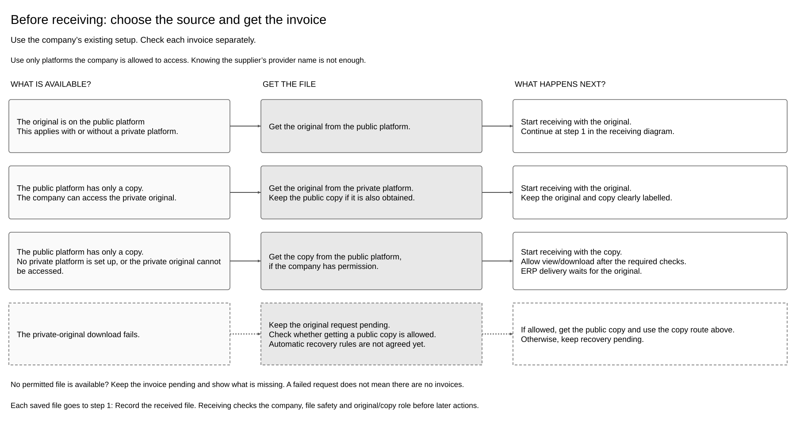
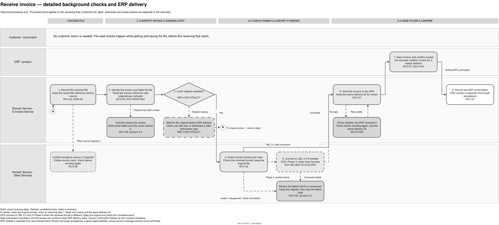

# Invoice Retrieval Logical Feature Specification

[Solution summary](SPEC-SEI-025-invoice-retrieval-solution-summary.md) · [API reuse assessment](SPEC-SEI-027-invoice-retrieval-sequence-and-reuse-assessment.md) · [API calls and Spain changes](api-reference/SPEC-SEI-042-existing-e-invoice-retrieval-api-reference.md)

Confluence views: [Summary](https://confluence.sage.com/pages/viewpage.action?pageId=933331276) · [Required behaviour](https://confluence.sage.com/pages/viewpage.action?pageId=943980648) · [Sequences and reuse](https://confluence.sage.com/pages/viewpage.action?pageId=943980652) · [API reference](https://confluence.sage.com/pages/viewpage.action?pageId=943980662)

## Revision overview

This view keeps SPEC016’s RRI, PRI, RSD and RCV meanings and acceptance IDs. The [predecessor](../archive/SPEC-SEI-016-invoice-receiving-retrieval-and-download-solution-specification.md) retains detailed inventories and is unchanged. The 11 November 2026 user decision requires view and user download for public and private platforms, replacing the earlier private-download TBD. File roles and records boundaries remain unchanged. The 13 November 2026 user decision limits DTS conversion to Phase 3 inputs that are not UBL 2.5. Provider coverage and implementation remain open. REF-SCOPE; REF-DTS-SCOPE.

## 1 Purpose, actors and boundary

Support two linked journeys: an authorised customer or accountant consults the business’s **sent and received** e-invoices through the ERP; automatic receiving obtains and processes inbound source files. In this spec, the **Domain Service** is the E-Invoice Service reached through the existing E-Invoice API. This is a logical access boundary, not a new API or deployment claim. Receiving delivers each eligible inbound invoice once to the authorised product. Caller authentication and permission for the selected business/action remain separate. REF-PRODUCT; REF-SCOPE; SPFE-S02 Article 11.

| Source / phase | View and download scope | Boundary |
|---|---|---|
| SPFE public solution — Phase 1 | **Required:** automatic collection, invoice list/detail view and authorised saved-file download. | Missing API/build evidence is a delivery gap; it does not make these outcomes optional. |
| External private providers — Phase 2 | **View and user download required.** | Qualify each enabled provider’s intake, product view and saved-file download. No provider transfer mode is selected here. |
| Sage private-platform offering — Phase 3 | **View and user download required.** | Qualify the offering, operator role and contracts, including saved-file download, before enabling it. |

REF-SCOPE is the product decision for this review; REF-PHASE defines phase labels. For every enabled platform, an authorised business or accountant must be able to download captured invoice files under RSD-07. Provider/API gaps are delivery gaps; they do not make user download optional. RET-G10 qualifies private delivery coverage. A provider may supply bytes or require a source-file fetch; that technical transfer differs from user download. The [copy-only policy in §3.4](#34-process-review-proposal) records the 13 November 2026 user decision. REF-COPY-POLICY.

Reuse the dataset and platform setup established by onboarding. [Lifecycle](../invoice-lifecycle/SPEC-SEI-029-invoice-lifecycle-logical-feature-specification.md) owns buyer decisions/payment reports; [SPEC014](../SPEC-SEI-014-shared-platform-connectivity-and-routing-solution-specification.md) owns routing/history. Use [GLO-SEI-001 — sending, receiving and invoice roles](../../context/GLO-SEI-001-e-invoicing-terminology.md#sending-receiving-and-invoice-roles) to distinguish exchange direction, sender/recipient, sales/purchase perspective and document type. Viewing does not create buyer acceptance or a source acknowledgement. A readable rendering and an original structured file retain separate roles.

## 2 Scenarios and observable outcomes

The customer or authorised accountant uses **View invoice list → Select and open invoice** for sent and received invoices. From the opened invoice, the customer can choose **Download file** or [**Review and take action** in SPEC029](../invoice-lifecycle/SPEC-SEI-029-invoice-lifecycle-logical-feature-specification.md#review-and-take-action). Download is not required before a decision. The ERP sends Query/Retrieve requests to the Domain Service and displays its results. Download is a separate choice; opening does not automatically save a file to the user’s device. Automatic inbound collection continues without a customer session. RSD-07; REF-SCOPE.

The ERP reuses the selected business’s NIF, certificate/authority setup, environment and authorised dataset binding from onboarding. This does not establish one dataset per NIF. The Query/Retrieve GETs use `datasetId` and Sage ID M2M bearer authentication; NIF and certificate are not new GET parameters. Current user/client permission is checked separately. [SPEC042](api-reference/SPEC-SEI-042-existing-e-invoice-retrieval-api-reference.md#shared-request-and-recovery-rules) owns exact authentication and attachment options; RET-G01 qualifies the Spain business/dataset/address binding.

| Trigger | Required outcome / safe alternative | Existing coverage |
|---|---|---|
| Public collection is due; customer requests refresh | Collect the eligible scope automatically, including when no customer is viewing the list. Customer refresh can accelerate collection; join equivalent refreshes. A failed query cannot be reported as an empty success. | RSD-01–06; A01–03/07/10; REF-PRODUCT, PRD211 Product principles 1–2 |
| Customer/accountant chooses **View invoice list** | ERP sends **Query e-invoices** to the Domain Service for the selected business and sent/received scope. The Domain Service checks access and returns permitted invoices, current status, attachment availability and paging information. ERP displays the results and keeps the business/source context across pages. Distinguish an empty list from a failed query or incomplete collection; show SPFE inbound collection freshness where applicable. | RSD-01/03/07; RET-API-01; PRD211 FR30–33/48/52; REF-SCOPE |
| Customer/accountant chooses **Select and open invoice** from the list | ERP sends **Retrieve e-invoice** with the selected ID and business context to the Domain Service. The service rechecks access and returns details, current status/history and attachment information under the selected request options. ERP displays permitted content and original/copy/derived labels. Explain unavailable content and the next action; metadata alone is not a complete invoice view. Saved content does not require a live source response or confirmed ERP delivery. | RSD-07; RET-API-02; RET-G01/08; REF-SCOPE |
| Customer/accountant chooses **Download file** from the opened invoice | If file choices or links were omitted, ERP requests them from the Domain Service through Retrieve before offering the file choice. Renew a link only when expiry is confirmed. Use the chosen attachment’s returned link. Following the selected `downloadUrl` transfers bytes from the file source. Apply current file permission, role, safety and integrity controls, including access changes since opening. Explain denial or file failure with a safe next action. Conversion or ERP-delivery failure alone does not block a safe allowed download. | RRI-A05/08; RSD-A04/08/09/14; RCV-A23; RET-API-03; REF-SCOPE |
| Customer/accountant chooses **Review and take action** on an opened invoice | Continue in [SPEC029’s customer decision journey](../invoice-lifecycle/SPEC-SEI-029-invoice-lifecycle-logical-feature-specification.md#review-and-take-action) using the same business and invoice identity. Query/Retrieve remain read operations. SPEC029 owns enabled actions, decision/report outcomes and recovery. | LCS-R04/08/12–14; LCS-A03/05/18/26/27 |
| Enabled private provider uses notification/reference intake | Save the observation, then obtain required files. Missing bytes remain `FETCH_PENDING` with an owner. | RRI-A02/03; PRI-01–04; transfer contract to confirm |
| Enabled private provider supplies complete files | Verify and save those bytes; do not fetch again because later processing is slow. | RRI-A01; RSD-04/05; transfer contract to confirm |
| Duplicate item or public copy/private original arrives | Preserve both observations; prove equivalence before one business invoice/product effect. Changed content remains a conflict. | RSD-A05/06; RCV-A13 |
| Correction document or replacement content arrives | Preserve the original. A correction document has its own identity/reference; replacement content needs a relationship decision. Never overwrite because the invoice number matches. | RCV-04/09; A06/18 |
| Capture succeeds; validation, mapping or delivery fails | Recover affected processing from saved bytes. Keep independently permitted source access; do not claim product receipt. | RSD-A04; RCV-A14–18/23 |
| Events are missed or available history is incomplete | Recover a bounded range using existing identities. Keep any unproved coverage gap visible. | RRI-A04; RSD-A10 |
| Client permission or route changes | Stop affected future actions; retain historical context and independent authorised client work. Recheck before resuming. | RRI-A08; RCV-A19/28/29 |

## 3 Process and activity order

**Before step 1: choose the source and get the invoice.** Use the company’s existing setup and permission. The first route applies whether or not a private platform is set up. [§3.4](#34-process-review-proposal) owns the source scenarios, copy-only policy and open recovery decision.

[Source-choice flow — Draw.io](../../assets/diagrams/receiving-source-selection-process.drawio) · [PNG](../../assets/diagrams/receiving-source-selection-process.png).

Each saved file continues at step 1 below with its original/copy label. If the private download fails, getting a public copy is conditional on its own permission and the recovery decision in §3.4; the diagram does not approve an automatic fallback.

**Then: check the saved invoice and deliver it to the ERP.**

[Receiving detail — Draw.io](../../assets/diagrams/receiving-intake-and-delivery-process.drawio) · [PNG](../../assets/diagrams/receiving-intake-and-delivery-process.png).

This supporting swimlane expands **A. Receive invoice** from the [SPEC025 five-action presentation overview](SPEC-SEI-025-invoice-retrieval-solution-summary.md#4-end-to-end-workflow). It starts after an inbound source file has been captured. The phase band sits above all lanes and applies only to receiving steps 1–8. Readability is checked when getting and saving the file under RSD-04. Recipient, safety and integrity controls remain technical intake requirements (RCV-02/03), without a separate business-process box. Step 2, **Identify the invoice and label the file**, reads the invoice reference and original/copy indicator. Unclear file roles lead to **Hold the invoice for review**. The customer has no required action; the lane order remains Customer / accountant, ERP / product, E-Invoice Service and Other Services. Source collection/progress remains RSD-01–06 and PRI-01–04.

Read the numbered steps from left to right. Skip step 5 for UBL 2.5; RCV-06 defines when conversion applies. Display numbers do not change requirement IDs. Marker **R** returns to step 1 when the original arrives. [§3.3](#33-failure-and-recovery-decisions) owns detailed recovery; [§3.4](#34-process-review-proposal) records the copy-only policy and open decisions.

**B. View invoice list**, **C. Select and open invoice** and **D. Download file** remain the [§2 customer journey](#customer-list-open-and-download), with explicit service calls in the [SPEC027 B–D sequence](SPEC-SEI-027-invoice-retrieval-sequence-and-reuse-assessment.md#24-required-view-and-user-download). Safe authorised consultation does not wait for ERP delivery. Receiving does not depend on those reads. Viewing and download do not create buyer acceptance. **E. Review and take action** continues separately in [SPEC029](../invoice-lifecycle/SPEC-SEI-029-invoice-lifecycle-logical-feature-specification.md#review-and-take-action).

### 3.1 Source acquisition and stored-file access

| Activity | Required behaviour / result |
|---|---|
| RSD-01 | Check current business/action authority, environment and source binding before protected calls. |
| RSD-02 | Join equivalent refreshes and apply approved capacity. Only the current run may save progress. |
| RSD-03 | Discover within the qualified scope and fetch exact files separately. Save continuation evidence; distinguish empty success from failure. |
| PRI-01–03 | Check provider/caller and delivery mode. Download missing required files; reuse complete supplied bytes. Keep partial/expired/unsupported outcomes distinct. |
| RSD-04 | Save exact bytes or an approved immutable reference with matching hash, source, role, profile and time. Check that the file is not empty and can be read as part of getting and saving it. Failed or incomplete capture stays pending with its reason and owner. |
| RSD-05 | Save a receiving classification. A pending handoff has an owner and cannot complete the covered page. |
| RSD-06; PRI-04 | Commit covered progress only after every item has source plus classification, or an approved ignore outcome. Later mapping failure does not undo this result. |
| RSD-08 | Recover an authorised bounded range with separate progress and existing item identities. Keep unrecoverable gaps visible. |
| RSD-07 | For saved-file view/download from any enabled platform, check current permission, role, safety, integrity and retention; return labelled saved bytes and audit the result. Select the requested representation without relabelling a public copy or rendering as an original. |
| RSD-09 | Apply retention/holds; preserve permitted historical access. Verify exit export before allowed disposal. |

### 3.2 Receiving handoff

| Activity | Required behaviour / result |
|---|---|
| RCV-01 Record | Save the source file reference and hash before later work or an irreversible confirmation to the source. If only metadata is available, keep file recovery pending. |
| RCV-02 Recipient control at intake | Check the invoice recipient against the existing onboarding setup: business, test/live environment, route at the time of receipt and target ERP. Hold unclear or wrong matches for review; do not show the invoice to another client. |
| RCV-03 Safety and integrity at intake | Check trust, safety and file integrity. Disable XML external-entity and network access. A check that has not finished has not passed. Keep unsafe files restricted. |
| RCV-04 Identify the invoice and label the file | Read the source item and invoice references. Classify the file as original, faithful copy or another evidenced role. For Spain public UBL, use the [copy-indicator table](#spain-copy-indicator). Keep missing or conflicting role evidence unresolved. A copy indicator does not prove that two files match; linking them requires qualified evidence under RET-G04/07/09. |
| RCV-05 Check format and rules | Check the original against the rules for its received format. Keep invalid, unsupported and unfinished checks separate. |
| RCV-06 Convert only when needed | Use existing DTS only in **Phase 3**, when the received invoice is **not UBL 2.5**. Convert it to UBL 2.5 using a tested mapping. Keep the received original and its link to the converted file. Check the output, including tax and extension fields, before ERP delivery. UBL 2.5 skips conversion. Other formats in Phases 1–2 stay pending for format resolution. RET-G07 qualifies the actual build and mapping. REF-DTS-SCOPE. |
| RCV-07 Send to the ERP | Save the delivery decision and a stable delivery ID. Verify the ERP confirmation before recording receipt. If the reply is lost, check the original result or resend only when safe, using the same ID. |
| RCV-08 Confirm to the source | Send a confirmation when the source contract requires it. If the result is unclear, check the original result before repeating a confirmation that may change the source state. |
| RCV-09 Recover | Record the reason, responsible person or team, and safe next step. Retry only the failed step from the saved file, with the versions recorded. Keep facts already delivered. |

The current flow does not include reusing a previous result or automatically resuming unfinished work when an invoice is received again. The user removed that path on 13 November 2026 because the capability is unconfirmed. Automatic content comparison is also unconfirmed. Repeat handling remains open under [SPEC027 RET-G09](SPEC-SEI-027-invoice-retrieval-sequence-and-reuse-assessment.md#4-open-engineering-decisions).

Internal approval holds only its named action. Accounting transfer has its own target/receipt; portfolio results stay per client. Neither creates buyer acceptance or blocks independently authorised capture. RCV-I13–16; RCV-A26–31.

### 3.3 Failure and recovery decisions

Apply the action to the affected item; keep completed work. Record its reason, original operation, next action, owner and resume evidence. These are required controls, not proven provider behaviour.

| Failure | Safe action / evidence to resume | Owner / coverage |
|---|---|---|
| Forged, wrong-client, duplicate or late event | Reject untrusted scope; reuse saved observations for repeats. Use verified event/item identity to recover missing work. | Events/Security; RRI-A02/04/09 |
| Attempt `ERROR`; current status unchanged | Read the correlated history outcome/error and use its code-specific action. A notification failure does not justify recapture. | API/Operations; INT-ERR01; RET-G02/09 |
| Expired credentials or withdrawn client grant | Stop affected calls/reads; resume only with current business/action authority. Keep other clients independent. | Identity/client; RSD-A01/08; RCV-A29 |
| Timeout, outage or `429` | Retain the original operation and pending result. Honour valid `Retry-After`; use bounded safe retry or check the original external effect first. | Integration/Operations; RSD-A10/16 |
| Missing file or expired link | Keep capture pending. Renew a confirmed expired link; classify other refusals separately. Prove the intended source/content binding. | Integration/provider; RRI-A02/03/06 |
| Interrupted transfer or incomplete file set | Keep verified files; recover only missing/failed required files. Do not create another invoice. | Integration/Records; RSD-A03/14 |
| Failed page, expired cursor, missed events or old history | Keep the last proved progress; recover the bounded gap separately. No partial-page completeness claim. | Retrieval/API; RSD-A03/07/10 |
| Concurrent capture, differing copies or changed content | Preserve observations; prove recipient, profile and business equivalence before one effect. Hold material conflicts. | Receiving/Records; RSD-A05/06 |
| Wrong recipient, unsafe/untrusted/invalid/unsupported file | Deny or restrict access/delivery. Require authorised resolution and passing checks; an ordinary retry cannot release quarantine. | Routing/Security/Validation; RCV-A17/21/22 |
| Hash/metadata mismatch, storage failure or stale run | Keep capture/progress incomplete; recover the original save and reject stale updates. Require consistent bytes, evidence and classification. | Records/Retrieval; RCV-A15 |
| Validation/mapping unavailable, late or lossy | Resume the saved attempt or authorise versioned reprocessing. Check output/source/version binding; preserve delivered facts and safe source access. | Validation/Receiving; DTS only for RCV-06 conversion; RCV-A16–18/22/23 |
| Optional rendering fails | Keep its result separate. A PDF or derived UBL cannot replace missing original bytes. | Format/Records; RRI-A06 |
| Required invoice-view content is unavailable | Show the incomplete view, reason and action owner. Use a qualified available source/representation where permitted; do not invent missing content. Keep safe source-file access independent. | Product/Format; DTS only if RCV-06 applies; RET-G07/08; REF-SCOPE |
| Product rejects, is unavailable or loses its receipt | Query/replay the same delivery under proven repeat safety. Confirm the product effect; do not refetch or duplicate the invoice. | Product/Receiving; RCV-A14/15/17 |
| Acknowledgement may have taken effect | Check the original result before unsafe repetition. Without safe lookup/replay, retain an owned manual case. | Integration/Operations; RSD-A16; RCV-A20 |
| Provider changes or a late item arrives | Keep the original source/route. Resolve delivery binding and current authority; never hide uncertainty on a new route. | Routing/Product; RCV-A19/28/29 |
| View denied, or saved download interrupted, missing or corrupt | Audit the actual read. Retry only with current permission; missing/corrupt saved bytes require an integrity/restore case. Keep a missing rendering separate from an available source file. | Records/Access; RRI-A05/06/08 |
| Hold or provider exit conflicts with disposal | Keep evidence under hold; verify export before disposal and preserve permitted historical access. | Records/Compliance; RSD-A11; RCV-A24 |

When the qualified retry policy is exhausted, stop automatic repetition and keep an owned unresolved case. Retry limits/alerts remain RSD-G07/RCV-Q11 and RET-G03/09. A support escalation alone cannot prove completion or authorise changes to original files/progress. INT-ERR01’s code-specific six-day guidance is not a Spain deadline.

### 3.4 Process review proposal

**Proposal for discussion, 13 November 2026.** The business needs a usable invoice even when one source or downstream step fails. The process must show which file is available, which action can proceed and which work remains pending. This proposal uses the existing RSD/PRI/RCV controls. The user selected the copy-only policy below; recovery triggers and equivalence checks still need qualification. REF-REVIEW; REF-COPY-POLICY.

| Review finding | Proposed change / authoritative control |
|---|---|
| Source selection, acquisition and collection progress precede receiving. | Show the [source-choice flow before step 1](#choose-source-and-get-invoice), then start the swimlane with the saved file. Keep collection/progress controls in §3.1. RSD-01–06; PRI-01–04; RCV-01–09. |
| A captured public/private file can be an original or faithful copy. | Carry the file role and provenance into receiving. Apply the selected copy-only policy before ERP delivery; the [Spain scenarios](#spain-original-and-faithful-copy-scenarios) own role classification. RSD-04; RCV-SPFE-R02. |
| The earlier swimlane joined duplicate checks, validation and delivery. | Show invoice identity and file-role classification separately from validation. Content comparison and repeat handling remain unconfirmed under §3.2; the diagram shows no automatic comparison, previous-result reuse or resumption path. RCV-04/05/09. |
| The earlier swimlane placed “Make the invoice available” after product delivery. | Show authorised saved-file access independently of validation/mapping and product receipt, after recipient, safety and integrity checks. RSD-07; RCV-02/03; §3.3. |
| The earlier swimlane placed acknowledgement last and combined distinct recovery outcomes. | Keep contract-timed acknowledgement independent. Resume only the failed stage using its saved evidence. RCV-07–09; §3.3. |

The [SPEC025 presentation overview](SPEC-SEI-025-invoice-retrieval-solution-summary.md#4-end-to-end-workflow) contains five action frames. The [§3 swimlane](#3-process-and-activity-order) expands receiving frame A; the SPEC027 customer sequence expands B–D. [SPEC029](../invoice-lifecycle/SPEC-SEI-029-invoice-lifecycle-logical-feature-specification.md#review-and-take-action) owns E. The scenarios below qualify the receiving input and copy-only policy; they do not introduce another collection process.

**Source-selection scenarios for review**

| Condition for the recipient | Acquisition and user outcome | Pending work / control |
|---|---|---|
| A public original is available; no private platform is enabled. | Use qualified SPFE access to capture the original. Enable permitted saved view/download after checks. | Reuse onboarding's business mapping and access; missing setup returns to onboarding. “No company setup” in the reference image does not remove these checks. RSD-01/04/07; SPFE-S02 Articles 9–11. |
| A private platform is enabled and this invoice used public issuance/interconnection. | Capture the original through the qualified recipient-side path or authorised SPFE recovery. | A private subscription alone does not force a private fetch or change the public original's role. No separate faithful copy is required for this exchange. [Spain scenarios](#spain-original-and-faithful-copy-scenarios). |
| Private exchange supplies an original; SPFE supplies a faithful copy. | Capture the private original from the recipient's qualified connection or supplied bytes. Capture the public copy where enabled and available. | Preserve both files; prove equivalence before linking them to one business invoice. A missing/rejected public copy does not itself invalidate the private original. RCV-04/05; SPFE-S02 Articles 4, 5(6). |
| Only a public faithful copy is available, with no qualified private access. | Apply the selected copy-only policy below. Show that the original is unavailable. | Keep original recovery owned and visible under the selected policy. Knowing the supplier's provider does not grant access to it. Product/Integration resolves the original acquisition path. |
| Private-original retrieval fails; a public faithful copy is independently accessible. | Subject to the recovery-trigger decision below, capture the copy under its own public authority and retain the failed private attempt. Apply the selected copy-only policy. | A refusal for private access is not permission to use another source. No automatic rerouting, original-role substitution or claim that original recovery completed. RSD-01/04; RCV-09. |
| The private original arrives after the copy, or both arrive concurrently. | Preserve both observations. Check recipient, identity, profile and business meaning before linking them. | Resume eligible work using the existing business identity; do not create a second ERP invoice. Hold conflicts. RSD-A05/06; RCV-A13. |

The reference image's “download copy if private fails” is a useful availability idea. It does not establish authority, copy completeness or ERP eligibility. Its reference to the provider's private platform must be qualified as an authorised acquisition path; receiving does not need general access to a supplier's platform. REF-REVIEW; RET-G01/04/05.

**Selected policy and remaining decisions**

| Decision | Selected policy or recommendation | Owner / evidence gate |
|---|---|---|
| Copy-only access and ERP eligibility — selected | Allow safe authorised view/download of the labelled faithful copy. Keep ERP delivery pending the original. When the original arrives, repeat source checks and prove its relationship to the captured copy before continuing under one business invoice identity. REF-COPY-POLICY. | Product: reconcile this decision into the canonical PRD before its next baseline review. Records, Receiving and target-product owners: prove file access and later-original handling under RET-G04/07/09/10. This is a product decision, not an external obligation or implementation claim. |
| When does Sage attempt public-copy recovery after private failure? | Recommend an independently authorised recovery attempt for temporary unavailability or missing bytes. Permission, identity and safety failures retain their own resolution. Keep the private-original case open. | Product/Integration/Identity: select triggers and supported source combinations under RET-G01/03/04/06. No timeout or retry count is selected. |
| What makes two representations equivalent? | Recommend qualified identity plus business-meaning checks. Different hashes are expected for different representations; material disagreement needs review. | Receiving/Records and product owners: prove comparison rules, required fields and concurrent/late arrival under RET-G04/07/09 and RCV-Q04. If RCV-06 applies, the DTS owner must also prove the selected conversion. A format conversion is not required just to compare two UBL 2.5 files. |

**Acceptance coverage for the selected policy:** extend RSD-A05/06, RRI-A05/08 and RCV-A13/23 to cover copy-first, original-first, concurrent arrival, private timeout and denied public access. Prove the selected ERP policy, visible original-recovery work, one business invoice, separate file roles and country-rule isolation. These are required functional evidence for the selected policy, not executed implementation tests. Recovery-trigger tests depend on the remaining decision above. SPFE-S02 Articles 4, 5(6), 10–11; REF-COPY-POLICY.

## 4 Shared controls and Spain binding

| Rule | Required country binding / evidence |
|---|---|
| Separate outcomes — RRI-R02; RCV-I10 | Discovery, capture, classification, product receipt, acknowledgement and buyer decisions remain independent. Technical errors cannot create Annex II business reports. [SPEC029](../invoice-lifecycle/SPEC-SEI-029-invoice-lifecycle-logical-feature-specification.md#5-spain-rules-and-annex-ii) owns them. |
| Public discovery — RSD-SPFE-R01 | `GetRegisteredInvoice` / `QUERYBYFILTER`: presentation date, up to 1000 results. `GetInvoices` / `QUERYBYID`: identity/final state, up to 1000 identifiers. Preserve `SECUENCE_ID`; continuation is still unqualified. SPFE-S03/S14/S15. |
| Public file recovery — RSD-SPFE-R02/03 | Qualify `DownloadInvoicesByLOC` or `DownloadInvoicesByID` separately. The 100-invoice limit applies to ID download only. Locator, invoice identity and `MessageId` differ. SPFE-S03/S12/S13. |
| Recipient authority — RSD-R01 | Check representation independently of credentials. Issuer/collaboration or locator-certificate branches do not prove recipient permission. SPFE-S02 Articles 9–11. |
| Source format — RCV-SPFE-R02 | Qualify public UBL 2.5, `CopyIndicator`, original/copy/derived roles and the conflicting example `ProfileID`. SPFE-S08/S09. |
| Shared reuse — RRI-R03/05; RSD-R09; RCV-R14 | Qualify records and the selected build. DTS conversion follows RCV-06. Keep Spain rules separate from France and other countries. |

**Spain original and faithful copy scenarios — RSD-04; RCV-SPFE-R02**

For an authorised recipient, classify each retrieved file from its exchange evidence and file role. SPFE can supply an original or a faithful copy of the same business invoice.

**For Spain’s public UBL format, `cbc:CopyIndicator` means:**

| Value | Meaning |
|---|---|
| `true` | Copy |
| `false` or omitted | Original |

The exact field is `/in:Invoice/cbc:CopyIndicator`. Source: [final BOE Annex I, BT-ES-1, PDF p. 13](../../context/BOE-A-2026-20587.pdf#page=13), and Article 4(3). SPFE-S02.

Apply this table only to the qualified Spain public profile. It does not define another country’s or a private platform’s file contract. Missing or conflicting classification evidence stays unresolved. The indicator labels the file; it does not prove that two files belong to the same invoice. An original and faithful copy need not be byte-for-byte identical or differ only in this field. Article 4(2) defines the corresponding invoice information required in the copy. Automatic content comparison remains unconfirmed under §3.2 and RET-G04/07/09. SPFE-S02; SPFE-S08/S09.

| Invoice exchange scenario | Required retrieval result | Evidence / limit |
|---|---|---|
| Sender uses SPFE; recipient uses B2B Router | If the qualified connection delivers this invoice to B2B Router, obtain the original from B2B Router. No separate faithful copy is required. An authorised recovery from SPFE retains its original role. | SPFE handled issuance or interconnection: SPFE-S02 Article 3(4). B2B Router route, file roles and access remain unconfirmed under RET-G01/04/05. |
| Sender uses Zerocoma; recipient uses SOVOS; exchange stays private | Obtain the original from SOVOS and the faithful copy from SPFE when available. Preserve both sources and link them to one business invoice only after equivalence checks. A missing copy stays visible; it does not relabel or replace the original. | SPFE-S02 Articles 4(1)–(3), 5(5), 6. Names illustrate sender/recipient roles; interoperability, original-file access and copy-result visibility remain unconfirmed under RET-G01/04/05 and sending SND-G05. |
| Sending has selected the public route and submitted the invoice to SPFE for exchange | Obtain the original from SPFE. Do not expect or create a separate faithful copy for this exchange. | SPFE-S02 Articles 3(4), 5(2). Selection and any existing-copy cancellation remain sending responsibilities under SPEC023 OUT-09/10 and SPFE-S02 Article 5(5). |

These examples clarify file roles; they do not qualify provider support. [SPEC023 — OUT-09 Spain recipient-route decision](../invoice-sending/SPEC-SEI-023-invoice-sending-logical-feature-specification.md#3-process-and-activity-order) governs a missing private destination, a failed lookup and an explicit public choice. Retrieval does not select a new delivery route. If receiving cannot match the invoice to the exact client, RCV-02 holds it for authorised resolution; it must not send that invoice to SPFE as a fallback.

## 5 Decisions and technical analysis boundary

[SPEC027’s gates](SPEC-SEI-027-invoice-retrieval-sequence-and-reuse-assessment.md#4-open-engineering-decisions) map API evidence to existing RRI-Q01–03, RSD-G01–09 and RCV-Q01–13. Unproved coverage blocks the affected mode. No service boundary, cadence, SLA, retention period or acknowledgement deadline is approved here.

[SPEC027 §3.1](SPEC-SEI-027-invoice-retrieval-sequence-and-reuse-assessment.md#31-query-coverage-and-recovery) records the proposed list-open refresh and Architecture's pull-policy decisions. It does not make a live SPFE call a condition for viewing captured information.

## 6 Functional acceptance

Required checks below retain their detailed IDs in REF-BASE Part 4. They have not been run against an implementation.

| Existing acceptance | Required evidence |
|---|---|
| RSD-A01/08; RRI-A08; RCV-A27/29 | Permission/revocation checks cover calls and saved reads; other authorised clients remain independent. SPFE-S02 Article 11. |
| RSD-A02/03/07; RCV-A15 | Concurrent work/crash recovery cannot skip an item, commit stale progress or complete a pending handoff. |
| RRI-A01–03/06 | Complete private bytes avoid refetch; metadata, expired links and partial files preserve item identity and remain incomplete. |
| RRI-A04; RSD-A10/16 | Missed events, old history and uncertain source effects retain visible gaps and safe recovery. |
| RSD-A05/06; RCV-A13; RCV-SPFE-R02 | Check the [three Spain exchange scenarios](#spain-original-and-faithful-copy-scenarios): public exchange needs no separate faithful copy; private exchange preserves the private original and public faithful copy. Check `CopyIndicator` true/false/omitted in the qualified profile. Match equivalent files before one product effect; hold conflicts and wrong-client matches without rerouting. Keep these Spain rules isolated from other countries and qualify provider support before enabling a route. SPFE-S02 Articles 3(4), 4, 5(5), 6 and Annex I BT-ES-1; SPFE-S08/S09. |
| RSD-A05/06; RRI-A05/08; RCV-A13/23 | Extend coverage for the [selected copy-only policy and arrival-order checks in §3.4](#34-process-review-proposal). REF-COPY-POLICY. |
| RSD-A04/09/14; RRI-A05; RCV-A23 | Safe permitted saved access survives mapping/product failure. Corrupt/unsafe files are not ordinarily served. |
| RSD-07; RRI-A05/08; PRD211 FR30–33/48/52 | Prove the [§2 customer journey](#customer-list-open-and-download) for every enabled source/phase. Cover sent and received results, direction labels and self-billing/credit mapping; list paging; the selected invoice ID/business; access withdrawn between actions; empty versus failed query/collection; SPFE inbound freshness; missing readable content; omitted attachment descriptors with a positive count; labelled file choice; and interrupted/denied download. Prove ERP → Domain Service request/result communication for Query and Retrieve, and a file-source transfer for download. Include safe faithful-copy access while the original and ERP delivery are pending, and saved access during source outage. Opening a selected invoice does not automatically download or create buyer acceptance. Collection does not depend on customer actions. REF-SCOPE. |
| RSD-07; LCS-R04/12–14 | Opening offers the [SPEC029 decision journey](../invoice-lifecycle/SPEC-SEI-029-invoice-lifecycle-logical-feature-specification.md#review-and-take-action) independently of download. Use [SPEC042’s exact type/status sources](api-reference/SPEC-SEI-042-existing-e-invoice-retrieval-api-reference.md#document-types-and-status-values); do not infer actions from a returned status label or AP/AR type. Lifecycle acceptance and recovery remain SPEC029 §6. |
| RCV-A14/16–18/20 | Async mapping, lost receipts and acknowledgements recover without overwriting evidence or creating buyer acceptance. |
| RCV-A26/28/30/31 | Approval, accounting and portfolio work retain independent results; stale approval/lost receipts cannot duplicate invoices. |
| RSD-A11/13/15; RCV-A22/24; RRI-A07/10 | Historical access and holds survive provider changes. Prove country-rule isolation. For RCV-06, prove that UBL 2.5 skips DTS in every phase, Phases 1–2 do not run conversion, and supported Phase 3 non-UBL 2.5 input is converted and checked. Unsupported input stays pending. REF-DTS-SCOPE. |
| RSD-SPFE-A01–03; RCV-SPFE-A01–03 | Presentation-date discovery, continuation, separate downloads, recipient authority and partial failures are qualified. SPFE-S02/S03/S08/S12–15. |

## REF Source references

| REF ID | Source and version/date | Exact location | Supported claim and limit |
|---|---|---|---|
| REF-SCOPE | User product direction, 11 and 13 November 2026, recorded in §§1–2 | Source/phase scope table; customer list/open/download journey | View and user download are required for SPFE, external private providers and the Sage offering. The list covers the authorised business’s sent and received invoices through ERP ↔ Domain Service calls. The user opens one invoice and can choose a file to download. Automatic receiving remains inbound. Replaces the 30 October private-download TBD. Product direction, not external law, a wire contract or implementation proof. |
| REF-DTS-SCOPE | User product direction, 13 November 2026, recorded in RCV-06 | §3.2 RCV-06 and §6 acceptance | DTS format conversion applies only in Phase 3 when the received invoice is not UBL 2.5. Narrows the earlier general DTS assumption in this receiving set. Product scope decision, not external law or proof of build/mapping readiness. |
| REF-COPY-POLICY | User product direction, 13 November 2026, recorded in §3.4 | Selected policy and acceptance coverage | Allow authorised faithful-copy view/download; keep ERP delivery pending the original. Product policy, not a legal requirement, implementation approval or claim of provider support. |
| REF-REVIEW | User review request and supplied Sage “Onboarding — Purchases / received invoices” image, received 13 November 2026; image footer © 2022 | Provider setup branches; private-download failure note; proposed analysis in §3.4 | Historical design cue for public original/copy and private-failure paths. Does not establish current law, provider contracts, access rights, ERP policy or implementation. The selected product policy has separate authority in REF-COPY-POLICY; recovery triggers and implementation qualification remain open. |
| REF-PHASE | [Onboarding scope](../onboarding-and-connectivity/SPEC-SEI-037-customer-onboarding-and-connectivity-solution-summary.md#3-master-feature-purpose-and-scope), draft, 28 October 2026 | Phase coverage and REF-PHASE | Shared phase labels: SPFE, external private providers, Sage offering. Labels do not establish provider support or release readiness. |
| REF-BASE | [SPEC-SEI-016](../archive/SPEC-SEI-016-invoice-receiving-retrieval-and-download-solution-specification.md), updated 20 October 2026 | Part 2 §§1–5.1; Part 4; Part 3 inventories | Existing requirement/activity/acceptance IDs and proposed logical controls; not deployed contracts. |
| REF-PRODUCT | [PRD-SEI-211](../../prds/PRD-SEI-211-public-platform-invoice-consultation-structured-review.md), updated 20 October 2026; [PRD-SEI-223](../../prds/PRD-SEI-223-interoperability-routing-transformation.md), updated 7 October 2026 | PRD211 Phase 1, FR1–55, retrieval/download boundary; PRD223 FR17–20/43–44 | Canonical scope and receiving/reuse outcomes, subject to recorded status. Proposed Sage safeguards remain design controls. |
| INT-RCV01 | [Supplied FR guide extract](<../../context/FR API/Receiving/receive-e-invoice-guide-extract.md>), received 22 October 2026; revision unknown | Sections 1–4 and Polling | Candidate API facts and coverage limits; no Spain implementation evidence. |
| INT-ERR01 | [FR error-handling extract](<../../context/FR API/Shared/invoice-flow-error-handling-guide-extract.md>), received 22 October 2026, revision/build unknown | Processing and error fields; `ERR-RECEIVING-DOC`, `ERR-RECEIVING-NOT`; Recovery interpretation | History-only attempt outcomes and code-specific retry/support actions. No automatic consumer resend or universal six-day policy. |
| SPFE-S22 | [Separate Annex II](<../../context/Anexo II/A2-Proyecto-OM-FE 21-10-26.pdf>), received 22 October 2026, filename date 21 October; release unverified | §§1–4 pp. 4–14; rejection list L1 p. 15 | Lifecycle code/actor/field evidence, not file-retrieval or AEAT processing-error contracts. Final SPFE-S02 Annex II remains legal baseline; [comparison](../../context/RES-SEI-002-spain-public-platform-technical-evidence.md#annex-ii-supplement-reviewed-22-october-2026). |
| SPFE-S02 | [Final Order HAC/1028/2026](../../context/BOE-A-2026-20587.pdf), published 5 October 2026 | Articles 3(4), 4(1)–(3), 5(2)/(5)/(6), pp. 6–8; Article 6 and Articles 9–11, pp. 8–11; Annex I BT-ES-1, p. 13 | Public issuance/interconnection needs no separate faithful copy; private exchange requires a faithful UBL copy. BT-ES-1 binds the copy indicator. Article 5(5) controls duplicates and prior-copy cancellation; Article 5(6) distinguishes copy rejection from private-original validity. Also establishes public identity, access and representation; no private-provider API, copy-only ERP policy or implementation proof. |
| SPFE-S03 | [Original catalogue](<../../context/Descripción servicios web/Catálogo de servicios/20261013/CatalogoServicios.pdf>), 0.1.0, 9 October 2026 | Sections 6.4–6.7, pp. 12–15 | Operation purposes, roles, limits and `SECUENCE_ID`. Complete query/download formats and side effects remain unqualified. |
| SPFE-S08 | [Original formats](<../../context/Descripción servicios web/Formatos entrada y salida/20261013/FormatosEntradaSalida.pdf>), 0.1.0, 9 October 2026, BORRADOR | §5.1.1 p. 8; §§5.4–5.7 pp. 14–15 | UBL 2.5 `InvoiceType`; query/download formats pending. Not a full validator. |
| SPFE-S09 | [Original factura.xml](../../context/Ejemplos/20261013/factura.xml), supplied 13 October 2026 | `cbc:ProfileID`; `cbc:CopyIndicator` | Example profile conflict and original classification only; not a complete faithful-copy contract. |
| SPFE-S12–15 | [DownloadInvoicesByID](<../../context/WSDL servicios web - PRE_29_10_2026/DownloadInvoicesByID.wsdl>), [DownloadInvoicesByLOC](<../../context/WSDL servicios web - PRE_29_10_2026/DownloadInvoicesByLOC.wsdl>), [GetInvoices](<../../context/WSDL servicios web - PRE_29_10_2026/GetInvoices.wsdl>), [GetRegisteredInvoice](<../../context/WSDL servicios web - PRE_29_10_2026/GetRegisteredInvoice.wsdl>), PRE release 29 October 2026 | Named operation, binding and service ports in each file | Exact operation names and PRE transport; opaque attachments do not complete business schemas; current transport rules are in SPEC-SEI-011 PCN-SPFE-R02/R03. |
| REF-EVIDENCE | [RES-SEI-002](../../context/RES-SEI-002-spain-public-platform-technical-evidence.md), repository evidence baseline | REF; SPFE-Q06/Q09/Q12–14/Q17 | Reading route to originals and unresolved conflicts; source inventory completeness is not mapping readiness. |
