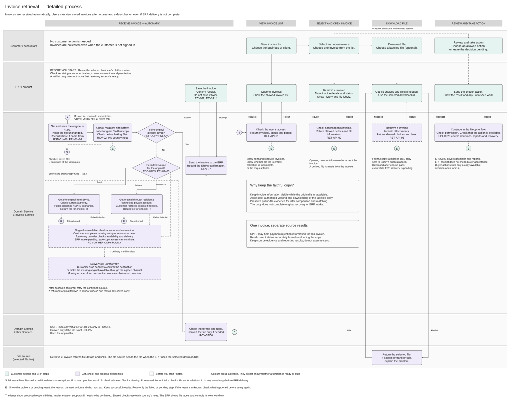

# Invoice Retrieval Logical Feature Specification

[Solution summary](SPEC-SEI-025-invoice-retrieval-solution-summary.md) · [API reuse assessment](SPEC-SEI-027-invoice-retrieval-sequence-and-reuse-assessment.md) · [API calls and Spain changes](api-reference/SPEC-SEI-042-existing-e-invoice-retrieval-api-reference.md)

Confluence views: [Summary](https://confluence.sage.com/pages/viewpage.action?pageId=933331276) · [Required behaviour](https://confluence.sage.com/pages/viewpage.action?pageId=943980648) · [Sequences and reuse](https://confluence.sage.com/pages/viewpage.action?pageId=943980652) · [API reference](https://confluence.sage.com/pages/viewpage.action?pageId=943980662)

## Revision overview

This view keeps SPEC016’s RRI, PRI, RSD and RCV meanings and acceptance IDs. The [predecessor](../archive/SPEC-SEI-016-invoice-receiving-retrieval-and-download-solution-specification.md) retains detailed inventories and is unchanged. The 11 November 2026 user decision requires view and user download for public and private platforms, replacing the earlier private-download TBD. File roles and records boundaries remain unchanged. The 13 November 2026 user decision limits DTS conversion to Phase 3 inputs that are not UBL 2.5. Provider coverage and implementation remain open. REF-SCOPE; REF-DTS-SCOPE.

## 1 Purpose, actors and boundary

Support two linked journeys. An authorised customer or accountant views the business’s **sent and received** e-invoices through the ERP. Separately, automatic receiving gets and processes incoming source files, then delivers each eligible invoice once to the authorised ERP. REF-PRODUCT; REF-SCOPE.

In this spec, the **Domain Service** means the E-Invoice Service reached through the existing E-Invoice API. This name describes access to the capability; it does not define a new API or deployment. Authenticating the caller does not establish permission for the selected business or action. SPFE-S02 Article 11.

| Source / phase | View and download scope | Boundary |
|---|---|---|
| SPFE public solution — Phase 1 | **Required:** automatic collection, invoice list/detail view and authorised saved-file download. | Missing API/build evidence is a delivery gap; it does not make these outcomes optional. |
| External private providers — Phase 2 | **View and user download required.** | Confirm each provider’s file intake, invoice view and saved-file download before enabling it. The provider transfer mode remains open. |
| Sage private-platform offering — Phase 3 | **View and user download required.** | Confirm the offering, operator role and contracts, including saved-file download, before enabling it. |

REF-SCOPE records the product decision; REF-PHASE defines the phase labels. RSD-07 requires authorised download of saved invoice files from every enabled platform. Missing provider/API support is a delivery gap; user download remains required. RET-G10 requires evidence of private saved-file download support. A provider may supply files or require Sage to fetch them. That transfer is separate from user download. The [selected copy-only policy is in §3.4](#34-process-review-proposal). REF-COPY-POLICY.

Reuse the dataset and platform setup established by onboarding. [Lifecycle](../invoice-lifecycle/SPEC-SEI-029-invoice-lifecycle-logical-feature-specification.md) owns buyer decisions and payment reports. [SPEC014](../SPEC-SEI-014-shared-platform-connectivity-and-routing-solution-specification.md) owns routing and route history. Use [GLO-SEI-001 — sending, receiving and invoice roles](../../context/GLO-SEI-001-e-invoicing-terminology.md#sending-receiving-and-invoice-roles) for direction, sender/recipient, sales/purchase perspective and document type. Viewing does not create buyer acceptance or confirm receipt to a source. A generated readable file and an original structured file keep separate roles.

## 2 Scenarios and observable outcomes

The customer or authorised accountant uses **View invoice list → Select and open invoice** for sent and received invoices. The next choices are **Download file**, [**Review and take action** in SPEC029](../invoice-lifecycle/SPEC-SEI-029-invoice-lifecycle-logical-feature-specification.md#review-and-take-action), or leaving the decision pending. Download is optional. Opening an invoice does not save a file to the user’s device or accept the invoice. The ERP requests the list and invoice details from the Domain Service and displays the results. Automatic incoming collection continues when no customer is signed in. RSD-07; REF-SCOPE.

Reuse the selected business’s existing onboarding setup: business/NIF, test/live environment, platform connections, credential references, authority and dataset mapping. Check receiving, viewing and download permission separately. If the mapping or lookup is missing or unclear, keep the affected work pending. Show its reason, next action and owner. A saved connection or certificate alone does not grant permission.

[RET-G01](SPEC-SEI-027-invoice-retrieval-sequence-and-reuse-assessment.md#ret-g01) records the open relationships, with onboarding GAP-01/02/06. No NIF/certificate lookup key or one-dataset-per-NIF rule is selected. Query/Retrieve GETs use `datasetId` and Sage ID machine-to-machine (M2M) bearer authentication. NIF and certificate are not new GET parameters. [SPEC042](api-reference/SPEC-SEI-042-existing-e-invoice-retrieval-api-reference.md#shared-request-and-recovery-rules) defines exact authentication and attachment options.

| Trigger | Required outcome / safe alternative | Existing coverage |
|---|---|---|
| Public collection is due, or the customer requests refresh | Collect eligible invoices automatically, including when no customer is viewing the list. A customer refresh can bring collection forward; combine equivalent refresh requests. A failed query is not an empty successful result. The list-open refresh remains a proposal under §5. | RSD-01–06; A01–03/07/10; REF-PRODUCT, PRD211 Product principles 1–2 |
| Customer/accountant chooses **View invoice list** | The ERP sends **Query e-invoices** for the selected business and sent/received scope. The Domain Service checks access and returns permitted invoices, current status, attachment availability and page information. The ERP displays the results and keeps the business/source context across pages. Distinguish an empty list, a failed query and incomplete collection. Show how current SPFE incoming collection is. | RSD-01/03/07; RET-API-01; PRD211 FR30–33/48/52; REF-SCOPE |
| Customer/accountant chooses **Select and open invoice** from the list | The ERP sends **Retrieve e-invoice** with the selected ID and business context. The Domain Service rechecks access and returns details, current status, history and requested attachment information. The ERP displays permitted content and original/faithful-copy/derived-file labels. Explain missing content and the next action. Metadata alone is not a complete invoice view. Viewing saved content does not require a live source response or confirmed ERP delivery. | RSD-07; RET-API-02; RET-G01/08; REF-SCOPE |
| Customer/accountant chooses **Download file** from the opened invoice | If file choices or links were omitted, the ERP requests them through Retrieve. Renew a link only when expiry is confirmed. Use the chosen attachment’s returned `downloadUrl` to get its bytes from the file source. Recheck current file permission, role, safety and integrity, including changes since opening. Explain a refusal or file failure and give a safe next action. Conversion or ERP-delivery failure alone does not block a safe permitted download. | RRI-A05/08; RSD-A04/08/09/14; RCV-A23; RET-API-03; REF-SCOPE |
| Customer/accountant chooses **Review and take action** on an opened invoice | Continue in [SPEC029’s customer decision journey](../invoice-lifecycle/SPEC-SEI-029-invoice-lifecycle-logical-feature-specification.md#review-and-take-action) using the same business and invoice identity. Query/Retrieve remain read operations. SPEC029 defines allowed actions, decision/report outcomes and recovery. File access does not enable a command. [Copy-only action eligibility remains open](#copy-only-actions). | LCS-R04/08/12–14; LCS-A03/05/18/26/27 |
| Enabled private provider sends a notification or file reference | Save the source observation, then get the required files. A source observation records what arrived from that source. Missing files remain `FETCH_PENDING` with an owner. | RRI-A02/03; PRI-01–04; transfer contract to confirm |
| Enabled private provider supplies complete files | Verify and save the supplied bytes. Do not fetch them again because later processing is slow. | RRI-A01; RSD-04/05; transfer contract to confirm |
| Duplicate item or public faithful copy/private original arrives | Preserve both source observations. Prove that the files represent one business invoice before linking them or delivering one invoice to the ERP. Hold changed content as a conflict. | RSD-A05/06; RCV-A13 |
| Correction document or replacement content arrives | Preserve the original. A correction document has its own identity/reference; replacement content needs a relationship decision. Never overwrite because the invoice number matches. | RCV-04/09; A06/18 |
| Capture succeeds; validation, mapping or delivery fails | Recover the affected processing from the saved file. Keep independently permitted saved-file access. Do not claim ERP receipt. | RSD-A04; RCV-A14–18/23 |
| Events are missed or available history is incomplete | Recover a bounded range using existing identities. Keep any unproved coverage gap visible. | RRI-A04; RSD-A10 |
| Client permission or route changes | Stop affected future actions; retain historical context and independent authorised client work. Recheck before resuming. | RRI-A08; RCV-A19/28/29 |

## 3 Process and activity order

**Detailed overall process**

[Detailed overall process — Draw.io](../../assets/diagrams/invoice-retrieval-overview-process.drawio) · [PNG](../../assets/diagrams/invoice-retrieval-overview-process.png).

The diagram expands the [SPEC025 combined workflow](SPEC-SEI-025-invoice-retrieval-solution-summary.md#4-end-to-end-workflow) into proposed responsibilities and handoffs. Its **Download file** and **Review and take action** columns are separate choices on the summary's customer-access path. They are not successive steps. **E** marks the shared problem or pending result in [§3.3](#33-failure-and-recovery-decisions). **S** connects safe saved files to viewing before ERP delivery completes. **R** returns a file through capture, recipient, safety and role checks under [§3.4](#original-file-retrieval). Implementation coverage remains unconfirmed.

[§3.1](#31-source-acquisition-and-stored-file-access) defines source acquisition and saved-file access. [§3.2](#32-receiving-handoff) defines receiving checks and ERP delivery. [§3.4](#34-process-review-proposal) owns the source scenarios, copy-only policy and open private-failure recovery decision.

### 3.1 Source acquisition and stored-file access

| Activity | Required behaviour / result |
|---|---|
| RSD-01 | Check current permission for the business/action, environment and source connection before protected calls. |
| RSD-02 | Combine equivalent refresh requests and apply approved capacity limits. Only the current collection run may save progress. |
| RSD-03 | Discover invoices within the confirmed scope. Fetch exact source files separately. Save the evidence needed to continue collection. Distinguish an empty successful result from a failure. |
| PRI-01–03 | Check the provider, caller and delivery mode. Download missing required files. Reuse complete supplied files. Distinguish partial, expired and unsupported results. |
| RSD-04 | Save exact bytes or an approved reference to unchangeable content. Keep the matching hash (integrity value), source, role, profile and time. Check that the file is not empty and can be read. Failed or incomplete capture stays pending with its reason and owner. |
| RSD-05 | Save the receiving classification: the recorded outcome or pending next step for the captured item. A pending handoff needs an owner and prevents the collection page from being marked complete. |
| RSD-06; PRI-04 | Save completed collection progress only after every item has a saved source file and receiving classification, or an approved reason to ignore it. A later mapping failure does not undo this progress. |
| RSD-08 | Recover an authorised, bounded range using existing item identities. Track recovery progress separately. Keep gaps visible when recovery is not possible. |
| RSD-07 | For saved-file view/download from any enabled platform, check current permission, role, safety, integrity and retention. Return labelled saved content and audit the result. Do not relabel a faithful copy or generated readable file as an original. |
| RSD-09 | Apply retention rules and holds that prevent deletion. Preserve permitted historical access. Verify the required exit export before permitted disposal. |

### 3.2 Receiving handoff

| Activity | Required behaviour / result |
|---|---|
| RCV-01 Record | Save the source file reference and hash before later work or an irreversible confirmation to the source. If only metadata is available, keep file retrieval pending. |
| RCV-02 Recipient control at intake | Check the invoice recipient against the existing onboarding setup: business, test/live environment, route at the time of receipt and target ERP. Hold unclear or wrong matches for review; do not show the invoice to another client. |
| RCV-03 Safety and integrity at intake | Check trust, safety and file integrity. Disable XML external-entity and network access. A check that has not finished has not passed. Keep unsafe files restricted. |
| RCV-04 Identify the invoice and label the file | Read the source item and invoice references. Label the file as original, faithful copy or another role supported by evidence. For Spain public UBL, use the [copy-indicator table](#spain-copy-indicator). Keep missing or conflicting role evidence unresolved. The indicator does not prove that two files represent the same business invoice. Linking them requires evidence under RET-G04/07/09. |
| RCV-05 Check format and rules | Check the original against the rules for its received format. Keep invalid, unsupported and unfinished checks separate. |
| RCV-06 Convert only when needed | Use existing DTS only in **Phase 3**, when the received invoice is **not UBL 2.5**. Convert it to UBL 2.5 using a tested mapping. Keep the received original and its link to the converted file. Check the output, including tax and extension fields, before ERP delivery. UBL 2.5 skips conversion in every phase. Other formats in Phases 1–2 stay pending for format resolution. RET-G07 requires evidence of the actual build and mapping. REF-DTS-SCOPE. |
| RCV-07 Send to the ERP | Save the delivery decision and a stable delivery ID. Verify the ERP confirmation before recording receipt. If the reply is lost, check the original result or resend only when safe, using the same ID. |
| RCV-08 Confirm to the source | Send a confirmation when the source contract requires it. If the result is unclear, check the original result before repeating a confirmation that may change the source state. |
| RCV-09 Recover | Record the reason, responsible person or team, and safe next step. Retry only the failed step from the saved file, with the versions recorded. Keep facts already delivered. |

Implementation support for reusing previous results, resuming duplicate intake and comparing file content remains unconfirmed under [SPEC027 RET-G09](SPEC-SEI-027-invoice-retrieval-sequence-and-reuse-assessment.md#4-open-engineering-decisions). The required outcomes above still apply. The **R** path retrieves a missing original and repeats intake checks. It does not establish automatic matching of original and copy.

Internal approval can hold only the action it governs. Accounting transfer has its own destination and receipt. An accountant’s results stay separate for each client. These activities do not create buyer acceptance or block independently authorised capture. RCV-I13–16; RCV-A26–31.

### 3.3 Failure and recovery decisions

Recover only the affected work. Keep completed results. Record the reason, original operation, next action, owner and evidence needed to resume. Provider support for these controls still needs proof.

| Failure | Safe action / evidence to resume | Owner / coverage |
|---|---|---|
| Forged, wrong-client, duplicate or late event | Reject untrusted events and wrong-client access. Keep saved observations for repeats. Recover missing work using verified event/item identity. | Events/Security; RRI-A02/04/09 |
| Attempt `ERROR`; current status unchanged | Read the matching history outcome and error. Follow the action for that code. A notification failure does not require another source capture. | API/Operations; INT-ERR01; RET-G02/09 |
| Expired credentials or withdrawn client permission | Stop affected calls and reads. Resume only with current permission for the business/action. Keep other clients independent. | Identity/client; RSD-A01/08; RCV-A29 |
| Timeout, outage or `429` | Keep the original operation and pending result. Honour valid `Retry-After`. Retry within confirmed safe limits. If the operation may already have changed external state, check its result first. | Integration/Operations; RSD-A10/16 |
| Missing file or expired link | Keep capture pending. Renew a link only when expiry is confirmed. Classify other refusals separately. Verify that the returned file belongs to the intended source item. | Integration/provider; RRI-A02/03/06 |
| Interrupted transfer or incomplete file set | Keep verified files. Recover only missing or failed required files. Do not create another invoice. | Integration/Records; RSD-A03/14 |
| Failed page, expired page token, missed events or incomplete history | Keep the last proved collection progress. Recover the bounded gap separately. A partial page is not complete. | Retrieval/API; RSD-A03/07/10 |
| Concurrent capture, differing copies or changed content | Preserve source observations. Check recipient, profile and business meaning before linking files or delivering one ERP invoice. Hold material conflicts for review. | Receiving/Records; RSD-A05/06 |
| Wrong recipient, unsafe/untrusted/invalid/unsupported file | Deny or restrict the affected access/delivery. Require authorised resolution and passing checks. An ordinary retry cannot release a restricted file. | Routing/Security/Validation; RCV-A17/21/22 |
| Hash/metadata mismatch, storage failure or an outdated run | Keep capture/progress incomplete. Recover the original save and reject outdated progress updates. Require consistent bytes, evidence and classification. | Records/Retrieval; RCV-A15 |
| Validation/mapping unavailable, late or losing information | Resume the saved attempt, or authorise reprocessing with recorded versions. Match the output to its source and rule versions. Preserve completed delivery and safe saved-file access. | Validation/Receiving; DTS only for RCV-06 conversion; RCV-A16–18/22/23 |
| Optional readable-file generation fails | Keep its result separate. A PDF or derived UBL file cannot replace a missing original. | Format/Records; RRI-A06 |
| Required invoice-view content is unavailable | Show the incomplete view, reason and owner. Use a confirmed available source or representation where permitted. Do not invent missing content. Keep safe saved-file access independent. | Product/Format; DTS only if RCV-06 applies; RET-G07/08; REF-SCOPE |
| ERP rejects delivery, is unavailable or its receipt is lost | Check the original delivery result or safely repeat the same delivery. Confirm ERP receipt. Do not fetch the source again or create another invoice. | Product/Receiving; RCV-A14/15/17 |
| Confirmation to the source may have taken effect | Check the original result before repeating an action that could change source state. If safe checking/repetition is unavailable, keep a manual case with an owner. | Integration/Operations; RSD-A16; RCV-A20 |
| Provider changes or a late item arrives | Keep the original source and route. Confirm the target ERP and current authority. Keep uncertainty visible when a new route is used. | Routing/Product; RCV-A19/28/29 |
| View denied, or saved download interrupted, missing or corrupt | Audit the access result. Retry only with current permission. Missing or corrupt saved files need an integrity/restore case. A missing readable file does not remove access to a safe source file. | Records/Access; RRI-A05/06/08 |
| A hold or provider exit prevents disposal | Keep evidence under hold. Verify the required export before disposal. Preserve permitted historical access. | Records/Compliance; RSD-A11; RCV-A24 |

When the confirmed retry limit is reached, stop automatic retries and keep an unresolved case with an owner. Retry limits and alerts remain open under RSD-G07/RCV-Q11 and RET-G03/09. Escalating to support does not complete the work or permit changes to original files or saved progress. INT-ERR01’s code-specific six-day guidance is not a Spain deadline.

### 3.4 Process review proposal

The process shows which file is available, which action can proceed and which work remains pending. The user selected the copy-only access and ERP policy below. Recovery triggers, file-matching rules and copy-only buyer actions remain open. REF-REVIEW; REF-COPY-POLICY.

| Process concern | Authoritative control / remaining qualification |
|---|---|
| Source capture and collection progress | [§3.1](#31-source-acquisition-and-stored-file-access) defines completion of collection. Later ERP-processing failure does not undo completed capture. RSD-01–06; PRI-01–04. |
| Original, faithful-copy and derived-file labels | [§4](#spain-original-and-faithful-copy-scenarios) defines Spain file roles. Apply the selected policy below to ERP delivery. RSD-04; RCV-SPFE-R02. |
| Invoice identity, validation and repeat handling | RCV-04/05/09 remain distinct. [§3.2](#32-receiving-handoff) records unconfirmed implementation coverage for comparison and reuse of earlier results. |
| Saved-file access before ERP receipt | RSD-07 and RCV-02/03 govern access after recipient, safety and integrity checks. ERP receipt is not a condition for permitted viewing/download. |
| Confirmation and recovery | RCV-08 follows the source contract’s timing. [§3.3](#33-failure-and-recovery-decisions) defines recovery without undoing successful work. |

**Original-file retrieval — RSD-01/03/04; PRI-01–03; RCV-04/09**

If a confirmed original is already saved, continue the required receiving checks without fetching it again. Otherwise, use the source cases below to find a permitted public source or the recipient’s confirmed private connection. Save the returned file. Repeat source, recipient, access, safety and role checks. Prove its relationship to any saved copy before ERP delivery. A returned copy or conflicting role does not complete original retrieval. Hold it for review instead of repeating the same fetch without resolution.

If no permitted source is available, access is denied or retrieval fails, keep original recovery open. Show its reason, next action and owner. ERP delivery stays pending; independently permitted copy access can continue. Automatic recovery triggers, supported source combinations and file-matching rules remain subject to the decisions below. RSD-01/03/04/07; RCV-04/09; REF-COPY-POLICY.

Check the recipient's account activation, current authority and receiving connection before asking the sender. The customer completes missing setup or restores access when prompted. The receiving provider checks invoice availability and delivery where appropriate. If delivery remains unresolved, the customer asks the sender to confirm the destination or make the existing original available through the agreed channel. A sender's confirmation does not change the copy's role or complete file retrieval. After access is restored, retry the confirmed source; a returned file still passes intake and matching checks. A retrieval failure alone does not establish a need to cancel or correct the invoice. RCV-02/09; [SPEC025 recovery explanation](SPEC-SEI-025-invoice-retrieval-solution-summary.md#retrieval-readiness-and-sender-contact).

The [SPEC025 copy-retrieval explanation](SPEC-SEI-025-invoice-retrieval-solution-summary.md#why-retrieve-faithful-copy) describes why labelled copy access continues during this work. It does not enable automatic public-copy fallback or settle copy-only buyer actions; the decisions below retain those limits.

**Source-selection scenarios for review**

| Condition for the recipient | Acquisition and user outcome | Pending work / control |
|---|---|---|
| A public original is available; no private platform is enabled. | Use confirmed SPFE access to capture the original. Allow permitted saved-file view/download after checks. | Reuse onboarding’s business mapping and access. Resolve missing setup through onboarding. RSD-01/04/07; SPFE-S02 Articles 9–11. |
| A private platform is enabled and this invoice used public issuance/interconnection. | Capture the original through the confirmed recipient-side path or authorised SPFE recovery. | A private subscription alone does not require a private fetch or change the public original’s role. No separate faithful copy is required for this exchange. [Spain scenarios](#spain-original-and-faithful-copy-scenarios). |
| Private exchange supplies an original; SPFE supplies a faithful copy. | Capture the private original from the recipient’s confirmed connection or supplied files. Capture the public copy where enabled and available. | Preserve both files. Prove that they represent the same business invoice before linking them. A missing/rejected public copy does not itself invalidate the private original. RCV-04/05; SPFE-S02 Articles 4, 5(6). |
| Only a public faithful copy is available, with no confirmed private access. | Apply the selected copy-only policy below. Show that the original is unavailable. | Keep original recovery visible with an owner. Knowing the supplier’s provider does not grant access to it. Product/Integration resolves how to get the original. |
| Private-original retrieval fails; a public faithful copy is independently accessible. | Subject to the recovery-trigger decision below, capture the copy under its own public authority and retain the failed private attempt. Apply the selected copy-only policy. | A refusal for private access is not permission to use another source. No automatic rerouting, original-role substitution or claim that original recovery completed. RSD-01/04; RCV-09. |
| The private original arrives after the copy, or both arrive concurrently. | Preserve both source observations. Check recipient, identity, profile and business meaning before linking them. | Continue eligible work using the same business invoice identity. Do not create a second ERP invoice. Hold conflicts for review. RSD-A05/06; RCV-A13. |

**Copy-only behaviour for engineering**

Apply this table when Sage holds a faithful copy but has not obtained the original. This does not prove that the sender failed to issue or deliver the original. The copy is part of normal private exchange, not a temporary draft created because retrieval failed. SPFE-S02 Article 4; REF-COPY-REVIEW.

| Area | Required behaviour or open decision |
|---|---|
| View and download | Allow safe authorised access. Label the file **Faithful copy** and show **Original retrieval pending** separately. RSD-07; REF-COPY-POLICY. |
| Automatic ERP intake | Keep delivery into incoming-invoice processing pending until the original passes the required checks. This is the selected product policy, not a general legal restriction on every business action. RCV-04/09; REF-COPY-POLICY. |
| Approval, commercial rejection, posting and payment | Copy access does not enable these commands. Product/Compliance and Lifecycle must decide each action's eligibility and evidence before enabling it for a copy-only invoice. See the [open action decision](#copy-only-actions). |
| Original recovery | Show the reason, attempted source, next action and owner. Follow [original-file retrieval](#original-file-retrieval); sender contact is one recovery step, not the only available action. RCV-02/09. |
| Original arrives later | Repeat intake and matching checks. Preserve the copy, earlier decisions and payment history. Continue under the same verified invoice identity without a second ERP invoice or duplicate report. RCV-04/05/09; RSD-A05/06. |
| Material disagreement | Preserve both files and their evidence. Hold affected processing for investigation; neither file automatically resolves a conflict. RCV-04/05. |
| Business status | The files represent one invoice after matching is proved. A copy has no independent second business lifecycle. Keep file role, retrieval progress, business facts and communication results separate. Use qualified current status evidence; a downloaded file does not prove the latest status. [SPEC029 status rules](../invoice-lifecycle/SPEC-SEI-029-invoice-lifecycle-logical-feature-specification.md#general-status-comparison). |
| Required status reports | Assess each report using its own data, authority and qualified process. Do not suspend reporting or reset known facts solely because original retrieval or ERP intake is pending. ES-RD10 Article 12; SPFE-S02 Articles 7–8. |

**Selected policy and remaining decisions**

| Decision | Selected policy or recommendation | Owner / evidence gate |
|---|---|---|
| Copy-only access and ERP eligibility — selected | Apply the [engineering behaviour table](#copy-only-engineering-behaviour). REF-COPY-POLICY. | Product: reconcile this decision into the canonical PRD before its next baseline review. Records, Receiving and target-product owners: prove file access and later-original handling under RET-G04/07/09/10. This is a product decision, not an external obligation or implementation claim. |
| Which buyer actions are allowed when only a copy is available? — open | Viewing/downloading a copy does not enable a buyer command. Decide eligibility for each action and the evidence it needs before enabling it. Once original/copy matching is proved, use one business invoice decision and separate reporting results for each destination. Do not treat the files as separate invoices or assume automatic synchronisation. The ERP-delivery hold does not extend a reporting deadline. | Product/Compliance and Lifecycle decide action policy under [SPEC029 LCS-R04/12–14](../invoice-lifecycle/SPEC-SEI-029-invoice-lifecycle-logical-feature-specification.md#4-functional-requirements-and-invariants) and [LIF-G07/08](../invoice-lifecycle/SPEC-SEI-030-invoice-lifecycle-sequence-and-reuse-assessment.md#lif-g07). Receiving/Records prove invoice/file matching under RET-G04/07/09. Evidence must cover copy-first and later-original arrival, action authority, required reporting fields and prevention of duplicate decisions/reports. |
| When does Sage attempt public-copy recovery after private failure? | Recommend an independently authorised recovery attempt for temporary unavailability or missing bytes. Permission, identity and safety failures retain their own resolution. Keep the private-original case open. | Product/Integration/Identity: select triggers and supported source combinations under RET-G01/03/04/06. No timeout or retry count is selected. |
| What proves that two files represent one business invoice? | Recommend verified identity and business-meaning checks. Different representations can have different hashes. Material disagreement needs review. | Receiving/Records and product owners: prove comparison rules, required fields and concurrent/late arrival under RET-G04/07/09 and RCV-Q04. If RCV-06 applies, the DTS owner must also prove the selected conversion. Comparing two UBL 2.5 files does not itself require format conversion. |

**Acceptance coverage:** extend RSD-A05/06, RRI-A05/08 and RCV-A13/23 for copy-first, original-first, concurrent arrival, private timeout and denied public access. For the [original-file decision](#original-file-retrieval), check that a saved original avoids another fetch. Files from a permitted public or recipient-private source must pass intake and role checks. Unavailable, denied and failed retrieval must keep recovery open with an owner. Check that missing setup and expired access lead to the correct customer or support action before unresolved delivery is escalated to the sender. A returned copy, sender confirmation or conflicting role must not complete recovery or release ERP delivery. Check the [engineering behaviour table](#copy-only-engineering-behaviour), including no implied buyer commands, preserved payment/decision history and independently assessed reporting. Prove one business invoice, separate file roles, no fetch loop and isolation of Spain rules. Recovery-trigger and copy-only action checks depend on the open decisions above. These are required checks, not executed tests. SPFE-S02 Articles 4, 5(6), 7–8, 10–11; REF-COPY-POLICY; REF-COPY-REVIEW.

## 4 Shared controls and Spain binding

| Rule | Required country binding / evidence |
|---|---|
| Separate outcomes — RRI-R02; RCV-I10 | Discovery, capture, classification, ERP receipt, source acknowledgement and buyer decisions have separate results. Technical errors cannot create Annex II business reports. [SPEC029](../invoice-lifecycle/SPEC-SEI-029-invoice-lifecycle-logical-feature-specification.md#5-spain-rules-and-annex-ii) defines business reporting. Retrieval does not submit the invoice or its faithful copy to SPFE; that belongs to [sending](../invoice-sending/SPEC-SEI-023-invoice-sending-logical-feature-specification.md#3-process-and-activity-order). |
| Public discovery — RSD-SPFE-R01 | `GetRegisteredInvoice` / `QUERYBYFILTER`: presentation date, up to 1000 results. `GetInvoices` / `QUERYBYID`: identity/final state, up to 1000 identifiers. Preserve `SECUENCE_ID`; continuation is still unqualified. SPFE-S03/S14/S15. |
| Public file recovery — RSD-SPFE-R02/03 | Confirm `DownloadInvoicesByLOC` or `DownloadInvoicesByID` separately. The 100-invoice limit applies to ID download only. A locator, invoice identity and `MessageId` are different identifiers. SPFE-S03/S12/S13. |
| Recipient authority — RSD-R01 | Check representation independently of credentials. Issuer/collaboration or locator-certificate branches do not prove recipient permission. SPFE-S02 Articles 9–11. |
| Source format — RCV-SPFE-R02 | Qualify public UBL 2.5, `CopyIndicator`, original/copy/derived roles and the conflicting example `ProfileID`. SPFE-S08/S09. |
| Shared reuse — RRI-R03/05; RSD-R09; RCV-R14 | Test records access and the selected build. DTS conversion follows RCV-06. Keep Spain rules separate from France and other countries. |

**Spain original and faithful copy scenarios — RSD-04; RCV-SPFE-R02**

For an authorised recipient, use exchange evidence to classify each retrieved file. A file from SPFE can be an original or a faithful copy. Its public source alone does not determine its role.

**For Spain’s public UBL format, `cbc:CopyIndicator` means:**

| Value | Meaning |
|---|---|
| `true` | Copy |
| `false` or omitted | Original |

The exact field is `/in:Invoice/cbc:CopyIndicator`. Source: [final BOE Annex I, BT-ES-1, PDF p. 13](../../context/BOE-A-2026-20587.pdf#page=13), and Article 4(3). SPFE-S02.

Apply this table only to the confirmed Spain public profile. It does not define another country’s or a private platform’s file contract. In that profile, omission means original; outside it, missing role evidence remains unresolved. Conflicting evidence always needs resolution. The indicator labels the file. It does not prove that two files belong to the same invoice. An original and faithful copy need not have identical bytes or differ only in this field. Article 4(2) defines the corresponding invoice information required in the copy. Automatic content comparison remains unconfirmed under §3.2 and RET-G04/07/09. SPFE-S02; SPFE-S08/S09.

| Invoice exchange scenario | Required retrieval result | Evidence / limit |
|---|---|---|
| Sender uses SPFE; recipient uses B2B Router | If the confirmed connection delivers this invoice to B2B Router, obtain the original from B2B Router. No separate faithful copy is required. An authorised recovery from SPFE retains its original role. | SPFE handled issuance or interconnection: SPFE-S02 Article 3(4). B2B Router route, file roles and access remain unconfirmed under RET-G01/04/05. |
| Sender uses Zerocoma; recipient uses SOVOS; exchange stays private | Obtain the original from SOVOS and the faithful copy from SPFE when available. Preserve both sources. Link them to one business invoice only after their relationship is proved. A missing copy stays visible; it does not relabel or replace the original. | SPFE-S02 Articles 4(1)–(3), 5(5), 6. Names illustrate sender/recipient roles; interoperability, original-file access and copy-result visibility remain unconfirmed under RET-G01/04/05 and sending SND-G05. |
| Sending has selected the public route and submitted the invoice to SPFE for exchange | Obtain the original from SPFE. Do not expect or create a separate faithful copy for this exchange. | SPFE-S02 Articles 3(4), 5(2). Selection and any existing-copy cancellation remain sending responsibilities under SPEC023 OUT-09/10 and SPFE-S02 Article 5(5). |

These examples clarify file roles; provider support still needs proof. [SPEC023 — OUT-09 Spain recipient-route decision](../invoice-sending/SPEC-SEI-023-invoice-sending-logical-feature-specification.md#3-process-and-activity-order) governs a missing private destination, a failed lookup and an explicit public choice. Retrieval does not select a new delivery route. If receiving cannot match the invoice to the exact client, RCV-02 holds it for authorised resolution. It must not send that invoice to SPFE as a fallback.

## 5 Decisions and technical analysis boundary

[SPEC027’s evidence gates](SPEC-SEI-027-invoice-retrieval-sequence-and-reuse-assessment.md#4-open-engineering-decisions), including [RET-G01 setup mapping](SPEC-SEI-027-invoice-retrieval-sequence-and-reuse-assessment.md#ret-g01), link API evidence to RRI-Q01–03, RSD-G01–09 and RCV-Q01–13. An affected capability cannot be enabled without that evidence. Component boundaries, collection frequency, service targets, retention periods and source-confirmation deadlines remain open.

[SPEC027 §3.1](SPEC-SEI-027-invoice-retrieval-sequence-and-reuse-assessment.md#31-query-coverage-and-recovery) records the proposed list-open refresh and Architecture's pull-policy decisions. It does not make a live SPFE call a condition for viewing captured information.

The reviewed local WSDL baseline is the **23 November 2026 PRE release** selected in the [source manifest](../../assets/regulatory/spain/spfe/source-manifest.json). The [release review](../../context/RES-SEI-002-spain-public-platform-technical-evidence.md#pre-wsdl-and-supporting-evidence-reviewed-23-november-2026) records unchanged WSDL bytes and added UBL schemas. Newer catalogue and formats replacements still need comparison under the [SPEC029 §5.3 source freshness gate](../invoice-lifecycle/SPEC-SEI-029-invoice-lifecycle-logical-feature-specification.md#53-source-limits-and-country-isolation). Registration does not prove business-field completeness, provider support or runtime readiness. REF-EVIDENCE.

## 6 Functional acceptance

Required checks below retain their detailed IDs in REF-BASE Part 4. They have not been run against an implementation.

| Existing acceptance | Required evidence |
|---|---|
| RSD-A01/08; RRI-A08; RCV-A27/29 | Permission/revocation checks cover calls and saved reads; other authorised clients remain independent. SPFE-S02 Article 11. |
| RSD-A02/03/07; RCV-A15 | Concurrent work and crash recovery cannot skip an item, save outdated progress or mark a pending handoff complete. |
| RRI-A01–03/06 | Complete private files avoid another fetch. Metadata-only, expired-link and partial-file cases keep their item identity and remain incomplete. |
| RRI-A04; RSD-A10/16 | Missed events, incomplete history and uncertain source results keep visible gaps and a safe recovery action. |
| RSD-A05/06; RCV-A13; RCV-SPFE-R02 | Check the [three Spain exchange scenarios](#spain-original-and-faithful-copy-scenarios). Public exchange needs no separate faithful copy. Private exchange preserves the private original and public faithful copy. Check `CopyIndicator` true/false/omitted in the confirmed profile. Prove file matching before one ERP delivery. Hold conflicts and wrong-client matches without rerouting. Keep Spain rules isolated from other countries. Prove provider support before enabling a route. SPFE-S02 Articles 3(4), 4, 5(5), 6 and Annex I BT-ES-1; SPFE-S08/S09. |
| RSD-A05/06; RRI-A05/08; RCV-A13/23 | Extend coverage for the [selected copy-only policy and arrival-order checks in §3.4](#34-process-review-proposal). REF-COPY-POLICY. |
| RSD-A04/09/14; RRI-A05; RCV-A23 | Safe permitted saved-file access continues during mapping or ERP-delivery failure. Ordinary view/download does not expose corrupt or unsafe files. |
| RSD-07; RRI-A05/08; PRD211 FR30–33/48/52 | Prove the [§2 customer journey](#customer-list-open-and-download) for every enabled source/phase. Cover sent/received results, direction labels and self-billing/credit mapping. Check paging, the selected invoice ID/business and access withdrawn between actions. Distinguish an empty list, a failed query and incomplete collection. Show how current SPFE collection is. Check missing readable content and omitted attachment details despite a positive count. Check labelled file choice and interrupted/denied download. Prove ERP → Domain Service requests/results for Query and Retrieve, and file-source transfer for download. Include safe faithful-copy access while the original and ERP delivery are pending. Saved-file access must also work during a source outage. Opening does not automatically download or create buyer acceptance. Collection does not depend on customer actions. REF-SCOPE. |
| RSD-07; LCS-R04/12–14 | From an opened invoice, allow the [SPEC029 decision journey](../invoice-lifecycle/SPEC-SEI-029-invoice-lifecycle-logical-feature-specification.md#review-and-take-action) without requiring download. Check action eligibility separately from file access, including the [open copy-only decision](#copy-only-actions). Do not infer actions from a status label or AP/AR type; use [SPEC042’s exact type/status sources](api-reference/SPEC-SEI-042-existing-e-invoice-retrieval-api-reference.md#document-types-and-status-values). Neither retrieval nor ERP receipt creates an acceptance timer or a business report. Lifecycle rules and acceptance remain in SPEC029 §§4–6. |
| RCV-A14/16–18/20 | Delayed mapping results, lost ERP receipts and source confirmations recover without overwriting evidence or creating buyer acceptance. |
| RCV-A26/28/30/31 | Approval, accounting and multi-client work retain independent results. Outdated approvals and lost receipts cannot cause duplicate invoices. |
| RSD-A11/13/15; RCV-A22/24; RRI-A07/10 | Historical access and holds survive provider changes. Prove country-rule isolation. For RCV-06, prove that UBL 2.5 skips DTS in every phase, Phases 1–2 do not run conversion, and supported Phase 3 non-UBL 2.5 input is converted and checked. Unsupported input stays pending. REF-DTS-SCOPE. |
| RSD-SPFE-A01–03; RCV-SPFE-A01–03 | Prove presentation-date discovery, continuation, separate downloads, recipient authority and handling of partial failures. SPFE-S02/S03/S08/S12–15. |

## REF Source references

| REF ID | Source and version/date | Exact location | Supported claim and limit |
|---|---|---|---|
| REF-SCOPE | User product direction, 11 and 13 November 2026, recorded in §§1–2 | Source/phase scope table; customer list/open/download journey | View and user download are required for SPFE, external private providers and the Sage offering. The list covers the authorised business’s sent and received invoices through ERP ↔ Domain Service calls. The user opens one invoice and can choose a file to download. Automatic receiving remains inbound. Replaces the 30 October private-download TBD. Product direction, not external law, a wire contract or implementation proof. |
| REF-DTS-SCOPE | User product direction, 13 November 2026, recorded in RCV-06 | §3.2 RCV-06 and §6 acceptance | DTS format conversion applies only in Phase 3 when the received invoice is not UBL 2.5. Narrows the earlier general DTS assumption in this receiving set. Product scope decision, not external law or proof of build/mapping readiness. |
| REF-COPY-POLICY | User product direction, 13 November 2026, recorded in §3.4 | Selected policy and acceptance coverage | Allow authorised faithful-copy view/download; keep ERP delivery pending the original. Product policy, not a legal requirement, implementation approval or claim of provider support. |
| REF-COPY-REVIEW | [NOTE-SEI-003 Q14.2–Q14.6](NOTE-SEI-003-receiving-questions-and-decisions.md#q14-2), research and user clarification, 23 November 2026 | §3.4 copy-only engineering behaviour, recovery and remaining decisions | Records existing policy, normal copy creation, recovery ownership, later-original handling and separate status/reporting. Action-specific permissions remain open; no general legal prohibition or provider implementation is established. |
| ES-RD10 | [Original RD 238/2026](https://www.boe.es/buscar/doc.php?id=BOE-A-2026-7295), published 31 March 2026; reviewed 23 November 2026 | Articles 8(2), 9(5), 11(9), 12(1)–(6) | Public interconnection and receiving-platform retrieval; no extra copy for public exchange; payment/rejection reporting and consultation for both routes. Does not prove a provider route, automatic status synchronisation or eligibility for every copy-only command. |
| REF-REVIEW | User review request and supplied Sage “Onboarding — Purchases / received invoices” image, received 13 November 2026; image footer © 2022 | Provider setup branches; private-download failure note; proposed analysis in §3.4 | Historical design cue for public original/copy and private-failure paths. Does not establish current law, provider contracts, access rights, ERP policy or implementation. The selected product policy has separate authority in REF-COPY-POLICY; recovery triggers and implementation qualification remain open. |
| REF-PHASE | [Onboarding scope](../onboarding-and-connectivity/SPEC-SEI-037-customer-onboarding-and-connectivity-solution-summary.md#3-master-feature-purpose-and-scope), draft, 28 October 2026 | Phase coverage and REF-PHASE | Shared phase labels: SPFE, external private providers, Sage offering. Labels do not establish provider support or release readiness. |
| REF-BASE | [SPEC-SEI-016](../archive/SPEC-SEI-016-invoice-receiving-retrieval-and-download-solution-specification.md), updated 20 October 2026 | Part 2 §§1–5.1; Part 4; Part 3 inventories | Existing requirement/activity/acceptance IDs and proposed logical controls; not deployed contracts. |
| REF-PRODUCT | [PRD-SEI-211](../../prds/PRD-SEI-211-public-platform-invoice-consultation-structured-review.md), updated 20 October 2026; [PRD-SEI-223](../../prds/PRD-SEI-223-interoperability-routing-transformation.md), updated 7 October 2026 | PRD211 Phase 1, FR1–55, retrieval/download boundary; PRD223 FR17–20/43–44 | Canonical scope and receiving/reuse outcomes, subject to recorded status. Proposed Sage safeguards remain design controls. |
| INT-RCV01 | [Supplied FR guide extract](<../../context/FR API/Receiving/receive-e-invoice-guide-extract.md>), received 22 October 2026; revision unknown | Sections 1–4 and Polling | Candidate API facts and coverage limits; no Spain implementation evidence. |
| INT-ERR01 | [FR error-handling extract](<../../context/FR API/Shared/invoice-flow-error-handling-guide-extract.md>), received 22 October 2026, revision/build unknown | Processing and error fields; `ERR-RECEIVING-DOC`, `ERR-RECEIVING-NOT`; Recovery interpretation | History-only attempt outcomes and code-specific retry/support actions. No automatic consumer resend or universal six-day policy. |
| SPFE-S22 | [Separate Annex II](<../../context/Anexo II/A2-Proyecto-OM-FE 21-10-26.pdf>), received 22 October 2026, filename date 21 October; release unverified | §§1–4 pp. 4–14; rejection list L1 p. 15 | Lifecycle code/actor/field evidence, not file-retrieval or AEAT processing-error contracts. Final SPFE-S02 Annex II remains legal baseline; [comparison](../../context/RES-SEI-002-spain-public-platform-technical-evidence.md#annex-ii-supplement-reviewed-22-october-2026). |
| SPFE-S02 | [Final Order HAC/1028/2026](../../context/BOE-A-2026-20587.pdf), published 5 October 2026; [official original](https://www.boe.es/buscar/doc.php?id=BOE-A-2026-20587), reviewed 23 November 2026 | Articles 3(4), 4(1)–(3), 5(2)/(5)/(6), pp. 6–8; Articles 6–11, pp. 8–11; Annex I BT-ES-1, p. 13 | Public issuance/interconnection needs no separate faithful copy; private exchange requires a marked faithful UBL copy. File identity, duplicate/copy-admission outcomes, status/payment communications, access and representation are separate concerns. No private-provider API, copy-only ERP policy or implementation proof. |
| SPFE-S03 | [Original catalogue](<../../context/Descripción servicios web/Catálogo de servicios/20261013/CatalogoServicios.pdf>), 0.1.0, 9 October 2026 | Sections 6.4–6.7, pp. 12–15 | Operation purposes, roles, limits and `SECUENCE_ID`. Complete query/download formats and side effects remain unqualified. |
| SPFE-S08 | [Original formats](<../../context/archive/original-technical-baseline/Descripción servicios web/Formatos entrada y salida/20261013/FormatosEntradaSalida.pdf>), 0.1.0, 9 October 2026, BORRADOR | §5.1.1 p. 8; §§5.4–5.7 pp. 14–15 | UBL 2.5 `InvoiceType`; query/download formats pending. Not a full validator. |
| SPFE-S09 | [Original factura.xml](../../context/Ejemplos/20261013/factura.xml), supplied 13 October 2026 | `cbc:ProfileID`; `cbc:CopyIndicator` | Example profile conflict and original classification only; not a complete faithful-copy contract. |
| SPFE-S12–15 | [DownloadInvoicesByID](<../../context/WSDL servicios web - PRE_23_11_26/DownloadInvoicesByID.wsdl>), [DownloadInvoicesByLOC](<../../context/WSDL servicios web - PRE_23_11_26/DownloadInvoicesByLOC.wsdl>), [GetInvoices](<../../context/WSDL servicios web - PRE_23_11_26/GetInvoices.wsdl>), [GetRegisteredInvoice](<../../context/WSDL servicios web - PRE_23_11_26/GetRegisteredInvoice.wsdl>), PRE release 23 November 2026 | Named operation, binding and service ports in each file | Exact operation names and PRE transport; opaque attachments do not complete business schemas; current transport rules are in SPEC-SEI-011 PCN-SPFE-R02/R03. |
| REF-EVIDENCE | [RES-SEI-002](../../context/RES-SEI-002-spain-public-platform-technical-evidence.md), repository evidence baseline | REF; SPFE-Q06/Q09/Q12–14/Q17 | Reading route to originals and unresolved conflicts; source inventory completeness is not mapping readiness. |
