# Invoice Retrieval Logical Feature Specification

[Solution summary](SPEC-SEI-025-invoice-retrieval-solution-summary.md) · [API reuse assessment](SPEC-SEI-027-invoice-retrieval-sequence-and-reuse-assessment.md) · [API calls and Spain changes](api-reference/SPEC-SEI-042-existing-e-invoice-retrieval-api-reference.md)

## Revision overview

This view keeps SPEC016’s RRI, PRI, RSD and RCV meanings and acceptance IDs. The [predecessor](../archive/SPEC-SEI-016-invoice-receiving-retrieval-and-download-solution-specification.md) retains detailed inventories and is unchanged. The 30 October scope decision requires view for public and private platforms, requires SPFE download and leaves private user download TBD. File roles and records boundaries remain unchanged. Provider coverage and implementation remain open. REF-SCOPE.

## 1 Purpose, actors and boundary

For a Spanish recipient, obtain source files so an authorised business or accountant can view invoices and use the file access defined below. Check the invoice and deliver it once to the authorised product through the separate receiving handoff. Check caller authentication separately from permission for the client and action. REF-PRODUCT; REF-SCOPE; SPFE-S02 Article 11.

| Source / phase | View and download scope | Boundary |
|---|---|---|
| SPFE public solution — Phase 1 | **Required:** automatic collection, invoice list/detail view and authorised saved-file download. | Missing API/build evidence is a delivery gap; it does not make these outcomes optional. |
| External private providers — Phase 2 | **View required; user download TBD.** | Qualify each enabled provider’s intake and product view. No provider transfer mode is selected here. |
| Sage private-platform offering — Phase 3 | **View required; user download TBD.** | Qualify the offering, operator role and contracts before enabling it. |

REF-SCOPE is the product decision for this review; REF-PHASE defines phase labels. Private user download needs a Product decision on file roles and intended use before delivery. This TBD decision does not remove required source acquisition or conservation controls for an enabled private intake. A provider may supply bytes or require a source-file fetch; that technical transfer differs from user download.

Reuse the dataset and platform setup established by onboarding. [Lifecycle](../invoice-lifecycle/SPEC-SEI-029-invoice-lifecycle-logical-feature-specification.md) owns buyer decisions/payment reports; [SPEC014](../SPEC-SEI-014-shared-platform-connectivity-and-routing-solution-specification.md) owns routing/history. See the [glossary](../../context/GLO-SEI-001-e-invoicing-terminology.md). Viewing does not create buyer acceptance or a source acknowledgement. A readable rendering and an original structured file retain separate roles.

## 2 Scenarios and observable outcomes

| Trigger | Required outcome / safe alternative | Existing coverage |
|---|---|---|
| Public collection is due; customer requests refresh | Collect the eligible scope automatically; join equivalent refreshes. A failed query cannot be reported as an empty success. | RSD-01–06; A01–03/07/10 |
| Business/accountant opens a public or private invoice list or detail | Check current client/invoice permission. Show permitted invoice content and source/file roles. A metadata-only availability record is not a complete invoice view. Distinguish no invoices from incomplete or failed intake; show collection freshness for SPFE. Viewing captured information does not depend on a live platform response. | RSD-01/03/07; RCV-02; PRD211 FR30–33/48/52; REF-SCOPE |
| Business/accountant downloads a captured SPFE file | Check current client/file authority, safety and integrity; return the selected labelled bytes or a recorded denial/incident. Mapping/product failure alone does not block a safe permitted source read. | RRI-A05/08; RSD-A04/08/09/14; RCV-A23 |
| Enabled private provider uses notification/reference intake | Save the observation, then obtain required files. Missing bytes remain `FETCH_PENDING` with an owner. | RRI-A02/03; PRI-01–04; transfer contract to confirm |
| Enabled private provider supplies complete files | Verify and save those bytes; do not fetch again because later processing is slow. | RRI-A01; RSD-04/05; transfer contract to confirm |
| Duplicate item or public copy/private original arrives | Preserve both observations; prove equivalence before one business invoice/product effect. Changed content remains a conflict. | RSD-A05/06; RCV-A13 |
| Correction document or replacement content arrives | Preserve the original. A correction document has its own identity/reference; replacement content needs a relationship decision. Never overwrite because the invoice number matches. | RCV-04/09; A06/18 |
| Capture succeeds; validation, mapping or delivery fails | Recover affected processing from saved bytes. Keep independently permitted source access; do not claim product receipt. | RSD-A04; RCV-A14–18/23 |
| Events are missed or available history is incomplete | Recover a bounded range using existing identities. Keep any unproved coverage gap visible. | RRI-A04; RSD-A10 |
| Client permission or route changes | Stop affected future actions; retain historical context and independent authorised client work. Recheck before resuming. | RRI-A08; RCV-A19/28/29 |

## 3 Process and activity order

[Draw.io](../../assets/diagrams/receiving-intake-and-delivery-process.drawio) · [PNG](../../assets/diagrams/receiving-intake-and-delivery-process.png).

Start with the captured source from [SPEC025](SPEC-SEI-025-invoice-retrieval-solution-summary.md#4-end-to-end-workflow). The diagram explains the receiving handoff after capture; it does not make ERP receipt a precondition for view/download. Private branches use the enabled provider's qualified transfer mode. Source acknowledgement occurs at the contract’s required milestone; its drawn position does not require waiting for the product.

### 3.1 Source acquisition and stored-file access

| Activity | Required behaviour / result |
|---|---|
| RSD-01 | Check current business/action authority, environment and source binding before protected calls. |
| RSD-02 | Join equivalent refreshes and apply approved capacity. Only the current run may save progress. |
| RSD-03 | Discover within the qualified scope and fetch exact files separately. Save continuation evidence; distinguish empty success from failure. |
| PRI-01–03 | Check provider/caller and delivery mode. Download missing required files; reuse complete supplied bytes. Keep partial/expired/unsupported outcomes distinct. |
| RSD-04 | Save exact bytes or an approved immutable reference with matching hash, source, role, profile and time. Partial/inconsistent capture stays incomplete. |
| RSD-05 | Save a receiving classification. A pending handoff has an owner and cannot complete the covered page. |
| RSD-06; PRI-04 | Commit covered progress only after every item has source plus classification, or an approved ignore outcome. Later mapping failure does not undo this result. |
| RSD-08 | Recover an authorised bounded range with separate progress and existing item identities. Keep unrecoverable gaps visible. |
| RSD-07 | For saved-file view/download, check current permission, role, safety, integrity and retention; return labelled saved bytes and audit the result. Select the requested representation without relabelling a public copy or rendering as an original. |
| RSD-09 | Apply retention/holds; preserve permitted historical access. Verify exit export before allowed disposal. |

### 3.2 Receiving handoff

| Activity | Required behaviour / result |
|---|---|
| RCV-01 Register | Save the source observation/hash before downstream work or an irreversible acknowledgement. Metadata alone remains acquisition pending. |
| RCV-02 Match | Resolve the exact recipient, environment, historical route and product. Hold ambiguity without exposing another client. |
| RCV-03 Check safety | Apply trust/safety policy; disable XML external-entity/network resolution. Unavailable checks stay pending; unsafe content stays restricted. |
| RCV-04 Identify | Check observation identity, then business identity. Different hashes alone cannot decide public-copy equivalence. |
| RCV-05 Validate | Check the original against the selected syntax/profile/rules. Keep invalid, unsupported and unavailable results distinct. |
| RCV-06 Map | Prefer qualified inbound DTS mapping. Preserve source/provenance and required tax/extension meaning; hold loss or missing coverage. |
| RCV-07 Deliver once | Save the delivery decision and stable identity. Require an authenticated product receipt before claiming consumption; recover lost receipts with the same identity. |
| RCV-08 Acknowledge | Respond at the qualified source milestone. Check the original result before repeating an acknowledgement that may have changed external state. |
| RCV-09 Recover | Assign reason, owner and safe action; reprocess saved bytes under recorded versions. Preserve previously delivered facts. |

Internal approval holds only its named action. Accounting transfer has its own target/receipt; portfolio results stay per client. Neither creates buyer acceptance or blocks independently authorised capture. RCV-I13–16; RCV-A26–31.

### 3.3 Failure and recovery decisions

Apply the action to the affected item; keep completed work. Record its reason, original operation, next action, owner and resume evidence. These are required controls, not proven provider behaviour.

| Failure | Safe action / evidence to resume | Owner / coverage |
|---|---|---|
| Forged, wrong-client, duplicate or late event | Reject untrusted scope; reuse saved observations for repeats. Use verified event/item identity to recover missing work. | Events/Security; RRI-A02/04/09 |
| Attempt `ERROR`; current status unchanged | Read the correlated history outcome/error and use its code-specific action. A notification failure does not justify recapture. | API/Operations; INT-ERR01; RET-G02/09 |
| Expired credentials or withdrawn client grant | Stop affected calls/reads; resume only with current business/action authority. Keep other clients independent. | Identity/client; RSD-A01/08; RCV-A29 |
| Timeout, outage or `429` | Retain the original operation and pending result. Honour valid `Retry-After`; use bounded safe retry or check the original external effect first. | Integration/Operations; RSD-A10/16 |
| Missing file or expired link | Keep capture pending. Renew a confirmed expired link; classify other refusals separately. Prove the intended source/content binding. | Integration/provider; RRI-A02/03/06 |
| Interrupted transfer or incomplete file set | Keep verified files; recover only missing/failed required files. Do not create another invoice. | Integration/Records; RSD-A03/14 |
| Failed page, expired cursor, missed events or old history | Keep the last proved progress; recover the bounded gap separately. No partial-page completeness claim. | Retrieval/API; RSD-A03/07/10 |
| Concurrent capture, differing copies or changed content | Preserve observations; prove recipient, profile and business equivalence before one effect. Hold material conflicts. | Receiving/Records; RSD-A05/06 |
| Wrong recipient, unsafe/untrusted/invalid/unsupported file | Deny or restrict access/delivery. Require authorised resolution and passing checks; an ordinary retry cannot release quarantine. | Routing/Security/Validation; RCV-A17/21/22 |
| Hash/metadata mismatch, storage failure or stale run | Keep capture/progress incomplete; recover the original save and reject stale updates. Require consistent bytes, evidence and classification. | Records/Retrieval; RCV-A15 |
| Validation/mapping unavailable, late or lossy | Resume the saved attempt or authorise versioned reprocessing. Check output/source/version binding; preserve delivered facts and safe source access. | Validation/DTS; RCV-A16–18/22/23 |
| Optional rendering fails | Keep its result separate. A PDF or derived UBL cannot replace missing original bytes. | Format/Records; RRI-A06 |
| Required invoice-view content is unavailable | Show the incomplete view, reason and action owner. Use a qualified available source/representation where permitted; do not invent missing content. Keep safe source-file access independent. | Product/Format/DTS; RET-G07/08; REF-SCOPE |
| Product rejects, is unavailable or loses its receipt | Query/replay the same delivery under proven repeat safety. Confirm the product effect; do not refetch or duplicate the invoice. | Product/Receiving; RCV-A14/15/17 |
| Acknowledgement may have taken effect | Check the original result before unsafe repetition. Without safe lookup/replay, retain an owned manual case. | Integration/Operations; RSD-A16; RCV-A20 |
| Provider changes or a late item arrives | Keep the original source/route. Resolve delivery binding and current authority; never hide uncertainty on a new route. | Routing/Product; RCV-A19/28/29 |
| View denied, or saved download interrupted, missing or corrupt | Audit the actual read. Retry only with current permission; missing/corrupt saved bytes require an integrity/restore case. Keep a missing rendering separate from an available source file. | Records/Access; RRI-A05/06/08 |
| Hold or provider exit conflicts with disposal | Keep evidence under hold; verify export before disposal and preserve permitted historical access. | Records/Compliance; RSD-A11; RCV-A24 |

When the qualified retry policy is exhausted, stop automatic repetition and keep an owned unresolved case. Retry limits/alerts remain RSD-G07/RCV-Q11 and RET-G03/09. A support escalation alone cannot prove completion or authorise changes to original files/progress. INT-ERR01’s code-specific six-day guidance is not a Spain deadline.

## 4 Shared controls and Spain binding

| Rule | Required country binding / evidence |
|---|---|
| Separate outcomes — RRI-R02; RCV-I10 | Discovery, capture, classification, product receipt, acknowledgement and buyer decisions remain independent. Technical errors cannot create Annex II business reports. [SPEC029](../invoice-lifecycle/SPEC-SEI-029-invoice-lifecycle-logical-feature-specification.md#5-spain-rules-and-annex-ii) owns them. |
| Public discovery — RSD-SPFE-R01 | `GetRegisteredInvoice` / `QUERYBYFILTER`: presentation date, up to 1000 results. `GetInvoices` / `QUERYBYID`: identity/final state, up to 1000 identifiers. Preserve `SECUENCE_ID`; continuation is still unqualified. SPFE-S03/S14/S15. |
| Public file recovery — RSD-SPFE-R02/03 | Qualify `DownloadInvoicesByLOC` or `DownloadInvoicesByID` separately. The 100-invoice limit applies to ID download only. Locator, invoice identity and `MessageId` differ. SPFE-S03/S12/S13. |
| Recipient authority — RSD-R01 | Check representation independently of credentials. Issuer/collaboration or locator-certificate branches do not prove recipient permission. SPFE-S02 Articles 9–11. |
| Source format — RCV-SPFE-R02 | Qualify public UBL 2.5, `CopyIndicator`, original/copy/derived roles and the conflicting example `ProfileID`. SPFE-S08/S09. |
| Shared reuse — RRI-R03/05; RSD-R09; RCV-R14 | Qualify the build, records and inbound DTS mapping. Keep Spain rules isolated from France/other countries. |

## 5 Decisions and technical analysis boundary

[SPEC027’s gates](SPEC-SEI-027-invoice-retrieval-sequence-and-reuse-assessment.md#4-open-engineering-decisions) map API evidence to existing RRI-Q01–03, RSD-G01–09 and RCV-Q01–13. Unproved coverage blocks the affected mode. No service boundary, cadence, SLA, retention period or acknowledgement deadline is approved here.

## 6 Functional acceptance

Required checks below retain their detailed IDs in REF-BASE Part 4. They have not been run against an implementation.

| Existing acceptance | Required evidence |
|---|---|
| RSD-A01/08; RRI-A08; RCV-A27/29 | Permission/revocation checks cover calls and saved reads; other authorised clients remain independent. SPFE-S02 Article 11. |
| RSD-A02/03/07; RCV-A15 | Concurrent work/crash recovery cannot skip an item, commit stale progress or complete a pending handoff. |
| RRI-A01–03/06 | Complete private bytes avoid refetch; metadata, expired links and partial files preserve item identity and remain incomplete. |
| RRI-A04; RSD-A10/16 | Missed events, old history and uncertain source effects retain visible gaps and safe recovery. |
| RSD-A05/06; RCV-A13 | Public/private copies produce one effect only after equivalence checks; material differences remain restricted. SPFE-S02 Article 6; SPFE-S08/S09. |
| RSD-A04/09/14; RRI-A05; RCV-A23 | Safe permitted saved access survives mapping/product failure. Corrupt/unsafe files are not ordinarily served. |
| RSD-07; RRI-A05/08; PRD211 FR30–33/48/52 | List/detail view is required for SPFE and enabled private sources. SPFE saved-file download is required; private user download stays TBD without disabling private view or required source capture. Check incomplete content, freshness/empty/failure distinctions, file-role labels, denied access and no live-source dependency for captured information/files. Reading creates no buyer decision. REF-SCOPE. |
| RCV-A14/16–18/20 | Async mapping, lost receipts and acknowledgements recover without overwriting evidence or creating buyer acceptance. |
| RCV-A26/28/30/31 | Approval, accounting and portfolio work retain independent results; stale approval/lost receipts cannot duplicate invoices. |
| RSD-A11/13/15; RCV-A22/24; RRI-A07/10 | Historical access/holds survive provider changes; actual DTS inbound and country isolation are proven. |
| RSD-SPFE-A01–03; RCV-SPFE-A01–03 | Presentation-date discovery, continuation, separate downloads, recipient authority and partial failures are qualified. SPFE-S02/S03/S08/S12–15. |

## REF Source references

| REF ID | Source and version/date | Exact location | Supported claim and limit |
|---|---|---|---|
| REF-SCOPE | User product direction and clarification, 30 October 2026, recorded in §1 | Required-versus-TBD scope table | View is required for public and private platforms. SPFE user download is required; private user download is TBD. Required backend source acquisition is separate. This is a product decision, not an external legal claim or implementation approval. |
| REF-PHASE | [Onboarding scope](../onboarding-and-connectivity/SPEC-SEI-037-customer-onboarding-and-connectivity-solution-summary.md#3-master-feature-purpose-and-scope), draft, 28 October 2026 | Phase coverage and REF-PHASE | Shared phase labels: SPFE, external private providers, Sage offering. Labels do not establish provider support or release readiness. |
| REF-BASE | [SPEC-SEI-016](../archive/SPEC-SEI-016-invoice-receiving-retrieval-and-download-solution-specification.md), updated 20 October 2026 | Part 2 §§1–5.1; Part 4; Part 3 inventories | Existing requirement/activity/acceptance IDs and proposed logical controls; not deployed contracts. |
| REF-PRODUCT | [PRD-SEI-211](../../prds/PRD-SEI-211-public-platform-invoice-consultation-structured-review.md), updated 20 October 2026; [PRD-SEI-223](../../prds/PRD-SEI-223-interoperability-routing-transformation.md), updated 7 October 2026 | PRD211 Phase 1, FR1–55, retrieval/download boundary; PRD223 FR17–20/43–44 | Canonical scope and receiving/reuse outcomes, subject to recorded status. Proposed Sage safeguards remain design controls. |
| INT-RCV01 | [Supplied FR guide extract](<../../context/FR API/Receiving/receive-e-invoice-guide-extract.md>), received 22 October 2026; revision unknown | Sections 1–4 and Polling | Candidate API facts and coverage limits; no Spain implementation evidence. |
| INT-ERR01 | [FR error-handling extract](<../../context/FR API/Shared/invoice-flow-error-handling-guide-extract.md>), received 22 October 2026, revision/build unknown | Processing and error fields; `ERR-RECEIVING-DOC`, `ERR-RECEIVING-NOT`; Recovery interpretation | History-only attempt outcomes and code-specific retry/support actions. No automatic consumer resend or universal six-day policy. |
| SPFE-S22 | [Separate Annex II](<../../context/Anexo II/A2-Proyecto-OM-FE 21-10-26.pdf>), received 22 October 2026, filename date 21 October; release unverified | §§1–4 pp. 4–14; rejection list L1 p. 15 | Lifecycle code/actor/field evidence, not file-retrieval or AEAT processing-error contracts. Final SPFE-S02 Annex II remains legal baseline; [comparison](../../context/RES-SEI-002-spain-public-platform-technical-evidence.md#annex-ii-supplement-reviewed-22-october-2026). |
| SPFE-S02 | [Final Order HAC/1028/2026](../../context/BOE-A-2026-20587.pdf), published 5 October 2026 | Article 6; Articles 9–11, PDF pp. 8–11 | Spain public identity, recovery/access and representation. Does not define internal storage or public wire fields. |
| SPFE-S03 | [Original catalogue](<../../context/Descripción servicios web/Catálogo de servicios/20261013/CatalogoServicios.pdf>), 0.1.0, 9 October 2026 | Sections 6.4–6.7, pp. 12–15 | Operation purposes, roles, limits and `SECUENCE_ID`. Complete query/download formats and side effects remain unqualified. |
| SPFE-S08 | [Original formats](<../../context/Descripción servicios web/Formatos entrada y salida/20261013/FormatosEntradaSalida.pdf>), 0.1.0, 9 October 2026, BORRADOR | §5.1.1 p. 8; §§5.4–5.7 pp. 14–15 | UBL 2.5 `InvoiceType`; query/download formats pending. Not a full validator. |
| SPFE-S09 | [Original factura.xml](../../context/Ejemplos/20261013/factura.xml), supplied 13 October 2026 | `cbc:ProfileID`; `cbc:CopyIndicator` | Example profile conflict and original classification only; not a complete faithful-copy contract. |
| SPFE-S12–15 | [DownloadInvoicesByID](<../../context/WSDL servicios web - PRE_29:10:2026/DownloadInvoicesByID.wsdl>), [DownloadInvoicesByLOC](<../../context/WSDL servicios web - PRE_29:10:2026/DownloadInvoicesByLOC.wsdl>), [GetInvoices](<../../context/WSDL servicios web - PRE_29:10:2026/GetInvoices.wsdl>), [GetRegisteredInvoice](<../../context/WSDL servicios web - PRE_29:10:2026/GetRegisteredInvoice.wsdl>), PRE release 29 October 2026 | Named operation, binding and service ports in each file | Exact operation names and PRE transport; opaque attachments do not complete business schemas; current transport rules are in SPEC-SEI-011 PCN-SPFE-R02/R03. |
| REF-EVIDENCE | [RES-SEI-002](../../context/RES-SEI-002-spain-public-platform-technical-evidence.md), repository evidence baseline | REF; SPFE-Q06/Q09/Q12–14/Q17 | Reading route to originals and unresolved conflicts; source inventory completeness is not mapping readiness. |
