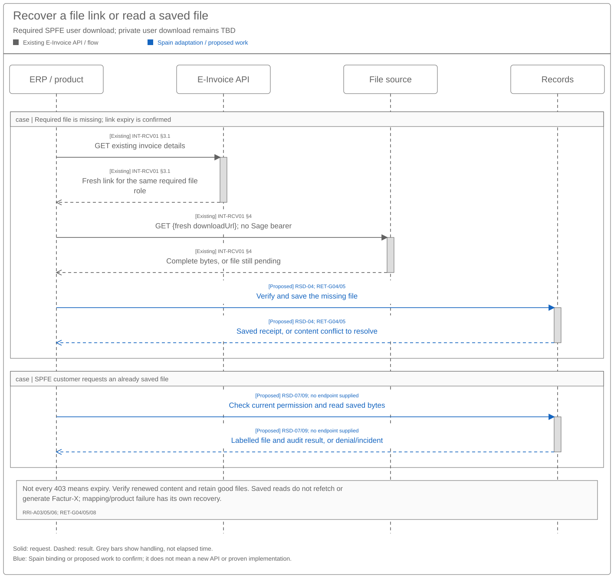

# Invoice Retrieval Sequence and Reuse Assessment

[Solution summary](SPEC-SEI-025-invoice-retrieval-solution-summary.md) · [Logical specification](SPEC-SEI-026-invoice-retrieval-logical-feature-specification.md)

## Revision overview

This view assesses the existing E-Invoice API against [SPEC016](../archive/SPEC-SEI-016-invoice-receiving-retrieval-and-download-solution-specification.md). That predecessor stays unchanged and remains the Confluence source. The supplied guide describes the implementation first used in France; it does not prove Spain support. No new endpoint or breaking change is established.

## 1 Engineering direction and product impact

Reuse the existing notification → detail → file-download pattern where qualified. Public collection needs a separate Spain contract behind the same receiving outcomes. [SPEC026](SPEC-SEI-026-invoice-retrieval-logical-feature-specification.md) owns required behaviour. INT-RCV01; REF-BASE/PRODUCT.

| Delivery scope | Reuse candidate / Spain work | Product impact / gates |
|---|---|---|
| Public MVP | Bind public discovery and separate downloads to shared capture/receiving. | Show collected files, gaps and freshness. No public webhook or product endpoint is established. RET-G01/03/06. |
| Public optional improvements | Reuse an optional refresh and qualified saved-file access. | Refresh joins existing work; reads return saved bytes. ZIP export remains outside initial scope. RET-G05/09. |
| Private platforms — later scope | Reuse subscriptions, list/detail/download; qualify each provider’s actual transfer. | Handle notification/fetch, polling or supplied bytes. No provider rollout is implied. RET-G01/02/04. |
| Shared processing | Prefer existing records, duplicate handling and inbound DTS mapping. | Keep source access, mapping and product receipt separate. Qualify actual builds/rules. RET-G05/07/09. |
| Optional derived files | Assess `format=facturx` only if selected. | Ordinary capture/read does not generate a hybrid. RET-G08. |

## 2 Proposed reuse sequences

Grey shows documented existing E-Invoice calls. Blue shows proposed Spain binding or a handoff to confirm. Supplied public SOAP operations are transport evidence; their business formats and running implementation remain unqualified. Arrows show requests and results.

### 2.1 Existing notifications, details and files

[Draw.io](../../assets/diagrams/invoice-retrieval-fr-notification-sequence.drawio) · [PNG](../../assets/diagrams/invoice-retrieval-fr-notification-sequence.png).

The product receives a scoped event, reads invoice details and downloads each required file. Capture is complete only after the bytes and evidence are saved consistently. Listing can replace a missed notification. An error event follows its own recovery action. INT-RCV01 §§1–4; INT-ERR01; RET-G01/02/04.

### 2.2 Spain public discovery and separate file recovery

[Draw.io](../../assets/diagrams/invoice-retrieval-spain-public-sequence.drawio) · [PNG](../../assets/diagrams/invoice-retrieval-spain-public-sequence.png).

Automatic collection discovers by presentation date, downloads separately and saves covered progress after source capture/classification. `GetInvoices` is an additional identity/status check when needed. A query result cannot stand in for a file. SPFE-S03/S08/S12–15; RSD-03–06.

### 2.3 Expired links, interrupted capture and stored-file access

[Draw.io](../../assets/diagrams/invoice-retrieval-file-recovery-sequence.drawio) · [PNG](../../assets/diagrams/invoice-retrieval-file-recovery-sequence.png).

Renew a confirmed expired link for the same invoice/file role; other `403` results need their actual reason. Preserve completed files during partial recovery. After capture, a saved-file request checks current permission and reads saved bytes. Its API remains unconfirmed. INT-RCV01 §4; RSD-04/07.

## 3 Existing operations and material contract gaps

| Existing operation / source | Request → result | Reuse / Spain gap |
|---|---|---|
| `POST /internal/events/subscriptions` — INT-RCV01 §1 | Event, dataset/source and HTTPS callback scope → subscription (`201`, labelled `201 OK` in guide). | Confirm access, schema/casing, security, safe replay and subscription lifecycle. RET-G01/02. |
| Received webhook — §2 | Event context; `subject` identifies invoice; nullable `data.errorCode`. | Verify scope/authenticity and map errors before using the ID. Receipt is not file capture. RET-G02. |
| `GET /datasets/{datasetId}/e-invoices/{e-invoiceId}` — §3.1 | Existing dataset/invoice IDs → details, status/history and attachment `downloadUrl`. | Confirm authoritative ID, source-file roles and Spain scope. RET-G01/04. |
| `GET /datasets/{datasetId}/e-invoices` — §3.2 | Filters/continuation → 20 items/page, `links.next`, `meta.count`, `meta.hasMore`; stated 90-day creation window. | Qualify inbound selection, date/order semantics and older recovery. RET-G03. |
| `GET {downloadUrl}` — §4 | Returned temporary URL, no `Authorization` → bytes; expired URL may return `403`. | Capture promptly; verify content. Re-read details for an expired link. RET-G04/05. |
| Detail GET with `format=facturx` — §§3.1/4 | Optional format request → generated/returned Factur-X/ZUGFeRD 2.3 `Human_Readable` attachment. | Derived file only; assess generation effects and Spain need separately. RET-G08. |
| `GetRegisteredInvoice` / `QUERYBYFILTER` — SPFE-S03/S15 | Presentation-date discovery → up to 1000 results, `SECUENCE_ID`. | Qualify exact filters/continuation and recipient authority. RET-G06. |
| `GetInvoices` / `QUERYBYID` — SPFE-S03/S14 | Up to 1000 identifiers → identity/final-status metadata. | Consultation, not general date discovery or file capture. RET-G06. |
| `DownloadInvoicesByLOC` / `DOWNLOADBYLOC` — SPFE-S03/S13 | Qualified locator → files/results; catalogue’s preferred recovery route. | Confirm recipient representation and locator binding. No LOC batch limit inferred. RET-G06. |
| `DownloadInvoicesByID` / `DOWNLOADBYID` — SPFE-S03/S12 | `ApplicationResponse` document references, up to 100 invoices → per-item results. | Qualify exact identity, envelope and partial-failure handling. RET-G06. |

### 3.1 Query coverage and recovery

The list can contain sent and received documents. Confirm inbound/self-billing selection; AP/AR names do not establish Spain mappings. Prove time boundaries, `links.next` scope, stable ordering, late arrivals and crash recovery before saving progress. The example-only `currentStatus/createdAt` filter is absent from the filter table. INT-RCV01 §3.2; RET-G01/03.

The 90-day creation window is neither retention nor complete history. Missing older coverage stays visible. No polling cadence/quota is supplied; honour valid `Retry-After` on `429`. Read/acknowledgement side effects and bounded retry remain qualification gates. RET-G02/03/06/09.

### 3.2 Identity, files, formats and source conflicts

| Contract issue | Required decision / consequence |
|---|---|
| Dataset, invoice and event IDs | Confirm represented business, partner, environment and historical route. Resolve `data.id` versus `data.attributes.eInvoiceId`; `erpInvoiceId` is not a universal deduplication key. RET-G01/02. |
| Subscription casing/security | Resolve `Data/Type/Attributes/Scope` versus lowercase examples, `opaqueToken`/`opaquetoken`, and subscription versus notification event names. Use one selected schema. RET-G02. |
| Attachment roles | Preserve `Undefined`, `UBL`, `Human_Readable`, `Original_Document`. UBL derived from Factur-X is not automatically the exchanged original. RET-G04. |
| Spain format and identity | Qualify public UBL 2.5, rectification, `CopyIndicator` and seller/number/date identity. Do not relabel example UBL 2.1; resolve `ProfileID` against final Annex I BT-23. SPFE-S02/S08/S09; RET-G06/07. |
| Extracted values | Tax totals/breakdowns are absent from the guide’s extracted response. Use the qualified structured file and assess existing DTS inbound mapping, tax/extension meaning and async result binding. RET-G07. |

### 3.3 Shared access, file safety and records

Check current client/action authority on source calls, link renewal and saved reads. Keep temporary URLs out of saved records, logs and events; do not forward Sage bearer tokens to file hosts. Qualify allowed destinations/redirects and verify file role, content, size/type and integrity. RET-G01/04/05.

Renewal does not prove immutable content. Stable attachment identity/version/hash and range/resume are missing from the guide. Partial files remain incomplete. Saved reads use qualified records permissions, retention/holds and historical access; missing/corrupt content opens a records incident. Ordinary reads do not refetch, generate Factur-X or create buyer acceptance. RSD-04/07/09; RET-G04/05/08.

### 3.4 Private-platform download boundary

A provider notification/reference requires the provider’s qualified file download. Complete supplied bytes avoid another provider fetch. The product-facing detail/`downloadUrl` flow does not prove how Sage obtained those bytes from B2B Router or another provider. Qualify provider file roles, original provenance, authority, renewal, acknowledgement and history separately. PRI-03; RRI-A01–03; REF-PRIVATE; RET-G01/04/05.

### 3.5 FR attempt errors and lifecycle separation

Use `data.attributes.history[].operationStatus` and `history[].errorCode` for the relevant attempt; `currentStatus` has neither. Preserve `IN_PROGRESS`, `COMPLETED`, `ERROR` and required `data.meta`; do not assume history ordering. INT-ERR01.

| Error situation / examples | Required handling |
|---|---|
| Notification failure — `ERR-RECEIVING-DOC-001` | Observe the platform-owned retry/support path. Do not recapture to generate another notification. |
| Missing key / duplicate — `ERR-RECEIVING-DOC-002`, `ERR-RECEIVING-NOT-25` | Qualify key ownership; check the existing transaction and file results. Do not invent an idempotency header for GET or a new invoice POST. |
| Configuration/verification — `ERR-RECEIVING-NOT-001`, `-007`, `-008` | Correct the named problem or use support; do not treat it as generic safe retry. |
| Retrieval, creation, attachment or delivery failure — `-003`, `-006`, `-009`, `-010`, `-016`, `-019` | Follow platform retry ownership and preserve completed stages. `-016` concerns a lifecycle document, not original-invoice capture. |
| Unknown/unused code or exhausted policy | Keep exact safe evidence and an owner; never default to success. `-014`/`-020` are unused; `-011` describes a temporary workaround, not DTS build proof. |

The [source dictionary](<../../context/FR API/Shared/invoice-flow-error-handling-guide-extract.md>) retains all 45 codes, including unpadded `ERR-RECEIVING-NOT-22`–`-25`. A final `ERROR` ends that attempt; later retries need separate correlation. Code-specific six-day support guidance is not a Spain legal deadline. Receiving errors cannot create payment/rejection/cancellation reports; [SPEC029](../invoice-lifecycle/SPEC-SEI-029-invoice-lifecycle-logical-feature-specification.md#5-spain-rules-and-annex-ii) owns Annex II. INT-ERR01; SPFE-S22.

## 4 Open engineering decisions

| Gate / owner | Evidence required before enabling the affected capability |
|---|---|
| RET-G01 — API, Identity, Routing, Product/Compliance | Business/dataset/partner mapping, service/environment support and current/historical action authority. RRI-Q01–03; RCV-Q02/12. |
| RET-G02 — API, Events, Security, Integration | Selected schemas/casing, authentication, event/attempt IDs, replay, errors, subscription lifecycle and read/acknowledgement effects. RCV-Q01/05. |
| RET-G03 — API, Retrieval, Operations | Inbound/date selection, pagination, stable progress, late/older history and visible gap recovery. RSD-G01/06/07. |
| RET-G04 — Integration/provider, Records, Security | Exact source/file roles, content binding, link renewal, partial/required file sets and safe transfer. RCV-Q01/03. |
| RET-G05 — Records, Product, Compliance | Existing saved-read contract/build, current permission, integrity, retention/holds, restore/export and historical access. RSD-G03/04; RCV-Q06. |
| RET-G06 — Spain connector, API, Identity/Compliance | Public filters/`MessageProperties`, `SECUENCE_ID`, LOC/ID/NIU encoding, authority, read effects and pending business formats. SPFE-Q06/09/12–14/17. |
| RET-G07 — DTS, Validation, Receiving/Product | Actual inbound build/mapping, Spain profile/rectification/copy rules, tax/extensions, async results, country isolation and support. RSD-G08; RCV-Q03/04/07/09. |
| RET-G08 — Product, API, Format/Records | Need and contract for optional Factur-X generation, access, concurrency and derived-file provenance. RRI-Q02; RCV-Q06. |
| RET-G09 — Receiving, Product, Operations | Durable capture/classification, product receipts, retry limits/escalation, per-client work, measured targets, build/run owner and existing-country regression. RCV-Q08/11/13; RRI-Q03. |

For each reuse candidate, identify the actual capability/build, Spain changes, owner and proof. A reusable pattern is not evidence that production code supports it. [SPEC026 recovery](SPEC-SEI-026-invoice-retrieval-logical-feature-specification.md#33-failure-and-recovery-decisions) defines the safe outcomes.

## 5 API qualification checks

These checks supplement SPEC026; none is claimed as executed implementation testing.

| Check | Required proof / functional link |
|---|---|
| RET-API-A01 | Wrong business/dataset/country/environment and revoked grants are denied on calls, renewal and saved reads. RSD-A01/08/13; RRI-A07/08; SPFE-S02 Article 11. |
| RET-API-A02 | Authenticate/error-check webhooks; recover duplicates, reordering, missed events and lost subscription responses. Verify receipt/attempt meaning. RRI-A02/04/09; RCV-A20. |
| RET-API-A03 | Over 20 items, mixed directions, date boundaries, repeated pages, concurrent arrivals, crashes and older-than-90-day work retain complete or visibly incomplete coverage. RSD-A03/07/10; RRI-A04. |
| RET-API-A04 | Notification-only versus supplied-file modes, missing/expired/refused/partial files, safe renewal and required/optional sets preserve good files and source identity. No bearer forwarding or unsafe access. RRI-A01–03/06; RSD-A06/09/14. |
| RET-API-A05 | Safe saved reads survive mapping/product failure, holds and provider changes; no refetch or silent disposal. RSD-A04/11; RRI-A05/08; RCV-A23/24. |
| RET-API-A06 | Public date discovery, continuation and separate LOC/ID downloads handle authority/partial failure and possible read effects. SPFE-S03/S08/S12–15; RSD-SPFE-A01–03; RSD-A16. |
| RET-API-A07 | Actual inbound DTS, copy equivalence, tax precision, corrections/extensions and source/version-bound async results pass country-isolated checks. No technical error creates a business report. RCV-A13/16–18/22; RRI-A10. |
| RET-API-A08 | Ordinary reads do not generate hybrids; optional generation preserves source, access, provenance and independent failure. RRI-A06/07; RCV-I05. |
| RET-API-A09 | Crash/lost receipt, notification failure after capture, duplicate transaction and platform retries cannot duplicate invoices or repeat good files. Stop exhausted retries with an owned unresolved case. RCV-A14/15/28/31; RSD-A02; INT-ERR01. |

## REF Source references

| REF ID | Original source and version/date | Exact location | Supported claim and limit |
|---|---|---|---|
| REF-BASE | [SPEC-SEI-016](../archive/SPEC-SEI-016-invoice-receiving-retrieval-and-download-solution-specification.md), updated 20 October 2026 | Parts 2–4; PRI/RSD/RCV contracts, data and gates | Proposed shared controls and inherited IDs; not a deployed physical API. |
| REF-PRODUCT | [PRD-SEI-211](../../prds/PRD-SEI-211-public-platform-invoice-consultation-structured-review.md), updated 20 October 2026; [PRD-SEI-223](../../prds/PRD-SEI-223-interoperability-routing-transformation.md), updated 7 October 2026; [PRD-SEI-227](../../prds/PRD-SEI-227-e-invoicing-as-a-service.md) | PRD211 FR1–55/Phase 1; PRD223 receiving FR17–20 and DTS FR43–44; shared-country direction | Canonical product sources with their recorded status; no API compatibility or runtime guarantee. |
| REF-PRIVATE | [PRD-SEI-216 B2B Router integration](../../prds/PRD-SEI-216-b2b-router-integration-structured-review.md), repository baseline reviewed 22 October 2026 | FR26–30, AC10 and evidence E3/E5/E6 limits | Private received-invoice discovery, legal-document/attachment retrieval and original capture requirements. Provider endpoint, file-delivery mode and Spain contract fitness remain unqualified; this is not a fresh verification of the provider's live API. |
| INT-RCV01 | [Selective extract of supplied FR receiving guide](<../../context/FR API/Receiving/receive-e-invoice-guide-extract.md>), received 22 October 2026, revision unknown | §1 subscription; §2 event; §3.1 detail; §3.2 list/filter; §4 file download; Polling | Guide facts and conflicts. Original attachment hash recorded in extract. OpenAPI, original page URL, full event/status/error contracts and build were not supplied. No Spain support established. |
| INT-ERR01 | [FR error-handling extract](<../../context/FR API/Shared/invoice-flow-error-handling-guide-extract.md>), received 22 October 2026, revision/build unknown | Processing and error fields; `ERR-RECEIVING-DOC`, `ERR-RECEIVING-NOT`, Recovery interpretation | Concrete history-only outcomes, 45 exact source codes and code-specific platform retry/support actions. Does not establish retry mechanics, runtime topology or Spain support. |
| SPFE-S22 | [Separate Annex II](<../../context/Anexo II/A2-Proyecto-OM-FE 21-10-26.pdf>), filename date 21 October 2026, supplied 22 October; no verified release version | §§1–4 pp. 4–14; L1 p. 15 | Eight lifecycle message types, actor roles and field cardinalities. Final BOE Annex II remains legal baseline; no retrieval endpoint/error dictionary or proven supersession. |
| SPFE-S02 | [BOE-A-2026-20587.pdf](../../context/BOE-A-2026-20587.pdf), final Order HAC/1028/2026, published 5 October 2026 | Article 6; Articles 9–11, PDF pp. 8–11; Annex I BT-23/24 | Public invoice identity, recovery/conservation and third-party representation; final profile baseline. Not the missing wire filter or provider API contract. |
| SPFE-S03 | [CatalogoServicios.pdf](<../../context/Descripción servicios web/Catálogo de servicios/20261013/CatalogoServicios.pdf>), 0.1.0, 9 October 2026 | §§6.4–6.7, pp. 12–15 | QUERYBYID/QUERYBYFILTER, presentation date, `SECUENCE_ID`, ID limits, LOC preference and authority branches. Exact encoding/ordering/recipient-authority reconciliation remain open. |
| SPFE-S08 | [FormatosEntradaSalida.pdf](<../../context/Descripción servicios web/Formatos entrada y salida/20261013/FormatosEntradaSalida.pdf>), 0.1.0, 9 October 2026, BORRADOR | §5.1.1 p. 8; §§5.4–5.7 pp. 14–15 | UBL 2.5 business documents; query/download business formats marked pending. Transport inventory does not complete them. |
| SPFE-S09 | [factura.xml](../../context/Ejemplos/20261013/factura.xml), supplied 13 October 2026 | `cbc:ProfileID`, `cbc:CustomizationID`, `cbc:CopyIndicator` | Exact example values and conflict with final Annex I BT-23. Not a complete faithful-copy or activated profile contract. |
| SPFE-S12 | [DownloadInvoicesByID.wsdl](<../../context/WSDL servicios web - PRE_29:10:2026/DownloadInvoicesByID.wsdl>), PRE release 29 October 2026 | `DownloadInvoicesByID` portType/binding, PartInfo/MIME documentation and service ports | Exact operation/PRE transport. Does not close pending business formats or prove live acceptance. |
| SPFE-S13 | [DownloadInvoicesByLOC.wsdl](<../../context/WSDL servicios web - PRE_29:10:2026/DownloadInvoicesByLOC.wsdl>), PRE release 29 October 2026 | `DownloadInvoicesByLOC` portType/binding, PartInfo/MIME documentation and service ports | Locator-download PRE transport; no inferred production address, LOC batch size or recipient authority. |
| SPFE-S14 | [GetInvoices.wsdl](<../../context/WSDL servicios web - PRE_29:10:2026/GetInvoices.wsdl>), PRE release 29 October 2026 | `GetInvoices` operation/binding/service ports | Identity-query PRE transport; opaque MIME attachments do not supply a complete business schema. |
| SPFE-S15 | [GetRegisteredInvoice.wsdl](<../../context/WSDL servicios web - PRE_29:10:2026/GetRegisteredInvoice.wsdl>), PRE release 29 October 2026 | Singular `GetRegisteredInvoice` operation; header-only WSDL messages, attachment documentation and service ports | Exact transport/name. Qualify catalogue `MessageProperties` filters and continuation semantics; the current WSDL no longer declares a generic payload part. See SPEC-SEI-011 PCN-SPFE-R02/R03 for current transport rules. |
| REF-TERMS | [Shared glossary](../../context/GLO-SEI-001-e-invoicing-terminology.md); [onboarding reuse assessment](../onboarding-and-connectivity/SPEC-SEI-039-customer-onboarding-and-connectivity-sequence-and-reuse-assessment.md), draft, 27 October 2026 | Dataset/account/address terms; onboarding GAP-01/06 | Identity terminology and current SXS/platform mapping gates; no assumption of one proven dataset per legal entity or new authority. |
| REF-EVIDENCE | [RES-SEI-002](../../context/RES-SEI-002-spain-public-platform-technical-evidence.md); [source manifest](../../assets/regulatory/spain/spfe/source-manifest.json) | Original-file inventory/hashes; SPFE-Q06/Q09/Q12–14/Q17 | Reading aid and unresolved source gates. Inventory or extract completeness does not prove mappings or implementation readiness. |
