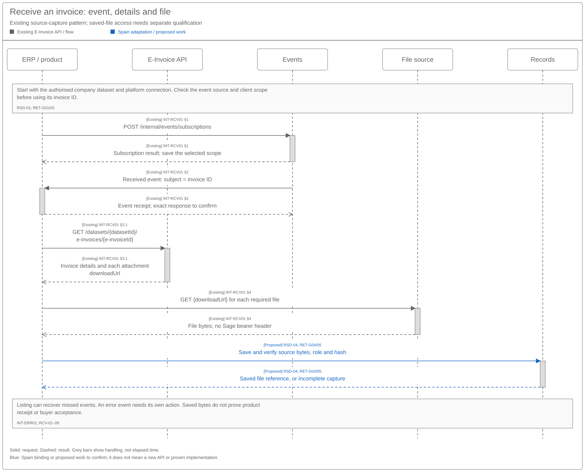
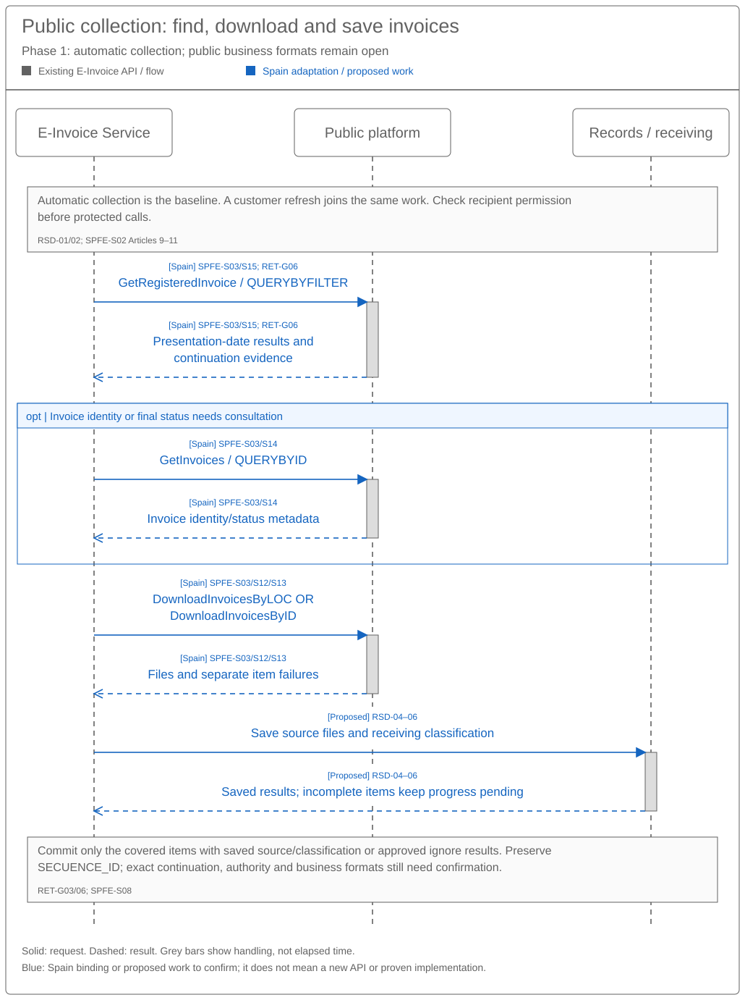
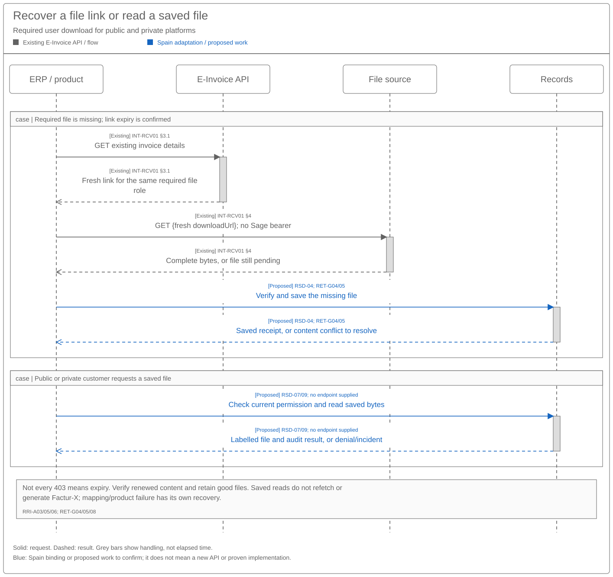
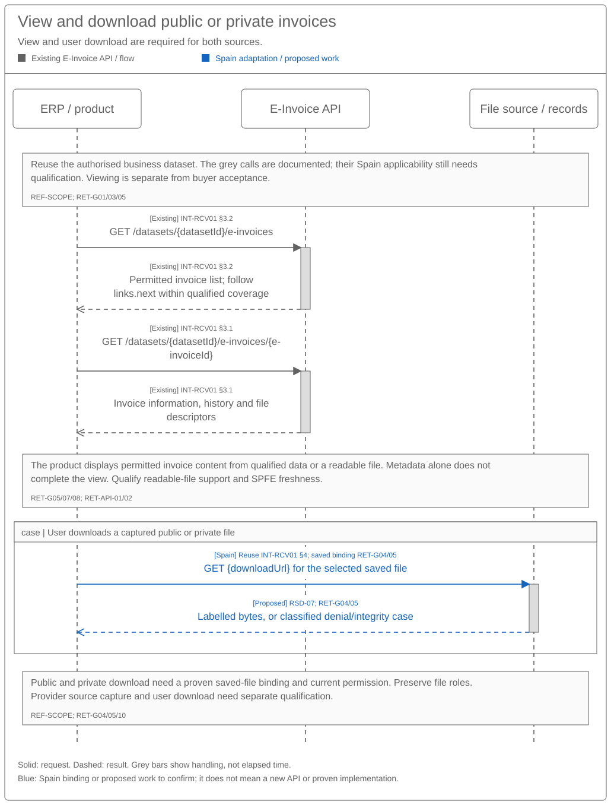

# Invoice Retrieval Sequence and Reuse Assessment

[Solution summary](SPEC-SEI-025-invoice-retrieval-solution-summary.md) · [Logical specification](SPEC-SEI-026-invoice-retrieval-logical-feature-specification.md) · [API calls and Spain changes](api-reference/SPEC-SEI-042-existing-e-invoice-retrieval-api-reference.md)

Confluence views: [Summary](https://confluence.sage.com/pages/viewpage.action?pageId=933331276) · [Required behaviour](https://confluence.sage.com/pages/viewpage.action?pageId=943980648) · [Sequences and reuse](https://confluence.sage.com/pages/viewpage.action?pageId=943980652) · [API reference](https://confluence.sage.com/pages/viewpage.action?pageId=943980662)

## Revision overview

This view assesses the existing E-Invoice API against [SPEC016](../archive/SPEC-SEI-016-invoice-receiving-retrieval-and-download-solution-specification.md). That predecessor stays unchanged; SPEC025 is the selected source for the stable Confluence overview page. This review adds the view/download scope decision and SPEC042 call details. The supplied guide was first used for France; it does not prove Spain support. No new endpoint or breaking change is established. REF-SCOPE.

## 1 Engineering direction and product impact

Reuse existing Query/Retrieve calls for the customer’s sent and received invoice views. ERP calls the Domain Service – E-Invoice Service through the existing E-Invoice API; the service returns the list or selected-invoice result to the ERP. Assess the existing attachment-download pattern for required user download across public and private platforms. Public collection needs its own Spain discovery/download binding; a product-facing GET does not prove that source integration exists. [SPEC026](SPEC-SEI-026-invoice-retrieval-logical-feature-specification.md) owns required behaviour and the scope decision. INT-RCV01; REF-BASE/PRODUCT/SCOPE.

| Delivery scope | Reuse candidate / Spain work | Product impact / gates |
|---|---|---|
| SPFE required collection, view and user download — Phase 1 | Bind public discovery/download to shared capture; qualify list/detail and safe saved-file access through existing APIs. | Show invoices, file roles, gaps and freshness; allow authorised SPFE file download. Product API applicability and source binding remain RET-G01/03/05/06. |
| Public optional improvements — Phase 1 | Assess refresh acceleration and optional notifications separately from required view/download. | Refresh joins existing work. ZIP export remains outside initial scope. RET-G02/09. |
| External private providers — Phase 2 | **View and user download required.** Reuse list/detail and saved-file access; qualify provider intake. | Qualify source-file acquisition separately from user download. Provider rollout needs RET-G01/02/04; private saved-file access needs RET-G05/10. |
| Sage private-platform offering — Phase 3 | **View and user download required.** Assess shared view/intake/download reuse and service-chain coverage. | Confirm operator readiness and actual build/contracts before enablement. RET-G01/04/09/10. |
| Shared processing | Reuse records and duplicate handling. DTS conversion applies only under [SPEC026 RCV-06](SPEC-SEI-026-invoice-retrieval-logical-feature-specification.md#32-receiving-handoff). | UBL 2.5 skips conversion. Qualify Phase 3 conversions separately from source access and ERP receipt. RET-G05/07/09; REF-DTS-SCOPE. |
| Optional derived files | Assess `format=facturx` only if selected. | Ordinary capture/read does not generate a hybrid. RET-G08. |

## 2 Proposed reuse sequences

The [SPEC026 source-choice flow](SPEC-SEI-026-invoice-retrieval-logical-feature-specification.md#choose-source-and-get-invoice) shows which file to obtain before receiving step 1. The sequences below add the calls and recovery evidence; they do not select the open private-failure recovery policy.

Grey shows documented existing E-Invoice calls. Blue shows proposed Spain binding or a handoff to confirm. Red in SPEC042 marks open evidence. Supplied public SOAP operations are transport evidence; their business formats and running implementation remain unqualified. Arrows show requests and results. A source fetch and a user download are different actions.

### 2.1 Existing notifications, details and files

[Draw.io](../../assets/diagrams/invoice-retrieval-fr-notification-sequence.drawio) · [PNG](../../assets/diagrams/invoice-retrieval-fr-notification-sequence.png).

This existing guide flow explains notification-led file capture. It does not prove private saved-file access or establish a public webhook. Capture is complete only after bytes and evidence are saved consistently. Listing can recover missed notifications within qualified coverage. An error event follows its own action. INT-RCV01 §§1–4; INT-ERR01; RET-G01/02/04.

### 2.2 Spain public discovery and separate file recovery

[Draw.io](../../assets/diagrams/invoice-retrieval-spain-public-sequence.drawio) · [PNG](../../assets/diagrams/invoice-retrieval-spain-public-sequence.png).

Automatic collection discovers by presentation date, downloads separately and saves covered progress after source capture/classification. `GetInvoices` is an additional identity/status check when needed. A query result cannot stand in for a file. SPFE-S03/S08/S12–15; RSD-03–06.

### 2.3 Expired links, interrupted capture and stored-file access

[Draw.io](../../assets/diagrams/invoice-retrieval-file-recovery-sequence.drawio) · [PNG](../../assets/diagrams/invoice-retrieval-file-recovery-sequence.png).

Renew a confirmed expired link for the same invoice/file role; other `403` results need their actual reason. Preserve completed files during partial recovery. After capture, a saved-file request checks current permission and reads saved bytes. Its API remains unconfirmed. INT-RCV01 §4; RSD-04/07.

### 2.4 Required view and user download

[Draw.io](../../assets/diagrams/invoice-retrieval-view-download-sequence.drawio) · [PNG](../../assets/diagrams/invoice-retrieval-view-download-sequence.png).

This supporting sequence expands **B. View invoice list**, **C. Select and open invoice** and **D. Download file** from the [SPEC025 presentation overview](SPEC-SEI-025-invoice-retrieval-solution-summary.md#4-end-to-end-workflow). **E. Review and take action** branches from C and continues in [SPEC029](../invoice-lifecycle/SPEC-SEI-029-invoice-lifecycle-logical-feature-specification.md#review-and-take-action); it does not require D.

The [SPEC026 §2 customer journey](SPEC-SEI-026-invoice-retrieval-logical-feature-specification.md#customer-list-open-and-download) owns the user actions and outcomes. The ERP calls the **Domain Service – E-Invoice Service**, through the existing E-Invoice API: **Query e-invoices (RET-API-01)** for the business’s sent/received list, then **Retrieve e-invoice (RET-API-02)** for the selected invoice. Each service result returns to the ERP before display. Preserve the selected ID, business and source across pages; RET-G01 still qualifies the ID relationship. For **Download file**, ERP uses a returned attachment link under RET-API-03. When descriptors were omitted or expiry is confirmed, it calls Retrieve with `includeAttachments=true` for links; the subsequent URL request transfers bytes from the file source. Download is optional and opening does not trigger it. A known qualified ID can still open detail directly; Query can also supply file links. These are existing API capabilities, not extra UI steps. [SPEC042 §1](api-reference/SPEC-SEI-042-existing-e-invoice-retrieval-api-reference.md#1-existing-product-facing-calls) owns the contract limits.

Rendering a readable document is separate from returning detail metadata. Both public and private platforms require saved-file download under SPEC026 §1. Qualify whether the existing `downloadUrl` identifies the captured source and meets Records controls before using it for this action. An absent readable rendering must not relabel XML or an original file as a PDF. REF-SCOPE; RET-G01/04/05/08/10.

## 3 Existing operations and material contract gaps

[SPEC042](api-reference/SPEC-SEI-042-existing-e-invoice-retrieval-api-reference.md#1-existing-product-facing-calls) owns RET-API-01–05 request/response detail and examples. This table relates the documented calls to reuse gaps; it does not select Spain endpoint availability.

| Existing operation / source | Request → result | Reuse / Spain gap |
|---|---|---|
| `POST /internal/events/subscriptions` — INT-RCV01 §1 | Event, dataset/source and HTTPS callback scope → subscription (`201`, labelled `201 OK` in guide). | Confirm access, schema/casing, security, safe replay and subscription lifecycle. RET-G01/02. |
| Received webhook — §2 | Event context; `subject` identifies invoice; nullable `data.errorCode`. | Verify scope/authenticity and map errors before using the ID. Receipt is not file capture. RET-G02. |
| Query e-invoices / RET-API-01: `GET /datasets/{datasetId}/e-invoices` — INT-RCV02; INT-RCV01 §3.2 | Optional filters/continuation → paginated `data[]`, nested documents, current status, `availableAttachments` and file links; no declared status history. | Qualify inbound selection and list-to-detail IDs. The guide's 20-item page/90-day window are not specified in the supplied OpenAPI. RET-G01/03. |
| Retrieve e-invoice / RET-API-02: `GET /datasets/{datasetId}/e-invoices/{e-invoiceId}` — INT-RCV03; INT-RCV01 §3.1 | Dataset and selected invoice UUID → one `data` object, status/history and `availableAttachments`. `includeAttachments` defaults to `true`; `false` omits descriptors/URLs and skips Factur-X generation. | Confirm authoritative ID, source-file roles and Spain scope. RET-G01/04. |
| File-transfer step: `GET {downloadUrl}` — INT-RCV01 §4 | Follow an attachment link from Retrieve or Query, no `Authorization` → bytes; expired URL may return `403`. No separate Sage invoice endpoint is defined. | Capture promptly; verify content. Re-read details for an expired link. RET-G04/05. |
| Detail GET with `format=facturx` — INT-RCV03; INT-RCV01 §§3.1/4 | Optional request → generate/persist hybrid or return existing `FacturX` attachment. | Guide describes `Human_Readable`; qualify role mapping, generation effects and Spain need. RET-G04/08. |
| `GetRegisteredInvoice` / `QUERYBYFILTER` — SPFE-S03/S15 | Presentation-date discovery → up to 1000 results, `SECUENCE_ID`. | Qualify exact filters/continuation and recipient authority. RET-G06. |
| `GetInvoices` / `QUERYBYID` — SPFE-S03/S14 | Up to 1000 identifiers → identity/final-status metadata. | Consultation, not general date discovery or file capture. RET-G06. |
| `DownloadInvoicesByLOC` / `DOWNLOADBYLOC` — SPFE-S03/S13 | Qualified locator → files/results; catalogue’s preferred recovery route. | Confirm recipient representation and locator binding. No LOC batch limit inferred. RET-G06. |
| `DownloadInvoicesByID` / `DOWNLOADBYID` — SPFE-S03/S12 | `ApplicationResponse` document references, up to 100 invoices → per-item results. | Qualify exact identity, envelope and partial-failure handling. RET-G06. |

### 3.1 Query coverage and recovery

| Source / boundary | Evidence and consequence |
|---|---|
| SPFE → Sage | The reviewed catalogue and PRE contracts provide query/download operations. No invoice-received webhook, subscription or WebSocket interface is established by this bundle. Sage must initiate discovery and file pulls using this baseline. Automated collection requires a Sage trigger; it is not SPFE push. Absence from this bundle is not proof that no future or separate interface can exist. SPFE-S03 §§6.4–6.7; SPFE-S12–15; REF-EVIDENCE. |
| France E-Invoice Service → consuming product | INT-RCV01 §§1–4 documents subscription → invoice-received webhook → Retrieve → attachment download. Its Polling section gives list/history polling when webhooks are unavailable. INT-ERR01 records receiving webhook failures. These sources do not prove the deployed schedule, quotas or the complete provider-to-Sage intake design. Do not assume France notifications exist for SPFE. |

**Existing product baseline:** PRD211 Product principles 1–2 requires scheduled collection independently of customer activity. Login or refresh may accelerate it. A product-facing Query or Retrieve GET does not establish that Sage makes a fresh SPFE call. REF-PRODUCT; INT-RCV02/03.

**Proposed list-open refresh — Architecture decision pending:** when a customer opens the invoice list, show captured invoices and collection freshness. If the last successful collection is too old under the selected policy, request or join an earlier pull. Keep captured invoices readable while that work runs; show a pending or failed refresh separately from an empty result. This candidate supplements the scheduled baseline. The freshness threshold, completion update mechanism and any product-to-Sage refresh contract remain unselected. User suggestion, 2 November 2026; RSD-02/03/07; RET-G03.

Architecture, API and Operations must determine the background schedule, list-open trigger, shared limits/concurrency, retry delays, duplicate-request handling and recovery after inactivity or outage. Product supplies the acceptable freshness target. Qualify SPFE limits separately from E-Invoice REST limits: the REST guide's `429`/`Retry-After` behaviour does not establish SPFE throttling. No numeric interval or quota is supplied. RET-G03/06/09.

The list can contain sent and received documents. Confirm inbound/self-billing selection; AP/AR names do not establish Spain mappings. Prove time boundaries, `links.next` scope, stable ordering, late arrivals and crash recovery before saving progress. The example-only `currentStatus/createdAt` filter is absent from the filter table. INT-RCV01 §3.2; RET-G01/03.

The 90-day creation window is neither retention nor complete history. Missing older coverage stays visible. No polling cadence/quota is supplied; honour valid `Retry-After` on `429`. Read/acknowledgement side effects and bounded retry remain qualification gates. RET-G02/03/06/09.

### 3.2 Identity, files, formats and source conflicts

| Contract issue | Required decision / consequence |
|---|---|
| Dataset, invoice and event IDs | Reuse the selected business’s NIF/certificate/authority setup and resolve its authorised dataset/environment. Query/Retrieve authenticate the application using M2M JWT; no NIF/certificate GET parameter is declared. Confirm represented business, partner, environment and historical route. INT-RCV02's list example has different outer `data[].id` and nested `documents[].eInvoiceId` values; confirm which binds the detail UUID. INT-RCV03 defines `data.id`, unlike the older guide table's `data.attributes.eInvoiceId`. `erpInvoiceId` is not a universal deduplication key. RET-G01/02. |
| Subscription casing/security | Resolve `Data/Type/Attributes/Scope` versus lowercase examples, `opaqueToken`/`opaquetoken`, and subscription versus notification event names. Use one selected schema. RET-G02. |
| Attachment availability | `availableAttachments` is a count, not a descriptor or immutable file ID. Retrieve `includeAttachments=false` omits descriptors and URL/Factur-X generation even when the count is positive. Request included links only when needed; preserve invoice/file binding. Current 13 November snapshot; RET-G04/05/08. |
| Attachment roles | Preserve `Undefined`, `UBL`, `Human_Readable`, `Original_Document`, `FacturX` from INT-RCV02/03. UBL derived from Factur-X is not automatically the exchanged original. RET-G04. |
| Spain format and identity | Qualify public UBL 2.5, rectification, the [SPEC026 copy-indicator table](SPEC-SEI-026-invoice-retrieval-logical-feature-specification.md#spain-copy-indicator) and seller/number/date identity. The flag classifies a file; it does not establish an automatic content-comparison capability. Do not relabel example UBL 2.1; resolve `ProfileID` against final Annex I BT-23. SPFE-S02/S08/S09; RET-G06/07. |
| Extracted values | Tax totals/breakdowns are absent from the guide’s extracted response. Read the required values from the checked structured file. For conversion under SPEC026 RCV-06, prove tax/extension preservation and match each result to its source and mapping version. RET-G07; REF-DTS-SCOPE. |

### 3.3 Shared access, file safety and records

Check current client/action authority on source calls, link renewal and saved reads. Keep temporary URLs out of saved records, logs and events; do not forward Sage bearer tokens to file hosts. Qualify allowed destinations/redirects and verify file role, content, size/type and integrity. RET-G01/04/05.

Renewal does not prove immutable content. Stable attachment identity/version/hash and range/resume are missing from the guide. Partial files remain incomplete. Saved reads use qualified records permissions, retention/holds and historical access; missing/corrupt content opens a records incident. Ordinary reads do not refetch, generate Factur-X or create buyer acceptance. RSD-04/07/09; RET-G04/05/08.

### 3.4 Private-platform download boundary

A provider notification/reference requires the provider’s qualified file download. Complete supplied bytes avoid another provider fetch. The product-facing detail/`downloadUrl` flow does not prove how Sage obtained those bytes from B2B Router or another provider. Qualify provider file roles, original provenance, authority, renewal, acknowledgement and history separately. PRI-03; RRI-A01–03; REF-PRIVATE; RET-G01/04/05.

### 3.5 FR attempt errors and lifecycle separation

Use `data.attributes.history[].operationStatus` and `history[].errorCode` for the relevant attempt; `currentStatus` has neither. Preserve `IN_PROGRESS`, `COMPLETED`, `ERROR` and required `data.meta`; do not assume history ordering. INT-ERR01.

| Error situation / examples | Required handling |
|---|---|
| Notification failure — `ERR-RECEIVING-DOC-001` | Observe the platform-owned retry/support path. Do not recapture to generate another notification. |
| Missing key / duplicate — `ERR-RECEIVING-DOC-002`, `ERR-RECEIVING-NOT-25` | Qualify key ownership; check the existing transaction and file results. Do not invent an idempotency header for GET or a new invoice POST. |
| Configuration/verification — `ERR-RECEIVING-NOT-001`, `-007`, `-008` | Correct the named problem or use support; do not treat it as generic safe retry. |
| Retrieval, creation, attachment or delivery failure — `-003`, `-006`, `-009`, `-010`, `-016`, `-019` | Follow platform retry ownership and preserve completed stages. `-016` concerns a lifecycle document, not original-invoice capture. |
| Unknown/unused code or exhausted policy | Keep exact safe evidence and an owner; never default to success. `-014`/`-020` are unused; `-011` describes a temporary workaround, not DTS build proof. |

The [source dictionary](<../../context/FR API/Shared/invoice-flow-error-handling-guide-extract.md>) retains all 45 codes, including unpadded `ERR-RECEIVING-NOT-22`–`-25`. A final `ERROR` ends that attempt; later retries need separate correlation. Code-specific six-day support guidance is not a Spain legal deadline. Receiving errors cannot create payment/rejection/cancellation reports; [SPEC029](../invoice-lifecycle/SPEC-SEI-029-invoice-lifecycle-logical-feature-specification.md#5-spain-rules-and-annex-ii) owns Annex II. INT-ERR01; SPFE-S22.

### 3.6 Who sends what and what comes back

| Caller → receiver | Request / result kept | Qualification / scope |
|---|---|---|
| ERP/product ↔ Domain Service – E-Invoice Service, via existing E-Invoice API | RET-API-01/02: authorised `datasetId`, sent/received scope and selected invoice ID → list/detail results, attachment availability and included links; history is in Retrieve. The ERP displays the service result. | Confirm Spain support, direction/self-billing selection and NIF/dataset/address binding. The GETs use M2M JWT, not certificate/NIF parameters. RET-G01/03. |
| E-Invoice Service → SPFE | RET-SPFE-01/02: recipient role, qualified presentation-date filters or invoice identities → discovery/status metadata and continuation evidence. | Required public collection; exact filter encoding and continuation remain RET-G06. Metadata is not a file. |
| E-Invoice Service → SPFE | RET-SPFE-03/04: qualified locator or invoice references → source invoices and distinct failed-item results. | Required source capture; preserve operation, item identity and exact bytes. RET-G04/06. |
| Product/file consumer → file source | RET-API-03: returned temporary URL → file bytes, or a classified refusal. | Candidate for required public/private user download only after saved-source binding passes RET-G04/05; private coverage also needs RET-G10. |
| E-Invoice Service / private integration → provider | Selected notification/fetch or supplied-file contract → verified source capture and intake result. | Required private view and user download need qualified intake and saved-file access. Exact provider contract and transfer mode remain RET-G01/04; private download coverage remains RET-G10. |
| Product → view/records capability — proposed | Current client/invoice/file context → readable information or permitted saved bytes, with access result. | Identify existing implementation first. No new view, render or saved-read endpoint is established. RET-G05/08/09. |

## 4 Open engineering decisions

| Gate / owner | Evidence required before enabling the affected capability |
|---|---|
| RET-G01 — API, Identity, Routing, Product/Compliance | Business/dataset/partner mapping, service/environment support and current/historical action authority. RRI-Q01–03; RCV-Q02/12. |
| RET-G02 — API, Events, Security, Integration | Selected schemas/casing, authentication, event/attempt IDs, replay, errors, subscription lifecycle and read/acknowledgement effects. RCV-Q01/05. |
| RET-G03 — Architecture, API, Retrieval, Operations; Product for freshness | Decide the pull policy in §3.1: background cadence, proposed list-open acceleration, freshness target/threshold, refresh result/contract, source versus REST quotas, concurrency and retry delays. Prove inbound/date selection, pagination, stable progress, late/older history and visible gap recovery. Confirm actual France mechanisms before reusing them. RSD-G01/06/07. |
| RET-G04 — Integration/provider, Records, Security | Exact source/file roles, content binding, link renewal, partial/required file sets and safe transfer. RCV-Q01/03. |
| RET-G05 — Records, Product, Compliance | Existing view/saved-read contracts and builds, source/file-role binding, current permission, integrity, retention/holds, restore/export and historical access beyond the list window. RSD-G03/04; RCV-Q06. |
| RET-G06 — Spain connector, API, Identity/Compliance | Public filters/`MessageProperties`, `SECUENCE_ID`, LOC/ID/NIU encoding, authority, read effects and pending business formats. SPFE-Q06/09/12–14/17. |
| RET-G07 — Validation, Receiving/Product; DTS for RCV-06 | Prove Spain format, correction and copy rules, tax/extensions, country isolation and support. For RCV-06 only, prove the Phase 3 non-UBL 2.5 → UBL 2.5 conversion build/mapping and match delayed results to their source/version. RSD-G08; RCV-Q03/04/07/09; REF-DTS-SCOPE. |
| RET-G08 — Product, API, Format/Records | Qualified product display/readable representations for required public/private view; need and contract for optional Factur-X generation. Confirm unavailable/unsupported renderings, access, concurrency and derived-file provenance. RRI-Q02; RCV-Q06. |
| RET-G09 — Receiving, Product, Operations | Durable capture/classification, product receipts, retry limits/escalation, per-client work, measured targets, build/run owner and existing-country regression. Confirm repeat-intake handling and content-comparison coverage under [SPEC026 §3.2’s capability limitation](SPEC-SEI-026-invoice-retrieval-logical-feature-specification.md#32-receiving-handoff). RCV-Q08/11/13; RRI-Q03. |
| RET-G10 — Product, Compliance, Records, provider integration | Qualify required private **user download** for each enabled external provider and the Sage offering: captured-file coverage, original/copy/derived roles, current permission, retention/holds, historical access and failure recovery. Link actual build/contracts and acceptance evidence; a missing provider contract is a delivery gap, not optional scope. RRI-Q02; REF-SCOPE. |

For each reuse candidate, identify the actual capability/build, Spain changes, owner and proof. A reusable pattern is not evidence that production code supports it. [SPEC026 recovery](SPEC-SEI-026-invoice-retrieval-logical-feature-specification.md#33-failure-and-recovery-decisions) defines the safe outcomes.

## 5 API qualification checks

These checks supplement SPEC026; none is claimed as executed implementation testing.

| Check | Required proof / functional link |
|---|---|
| RET-API-A01 | Wrong business/dataset/country/environment and revoked grants are denied on calls, renewal and saved reads. RSD-A01/08/13; RRI-A07/08; SPFE-S02 Article 11. |
| RET-API-A02 | Authenticate/error-check webhooks; recover duplicates, reordering, missed events and lost subscription responses. Verify receipt/attempt meaning. RRI-A02/04/09; RCV-A20. |
| RET-API-A03 | Scheduled pulls continue without customer sessions. If list-open acceleration is selected, fresh data avoids an unnecessary pull; stale data requests or joins one within the qualified limits. Concurrent viewers do not duplicate collection; captured content stays readable during refresh or source failure. Prove recovery after inactivity/outage. Over 20 items, mixed directions, date boundaries, repeated pages, concurrent arrivals, crashes and older-than-90-day work retain complete or visibly incomplete coverage. RSD-A03/07/10; RRI-A04; REF-PRODUCT; RET-G03. |
| RET-API-A04 | Notification-only versus supplied-file modes, missing/expired/refused/partial files, safe renewal and required/optional sets preserve good files and source identity. No bearer forwarding or unsafe access. RRI-A01–03/06; RSD-A06/09/14. |
| RET-API-A05 | Safe saved reads survive mapping/product failure, holds and provider changes; no refetch or silent disposal. RSD-A04/11; RRI-A05/08; RCV-A23/24. |
| RET-API-A06 | Public date discovery, continuation and separate LOC/ID downloads handle authority/partial failure and possible read effects. SPFE-S03/S08/S12–15; RSD-SPFE-A01–03; RSD-A16. |
| RET-API-A07 | Prove the RCV-06 phase/format cases in SPEC026 §6, copy equivalence, tax precision and correction/extension handling. For a selected Phase 3 conversion, prove the actual DTS result and source/version link. No technical error creates a business report. RCV-A13/16–18/22; RRI-A10; REF-DTS-SCOPE. |
| RET-API-A08 | Ordinary reads do not generate hybrids; optional generation preserves source, access, provenance and independent failure. RRI-A06/07; RCV-I05. |
| RET-API-A09 | Crash/lost receipt, notification failure after capture, duplicate transaction and platform retries cannot duplicate invoices or repeat good files. Stop exhausted retries with an owned unresolved case. RCV-A14/15/28/31; RSD-A02; INT-ERR01. |
| RET-API-A10 | Prove the SPEC026 §2 list → selected invoice → optional download journey, including permission changes between actions and incomplete/denied results. Prove ERP ↔ Domain Service Query/Retrieve calls and results for sent/received views. Prove Query returns a paginated list and a selected result maps to the correct Retrieve detail/history; do not equate outer and nested IDs without evidence. Both can supply file links. Check the default `includeAttachments=true`, false with a positive count, count zero, and missing/expired links followed by Retrieve with included attachments. False must skip URL and Factur-X generation. A further URL GET obtains bytes from the file source. INT-RCV02/03; RET-G01. Required public/private view enforces client/invoice permission and distinguishes source/file roles. Missing content stays visibly incomplete. SPFE shows freshness. Each enabled public/private platform offers authorised saved-file download during mapping/product failure or source outage. Check private originals and captured public originals/copies, denied access, expired-link renewal, interrupted transfers and missing/corrupt saved files. No view creates buyer acceptance. SPEC026 §2/§6; REF-SCOPE. |

The [REST snapshot register](<../../context/FR API/Receiving/openapi-source-snapshots.json>) records current and preserved earlier hashes. [The source comparison](<../../context/FR API/Receiving/receive-e-invoice-guide-extract.md#query-and-retrieve-openapi-snapshots>) identifies the 13 November additions. Both supplied files still declare `info.version: 1.0.0`; publication date and deployed build remain unknown.

## REF Source references

| REF ID | Original source and version/date | Exact location | Supported claim and limit |
|---|---|---|---|
| REF-DTS-SCOPE | [SPEC026 RCV-06](SPEC-SEI-026-invoice-retrieval-logical-feature-specification.md#32-receiving-handoff), user direction, 13 November 2026 | Conversion scope and §6 acceptance | Phase 3 conversion only when the received format is not UBL 2.5. Product decision; not proof of existing DTS build or mapping support. |
| REF-SCOPE | [SPEC026 scope decision](SPEC-SEI-026-invoice-retrieval-logical-feature-specification.md#1-purpose-actors-and-boundary), user direction, 11 November 2026 | Source/phase table; REF-SCOPE/REF-PHASE | Public/private view and user download required. Phase labels and scope decisions do not prove implementation support. |
| REF-API | [SPEC042](api-reference/SPEC-SEI-042-existing-e-invoice-retrieval-api-reference.md), draft, updated 13 November 2026 | RET-API-01–05, RET-SPFE-01–04 and REF | Detailed source-backed call analysis and proposed Spain reuse; not an approved new contract. |
| REF-BASE | [SPEC-SEI-016](../archive/SPEC-SEI-016-invoice-receiving-retrieval-and-download-solution-specification.md), updated 20 October 2026 | Parts 2–4; PRI/RSD/RCV contracts, data and gates | Proposed shared controls and inherited IDs; not a deployed physical API. |
| REF-PRODUCT | [PRD-SEI-211](../../prds/PRD-SEI-211-public-platform-invoice-consultation-structured-review.md), updated 20 October 2026; [PRD-SEI-223](../../prds/PRD-SEI-223-interoperability-routing-transformation.md), updated 7 October 2026; [PRD-SEI-227](../../prds/PRD-SEI-227-e-invoicing-as-a-service.md) | PRD211 Product principles 1–2, FR1–55/Phase 1; PRD223 receiving FR17–20 and DTS FR43–44; shared-country direction | Scheduled collection baseline and customer-triggered acceleration; canonical product scope with recorded status. No API compatibility, selected cadence or runtime guarantee. |
| REF-PRIVATE | [PRD-SEI-216 B2B Router integration](../../prds/PRD-SEI-216-b2b-router-integration-structured-review.md), repository baseline reviewed 22 October 2026 | FR26–30, AC10 and evidence E3/E5/E6 limits | Private received-invoice discovery, legal-document/attachment retrieval and original capture requirements. Provider endpoint, file-delivery mode and Spain contract fitness remain unqualified; this is not a fresh verification of the provider's live API. |
| INT-RCV01 | [Selective extract of supplied FR receiving guide](<../../context/FR API/Receiving/receive-e-invoice-guide-extract.md>), received 22 October 2026, revision unknown | §1 subscription; §2 event; §3.1 detail; §3.2 list/filter; §4 file download; Polling | Guide facts and conflicts; attachment hash recorded in extract. Reconcile with INT-RCV02/03. Original page URL, full event/status contracts and deployed build remain missing. No Spain support established. |
| INT-RCV02 | [Query e-invoices OpenAPI](<../../context/FR API/Receiving/query-e-invoices.openapi.json>), OpenAPI 3.1.0, info.version 1.0.0; current snapshot received 13 November 2026; earlier 2 November snapshot preserved | List GET; `GetInvoicesResponse` / `InvoicesResponse`; 200 example | Sent/received types, list/current status, legal addresses, attachment count/file links; unresolved outer/document ID relationship. No runtime or Spain readiness proof. See SPEC042 REF for limits. |
| INT-RCV03 | [Retrieve e-invoice OpenAPI](<../../context/FR API/Receiving/retrieve-e-invoice.openapi.json>), OpenAPI 3.1.0, info.version 1.0.0; current snapshot received 13 November 2026; earlier 2 November snapshot preserved | Detail GET; `InvoiceResponse`; `invoiceHistoryItem`; `parameters.format` and inline `includeAttachments` | Detail/history, legal addresses, attachment count and `includeAttachments` URL/generation control. No full event/attempt correlation or deployed Spain support established. |
| INT-ERR01 | [FR error-handling extract](<../../context/FR API/Shared/invoice-flow-error-handling-guide-extract.md>), received 22 October 2026, revision/build unknown | Processing and error fields; `ERR-RECEIVING-DOC`, `ERR-RECEIVING-NOT`, Recovery interpretation | Concrete history-only outcomes, 45 exact source codes and code-specific platform retry/support actions. Does not establish retry mechanics, runtime topology or Spain support. |
| SPFE-S22 | [Separate Annex II](<../../context/Anexo II/A2-Proyecto-OM-FE 21-10-26.pdf>), filename date 21 October 2026, supplied 22 October; no verified release version | §§1–4 pp. 4–14; L1 p. 15 | Eight lifecycle message types, actor roles and field cardinalities. Final BOE Annex II remains legal baseline; no retrieval endpoint/error dictionary or proven supersession. |
| SPFE-S02 | [BOE-A-2026-20587.pdf](../../context/BOE-A-2026-20587.pdf), final Order HAC/1028/2026, published 5 October 2026 | Article 6; Articles 9–11, PDF pp. 8–11; Annex I BT-23/24 | Public invoice identity, recovery/conservation and third-party representation; final profile baseline. Not the missing wire filter or provider API contract. |
| SPFE-S03 | [CatalogoServicios.pdf](<../../context/Descripción servicios web/Catálogo de servicios/20261013/CatalogoServicios.pdf>), 0.1.0, 9 October 2026 | §§6.4–6.7, pp. 12–15 | QUERYBYID/QUERYBYFILTER, presentation date, `SECUENCE_ID`, ID limits, LOC preference and authority branches. Exact encoding/ordering/recipient-authority reconciliation remain open. |
| SPFE-S08 | [FormatosEntradaSalida.pdf](<../../context/Descripción servicios web/Formatos entrada y salida/20261013/FormatosEntradaSalida.pdf>), 0.1.0, 9 October 2026, BORRADOR | §5.1.1 p. 8; §§5.4–5.7 pp. 14–15 | UBL 2.5 business documents; query/download business formats marked pending. Transport inventory does not complete them. |
| SPFE-S09 | [factura.xml](../../context/Ejemplos/20261013/factura.xml), supplied 13 October 2026 | `cbc:ProfileID`, `cbc:CustomizationID`, `cbc:CopyIndicator` | Exact example values and conflict with final Annex I BT-23. Not a complete faithful-copy or activated profile contract. |
| SPFE-S12 | [DownloadInvoicesByID.wsdl](<../../context/WSDL servicios web - PRE_29_10_2026/DownloadInvoicesByID.wsdl>), PRE release 29 October 2026 | `DownloadInvoicesByID` portType/binding, PartInfo/MIME documentation and service ports | Exact operation/PRE transport. Does not close pending business formats or prove live acceptance. |
| SPFE-S13 | [DownloadInvoicesByLOC.wsdl](<../../context/WSDL servicios web - PRE_29_10_2026/DownloadInvoicesByLOC.wsdl>), PRE release 29 October 2026 | `DownloadInvoicesByLOC` portType/binding, PartInfo/MIME documentation and service ports | Locator-download PRE transport; no inferred production address, LOC batch size or recipient authority. |
| SPFE-S14 | [GetInvoices.wsdl](<../../context/WSDL servicios web - PRE_29_10_2026/GetInvoices.wsdl>), PRE release 29 October 2026 | `GetInvoices` operation/binding/service ports | Identity-query PRE transport; opaque MIME attachments do not supply a complete business schema. |
| SPFE-S15 | [GetRegisteredInvoice.wsdl](<../../context/WSDL servicios web - PRE_29_10_2026/GetRegisteredInvoice.wsdl>), PRE release 29 October 2026 | Singular `GetRegisteredInvoice` operation; header-only WSDL messages, attachment documentation and service ports | Exact transport/name. Qualify catalogue `MessageProperties` filters and continuation semantics; the current WSDL no longer declares a generic payload part. See SPEC-SEI-011 PCN-SPFE-R02/R03 for current transport rules. |
| REF-TERMS | [Shared glossary](../../context/GLO-SEI-001-e-invoicing-terminology.md); [onboarding reuse assessment](../onboarding-and-connectivity/SPEC-SEI-039-customer-onboarding-and-connectivity-sequence-and-reuse-assessment.md), draft, updated 29 October 2026 | View/acquisition/download and dataset/account/address terms; onboarding GAP-01/02/06 | Identity and action terminology; current SXS/platform mapping gates. No assumption of one proven dataset per legal entity or new authority. |
| REF-EVIDENCE | [RES-SEI-002](../../context/RES-SEI-002-spain-public-platform-technical-evidence.md); [source manifest](../../assets/regulatory/spain/spfe/source-manifest.json) | Original-file inventory/hashes; SPFE-Q06/Q09/Q12–14/Q17 | Reading aid and unresolved source gates. Inventory or extract completeness does not prove mappings or implementation readiness. |
