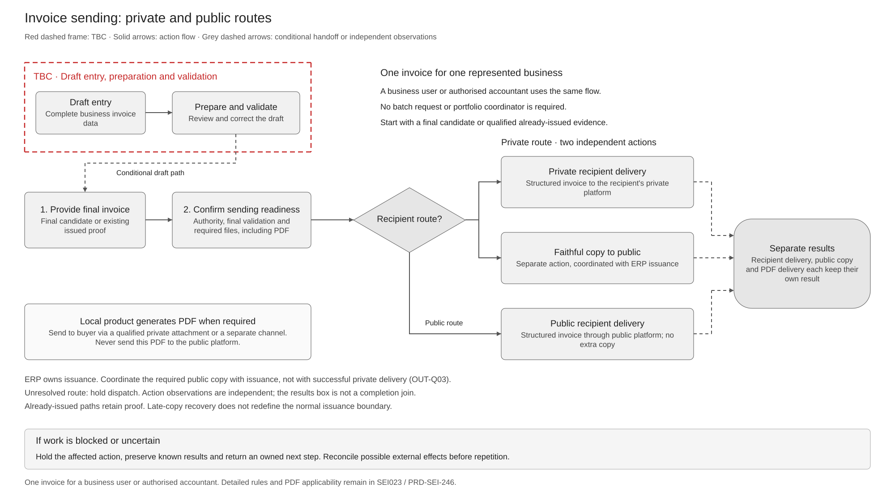

# Invoice Sending Solution Summary

[Logical Feature Specification](SPEC-SEI-023-invoice-sending-logical-feature-specification.md) · [Sequence and Reuse Assessment](SPEC-SEI-024-invoice-sending-sequence-and-reuse-assessment.md) · [Feature landing page](README.md)

## Revision overview

This separate companion set reorganises [SPEC-SEI-007](../archive/SPEC-SEI-007-invoice-sending-solution.md) for stakeholder, business-process and engineering review. It adds the supplied FR sending-guide assessment. The predecessor stays unchanged, including its detailed contracts, data inventory and field traceability. OUT activity, requirement and acceptance IDs retain their meanings.

ERP issuance ownership and independent action outcomes remain unchanged. The current journey sends one invoice for a business or its authorised accountant. PRD-SEI-246 now records the local-product transitional PDF responsibility; exact channel coverage and issuance/copy coordination remain open. SPEC-SEI-022 is selected for the existing Confluence page `923861395`. The logical specification and sequence/reuse assessment are companion pages under the same feature. Publication is authorised; all three lifecycle statuses remain draft.

## 1 Purpose and intended outcomes

A Spanish business or authorised accountant must prepare an invoice, resolve blocking issues and send the exact final invoice through a qualified route. The ERP owns issuance. The product must show what happened to each delivery or required public copy and who must act next.

This summary is for Product, directors and cross-functional stakeholders. [SPEC-SEI-023](SPEC-SEI-023-invoice-sending-logical-feature-specification.md) owns the proposed behaviour in this set. [SPEC-SEI-024](SPEC-SEI-024-invoice-sending-sequence-and-reuse-assessment.md) assesses existing APIs and evidence gaps. REF-BASE; REF-PRODUCT.

## 2 Terms used

Use the [shared glossary](../../context/GLO-SEI-001-e-invoicing-terminology.md). The represented business, authenticated caller, invoice seller/buyer, approver and signer are distinct roles. Login, connection and certificate possession do not by themselves establish action authority.

An **exchange action** has one purpose and result, such as recipient delivery or faithful public-copy submission. A processing notification or technical acknowledgement does not establish buyer acceptance.

## 3 Scope and actors

| Situation | Intended outcome / boundary |
|---|---|
| Direct business or accountant for one client | Prepare, approve where authorised and send one invoice with current business/action authority. |
| Service-assisted draft entry and validation — TBC | Confirm scope and handoff. The proposed path returns issues before issuance; correction creates a new draft revision. |
| Final candidate ready | Qualify its exact data, recipient route, files, authority and required actions before dependent issuance. |
| Public or private recipient route | Select one eligible delivery route from current evidence. Apply Spain copy rules separately. |
| Already-issued invoice or uncertain action | Preserve issuance and earlier results. Use the applicable correction or reconciliation path. |
| Transitional PDF required | The local product generates the matching PDF. Recipient delivery uses a separately qualified capability and owner. See OUT-PDF-R01/02. |

An accountant sending one client's invoice uses the same route and copy controls as the business user. Batch sending is not a prerequisite, and the supplied FR guide does not establish a bulk accountant requirement. Wider portfolio and accounting-handoff proposals stay separate under OUT-Q02.

Full setup belongs to [onboarding](../archive/onboarding/README.md). Creation, trust, route qualification and later lifecycle reporting retain their owning specifications. This sending set coordinates their handoffs; it does not approve new service boundaries. REF-BASE; REF-PRODUCT.

## 4 End-to-end workflow

The main decision is the recipient route. **Private delivery has a separate faithful public-copy action; public recipient delivery has no extra copy.** The same single-invoice flow applies to a business user or an authorised accountant. The diagram shows these actions separately so one result cannot hide another. REF-LOGICAL; SPFE-S02 Article 4.

[Full-size SVG](../../assets/diagrams/invoice-sending-end-to-end-workflow.svg) · [Editable Draw.io](../../assets/diagrams/invoice-sending-end-to-end-workflow.drawio) · [PNG](../../assets/diagrams/invoice-sending-end-to-end-workflow.png).

The **red dashed box keeps service-assisted draft entry, preparation and validation TBC**. Final candidates and qualified already-issued invoices still need current authority, final validation and an eligible route. A failed lookup holds dispatch; it cannot select public fallback.

The ERP owns issuance. Coordinate any required public copy with issuance under OUT-Q03. Recipient delivery and public-copy results stay independent; technical success does not establish buyer acceptance. OUT-SPFE-R01; SPFE-S02 Article 4; OUT-13–15.

**PDF responsibility:** the local product generates the transitional readable PDF where the [product rule](../../prds/PRD-SEI-246-spain-invoice-preparation-and-outbound-flow.md#transitional-pdf-product-rule) applies. Send it to the recipient, never to the public platform. A qualified private attachment path may carry it; the public structured-invoice route needs a separate recipient PDF channel. [SEI023](SPEC-SEI-023-invoice-sending-logical-feature-specification.md#transitional-pdf-behaviour) defines behaviour; [SEI024](SPEC-SEI-024-invoice-sending-sequence-and-reuse-assessment.md#33-transitional-pdf-generation-and-attachment-delivery) assesses upload and delivery. RD238-T2.

SEI023 retains the [process and activity order](SPEC-SEI-023-invoice-sending-logical-feature-specification.md#3-process-and-activity-order), [exception and recovery decisions](SPEC-SEI-023-invoice-sending-logical-feature-specification.md#exceptions-errors-and-recovery), [Spain rules](SPEC-SEI-023-invoice-sending-logical-feature-specification.md#4-shared-controls-and-spain-binding) and [scenario checks](SPEC-SEI-023-invoice-sending-logical-feature-specification.md#6-functional-acceptance). Recovery preserves successful actions and resolves only affected work.

## 5 Reuse direction and Spain boundaries

| Area | Direction and consequence |
|---|---|
| Shared design patterns | Retain revision binding, independent action results, approval evidence and recovery. Reusing these patterns does not prove existing code coverage. |
| FR sending APIs | Assess the documented create/upload/event/detail flow first. It starts with prepared files; it does not establish the complete draft-to-issuance Spain journey. INT-SND01; SPEC-SEI-024. |
| Shared capability with country binding | Qualify identity, addresses, document/profile selection, route evidence, trust and status mappings for the selected Spain route. |
| Transformation | Existing DTS is the preferred candidate. Qualify its build, Spain mappings, rule packs, semantic preservation and operations under [SPEC-SEI-008](../SPEC-SEI-008-spain-ubl-mapper-migration-to-dts-solution-specification.md). REF-DTS. |
| Spain-specific behaviour | Public recipient fallback, faithful copies and legal correction rules stay in Spain policy. Public transport and format evidence do not establish a ready Sage integration. SPFE-S02/S08/S16. |
| Unknown implementation | Preparation/final handoffs, copy/issuance coordination, per-action results, approval and portfolio coverage need named owners and evidence before activation. |

## 6 Material decisions and dependencies

| Decision / risk | Consequence and owner |
|---|---|
| Service-assisted draft entry and validation — TBC | ERP Product, API and Architecture must confirm the scope, owner and draft-to-final handoff before enabling this path. |
| OUT-Q01 Approval policy | Product, Identity and Spain Compliance must qualify eligible roles, manual/automatic decisions and revision binding. Missing evidence holds the dependent action. |
| OUT-Q03 Issuance and public-copy coordination | ERP, E-Invoice and Compliance owners must prove the actual boundary and partial/lost-result recovery. A saved queue intent alone is insufficient. |
| Route and trust qualification | Routing, Integration, Identity and Trust owners must supply fresh eligible route evidence and selected-purpose authority. An unresolved lookup cannot select public delivery by default. |
| FR contract and Spain coverage | API and Integration owners must pin the actual schemas/build, country fields, representation support, idempotency and event meanings. Existing FR documentation is insufficient for activation. |
| Transitional PDF delivery channel | Local Product, API, Integration and Compliance must qualify attachment or separate-channel recipient delivery. The existing attachment API is a reuse candidate; actual Spain support and delivery proof remain open under SND-G08. |
| OUT-Q02 Portfolio and accounting handoff | Separate optional scope; not required for the main single-invoice journey. Qualify it before enabling it. |

## 7 Completion and assurance

The business can see a separate known result or owned pending/unknown state for each action. An escalation or notification alone cannot close the invoice journey. Functional acceptance is in SPEC-SEI-023; engineering qualification is in SPEC-SEI-024. These drafts do not establish production readiness.

## REF Source references

| ID | Source / version and exact location | Supported claim and limit |
|---|---|---|
| REF-BASE | [SPEC-SEI-007](../archive/SPEC-SEI-007-invoice-sending-solution.md), updated 13 October 2026; Parts 1–4, OUT-Q01–03 | Predecessor design, IDs and open decisions; not implementation proof. |
| REF-LOGICAL | [SPEC-SEI-023](SPEC-SEI-023-invoice-sending-logical-feature-specification.md), draft, 22 October 2026; sections 2–6, OUT-A01–22, OUT-SPFE-A01–04 and OUT-PDF-R01/02 | Authoritative scenario, activity and acceptance detail. The overview does not approve implementation or close open decisions. |
| REF-PRODUCT | [PRD-SEI-246](../../prds/PRD-SEI-246-spain-invoice-preparation-and-outbound-flow.md), 22 October 2026, Agreed business boundaries and transitional PDF product rule; [PRD-SEI-223](../../prds/PRD-SEI-223-interoperability-routing-transformation.md), BR1–14 and FR1–16; [PRD-SEI-212](../../prds/PRD-SEI-212-public-platform-invoice-submission-structured-review.md), scope; [PRD-SEI-227](../../prds/PRD-SEI-227-e-invoicing-as-a-service.md), country-pack governance | Canonical product sources, including user-recorded local-product PDF generation responsibility. Draft scope and unresolved source differences remain subject to their owners. |
| RD238-T2 | [Original published RD 238/2026](https://www.boe.es/buscar/doc.php?id=BOE-A-2026-7295), published 31 March 2026, checked 22 October 2026; transitional provision 2(1)–(2), final provision 4 | PDF transition and recipient-only delivery restriction. The product rule owns the scope detail; the law does not allocate a Sage generator or API. |
| INT-SND01 | [Supplied FR sending-guide extract](<../../context/FR API/Sending/send-e-invoice-guide-extract.md>), received 22 October 2026; prerequisites and steps 1–5 | Documented FR operations and guide conflicts. Original guide revision, OpenAPI and deployed build unknown. |
| SPFE-S02 | [Original BOE PDF](../../context/BOE-A-2026-20587.pdf), final Order HAC/1028/2026, published 5 October 2026; Articles 3.4–3.6, 4 and 5.4–5.7; [official text](https://www.boe.es/diario_boe/txt.php?id=BOE-A-2026-20587) | Legal copy, correction and admission rules; not an ERP coordination contract. |
| SPFE-S08 | [Original formats PDF](<../../context/Descripción servicios web/Formatos entrada y salida/20261013/FormatosEntradaSalida.pdf>), draft 0.1.0, 9 October 2026; 5.1.1 p. 8 | Supplied public UBL 2.5 document selection; no proof of FR API or DTS support. |
| SPFE-S16 | [Original SendInvoice WSDL](<../../context/WSDL servicios web - PRE_29:10:2026/SendInvoice.wsdl>), PRE release 29 October 2026; operation, binding and service ports | Public PRE transport; not complete business schema or live qualification. |
| REF-DTS | [SPEC-SEI-008](../SPEC-SEI-008-spain-ubl-mapper-migration-to-dts-solution-specification.md), 13 October 2026; reuse assessment; PRD-SEI-223 FR43–46 | Preferred transformation candidate and qualification direction. |
