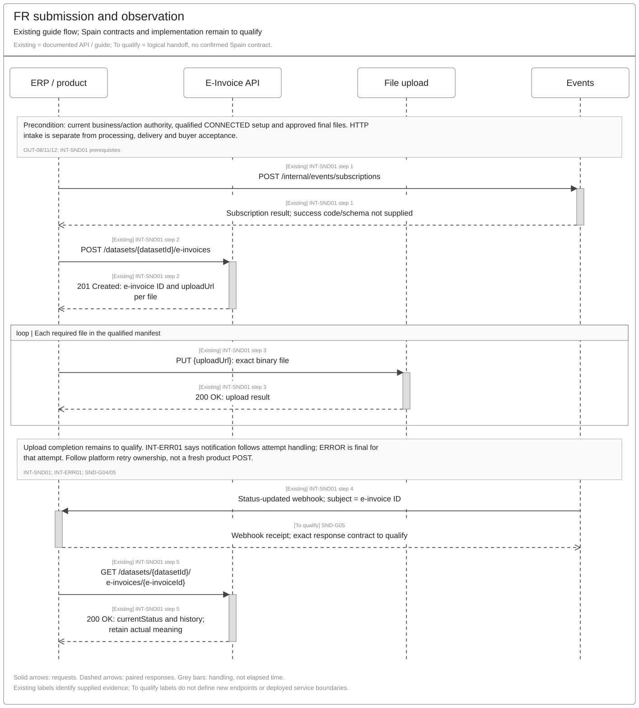
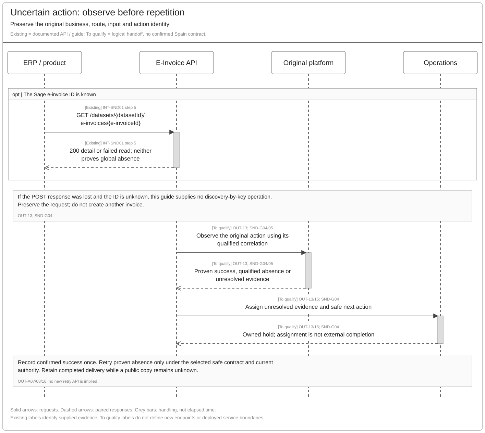

# Invoice Sending Sequence and Reuse Assessment

[Solution Summary](SPEC-SEI-022-invoice-sending-solution-summary.md) · [Logical Feature Specification](SPEC-SEI-023-invoice-sending-logical-feature-specification.md) · [Feature landing page](README.md)

## Revision overview

This separate engineering view extends [SPEC-SEI-007](../archive/SPEC-SEI-007-invoice-sending-solution.md) with the supplied FR sending guide, received 22 October 2026. It separates documented create/upload/event/detail operations from unconfirmed Spain preparation, route, issuance/copy and recovery contracts. The predecessor stays unchanged, including OUT-INT-01–11, OUT-D01–12 and detailed field traceability.

Existing OUT IDs retain their meanings. The current journey is per invoice; bulk accountant sending remains separate unqualified scope. The PDF assessment implements the recorded product direction in PRD-SEI-246. SND-G IDs identify engineering gaps. API qualification checks in §5 link to existing functional acceptance. These drafts do not change the selected Confluence source or approve new APIs.

## 1 Engineering direction and product impact

Assess the existing FR sending APIs before proposing another submission interface. Reuse is a candidate pending the selected build, contracts and Spain qualification. [SPEC-SEI-023](SPEC-SEI-023-invoice-sending-logical-feature-specification.md) owns behaviour. The FR guide starts with ready files and a connected dataset; it does not establish the full Spain draft-to-issuance journey. INT-SND01; REF-BASE/PRODUCT.

No breaking API change has been established. The rows below identify integration work and evidence to assess, rather than approved endpoint development.

| Scope | Possible shared API or country/provider work | Product integration impact / gap |
|---|---|---|
| Draft preparation and final handoff | Qualify complete-data intake, final identity/revision binding, approval and ERP issuance coordination. No physical methods/paths are evidenced. | A current file-upload integration may need additional preparation and issuance handoffs. Exact contract is open. SND-G01/06. |
| Spain public recipient delivery / required copy | Bind public UBL profile, authority, original/copy purpose, transport and request/item results. Determine whether the existing API exposes these distinctions. | Retain separate delivery/copy results and actual issuance evidence. One generic submission/status cannot be assumed sufficient. SND-G02/05/06. |
| Spain private platforms | Qualify provider access-point/address rules, format, trust and action outcome meanings. | Reuse create/upload/detail only for a supported Spain provider. Confirm which file is required and how failures return. SND-G02/03/05. |
| Shared events, reads and recovery | Qualify key/replay semantics, lost-ID discovery, upload completion, event security and authoritative results. | Retain original IDs and input; handle partial uploads, failed processing, duplicate/out-of-order events and missing notifications. SND-G04/05/07. |
| Transformation and derived files | Assess existing DTS for the selected Spain mapping. Factur-X generation is a separate documented FR retrieval option. | Do not require another ERP to produce a finished file merely because the FR guide starts there. Qualify file-generation ownership and mapping. SND-G01/03. |
| Transitional PDF companion | The local product generates the PDF. Assess existing attachment transport for qualified private delivery and a separate recipient channel where needed. | Implement OUT-PDF-R01/02; exclude this PDF from public requests. Do not infer Spain delivery or server-side generation from `application/pdf` support. SND-G08; RD238-T2. |

An authorised accountant sends one invoice for one client through the same POST/upload/result flow as the business user. The guide documents one recipient per submission; it supplies no bulk coordinator contract. Public transport batches in the AEAT catalogue are a different concern. INT-SND01; SND-G06.

## 2 Proposed reuse sequences

The sequences distinguish **Existing** guide operations from **To qualify** logical handoffs. Participants group responsibilities, not approved deployments. Requests use solid arrows; paired responses use dashed arrows. Grey bars do not promise timing.

### 2.1 Documented FR submission and observation

[Editable Draw.io](../../assets/diagrams/invoice-sending-fr-submission-sequence.drawio) · [PNG](../../assets/diagrams/invoice-sending-fr-submission-sequence.png).

Use only after current business/action authority, a qualified `CONNECTED` setup and an approved file manifest. `201` creates the Sage resource and upload references. PUT success confirms upload under its contract. The event can report processing success or `ERROR`; read details to establish the actual result. None of these facts alone proves buyer acceptance. INT-SND01 prerequisites and steps 1–5; OUT-A10/13/14.

### 2.2 Spain final plan and independent actions

[Editable Draw.io](../../assets/diagrams/invoice-sending-spain-actions-sequence.drawio) · [PNG](../../assets/diagrams/invoice-sending-spain-actions-sequence.png).

The public recipient route and private recipient route are alternatives. A required public copy is another action. The copy/issuance frame is a logical coordination requirement; it makes no claim about physical simultaneity, an atomic transaction or an existing API. OUT-Q03 must prove the boundary and failure handling. Public protocol execution follows SPEC-SEI-011; destination evidence follows SPEC-SEI-012 and connection context follows SPEC-SEI-014. SPFE-S02/S08/S16; OUT-A03/04/07/12; OUT-SPFE-A01.

The diagram covers private delivery with a required copy and direct public recipient delivery. It does not show every sender-to-recipient platform combination. The table below makes the API coverage and remaining gaps explicit. **Public/private describes the platform used by each party.** The copy decision also needs evidence of the platform actually used for issuance or interconnection; a private recipient alone does not establish a copy obligation. OUT-09/10; OUT-SPFE-R01; SPFE-S02 Articles 3.4/4.

| Sender → recipient platform | API coverage and remaining evidence | Separate faithful public copy |
|---|---|---|
| Public → private | Public issuance/interconnection is recognised in the source rules, but the public-to-private transfer is not shown in this sequence. Qualify how the private platform obtains the invoice, who performs the transfer, authority, correlation and recipient-delivery evidence. No public forwarding endpoint or private-provider download contract is established by the FR POST/upload guide. SND-G02/05/06. | None for an invoice already issued or interconnected through the public platform. Do not submit it again as a copy. |
| Private → private | The FR create/upload/event/detail flow is a candidate product-facing interface. Private delivery in the diagram covers the logical action. Qualify delivery within one provider and interconnection between different providers separately, including their downstream APIs and outcome meanings. The guide does not prove either Spain provider contract. SND-G02/03/05. | Required where public issuance/interconnection is not used. Qualify the responsible sender and issuance boundary; retain delivery and copy results separately. |
| Private → public | The public action uses qualified `SendInvoice` interconnection with an original, rather than a faithful-copy submission standing in for delivery. The WSDL establishes public intake; the selected private-provider-to-public handoff and recipient availability/delivery evidence remain to qualify. SND-G02/05/06. | No additional copy once public interconnection is established for that invoice. An earlier copy needs the governed transition in OUT-SPFE-R02; it is not a fresh-send shortcut. |
| Public → public | Public issuance or interconnection supplies the public original. The FR POST/upload flow does not document the AEAT invoice-generation form. Qualify the applicable public submission or retrieval path and recipient outcome; do not create the already-issued invoice again. SND-G02/05/06. | None for the established public issuance/interconnection. |

All four combinations remain subject to selected-build and end-to-end contract qualification. Public admission, product upload and notification arrival are distinct evidence levels. An unknown transfer/result holds the affected action under §2.3; it cannot trigger a second delivery route or a new copy. The applicable transitional PDF uses §3.3 independently of this table. OUT-A03–05/07/08; OUT-SPFE-A01/02; INT-SND01; SPFE-S02 Articles 3–5; SPFE-S16.

### 2.3 Missing or uncertain result

[Editable Draw.io](../../assets/diagrams/invoice-sending-recovery-sequence.drawio) · [PNG](../../assets/diagrams/invoice-sending-recovery-sequence.png).

Use the known e-invoice ID to query details. A lost POST response may leave no ID; the guide supplies no discovery-by-key contract. An empty/failed query is not proven absence. Keep the original context and owner until the selected contract supports a safe next action. Do not resend successful recipient delivery because a copy or status query is unknown. OUT-13; SND-G04; OUT-A07/08/16.

## 3 Existing operations and material contract gaps

These are guide-evidenced operations, not verified OpenAPI signatures or deployed Spain capability. Preserve the exact field and state names in INT-SND01; reconcile source conflicts before generating a client.

| Operation / source locator | Documented contract | Spain reuse assessment and functional coverage |
|---|---|---|
| `POST /internal/events/subscriptions`; step 1 and overview | Register resource `einvoice`, dataset, source and `e-invoicing.einvoice.statusupdated`. Operation card omits the leading slash. Success code/body not supplied. | Candidate notification pattern for OUT-14/15. Pin accessible API base, casing/schema, authentication, event library and Spain support. SND-G05/07. |
| `POST /datasets/{datasetId}/e-invoices`; step 2 | `201 Created`; resource ID and attachment `uploadUrl` values. `Idempotency-Key`, `traceparent`, `tracestate` and `Authorization` are marked required. | Candidate prepared-file intake, not OUT-01–08 preparation or ERP issuance. Prove final revision/action binding, key scope and asynchronous outcome. SND-G01/04/06. |
| `PUT {uploadUrl}`; step 3 | Binary upload, one request per attachment; `200 OK`. URL is returned dynamically. | Candidate file transport for OUT-11/12. Confirm required manifest, scan/completion trigger, expiry/renewal and partial/lost-upload recovery. Do not infer readiness from one uploaded file. SND-G03/04. |
| Status-updated webhook; step 4 | Environment/access-point-specific `source` and event type prefix; `subject` is the e-invoice ID. Example contains `datasetid`, event `id` and nullable `data.errorCode`. | Candidate observation for OUT-13–15; not a dispatch command or success-only event. Verify authenticity and scope, deduplicate, then read the authoritative result. Delivery/order/freshness semantics are unknown. SND-G05. |
| `GET /datasets/{datasetId}/e-invoices/{e-invoiceId}`; step 5 | `200 OK`; status/history, files and `downloadUrl`. `operationStatus`: `IN_PROGRESS`, `COMPLETED`, `ERROR`. | Candidate observation using a retained ID. Exact meaning of each source status and relation to delivery/copy need qualification. The overview's collection path is not evidence of a search-by-idempotency operation. SND-G04/05/07. |
| Same GET with `format=facturx`; step 5 | Can generate and persist a Factur-X/ZUGFeRD 2.3 hybrid; returns an existing hybrid without regeneration. | Optional FR representation capability. Exclude from routine status observation. Qualify Spain need, source preservation, mapping, concurrency and access before enabling. SND-G03. |
| `SendInvoice`; SPFE-S16 | Exact PRE SOAP 1.2/MIME binding; `SendInvoiceCertPort` or `SendInvoiceSealPort`. ebMS action `SUBMITINVOICE` is in SPFE-S03. | Public execution candidate behind the Sage-facing contract. Transport certificate selection does not establish invoice-signing authority. Keep transport/SOAP, request result and each item result separate. SND-G02/06. |

Public WSDL service addresses are `https://prewww1.aeat.es/wlpl/SPFE-FACT/ws/SendInvoiceSOAP` and `https://prewww10.aeat.es/wlpl/SPFE-FACT/ws/SendInvoiceSOAP`. They establish PRE contract locations only. Do not infer production addresses or live acceptance. SPFE-S16 service ports.

### 3.1 Identity, routing and representation differences

| Evidence / exact fields | Required qualification and consequence |
|---|---|
| `sender`, `recipient`, `accessPointAddressType`, `accessPointAddress`, `accessPointId` | FR routing addresses are separate from invoice seller/buyer. Sender must belong to the calling dataset. Spain address types, NIF/establishment mapping, connection scope and public/private service IDs are unknown. Do not replace `fr.siren` with an invented Spain enum. SND-G02; OUT-R04/11. |
| Submission's required values and correlation | The guide requires `sender.accessPointAddressType`, `recipient.accessPointAddressType` and `eInvoiceTypeCode`, even where an earlier schema says optional. Retain returned resource identity and optional `erpInvoiceId` linkage; the ERP reference is not an idempotency guarantee. INT-SND01 Submission design requirements and step 2; SND-G04/07. |
| Self-billing and extra recipients | Guide routes buyer to seller, one recipient per submission. Qualify material issuer, represented business, actual destination, public-copy responsibility and supported `eInvoiceTypeCode`; the guide does not resolve those Spain roles. Accountant distribution remains OUT-Q02. SND-G02/06. |
| `AR_Invoice`, `AR_CreditNote`, `AP_CreditNote` | Preserve FR codes and the guide's type `381` association. Supplied public formats use UBL 2.5 `InvoiceType`, including rectification, not `CreditNote`. Confirm any public mapping; never infer it from the FR label. SPFE-S08 p. 8; SND-G03. |
| `attachments[].mimetype` / `filename` | Guide names `ubl-2.1/xml` and `application/pdf`, filename 1–128 and address values 1–50. It supplies no Spain UBL 2.5 MIME value. Qualify selected schemas, file roles and limits without silently extending them. SND-G02/03/07. |
| FR UBL/PDF or Factur-X choice | Real France UBL can have an optional PDF; Factur-X needs one hybrid file. Demo's two-file requirement is local. Public restrictions on embedded files are distinct from MIME transport of UBL business documents; do not forward a hybrid or auxiliary PDF by default. SPFE-S02 Articles 3.5/4.4; SPFE-S03 p. 11; SND-G03. |
| Public batch, identity and results | Catalogue states 1–100 invoices, authority evaluated per invoice and a disputed 5120-byte unit limit. Preserve the conflict with supplied examples; do not silently use KB. Business `200`/`406`/`400` request codes are not HTTP codes. Example locator/response fields do not prove CSV mapping. SPFE-S03/S08/S06; SND-G02. |
| Existing DTS | Preferred transformation implementation candidate under PRD-SEI-223 FR43–46 and SPEC-SEI-008. Prove Spain field coverage, profile/version coexistence, rule isolation, final-byte validation, semantic preservation and operational ownership. FR UBL 2.1 or Factur-X support alone cannot establish this. SND-G03. |

### 3.2 Shared authentication, safety and source conflicts

Authenticate each caller, then check current represented-business and action authority. M2M access, a ready connection or trace IDs do not replace delegation or signing permission. Bind retained invoice, action and upload references to the correct business/environment. Keep token-bearing URLs and webhook credentials out of logs/events. These are proposed Sage controls supporting OUT-R07–14, not additional claims about the guide.

The guide documents `Idempotency-Key` for invoice POST but no key lifetime, input-binding rule or concurrency guarantee. The logical same-input replay/changed-input conflict requirement remains open at the API boundary. An upload retry and a fresh invoice POST have different effects. Qualify which party retries processing, the upload-complete trigger and how to observe the original action before repetition. SND-G04.

INT-SND01 records unresolved schema differences: subscription casing, `data.id` versus `attributes.eInvoiceId`, `currentStatus` object/string/empty object, a duplicated `specversion`, and unprefixed subscription event versus prefixed notification type. Its `New` example after the supposed sent event does not establish status progression. Obtain the actual schema/event/status contracts; do not build a normative payload from those examples. SND-G05/07.

Use [SEI023's exception decisions](SPEC-SEI-023-invoice-sending-logical-feature-specification.md#exceptions-errors-and-recovery) for functional handling. The source values below identify evidence to inspect; they are not a complete error catalogue or universal retry policy. INT-SND01.

| Supplied value or missing result | Meaning / API qualification |
|---|---|
| `SENDER_NOT_ONBOARDED`; connection not `CONNECTED` | Guide prerequisite failure. Resolve selected setup and inspect the existing attempt before another submission. Do not infer that asynchronous POST acceptance proved readiness. SND-G02/04/06. |
| `MALICIOUS_ATTACHMENTS` | Identify the affected file and processing outcome. The guide's fresh-local-file advice establishes no amendment, deletion or upload-renewal endpoint. Qualify safe file recovery without changing issued content or creating another invoice. SND-G03/04. |
| Status event with `data.errorCode`; `operationStatus: ERROR` | Inspect the actual error and history for the original invoice/action. Processing completion can be an error; it cannot establish that every external action failed or can be repeated. Missing status/error-library semantics remain SND-G05. |
| `Submitted`, absent event or failed detail read | Non-production `Submitted` may indicate unresolved recipient registration. Use the retained ID for qualified observation; no notification or failed refresh establishes delivery or absence. A lost POST ID has no evidenced discovery-by-key operation. SND-G04/05. |

The selected contracts must establish error stage, effect certainty, retry ownership and observation evidence. HTTP error names alone cannot release a resend. No general-purpose cancellation endpoint or fixed retry/backoff schedule is evidenced by this guide.

### 3.3 Transitional PDF generation and attachment delivery

[OUT-PDF-R01/02](SPEC-SEI-023-invoice-sending-logical-feature-specification.md#transitional-pdf-behaviour) owns behaviour. The local-product generation decision and legal applicability are recorded in [PRD-SEI-246](../../prds/PRD-SEI-246-spain-invoice-preparation-and-outbound-flow.md#transitional-pdf-product-rule). The API carries supplied files; its attachment fields are not evidence that it generates the required PDF. REF-PDF-DECISION; RD238-T2.

| Step / responsibility | Existing evidence and Spain assessment |
|---|---|
| Local product generates the PDF | Bind the file to the exact invoice/revision and applicability result. This is the recorded product allocation, not an inferred FR API capability. |
| Declare a PDF for qualified private recipient delivery | Existing `POST /datasets/{datasetId}/e-invoices` uses `attachments[].filename` and `attachments[].mimetype: "application/pdf"`. Include a matching product-generated file only when the selected Spain provider/connector is qualified to deliver it to the recipient. No new endpoint or Spain support is established by this field. INT-SND01 step 2. |
| Upload the binary | PUT the local product's file to its returned `uploadUrl`. Qualify binding, completion trigger, scanning, limits and retry safety. `200 OK` proves the documented upload result only. INT-SND01 step 3; SND-G03/04. |
| Keep the public action separate | Do not forward this PDF to `SendInvoice`, inside UBL or as a separate MIME part. An existing common attachment list needs per-action destination filtering before reuse. Public request packaging of structured UBL is a different transport concern. RD238-T2; SND-G02/08. |
| Public structured route or private connector cannot deliver the PDF | Use a separately qualified recipient channel. Channel selection, operational owner, dispatch contract, timing and receipt evidence remain open; no email or other API is assumed. A private-upload capability cannot close this gap for the public route. SND-G08. |
| Confirm the recipient obligation | Correlate PDF delivery evidence or an owned pending/failure result to the invoice. Check whether the status/detail contract actually proves PDF delivery; do not infer it from general invoice processing completion. Recover only affected work. SND-G05/08. |

`format=facturx` remains a separate FR capability that can generate a hybrid on retrieval. It is not the decided generation path for this transitional PDF. A France-optional or Demo-required PDF setting does not determine Spain applicability. INT-SND01; OUT-PDF-R01.

### 3.4 FR attempt errors and Annex II handoff

The later [INT-ERR01 error guide](<../../context/FR API/Shared/invoice-flow-error-handling-guide-extract.md>) supplies error codes and clarifies the retrieve response. Read `data.attributes.history[].operationStatus` and `history[].errorCode` for the relevant attempt. `currentStatus` contains neither field; `Submitted` can coexist with a failed sending history item. The guide marks `data.meta` required. Pin the actual schema and attempt correlation before client generation; the development reference path containing `1.13.0` is not a deployment guarantee.

| Source evidence / exact codes | Product handling and remaining qualification |
|---|---|
| Status notification follows handling; `ERROR` is final for that attempt | Record the terminal attempt and the associated invoice/action. Do not infer recipient success from notification arrival or use another history item's outcome. The relationship between a final failed attempt and later platform retry remains SND-G04/05. |
| `ERR-SENDING-DOC-001`–`004` | Source assigns retry to the platform flow and support if unchanged after six days. Product observes original work; it does not create another invoice, change key or repeat delivery/public copy. Prove platform retry trigger, identity, scope and evidence. |
| `ERR-SENDING-DOC-005`/`006`/`007` | Tracking persistence/unexpected errors require support; key lookup failure requires checking the original valid key and support if persistent. Preserve a possible provider effect even when local tracking failed. A new key is not a repair instruction. |
| `ERR-SENDING-STATUS-*` | Status-change processing is separate from invoice dispatch. Exact code actions are in INT-ERR01: selected temporary cases use platform retry; mapping/persistence/unsupported status cases need support or correction. Preserve irregular `-0010`/`-0011`. No whole-invoice resend to repair a status attempt. |
| Six-day support wording | Apply only to source rows that state it, after qualifying the selected FR build/runbook. It is not a general retry budget, Spain SLA, permission to delay a time-sensitive duty or the Articles 5.7/8.4 outage allowance. |

SPFE-S22 is a separate Annex II supplied on 22 October, not a new invoice-send error dictionary. Its reviewed event codes and key cardinalities align with final BOE Annex II. Recipient `PAYMENT`/`REJECTION`, issuer `SETTLEMENT`/`DEFAULT` and their cancellations belong to [SPEC-SEI-009](../archive/SPEC-SEI-009-invoice-lifecycle-status-solution-specification.md#annex-ii-event-field-traceability). A failed technical attempt cannot create a buyer rejection or cancel an invoice/report automatically. Keep FR processing codes, AEAT admission/error results and business lifecycle codes separate. SPFE-S02 Annex II; [supplement comparison and remaining gates](../../context/RES-SEI-002-spain-public-platform-technical-evidence.md#annex-ii-supplement-reviewed-22-october-2026).

## 4 Open engineering decisions

Each owner must record the source capability/build, retained behaviour, Spain changes, missing coverage and acceptance evidence before the affected scope is enabled. Existing implementation reuse and design-pattern reuse remain separate claims.

| Gate | Missing evidence / activation consequence | Accountable roles |
|---|---|---|
| SND-G01 Preparation and final intake | Actual complete-data and final-revision contracts, generation ownership and relationship to file POST. No claim that the supplied sending API covers preparation. | ERP Product, API, E-Invoice, Architecture. |
| SND-G02 Spain binding | Business/dataset/address mapping, provider/environment IDs, recipient eligibility and the four platform combinations in §2.2. Qualify each platform handoff and its delivery evidence, including public-to-private acquisition and same/different private providers. Pin public business schemas, profile conflict, size, batch, authority, locator and CSV meanings. Preserve SPFE-Q03/08/13/15/18. | Spain Compliance, Integration, Routing, API/public connector. |
| SND-G03 Files, DTS and trust | Required files, Spain UBL/profile and MIME support, scan/upload contracts, DTS build/mappings/rules, protected trust model and optional hybrid generation. | DTS, Validation, Trust, Security, Integration. |
| SND-G04 Mutation and recovery | Idempotency scope/window/input binding, concurrency, upload completion/renewal, lost-POST-ID discovery, original-action query, cancellation effect boundary and safe retry ownership. Unproven absence cannot release resend; missing cancel/resume contracts remain gaps. | API, Integration, Operations. |
| SND-G05 Events and result meanings | Subscription surface/schema, webhook security, selected source/type/status library, delivery/order/freshness, error outcomes and separate public-copy evidence. | API, Events, Lifecycle, Security. |
| SND-G06 Business coordination | Exact-revision decisions, current client authority and ERP issue/copy proof. OUT-Q02 portfolio/accounting contracts remain separate optional scope; no bulk API is required for the single-invoice flow. | Product, ERP, Identity, Compliance, Architecture. |
| SND-G07 Build and compatibility | Pin OpenAPI/event/schema versions, resolve guide conflicts, prove existing FR regressions, Spain isolation, monitoring/support, retention and measured capacity. Qualify retry budgets, stalled-work detection, escalation and evidence-backed case closure; no numerical targets are established here. | API owner, Architecture, Operations, Records. |
| SND-G08 PDF recipient channel | Prove actual private attachment delivery or select a separate recipient channel; qualify per-action PDF exclusion, file/revision binding, applicability/exception evidence, timing, outcomes and recovery. Generation stays with the local product. | Local Product, API, Integration, Spain Compliance, Operations. |

## 5 API qualification checks

These checks are specified evidence, not completed implementation tests. Functional checks retain their existing OUT IDs in SPEC-SEI-023.

For **Replay and recovery** and **Notifications and results**, include the INT-ERR01 case where `currentStatus.status` is `Submitted` but the relevant history item is `ERROR`/`ERR-SENDING-DOC-004`. Prove platform retry ownership, immutable attempt evidence, lost-tracking reconciliation and no fresh consumer POST/key. Resolve how later attempts are correlated. For **Public delivery and copy** and **Country isolation and compatibility**, prove no FR processing error is mapped into an Annex II business report; use the actor-specific field gates already held by SPEC-SEI-009. Source guidance and implementation tests remain separate evidence.

| Check / functional acceptance references | Evidence required before activation |
|---|---|
| Access and authority / OUT-A13–16 | Demonstrate business/dataset/environment isolation, delegated action scope, protected file URLs and authority loss between plan and execution. INT-SND01; SND-G02/06. |
| Replay and recovery / OUT-A02/08/18/20/21 | Same-input POST replay, conflicting input, concurrent calls, cancellation races and lost response retain the original action. No second invoice when the ID is unknown; cancellation remains pending after a possible effect until qualified evidence resolves it. INT-SND01 step 2; SND-G04. |
| File uploads / OUT-A06/09/20 | Partial, expired, rejected and uncertain uploads follow the pinned contract. Preserve good file bindings; no fresh invoice merely to renew upload access. Final bytes remain bound to the issued revision; scan failure cannot silently replace issued content. INT-SND01 step 3; SND-G03/04. |
| Notifications and results / OUT-A07/08/10/22 | Test success and `ERROR` notifications, duplicate/out-of-order or contradictory delivery, invalid scope/signature, lost event and failed refresh. Plain detail reads retain source evidence and freshness; never infer buyer acceptance, copy completion or a need to resend. INT-SND01 steps 1/4/5; SND-G05. |
| Formats and transformation / OUT-A06/11 | Qualify Spain mappings, public UBL 2.5/rectification, private file combinations and optional Factur-X independently. Record DTS build, pack/version and semantic-loss results; FR/Demo rules do not become Spain defaults. SPFE-S08; INT-SND01; SND-G03/07. |
| Public delivery and copy / OUT-A03–05; OUT-SPFE-A01–04; OUT-A19/21 | Exercise all four platform combinations in §2.2, with same-provider and different-provider private delivery. Prove each handoff and recipient result; hold unsupported or unknown paths. Prove actual issuance/copy coordination, original/copy classification and no extra copy after public use. Exercise permitted correction/withdrawal, partial admission and qualified outages. Include both delivery-success/copy-failure and copy-success/delivery-failure; retain completed actions. Pin schema/credential port and distinguish transport, request, item and CSV evidence. SPFE-S02/S03/S08/S16/S06; SND-G02/05/06. |
| Country isolation and compatibility / OUT-A11/12/17 | Regress existing France behaviour. A Spain rule/route upgrade cannot change another country or an earlier action plan. Record API/build support, recovery owner, retention and measured operating limits. REF-PRODUCT; SND-G07. |
| Transitional PDF delivery / OUT-PDF-A01–03 | Use a product-generated PDF in a qualified private manifest and upload it through the returned URL; prove actual recipient evidence. For the public structured route, use the qualified separate PDF channel. Inspect all public request parts for exclusion. Failed PDF work must not repeat successful invoice/copy actions. Regress FR file choices and one-client accountant sending. RD238-T2; INT-SND01; SND-G08. |

## REF Source references

The guide is supplied evidence with an unknown original revision/build. Original Spain files establish their own legal or technical facts; examples do not establish complete contracts. English extracts and the inventory are reading aids. No source proves implementation readiness.

| ID | Source / version and exact locator | Supported claim and limit |
|---|---|---|
| INT-SND01 | [FR guide evidence extract](<../../context/FR API/Sending/send-e-invoice-guide-extract.md>), received 22 October 2026; prerequisites, Submission design requirements and steps 1–5; original attachment hash recorded there | Documented methods, fields, file choices, codes and source conflicts. Canonical guide URL, full OpenAPI, event library and deployed build not supplied. |
| INT-ERR01 | [FR error-handling extract](<../../context/FR API/Shared/invoice-flow-error-handling-guide-extract.md>), received 22 October 2026, revision/build unknown; Processing and error fields; `ERR-SENDING-DOC`, `ERR-SENDING-STATUS`; Recovery interpretation | Concrete history fields, exact error actions and platform retry ownership. Selected-code six-day support guidance does not establish Spain service or legal deadlines. |
| SPFE-S22 | [Separate Annex II](<../../context/Anexo II/A2-Proyecto-OM-FE 21-10-26.pdf>), filename 21 October 2026, supplied 22 October; §§1–4 pp. 4–14, L1 p. 15 | Supplementary lifecycle code/field evidence; release and supersession unverified. Final SPFE-S02 Annex II remains legal source. No send/download endpoint or AEAT processing-error dictionary. |
| REF-BASE | [SPEC-SEI-007](../archive/SPEC-SEI-007-invoice-sending-solution.md), updated 13 October 2026; Parts 2–4, OUT-INT-01–11 and OUT-D01–12 | Original logical controls, technical analysis and acceptance coverage. |
| REF-PDF-DECISION | [PRD-SEI-246 PDF product rule](../../prds/PRD-SEI-246-spain-invoice-preparation-and-outbound-flow.md#transitional-pdf-product-rule), updated 22 October 2026; agreed boundaries and product rule | Local-product generation allocation and single-invoice scope; not a deployed PDF channel contract. |
| RD238-T2 | [Original published RD 238/2026](https://www.boe.es/buscar/doc.php?id=BOE-A-2026-7295), published 31 March 2026, checked 22 October 2026; transitional provision 2(1)–(2), final provision 4 | Source of the PDF applicability and recipient-only restriction; no API or PDF-generation allocation. |
| REF-PRODUCT | [PRD-SEI-223](../../prds/PRD-SEI-223-interoperability-routing-transformation.md), BR1–14 and FR43–46; [PRD-SEI-227](../../prds/PRD-SEI-227-e-invoicing-as-a-service.md), country-pack governance; [SPEC-SEI-008](../SPEC-SEI-008-spain-ubl-mapper-migration-to-dts-solution-specification.md), updated 13 October 2026, DTS reuse assessment | Shared/country separation and preferred DTS candidate. Source designs do not prove deployed contracts or mappings. |
| SPFE-S02 | [BOE PDF](../../context/BOE-A-2026-20587.pdf), final Order HAC/1028/2026, published 5 October 2026; Articles 3.4–3.6, 4 and 5.4–5.7; [official text](https://www.boe.es/diario_boe/txt.php?id=BOE-A-2026-20587) | Legal copy, file, admission and correction duties; no physical API coordination contract. |
| SPFE-S03 | [Catalogue PDF](<../../context/Descripción servicios web/Catálogo de servicios/20261013/CatalogoServicios.pdf>), draft 0.1.0, 9 October 2026; sections 6.2–6.4 pp. 10–12 | Submission/withdrawal/query descriptions, per-invoice authority, batch and disputed byte limit. Selected provider/build qualification remains open. |
| SPFE-S08 | [Formats PDF](<../../context/Descripción servicios web/Formatos entrada y salida/20261013/FormatosEntradaSalida.pdf>), draft 0.1.0, 9 October 2026; 5.1.1 p. 8, 5.1.2 pp. 8–12, 5.2 p. 14 | UBL 2.5 document selection, messaging and business response codes. Not an invoice schema or DTS build. |
| SPFE-S16 | [SendInvoice WSDL](<../../context/WSDL servicios web - PRE/20261013/SendInvoice.wsdl>), supplied 13 October 2026; documentation, operation, SOAP binding, certificate/seal ports | Exact PRE transport; opaque UBL attachments need separate validation. No production endpoint or replay promise. |
| SPFE-S06 | [RespuestaAltaFacturas.xml](<../../context/Descripción servicios web/Ejemplos y peticiones de repuesta/20261013/01 - SendInvoicesSOAP/RESPUESTA/RespuestaAltaFacturas.xml>), supplied 13 October 2026; DocumentResponse / DocumentReference | Illustrative item results, locator and response identifier; not complete CSV mapping. |
| REF-SPAIN | [RES-SEI-002](../../context/RES-SEI-002-spain-public-platform-technical-evidence.md), source register and open SPFE questions; [manifest](../../assets/regulatory/spain/spfe/source-manifest.json) | Original-file versions/hashes, source conflicts and contract inventory; not mapping completeness or live acceptance. |
