# Customer Offboarding Solution Summary

[Logical Feature Specification](SPEC-SEI-032-customer-offboarding-logical-feature-specification.md) · [Sequence and Reuse Assessment](SPEC-SEI-033-customer-offboarding-sequence-and-reuse-assessment.md) · [Feature folder](README.md)

## Revision overview

This separate draft develops [SPEC-SEI-003](../archive/SPEC-SEI-003-offboarding-solution-specification.md) into three review views. It adds platform responsibility scenarios, separate support and access periods, explicit cutoff handling and a fuller export assessment. The predecessor remains unchanged and selected for stable Confluence page `923861391`.

OFF-01–08, OFF-I01–08, OFF-R01–10 and OFF-A01–11 retain their meanings. Existing detailed interaction and data inventories remain in SPEC-SEI-003. No provider contract, retention schedule, lifecycle status or publication approval changes. Support durations, commercial terms and the practical delivery of invoice-copy rights remain open product and legal decisions.

## 1 Problem and intended outcomes

A business can leave Sage while invoices still need delivery confirmation, payment reporting, corrections or evidence. Ending every capability at subscription expiry can strand this work. Keeping every capability active indefinitely leaves unclear authority, cost and security exposure. The business needs a dated statement of what stops, what continues, who owns it and how records remain available. REF-PRODUCT.

The intended outcomes are an observed switch for new traffic, an accountable path for earlier obligations, a usable evidence handover, and controlled access removal. The [logical specification](SPEC-SEI-032-customer-offboarding-logical-feature-specification.md) defines the behaviour. This summary presents the decisions needed to offer it.

## 2 Scope and platform responsibilities

| Situation | What Sage must coordinate within its authorised scope | What needs separate evidence |
|---|---|---|
| Business leaves the Sage private platform for another private platform | Scope, destination proof, new-traffic cutoff, Sage history, release and export. | Destination acceptance and the old/new operators' historical responsibilities. |
| Business leaves another private platform and retains its Sage product | Destination onboarding and route change; the previous provider's exit steps only where authorised. | Previous-provider notice, withdrawal, export and historical access. Sage cannot promise their execution without a contract. |
| Business changes an external private provider while Sage coordinates both connections | One scoped transition; preserve both operators' actual evidence and independent release gates. | Supported direction/address granularity and each provider's action/query contract. |
| Business stops using its Sage product but keeps a private-platform agreement | Identify which product access and commercial scope ends. | Whether the platform agreement, mandate and independent archive access continue. Product cancellation is not proof of platform termination. |
| Business ends its full Sage e-invoicing scope | Account for all selected entities/directions, future receipt, unfinished work and data disposition. | A valid external/public destination where required, or evidence supporting a different treatment. |
| A private provider becomes unavailable or access is compromised | Protect records and deadlines; establish an approved alternative and incident owner. | Emergency authority, obtainable evidence and a technically supported recovery path. |

The business administrator or authorised accountant approves scope. Product and Operations own the customer exit statement. Each platform operator owns its external actions under its agreement. Legal/Tax determines continuing obligations; Privacy/Records determines data disposition; Security controls credential release. These are responsibilities, not proposed service boundaries.

## 3 End-to-end flow

[Editable Draw.io](../../assets/diagrams/offboarding-planned-exit-process.drawio) · [PNG](../../assets/diagrams/offboarding-planned-exit-process.png).

The existing diagram shows the planned OFF-01–07 journey. G4 changes new traffic. G5 keeps earlier work accountable. G6 and G7 separately release dependencies and assign data disposition. Export preparation can start before cutover; OFF-07 is its completion and disposition gate. The diagram's order does not require all export generation to wait until release. A partial or uncertain result follows OFF-08 in the logical view.

## 4 How long should support continue?

**Recommendation for product review:** use separate periods with explicit start events. Avoid one account-wide expiry. The following numbers are planning proposals for OFF-Q01; they are neither statutory periods nor existing Sage commitments. Detailed rules and failure handling are authoritative in SPEC-SEI-032, section 4.

| Period | Proposed starting position | Approval needed |
|---|---|---|
| Planned notice and preparation | Aim for 30 calendar days before intended cutover. Allow an expressly agreed shorter period or urgent exit. | Product/Commercial and provider owner: contractual notice, customer need and achievable destination proof. |
| New invoice traffic | Stop the old authorised scope at observed cutover. A support or export period does not extend permission to send new invoices. | Route and provider owners: exact transaction boundary and inbound propagation behaviour. |
| Transition assistance and self-service export | Offer 90 calendar days from observed cutover, with dates stated before approval. | Product/Operations: staffing, access, fees, notice and exception route. This window cannot override continuing rights or duties. |
| Earlier invoice obligations | Continue the necessary restricted processing until completion or evidenced handover. Review unresolved cases every 30 calendar days and before each due date. | Legal/Tax, Operations and providers: permitted actor/channel, cost and escalation. No unowned expiry or indefinite full-service access. |
| Invoice-copy access and retained evidence | Establish a separate lawful access and retention schedule. | Legal/Records: applicable rights, custodian, request channel, retention triggers and holds. See REF-COPY and REF-PRIVACY. |
| Credentials | Remove each credential after its final dependency ends; review retained access with the historical case. | Security and the relevant obligation owner. A compromised credential follows incident containment. |

Spain's Law 56/2007 Article 2 bis.3 gives recipients four years from invoice issue to request copies without additional cost. This is not four years of full Sage service. The accountable copy provider, applicable commencement rules and post-exit channel need Legal confirmation. REF-COPY; OFF-Q03.

## 5 Do we need export?

**Yes: provide an authorised export and evidence-handover capability.** This is already in the draft product baseline, OFR12–13. For each exit, agree whether the customer receives files, an authorised destination receives them, or a verified continuing archive supplies access. Record the result and limitations. A change of provider does not automatically transfer records or transfer responsibility for unfinished actions. REF-PRODUCT.

The package must distinguish source invoice files, public copies, readable renditions and event/report evidence. A PDF-only package cannot establish the complete structured evidence handover. SPEC-SEI-032, section 5 defines scope, manifest, receipts, late additions and recovery. Public download capabilities are inputs to this assessment; they do not prove that every source original, private acknowledgement or history item is available. REF-SPFE.

## 6 Reuse and Spain boundaries

| Area | Intended Spain use and reuse classification | Qualification needed |
|---|---|---|
| Exit case, scoped gates and recovery | Reuse the proposed OFF design pattern. | Existing implementation, product access after cancellation and Operations tooling remain unknown. |
| Connection update, disconnection and observation | Assess the existing FR implementation first; bind Spain/provider rules separately. | Version-specific removal scope, completion evidence, shared-address impact and historical access. REF-FR. |
| Export, authorised retrieval and archive | Assess shared records/retrieval capabilities before creating another export implementation. | Coverage, completeness, access after subscription end and destination import. |
| DTS transformation | Preferred candidate if export needs an additional supported representation. | Actual build, contracts, mappings, rule packs and operations. Preserve exact originals separately; conversion cannot manufacture missing evidence. |
| Spain-specific behaviour | Keep identity, receiving publication, public-copy and reporting rules in Spain policy. | Post-switch actor/channel and receiving-point sequence remain open. Another country's exit rules cannot activate Spain coverage. |

The [reuse assessment](SPEC-SEI-033-customer-offboarding-sequence-and-reuse-assessment.md) records source capability, local changes, owner and evidence gaps. No production exit implementation is established by this review.

## 7 Decisions needed before a customer commitment

| Decision | Consequence and accountable role |
|---|---|
| OFF-Q01 Support/notice/access periods and charges | Product/Commercial/Operations must accept or amend the planning proposal and update PRD-SEI-243 before it becomes a service commitment. |
| OFF-Q02 Historical execution and custody | Legal/Tax and both platform owners must identify who can act after switch and who retains each record. PRD OD1/2/6. |
| OFF-Q03 Copy access, retention and deletion | Legal/Privacy/Records must bind applicable copy rights, retention duties, controller instructions and legal holds by data class. PRD OD5. |
| OFF-Q04 Provider and route contract | Platform owners must qualify notice, granularity, completion observation, inbound propagation and emergency handling. PRD OD3/4/8. |
| OFF-Q05 Export and receiving-party acceptance | Records/Product and destination owner must agree package coverage, supported imports, omissions, receipts and later additions. |
| OFF-Q06 Service and security exceptions | Operations/Security must define restricted post-exit access, escalation, unavailable customer handling and compromised-access recovery. |

These decisions block the dependent commitment or automation. They do not require unrelated product shutdown or publication. An owned manual gate is possible only with authority and evidence; it cannot waive an applicable obligation.

## REF Source references

| Source ID | Original source, version/date and locator | Supported claim and limit |
|---|---|---|
| REF-PRODUCT | [PRD-SEI-243](../../prds/PRD-SEI-243-customer-offboarding-and-provider-exit.md), draft 5 October 2026; OFR1–15, OD1–8. [SPEC-SEI-003](../archive/SPEC-SEI-003-offboarding-solution-specification.md), draft updated 8 October 2026; Parts 1–4. | Canonical product baseline and proposed OFF design. Neither approves new support periods. |
| REF-COPY | [Law 56/2007, consolidated BOE text](https://www.boe.es/buscar/act.php?id=BOE-A-2007-22440#a2bis), checked 22 October 2026; Article 2 bis.3 and associated effectivity notes. | Recipient copy-request right. No universal Sage support duration or automatic allocation to a former platform. |
| REF-PRIVACY | [GDPR, published BOE text](https://www.boe.es/buscar/doc.php?id=DOUE-L-2016-80807), 4 May 2016; Articles 5(1)(e), 28(3)(g). | Storage limitation and processor return/deletion subject to required retention. Roles and schedules need qualification. |
| REF-SPFE | [Original Order HAC/1028/2026 PDF](../../context/BOE-A-2026-20587.pdf), published 5 October 2026, Articles 9–11; [official BOE](https://www.boe.es/buscar/doc.php?id=BOE-A-2026-20587). SPFE-S02 in the [evidence baseline](../../context/RES-SEI-002-spain-public-platform-technical-evidence.md). | Recovery, download and access framework. No full private-platform archive transfer or offboarding API. Exact technical sources are in SPEC-SEI-033 REF. |
| REF-FR | [Saved access-point guide extract](<../../context/FR API/Onboarding/access-point-guides-evidence-extract.md>), received 22 October 2026; INT-AP02/03/05/06. | Evidence of versioned address removal, asynchronous disconnection and observation limits. Guide versions conflict; Spain support is unproven. |
