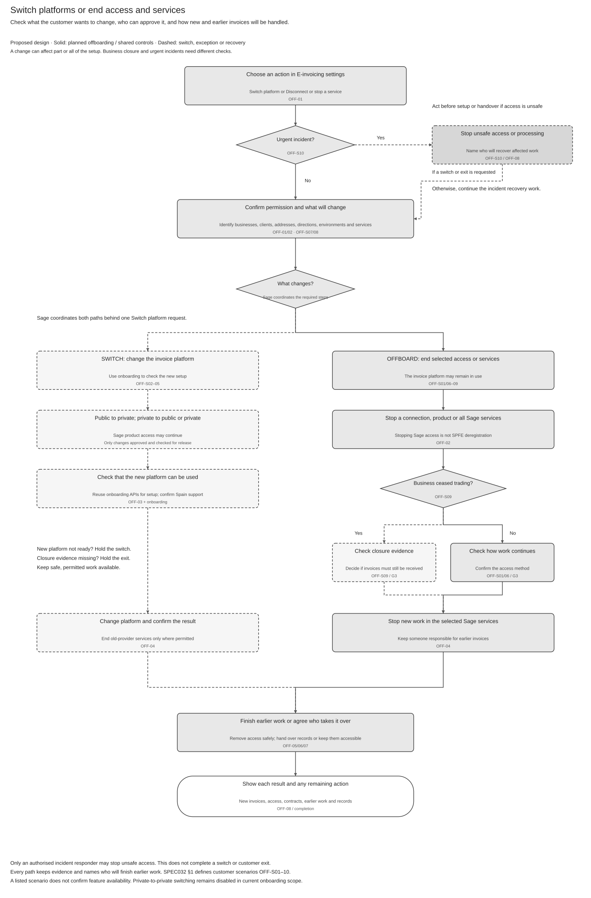

# Customer Offboarding Solution Summary

[Logical Feature Specification](SPEC-SEI-032-customer-offboarding-logical-feature-specification.md) · [Sequence and Reuse Assessment](SPEC-SEI-033-customer-offboarding-sequence-and-reuse-assessment.md) · [Feature folder](README.md)

## Revision overview

This separate draft develops [SPEC-SEI-003](../archive/SPEC-SEI-003-offboarding-solution-specification.md) into three review views. It adds platform responsibility scenarios, separate support and access periods, explicit cutoff handling and a fuller export assessment. The predecessor remains unchanged and selected for stable Confluence page `923861391`.

OFF-01–08, OFF-I01–08, OFF-R01–10 and OFF-A01–11 retain their meanings. Existing detailed interaction and data inventories remain in SPEC-SEI-003. No provider contract, retention schedule, lifecycle status or publication approval changes. Support durations, commercial terms and the practical delivery of invoice-copy rights remain open product and legal decisions.

## 1 Problem and intended outcomes

A business can leave Sage while earlier invoices still need delivery confirmation, payment reporting or correction. It may also need access to invoice records. Ending all access when the subscription expires can prevent this work. Keeping all services active creates cost and security risks. The customer needs to know what stops, what continues, who is responsible and how records remain available. REF-PRODUCT.

The result must show when new invoice processing changes, who will finish earlier work, how records are handed over or kept accessible, and which access has ended. The [logical specification](SPEC-SEI-032-customer-offboarding-logical-feature-specification.md) defines the required behaviour. This summary explains the customer outcomes and decisions still needed.

## 2 Scope and platform responsibilities

| Situation | What Sage must coordinate within its authorised scope | What needs separate evidence |
|---|---|---|
| Business leaves the Sage private platform for another private platform | Check the new platform, confirm when new invoices change platform, and arrange earlier work and records access. | The new provider's acceptance and who will handle earlier invoices at each provider. |
| Business leaves another private platform but keeps its Sage product | Set up the new platform and coordinate old-provider steps only where Sage has permission. | The old provider's notice, exit, export and access rules. Sage cannot promise to perform actions outside its contract. |
| Business changes external private provider while Sage coordinates both connections | Coordinate one change and obtain separate confirmation from each provider. | Whether each provider supports the selected address or invoice direction, and how completion is confirmed. |
| Business stops using its Sage product but keeps a private-platform agreement | Identify the subscription and access that end. | Whether the platform agreement, authority and separate archive access continue. Product cancellation does not automatically end the platform agreement. |
| Business ends all identified Sage e-invoicing services | Account for future invoice receipt, unfinished work, access and records for each selected business and direction. | A working replacement where required, or an accepted decision that no replacement is needed. |
| A private provider becomes unavailable or access is compromised | Stop unsafe work, protect evidence and name who will manage recovery and deadlines. | Permission for emergency action and a working recovery method. |

The business administrator or authorised accountant approves what will change. Product and Operations explain the exit terms to the customer. Each platform operator confirms its own actions. Legal/Tax confirms which duties continue. Privacy/Records decides how records are kept, returned or deleted. Security decides when credentials can be removed. These responsibilities do not prescribe separate technical services.

## 3 End-to-end flow

### Customer action: switch or offboard

**Customer entry point:** use E-invoicing settings to **Connect or add a platform**, **Switch platform**, or **Disconnect or stop a service**. A switch is one customer request. Sage coordinates new setup and any old-service exit behind that request, with progress and next actions shown in settings. [SPEC038](../onboarding-and-connectivity/SPEC-SEI-038-customer-onboarding-and-connectivity-logical-feature-specification.md#e-invoicing-settings-intended-interaction) owns this intended interaction.

A **switch** changes the platform used to send or receive new invoices. **Offboarding** ends selected access or services. A switch can include ending old access or services. The customer starts one switch request, which can affect part or all of their setup. The [logical spec's customer-action table](SPEC-SEI-032-customer-offboarding-logical-feature-specification.md#customer-action-scenarios), OFF-S01–10, defines the ten scenarios, including urgent incidents and business closure. A listed scenario is not a promise that the feature is available.

[The settings overview lives in SPEC037](../onboarding-and-connectivity/SPEC-SEI-037-customer-onboarding-and-connectivity-solution-summary.md#e-invoicing-settings-overview). [SPEC038 owns the complete customer switch journey](../onboarding-and-connectivity/SPEC-SEI-038-customer-onboarding-and-connectivity-logical-feature-specification.md#switch-platform-one-customer-journey). This offboarding set defines the old-service exit checks within that journey, or a standalone disconnect. Its switch references do not create another customer request. The diagram below expands those checks.

[Editable Draw.io](../../assets/diagrams/offboarding-and-switch-customer-actions.drawio) · [PNG](../../assets/diagrams/offboarding-and-switch-customer-actions.png) · [Customer-action scenarios](../../work/offboarding-review/customer-actions.html).

Start by checking for an urgent incident. Stop unsafe access when needed, without waiting for the planned switch or exit checks. Then identify what the customer wants to change. If the business has ceased trading, confirm whether a replacement platform is needed. Every path must leave someone responsible for earlier work and records.

Ending Sage access to SPFE is different from changing where new invoices are received. Neither action proves that the customer has deregistered from SPFE. The exact public-access steps remain open under OFF-Q02/04; see SPEC-SEI-033 §3.3.

Onboarding and offboarding describe the work Sage must coordinate. They do not require separate customer journeys for a switch. [SPEC033](SPEC-SEI-033-customer-offboarding-sequence-and-reuse-assessment.md#how-the-onboarding-apis-support-a-platform-switch) keeps API reuse and Spain implementation checks separate from the settings interaction.

### Planned exit and recovery

[Editable Draw.io](../../assets/diagrams/offboarding-planned-exit-process.drawio) · [PNG](../../assets/diagrams/offboarding-planned-exit-process.png).

The existing diagram shows the normal OFF-01–07 process. G4 confirms when new invoice processing changes. G5 assigns earlier work. G6 checks which access and services can end. G7 confirms records handover and the rules for keeping or deleting data. Export preparation can start before the change; it does not need to wait for access removal. Use OFF-08 when an action partly succeeds or its result is unknown.

## 4 How long should support continue?

**Recommendation for product review:** use separate periods with explicit start events. Avoid one account-wide expiry. The following numbers are planning proposals for OFF-Q01; they are neither statutory periods nor existing Sage commitments. Detailed rules and failure handling are authoritative in SPEC-SEI-032, section 4.

| Period | Proposed starting position | Approval needed |
|---|---|---|
| Planned notice and preparation | Aim for 30 calendar days before the planned change. Allow an agreed shorter period or urgent exit. | Product/Commercial and the provider owner confirm notice terms, customer needs and time to check any new platform. |
| New invoices | Stop starting new work in the old service when the change is confirmed. Extra support or export time does not permit new invoicing there. | Route and provider owners agree which invoices belong to each platform and how receipt changes take effect. |
| Transition assistance and self-service export | Offer 90 calendar days from the confirmed change. State the dates before approval. | Product/Operations confirm staffing, access, fees, notices and exceptions. Continuing rights and duties still apply. |
| Earlier invoice duties | Continue only the necessary work until it is finished or a new owner accepts it. Review open cases every 30 calendar days and before each due date. | Legal/Tax, Operations and providers confirm who can act, how, at what cost and when to escalate. |
| Invoice-copy access and retained evidence | Agree separate rules and dates for access and keeping records. | Legal/Records confirm applicable rights, who keeps records, how copies are requested and when deletion must be paused. REF-COPY; REF-PRIVACY. |
| Credentials | Remove each credential when no remaining authorised work needs it. Review any continued access with the earlier-work case. | Security and the work owner confirm removal. Compromised access follows the incident process. |

Spain's Law 56/2007 Article 2 bis.3 gives recipients four years from invoice issue to request copies without additional cost. This is not four years of full Sage service. The accountable copy provider, applicable commencement rules and post-exit channel need Legal confirmation. REF-COPY; OFF-Q03.

## 5 Do we need export?

**Yes: provide an authorised export and evidence-handover capability.** This is already in the draft product baseline, OFR12–13. For each exit, agree whether the customer receives files, an authorised destination receives them, or a verified continuing archive supplies access. Record the result and limitations. A change of provider does not automatically transfer records or transfer responsibility for unfinished actions. REF-PRODUCT.

The export must identify original invoice files, public copies, readable copies such as PDFs, and event/report evidence separately. PDFs alone are not a complete handover of structured invoice records. SPEC-SEI-032, section 5 defines the file list, delivery confirmation, later additions and recovery. Public downloads can supply some records, but do not prove that all originals, private-provider responses or history are available. REF-SPFE.

## 6 Reuse and Spain boundaries

| Area | Intended Spain use and reuse classification | Qualification needed |
|---|---|---|
| Exit case, scoped gates and recovery | Reuse the proposed OFF design pattern. | Existing implementation, product access after cancellation and Operations tooling remain unknown. |
| Connection update, disconnection and observation | Assess the existing FR implementation first; bind Spain/provider rules separately. | Version-specific removal scope, completion evidence, shared-address impact and historical access. REF-FR. |
| Export, authorised retrieval and archive | Assess shared records/retrieval capabilities before creating another export implementation. | Coverage, completeness, access after subscription end and destination import. |
| DTS transformation | Preferred candidate if export needs an additional supported representation. | Actual build, contracts, mappings, rule packs and operations. Preserve exact originals separately; conversion cannot manufacture missing evidence. |
| Spain-specific behaviour | Keep identity, receiving publication, public-copy and reporting rules in Spain policy. | Post-switch actor/channel and receiving-point sequence remain open. Another country's exit rules cannot activate Spain coverage. |

The [reuse assessment](SPEC-SEI-033-customer-offboarding-sequence-and-reuse-assessment.md) records source capability, local changes, owner and evidence gaps. No production exit implementation is established by this review.

## 7 Decisions needed before a customer commitment

| Decision | Consequence and accountable role |
|---|---|
| OFF-Q01 Support/notice/access periods and charges | Product/Commercial/Operations must accept or amend the planning proposal and update PRD-SEI-243 before it becomes a service commitment. |
| OFF-Q02 Earlier work and records | Legal/Tax and both platform owners must identify who can act after the switch and who keeps each record. PRD OD1/2/6. |
| OFF-Q03 Copy access, retention and deletion | Legal/Privacy/Records must bind applicable copy rights, retention duties, controller instructions and legal holds by data class. PRD OD5. |
| OFF-Q04 Provider and route contract | Platform owners must confirm notice terms, which parts can be removed, how completion is checked, when receipt changes take effect and how emergencies are handled. PRD OD3/4/8. |
| OFF-Q05 Export and receiving-party acceptance | Records/Product and destination owner must agree package coverage, supported imports, omissions, receipts and later additions. |
| OFF-Q06 Service and security exceptions | Operations/Security must define restricted post-exit access, escalation, unavailable customer handling and compromised-access recovery. |

An open decision prevents the affected promise or automatic action. Other safe work can continue. A manual step needs a named owner, permission and completion evidence. It cannot remove an applicable duty.

## REF Source references

| Source ID | Original source, version/date and locator | Supported claim and limit |
|---|---|---|
| REF-PRODUCT | [PRD-SEI-243](../../prds/PRD-SEI-243-customer-offboarding-and-provider-exit.md), draft 5 October 2026; OFR1–15, OD1–8. [SPEC-SEI-003](../archive/SPEC-SEI-003-offboarding-solution-specification.md), draft updated 8 October 2026; Parts 1–4. | Canonical product baseline and proposed OFF design. Neither approves new support periods. |
| REF-COPY | [Law 56/2007, consolidated BOE text](https://www.boe.es/buscar/act.php?id=BOE-A-2007-22440#a2bis), checked 22 October 2026; Article 2 bis.3 and associated effectivity notes. | Recipient copy-request right. No universal Sage support duration or automatic allocation to a former platform. |
| REF-PRIVACY | [GDPR, published BOE text](https://www.boe.es/buscar/doc.php?id=DOUE-L-2016-80807), 4 May 2016; Articles 5(1)(e), 28(3)(g). | Storage limitation and processor return/deletion subject to required retention. Roles and schedules need qualification. |
| REF-SPFE | [Original Order HAC/1028/2026 PDF](../../context/BOE-A-2026-20587.pdf), published 5 October 2026, Articles 9–11; [official BOE](https://www.boe.es/buscar/doc.php?id=BOE-A-2026-20587). SPFE-S02 in the [evidence baseline](../../context/RES-SEI-002-spain-public-platform-technical-evidence.md). | Recovery, download and access framework. No full private-platform archive transfer or offboarding API. Exact technical sources are in SPEC-SEI-033 REF. |
| REF-FR | [Saved access-point guide extract](<../../context/FR API/Onboarding/access-point-guides-evidence-extract.md>), received 22 October 2026; INT-AP02/03/05/06. | Evidence of versioned address removal, asynchronous disconnection and observation limits. Guide versions conflict; Spain support is unproven. |
