# Customer Offboarding Logical Feature Specification

[Solution Summary](SPEC-SEI-031-customer-offboarding-solution-summary.md) · [Sequence and Reuse Assessment](SPEC-SEI-033-customer-offboarding-sequence-and-reuse-assessment.md) · [Feature folder](README.md)

## Revision overview

This separate draft develops the logical view of [SPEC-SEI-003](../archive/SPEC-SEI-003-offboarding-solution-specification.md). It expands Sage/external private-platform scenarios, cutoff behaviour, support/access periods and export recovery. The predecessor remains unchanged and selected for stable Confluence page `923861391`.

OFF-01–08, OFF-I01–08, OFF-R01–10 and OFF-A01–11 keep their original meanings. OFF-R11–17 and OFF-A12–29 develop the draft PRD. OFF-S01–10 classify customer actions and make public-access, closure and incident paths explicit. OFF-Q01–06 identify unresolved decisions in SPEC-SEI-031. Numeric periods are proposals requiring a product decision. The detailed interaction/data records remain in SPEC-SEI-003 Part 3; new implementation placement is outside this view.

Terminology follows the [shared glossary](../../context/GLO-SEI-001-e-invoicing-terminology.md). An authenticated caller still needs authority for the represented business and requested action. A transport acknowledgement does not prove completed disconnection, handover or reporting.

## 1 Scope, actors and observable outcomes

The customer administrator or an authorised representative requests the change. They identify the business, environment, invoice direction and services affected. Each platform confirms the actions it has completed. Operations follows up unfinished work. Legal/Tax confirms which duties continue. Records/Privacy decides how records are kept, returned or deleted. Security controls access and credentials. REF-PRODUCT.

### Classification and scope

Use the [shared definitions](../../context/GLO-SEI-001-e-invoicing-terminology.md#switching-and-offboarding). A **switch** changes the platform used to send or receive new invoices. **Offboarding** ends the selected access or services. A switch can include ending old access or services, for example moving to another provider and cancelling Sage access. This remains one customer request.

The [SPEC038 — E-invoicing settings](../onboarding-and-connectivity/SPEC-SEI-038-customer-onboarding-and-connectivity-logical-feature-specification.md#e-invoicing-settings-intended-interaction) owns the customer entry point. **Switch platform** is one customer action. The new-platform onboarding and old-service offboarding are coordinated parts of that request, not separate processes the customer must start. Use **Disconnect or stop a service** when no replacement platform is requested. Show the combined request's progress and unfinished actions in settings.

For either route, record whether the change affects **part** or **all** of the customer's setup. Identify the businesses, clients, addresses, invoice directions, environments and services affected. Leave everything else unchanged.

Check for an urgent incident first (OFF-S10). An authorised incident responder can stop unsafe access before the new platform is ready or earlier work has been handed over. Record what stopped and who will recover the affected work. Handle any later switch or cancellation as a separate decision. If the business has ceased trading (OFF-S09), confirm whether it still needs to receive new invoices; a replacement platform may not be required.

### Customer-action scenarios

For switching scenarios, this table owns the **old-service exit responsibilities**. [SPEC038 owns the complete customer switch journey](../onboarding-and-connectivity/SPEC-SEI-038-customer-onboarding-and-connectivity-logical-feature-specification.md#switch-platform-one-customer-journey). Follow that journey and apply the relevant OFF checks within the same request. For a disconnect without a replacement platform, SPEC032 owns the exit journey.

| ID | Customer action and condition | Category | Required result | Failure or recovery |
|---|---|---|---|---|
| OFF-S01 | Stop using Sage to access SPFE; continue directly or through another authorised product. | Offboarding | Stop the selected Sage access and automatic tasks. Confirm who will continue required work and how. Record any removal of Sage's authority separately. | If continuing work has no confirmed owner or access method, hold the planned access removal that would prevent it. Do not report that the customer has deregistered from SPFE or ended all authority. OFF-05/06; REF-SPFE. |
| OFF-S02 | Receive future invoices through a private platform instead of the public platform. | Switch; also offboarding if old access or services end | Onboarding checks the new setup. Confirm that receipt has changed as authorised. Keep earlier public invoices and applicable public-copy/reporting duties accounted for. | If the new receiving arrangement is not confirmed, hold the switch. Keep public access where permitted. Do not report public-platform deregistration. OFF-03/04; REF-RD/REF-SPFE. |
| OFF-S03 | Leave a private provider and use SPFE or Sage private through the Sage product. | Switch + end old-provider services | Onboarding checks the new setup. Coordinate the old provider's exit and handover only where Sage has permission to do so. | If Sage cannot perform an external step, name who must do it and what confirmation is needed. A working new connection does not prove that the old service has ended. |
| OFF-S04 | Move from Sage private to another private platform. | Switch + end Sage-platform services | Confirm that the new platform works and record when new invoices change platform. Keep each earlier invoice linked to its original platform and preserve agreed access. | If the new platform is not ready, hold the switch. OFF-03/08. |
| OFF-S05 | Change external private provider but keep the Sage product. | Switch + end old-provider services | Coordinate one change for the selected businesses and invoice directions. Obtain separate confirmation from each provider. | A successful step at one provider cannot close an unfinished step at the other. |
| OFF-S06 | Cancel the Sage product but keep a platform agreement. | Product offboarding | End only the selected subscription and access. Before removing the product login, provide another permitted way to use any retained platform or invoice archive. | Hold access removal if it would prevent required continuing access. Cancelling the product does not automatically end the platform agreement. |
| OFF-S07 | Disconnect one business, client, address or invoice direction. | Partial switch and/or offboarding | Change only what the customer selected. Keep other services and shared credentials working. | Do not remove the whole connection if it would affect other work. If partial removal is unsupported, hold that step and name the owner. |
| OFF-S08 | End all the customer's identified Sage e-invoicing services. | Full Sage offboarding; switch if needed | Show separate results for new invoices, future receipt, earlier work, contracts, access and records. | Keep unfinished invoice or export work visible after the subscription ends. Ending Sage services does not automatically end external agreements. |
| OFF-S09 | The business has ceased trading and requests exit without a new platform. | Offboarding with business-closure checks | Legal/Tax checks the evidence and decides how future receipt must be handled. Record that decision at G3 before the planned stop. Name who will finish earlier work. | If evidence is missing, hold the planned exit or check a replacement platform. If the no-destination decision is accepted, do not require a replacement platform. No deregistration process is assumed. |
| OFF-S10 | The provider is unavailable or access is compromised. | Incident / recovery | An authorised incident responder stops unsafe access or processing immediately. Keep the evidence. Name who will recover affected work and how. Decide separately whether a later switch or exit is needed. | Do not wait for destination checks (G3) or handover (G5) to stop compromised access. An outage does not authorise a new platform or prove that the old one can continue safely. OFF-08. |

The supplied files contain no named SPFE offboarding operation. How Sage access and representation are changed remains open under OFF-Q02/04; see SPEC-SEI-033 §3.3. The table describes the scenarios to assess, not the features available in a release. Private A → private B switching remains disabled in current onboarding scope. Product must enable the relevant direction and the platform owners must confirm it works before use. REF-ONB.

Onboarding provides connection setup for a switch. The existing connect and update APIs may support that setup; they do not establish that the complete switch is supported for Spain. [SPEC033 — How the onboarding APIs support a platform switch](SPEC-SEI-033-customer-offboarding-sequence-and-reuse-assessment.md#how-the-onboarding-apis-support-a-platform-switch) maps the calls and remaining checks.

The [solution-summary diagram](SPEC-SEI-031-customer-offboarding-solution-summary.md#customer-action-switch-or-offboard) shows how these scenarios enter the workflow below.

## 2 State, invariants and workflow

Retain the predecessor's case stages: `REQUESTED`, `INVENTORY`, `DESTINATION_READY`, `CUTOVER_PENDING`, `CUTOVER_OBSERVED`, `HISTORICAL_CONTINUITY`, `RELEASE_PENDING`, `DISPOSITION_PENDING`, `COMPLETE`, `BLOCKED`, `OUTCOME_UNKNOWN`, `CANCELLED`. These are proposed internal states. They are not provider values.

The `DESTINATION_READY` stage records which G3 check passed. This can be a new platform, a retained access method, or an accepted decision that no new platform is needed. The state name alone does not prove that a new platform was set up.

Track route, registration, credentials, subscription, export and retained-data obligations separately. `COMPLETE` requires resolved or evidenced handover of historical work and assigned, owned disposition schedules. Future scheduled retention/deletion may continue after case closure only with a durable owner, due date, evidence and reopen/escalation path. Case closure does not assert that every retained record has already been deleted. REF-PRODUCT OFR7/8/13.

The authoritative invariant statements remain [OFF-I01–08](../archive/SPEC-SEI-003-offboarding-solution-specification.md#1-scope-state-and-invariants): scope/authority, destination isolation, inbound continuity, invoice origin, unknown outcomes, separate release, historical ownership and factual evidence. The following activities apply those rules.

| Activity / gate | Required behaviour and visible result | Safe next action |
|---|---|---|
| OFF-01 / G1 Authority and scope | Apply section 1. Confirm the business, caller, permission, selected scope and any required new platform. Check permission to end contracts separately. Link a repeated request to the same unchanged input. | Reject planned changes with unclear permission or scope. Process overlapping requests in order or report a conflict. OFF-S10 defines incident permission. |
| OFF-02 / G2 Inventory | List current platforms, work in progress, receipt progress, reporting duties, registrations, shared credentials, records and contracts. Record later changes. Show the customer the section 4 exit statement. | Hold a planned stop or access removal if missing information could leave invoices or duties unhandled. |
| OFF-03 / G3 Destination or continuing-work decision | For a switch, confirm that the new platform can send or receive as required. For access/product-only exit, confirm the retained or replacement access method. For business closure, apply OFF-S09. Saved configuration alone is insufficient. | Correct and retest without disturbing a safe existing service. Record which check passed. Incident containment follows OFF-S10 separately. |
| OFF-04 / G4 Cutover | Recheck permission, current evidence and route version. Apply one change for the selected scope. Confirm what changed in Sage and at the provider. Section 3 determines which platform handles each invoice. | If an external change may have occurred but its result is unknown, record `OUTCOME_UNKNOWN` and use OFF-08. |
| OFF-05 / G5 Historical continuity | For each unfinished duty, name who will act, how they may act, the due date, supporting evidence and required access. If responsibility moves, record the new owner's acceptance. | Keep unfinished work assigned and escalate before its due date. A support end date cannot close it. REF-RD, REF-SPFE. |
| OFF-06 / G6 Release | Confirm each applicable action separately: stopping old traffic, withdrawing receipt, contract-supported deregistration, removing credentials and ending contracts. Check what still uses shared access before removing it. OFF-S01 applies to public access. | For unsupported automation, identify a permitted manual step, owner and completion evidence. An unknown result blocks actions that depend on it. OFF-S10 governs urgent security action. |
| OFF-07 / G7 Export and disposition | Complete the records or access handover in section 5. Record approved dates and rules for keeping, holding or deleting each data class. | Repair missing records or agree a permitted alternative and its limits. A failed download is not a complete export. |
| OFF-08 Recovery | Check what happened to the original operation before making another change. Keep invoices linked to the platform that handled them. A cancellation can undo only reversible work; reversing a completed external change needs a new controlled transition. | Operations records the result, deadlines, customer notice, next permitted action and responsible owner. |

[Editable Draw.io](../../assets/diagrams/offboarding-recovery-process.drawio) · [PNG](../../assets/diagrams/offboarding-recovery-process.png). The diagram explains OFF-08's reconciliation decision. An urgent security action uses incident authority and records the unavailable historical path rather than claiming continuity that cannot be delivered.

## 3 What stops at cutoff?

The **cutoff** is the confirmed point when the old service stops starting new work for the selected scope. Record its time, time zone, route version and the rule for assigning invoices before and after it. An invoice date, planned cancellation date or request-arrival time alone does not prove which provider has started handling an invoice. REF-PRODUCT OFR5/6; proposed detail under OFF-R11.

| Work at the boundary | Required treatment | Control and recovery |
|---|---|---|
| New eligible invoice after observed cutoff | Use the qualified destination for the selected scope. Reject or hold an attempt to start new traffic on the old scope with an actionable reason. | Historical access and the 90-day proposal do not permit new invoicing through the old route. |
| Prepared/queued invoice with no external effect | Apply the agreed commitment rule. If no binding original plan exists, re-evaluate the current qualified route before first submission. | Record reassignment and invalidate the obsolete send plan. An issued invoice retains its identity and content. |
| Queued invoice bound to an earlier route | Resolve under its documented original plan or an expressly authorised change with proof that no old-provider effect occurred. | Do not infer that a queue item is safe to resend from its creation time. |
| Send accepted, in progress or outcome unknown | Preserve original operator/correlation and reconcile there. | A destination change does not authorise replay. |
| Late inbound invoice on the old connection | Preserve receipt, original provider and deduplication evidence. Handle through the qualified transition rule and alert the route owner. | Do not discard, silently forward or issue a new business invoice. Release remains pending if receipt/publication is unresolved. |
| Repeated callback, status update or late payment | Accept and attribute only through the permitted historical channel. Reconcile duplicates/conflicts against prior evidence. | Product cancellation cannot turn an old event into a new invoice or a completed public report. |
| New rectifying invoice linked to old history | Evaluate as a new invoice under the confirmed current country/provider rule, keeping the original reference. | Cross-provider correction handling remains OFF-Q02; neither route is assumed. |
| Credential shared with retained entities or directions | Remove only the selected authority if supported; retain the shared dependency with restricted scope. | If independent removal is unsupported, hold that release and assign a provider owner. |

If destination state becomes uncertain during propagation, stop only the unsafe work and open OFF-08. An available last safe route may continue only where the observed provider state, mandate and country rules permit it. No automatic switch back follows.

## 4 Support, access and expiry controls

### Exit statement

Before authorisation, the customer and Operations must see current and destination operators; selected entities/directions; requested and observed cutoff; commercial end date; each remaining action/channel; support hours and response/escalation terms; support end/review date; archive custodian and copy-request channel; export scope/readiness/expiry; fees or contractual limits; provider notice requirements; and the next action/owner for unresolved items. Dates must name their start event and time zone. OFF-R09/12.

### Proposed planning periods

These are candidates for OFF-Q01 and PRD-SEI-243, not approved requirements or existing service levels.

| Item | Candidate | Why this boundary is separate |
|---|---|---|
| Planned preparation | 30 calendar days before intended cutoff; shorter by explicit agreement or emergency process. | Allows destination and inventory work. It cannot override a provider's evidenced notice requirement. |
| Transition support and self-service export | 90 calendar days after observed cutoff for the affected scope. | Provides a bounded assistance/access offer. Staged cutovers have separately recorded dates. The commercial end may differ. |
| Unresolved historical obligations | Until completion or evidenced handover; review at least every 30 calendar days and before any earlier due date. | A fixed account expiry cannot decide legal authority or make an unpaid invoice disappear. |
| Copy access, records and credentials | No common duration proposed. Use the applicable approved schedule or actual dependency end. | They have different purposes and triggers. REF-COPY; REF-PRIVACY. |

OFF-R12 requires a recorded decision before any of these durations becomes a customer promise. OFF-Q01 must also decide reminder timings, support response targets, charges and the authority for extensions. Do not infer those terms from the candidate periods.

### When a period expires

| Condition | Required result | Next action |
|---|---|---|
| Assistance window ends; all relevant handovers complete | End the agreed transition assistance and general access, retaining only separately authorised functions. | Show the continuing copy/archive channel and disposition schedule. |
| Historical obligation or provider result remains unresolved | Keep its owner, deadline and permitted channel visible. Do not mark it complete from the date alone. | Escalate before expiry; decide restricted continuation, accepted alternative or incident response. No restoration of new-traffic permission. |
| Package is incomplete or inaccessible due to Sage/provider failure | Keep export/disposition pending. Give a repair owner and revised delivery/access dates. | A timed-out link does not erase the obligation to deliver the agreed package. |
| Customer does not download or reply | Record delivery attempts, contractual notices and available alternatives. | Apply approved non-response policy; never invent a receipt or infer consent to deletion. OFF-Q06. |
| Self-service access ends while an applicable copy right continues | Provide the approved authenticated request channel. | Do not require renewal solely to obtain a copy that must be supplied without additional cost. Legal confirms the accountable party. REF-COPY. |
| A legal hold or retention requirement remains | Restrict retained records to the approved purpose; keep custodian and review date. | Defer the affected deletion. Expiry of general access is not evidence of data deletion. REF-PRIVACY. |
| Security requires immediate revocation | Contain the credential risk under incident authority. | Record affected duties, notices and alternative recovery. Do not keep a compromised secret active solely to meet an exit date. |

The copy-right baseline is four years from each invoice's issue under Article 2 bis.3, subject to applicability. It is not measured from offboarding. Legal must confirm responsible parties, effectivity and the delivery channel. REF-COPY; OFF-Q03. Do not substitute that period for a data-class retention schedule.

## 5 Export and evidence handover

### Scope and package

An authorised customer must be able to obtain the agreed evidence under OFR12. Agree the package before cutoff. For product-only cancellation or a partial exit, a verified continuing archive can avoid an unnecessary bulk transfer, but the customer must still have the permitted export/copy path. Record whether delivery is to the customer, an authorised destination or an accepted archive custodian. REF-PRODUCT; OFF-R13.

| Evidence class | Required content where held and in agreed scope | Limitation to expose |
|---|---|---|
| Invoice files | Exact stored source bytes, identifiers, syntax/version, source/provider, direction and issue/receipt timestamps. Preserve signatures/seals and validation evidence where held. | Missing originals, unavailable attachments and unsupported formats. A transformed file is separately labelled. |
| Other representations | Public original or faithful-copy classification and any readable rendition, with provenance and links to the invoice. | Public copy and private source original may differ. Do not relabel one as the other. |
| Delivery and lifecycle | Acknowledgements, raw provider values, attributed events, event times and separate commercial/payment/reporting outcomes. | Missing external history, unknown meanings and observations that do not prove final delivery. |
| Public reporting | Submitted communications, response/receipt references, cancellations and destination-specific unresolved results. | An invoice download does not prove all reports succeeded. REF-SPFE. |
| Exit and unfinished work | Cutover/route evidence, obligation owner/channel/due date, handover acceptance and relevant authorisation evidence with necessary redaction. | Transfer of files alone does not grant the destination authority to act. |
| Machine-readable manifest | Entity/environment/scope, snapshot boundary, package/part versions, inventory counts, file hashes, relationships, omissions and completeness result. | Counts and hashes prove only against the recorded inventory; they cannot prove that the source inventory was complete. |

Never include private keys, bearer tokens or reusable credentials. Apply tenant/entity/delegate isolation and minimise unrelated personal data. Returning personal data under a processor contract and exporting invoice evidence are separately qualified obligations. REF-PRIVACY; OFF-R14.

### Delivery, later additions and recovery

| Step | Observable result and failure handling |
|---|---|
| Prepare | Check export authority and inventory coverage early. If preparation precedes cutoff, label its snapshot boundary. Unavailable source records create an owned omission. |
| Generate and validate | Reconcile manifest counts and relationships to inventory, compute hashes and verify that package parts can be read. Large exports use resumable parts/checkpoints under the qualified implementation. An incomplete part cannot count as delivered. |
| Deliver | Use an authenticated, scoped channel with an explicit expiry. Log generation, availability, retrieval and receiving-party acceptance as different events. Verify the recipient again before reissuing expired access. |
| Confirm handover | Record customer/destination receipt and manifest version. If the destination will process old obligations, additionally confirm authority, import/operability and acceptance of those obligations. Download alone is insufficient. |
| Add late evidence | Link a versioned delta package to the previous snapshot for later callbacks, reports or corrections. State coverage end and unresolved work each time. A completed snapshot is not a claim that future invoice events are impossible. |
| Resolve gaps | Repair/re-export and preserve prior receipts. A limitation may be accepted only by an authorised party with an evidenced alternative where required; it cannot waive an applicable duty or make absent evidence present. |
| Dispose | After the applicable authority, handover and schedule checks, evidence deletion/continued retention by class and affected copy, including backup handling. A hold blocks only its covered data. Retain the lawful exit audit under its own schedule. |

Exact output schema, size limits, secure delivery method and destination import support are OFF-Q05, not invented API contracts. A public-platform download can contribute records but cannot substitute for this complete assessment. REF-SPFE/REF-CATALOGUE.

## 6 Requirements and operational controls

OFF-R01–10 remain authoritative in SPEC-SEI-003 Part 2 section 3. They cover authority, inventory, destination, cutoff/origin, historical work, independent release, reconciliation, concurrency, visibility and recovery. New detail below references the same draft product requirements; it does not approve the support proposals.

| ID | Condition and required behaviour | Product trace |
|---|---|---|
| OFF-R11 | At cutoff, the authorised business and Operations must see which queued/in-flight/new work uses each operator under section 3. Uncertain effects require original-route reconciliation before reassignment. | OFR2/5/6/9. |
| OFF-R12 | Before approval and each scheduled expiry, the customer and Operations must receive the section 4 statement and applicable next action. A date alone cannot complete an unresolved obligation or grant new-traffic permission. | OFR7/8/11/13; durations remain OFF-Q01. |
| OFF-R13 | For an authorised export/handover, the customer or agreed recipient must receive section 5 evidence, manifest and separate retrieval/acceptance results; omissions keep the dependent gate open. | OFR12/13. |
| OFF-R14 | During post-exit access/export, an actor must remain limited to the authorised entity, purpose and data. Revoked delegates lose access; an alternative authorised recipient can receive a reissued package. | OFR1/8/12; ONFR2/3. |
| OFF-R15 | When one product/provider relationship ends, the customer must see the independent result of each retained relationship. Shared addresses/credentials and unselected client scopes must not be removed by a broader disconnect. | OFR1/8/10/11. |
| OFF-R16 | Before a country/provider exit is activated, its owner must qualify applicable authority, route, historical, copy/export and disposition rules. Unproven coverage remains an owned gate and cannot become a default for another country. | OFR3/4/7/8/13; source-dependent detail REF-RD/REF-SPFE/REF-COPY. |
| OFF-R17 | For each customer request, apply section 1 classification, scope and exception entry. Record the applicable OFF-S scenarios and the G3 branch before planned cutoff. Classification cannot enable a disabled switch or establish public deregistration. | OFR1–6/9/10; OFF-R15/16; agreed scenario clarification. |

Every material decision/mutation retains actor, represented business, scope, original operation, expected/actual version, time, observed evidence, approval and next action. Track unknown-result age, late old-route invoices, approaching obligation dates, export omissions and residual access. Targets and response hours need Product/Operations approval; guide observation windows are not support or retention commitments.

## 7 Assurance and traceability

The [original OFF-A01–11 matrix](../archive/SPEC-SEI-003-offboarding-solution-specification.md#1-verification-matrix) remains required coverage. It covers outbound-only, unproven inbound, unknown delivery, late duties, withdrawal timeout, concurrency, full export, reversal, outage, country isolation and platform change versus full exit. The additional scenarios below are acceptance definitions, not executed implementation tests.

| Check | Required observation | Trace |
|---|---|---|
| OFF-A12 External-provider exit | When Sage lacks external withdrawal permission or automation, show the responsible operator/manual evidence gate. Do not claim completed withdrawal. | R01/06/15/16; INT-AP03. |
| OFF-A13 Product-only cancellation | End the selected product access while a retained platform agreement and authorised copy channel remain independently visible and usable. | R06/09/12/15. |
| OFF-A14 Cutoff race and queue | Race a prepared item, an accepted send and a new invoice across cutoff. Apply the recorded commitment rule exactly once; reconcile the accepted/unknown send before reassignment. | R02/04/07/08/11. |
| OFF-A15 Late old-route receipt | Preserve and deduplicate a late receipt, retain the observed source and open correction/release work. Do not discard it because cutoff passed. | R04/05/10/11. |
| OFF-A16 Support expiry with open payment | On expiry, retain an owned permitted channel for the earlier duty or an evidenced accepted handover. End new-traffic permission independently. | R05/06/12; REF-RD Articles 10/12, actor qualification still open. |
| OFF-A17 Copy access after exit | For an applicable invoice inside its issue-based copy period, the approved authenticated channel supplies the copy without the prohibited extra charge. Test the confirmed applicability boundary separately from the 90-day candidate. | R09/12/16; REF-COPY Article 2 bis.3; OFF-Q03 must be resolved. |
| OFF-A18 Partial/unreadable export | Omit a source file or corrupt a package part. Validation exposes the gap; no complete-export result or fictitious receipt is recorded. Recovery produces a linked replacement. | R09/13; OFR12. |
| OFF-A19 Late event after export | Add a report/callback after the initial snapshot. Produce a linked delta and keep unresolved destination outcomes visible. | R05/13; REF-SPFE Articles 8–10. |
| OFF-A20 Scope and authority isolation | Reject cross-entity export and a revoked delegate's link. A partial exit leaves other entities/directions/shared dependencies unchanged. | R01/08/14/15. |
| OFF-A21 Non-response and expired link | Distinguish availability, retrieval and acceptance. Reissue only to an authorised recipient; apply approved notice/escalation without inferring receipt or deletion consent. | R09/12/13/14; OFF-Q06. |
| OFF-A22 Security and hold | With G3/G5 incomplete, revoke compromised access under incident authority and retain an owned recovery case. Assess later switch/exit independently; do not activate a route from the incident alone. An applicable hold prevents covered deletion without preserving unrelated general access. | R05/06/10/12/14/17; OFF-S10; REF-PRIVACY, role/schedule qualified. |
| OFF-A23 Address absence | A `202`, update event or absent address alone cannot establish completed scoped disconnection. Correlate the original action and provider result; preserve unrelated addresses. | R03/06/07/15; INT-AP02/03/05/06. |
| OFF-A24 Country/reuse qualification | Attempt activation without a Spain/provider contract or qualified historical path. Block the dependent gate. France registration/status rules and Spain public/reporting rules remain isolated in regression coverage. | R16; OFF-A10; SPEC-SEI-033. |
| OFF-A25 File transfer versus obligation transfer | Download a valid export but leave destination authority/import/obligation acceptance unproved. Mark file delivery separately; G5 remains open. | R05/06/13; OFF-Q02/05. |
| OFF-A26 Stop Sage public access | End selected Sage SPFE access after proving the continuing authorised channel. Retain unrelated authority and earlier-work ownership; no SPFE deregistration is reported. Missing continuity blocks planned dependent release. | OFF-S01; R05/06/15/17; OFF-Q02/04. |
| OFF-A27 Public-to-private change | Qualify destination receipt and observe one enabled transition. Keep earlier public context and independently applicable public duties. Missing destination evidence holds the switch; no public deregistration is inferred. | OFF-S02; R03/04/16/17; REF-RD/REF-SPFE. |
| OFF-A28 Business closure | Reject an unsupported closure assertion at G3. With qualified cessation evidence, permit the documented no-destination branch while keeping earlier duties owned. Do not require a replacement solely to satisfy the destination stage label. | OFF-S09; R03/05/17; OFF-Q02/04. |
| OFF-A29 Classification and combined scope | Start one **Switch platform** request from settings. Coordinate new setup and any old-service exit without asking the customer to start another request. Show each pending/failed action and next owner in settings. Apply one coordinated cutoff and independent relationship results; retain an unselected client's scope. Attempt a disabled private-to-private switch and observe a hold rather than activation. | OFF-S04–08; R08/15/16/17; onboarding enabled-scope boundary. |

Production needs approved OFF-Q01–06 decisions, qualified contracts, safe partial/full-exit drills, a staffed runbook, accepted customer wording and evidence that post-cancellation access works. Document validation only checks this review set; it cannot close those gates.

## REF Source references

| Source ID | Original source, version/date and exact locator | Supported claims and limits |
|---|---|---|
| REF-PRODUCT | [PRD-SEI-243](../../prds/PRD-SEI-243-customer-offboarding-and-provider-exit.md), draft 5 October 2026; OFR1–15, ONFR1–5, OD1–8. [SPEC-SEI-003](../archive/SPEC-SEI-003-offboarding-solution-specification.md), draft updated 8 October; Parts 2–4. | Product baseline and proposed safety controls. New periods remain proposals. |
| REF-ONB | [SPEC-SEI-038](../onboarding-and-connectivity/SPEC-SEI-038-customer-onboarding-and-connectivity-logical-feature-specification.md), current repository draft; §1 phase coverage and REF-PHASE. | Onboarding owns destination setup; private A → private B remains disabled. Analysis coverage does not approve delivery or implementation. |
| REF-RD | [Published RD 238/2026](https://www.boe.es/buscar/doc.php?id=BOE-A-2026-7295), 31 March 2026; Articles 5.4, 6, 10 and 12, final provision 4. | Receiving-publicity and continuing invoice/reporting context. Does not establish a former provider's continuing authority or a universal exit period. |
| REF-SPFE | SPFE-S02: [original Order HAC/1028/2026 PDF](../../context/BOE-A-2026-20587.pdf), published 5 October 2026; Articles 8–11 and Annex II; [official text](https://www.boe.es/buscar/doc.php?id=BOE-A-2026-20587). | Reporting responses/cancellations, recovery/download and authority. No blanket public archive completeness or private handover API. |
| REF-CATALOGUE | SPFE-S03: [original catalogue PDF](<../../context/Descripción servicios web/Catálogo de servicios/20261013/CatalogoServicios.pdf>), v0.1.0, 9 October 2026; sections 6.4–6.9, pp. 12–19. | Query/download/event capability descriptions only. Initial technical evidence; pagination, completeness and cross-provider authority need qualification. |
| REF-COPY | [Law 56/2007 consolidated text](https://www.boe.es/buscar/act.php?id=BOE-A-2007-22440#a2bis), checked 22 October 2026; Article 2 bis.3 and effectivity notes. | Recipient copy right and issue-based period. Legal must allocate responsibility/applicability; no general retention or full-service duration follows. |
| REF-PRIVACY | [GDPR published text](https://www.boe.es/buscar/doc.php?id=DOUE-L-2016-80807), 4 May 2016; Articles 5(1)(e), 28(3)(g). | Storage limitation and processor return/deletion subject to legally required retention. Does not define an invoice export schema or all Sage legal roles. |
| INT-AP02/03/05/06 | [Saved access-point guide extract](<../../context/FR API/Onboarding/access-point-guides-evidence-extract.md>), received 22 October 2026; matching source-ID headings. Removal text mentions v1.1.0; disconnect guide links 0.1.7; error link includes 1.10.0. | Update/disconnect/observe candidate behaviour, accepted versus completed outcome, failed-absent addresses and short-lived observations. Not a Spain contract or retention policy. |

The [Spain evidence guide](../../context/RES-SEI-002-spain-public-platform-technical-evidence.md) remains the public source baseline. Read the original file for each claimed behaviour. The English extracts aid reading; their presence does not prove implementation or mapping coverage.
