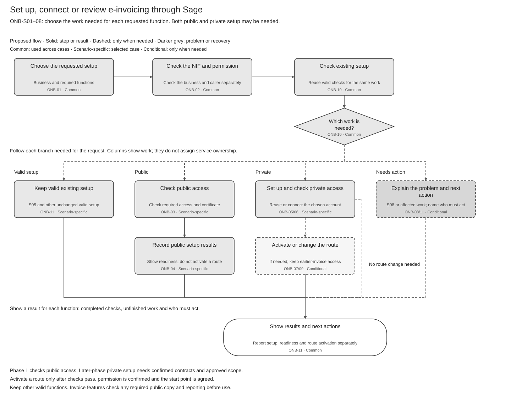

# Customer Onboarding and Connectivity Solution Summary

[Solution Summary](SPEC-SEI-037-customer-onboarding-and-connectivity-solution-summary.md) · [Logical Feature Specification](SPEC-SEI-038-customer-onboarding-and-connectivity-logical-feature-specification.md) · [Sequence and Reuse Assessment](SPEC-SEI-039-customer-onboarding-and-connectivity-sequence-and-reuse-assessment.md) · [Folder](README.md)

## Revision overview

This view combines SPEC-SEI-018 onboarding and SPEC-SEI-034 connection setup. It keeps their scope and decisions. The summary and diagram now show the main journey; SPEC038 holds the required behaviour and SPEC039 the existing E-Invoice API reuse decisions. Archived sources are unchanged. Provider support, operator approval and actual Spain implementation remain open.

## 1 Purpose

**What:** let a business or its authorised accountant set up Sage access to its chosen supported e-invoicing platform. Show what is ready, what is missing and who must act next.

**Why:** use existing accounts, valid certificates and working connections without repeating setup or accidentally changing provider.

**Reuse:** use the existing E-Invoice API and Tax certificate capability. Confirm Spain service settings, NIF/address rules, permissions, certificate acceptance and provider support. The API was first used for France; it is shared.

**Read next:** [SPEC038](SPEC-SEI-038-customer-onboarding-and-connectivity-logical-feature-specification.md) explains behaviour and exceptions; [SPEC039](SPEC-SEI-039-customer-onboarding-and-connectivity-sequence-and-reuse-assessment.md) gives calls, examples, reuse recommendations and required changes. These drafts do not prove production support.

## 2 Terms used

Use the [shared glossary](../../context/GLO-SEI-001-e-invoicing-terminology.md).

| Term | Meaning |
|---|---|
| Represented business | The business being set up, including an accountant's client. |
| Authority | Permission for this action and business. Login, a client relationship or a certificate alone is insufficient. |
| Readiness | Sage has the required access for the selected function, caller, business and environment. |
| Activation | Separately authorised use of the selected route for specified future invoice work. A connection is not activation. |
| Recovery | Check what happened to an earlier request before correcting or repeating it. |

## 3 Master Feature purpose and scope

| Scenario | Customer situation | Setup outcome |
|---|---|---|
| ONB-S01 | New setup | Choose a supported option and complete its required checks. |
| ONB-S02 | Already uses the public service | Check Sage access; do not assume new public registration. |
| ONB-S03 | Keeps a private provider | Link its account and add only missing Sage setup. |
| ONB-S04 | Uses public and private services | Check selected functions separately; preserve valid results and required dependencies. |
| ONB-S05 | Reviews or extends Sage setup | Keep unchanged setup or add only the requested functions. |
| ONB-S06 | Requests a platform change | Permit only enabled, authorised changes; preserve earlier invoices. |
| ONB-S07 | Already uses B2G | Assess B2B separately and retain B2G setup. |
| ONB-S08 | Unsupported or unknown setup | Explain the limitation, missing evidence and action owner. |

**Phase 1:** check public readiness. Private setup and route activation are later-phase work. Private A to Private B stays disabled. A customer may act directly or through an authorised accountant; one client needs no batch mode.

Onboarding does not send an invoice, assume public enrolment or prove operator eligibility. Sending, receiving, reporting and full exit stay in their owning features. Sage acting as a private platform requires separate operator approval under REF-OPERATOR.

Pending checks, unknown effects and unanswered actions remain open. Rejection/withdrawal records the requested work's outcome; cancellation completes only after possible external effects are resolved. Existing service and earlier obligations keep their own status.

**Timing:** customer setup has no general 30-day promise. An applicable platform-operator interconnection request has a **one-month** receiving-operator period, with the specific queue exception and required interim public exchange. [SPEC038 operator handoff](SPEC-SEI-038-customer-onboarding-and-connectivity-logical-feature-specification.md#operator-interconnection-handoff) gives the exact rule. REF-INTERCONNECT.

## 4 Parties and responsibility boundary

| Party | Responsibility |
|---|---|
| Business / authorised accountant | Select the business and setup; supply only missing information or approval. |
| Product | Show supported choices, progress, results and next actions. |
| E-Invoice Service | Coordinate setup and recovery; no separate onboarding service is assumed. |
| Identity, Tax/Trust and connection owners | Confirm permission, certificate and connection evidence for the selected action. |
| Routing / invoice-feature owners | Control route activation and keep earlier-invoice access; enforce checks when invoices are used. |
| Named operator / service owner | Confirm that Sage or its partner may offer the private-platform service before enabling it. |
| Operations | Resolve assigned problems with evidence; an assignment alone is not success. |

## 5 Key open solution decisions

[Existing decision IDs](../archive/SPEC-SEI-002-onboarding-solution-specification.md#5-key-decisions-and-risks) retain their owners; [SPEC039 §4](SPEC-SEI-039-customer-onboarding-and-connectivity-sequence-and-reuse-assessment.md#4-open-engineering-decisions) lists the engineering answers needed.

| Decision | Who must resolve it / when |
|---|---|
| Existing code, API coverage, business/dataset mapping and Spain/provider inputs — ONB-Q05, OFR-Q03 | Architecture, API, Identity, Tax and Integration; before build or enablement. |
| Access evidence, provider state, safe recovery and earlier-invoice access — ONB-Q01/02/06/07, OFR-Q01/02/04 | Integration, Routing, Trust, Identity, Compliance and Operations; before the affected path is used. |
| Product fields, start dates/timezones and receiving history — ONB-Q04/09 | API, Product, Routing and Receiving; product/pilot review. |
| Approval and accountant-batch support — ONB-Q07/08 | Product, Identity, API and Operations; confirm approvers, permissions, limits and visibility before use. |
| Sage private-platform operator and delivery model | Operator, Compliance, Security and Operations; prove legal/technical support and operations before offering the service. |
| Phase 2: provider outside the planned list | Open: supported providers only, or an “Other provider” request? Spain Product/local technical lead to decide; offer no unconfirmed connection. Being outside the list alone does not prove lack of support. |

## 6 End to end workflow

Figure 1. Check the business, permission and existing setup, then follow each branch needed for the request. [Draw.io](../../assets/diagrams/onboarding-summary-scenario-selection-process.drawio) · [PNG](../../assets/diagrams/onboarding-summary-scenario-selection-process.png). Ask for approval only when missing. If a check fails or its result is unknown, show who must act and keep other valid work. Detailed rules stay in SPEC038.

## 7 Master Feature lifecycle

| Work | Activities / result |
|---|---|
| Select and inspect | ONB-01/02/10: capture the request, check identity/permission and reuse valid setup. |
| Check public access | ONB-03/04/11: check required access/certificate and return readiness or an action. |
| Set up private access — later phase | ONB-05/06: reuse or connect the account and prove required access. ONB-07/09 separately controls an enabled route change and earlier access. |
| Resolve missing or failed work | ONB-12 for approval; ONB-08 for correction/recovery. Resume the affected check. |
| Process a client list | ONB-13: save a receipt, check clients independently and return only currently permitted progress. |

## 8 Cross cutting solution considerations

Keep Spain rules separate from shared behaviour and keep test/production evidence separate. An added function rechecks only its affected requirements; working setup remains unchanged.

Reuse decisions belong to SPEC039. Reuse of a design is not proof of running code. Confirm Tax certificate acceptance for each selected action. DTS remains the preferred conversion candidate for later invoice features under [SPEC008](../SPEC-SEI-008-spain-ubl-mapper-migration-to-dts-solution-specification.md); onboarding converts no invoice. Peppol is outside this scope.

## 9 Dependencies and risks

| If… | Required response |
|---|---|
| Permission or certificate evidence is missing | Stop the affected work and identify who must act. |
| A request may have changed external state | Check its original result before repeating it. |
| A setup change affects receiving | Routing checks actual reachability before allowing unsafe traffic. |
| Earlier invoices need the old path | Keep the required access until release is authorised. |
| Capacity or service targets are unconfirmed | Operations sets limits and objectives from contract/pilot evidence. |

## 10 Features within this Master Feature

Onboarding owns customer setup and its recovery. Certificate, connectivity/routing and invoice-operation features keep their responsibilities. [SPEC038](SPEC-SEI-038-customer-onboarding-and-connectivity-logical-feature-specification.md) links their handoffs. Configured account, readiness, route activation and operator approval remain separate results; no new deployment boundary is approved.

## 12 Assurance and completion checks

Before enabling work, close its [functional/release checks in SPEC038](SPEC-SEI-038-customer-onboarding-and-connectivity-logical-feature-specification.md#review-and-release-gates) and [implementation checks in SPEC039](SPEC-SEI-039-customer-onboarding-and-connectivity-sequence-and-reuse-assessment.md#4-open-engineering-decisions).

## REF Source references

| REF ID | Source and version | Exact location | Supported claim and limit |
|---|---|---|---|
| REF-BASE | [SPEC-SEI-002](../archive/SPEC-SEI-002-onboarding-solution-specification.md), snapshot 20 October 2026 | Parts 1–4 and REF | Predecessor scope, IDs, recorded ownership direction, proposed behaviour and open gates. Not implementation evidence. |
| REF-PRODUCT | [PRD-SEI-101](../../prds/PRD-SEI-101-public-platform-onboarding.md), [104](../../prds/PRD-SEI-104-accountant-and-single-client-onboarding.md), [107](../../prds/PRD-SEI-107-public-onboarding-failure-recovery.md), [222](../../prds/PRD-SEI-222-customer-onboarding-entry-point-migration.md) | Decision summaries, scope and functional requirements | Canonical product scope; unresolved differences require an owner decision. |
| REF-COUNTRY | [PRD-SEI-227](../../prds/PRD-SEI-227-e-invoicing-as-a-service.md) | Shared platform and country-pack direction | Reuse direction; not deployment qualification. |
| REF-INTERCONNECT | [RD 238/2026 official original](https://www.boe.es/buscar/doc.php?id=BOE-A-2026-7295), published 31 March 2026; checked 22 October 2026 | Articles 8(1)–(3), 9(1)–(5) | Participating-platform interconnection, one-month receiving-operator period, specific queue exception and interim public exchange. Not a general customer ERP-onboarding SLA. |
| SPFE-S03 | [Original catalogue](<../../context/Descripción servicios web/Catálogo de servicios/20261013/CatalogoServicios.pdf>), 0.1.0, 9 October 2026 | Sections 6.1–6.10, pp. 9–20 | Supplied public operations; no onboarding enrolment contract in this bundle. Supports the S02 boundary. Does not prove live availability. |
| REF-EVIDENCE | [RES-SEI-002](../../context/RES-SEI-002-spain-public-platform-technical-evidence.md) and [logical REF](SPEC-SEI-038-customer-onboarding-and-connectivity-logical-feature-specification.md#ref-source-references) | Source register, exact contracts and open conflicts | Original-source route for Spain-dependent rules and acceptance. The guide is a reading aid. |
| REF-PREDECESSORS | [018](../archive/onboarding/SPEC-SEI-018-customer-onboarding-solution-summary.md), [019](../archive/onboarding/SPEC-SEI-019-customer-onboarding-logical-feature-specification.md), [021](../archive/onboarding/SPEC-SEI-021-customer-onboarding-sequence-and-reuse-assessment.md); [034](../archive/provider-connectivity/SPEC-SEI-034-provider-connectivity-solution-summary.md), [035](../archive/provider-connectivity/SPEC-SEI-035-provider-connectivity-logical-feature-specification.md), [036](../archive/provider-connectivity/SPEC-SEI-036-provider-connectivity-sequence-and-reuse-assessment.md), repository sources updated 23 October 2026. | Sections and IDs stated in the source/claim cells. | Scope, scenarios, ONB/OFR activities, capability boundaries, formats and evidence gates. Retained draft designs; no approval or implementation proof. |
| REF-PROVIDER | [SPEC-SEI-011](../SPEC-SEI-011-public-platform-connector-solution-specification.md), [013](../SPEC-SEI-013-provider-api-through-the-e-invoicing-global-api-solution-specification.md), [017](../SPEC-SEI-017-b2b-router-provider-adapter-binding-solution-specification.md), updated 20 October 2026. | Sections and IDs stated in the source/claim cells. | Public execution, Global API access/integration modes, B2B Router binding and PCN/GPA/B2BR gates. Setup consumes qualified capabilities; these sources retain runtime contracts and uncertainties. |
| REF-CONNECTIVITY | [SPEC-SEI-014](../SPEC-SEI-014-shared-platform-connectivity-and-routing-solution-specification.md), updated 20 October 2026; Part 1 §§1–3 and SPC-01–08. | Sections and IDs stated in the source/claim cells. | Customer-provider and platform-interconnection roles; separate qualification, routes and continuity. Proposed shared foundation, not build compatibility or operator eligibility. |
| REF-OPERATOR | [PRD-SEI-210](../../prds/PRD-SEI-210-sage-private-platform-reuse-and-operator-expansion.md), updated 10 August 2026; delivery-model/reuse boundaries. [PRD-SEI-221](../../prds/PRD-SEI-221-operator-readiness-regulatory-governance.md), updated 6 October 2026; Decision summary, Phase and outcome, readiness domains, E7, BR11 and FR20. | Sections and IDs stated in the source/claim cells. | Sage service, named operator, legal/technical/security/operations evidence and operator interconnection process. Canonical proposed product scope; no selected delivery model, operator appointment or permission to launch. |
