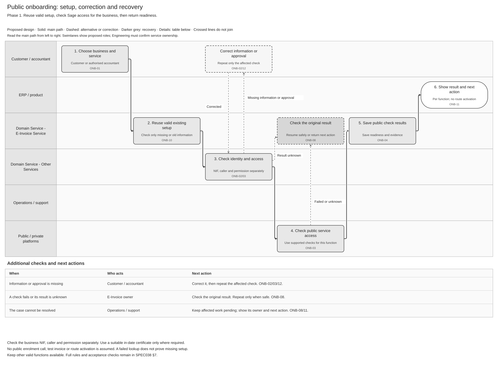
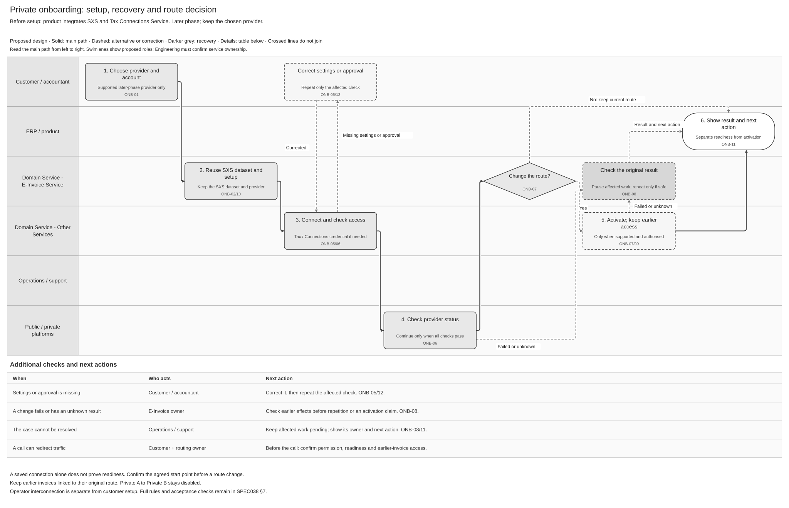

# Customer Onboarding and Connectivity Logical Feature Specification

[Solution Summary](SPEC-SEI-037-customer-onboarding-and-connectivity-solution-summary.md) · [Logical Feature Specification](SPEC-SEI-038-customer-onboarding-and-connectivity-logical-feature-specification.md) · [Sequence and Reuse Assessment](SPEC-SEI-039-customer-onboarding-and-connectivity-sequence-and-reuse-assessment.md) · [Folder](README.md)

## Revision overview

This view combines SPEC-SEI-019 customer setup and SPEC-SEI-035 connectivity. It retains all scenario, requirement and acceptance IDs. Repeated explanations are removed; state definitions and operator timing are in §7. Archived predecessors remain unchanged. Scope, open decisions and the ONB-R25 correction remain unchanged. No new API or deployment is approved.

## 1 Purpose and authority

**What happens:** a customer or authorised accountant selects a business and setup option. Sage checks identity, permission and any required certificate, reuses valid setup and returns the result and next action. This lets the customer use Sage without repeating setup or accidentally changing provider.

**How to read:** §3 selects the path; §6 explains the activities and links to their rules and checks. Approval, recovery and accountant batches apply only when needed. §7 holds supporting detail. [SPEC037](SPEC-SEI-037-customer-onboarding-and-connectivity-solution-summary.md) is the quick overview; [SPEC039](SPEC-SEI-039-customer-onboarding-and-connectivity-sequence-and-reuse-assessment.md) owns existing E-Invoice API calls, payload examples, reuse recommendations and Spain changes.

This is proposed behaviour from REF-PRODUCT. External Spain requirements cite their source IDs. They do not prove a working implementation.

## 2 Terms used

Use the [shared glossary](../../context/GLO-SEI-001-e-invoicing-terminology.md). These are the terms needed for the journey.

| Term | Plain meaning |
|---|---|
| Represented business / NIF | The business being set up and its Spanish tax identifier. It may be a client of the accountant who starts setup. |
| Authority | Current permission for this action and business. Login, a client relationship and certificate ownership are separate checks. |
| Readiness | Sage has the required access for the selected function, caller, business and environment. The result records limitations and when to check again. |
| Route / activation | The chosen platform/connection for specified future invoice work; the separately authorised start of using it. |
| Entry point | The published destination where the business can receive invoices. A saved connection alone does not prove it can be reached. |
| Recovery / reconciliation | Check what happened to an earlier request before correcting or repeating it. |
| Approval evidence | A permitted person's decision for a named business, action and request version. It does not replace official authority. |
| Batch receipt | Confirmation that a list of separate client requests was saved. Each client still needs its own checks. |

## 3 Scope

### 3.1 In scope

Select the requested setup, inspect existing information and do only missing or changed work. Return results per function. Keep invoice execution separate.

| ID | Starting situation | Required result |
|---|---|---|
| ONB-S01 | No established setup | Offer supported choices and complete their required checks. |
| ONB-S02 | Existing public service outside Sage | Check Sage access; do not assume new public registration or active exchange. |
| ONB-S03 | Keep the existing private provider | Link its existing account and add only missing Sage setup. Initial route use still needs permission where required. |
| ONB-S04 | Use public and private services together | Check functions separately, preserve valid results and respect dependencies. Each delivery action has one executor. |
| ONB-S05 | Review or extend existing Sage setup | Keep valid unchanged setup. Recheck stale evidence or add only the requested functions. |
| ONB-S06 | Request a supported platform change | Confirm permission and when the change takes effect; preserve earlier invoices and block unapproved transitions. |
| ONB-S07 | Already use B2G | Check B2B separately and keep B2G setup intact. |
| ONB-S08 | Unsupported provider/function or unknown setup | Return the limitation, missing evidence and owner. Do not infer absence or force a provider change. Unlisted-provider UI remains undecided. |

The same paths apply to a direct customer or an accountant acting for a client. A single-client request does not require batch mode.

| Path | Activities / result |
|---|---|
| [Public — Phase 1](#65-onb-03-assess-prerequisites) | ONB-01 request → ONB-02 identity/permission → ONB-10 existing setup → ONB-03 access/certificate → ONB-04/11 result. No invoice, assumed enrolment or route change. |
| [Private — later phase](#67-onb-05-configure-private-choice) | Use the shared checks, then ONB-05 connection → ONB-06 proof of access → ONB-11 result. Use ONB-07/09 only for an enabled, authorised route change. Private A to Private B stays disabled. |
| Conditional work | [ONB-12 approval](#63-onb-12-coordinate-client-approval-and-evidence), [ONB-08 recovery](#610-onb-08-reconcile-and-recover), [ONB-13 client batch](#613-onb-13-manage-portfolio-batch), only when needed. |

Adding a function rechecks only that function and its affected dependencies (ONB-R03/12/18). For example, existing public access for one function does not prove access for another. A Sage private-platform offer also needs the operator checks in §6.7; customer setup cannot grant operator eligibility.

### 3.2 Out of scope

Invoice creation, sending, receiving, reporting and full exit stay with their owning features. API paths, payloads, field mapping and deployment choices stay in SPEC039 and its sources.

### 3.3 Outcomes and end states

Return readiness, separately evidenced activation, unchanged setup, a limitation or a required action for each function. A receipt, approval or progress update is not readiness. Pending checks, retries and unknown effects remain open. Cancellation is final only after ONB-08 resolves possible effects; no single customer-wide ONBOARDED flag replaces these results.

### 3.4 Assumptions and dependencies

| Required evidence | Owner / source |
|---|---|
| Business identity, customer/accountant permission and approval | Identity and Product; current checks for each business/action. |
| Suitable certificate and protected use | Tax/Trust; SPEC-SEI-001. Confirm the actual Tax/Connections/AFL interface and accepted purpose. |
| Connection, route changes and earlier-invoice access | Connectivity/Routing; SPEC-SEI-014. Receiving history and saved progress remain with SPEC-SEI-016. |
| Public access and product API integration | SPEC-SEI-011/013 owners; existing E-Invoice API reuse and gaps in SPEC039. |
| Business, client and address mapping | API/Identity/Tax/Enablement; INT-DS01 and SPEC039 GAP-01/02/08. Multiple addresses do not establish multiple legal entities. Spain and native-channel support remain open. |
| What already runs and what must change | E-Invoice Service and Architecture; ONB-Q05/OFR-Q03 and SPEC039. |

### 3.5 Decisions and open questions

[ONB-Q01–09 and OFR-Q01–04](../archive/SPEC-SEI-002-onboarding-solution-specification.md#5-key-decisions-and-risks) retain their owners. SPEC039 states the implementation questions and required evidence; missing evidence blocks only dependent work.

**Phase 2 open question — provider outside the planned list:** show only supported providers, or allow an “Other provider” request? Spain Product and the local technical lead must decide. Until then, do not offer a connection whose support is unconfirmed; being outside the list alone does not prove lack of support. Any applicable operator-interconnection duty follows the [separate handoff](#operator-interconnection-handoff). REF-PROVIDERS; REF-PRIVATE Articles 8–9.

## 4 Feature wide functional requirements and rules

These rules apply to every path. REF-PRODUCT/REF-BASE are the baseline unless a SPFE source is cited. SPEC039 records which existing implementation and API can support the selected path.

Apply [the shared requirements](#shared-requirements) to every activity: identity and permission, separate check results, valid-evidence reuse, client isolation, audit and safe recovery. These controls also apply to later-phase work.

**Phase and country limits:** Phase 1 checks public readiness without route changes. Private setup/activation require later-phase approval and evidence. Private A to Private B stays disabled. Keep test and production evidence, credentials and routes separate. Spain rules must not become another country's defaults.

## 5 Cross cutting quality and operational requirements

These existing controls add no numeric service promise.

The [full operational controls](#operational-controls) cover security/redaction, restart without duplicate effects, audit/retention, bounded retries and support, and accessible results. Security/Compliance/Operations must agree the open limits before use.

## 6 Feature activities

Read the activities on the selected path. Each gives its trigger/result and links to its requirements and acceptance checks. API and implementation detail belongs to SPEC039.

### 6.1 ONB-01 Capture requested functions

**Start:** the customer/accountant requests setup with current permission to prepare that business. **Result:** one saved request, a duplicate result or a conflict.

Save the business, functions, direction and environment before an external change (OFR-01). Pending identity/certificate checks allow intake only. Unsupported work returns a limitation. An unchanged repeat reuses the saved item after access checks; conflicting input does not create another effect.

[Requirements and acceptance checks](#activity-1-rules-and-checks).

### 6.2 ONB-02 Check business identity and authority

**Check:** the business NIF/NIE, caller identity and permission for this action separately. An accountant also needs a current firm role and client relationship. Missing approval uses ONB-12; uncertain earlier work uses ONB-08.

[Requirements and acceptance checks](#activity-2-rules-and-checks).

### 6.3 ONB-12 Coordinate client approval and evidence

**Only when approval is missing:** ask an eligible person for the specific decision. Reuse current matching evidence; an invitation or local approval alone does not prove official authority.

Keep approval decisions separate from terms, delegation, signing and route-change permission. Reject stale/conflicting responses; withdrawal or role loss stops affected future use. Changed requests need a fresh check. Approvers, channel and expiry remain ONB-Q07. See [request states](#request-and-batch-states); [approval flow by role](../../assets/diagrams/onboarding-client-approval-swimlane.svg) ([Draw.io](../../assets/diagrams/onboarding-client-approval-swimlane.drawio), [PNG](../../assets/diagrams/onboarding-client-approval-swimlane.png)).

[Requirements and acceptance checks](#activity-3-rules-and-checks).

### 6.4 ONB-10 Assess current setup

**Before new setup:** compare the requested functions with current public/private/Sage evidence. **Result:** identify valid unchanged, missing, stale or unsupported work.

Keep customer declarations separate from observed evidence, with source, time, environment and version. Failed/empty lookup does not prove absence. Registering an address can redirect traffic; apply the change checks before acting. Dataset mapping and provider details stay in SPEC039.

[Requirements and acceptance checks](#activity-4-rules-and-checks).

### 6.5 ONB-03 Assess prerequisites

**Before returning readiness:** confirm required access and certificate checks for the selected business, action and environment.

Figure 1. Public setup with the main correction and recovery paths. Further actions are in the table below the flow. [Draw.io](../../assets/diagrams/onboarding-public-setup-swimlane.drawio) · [PNG](../../assets/diagrams/onboarding-public-setup-swimlane.png). Full requirements and acceptance checks remain in §7.

Use Tax certificate evidence where required: current dates, accepted material, permission and a protected reference. Correct missing/expired/revoked/unsuitable material; unavailable/stale evidence stays unknown. NOT_REQUIRED needs a policy reason. Web-form access does not prove automated Sage access. Registered third-party retrieval/consultation authority remains required where Article 11 applies. Authentication, invoice signing and permission are separate. SPFE-S02; REF-PRIVATE Article 7(3).

[Requirements and acceptance checks](#activity-5-rules-and-checks).

### 6.6 ONB-04 Publish public readiness

**After the selected checks:** return public readiness for each requested function. One successful operation cannot prove every function ready.

Check both the actual Sage implementation/contract and the business's permission/certificate evidence. Missing implementation support is not a customer certificate failure. Return the function, environment, result, evidence, limitations, recheck condition and next action/owner; these meanings are not new API field names.

READY requires every mandatory check to pass. READY_WITH_LIMITATIONS must name the permitted scope and cannot hide a failed mandatory check. Neither activates a route. Exact states are in [§7](#public-readiness-states). Each later invoice operation rechecks its own access. Public contracts remain with SPEC-SEI-011; SPEC039 explains setup API use.

[Requirements and acceptance checks](#activity-6-rules-and-checks).

### 6.7 ONB-05 Configure private choice

**Later phase only:** the customer selects a supported private provider/account. Confirm the required contract and permission before adding missing setup.

Figure 2. Private setup with correction, recovery and a separate route-change decision. Further actions are in the table below the flow. [Draw.io](../../assets/diagrams/onboarding-private-setup-swimlane.drawio) · [PNG](../../assets/diagrams/onboarding-private-setup-swimlane.png). The route-change decision stays separate from connection checks. Full requirements and acceptance checks remain in §7.

Keep the chosen provider and valid setup. Do not repeat enrolment, subscriptions or credential replacement. Before a call that can redirect traffic, confirm permission, an enabled transition and access to earlier invoices. Unknown effects use ONB-08.

**Operator interconnection is separate:** a customer's ERP setup has no general one-month completion promise. When the operator duty applies, hand the case to the operator process; its receiving-operator period is **one month**, subject to the specific receipt-order exception, with required interim public exchange. Show progress without claiming customer readiness. [Operator handoff details](#operator-interconnection-handoff); PRD-SEI-221 FR20; REF-PRIVATE Articles 8–9.

**If Sage is the private platform:** name the actual operator/delivery model and confirm its permitted public/private functions, credentials, security, data controls, support, continued access and exit under PRD-SEI-221. Keep this separate from customer permission, connection status and route activation. Reuse ONB-01/02/10 and ONB-03/05/06; create no parallel registry or invoice replay. Missing/degraded operator readiness returns a limitation and uses SPC-08 for controlled suspension and earlier access, not an automatic provider switch. REF-OPERATOR/CONNECTIVITY.

[Requirements and acceptance checks](#activity-7-rules-and-checks).

### 6.8 ONB-06 Prove private readiness

**After private configuration:** prove access for each requested function and the required provider state.

A saved connection or missing address does not prove readiness or removal. Preserve the intended change and its observed result. If a change can affect receiving, confirm actual reachability before allowing unsafe traffic; even a still-selected old route may be unsafe. Missing evidence needs a named owner.

[Requirements and acceptance checks](#activity-8-rules-and-checks).

### 6.9 ONB-07 Cut over new traffic

**Only for an enabled route change:** require current permission, readiness and observed provider state. **Result:** a confirmed effective boundary, or a conflict/pending action.

Reject stale or competing changes; disputed state cannot become ACTIVE. Keep each earlier invoice's original route. Unchanged setup needs no route change. Restoration requires fresh permission and reachability evidence.

[Requirements and acceptance checks](#activity-9-rules-and-checks).

### 6.10 ONB-08 Reconcile and recover

**When a check fails or a change has an uncertain result:** resolve the original request and return to its blocked check. Correct wrong information as a new revision; retain earlier decisions and the original request identity.

| Result of the earlier request | Next action |
|---|---|
| It succeeded | Record the result once and resume the blocked checks; do not infer route activation. |
| It had no effect | Repeat only when the contract accepts that evidence, permission is current and retry limits allow it. |
| It is unknown or conflicting | Keep the affected work pending with its owner. A failed or empty lookup does not prove nothing happened. |

**Cancellation:** stop safe queued work. Resolve every possible effect or obtain an approved, evidence-backed decision. An assigned owner or open unknown effect cannot complete cancellation.

[Requirements, recovery steps and acceptance checks](#activity-10-rules-and-checks). API/source codes and provider retry rules stay in SPEC039.

### 6.11 ONB-09 Preserve and release

**After a change, or while earlier invoices remain open:** keep their original actor, route, evidence and permitted access.

Retain access for earlier delivery, reports, rejection, correction and audit. Preserve retrieval progress and avoid duplicate intake. Unknown historical coverage blocks release of old dependencies, but need not block safe independent new work. Full exit belongs to SPEC-SEI-003.

[Requirements and acceptance checks](#activity-11-rules-and-checks).

### 6.12 ONB-11 Return results and required actions

**After saving a result:** return only what the caller may currently see, per function, with missing work and its owner.

Connection, readiness and activation are separate. Setup proves no invoice acceptance, payment or completed reporting. Notifications reflect saved state; after loss, duplicates or reordering, read the current permitted result without repeating work. Keep partial results partial. Later protected use rechecks permission and certificate validity. Event/API contracts stay in SPEC039.

[Requirements and acceptance checks](#activity-12-rules-and-checks).

### 6.13 ONB-13 Manage portfolio batch

**Only for an accountant batch:** confirm batch permission/contract under ONB-Q08. Save the request list before returning a receipt; then run each client independently.

Bind the batch to organisation, environment and purpose. Reuse the receipt for an unchanged repeat; conflicting/overlapping requests cannot duplicate work. Preserve submitted/unique counts and resume after restart. Recheck permission before each client's work and result access. Deny unlinked clients safely; role/relationship loss stops affected work/access. A replacement actor inherits no permission or credential.

[Batch states and visibility rules](#request-and-batch-states) · [batch flow by role](../../assets/diagrams/onboarding-accountant-batch-swimlane.svg) ([Draw.io](../../assets/diagrams/onboarding-accountant-batch-swimlane.drawio), [PNG](../../assets/diagrams/onboarding-accountant-batch-swimlane.png)).

[Requirements and acceptance checks](#activity-13-rules-and-checks).

## 7 Traceability and supporting artefacts

Use this section for state definitions, operator timing and source detail. The main setup paths are in §3 and §6. The tables below are the authoritative requirements and acceptance checks; the journey links to them.

**ONB-R25 correction:** this ID means the requested/confirmed effective boundary. SPEC-SEI-019 used it twice; operator handoff instead uses PRD-SEI-221 FR20 and ONB-A44/A45. Neither behaviour nor the archived source changes.

| Historical reference | Current authoritative reference |
|---|---|
| SPEC-SEI-002 ONB-R25; SPEC-SEI-019 §6.9 ONB-R25 | SPEC-SEI-038 §6.9 and its linked ONB-R25 requirement: requested start and confirmed effective boundary. |
| SPEC-SEI-019 §6.7 ONB-R25 | SPEC-SEI-038 §6.7 operator handoff; PRD-SEI-221 FR20; ONB-A44/A45. Do not use an unqualified ONB-R25 reference for operator interconnection. |

### Supporting inventories

| Source | Use it for |
|---|---|
| [SPEC039 API reuse assessment](SPEC-SEI-039-customer-onboarding-and-connectivity-sequence-and-reuse-assessment.md) | Existing E-Invoice API calls, payload example, Spain work and owner decisions. [Archived SPEC020](../archive/SPEC-SEI-020-customer-onboarding-api-design-and-reuse-assessment.md) retains detailed API checks and source differences. |
| [Interaction contracts](../archive/SPEC-SEI-002-onboarding-solution-specification.md#1-interaction-contracts) and [data inventory](../archive/SPEC-SEI-002-onboarding-solution-specification.md#2-data-inventory) | ONB-INT-01–13/OFR-INT-01–09 and ONB-D01–13/OFR-D01–09 analysis; proposed interfaces/records, not approved new services or stores. |
| [Customer fields](../archive/SPEC-SEI-002-onboarding-solution-specification.md#3-customer-and-accountant-fields-by-scenario) and [system/results](../archive/SPEC-SEI-002-onboarding-solution-specification.md#4-system-fields-dates-and-erp-results) | ONB-Q04/09 field, start-date and receiving-history decisions. |
| [Public field boundary](../archive/SPEC-SEI-002-onboarding-solution-specification.md#5-sage-spfe-field-boundary), [verification matrix](../archive/SPEC-SEI-002-onboarding-solution-specification.md#1-verification-matrix) and [technical sequences](../archive/SPEC-SEI-002-onboarding-solution-specification.md#onboarding-technical-sequences) | Source mapping and detailed analysis; no onboarding payload or proven deployment. |
| [SPEC001](../SPEC-SEI-001-certificate-management-solution-specification.md), [011](../SPEC-SEI-011-public-platform-connector-solution-specification.md), [013](../SPEC-SEI-013-provider-api-through-the-e-invoicing-global-api-solution-specification.md), [014](../SPEC-SEI-014-shared-platform-connectivity-and-routing-solution-specification.md), [016](../archive/SPEC-SEI-016-invoice-receiving-retrieval-and-download-solution-specification.md), [003](../archive/SPEC-SEI-003-offboarding-solution-specification.md) | Certificate, public execution, API, routing, receiving and exit ownership. |

### Shared requirements

In the retained rules, “qualified” means confirmed support for the selected action, contract and environment. “Idempotency” means that repeating the same request adds no effect only within the contract’s stated conditions and duplicate window. SPEC039 holds the implementation evidence.

| ID | Requirement or rule | Applies to |
|---|---|---|
| ONB-R01 | Before any external change, Sage must resolve the authorised tenant, represented business, environment and exact function/scope. | All protected work. |
| ONB-R02 | Sage must verify direct or per-client delegated authority for each action and recheck it before activation or another protected execution. | Identity, setup, activation and use. |
| ONB-R03 | Sage must keep readiness dimensions and their evidence separate. A certificate check applies only where the selected policy requires it. | Public/private readiness and results. |
| ONB-R04 | Sage must isolate each client's result, correction, cancellation and failure; other safe clients can continue. | Portfolio processing. |
| ONB-R10 | Sage must retain who requested, decided, changed, observed, corrected or overrode the work, with scope, time and source. | All activities. |
| ONB-R12 | Sage must reuse only matching valid evidence. Unchanged setup requires no external change; extension affects only requested functions. | Planning and checks. Proposed scenario refinement. |
| ONB-R14 | Sage must retain B2G/B2B distinctions, phase limits, unsupported functions and gated transitions. Invoice owners decide transaction applicability. | Scenario planning and execution. |
| ONB-R16 | Sage must reuse suitable protected references under SPEC-SEI-001. Failed lookup remains unknown and cannot trigger an assumed missing-certificate upload. Authentication and signing require separate qualification. | Public/private trust checks and recovery. |
| ONB-R17 | Before readiness, Sage must verify the business NIF and action authority, plus a suitable certificate where required. A policy-backed NOT_REQUIRED removes only the certificate condition. | ONB-02/03/04/06. |
| ONB-R18 | Sage must distinguish intake, readiness, activation and later use. Each actual actor/contract must qualify authentication, signing, retrieval and reporting separately. | Setup and runtime handoff; SPFE-S02 Article 11. |
| ONB-R19 | Sage must check current firm role, client relationship and action permission independently at protected reads, changes and execution. | Direct/delegated access and portfolio results. |
| ONB-R24 | Sage must prefill qualified current information and ask only for missing, changed or unverified information required by selected functions. A missing/conflicting value returns the affected function, reason and correction owner. | Intake, assessment and client action. Proposed field refinement. |
| OFR-R01 | Sage must classify the business problem separately from whether the operation can safely repeat. | Every failed operation. |
| OFR-R02 | For a permitted retry, Sage must preserve operation identity and correlation and apply an approved, versioned policy and budget. | Automatic and manual retry. |
| OFR-R03 | After a possible external effect with no definitive result, Sage must hold dependent work and reconcile before retry or success. | Unknown changes. |
| OFR-R05 | Sage must return an existing result for an unchanged duplicate and reject conflicting input or stale revisions without another effect. | Requests, corrections and concurrent decisions. |
| OFR-R06 | Sage must isolate recovery and cancellation by client item. | Portfolio processing. |
| OFR-R07 | Manual actions must enforce current authority, environment, security and audit controls. An override cannot bypass evidence or legal-policy gates. | Support and manual recovery. |
| OFR-R08 | Sage must return stable safe status, correlation, relevant policy version, action and owner without exposing protected data. | Product and support results. |
| OFR-R09 | Sage must bind recovery to the original scenario, plan, provider/role, direction, scope and blocked check. Preserve independent valid functions and enforce dependencies. | Failed checks and external effects. |
| OFR-R10 | Corrected or reconciled work must return to its parent checks. Recovery cannot force migration, repeat enrolment, commit a route or infer absence from failed discovery. | Recovery completion. |
| OFR-R12 | Sage must keep NIF, required-certificate and authority findings independent and use qualified protected references and original-source observations. | Trust correction and recovery. |

### Operational controls

| NFR ID | Category | Requirement and acceptance target | Position |
|---|---|---|---|
| ONB-NFR01 | Security and privacy | Isolate tenant/business/environment access. Return no private keys, reusable secrets, raw confidential provider bodies or full tax identifiers in logs, metrics and notifications. Retain only safe protected references in setup results. | Proposed control; negative access/redaction tests required. |
| ONB-NFR02 | Recoverability | A restart must retain accepted intent, duplicate detection, batch manifests and unresolved original effects. Recover without creating an additional effect. | Proposed control; persistence-loss/restart evidence required. |
| ONB-NFR03 | Audit and retention | Keep reproducible decision, correction and operation histories. Apply approved retention and deletion by data class; do not invent a duration. | Policy schedule open with Security, Privacy and Compliance. |
| ONB-NFR04 | Capacity and support | Bound retry attempts and elapsed time, observe provider guidance and schedule independent clients fairly. Monitor pending/unknown age, missing owners, approval expiry, queue age and failed transitions. | Numeric limits, objectives and alert thresholds open with Operations; ONB-Q07/08. |
| ONB-NFR05 | Usability and accessibility | Show the affected function, current outcome and permitted next action with its owner. Do not rely on colour alone to distinguish status or client actions. | Proposed control; ERP review under ONB-Q04/09. |

### Detailed activity rules and acceptance

#### Activity 1 rules and checks

ONB-01 Capture requested functions

| Acceptance ID | Acceptance check |
|---|---|
| ONB-A26 | Save authorised intake with pending identity/trust checks; do not trigger upload, readiness, activation or dependent execution. |
| OFR-A06 | Unchanged repeats reuse the saved result. Changed input or stale revisions conflict without another effect. |
| OFR-A04 | After external success and local data loss, recover the original effect once from retained evidence. |

#### Activity 2 rules and checks

ONB-02 Check business identity and authority

| Acceptance ID | Acceptance check |
|---|---|
| ONB-A03 | Recheck corrected NIF/authority evidence as a new revision; preserve earlier decisions and operations. |
| ONB-A25; OFR-A20 | Keep NIF, certificate and authority independent. One pass cannot hide another failure; resume the affected check. NOT_REQUIRED removes only the certificate condition. |
| ONB-A29 | Check single-client delegated access without requiring batch mode. Deny unrelated/unknown client references safely. |
| ONB-SPFE-A03 | A valid certificate cannot overcome missing registered retrieval authority. Hold retrieval; preserve independent results. SPFE-S02 Article 11; SPFE-S03. |

#### Activity 3 rules and checks

ONB-12 Coordinate client approval and evidence

| Requirement ID | Activity requirement |
|---|---|
| ONB-R20 | First check current evidence for the exact purpose/scope. If insufficient, Sage must save and present a request to an eligible approver. Keep terms acceptance, delegated operation, route change and signing decisions separate. |
| ONB-R21 | Sage must bind the request/response to business, delegate where relevant, purpose, scope, environment, plan/digest, policy/terms version and expiry. Reject stale/conflicting responses. Withdrawal stops affected future use and preserves earlier snapshots. |

| Acceptance ID | Acceptance check |
|---|---|
| ONB-A30 | Reuse current matching evidence. Otherwise return ACTION_REQUIRED and the eligible owner for dependent work. |
| ONB-A31 | Local approval or terms acceptance cannot replace effective delegation and official evidence. SPFE-S02 Article 11. |
| ONB-A32 | Refusal, expiry, changed plans or competing decisions cannot authorise stale work or trigger technical retries. |
| ONB-A33 | Withdrawal or relationship/staff-role loss stops affected future work and reads; reconcile in-flight effects. Replacement actors need fresh authority. |
| ONB-A39 | Use trusted firm/actor context for client actions; manual entry or invitation cannot establish approver eligibility. |

#### Activity 4 rules and checks

ONB-10 Assess current setup

| Requirement ID | Activity requirement |
|---|---|
| ONB-R11 | Sage must assess current public/private/Sage setup and the requested outcome before planning missing work. Keep customer declarations separate from observed evidence, including source, time, environment and version. |

| Acceptance ID | Acceptance check |
|---|---|
| ONB-A11 | For ONB-S01, present supported choices and apply their phase/activation gates; no silent platform selection. |
| ONB-A12 | For ONB-S02, request missing Sage authority or reuse matching valid evidence without repeated work. |
| ONB-A15; OFR-A14 | For ONB-S05, preserve valid references and route version despite failed reads; refresh only affected checks or requested extensions. |
| ONB-A17; OFR-A18 | For ONB-S07/08, preserve B2G/B2B distinctions and return owned limitations; no retry loop or whole-business applicability decision. |
| ONB-A18 | Unknown/unsupported setup cannot force a provider change or mutation. Possible effects enter ONB-08. |
| ONB-A38 | Across ONB-S01–08, prefill valid information and request necessary corrections only. Unchanged S05 needs no new input or mutation. |

#### Activity 5 rules and checks

ONB-03 Assess prerequisites

| Requirement ID | Public source constraint and proposed Sage control |
|---|---|
| ONB-SPFE-R02 | Use only supplied qualified checks for public-only setup. Do not invent enrolment, receiving-point publication, onboarding `effectiveDate` or a test invoice. The supplied operation inventory has no such setup payload. SPFE-S03 sections 6.1–6.10; SPFE-S08 sections 5.1–5.9; SPFE-S16. |
| ONB-SPFE-R03 | Verify the represented business independently from the certificate caller and require current action authority. Local approval or an existing credential alone cannot satisfy official representation. SPFE-S02 Article 11; SPFE-S03 operation authorisation. |

| Acceptance ID | Acceptance check |
|---|---|
| ONB-A22 | Reuse protected references only for matching purpose, subject, role, environment and version; no repeat upload or credential copy. |
| ONB-A23; OFR-A21 | Distinguish missing material from unavailable evidence. Retry only a safe read within budget; otherwise escalate. |
| ONB-A24 | Tax-only validity or certificate status cannot enable authentication/signing without qualified execution coverage. |
| ONB-A27; OFR-A23 | Unmet prerequisites or web-form access cannot qualify automated functions or justify an invented setup mutation. SPFE-S02 Article 11. |
| ONB-SPFE-A02 | Without an external registration contract, public setup performs no enrolment, receiving publication or invoice mutation. SPFE-S03/S08/S16. |

#### Activity 6 rules and checks

ONB-04 Publish public readiness

| Requirement ID | Activity requirement |
|---|---|
| ONB-SPFE-R01 | Qualify submission, consultation, retrieval and event reporting independently for contract, credential and authority. A network connection or one accepted operation cannot prove all functions ready. SPFE-S03; SPFE-S16 establishes submission ports only. |

| Acceptance ID | Acceptance check |
|---|---|
| ONB-A01 | Return evidenced public readiness or a precise limitation, evidence/recheck condition and action owner; keep the private route unchanged. Missing mandatory evidence cannot return READY or be hidden by READY_WITH_LIMITATIONS. |
| ONB-SPFE-A01 | Submission qualification cannot establish receiving readiness. When download is added, return its independent findings and preserve valid submission evidence. A qualified contract cannot replace business authority, and a valid certificate cannot replace qualified implementation coverage. SPFE-S03/S16; ONB-R03/12/18. |

#### Activity 7 rules and checks

ONB-05 Configure private choice

| Requirement ID | Activity requirement |
|---|---|
| ONB-R05 | Sage must allow private configuration and checks without changing the active route. Record explicit operator, scope, direction and supported commercial/support boundary. |

| Acceptance ID | Acceptance check |
|---|---|
| ONB-A04 | Configuration/testing without activation, including local failure, leaves the active route unchanged. |
| ONB-A13; OFR-A12 | For ONB-S03 recovery, retain provider and original operation; avoid another account/enrolment and resume ONB-05/06. |
| ONB-A43 | Check actual support for an unlisted provider. Without a qualified path, return a limitation and owner under ONB-S08; the UI treatment stays TBD. Presence or absence in the portfolio cannot prove readiness, force a switch or promise a completion date. REF-PROVIDERS. |
| ONB-A44 | For qualifying operator requests, verify receipt-based one-month timing and the exact additional-request/receipt-order exception. Customer selection, setup HTTP success, resubmission or internal case closure cannot start, reset or satisfy that clock. REF-PRIVATE Article 9(3)–(4); PRD-SEI-221 FR20. |
| ONB-A45 | While interconnection is pending, the operator handoff retains the required public interim path. Completion needs operational invoice/status evidence; deadline risk or unknown timing remains owned and cannot imply readiness. REF-PRIVATE Articles 8(3), 9(3)–(5); PRD-SEI-221 FR20. |

#### Activity 8 rules and checks

ONB-06 Prove private readiness

| Acceptance ID | Acceptance check |
|---|---|
| ONB-A14; OFR-A13 | For ONB-S04 partial failure, preserve independent valid functions, enforce dependencies and retain one delivery executor per action. |
| ONB-A06; OFR-A03 | A lost publication result remains OUTCOME_UNKNOWN. Preserve original evidence; no blind repeat or assumed previous-route safety. |

#### Activity 9 rules and checks

ONB-07 Cut over new traffic

| Requirement ID | Activity requirement |
|---|---|
| ONB-R06 | Before activation, Sage must require explicit authority for the exact direction/scope and observed required inbound readiness. |
| ONB-R07 | Sage must process overlapping scope changes one at a time and preserve each invoice's actual origin route. A stale expected route version cannot overwrite a concurrent change. |
| ONB-R25 | Sage must distinguish the requested start from the confirmed effective boundary. Unknown historical start alone cannot reset unchanged setup or receiving progress. Scheduling/timezone support remains ONB-Q09. |

| Acceptance ID | Acceptance check |
|---|---|
| ONB-A05 | Only the authorised direction changes at its evidenced boundary; earlier invoices retain their origins. |
| ONB-A07; OFR-A17 | Overlapping or changed plans cannot overwrite a stale version; preserve separate original operations. |
| ONB-A08; OFR-A15 | During uncertain cutover/restoration, Routing uses actual reachability and a separately authorised transition; preserve invoice history. |
| ONB-A10; ONB-A16 | Confirm unchanged setup without unnecessary change. Hold unapproved transitions, including Private A to Private B. |
| ONB-A40 | Distinguish requested and confirmed start, preserve unknown historical start, and verify timezone/boundary behaviour. |

#### Activity 10 rules and checks

ONB-08 Reconcile and recover

| Recovery activity | Required behaviour and safe next action |
|---|---|
| OFR-01 Capture durable intent | Use the original record from ONB-01; preserve input, policy, authority and operation identity before dispatch. |
| OFR-02 Classify | Separate problem category from repeat safety. Preserve original source reason and mapping version; return a safe reason/owner. Security/environment mismatch is denied and audited. |
| OFR-03 Correct | Accept authorised scoped correction as a new revision; keep prior decisions. Hold conflicting new changes while an earlier effect is unknown. Resume the affected check. |
| OFR-04 Retry safely | Retry only a proven safe read or contractually idempotent change, with the same identity. Check current authority, cancellation, environment, provider guidance, scope conflict and attempt/elapsed budget. |
| OFR-05 Hold unknown | After a possible effect, retain OUTCOME_UNKNOWN, original input/operation/provider reference, version and transmission timing. Block conflicting repeat, dependent readiness and final cancellation. |
| OFR-06 Reconcile | Query reliable original state. CONFIRMED_SUCCESS records the effect once and returns to parent checks. CONFIRMED_ABSENT permits retry only if that contract accepts the proof. CONFLICT/UNRESOLVED stays held. |
| OFR-07 Escalate | Assign an owner with original evidence, deadline exposure, last observation, unsafe actions and customer-safe message. Manual disposition needs approver/evidence; it cannot rewrite external facts. |
| OFR-08 Publish | Commit the result before notification; ONB-11 composes the per-function view. Repeated/lost notifications are repaired by reading the current permitted version. |

Keep validation, authentication, permission, policy, conflict, dependency, security and internal failures separate from “did the request run?” and “can it repeat safely?”. Exact codes/provider retry rules stay in SPEC039. Country-specific rules are not shared defaults. SPFE-S03 §5.1; SPFE-S08 §§4.3, 5.2–5.9.

| Requirement ID | Additional constraint |
|---|---|
| ONB-R08 | Before retry or success, Sage must reconcile an external change whose result is unknown. An empty/failed query is not proof of absence. |
| OFR-R04 | Exhausted budgets or missing reliable observation must produce an owned unresolved case, without false success, absence or final cancellation. |
| OFR-SPFE-R01 | Recover the failed setup check through its qualified owner; do not use SendInvoice/CancelInvoice as an onboarding probe or rollback. Proposed Sage control; SPFE-S03/S16 identify invoice operations. |
| OFR-SPFE-R02 | Preserve transport, SOAP, request and per-item results separately. Resume only with proven repeat safety or authoritative reconciliation. SPFE-S03/S08. |

| Acceptance ID | Acceptance check |
|---|---|
| OFR-A01 | Proven non-transmission with invalid data returns correction; no unchanged automatic retry or external call. |
| OFR-A02 | A throttled safe-read retry preserves correlation, approved budget, provider guidance and fair client processing. |
| OFR-A05 | Exhausted retries or missing reliable observation retain an owned unresolved case; do not infer absence. |
| OFR-A09 | Manual support/retry enforces current authority, environment and redaction. |
| OFR-A16 | CONFIRMED_SUCCESS returns to fresh parent checks; it cannot commit a route or claim active use. |
| OFR-A22 | Credential correction or uncertain protected use retains original source/purpose/version and owner; no new signer, issuance or blind repeat. |
| OFR-SPFE-A01 | Generic resend guidance permits only a proven safe public-check retry; no invoice/route mutation. SPFE-S03/S08. |
| OFR-SPFE-A02 | Lost owning-feature results retain their original operation and recovery owner; no fabricated setup success. SPFE-S03/S16. |

#### Activity 11 rules and checks

ONB-09 Preserve and release

| Requirement ID | Activity requirement |
|---|---|
| ONB-R09 | Sage must preserve original actor, route and evidence for earlier invoices and release previous dependencies separately after their approved continuity gates. |

| Acceptance ID | Acceptance check |
|---|---|
| ONB-A41 | Earlier-invoice retrieval qualifies dates, authority and source coverage, preserves progress and avoids duplicates. Unknown coverage has an owner. |

#### Activity 12 rules and checks

ONB-11 Return results and required actions

| Requirement ID | Activity requirement |
|---|---|
| ONB-R13 | Sage must return setup, readiness and independently evidenced activation separately for each selected function through the common API. |

| Acceptance ID | Acceptance check |
|---|---|
| ONB-A20 | After concurrent/lost/duplicate observations, return the current authorised result without repeating work or implying activation. |
| ONB-A42 | Keep business/caller, function findings and owned actions separate. Return no credentials, invented SPFE setup fields or test invoice. SPFE-S02 Article 11; SPFE-S03/S08/S16/S18. |

#### Activity 13 rules and checks

ONB-13 Manage portfolio batch

| Requirement ID | Activity requirement |
|---|---|
| ONB-R22 | Sage must save a batch manifest before receipt, map each logical client item once and resume incomplete decomposition after restart. An invalid envelope/conflicting duplicate item reference creates no client work. |
| ONB-R23 | Sage must expose only currently permitted progress/actions and allow authorised selected correction/cancellation without repeating completed independent work or hiding unknown effects. |

| Acceptance ID | Acceptance check |
|---|---|
| ONB-A02; OFR-A07 | Each client retains permission and result. Counts reflect saved outcomes; unknown work is not complete or failed. |
| ONB-A34 | Repeats/restarts create each logical item once; preserve received/unique counts. Reject conflicting envelope entries before client work. |
| ONB-A35; OFR-A08 | Selected correction/cancellation preserves other safe and completed work. Unknown effects prevent final cancellation. |
| ONB-A36 | Lost client access withholds current details, totals and revealing parent state; retain only safe submitted references. |

### Public readiness states

NOT_STARTED, CHECKING, ACTION_REQUIRED, READY_WITH_LIMITATIONS, READY, SUSPENDED and OUTCOME_UNKNOWN retain their meanings. READY records checks passed at that time; expiry/revocation can change it. A pending prerequisite differs from an unknown external effect. The mandatory-check and limitation rules are in §6.6.

### Request and batch states

Approval requests use REQUESTED, APPROVED, DECLINED, EXPIRED, WITHDRAWN and SUPERSEDED. Only REQUESTED accepts an initial decision. APPROVED records a response; official permission is checked separately. Request expiry and permission expiry are separate. Identical responses acknowledge the saved decision but cannot restore withdrawn/expired permission. Changed plans require revalidation or replacement.

Batch states below are proposed coordination states, not per-client readiness.

| Proposed coordination state | Meaning |
|---|---|
| RECEIVED | Receipt and manifest saved; item creation/processing not started. |
| PROCESSING | Work advances without an unresolved approval, correction or uncertain effect. |
| PARTIAL | At least one item needs such action/resolution; other safe items can continue. |
| COMPLETED | Every requested item has a recorded final disposition; no pending action/uncertain effect remains. Not a readiness result. |
| CANCELLING | Remaining-batch cancellation recorded; safe pending work stops and submitted effects await resolution. |
| CANCELLED | Remaining-batch work stopped and ONB-08's closure gate passed. Retain completed item results. |
| FAILED_ENVELOPE | Rejected before client items or external work. Failure after receipt is recoverable work. |

CANCELLING takes precedence during remaining-batch cancellation until effects are resolved. Selected-item cancellation does not cancel the whole batch. Show only currently accessible progress; withhold revealing totals/parent states. Receipt counts describe submitted requests, not current progress.

### Operator interconnection handoff

This is the detail linked from §6.7. The receiving operator's period is **one month**, not a fixed 30-day timer. A customer-support request alone does not establish receipt of a peer-platform request. REF-PRIVATE Article 9; PRD-SEI-221 FR20.

| Condition | Required behaviour and observable result |
|---|---|
| Qualifying peer-platform request received | The receiving operator records receipt evidence and makes the interconnection operational within **one month from receipt**. Supply the required specifications, test facility and resources. The clock does not start at a customer's provider selection or a Sage setup API call. Article 9(3). |
| Additional requests cannot be handled simultaneously during that period | Apply strict receipt order. For each qualifying queued request, its one-month period starts when the immediately preceding interconnection becomes operational. Retain the original receipt, queue order, preceding completion and resulting clock start. This is the specific Article 9(4) exception, not a general pause. |
| Interconnection is pending | The requesting operator deposits affected invoices in the public solution; the receiving operator receives them through that path. Invoice owners execute this interim exchange. It does not change the customer's selected provider or authorise a migration. Article 9(5). |
| Completion is claimed | Retain operational evidence for invoice and mandatory-status exchange. A successful setup call or closed support case is insufficient. Articles 8(3), 9(3). |
| Receipt, due date or progress is unknown, or completion is at risk/overdue | Keep an operator-owned escalation and show the limitation. Do not report readiness, reset the clock on retry or silently move the deadline. Exact calendar, month-end, timezone and alert rules require Spain Compliance and Operations qualification. Proposed Sage control. |

Record the receiving operator, request/receipt reference and time, queue basis, clock start, calculated deadline and operational completion evidence. These are evidence needs, not a proposed API payload. Spain Compliance and Operations must confirm calendar, month-end, timezone and alert rules before use. REF-PRIVATE Article 9(3)–(4).

### Solution ownership and reuse qualification

**ONB-R15 / OFR-R11:** the E-Invoice Service coordinates setup and recovery; dependency owners retain their controls. Actual code, ownership and deployment evidence stay in SPEC039 under ONB-Q05/OFR-Q03. Approval/portfolio reuse needs its own permission and implementation checks. Existing DTS is preferred for invoice conversion under [SPEC008](../SPEC-SEI-008-spain-ubl-mapper-migration-to-dts-solution-specification.md); onboarding performs none. ONB-Q01/02/05/06/07/08 and OFR-Q01/02/03/04 retain their owners.

| Acceptance ID | Required cross-feature evidence |
|---|---|
| ONB-A09; OFR-A10 | Select each country/provider’s approved rules. Missing evidence holds dependent work; preserve prior Spain evidence. |
| ONB-A19; OFR-A11 | Reuse needs source capability/build, changes, gaps, owner and evidence. Changed role/purpose/environment/version requires requalification. |
| ONB-A21; OFR-A19 | Retain E-Invoice Service coordination; confirm actual implementation rather than assume a proposed component exists. |
| ONB-A28; OFR-A24 | Diagrams and supporting sequences retain aligned IDs and outcomes; faults return to the correct correction/recovery checkpoint. |
| ONB-A37 | Reusing approval/portfolio patterns needs local authority, approver, disclosure and implementation qualification. |

### Review and release gates

Close the applicable checks in the [existing release record](../archive/SPEC-SEI-002-onboarding-solution-specification.md#2-review-and-release-gates) before enabling that work. Acceptance describes evidence to obtain, not completed tests.

| Scope | Evidence needed |
|---|---|
| Design | Scenario/function dependencies, original-operation identity, safe repeat/observation semantics, exact recovery checkpoints and accountable owners. |
| Public pilot | Qualified function contracts, caller/representation, conditional trust, independent results and SPFE acceptance above. Resolve relevant SPFE-Q01/09/12 conflicts with the source owner. |
| Private/migration pilot | Qualified provider/operator, receiving-point sequence/reachability, authorised boundary, concurrent-change/restoration tests and historical access. |
| Delegated/portfolio pilot | Eligible approvers, accepted evidence and actual action channel; durable receipt, restart, selected recovery/cancellation and current-visibility tests. |
| ERP/cohort pilot | Actual field mappings, missing-input actions, timezone/scheduling support and receiving-history coverage. Measure existing-use assumptions. |
| Production | Approved security, retention, support ownership/runbooks, conformance and measured capacity, service/recovery objectives and retry limits. |

## REF Source references

Final published law establishes legal duties. A technical file establishes only its own stated contract facts. Examples cannot close missing field/profile/operation coverage. The supplied formats document is draft; conflicting transport and unfinished service formats remain qualification gates. English guides and text extracts are reading aids.

| REF ID | Original source and version | Exact location | Supported claims and limits |
|---|---|---|---|
| REF-BASE | [SPEC-SEI-002](../archive/SPEC-SEI-002-onboarding-solution-specification.md), updated 20 October 2026 | ONB/OFR activities, requirements, verification matrix and decisions | Predecessor IDs, recorded ownership and proposed behaviour. Does not prove implementation. |
| INT-AP01–06 | [Supplied access-point guide extracts](<../../context/FR API/Onboarding/access-point-guides-evidence-extract.md>), received 22 October 2026; revisions/builds unverified | Connect/channel selection; update/removal; disconnection; ownership transfer; error dictionary; catalogue/address/status guidance | Existing France registration effects, product mapping responsibility, per-address events and retry guidance. SEI039 retains version/source conflicts and Spain qualification; no gated transition is enabled by these guides. |
| INT-DS01 | [Supplied internal Network dataset guide extract](<../../context/FR API/Onboarding/network-onboarding-create-dataset-guide-extract.md>), received 22 October 2026; canonical URL/revision unknown | Partner tenancy model / Ownership and access; Multi-product and existing Sage channels; Steps 1–2 | Documents partner-owned datasets and create/confirm behaviour for an external partner channel. One-per-entity provisioning guidance is not a proven dataset constraint; France cardinality, Spain support, channel linkage and source inconsistencies remain open in SEI039. |
| REF-PRODUCT | [PRD-SEI-101](../../prds/PRD-SEI-101-public-platform-onboarding.md), [104](../../prds/PRD-SEI-104-accountant-and-single-client-onboarding.md), [107](../../prds/PRD-SEI-107-public-onboarding-failure-recovery.md), [222](../../prds/PRD-SEI-222-customer-onboarding-entry-point-migration.md), [225](../../prds/PRD-SEI-225-operations-resilience-support-reconciliation.md), [231](../../prds/PRD-SEI-231-country-identifiers-tenancy-and-delegated-accountants.md) | Product scope/FRs; PRD-104 FR2–8/13–20 and NFR4; PRD-107 FR1–20; PRD-231 ID-FR9–12. Individual source versions remain in their front matter. | Canonical product needs for readiness, authority, portfolio, recovery and continuity. Earlier external assumptions cannot override final sources. |
| SPFE-S02 | [BOE-A-2026-20587.pdf](../../context/BOE-A-2026-20587.pdf); Order HAC/1028/2026, published 5 October 2026; [official original](https://www.boe.es/eli/es/o/2026/10/02/hac1028) checked 21 October 2026 | Article 11(1)–(2) | Certificate access, specified web-form options and representation rules including registered third-party recovery/consultation authority. Does not prove Sage API support. |
| REF-PRIVATE | [RD 238/2026 official original](https://www.boe.es/buscar/doc.php?id=BOE-A-2026-7295), published 31 March 2026; original and consolidated text checked 22 October 2026 | Articles 7(3), 8(1)–(3), 9(1)–(5) | Private-invoice signature boundary; participating-platform interconnection, invoice/status coverage, receiving-operator one-month period, specific receipt-order exception and interim public exchange. Not a 30-day customer ERP-onboarding SLA or evidence of a working provider integration. |
| REF-PROVIDERS | [PRD-SEI-213](../../prds/PRD-SEI-213-private-platform-connectivity-structured-review.md), current draft | Phase 2 provider landscape; BR4; FR4 | Planned provider scope and qualification before readiness. Does not establish a live provider count or decide the unlisted-provider UI. |
| SPFE-S03 | [CatalogoServicios.pdf](<../../context/Descripción servicios web/Catálogo de servicios/20261013/CatalogoServicios.pdf>), 0.1.0, 9 October 2026 | Sections 4.1–4.3, 5.1 and 6.1–6.10, pp. 7–20 | Operation inventory, authorisation and fault/resend guidance. No supplied onboarding enrolment contract; no blanket repeat-safety guarantee. |
| SPFE-S08 | [FormatosEntradaSalida.pdf](<../../context/Descripción servicios web/Formatos entrada y salida/20261013/FormatosEntradaSalida.pdf>), 0.1.0, 9 October 2026, marked draft | Sections 4.3 and 5.1.2–5.9, pp. 7–15 | Caller/destination/message structure and distinct response levels. No onboarding payload; transport conflict and pending formats limit qualification. |
| SPFE-S16 | [SendInvoice.wsdl](<../../context/WSDL servicios web - PRE/20261013/SendInvoice.wsdl>), supplied 13 October 2026 | Request documentation, SOAP binding, fault and service/port elements | Submission contract and certificate-class PRE ports; no onboarding mutation, live-availability evidence or guarantee that repetition is safe. |
| SPFE-S18 | [ebms-header-3_0-200704.xsd](<../../context/WSDL servicios web - PRE/20261013/xsd/ebms/ebms-header-3_0-200704.xsd>), supplied 13 October 2026 | MessageInfo, PartyInfo/From/To, CollaborationInfo and PayloadInfo/PartInfo | Exact header structure used by ONB-A42's supporting mapping; generic schema does not establish business values, authority or replay safety. |
| REF-CONTEXT | [RES-SEI-002](../../context/RES-SEI-002-spain-public-platform-technical-evidence.md), [source manifest](../../assets/regulatory/spain/spfe/source-manifest.json), [glossary](../../context/GLO-SEI-001-e-invoicing-terminology.md) | Source register, snapshot hashes, shared conflicts and terminology | Traceability and reading aids. Inventory completeness and hashes do not prove field-map or implementation completeness. |
| REF-PREDECESSORS | [018](../archive/onboarding/SPEC-SEI-018-customer-onboarding-solution-summary.md), [019](../archive/onboarding/SPEC-SEI-019-customer-onboarding-logical-feature-specification.md), [021](../archive/onboarding/SPEC-SEI-021-customer-onboarding-sequence-and-reuse-assessment.md); [034](../archive/provider-connectivity/SPEC-SEI-034-provider-connectivity-solution-summary.md), [035](../archive/provider-connectivity/SPEC-SEI-035-provider-connectivity-logical-feature-specification.md), [036](../archive/provider-connectivity/SPEC-SEI-036-provider-connectivity-sequence-and-reuse-assessment.md), repository sources updated 23 October 2026. | Sections and IDs stated in the source/claim cells. | Scope, scenarios, ONB/OFR activities, capability boundaries, formats and evidence gates. Retained draft designs; no approval or implementation proof. |
| REF-PROVIDER | [SPEC-SEI-011](../SPEC-SEI-011-public-platform-connector-solution-specification.md), [013](../SPEC-SEI-013-provider-api-through-the-e-invoicing-global-api-solution-specification.md), [017](../SPEC-SEI-017-b2b-router-provider-adapter-binding-solution-specification.md), updated 20 October 2026. | Sections and IDs stated in the source/claim cells. | Public execution, Global API access/integration modes, B2B Router binding and PCN/GPA/B2BR gates. Setup consumes qualified capabilities; these sources retain runtime contracts and uncertainties. |
| REF-CONNECTIVITY | [SPEC-SEI-014](../SPEC-SEI-014-shared-platform-connectivity-and-routing-solution-specification.md), updated 20 October 2026; Part 1 §§1–3 and SPC-01–08. | Sections and IDs stated in the source/claim cells. | Customer-provider and platform-interconnection roles; separate qualification, routes and continuity. Proposed shared foundation, not build compatibility or operator eligibility. |
| REF-OPERATOR | [PRD-SEI-210](../../prds/PRD-SEI-210-sage-private-platform-reuse-and-operator-expansion.md), updated 10 August 2026; delivery-model/reuse boundaries. [PRD-SEI-221](../../prds/PRD-SEI-221-operator-readiness-regulatory-governance.md), updated 6 October 2026; Decision summary, Phase and outcome, readiness domains, E7, BR11 and FR20. | Sections and IDs stated in the source/claim cells. | Sage proposition, named operator, legal/technical/security/operations evidence and operator interconnection process. Canonical proposed product scope; no selected delivery model, operator appointment or permission to launch. |
