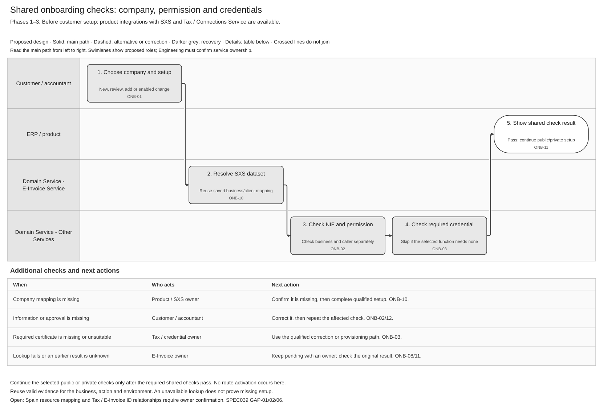

# Customer Onboarding and Connectivity Logical Feature Specification

[Summary — 037](SPEC-SEI-037-customer-onboarding-and-connectivity-solution-summary.md) · [API reuse — 039](SPEC-SEI-039-customer-onboarding-and-connectivity-sequence-and-reuse-assessment.md)

## Revision overview — Phases 1–3

This view combines SPEC-SEI-019 and SPEC-SEI-035. It keeps their scenarios and activity IDs. Detailed API contracts and historical analysis remain in their linked sources; they are not repeated here. The predecessors are unchanged. Scope and open decisions are unchanged.

## 1 Purpose and authority — Phases 1–3

Let a business or its authorised accountant set up Sage access to its chosen e-invoicing platform. Reuse valid setup, ask only for missing information and show what is ready or needs action. This avoids repeated registration and unintended provider changes.

**Phase coverage:** **1 — SPFE public solution; 2 — external private providers; 3 — Sage private-platform offering.** Labels show analysis coverage, not delivery approval or confirmed API availability. REF-PHASE. Private A to Private B stays disabled. Invoice sending, receiving, reporting and full exit belong to separate features. REF-PRODUCT.

## 2 Terms used — Phases 1–3

**NIF** identifies the business. **Permission** determines who may act for it. **Readiness** means Sage has passed the checks for a requested function. **Activation** separately authorises use of a platform for future work. A saved connection does not prove both. Other terms use the [shared glossary](../../context/GLO-SEI-001-e-invoicing-terminology.md).

## 3 Scope — Phases 1–3

### 3.1 In scope — Phases 1–3

The customer and an authorised accountant use the same paths. Batch processing is optional.

| ID | Customer situation | What Sage does | Phase |
|---|---|---|---|
| ONB-S01 | No existing setup | Offer supported choices and complete the selected setup. | 1–3 |
| ONB-S02 | Already uses the public platform outside Sage | Check the access Sage needs; reuse valid evidence. | 1; reused in 2–3 |
| ONB-S03 | Wants to keep a private provider | Link its account and add only missing Sage setup. | 2–3 |
| ONB-S04 | Uses public and private services | Check each requested function separately. Keep valid results when another check fails; enforce dependencies and one executor per invoice action. | 2–3 |
| ONB-S05 | Already has Sage setup | Confirm unchanged setup, refresh expired evidence or add the requested function. | 1–3 |
| ONB-S06 | Wants to change platform | Allow only an enabled, authorised change. Confirm when it takes effect and preserve access to earlier invoices. | 2–3; enabled changes only |
| ONB-S07 | Already uses business-to-government invoicing (B2G) | Check business-to-business access separately; keep B2G setup intact. | 1–3 |
| ONB-S08 | Provider/function is unsupported, or setup is unknown | State the limitation, missing information and owner. Do not force a provider change. | 1–3 |

### 3.2 Decisions and open questions — Phases 1–3

**Spain connection model:** [039 GAP-02](SPEC-SEI-039-customer-onboarding-and-connectivity-sequence-and-reuse-assessment.md#gap-02) owns the open decision. Scenario outcomes do not select the API resource model.

**Phase 2 — unlisted provider:** Product and the local technical lead must decide whether to show only supported providers or allow an “Other provider” request. Until support is confirmed, do not offer a connection. REF-PROVIDERS. Implementation questions are in [039 §2](SPEC-SEI-039-customer-onboarding-and-connectivity-sequence-and-reuse-assessment.md#2-open-engineering-decisions).

## 4 Feature wide functional requirements and rules — Phases 1–3

**Product integration preconditions:** before enabling e-invoicing, each product must integrate **SXS** for `datasetId` / `tenantId` management and **Tax certificate management / Connections Service** for credential setup and protected use. These product integrations precede customer onboarding. Accountants need a permitted mapping for each client. They do not replace customer permission or require a certificate where the selected function does not need one. B2B lookup/readiness interfaces still need confirmation. User direction, 26–27 October 2026; REF-INTEGRATION.

Reuse current evidence only for the same business, action and environment. Keep customer statements separate from observed results. A failed lookup means “not confirmed”, not “does not exist”. Spain rules and test credentials must not affect other countries or production. ONB-R01/03/12/14/24; OFR-R09/10.

## 5 Cross cutting quality and operational requirements — Phases 1–3

Keep client data and permissions separate. Protect certificate keys and secrets. Save requests and results so a restart or repeated request does not duplicate work. Record who changed what and when. Security and Operations must confirm retention, retry limits and support ownership before release. ONB-NFR01–05.

## 6 Feature activities — Phases 1–3

### 6.1 ONB-01 Capture requested functions — Phases 1–3

Save the business, requested setup and environment. Prefill valid information and ask only for missing or changed inputs. An unchanged repeated request returns its saved result; conflicting changes require review.

### 6.2 ONB-02 Check business identity and authority — Phases 1–3

Check the NIF, caller identity and permission separately. For an accountant, also check the current firm role and client relationship. Login or certificate ownership alone does not prove permission. SPFE-S02 Article 11.

### 6.3 ONB-12 Coordinate client approval and evidence — Phases 1–3

If approval is missing, ask an eligible person for the specific action. Changed, expired or withdrawn approval cannot authorise new work; stop affected work when client access ends. Local approval does not replace official representation. [Approval flow](../../assets/diagrams/onboarding-client-approval-swimlane.svg).

### 6.4 ONB-10 Assess current setup — Phases 1–3

Resolve the company's SXS dataset/client mapping before dataset-scoped credential lookup or access-point calls. Reuse the company mapping when adding a platform; apply the resource relationships decided under 039 GAP-01/02. Missing mapping follows the qualified channel/SXS setup process; an unavailable lookup remains pending. Compare existing public, private and Sage setup; check only missing, changed or expired items. Do not create another account to repair an unknown result.

### 6.5 ONB-03 Assess prerequisites — Phases 1–3, where required

Run these shared checks before public or private setup. Use the Tax certificate service where a certificate is required: confirm its dates, suitability and permitted use for this business and environment. Reuse a protected reference. Missing, expired or revoked material needs correction; an unavailable lookup remains pending. Authentication, signing and permission are separate checks. REF-TRUST; SPFE-S02.

### 6.6 ONB-04 Publish public readiness — Phase 1; reused in Phases 2–3

Return readiness only for the functions whose mandatory checks passed, including actual Sage support. Name any limitation and next action. The supplied public contracts contain no onboarding enrolment operation; do not invent one or send a test invoice. Web-form access does not prove automated access. SPFE-S03/S08/S16.

### 6.7 ONB-05 Configure private choice — Phases 2–3

The private path links the selected provider account and checks access. Keep valid accounts and credentials. Before a call that can redirect traffic, check permission and continued access to earlier invoices. Setup can finish without activating a route. REF-CONNECTIVITY.

For Phase 3, if Sage offers the private-platform service, first confirm the named legal operator, permitted interfaces, security and operations under [PRD-SEI-221](../../prds/PRD-SEI-221-operator-readiness-regulatory-governance.md). A customer connection does not establish operator eligibility. REF-OPERATOR.

### 6.8 ONB-06 Prove private readiness — Phases 2–3

Confirm provider access for each requested function. A saved connection alone is insufficient. Where a change affects receiving, confirm that the intended destination is reachable before activation.

### 6.9 ONB-07 Cut over new traffic — Phases 2–3, enabled changes only

For an enabled change, confirm permission, readiness and the effective start. Reject stale or competing changes. Do not reset unchanged setup because its historical start is unknown. ONB-R06/07/25.

### 6.10 ONB-08 Reconcile and recover — Phases 1–3

| Problem | Required next action |
|---|---|
| Wrong or missing input | Ask the responsible person to correct it; resume the affected check. |
| Earlier request succeeded | Save that result once; continue remaining checks. |
| Earlier request is confirmed to have had no effect | Repeat only if the contract allows it and permission is current. |
| Result is unknown or conflicting | Keep affected work pending with an owner. Check the original request before repeating it. |
| Customer cancels | Stop safe pending work. Resolve possible external effects before confirming cancellation. |

### 6.11 ONB-09 Preserve and release — Phases 1–3

Keep earlier invoices linked to their original platform, evidence and access. Preserve retrieval progress. Release old dependencies only when continuity is confirmed; full exit belongs to the [offboarding spec](../archive/SPEC-SEI-003-offboarding-solution-specification.md).

### 6.12 ONB-11 Return results and required actions — Phases 1–3

Show each requested function's result, missing item and next action/owner. Preserve independent successful results. Connection, readiness and activation remain separate. Read the current saved result after a lost notification; later use must recheck permission and certificate validity.

### 6.13 ONB-13 Manage portfolio batch — Phases 1–3

For an accountant batch, save the client list before returning a receipt. Check permission and process each client independently. Correction or cancellation for one client must not repeat completed work or block other safe clients. A receipt is not completed setup; disclose only currently authorised results. [Batch flow](../../assets/diagrams/onboarding-accountant-batch-swimlane.svg).

## 7 Traceability and supporting artefacts — Phases 1–3

The activities above define the journey. Use the existing sources for detailed checks rather than copying them into this view.

| Detail | Existing source |
|---|---|
| ONB/OFR requirements, states and functional acceptance IDs | [019 activities and checks](../archive/onboarding/SPEC-SEI-019-customer-onboarding-logical-feature-specification.md#6-feature-activities); [035 connectivity acceptance](../archive/provider-connectivity/SPEC-SEI-035-provider-connectivity-logical-feature-specification.md#5-functional-acceptance-and-retained-detail). |
| Existing calls, Spain changes and implementation gaps | [039 reuse assessment](SPEC-SEI-039-customer-onboarding-and-connectivity-sequence-and-reuse-assessment.md). API schemas stay in its linked contracts. |

**ONB-R25 correction:** this ID retains its effective-start meaning from SPEC-SEI-002. The second use in archived 019 for operator interconnection is instead referenced by PRD-SEI-221 FR20 and ONB-A44/A45.

### Operator interconnection handoff — Phase 3 operator scope

This is separate from customer setup. Where Article 9 applies, the receiving operator must make the connection operational within **one month from receipt**. If additional requests cannot be handled simultaneously, Article 9(4) requires receipt order; each queued request's month starts when the preceding interconnection becomes operational. Pending interconnection uses the required public exchange path. Compliance and Operations own timing and completion evidence under PRD-SEI-221 FR20; setup API success does not complete that duty. REF-PRIVATE; ONB-A44/A45.

### Review and release gates — Phases 1–3

Before enabling a path, demonstrate its main outcome, correction, unknown-result recovery and client isolation. Also check that Spain rules do not change another country's behaviour. Close the applicable [existing release checks](../archive/SPEC-SEI-002-onboarding-solution-specification.md#2-review-and-release-gates) and [039 implementation questions](SPEC-SEI-039-customer-onboarding-and-connectivity-sequence-and-reuse-assessment.md#2-open-engineering-decisions). These are required checks, not tests already passed.

## REF Source references — Phases 1–3

| ID | Source, version and location | Supports / limit |
|---|---|---|
| REF-PHASE | [PRD213](<../../prds/PRD-SEI-213-private-platform-connectivity-structured-review.md>), Phase 2 scope; [PRD210](<../../prds/PRD-SEI-210-sage-private-platform-reuse-and-operator-expansion.md>), Phase 3 document map / phase comparison; [PRD221](<../../prds/PRD-SEI-221-operator-readiness-regulatory-governance.md>), Phase and outcome; repository drafts. User direction, 28 October 2026. | Phase labels describe analysis coverage: SPFE, external providers, then Sage private-platform offering. They do not approve delivery, implementation or Private A to Private B switching. |
| REF-PRODUCT | [PRD101](../../prds/PRD-SEI-101-public-platform-onboarding.md), [104](../../prds/PRD-SEI-104-accountant-and-single-client-onboarding.md), [107](../../prds/PRD-SEI-107-public-onboarding-failure-recovery.md), [222](../../prds/PRD-SEI-222-customer-onboarding-entry-point-migration.md), [231](../../prds/PRD-SEI-231-country-identifiers-tenancy-and-delegated-accountants.md); repository draft versions; scope and functional requirements. | Proposed product behaviour, not proof of implementation. |
| REF-TRUST | [SPEC001](../SPEC-SEI-001-certificate-management-solution-specification.md), updated 20 October 2026, CERT-04/05 and G1/G9/G10. | Certificate reuse/checks; actual Tax interface and Spain acceptance remain open. |
| REF-INTEGRATION | User direction, 26–27 October 2026, recorded in §4; [SXS glossary definition](../../context/GLO-SEI-001-e-invoicing-terminology.md#services-connections-and-routing). | Product integration precondition; not evidence of a deployed SXS/Tax contract. |
| SPFE-S02 | [Original BOE order](../../context/BOE-A-2026-20587.pdf), HAC/1028/2026, 5 October 2026, Article 11(1)–(2). | Access and representation, including registered third-party consultation/retrieval authority; no Sage implementation proof. |
| SPFE-S03/S08/S16 | [Catalogue](<../../context/Descripción servicios web/Catálogo de servicios/20261013/CatalogoServicios.pdf>) 0.1.0, 9 October 2026, §§4.3/5.1/6.1–6.10; [draft formats](<../../context/Descripción servicios web/Formatos entrada y salida/20261013/FormatosEntradaSalida.pdf>) 0.1.0, 9 October 2026, §§5.1–5.9; [SendInvoice WSDL](<../../context/WSDL servicios web - PRE/20261013/SendInvoice.wsdl>) snapshot 13 October 2026, binding/service ports. | Operation boundaries; no supplied onboarding enrolment contract. Unfinished formats and transport conflicts in [RES-SEI-002](../../context/RES-SEI-002-spain-public-platform-technical-evidence.md) remain open. |
| REF-PRIVATE | [Original RD 238/2026](https://www.boe.es/buscar/doc.php?id=BOE-A-2026-7295), 31 March 2026, Articles 8–9. | Operator interconnection, timing exception and interim public exchange; not a customer-onboarding deadline. |
| REF-PROVIDERS | [PRD213](../../prds/PRD-SEI-213-private-platform-connectivity-structured-review.md), current draft, BR4/FR4. | Planned provider scope; unlisted-provider UI remains undecided. |
| REF-CONNECTIVITY / REF-OPERATOR | [SPEC014](../SPEC-SEI-014-shared-platform-connectivity-and-routing-solution-specification.md), 20 October 2026, SPC-01–08; [PRD221](../../prds/PRD-SEI-221-operator-readiness-regulatory-governance.md), 6 October 2026, readiness domains and FR20. | Proposed connection/activation controls and operator obligations; no launch approval. |
