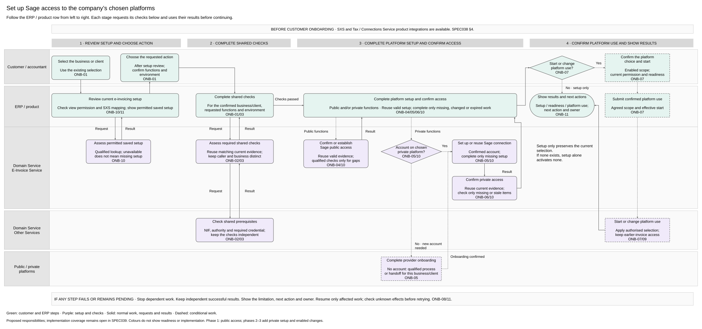

# Customer Onboarding and Connectivity Logical Feature Specification

[Summary — 037](SPEC-SEI-037-customer-onboarding-and-connectivity-solution-summary.md) · [API reuse — 039](SPEC-SEI-039-customer-onboarding-and-connectivity-sequence-and-reuse-assessment.md)

## Revision overview — Phases 1–3

This view combines SPEC-SEI-019 and SPEC-SEI-035. It keeps their scenarios and activity IDs. Detailed API contracts and historical analysis remain in their linked sources; they are not repeated here. The predecessors are unchanged. Scope and open decisions are unchanged.

## 1 Purpose and authority — Phases 1–3

Let a business or its authorised accountant set up Sage access to its chosen e-invoicing platform. Reuse valid setup, ask only for missing information and show what is ready or needs action. This avoids repeated registration and unintended provider changes.

**Phase coverage:** **1 — SPFE public solution; 2 — external private providers; 3 — Sage private-platform offering.** Labels show analysis coverage, not delivery approval or confirmed API availability. REF-PHASE. Private A to Private B stays disabled. Invoice sending, receiving, reporting and full exit belong to separate features. REF-PRODUCT.

### E-invoicing settings — intended interaction

The intended product interaction is one **E-invoicing settings** area in the **business's or accountant's Sage product**, for the selected business or client. Customers may also enter through guided onboarding for initial or incomplete setup, where the product provides it. Both entry points follow the same business selection, setup review and action checks under ONB-01/10. Customers can review their current setup and request the following supported actions. The exact menu location, screen design and implementation remain to confirm with the product team. [SPEC037's settings overview](SPEC-SEI-037-customer-onboarding-and-connectivity-solution-summary.md#e-invoicing-settings-overview) is the primary home of the shared diagram.

| Customer action in settings | Meaning | Specification responsibility |
|---|---|---|
| Connect or add a platform | Set up Sage access to a chosen platform, reusing valid accounts and connections. | [SPEC038 — Setup scenarios](#31-in-scope), ONB-S01–05 and the applicable checks. |
| Switch platform | Change the platform used for future sending or receipt. Keep this as one customer request, with the selected scope, start and progress. | [SPEC038 — Switch platform](#switch-platform-one-customer-journey) coordinates new setup, routing and any old-service exit; [SPEC032 — Exit checks](../offboarding/SPEC-SEI-032-customer-offboarding-logical-feature-specification.md#2-state-invariants-and-workflow) supplies the offboarding rules. |
| Disconnect or stop a service | End selected Sage access or services, without assuming that the customer wants a different platform. | [SPEC032 — Customer-action scenarios](../offboarding/SPEC-SEI-032-customer-offboarding-logical-feature-specification.md#customer-action-scenarios), selected OFF-S01/06–09 and applicable exit checks. |

Customers must not have to start separate onboarding and offboarding requests to complete one switch. Before confirmation, show what will change, what will remain, the proposed start and how earlier invoices will be handled. Settings must show progress, any failed or pending step, and who must act next. Ending a connection does not automatically cancel a product subscription or platform agreement; show and confirm those actions separately where applicable.

Offer only enabled actions for the selected country, platform, business and caller. An unsupported action must explain the limitation and available next step. This settings model does not enable private A → private B switching or assert that all listed actions are implemented. Incident response can also start outside settings; OFF-S10 still permits urgent action under incident authority.

#### Switch platform — one customer journey

This section owns the complete customer switch journey (ONB-S06). The onboarding and offboarding specs each retain their detailed checks. A switch scenario in the offboarding table describes the old-service responsibilities within this journey; it is not another customer process.

| Stage | Customer experience and coordination | Detailed rule owner |
|---|---|---|
| Choose the change | In settings, select the current and new platform, affected businesses and invoice directions, and requested start. Confirm that the action is enabled and the caller has permission. | ONB-01/02; enabled scope in §3. |
| Check the new setup | Reuse valid setup and complete only missing connection, credential and readiness checks. Keep progress in the same request. | ONB-10 and ONB-03–06. |
| Review and confirm | Show what changes, what remains, the proposed start and who will handle earlier invoices. Include any requested old-service termination and its separate contract/access consequences. Obtain the applicable approval. | ONB-07; [SPEC032](../offboarding/SPEC-SEI-032-customer-offboarding-logical-feature-specification.md#2-state-invariants-and-workflow), OFF-01/02/03/05. |
| Change future invoice handling | Apply one authorised change and confirm when it takes effect. Keep earlier invoice results and their original platform context. An unknown result remains pending for recovery. | ONB-07/08; [SPEC014 — Routing controls](../SPEC-SEI-014-shared-platform-connectivity-and-routing-solution-specification.md#2-behaviour-by-activity) routing controls; OFF-04/08. |
| Finish or track old-service work | Where access or services must end, apply the offboarding checks and preserve required records and unfinished duties. Return each step's result, pending work and next owner to the same settings request. | ONB-09/11; [SPEC032](../offboarding/SPEC-SEI-032-customer-offboarding-logical-feature-specification.md#2-state-invariants-and-workflow), OFF-05–08. |

For a request to stop services without a replacement platform, use **Disconnect or stop a service** and the relevant [SPEC032 — Customer-action scenario](../offboarding/SPEC-SEI-032-customer-offboarding-logical-feature-specification.md#customer-action-scenarios). Do not create a switch request just to process a cancellation. [SPEC039 — Supported change](SPEC-SEI-039-customer-onboarding-and-connectivity-sequence-and-reuse-assessment.md#34-supported-change) owns the API reuse assessment; API reuse does not change this customer-journey ownership.

## 2 Terms used — Phases 1–3

**NIF** identifies the business. **Permission** determines who may act for it. **Readiness** means Sage has passed the checks for a requested function. **Activation** separately authorises use of a platform for future work. A saved connection does not prove both. Other terms use the [shared glossary](../../context/GLO-SEI-001-e-invoicing-terminology.md).

### Spain business structures and identity examples

| Spain case | Example | Identity example: NIF/NIE |
|---|---|---|
| One business, several establishments | A company operates several shops or offices. | One company NIF with several establishments or addresses. Separate premises do not automatically mean separate NIFs. Separately identified permanent establishments need their own country-rule assessment. REF-ES-STRUCTURES; shared glossary. |
| One group, several legal entities | A parent company manages several subsidiaries. | Multiple NIFs: NIF-A for the parent, NIF-B for subsidiary B and NIF-C for subsidiary C. Group membership does not merge their identities. REF-ES-STRUCTURES. |
| One accountant, several client businesses | A despacho manages companies and self-employed clients. | Multiple client NIFs, separate from the accountant's NIF. For a foreign individual, the NIE generally serves as the NIF; AEAT can assign a NIF when the person has no DNI/NIE. Authority remains specific to the client and action. REF-ES-STRUCTURES; REF-ES-NIF. |

These examples distinguish establishments, legal entities and accountant/client relationships. They do not prescribe how many entities a dataset contains. [039 GAP-01/02](SPEC-SEI-039-customer-onboarding-and-connectivity-sequence-and-reuse-assessment.md#gap-01) must confirm whether each case uses one or several datasets and connections. France SIREN/SIRET rules do not define the Spain mapping.

### Spain NIF identifier classes

NIF is the common taxpayer identifier. Capture and validate the business NIF using the rules for its identifier class. Do not require separate NIF, DNI and NIE values for the same taxpayer. PRD101 FR6–10; REF-ES-NIF.

| Business being identified | Value used as its NIF | Sample value (synthetic) |
|---|---|---|
| Spanish individual / sole trader | DNI number, including its check letter. | `12345678Z` |
| Foreign individual / sole trader | NIE, which generally serves as the individual's NIF. | `X1234567L` |
| Company or other entity | Entity NIF. | `B12345674` (SL company) |
| Individual with an exceptional AEAT-assigned identifier | Applicable K-, L- or M-prefixed NIF when the person has no DNI/NIE. | `K0000001R`, `L0000001R`, `M0000001R` |

These are synthetic format examples with valid check characters. They are not verified AEAT registrations and must not be used for live transactions.

REF-ES-NIF supports the individual classes; REF-ES-ENTITY-NIF supports entity NIFs. Keep enough identifier-class information to select the correct validation. This table does not define new API fields or confirm implementation coverage. [039 GAP-01/02](SPEC-SEI-039-customer-onboarding-and-connectivity-sequence-and-reuse-assessment.md#gap-01) retains the contract-mapping questions. [ONB-03 prerequisite checks](#65-onb-03-assess-prerequisites) govern identity readiness separately from certificates and authority.

## 3 Scope — Phases 1–3

### 3.1 In scope — Phases 1–3

The customer and an authorised accountant use the same paths. Batch processing is optional. Scenarios can overlap: S03 identifies a retained provider, while S05 identifies existing Sage setup. [SPEC037 Figure 1 and its scenario-path column](SPEC-SEI-037-customer-onboarding-and-connectivity-solution-summary.md#3-master-feature-purpose-and-scope) map these situations to the shared journey; they are not exclusive branches.

| ID | Customer situation | What Sage does | Phase |
|---|---|---|---|
| ONB-S01 | No existing setup | Offer supported choices and complete the selected setup. If the chosen private platform has no account, complete its required onboarding and connect to Sage under ONB-05. Starting platform use needs the separate ONB-07 decision where enabled. | 1–3 |
| ONB-S02 | Already uses the public platform outside Sage | Check the access Sage needs; reuse valid evidence. | 1; reused in 2–3 |
| ONB-S03 | Wants to keep a private provider | Connect its existing account to Sage, or reuse a valid Sage connection. Complete only missing or changed Sage setup. | 2–3 |
| ONB-S04 | Uses public and private services | Check each requested function separately. Keep valid results when another check fails; enforce dependencies and one executor per invoice action. | 2–3 |
| ONB-S05 | Already has Sage setup | Confirm unchanged setup, refresh expired evidence or add the requested function. | 1–3 |
| ONB-S06 | Wants to change platform | Confirm target access through the applicable public/private paths, reusing valid setup. Allow only an enabled, authorised change. Confirm when it takes effect and preserve access to earlier invoices. | 2–3; enabled changes only |
| ONB-S07 | Already uses business-to-government invoicing (B2G) | Assess requested business-to-business functions through the applicable public/private paths; keep B2G setup intact. | 1–3 |
| ONB-S08 | Provider/function is unsupported, or setup is unknown | State the limitation, missing information and owner. Do not force a provider change. | 1–3 |

### 3.2 Decisions and open questions — Phases 1–3

**Spain connection model:** [039 GAP-02](SPEC-SEI-039-customer-onboarding-and-connectivity-sequence-and-reuse-assessment.md#gap-02) owns the open decision. Scenario outcomes do not select the API resource model.

**Phase 2 — unlisted provider:** Product and the local technical lead must decide whether to show only supported providers or allow an “Other provider” request. Until support is confirmed, do not offer a connection. REF-PROVIDERS. Implementation questions are in [039 §2](SPEC-SEI-039-customer-onboarding-and-connectivity-sequence-and-reuse-assessment.md#2-open-engineering-decisions).

## 4 Feature wide functional requirements and rules — Phases 1–3

**Product integration preconditions:** before enabling e-invoicing, each product must integrate **SXS** for `datasetId` / `tenantId` management and **Tax certificate management / Connections Service** for credential setup and protected use. These product integrations precede customer onboarding. Accountants need a permitted mapping for each client. They do not replace customer permission or require a certificate where the selected function does not need one. B2B lookup/readiness interfaces still need confirmation. User direction, 26–27 October 2026; REF-INTEGRATION.

**Platform onboarding and certificate reuse:** the Spain team confirmed, as reported by the user on 11 November 2026, that the same certificate can be reused across platforms, but each platform requires separate onboarding (configuration and setup). When an administrator adds a second platform, reuse a suitable certificate and complete the second platform's required configuration, authority and readiness checks. Show each platform's setup result separately. If the second setup fails or remains pending, identify its next action and owner; do not mark it ready because the first platform is ready. This confirmation does not select API connection resources or credential-ID relationships; [039 GAP-02/06](SPEC-SEI-039-customer-onboarding-and-connectivity-sequence-and-reuse-assessment.md#gap-06) retain those implementation checks.

Reuse current evidence only for the same business, action and environment. Keep customer statements separate from observed results. A failed lookup means “not confirmed”, not “does not exist”. Spain rules and test credentials must not affect other countries or production. ONB-R01/03/12/14/24; OFR-R09/10.

## 5 Cross cutting quality and operational requirements — Phases 1–3

Keep client data and permissions separate. Protect certificate keys and secrets. Save requests and results so a restart or repeated request does not duplicate work. Record who changed what and when. Security and Operations must confirm retention, retry limits and support ownership before release. ONB-NFR01–05.

## 6 Feature activities — Phases 1–3

[Editable Draw.io — combined onboarding swimlane](../../assets/diagrams/onboarding-and-connectivity-swimlane.drawio) · [PNG preview](../../assets/diagrams/onboarding-and-connectivity-swimlane.png).

Follow the ERP / product row from left to right. Each stage requests its supporting checks below and uses their results before continuing. Stage 3 can run the public path, private path or both. Both return to the same ONB-07 platform-use decision. The four journey stages are separate from delivery Phases 1–3.

The swimlane groups interactions for readability; SPEC039 retains the detailed requests, progress reads and API qualification. The shared recovery note applies to every failed or pending step under ONB-08/11. Lane responsibilities are proposed; they do not approve service ownership or implementation coverage.

### 6.1 ONB-01 Capture requested functions — Phases 1–3

From E-invoicing settings or guided onboarding, **Select the business or client**; use the product's existing selection where available. Run **Review current e-invoicing setup** under ONB-10 before **Choose the requested action**. Offer review of existing access, **Connect or add a platform** and **Switch platform** only where supported. An entry point may supply an initial intent; confirm it against the loaded setup before proceeding. Then save the business, requested functions and environment, and complete the applicable ONB-02/03 checks. Prefill valid information and ask only for missing or changed inputs. An unchanged repeated request returns its saved result; conflicting changes require review. User direction, 11 November 2026.

### 6.2 ONB-02 Check business identity and authority — Phases 1–3

Check the NIF, caller identity and permission separately. For an accountant, also check the current firm role and client relationship. Login or certificate ownership alone does not prove permission. SPFE-S02 Article 11.

### 6.3 ONB-12 Coordinate client approval and evidence — Phases 1–3

If approval is missing, ask an eligible person for the specific action. Changed, expired or withdrawn approval cannot authorise new work; stop affected work when client access ends. Local approval does not replace official representation. [Approval flow](../../assets/diagrams/onboarding-client-approval-swimlane.svg).

### 6.4 ONB-10 Assess current setup — Phases 1–3

For **Review current e-invoicing setup**, verify the caller's permission to view the selected business or client. Resolve its SXS dataset/client mapping before dataset-scoped credential lookup or access-point calls. Load and show the permitted saved setup and credential references; do not expose secrets. Saved configuration does not prove readiness or authority for a later action. Reuse the company mapping when adding a platform; apply the resource relationships decided under 039 GAP-01/02. Missing mapping follows the qualified channel/SXS setup process; an unavailable lookup returns a pending result, next action and owner. Do not treat an unavailable lookup as evidence of missing setup or create another account to repair an unknown result.

After ONB-01 captures the action, **Which platform setup applies?** selects the public and/or private paths for the requested functions. Reuse valid setup and matching current evidence in both paths; complete only missing, changed or expired items. Valid unchanged setup requires no new configuration or unnecessary external checks. This rule covers S05 within either path rather than a separate reuse branch. Keep results per function, preserve independent successful results and enforce dependencies before continuing affected work. Existing B2G setup remains unchanged when B2B functions are assessed. Both paths lead to ONB-07's platform-use decision.

### 6.5 ONB-03 Assess prerequisites — Phases 1–3, where required

See Stage 2 of the [combined onboarding swimlane](#onboarding-process). Stage 1 supplies the selected business, current setup and confirmed action.

Run these shared checks before public or private setup. The table explains [ONB-R17 — independent prerequisites](../archive/onboarding/SPEC-SEI-019-customer-onboarding-logical-feature-specification.md#4-feature-wide-functional-requirements-and-rules). A NIF and an in-date certificate alone do not establish readiness.

The ERP/product requests permitted current setup through its qualified SXS/API integration, shows that setup, and submits the customer's confirmed action for shared checks. The E-Invoice Service lane coordinates the checks; the Other Services lane provides the required identity and credential capabilities. The ERP shows the returned results and next actions. These are functional responsibilities; actual interface and service ownership remain qualified in [039 §3.1](SPEC-SEI-039-customer-onboarding-and-connectivity-sequence-and-reuse-assessment.md#31-shared-prerequisites).

| Check | Required evidence for the selected business, action and environment | If the check does not pass |
|---|---|---|
| Business NIF | Verify the represented taxpayer's NIF using the [Spain NIF identifier classes](#spain-nif-identifier-classes). The accountant's or platform caller's NIF cannot replace the business NIF. REF-ES-NIF; REF-PRODUCT, PRD101 FR6–10. | Ask for correction or missing evidence. An unconfirmed business NIF blocks dependent readiness even if the certificate is valid. |
| Caller identity and authority | Identify the caller and verify current permission for this business and action. For delegated access, check the represented principal, delegate and operation-specific authority. SPFE-S02 Article 11; ONB-02/12. | Obtain the required authority through ONB-12. Login, a valid NIF or certificate possession cannot replace permission. |
| Required certificate or seal | Use the Tax certificate service to check the selected credential's owner/caller, represented business, permitted purpose, issuer/chain, validity, revocation status and environment. Reuse a suitable protected reference. For SPFE web-service calls, select the accepted certificate/seal class and matching WSDL port; authentication cannot be skipped. REF-TRUST, SPEC001 CM-SPFE-R01; SPFE-S03 §4.3; SPFE-S16 service ports. | Correct missing, expired, revoked or unsuitable material. Keep an unavailable check or unconfirmed acceptance pending. Block only dependent functions. |
| Readiness for the requested function | Pass the independent NIF, authority and required-credential checks, then confirm the platform access and actual Sage support under ONB-04/06. An approved `NOT_REQUIRED` decision removes only the certificate condition for a function that permits it. REF-TRUST, SPEC001 CM-R01. | Return the failed or pending check, next action and owner. Passing one check cannot override another failure or activate a route. |

The selected access model determines whose certificate is used. An authorised accountant or platform may use an accepted credential for a permitted delegated action; do not require a customer certificate upload by default. Credential acceptance and delegated authority remain open under [039 GAP-03/06](SPEC-SEI-039-customer-onboarding-and-connectivity-sequence-and-reuse-assessment.md#gap-03). Authentication and invoice signing are separate purposes; an authentication certificate does not automatically qualify for signing. REF-TRUST; SPFE-S02.

Acceptance uses [ONB-A25 / OFR-A20](../archive/onboarding/SPEC-SEI-019-customer-onboarding-logical-feature-specification.md#62-onb-02-check-business-identity-and-authority): verify a valid NIF with an unsuitable required certificate, a valid certificate with an unconfirmed NIF, both valid with missing authority, and an approved `NOT_REQUIRED` result. Each case must retain the other independent checks.

### 6.6 ONB-04 Publish public readiness — Phase 1; reused in Phases 2–3

See the public path in Stage 3 of the [combined onboarding swimlane](#onboarding-process).

Return readiness only for the functions whose mandatory checks passed, including actual Sage support. Name any limitation and next action. The supplied public contracts contain no onboarding enrolment operation; do not invent one or send a test invoice. Web-form access does not prove automated access. SPFE-S03/S08/S16.

The ERP uses the applicable saved setup from Stage 1 and requests the public-access assessment. Matching current evidence goes directly to the saved result. Missing, changed or expired evidence follows only the affected checks, using a qualified public method where needed. The Domain Service lanes retain coordination, supporting checks and saved findings. Corrections return through the product request; an unknown result follows ONB-08. Scoped results return to the ERP before the common ONB-07 decision. [039 §3.2](SPEC-SEI-039-customer-onboarding-and-connectivity-sequence-and-reuse-assessment.md#32-public-readiness) shows the corresponding interactions.

If no qualified evidence can establish access for a requested function, keep that result unconfirmed and name the action owner. [039's WSDL assessment](SPEC-SEI-039-customer-onboarding-and-connectivity-sequence-and-reuse-assessment.md#spfe-wsdl-onboarding-boundary) records the operation evidence, limits and GAP-05/06 owners; [039 §5](SPEC-SEI-039-customer-onboarding-and-connectivity-sequence-and-reuse-assessment.md#5-acceptance-coverage) defines the contract-specific checks. This is a proposed readiness control, not an external onboarding contract.

### 6.7 ONB-05 Configure private choice — Phases 2–3

See the private path in Stage 3 and the common platform-use decision in Stage 4 of the [combined onboarding swimlane](#onboarding-process).

**Account on chosen private platform?** distinguishes the provider account from its Sage connection. An existing provider account does not prove that Sage is connected. Use of platform A does not prove an account exists on chosen platform B. Assess the chosen platform's account, including when a platform is new to Sage. User clarification, 11 November 2026.

For an accountant, assess whether the platform account is valid for the selected client under the qualified provider model. Keep the represented client, acting accountant and account holder distinct. The firm's own account or client relationship alone cannot establish permission for that client. Do not assume that each client needs a separate provider account; shared account/client arrangements require provider contract and authority evidence under 039 GAP-01/02/03/08. Missing client approval follows ONB-12 before dependent work continues.

| Condition on the chosen platform | Required behaviour |
|---|---|
| Customer already has an account | **Connect existing account to Sage**, or reuse its valid Sage connection. Complete only missing or changed Sage configuration; do not repeat provider account onboarding solely because Sage access is new. |
| Customer has no account | **Complete provider onboarding, then connect**. Use the provider's qualified account-onboarding process or handoff, then complete its Sage configuration and connection. Do not assume Sage creates the account automatically or invent a provider API. |
| Account status or required onboarding support is unconfirmed | Return the E result with missing evidence, next action and owner. Do not infer that an account is absent or create a duplicate. |

Both account branches lead to **Confirm private access** under ONB-06. Each platform still requires its own Sage setup and readiness checks, even when a suitable certificate is reused. Add or update only missing or changed configuration; keep suitable credentials. [039 GAP-02/06/08](SPEC-SEI-039-customer-onboarding-and-connectivity-sequence-and-reuse-assessment.md#gap-08) must qualify each provider's onboarding/connection path, completion evidence and responsible party before enablement. Before a call that can redirect invoice work, check permission and continued access to earlier invoices. Setup can finish without activating a route; ONB-07 owns that separate decision. REF-CONNECTIVITY.

The ERP uses saved private setup from Stage 1. After the chosen platform account is confirmed, it submits only missing connection work and reads progress where needed, using the original request and returned references. The E-Invoice Service lane shows connection setup and the proposed access assessment. It confirms readiness after assessing the chosen platform's qualified evidence, then returns the scoped result to the ERP. Stage 4 owns the separate platform-use handoff for either path. [039 §3.3](SPEC-SEI-039-customer-onboarding-and-connectivity-sequence-and-reuse-assessment.md#33-private-setup) and [§3.4](SPEC-SEI-039-customer-onboarding-and-connectivity-sequence-and-reuse-assessment.md#34-supported-change) show the detailed connection, progress and platform-use interactions. The account decision's missing/unknown cases and shared reuse rule remain in ONB-05/10 above.

For Phase 3, if Sage offers the private-platform service, first confirm the named legal operator, permitted interfaces, security and operations under [PRD-SEI-221](../../prds/PRD-SEI-221-operator-readiness-regulatory-governance.md). A customer connection does not establish operator eligibility. REF-OPERATOR.

### 6.8 ONB-06 Prove private readiness — Phases 2–3

**Confirm private access** for each requested function; reuse matching current evidence under ONB-10. A saved connection alone is insufficient. Where a change affects receiving, confirm that the intended destination is reachable before activation.

### 6.9 ONB-07 Cut over new traffic — Phases 2–3, enabled changes only

After the applicable public/private paths return their results, **Start or change platform use?** asks whether this action is part of the customer request. For **No — setup only**, return ONB-11 results. Keep any existing platform selection unchanged; if none exists, setup alone activates none. This exit applies after either or both platform paths, including valid unchanged setup.

Where starting or changing use is requested and enabled, **Confirm the platform choice and start** for the agreed sending, receiving or combined scope. Confirm current permission, required readiness and the effective start. Failed dependencies block affected work. Reject stale or competing changes. **Start or change platform use** applies only the authorised selection from the agreed start; ONB-09 preserves earlier-invoice access. Technical specifications call this route activation or a routing change; it is separate from connection configuration. Do not reset unchanged setup because its historical start is unknown. ONB-R06/07/25.

### 6.10 ONB-08 Reconcile and recover — Phases 1–3

Each **E** reference in SPEC037 Figure 1 leads to **Show pending result or limitation**. State the limitation or pending evidence, next action and owner. Stop dependent work, preserve independent successful results and resume only the affected step when resolved. The E references include unsupported choices, failed or pending checks and uncertain external results; they do not turn every limitation into a retry. ONB-10 distinguishes unavailable lookup from confirmed missing setup.

| Problem | Required next action |
|---|---|
| Wrong or missing input | Ask the responsible person to correct it; resume the affected check. |
| Earlier request succeeded | Save that result once; continue remaining checks. |
| Earlier request is confirmed to have had no effect | Repeat only if the contract allows it and permission is current. |
| Result is unknown or conflicting | Keep affected work pending with an owner. Check the original request before repeating it. |
| Customer cancels | Stop safe pending work. Resolve possible external effects before confirming cancellation. |

### 6.11 ONB-09 Preserve and release — Phases 1–3

Keep earlier invoices linked to their original platform, evidence and access. Preserve retrieval progress. Release old dependencies only when continuity is confirmed. Apply [SPEC032's exit checks](../offboarding/SPEC-SEI-032-customer-offboarding-logical-feature-specification.md#2-state-invariants-and-workflow) within the same switch request when old access or services must end. A standalone full exit follows SPEC032 without requiring a replacement-platform journey.

### 6.12 ONB-11 Return results and required actions — Phases 1–3

Show each requested function's result, missing item and next action/owner. Preserve independent successful results. Connection, readiness and activation remain separate. Read the current saved result after a lost notification; later use must recheck permission and certificate validity.

### 6.13 ONB-13 Manage portfolio batch — Phases 1–3

For an accountant batch, save the client list before returning a receipt. Check permission and process each client independently. Correction or cancellation for one client must not repeat completed work or block other safe clients. A receipt is not completed setup; disclose only currently authorised results. [Batch flow](../../assets/diagrams/onboarding-accountant-batch-swimlane.svg).

## 7 Traceability and supporting artefacts — Phases 1–3

The activities above define the journey. The [combined swimlane](#onboarding-process) shows shared checks, public/private setup and the common platform-use decision. Its supporting checks stay within each journey stage. ONB-08 owns correction and unknown-result recovery; ONB-12/13 retain the separate approval and batch flows. SPEC039's participants show interface boundaries rather than a different customer process or approved deployments.

| Journey stage in the combined swimlane | Functional IDs | Corresponding SPEC039 interactions |
|---|---|---|
| 1 — Review setup and choose action | ONB-01/10/11 | [Shared prerequisites](SPEC-SEI-039-customer-onboarding-and-connectivity-sequence-and-reuse-assessment.md#31-shared-prerequisites): product/SXS mapping and qualified API-02 setup discovery. |
| 2 — Complete shared checks | ONB-02/03/11/12 | [Shared prerequisites](SPEC-SEI-039-customer-onboarding-and-connectivity-sequence-and-reuse-assessment.md#31-shared-prerequisites): prerequisite request, identity/credential findings and next action. |
| 3 — Public setup and access | ONB-03/04/10/11 | [Public readiness](SPEC-SEI-039-customer-onboarding-and-connectivity-sequence-and-reuse-assessment.md#32-public-readiness): qualified API-01/02/04 discovery and the access-check request/result. |
| 3 — Private setup and access | ONB-05/06/10/11 | [Private setup](SPEC-SEI-039-customer-onboarding-and-connectivity-sequence-and-reuse-assessment.md#33-private-setup): API-02/03/04, existing-account reuse, the qualified new-account handoff and progress reads where needed. |
| 4 — Confirm platform use and show results | ONB-07/09/11 | [Supported change](SPEC-SEI-039-customer-onboarding-and-connectivity-sequence-and-reuse-assessment.md#34-supported-change): confirmed scope/start, separate platform-use handoff and saved result. API-05 covers supported configuration edits, not activation. |

Use the existing sources below for detailed checks rather than copying them into this view.

| Detail | Existing source |
|---|---|
| ONB/OFR requirements, states and functional acceptance IDs | [019 activities and checks](../archive/onboarding/SPEC-SEI-019-customer-onboarding-logical-feature-specification.md#6-feature-activities); [035 connectivity acceptance](../archive/provider-connectivity/SPEC-SEI-035-provider-connectivity-logical-feature-specification.md#5-functional-acceptance-and-retained-detail). |
| Existing calls, Spain changes and implementation gaps | [039 reuse assessment](SPEC-SEI-039-customer-onboarding-and-connectivity-sequence-and-reuse-assessment.md). API schemas stay in its linked contracts. |

**ONB-R25 correction:** this ID retains its effective-start meaning from SPEC-SEI-002. The second use in archived 019 for operator interconnection is instead referenced by PRD-SEI-221 FR20 and ONB-A44/A45.

### Operator interconnection handoff — Phase 3 operator scope

This is separate from customer setup. Where Article 9 applies, the receiving operator must make the connection operational within **one month from receipt**. If additional requests cannot be handled simultaneously, Article 9(4) requires receipt order; each queued request's month starts when the preceding interconnection becomes operational. Pending interconnection uses the required public exchange path. Compliance and Operations own timing and completion evidence under PRD-SEI-221 FR20; setup API success does not complete that duty. REF-PRIVATE; ONB-A44/A45.

### Review and release gates — Phases 1–3

Before enabling a path, demonstrate its main outcome, correction, unknown-result recovery and client isolation. For ONB-01/10, verify that an existing business selection is reused, current setup is shown before action confirmation, and an unavailable lookup returns a pending result without duplicate setup. Verify that an accountant cannot view another client's setup without permission and that saved configuration alone cannot pass readiness.

For both platform paths, verify that valid unchanged setup and matching current evidence require no new configuration or unnecessary external checks. For ONB-04/06, assess the evidence before confirming scoped readiness. If no qualified public check or other evidence exists, return the unconfirmed result and owner under GAP-05/06.

Check the [SPEC037 scenario-path mapping](SPEC-SEI-037-customer-onboarding-and-connectivity-solution-summary.md#3-master-feature-purpose-and-scope) against S01–08: S05 can reuse unchanged setup or refresh/extend the affected functions through either platform path; S06 checks the target and still requires the separate platform-use decision even when target setup is already valid; S07 can assess public or private B2B access without changing B2G. For ONB-05, cover an existing provider account without a Sage connection, a valid existing Sage connection, no account on the chosen provider, and use of A without an account on B. Unknown account status or an unqualified onboarding path must return E without duplicate account creation; completed onboarding still needs independent ONB-06 access evidence. Test setup-only requests after each applicable path with an existing platform selection and with none. Neither case may activate or change platform use. For S04, retain independent successful results when another function fails; block its dependent work. For S08, show the E result without forcing a provider change or repeating an uncertain request.

Repeat the private-account cases for an accountant onboarding one permitted client. Verify that the provider account covers that client, missing approval invokes ONB-12, and an unlinked client cannot be viewed or changed. The accountant's firm identity or own platform account must not silently replace the represented client. Batch processing is optional for one client; a client list applies ONB-13 isolation and current authority checks per client.

For [platform setup with certificate reuse](#platform-onboarding-and-certificate-reuse), verify two platforms using the same suitable certificate: completion of the first setup must leave the second pending until its own checks pass; a failure in the second must show its next action without changing the first result solely because the certificate is shared. Also check that Spain rules do not change another country's behaviour. Close the applicable [existing release checks](../archive/SPEC-SEI-002-onboarding-solution-specification.md#2-review-and-release-gates) and [039 implementation questions](SPEC-SEI-039-customer-onboarding-and-connectivity-sequence-and-reuse-assessment.md#2-open-engineering-decisions). These are required checks, not tests already passed.

## REF Source references — Phases 1–3

| ID | Source, version and location | Supports / limit |
|---|---|---|
| REF-PHASE | [PRD213](<../../prds/PRD-SEI-213-private-platform-connectivity-structured-review.md>), Phase 2 scope; [PRD210](<../../prds/PRD-SEI-210-sage-private-platform-reuse-and-operator-expansion.md>), Phase 3 document map / phase comparison; [PRD221](<../../prds/PRD-SEI-221-operator-readiness-regulatory-governance.md>), Phase and outcome; repository drafts. User direction, 28 October 2026. | Phase labels describe analysis coverage: SPFE, external providers, then Sage private-platform offering. They do not approve delivery, implementation or Private A to Private B switching. |
| REF-PRODUCT | [PRD101](../../prds/PRD-SEI-101-public-platform-onboarding.md), [104](../../prds/PRD-SEI-104-accountant-and-single-client-onboarding.md), [107](../../prds/PRD-SEI-107-public-onboarding-failure-recovery.md), [222](../../prds/PRD-SEI-222-customer-onboarding-entry-point-migration.md), [231](../../prds/PRD-SEI-231-country-identifiers-tenancy-and-delegated-accountants.md); repository draft versions; scope and functional requirements. | Proposed product behaviour, not proof of implementation. |
| REF-TRUST | [SPEC001](../SPEC-SEI-001-certificate-management-solution-specification.md), updated 20 October 2026, CERT-04/05 and G1/G9/G10. | Certificate reuse/checks; actual Tax interface and Spain acceptance remain open. |
| REF-INTEGRATION | User direction, 26–27 October 2026, recorded in §4; [SXS glossary definition](../../context/GLO-SEI-001-e-invoicing-terminology.md#services-connections-and-routing). | Product integration precondition; not evidence of a deployed SXS/Tax contract. |
| SPFE-S02 | [Original BOE order](../../context/BOE-A-2026-20587.pdf), HAC/1028/2026, 5 October 2026, Article 11(1)–(2). | Access and representation, including registered third-party consultation/retrieval authority; no Sage implementation proof. |
| SPFE-S03/S08/S16 | [Catalogue](<../../context/Descripción servicios web/Catálogo de servicios/20261013/CatalogoServicios.pdf>) 0.1.0, 9 October 2026, §§4.3/5.1/6.1–6.10; [draft formats](<../../context/Descripción servicios web/Formatos entrada y salida/20261013/FormatosEntradaSalida.pdf>) 0.1.0, 9 October 2026, §§5.1–5.9; [SendInvoice WSDL](<../../context/WSDL servicios web - PRE_29_10_2026/SendInvoice.wsdl>) PRE release 29 October 2026, binding/service ports. | Operation boundaries; no supplied onboarding enrolment contract. Unfinished formats and transport conflicts in [RES-SEI-002](../../context/RES-SEI-002-spain-public-platform-technical-evidence.md) remain open. |
| REF-PRIVATE | [Original RD 238/2026](https://www.boe.es/buscar/doc.php?id=BOE-A-2026-7295), 31 March 2026, Articles 8–9. | Operator interconnection, timing exception and interim public exchange; not a customer-onboarding deadline. |
| REF-PROVIDERS | [PRD213](../../prds/PRD-SEI-213-private-platform-connectivity-structured-review.md), current draft, BR4/FR4. | Planned provider scope; unlisted-provider UI remains undecided. |
| REF-CONNECTIVITY / REF-OPERATOR | [SPEC014 — Routing controls](../SPEC-SEI-014-shared-platform-connectivity-and-routing-solution-specification.md#2-behaviour-by-activity), 20 October 2026, SPC-01–08; [PRD221](../../prds/PRD-SEI-221-operator-readiness-regulatory-governance.md), 6 October 2026, readiness domains and FR20. | Proposed connection/activation controls and operator obligations; no launch approval. |
| REF-ES-STRUCTURES | AEAT online guidance, checked 9 November 2026: [Model 036 — activities and premises](https://sede.agenciatributaria.gob.es/Sede/censos-nif-domicilio-fiscal/tramites-censales-relacionados-empresarios-profesionales-retenedores/preguntas-frecuentes-modelos-036-037/modificaciones-censales/datos-relativos-actividades-economicas-locales.html), premises changes; [Model 220 — importing each group entity's data](https://sede.agenciatributaria.gob.es/Sede/eu_es/ayuda/consultas-informaticas/impuesto-sobre-sociedades-ayuda-tecnica/importar-datos-modelo-200-modelo-220.html), entity NIF; [delegated social collaboration](https://sede.agenciatributaria.gob.es/Sede/colaborar-agencia-tributaria/colaboracion-social-presentacion-declaraciones/colaboracion-social-delegada.html), introduction and third-party representation. No page version stated. | Business-structure and representation examples only. Does not establish Sage dataset cardinality, a SIRET-equivalent hierarchy or authority for an SPFE operation. |
| REF-ES-NIF | [AEAT — individual NIF composition](https://sede.agenciatributaria.gob.es/Sede/ayuda/manuales-videos-folletos/manuales-practicos/guia-practica-cumplimentacion-modelo-censal-036/anexos/anexo-01-solicitud-nif-documentacion-aportar/informacion-sobre-numero-identificacion-fiscal/composicion-nif/personas-fisicas.html), general DNI/NIE rules and special K/L/M assignments; checked 10 November 2026; no page version stated. | Explains individual identifier classes. Does not establish API address types or implementation coverage. |
| REF-ES-ENTITY-NIF | [AEAT — entity NIF composition](https://sede.agenciatributaria.gob.es/Sede/ayuda/manuales-videos-folletos/manuales-practicos/guia-practica-cumplimentacion-modelo-censal-036/anexos/anexo-01-solicitud-nif-documentacion-aportar/informacion-sobre-numero-identificacion-fiscal/composicion-nif/personas-juridicas-entidades.html), composition and entity-class prefixes; checked 10 November 2026; cites Order EHA/451/2008 Articles 2–5. | Supports the entity NIF class; does not establish e-invoicing eligibility, platform acceptance or Sage implementation coverage. |
