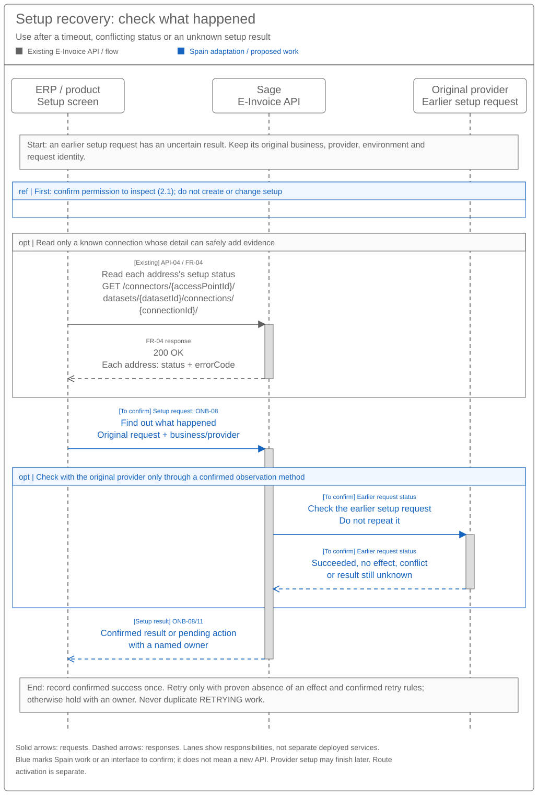

# Customer Onboarding and Connectivity Sequence and Reuse Assessment

[Solution Summary](SPEC-SEI-037-customer-onboarding-and-connectivity-solution-summary.md) · [Logical Feature Specification](SPEC-SEI-038-customer-onboarding-and-connectivity-logical-feature-specification.md) · [Sequence and Reuse Assessment](SPEC-SEI-039-customer-onboarding-and-connectivity-sequence-and-reuse-assessment.md) · [Folder](README.md)

Setup API guide for architects and developers. Start with sections 1–2.5. Use §2.6 for the API inventory, §2.7 for a worked payload and §4 for unresolved gaps.

## Revision overview

This successor combines SPEC-SEI-021 onboarding reuse with SPEC-SEI-036 connectivity findings, including the separate Sage operator role. The predecessors remain unchanged. Existing API/GAP IDs and sequence behaviour retain their meanings. The shared API is named E-Invoice API; per-call recommendations now separate reuse, Spain changes and implementation checks. The five onboarding diagrams now state the starting situation, action, responsible party and result; archived assets remain unchanged. Provider choice, implementation coverage and activation remain open; no new API or deployment is approved.

## 1 Engineering direction

**What we want to do:** let a business or its authorised accountant set up Sage access to a supported e-invoicing platform. Check the business NIF, permission and required certificate; reuse existing setup; return what is ready, what is missing and who must act next. Invoice sending, receiving and reporting are separate features.

**Why:** the customer should use Sage with its chosen platform without repeating valid setup, uploading the same certificate again or accidentally changing provider. Products should use the shared E-Invoice API and add Spain rules where needed.

**What we already have:** the existing E-Invoice API lists platform services, finds dataset connections, creates connections, reads each address's status and updates supported details. The supplied contracts document these calls. They were first used for France; the API is shared. Country values such as `fr.siren` belong to the supplied example, not to the API's name. FR-01–05; INT-DS01; INT-AP01–06.

**Engineering decision:** reuse those calls and IDs. Add Spain service settings, identity/address rules and provider support to the existing API where required. Reuse the Tax certificate capability. Check existing implementation before adding missing access checks, setup results or recovery handling. Do not create a parallel onboarding API or assume a new public enrolment operation. The per-call recommendations and checks are in [§2.6](#26-existing-api-and-capability-reuse). REF-REUSE; REF-COUNTRY; REF-TRUST.

Phase 1 returns public readiness. Private setup and route activation are later-phase work. Private A to Private B remains disabled. [SEI038](SPEC-SEI-038-customer-onboarding-and-connectivity-logical-feature-specification.md) holds the detailed requirements.

**Key terms** — aligned with the [shared glossary](../../context/GLO-SEI-001-e-invoicing-terminology.md).

| Term / field | Meaning |
|---|---|
| NIF / authority | NIF identifies the Spanish business. Authority is permission for this action on its behalf. Login or a certificate alone does not prove permission. |
| `datasetId` | The Network resource ID used to find the customer's connections. Store it; do not derive it from NIF. GAP-01 must confirm which businesses each dataset can contain. |
| `accessPointId` | The service route ID, shared across customers. The API owner must supply the enabled Spain IDs. |
| `connectionId` | The ID of a dataset's connection to a service. Store it for status and update calls. |
| `accessPointAddress` | An address inside a connection. Several addresses may belong to one business. Spain address types still need confirmation. |
| Route | The platform/connection selected for specified future invoice work. A setup change can affect that choice; permission and earlier-invoice access must be checked first. |
| Certificate reference | An ID for using a certificate through the trusted service without returning its private key. The actual interface must be confirmed. |
| Readiness / activation | Readiness answers “can Sage perform this selected function for this business, caller and environment?” Activation separately authorises the route to be used. `201` or `CONNECTED` alone does not establish both. |

**Work by delivery scope.** This is the work to assess and deliver, not a claim that every item needs new code. The owners in §4 must identify what already exists and what must change. No replacement endpoint is proposed; review any input or result change against existing products.

| Scope | Required work | Product work / boundary | Calls and checks |
|---|---|---|---|
| Public platform MVP | Configure Spain public services and environments. Check NIF, action permission, suitable in-date certificate and Sage access. Return the result, missing item and action owner. | Reuse saved customer information. Show ready, pending or unsupported work in plain language. Exact result/certificate interfaces must be confirmed before implementation. | §2.1–2.2; API-01/02/04 only where applicable; GAP-02/03/05/06. |
| Public platform nice-to-haves | Add certificate-renewal reminders and progress notifications where supported. | Optional UI/notification work. Core status checks and recovery remain MVP. | GAP-05/06: confirm available events. |
| Private platforms — later phase | Connect the chosen provider account. Add its Spain address rules, credentials and setup/status handling. Check routing effects before changing anything. | Capture only missing provider inputs; keep valid connections and earlier-invoice access. The “Other provider” option remains a Product decision. | §2.3–2.5; API-01–05; GAP-02/04/05/06/07/08. |
| Sage as a private platform — conditional | Name the legal operator and confirm its permitted public/private interfaces, security and operations. | Offer the service only when these checks pass. A customer's successful connection does not make Sage an eligible operator. | REF-OPERATOR; SPC-01–04/08; GPA-01/02/10. |
| Shared work | Confirm business/NIF-to-dataset mapping, accountant access, Spain dataset inputs, safe request repeats, events and product compatibility. | Store IDs and the original request identity. Show setup in progress separately from complete. Confirm native-product linkage and existing approval/portfolio support. | INT-DS01; GAP-01/04/06/07/08. |

## 2 Proposed reuse sequences

Read from top to bottom. Grey / **Existing** shows existing E-Invoice API calls and flows. Blue / **To confirm** shows Spain work or an interface still to confirm. Blue does not mean a new API or service; §2.6 states what to reuse, extend or check. Solid arrows are requests; dashed arrows are responses. A `ref` box points to another sequence. Lanes group responsibilities, not agreed service deployments; grey bars make no timing promise.

Each diagram states its starting inputs and end result. Arrow labels give the action above the exact API call, then the returned IDs or status. `opt` means “only if the condition applies”; `ref` means “use the referenced checks”. The tables explain decisions and next actions. Invoice sending, receiving and reporting flows remain in their owning specs.

### 2.1 Shared prerequisites


**Purpose:** check the business, permission and required certificate. Reuse valid evidence. ONB-02/03.

| Step | Input / check | Result / next action |
|---|---|---|
| 1. Identify business and caller | NIF, caller identity and permission for the selected action. Keep establishment/routing references separate. | Missing identity or permission blocks affected work; name the action owner. ONB-02/12. |
| 2. Check certificate, if required | Ask the existing Tax capability for a suitable, in-date certificate for this business, purpose and environment. | Reuse a protected reference, never private key material. Failed lookup does not mean another upload is needed. Actual Spain contract remains GAP-03/06. REF-TRUST. |
| 3. Find the required dataset | Reuse a stored mapping. Create only if the channel needs a missing dataset. | `POST /datasets`: `202` has no ID; repeat identical input with the same `X-Idempotency-Key`. After `200`, store returned `tenantId` as `datasetId`. INT-DS01. |

Spain dataset inputs, replay limits, the differing example `data.id` and native-product linkage remain GAP-01/02/04. The supplied examples do not establish one dataset per NIF.

[Full-size SVG](../../assets/diagrams/onboarding-setup-shared-prerequisites-sequence.svg) · [Editable Draw.io](../../assets/diagrams/onboarding-setup-shared-prerequisites-sequence.drawio) · [PNG](../../assets/diagrams/onboarding-setup-shared-prerequisites-sequence.png)

### 2.2 Public readiness


**Example:** a business already uses Spain's public platform (SPFE) and wants Sage access. Check access; do not assume a new public registration. ONB-S02.

| Step | Input / check | Result / next action |
|---|---|---|
| 1. Select scope | Business NIF, requested public function and environment; shared checks in §2.1. | Confirm action-specific permission, including representation for third-party consultation/recovery. SPFE-S02 Article 11. |
| 2. Inspect Sage setup, if applicable | API-01 discovers services; API-02 finds the dataset's connections; API-04 reads a known connection. | These are Sage records. Their Spain applicability is open; `CONNECTED` does not prove public access. |
| 3. Check access requirements | Actual Sage build, selected public contract, environment and accepted certificate/seal. | Return readiness or missing evidence and owner. Do not send an invoice or status message as an onboarding test. GAP-02/03/05/06. |

**Contract gap:** the supplied public catalogue/WSDLs contain invoice operations, not an enrolment API or public-onboarding payload. PRE access, production endpoints and the recorded SOAP-version conflict remain open. The existing `/connect` call does not establish public registration. SPFE-S03/S08/S16; REF-SPAIN SPFE-Q01/Q12.

The [SEI038 public-only plan](SPEC-SEI-038-customer-onboarding-and-connectivity-logical-feature-specification.md#31-in-scope) defines the checks; [SPEC-SEI-011](../SPEC-SEI-011-public-platform-connector-solution-specification.md) retains public-operation contracts.

[Full-size SVG](../../assets/diagrams/onboarding-setup-public-readiness-sequence.svg) · [Editable Draw.io](../../assets/diagrams/onboarding-setup-public-readiness-sequence.drawio) · [PNG](../../assets/diagrams/onboarding-setup-public-readiness-sequence.png)

### 2.3 Private setup


**Example:** keep the customer’s private provider and connect its account to Sage. Check existing setup first: connect can change address routing. ONB-S03; INT-AP04.

| Step | API / information exchanged | Result / next action |
|---|---|---|
| 1. Find the service and existing connection | API-01 returns access-point IDs. API-02 uses `datasetId` and returns connection status plus a nullable `connectionId`. | If a connection exists, retain its ID and inspect it with API-04. A missing local connection does not prove no external account exists. |
| 2. Check whether anything is missing | Compare the provider account, requested setup, addresses and environment with its confirmed contract. | Reuse matching setup. Before any change, confirm permission, possible routing takeover and continued access to earlier invoices. |
| 3. Create only required missing setup | API-03 takes the dataset/service IDs and the company, user and address body in §2.7. | `201` returns a connection resource; it does not confirm provider setup completion. Store `data.id` as `connectionId`. |
| 4. Follow address progress | API-04 uses all three IDs. Events can also report address changes once their contract is confirmed. | Inspect each address's `status` and `errorCode`. Do not repeat connect while it is `RETRYING`. Sending/receiving readiness and route activation remain separate checks. INT-AP01/05/06. |

The [existing API connect example](#27-existing-e-invoice-api-connect-example) shows the request, the returned `connectionId` and the next detail call.

**Spain gap:** confirm provider endpoints/protocol, account/API/UI eligibility, credentials, address/usage rules, environment and receiving destination. No Spain address enum or private-provider payload is supplied; changing `FR` to `ES` is insufficient. GAP-02/03/05/06/07.

**Phase 2 open question:** for a provider outside the planned list, show only supported providers or allow an “Other provider” request? Product/local technical lead to decide; do not offer an unconfirmed connection (ONB-S08; SEI038 §3.5). Operator interconnection follows the [SEI038 handoff](SPEC-SEI-038-customer-onboarding-and-connectivity-logical-feature-specification.md#67-onb-05-configure-private-choice): the receiving operator has **one month**, subject to the specific receipt-order exception, with required interim public exchange. This is not a 30-day customer-onboarding promise, and `/connect` or `CONNECTED` does not satisfy it. REF-INTERCONNECT; GAP-06/08.

[Full-size SVG](../../assets/diagrams/onboarding-setup-private-setup-sequence.svg) · [Editable Draw.io](../../assets/diagrams/onboarding-setup-private-setup-sequence.drawio) · [PNG](../../assets/diagrams/onboarding-setup-private-setup-sequence.png)

**Sage as a private platform:** connecting a customer's provider account does not establish that Sage may operate a platform. Before offering this option, name the accountable operator and confirm its permitted public/private interfaces, accounts and credentials. SPEC-SEI-014 SPC-01–03 defines the checks. GPA-10 records an interconnection case; it does not grant operator eligibility. Reuse the shared connection and routing foundation rather than creating a parallel registry or invoice history. REF-CONNECTIVITY/OPERATOR/PROVIDER.


[Full-size SVG](../../assets/diagrams/shared-platform-connection-qualification-process.svg) · [Editable Draw.io](../../assets/diagrams/shared-platform-connection-qualification-process.drawio) · [PNG](../../assets/diagrams/shared-platform-connection-qualification-process.png).

This shared diagram checks the integration role, configuration and supported capabilities. Passing it does not activate a customer route. Operator timing and completion evidence follow the [SEI038 handoff](SPEC-SEI-038-customer-onboarding-and-connectivity-logical-feature-specification.md#67-onb-05-configure-private-choice).

### 2.4 Supported change


**Purpose:** add or change supported setup without resetting what already works. ONB-S05/S06; ONB-07/09.

| Customer request | Developer action | Boundary |
|---|---|---|
| Review unchanged setup | Read the existing connection with API-02/04; return its valid references. | No connect/update or new route version is needed. Recheck only stale evidence. |
| Add a supported function or edit connection details | Check the new prerequisites. Use API-05 only if the selected provider/build supports that edit. | The allowed Spain fields, concurrency rules and route effects remain GAP-04/07. No Spain update body is approved. |
| Change platform | Check that this transition is enabled and that the customer authorised its effect on future work. Preserve access to earlier invoices. | Route activation is separate from updating a connection. Private A to Private B stays disabled. REF-ROUTING. |

[Full-size SVG](../../assets/diagrams/onboarding-setup-supported-change-sequence.svg) · [Editable Draw.io](../../assets/diagrams/onboarding-setup-supported-change-sequence.drawio) · [PNG](../../assets/diagrams/onboarding-setup-supported-change-sequence.png)

### 2.5 Uncertainty and recovery



**Purpose:** find out what happened before repeating a setup request. Keep the original business, provider, environment and operation identity. ONB-08/11; OFR-01–08.

| Observation | Safe next action |
|---|---|
| Connect timed out or its response was lost | Inspect the original connection/address using API-02/04 and reliable provider evidence. A failed or empty read does not prove the request had no effect. |
| Address is `RETRYING` | Let the platform retry; observe its status. Do not submit another connect request for that address. INT-AP05/06. |
| Result is confirmed, or remains unknown | Record confirmed success once. Retry only when the earlier request had no effect, permission is current and the contract allows repetition. Otherwise keep the affected work pending with a named owner. Preserve valid independent functions. |

Do not force a provider switch or delete/recreate a connection to clear an unknown result. INT-AP05/06.

[Full-size SVG](../../assets/diagrams/onboarding-setup-uncertainty-recovery-sequence.svg) · [Editable Draw.io](../../assets/diagrams/onboarding-setup-uncertainty-recovery-sequence.drawio) · [PNG](../../assets/diagrams/onboarding-setup-uncertainty-recovery-sequence.png)

### 2.6 Existing API and capability reuse

**How to use this table:** “reuse” selects the existing call or service; it does not certify an untested Spain implementation. “Extend” identifies the Spain support required. “Check existing implementation” names a required behaviour whose code/interface is not supplied. Build only the missing part after the named owner checks it.

| Existing API / capability | Recommendation | Spain work required | Check before enabling / owner |
|---|---|---|---|
| Dataset: `POST /datasets`. INT-DS01. | **Reuse the create/confirm flow.** | Supply Spain business inputs only if this channel requires a new dataset. Keep `202`/`200` handling and saved IDs. | Confirm dataset-to-NIF/client mapping, `tenantId` versus `data.id`, native channels and repeat limits. GAP-01/02/04; API, Identity, Tax, Enablement. |
| API-01: `GET /accesspoints`. FR-01. | **Reuse the call; add Spain services.** | Make enabled public/private services available through the existing list. Do not reuse a France service ID for Spain. | Confirm service IDs, environments and what each supports. GAP-02/08; API and Integration. |
| API-02: `GET /datasets/{datasetId}/accesspoints`. FR-02. | **Reuse the lookup and IDs.** | Use the confirmed business/dataset mapping to inspect existing Sage setup. | Confirm caller access and what a dataset-level status proves. GAP-01/05; API and Identity. |
| API-03: `POST /connectors/{accessPointId}/datasets/{datasetId}/connect`. FR-03; INT-AP04. | **Reuse the call; extend Spain support.** | Add confirmed Spain address types/rules and the chosen private provider's account setup. Keep public use disabled until its purpose is established. | Confirm required inputs, permission, duplicate handling and whether connect changes routing. GAP-02/03/04; API, Integration, Identity and Routing. |
| API-04: `GET /connectors/{accessPointId}/datasets/{datasetId}/connections/{connectionId}/`. FR-04. | **Reuse the status read.** | Interpret each address's status/error for the selected provider. Keep public access and route activation as separate checks. | Confirm how recent results must be, partial/missing addresses and whether reads can establish an earlier request's result. GAP-04/05; API, Integration and Operations. |
| API-05: `PUT /connectors/{accessPointId}/datasets/{datasetId}/connections/{connectionId}/`. FR-05; INT-AP02. | **Reuse supported updates; extend Spain rules.** | Support only confirmed edits to Spain connection/address details. No provider migration or rollback is assumed. | Confirm allowed fields/removal, simultaneous updates and routing effects. GAP-04/07; API, Integration and Routing. |
| Events: guide `POST /internal/events/subscriptions`. INT-AP01–03. | **Reuse events where the caller can subscribe.** | Map supported events to setup progress. Public event support remains unconfirmed. | Confirm access to this internal endpoint, event version, duplicates, ordering and delivery/recovery rules. GAP-05/06/07; API and Operations. |
| Disconnect: guide `DELETE /connectors/{accessPointId}/datasets/{datasetId}/connections/{connectionId}`. INT-AP03. | **Keep outside normal onboarding.** | Do not delete/recreate to repair setup. Use only a separately authorised, supported exit path. | Confirm current contract, removal scope and earlier-invoice access. GAP-04/07; API and Operations. [Offboarding](../archive/SPEC-SEI-003-offboarding-solution-specification.md) owns full exit. |
| Identity and permission checks. REF-LOGICAL; GAP-03/06. | **Check existing implementation; add missing Spain checks.** | Validate the business NIF and permission for each action, including an accountant acting for a client. | Identify the current API, accepted evidence and returned decision. Login, M2M access and request `user` alone are insufficient. Identity, Security and Product. |
| Tax certificate capability. REF-TRUST; REF-SAGE-CERT. | **Reuse the service; confirm the interface.** | Find an existing certificate; check its dates and suitability for this business/action/environment; return a protected reference. | Confirm the API, private-key custody and acceptance for the selected B2B action. No new upload when lookup is unavailable. GAP-03/06; Tax/Trust, Security and Integration. |
| Public connector. REF-PROVIDER, SPEC-SEI-011. | **Reuse its access/contract checks; confirm build support.** | Configure the selected Spain public operation/environment and accepted certificate/seal. Do not invent enrolment or send a test invoice. | Confirm actual build, PRE access, production endpoints and source conflicts. GAP-02/03/05/06; Public Integration and Tax/Trust. |
| Setup result and recovery coordination. REF-LOGICAL ONB-08/10/11. | **Check existing implementation; add only missing handling.** | Combine identity, certificate and connection checks into results per requested function. Return missing work and its owner; check earlier requests before retry. | Identify current result/event contracts, saved request identity, approval/batch support and recovery owner. GAP-04/05/06/08; E-Invoice Service, API and Operations. |
| Shared routing controls. REF-ROUTING. | **Reuse the design; confirm the running implementation.** | Keep activation separate from connection setup. For enabled changes, preserve the effective boundary and access to earlier invoices. | Confirm existing route APIs, supported transitions and recovery. GAP-06/08; Routing and Architecture. |

Products can implement the documented ID lookup and status handling against the existing API. Spain setup inputs and provider choices must wait for the listed checks. The supplied example's `fr.*` address values must not be used for a Spanish NIF.

Keep one product-facing API direction under SPEC-SEI-013. Its `PROVIDER_API`, `SAGE_ADAPTER` and `HYBRID` modes do not prove that one provider supports every function. Each change needs one executor and one owner to check its result. B2B Router remains a possible provider, not a selected one. REF-PROVIDER.

Invoice conversion remains outside onboarding. Existing DTS is the preferred candidate when an invoice feature needs conversion; confirm the build, formats, mappings, rule packs, signatures, meaning and operations in that feature. Preserve source and converted files separately. REF-REUSE; REF-PREDECESSORS.

### 2.7 Existing E-Invoice API connect example

**API-03 request:** the existing E-Invoice API body with all required fields. This supplied example uses France-specific address values; Spain values are not yet confirmed. Values are artificial; `000000000` is a placeholder company identifier, not a validated SIREN. This is not a Spain payload or a request to run. FR-03, `PostAccessPointConnectionRequest` / `AccessPointConnectionRequest`.

```http
POST /connectors/{accessPointId}/datasets/{datasetId}/connect
Content-Type: application/vnd.api+json
Idempotency-Key: <key for this setup request>
```

```json
{
  "data": {
    "type": "AccessPointConnection",
    "attributes": {
      "companyName": "Example Business",
      "companyAddress": "1 Example Street",
      "companyPostalCode": "75000",
      "companyCountryCode": "FR",
      "user": {
        "firstName": "Casey",
        "lastName": "Example",
        "jobTitle": "Administrator",
        "emailAddress": "onboarding@example.invalid",
        "clientIPAddress": "203.0.113.10"
      },
      "accessPointAddresses": [
        {
          "accessPointAddressType": "fr.siren",
          "accessPointAddress": "000000000",
          "usage": ["SEND"]
        }
      ]
    }
  }
}
```

`company*` describes the business; `user` identifies the requester, without proving authority. `usage` restricts permitted operations; connect sends no invoice. The schema accepts `SEND`/`EREPORTING`; the guide also lists `RECEIVE` (GAP-07). Authentication follows FR-03. Dataset creation instead uses `X-Idempotency-Key`; neither header proves replay guarantees. INT-DS01; INT-AP06; GAP-04.

**`201` response extract — API-03.** Audit fields and other address fields are omitted. The synthetic ID is the value to retain as `connectionId`. FR-03, `PostAccessPointConnectionResponse`.

```json
{
  "data": {
    "type": "AccessPointConnection",
    "id": "00000000-0000-4000-8000-000000000003",
    "attributes": {
      "accessPointAddresses": [
        {
          "accessPointAddressType": "fr.siren",
          "accessPointAddress": "000000000",
          "status": "IN_PROGRESS",
          "errorCode": null
        }
      ]
    }
  }
}
```

Next, call API-04: `GET /connectors/{accessPointId}/datasets/{datasetId}/connections/{connectionId}/`. Read each address result: `IN_PROGRESS` means wait and observe; `RETRYING` means the platform is retrying; `ERROR` needs the error-specific action; `CONNECTED` confirms address connection only. Disappearance from a later response is not proof that an earlier request had no effect. FR-04; INT-AP05/06.

## 3 Scenario variations

SEI038 remains authoritative for ONB-S01–08. These rows select the technical path; they add no business scope.

| Scenario | Sequences / variation |
|---|---|
| ONB-S01 No established setup | Shared, then the selected public/private path. Create only required missing resources; apply phase and route checks. |
| ONB-S02 Existing public service | Public path; reuse valid evidence and establish missing Sage access. |
| ONB-S03 Private provider retained | Private path; keep its account. Existing external registration does not prove a Sage connection. |
| ONB-S04 Public and private together | Evaluate both paths independently; preserve partial results, enforce public-copy/reporting dependencies and retain one delivery executor. |
| ONB-S05 Existing Sage setup | Confirm unchanged references; use supported change only for stale checks or requested extensions. |
| ONB-S06 Platform change | Supported change, with private setup only where needed; retain earlier invoice context. |
| ONB-S07 Existing B2G | Assess B2B through the selected path; preserve B2G configuration and references. |
| ONB-S08 Unsupported/unknown | Return the precise limitation and owner; unlisted-provider UI remains TBD. Distinguish the operator interconnection handoff in PRD-SEI-221 FR20. Use recovery only where earlier effects need observation. |

## 4 Open engineering decisions

The recommendations in §2.6 stand. These checks determine the exact changes and whether the selected setup can be enabled. Each owner must return the existing build/interface, the supported behaviour, the missing work and the test or source that proves the answer. Keep affected work pending until that answer is available.

| Existing ID / subject | Answer needed from the owner | Owner |
|---|---|---|
| GAP-01 Business and dataset IDs | Which returned ID is `datasetId`? Which NIFs/addresses can one dataset contain? How are partner accounts, accountant clients, Tax records and native-product channels linked and kept separate? Multiple addresses do not prove multiple legal entities. INT-DS01; FR-02–05. | API, Identity, Tax, Enablement. |
| GAP-02 Spain inputs and services | Supply the Spain business-type codes, identifier/address rules, permitted `usage`, service IDs and environments. State what is configuration, an existing-code change or an API-contract change. REF-COUNTRY; INT-DS01; INT-AP06. | Spain Product/Compliance, API, Integration. |
| GAP-03 Permission to act | Identify the accepted proof that this caller may perform this action for this business, directly or as a delegate. M2M access, certificate possession and request `user` are insufficient. SPFE-S02; REF-TRUST. | Identity, Security, Product. |
| GAP-04 Safe changes and repeats | Explain when repeating create/connect is safe; distinguish `X-Idempotency-Key` from `Idempotency-Key`. Confirm duplicate windows, partly completed requests, simultaneous updates and how to check an earlier request's effect. FR-03/05; INT-DS01. | API, Integration, Operations. |
| GAP-05 Meaning of results | Explain partial/missing addresses, which function each status proves, event versions, how recent evidence must be and the separate activation result. `CONNECTED` or a missing address is insufficient on its own. FR-02/04; INT-AP05/06. | API, E-Invoice Service, Routing. |
| GAP-06 Other required interfaces | Identify the NIF/permission and Tax certificate interfaces, private-key custody, subscription/UI access, approvals, batch/case handling and route controls. For operator interconnection, identify request/receipt and queue records, one-month deadline tracking, interim public exchange and completion evidence under [SEI038 §6.7](SPEC-SEI-038-customer-onboarding-and-connectivity-logical-feature-specification.md#67-onb-05-configure-private-choice). The supplied setup API does not establish this coverage. REF-TRUST; INT-AP01–03; REF-INTERCONNECT. | Architecture and the relevant API/service owners; operator process: Compliance/Operations. |
| GAP-07 Conflicting source details | Confirm the API version/build and resolve `RECEIVE`, update/remove/DELETE, address takeover/conflicts, dates/lengths/authentication, statuses/events and header differences. Resolve the guide's 24-hour retry, six-day escalation and seven-day error observations; the latter is not audit retention. INT-AP01–06. | E-Invoice API/dataset owners, Operations. |
| GAP-08 Existing code and delivery work | Record what already runs, the Spain changes, effects on existing products, regression tests, monitoring, recovery and support owner. Confirm approval/portfolio support. Product must decide the unlisted-provider option before private onboarding is enabled. Documentation alone does not prove production support. | Architecture, API, Integration, Operations; unlisted-provider choice: Spain Product/local technical lead. |
| Sage operator role | Name the legal operator and delivery model. Confirm contracts, allowed credentials, conformance, public-copy/reporting support, operations and exit for the selected customers. Customer connection success is insufficient. REF-OPERATOR; SPC-Q01–07. | Operator/service owner, Spain Product/Compliance, Security, Integration and Operations. |

The [detailed source differences in SPEC020 §5](../archive/SPEC-SEI-020-customer-onboarding-api-design-and-reuse-assessment.md#5-common-spain-changes-and-open-evidence) remain supporting evidence. DTS assessment belongs to its [owning invoice features](../SPEC-SEI-008-spain-ubl-mapper-migration-to-dts-solution-specification.md).

[SEI038 §7](SPEC-SEI-038-customer-onboarding-and-connectivity-logical-feature-specification.md#7-traceability-and-supporting-artefacts) retains ONB-R25 for the effective boundary; operator handoff uses PRD-SEI-221 FR20 and ONB-A44/A45.

## 5 Acceptance coverage

Retain [API-A01–16](../archive/SPEC-SEI-020-customer-onboarding-api-design-and-reuse-assessment.md#6-reuse-assurance) and SEI038 functional acceptance. Apply the role-isolation checks below to the same controls. No implementation tests have run.

| Existing checks | Review against these sequences |
|---|---|
| API-A01/02/07/13 | Business/client isolation, unchanged setup, Spain-rule isolation and existing-product regressions. FR-01–05; INT-DS01; REF-COUNTRY. |
| API-A03/04/05/08 | Duplicate, lost-response, concurrency and retry cases preserve original effects. FR-03/05; INT-DS01; INT-AP05/06. |
| API-A06/11 | HTTP paths/codes, paired returns and per-address outcomes match source meaning. FR-01–05. |
| API-A09/12/16 | Missing capability stays owned; selected builds, guide conflicts, events and actual operations are confirmed. INT-AP01–06. |
| API-A10/14 | Public boundary, independent NIF/authority/certificate findings, protected-reference reuse and later-use rechecks. SPFE-S02/S03/S08; REF-TRUST. |
| API-A15 | Conditional provisioning, retained identifiers/keys, multi-address scope and confirmed native-channel mapping. INT-DS01. |
| ONB-A43–45 | Unlisted-provider limitations, role-specific interconnection handoff, one-month receipt/queue timing and required interim exchange. Setup responses cannot imply process completion. REF-LOGICAL; REF-INTERCONNECT. |

**Check the two roles separately:** a confirmed external-provider customer connection must not enable the Sage operator role. Enabling the Sage private-platform service must not rewrite existing customers’ provider routes or history. An operator-readiness failure must keep the affected work pending even if its business credentials pass. Evidence uses the existing ONB-A04/A44/A45, SPC-01–04/08 and PRD-SEI-221 gates. For every reused implementation, check country isolation, current permission and that earlier requests are checked before retry.

## REF Source references

FR-01–05 are retained source IDs for the existing E-Invoice API contracts first supplied for France. They are OpenAPI 3.1.0 files declaring `info.version: 1.0.0`, reviewed 21 October 2026; publication dates and deployed builds are unknown. Guide extracts were received 22 October 2026; their original URLs/revisions/builds remain unverified. Extracts and examples are not complete contracts. Original Spain files remain authoritative; REF-SPAIN inventories contracts and unresolved conflicts, not implementation readiness.

| ID | Source / version and exact locator | Supports / limit |
|---|---|---|
| REF-REUSE | [SPEC020 section 1](../archive/SPEC-SEI-020-customer-onboarding-api-design-and-reuse-assessment.md#1-engineering-decision-summary), recorded direction, 22 October 2026. | Existing E-Invoice API reuse direction; no schema or deployment approval. |
| REF-COUNTRY | [PRD-SEI-227](../../prds/PRD-SEI-227-e-invoicing-as-a-service.md), canonical proposal, FR11 / country-pack governance. | Shared/country separation; broader proposal status unchanged. |
| REF-LOGICAL | [SPEC-SEI-038](SPEC-SEI-038-customer-onboarding-and-connectivity-logical-feature-specification.md), draft successor, created 23 October 2026; sections 3–7, ONB/OFR activities and acceptance. | Canonical business behaviour and phase gates; no deployed API proof. |
| REF-INTERCONNECT | [RD 238/2026 official original](https://www.boe.es/buscar/doc.php?id=BOE-A-2026-7295), published 31 March 2026; checked 22 October 2026; Articles 8(1)–(3), 9(1)–(5). | Participating-platform operator duty, invoice/status exchange, one-month receipt-based period, specific receipt-order exception and public interim route. Not an ERP/customer setup SLA; no provider API or calendar implementation contract supplied. |
| REF-TRUST | [SPEC-SEI-001](../SPEC-SEI-001-certificate-management-solution-specification.md), draft, updated 20 October 2026; CERT-04/05, G1/G9/G10. | Proposed protected-reference and certificate checks; service ownership and acceptance for the selected B2B action remain open. |
| REF-SAGE-CERT | [Sage certificate management](https://confluence.sage.com/spaces/CCLD/pages/759615024/Sage+certificate+management), page 759615024; version/content unverified, access unavailable in predecessor review. | User-supplied supporting context; no independent proof of live Tax contracts or Spain acceptance. |
| REF-ROUTING | [SPEC-SEI-014](../SPEC-SEI-014-shared-platform-connectivity-and-routing-solution-specification.md), SPC-04/08; [SPEC-SEI-016](../archive/SPEC-SEI-016-invoice-receiving-retrieval-and-download-solution-specification.md), Shared connection and route handoff; drafts updated 20 October 2026. | Proposed route activation and earlier-invoice access controls; no change API contract supplied. |
| INT-DS01 | [Dataset guide extract](<../../context/FR API/Onboarding/network-onboarding-create-dataset-guide-extract.md>); ownership/channel sections, steps 1–2 and field reference. | POST `202`/`200`, keys and `tenantId`; Spain availability, example ID and permitted business-to-dataset mapping are unconfirmed. |
| INT-AP01 | [Connect extract](<../../context/FR API/Onboarding/access-point-guides-evidence-extract.md#int-ap01-connect-and-channel-selection>); connection model, channel selection, steps 0–5. | Connection, API/UI and status reads; supplied examples cover France, not a verified Spain implementation. |
| INT-AP02 | [Update extract](<../../context/FR API/Onboarding/access-point-guides-evidence-extract.md#int-ap02-update-and-removal>); steps 1–4; removal names v1.1.0. | Candidate update/remove; guide/OpenAPI differences unresolved. |
| INT-AP03 | [Disconnection extract](<../../context/FR API/Onboarding/access-point-guides-evidence-extract.md#int-ap03-connection-disconnection>); remove/confirm, linked API 0.1.7. | Legacy DELETE/202 and observations; no generic rollback or full-exit proof. |
| INT-AP04 | [Ownership extract](<../../context/FR API/Onboarding/access-point-guides-evidence-extract.md#int-ap04-address-ownership-transfer>); scenarios A/B, implementation/confirmation, linked API 0.1.9. | Possible routing takeover; not universal linking or last-one-wins. |
| INT-AP05 | [Error extract](<../../context/FR API/Onboarding/access-point-guides-evidence-extract.md#int-ap05-error-handling-and-retry-ownership>); retention/dictionary/ERR-PPL002-3; link contains 1.10.0. | Retry scopes, seven-day observations and failed-absent addresses; behaviour in the deployed build needs confirmation. |
| INT-AP06 | [Catalogue/status extract](<../../context/FR API/Onboarding/access-point-guides-evidence-extract.md#int-ap06-catalogue-address-mapping-and-environments>); addresses, usage, retries, notifications and environments. | Partial events, mapping, guide `RECEIVE` usage and real/demo limits; guide/schema conflicts remain GAP-07. No Spain deployment proof. |
| FR-01 | [Discovery contract](<../../context/FR API/Onboarding/get-accesspoints.md>); operationId `Get-AccessPoints`, GET response. | API-01 IDs/names; no capability/readiness proof. |
| FR-02 | [Dataset listing contract](<../../context/FR API/Onboarding/get-dataset-accesspoints.md>); `Get-Dataset-AccessPoints`, GET response. | API-02 status/nullable `connectionId`; no external-absence proof. |
| FR-03 | [Connect contract](<../../context/FR API/Onboarding/new-accesspoint-connection.md>); `New-AccessPoint-Connection`, `Idempotency-Key`, `201` response. | API-03 request schemas `PostAccessPointConnectionRequest` / `AccessPointConnectionRequest`, response `PostAccessPointConnectionResponse`; body example and address states. Replay/effects remain unqualified. |
| FR-04 | [Detail contract](<../../context/FR API/Onboarding/get-accesspoint-connection.md>); `Get-AccessPoint-Connection`, GET response. | API-04 `AccessPointConnectionResponse` address `status` / `errorCode`; how recent results are and whether they prove an earlier request’s result remain unconfirmed. |
| FR-05 | [Update contract](<../../context/FR API/Onboarding/put-accesspoint-connection.md>); `Put-AccessPoint-Connection`, PUT response. | API-05 actions/date/usage rules; no supplied repeat/version guarantee. |
| SPFE-S02 | [Original BOE order](../../context/BOE-A-2026-20587.pdf), HAC/1028/2026, published 5 October 2026; Article 11(1)–(2). | Certificate access and representation; no Sage implementation proof. |
| SPFE-S03 | [Original service catalogue](<../../context/Descripción servicios web/Catálogo de servicios/20261013/CatalogoServicios.pdf>), 0.1.0, 9 October 2026; sections 4.3, 5.1, 6.1–6.10, pp. 8–20. | Public access/operation inventory; no supplied onboarding enrolment command. |
| SPFE-S08 | [Original input/output formats](<../../context/Descripción servicios web/Formatos entrada y salida/20261013/FormatosEntradaSalida.pdf>), draft 0.1.0, 9 October 2026; sections 5.1–5.9, pp. 8–15. | Response distinctions; pending formats do not supply an onboarding payload. |
| SPFE-S16 | [Original SendInvoice WSDL](<../../context/WSDL servicios web - PRE/20261013/SendInvoice.wsdl>), supplied snapshot 13 October 2026; `SendInvoiceSoapBinding`, `SendInvoiceCertPort`, `SendInvoiceSealPort`. | SOAP 1.2, ebMS/MIME packaging and PRE certificate/seal addresses; no proven connectivity or production endpoint. |
| REF-SPAIN | [Original-file evidence baseline](../../context/RES-SEI-002-spain-public-platform-technical-evidence.md), updated 22 October 2026; source authority, file inventory and conflicts. | Routes legal/technical claims to original BOE/catalogue/WSDL/XSD files; inventory is not mapping completeness. |
| REF-PREDECESSORS | [018](../archive/onboarding/SPEC-SEI-018-customer-onboarding-solution-summary.md), [019](../archive/onboarding/SPEC-SEI-019-customer-onboarding-logical-feature-specification.md), [021](../archive/onboarding/SPEC-SEI-021-customer-onboarding-sequence-and-reuse-assessment.md); [034](../archive/provider-connectivity/SPEC-SEI-034-provider-connectivity-solution-summary.md), [035](../archive/provider-connectivity/SPEC-SEI-035-provider-connectivity-logical-feature-specification.md), [036](../archive/provider-connectivity/SPEC-SEI-036-provider-connectivity-sequence-and-reuse-assessment.md), repository sources updated 23 October 2026. | Scope, scenarios, ONB/OFR activities, capability boundaries, formats and evidence gates. Retained draft designs; no approval or implementation proof. |
| REF-PROVIDER | [SPEC-SEI-011](../SPEC-SEI-011-public-platform-connector-solution-specification.md), [013](../SPEC-SEI-013-provider-api-through-the-e-invoicing-global-api-solution-specification.md), [017](../SPEC-SEI-017-b2b-router-provider-adapter-binding-solution-specification.md), updated 20 October 2026. | Public execution, Global API access/integration modes, B2B Router binding and PCN/GPA/B2BR gates. Setup uses confirmed capabilities; these sources retain runtime contracts and uncertainties. |
| REF-CONNECTIVITY | [SPEC-SEI-014](../SPEC-SEI-014-shared-platform-connectivity-and-routing-solution-specification.md), updated 20 October 2026; Part 1 §§1–3 and SPC-01–08. | Customer-provider and platform-interconnection roles; separate checks, routes and earlier-invoice access. Proposed shared foundation, not proof of compatible code or an eligible operator. |
| REF-OPERATOR | [PRD-SEI-210](../../prds/PRD-SEI-210-sage-private-platform-reuse-and-operator-expansion.md), updated 10 August 2026; delivery-model/reuse boundaries. [PRD-SEI-221](../../prds/PRD-SEI-221-operator-readiness-regulatory-governance.md), updated 6 October 2026; Decision summary, Phase and outcome, readiness domains, E7, BR11 and FR20. | Sage proposition, named operator, legal/technical/security/operations evidence and operator interconnection process. Canonical proposed product scope; delivery model, operator appointment and permission to launch remain open. |
