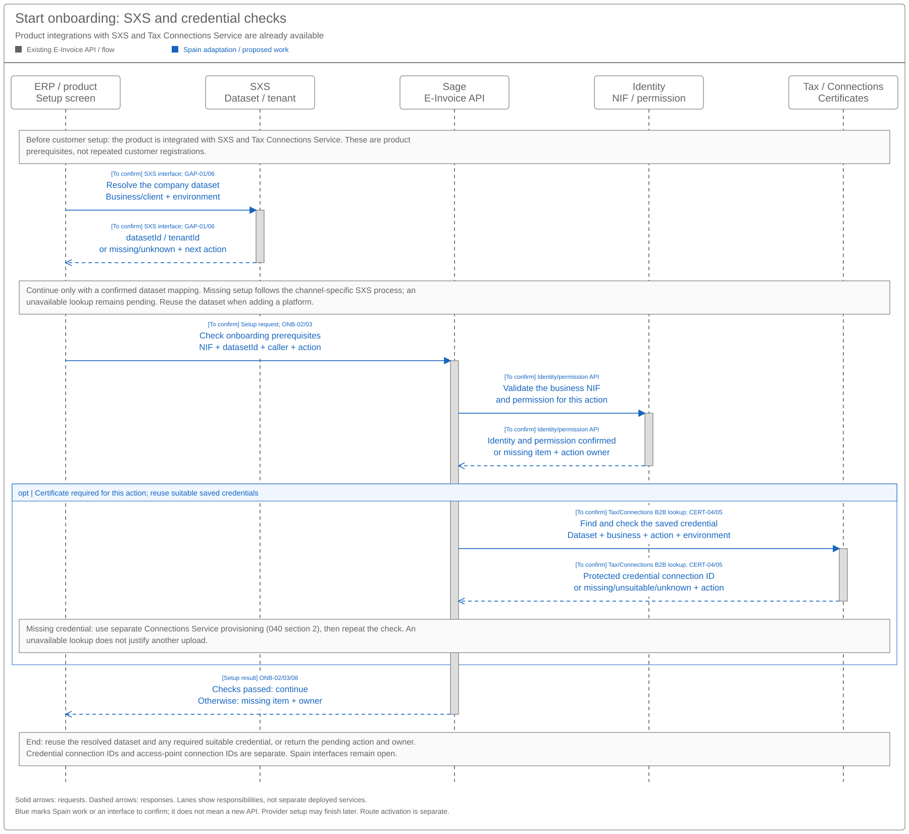
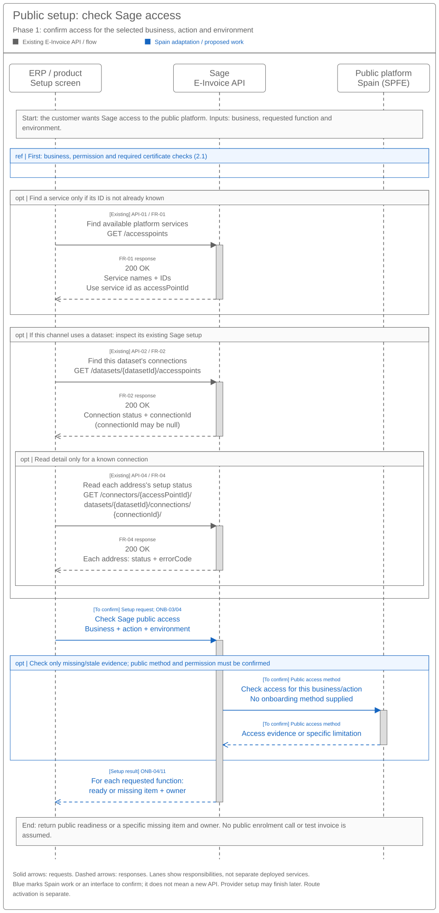
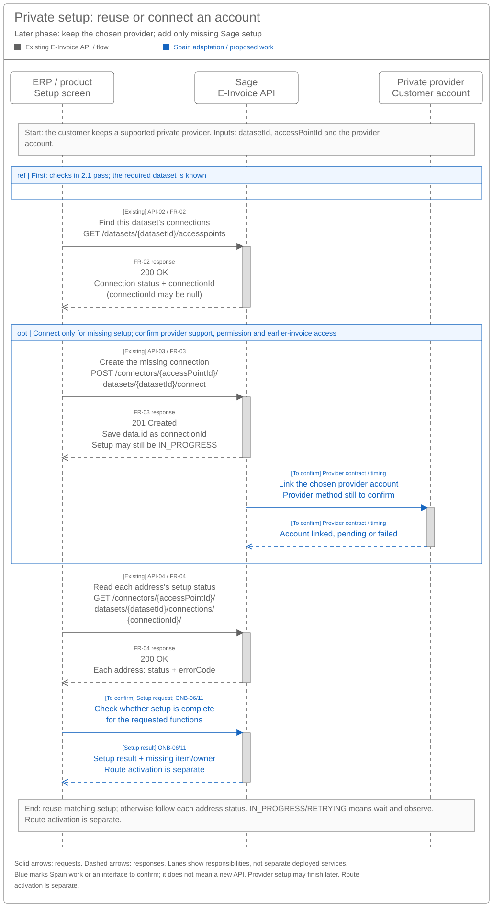
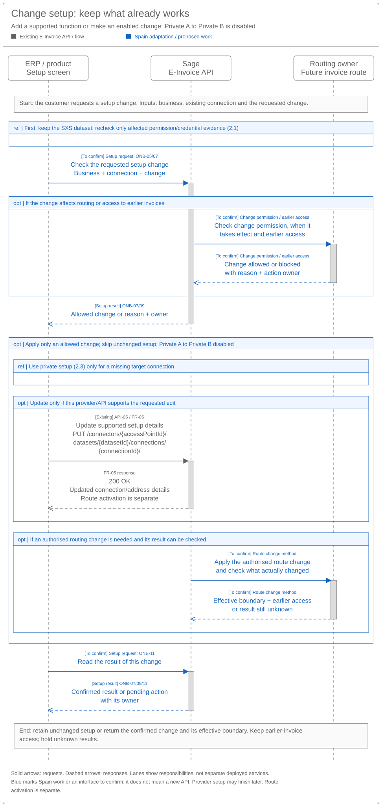

# Customer Onboarding and Connectivity Sequence and Reuse Assessment

[Summary — 037](SPEC-SEI-037-customer-onboarding-and-connectivity-solution-summary.md) · [Customer paths — 038](SPEC-SEI-038-customer-onboarding-and-connectivity-logical-feature-specification.md) · [API and field changes — 040](api-reference/SPEC-SEI-040-existing-e-invoice-onboarding-api-reference.md)

Products: **Sage 50, Sage 200, Sage Active and Sage X3** are the ERP products; **Despachos** is the accountant product. Each must meet the [SXS and Tax integration precondition](SPEC-SEI-038-customer-onboarding-and-connectivity-logical-feature-specification.md#4-feature-wide-functional-requirements-and-rules) before enabling e-invoicing. SXS manages the product's `datasetId` / `tenantId`.

## Revision overview

This view combines SPEC-SEI-021 and SPEC-SEI-036. It owns sequences, product impact and GAP decisions; 040 owns request/response examples. API/GAP IDs and predecessors are unchanged.

## 1 Engineering direction

**What:** set up Sage access to the customer's selected e-invoicing platform. **Why:** reuse valid setup without repeated registration or an unintended provider change.

**What exists:** the shared E-Invoice API can list services, find connections, connect, read status and update supported details. **Proposal:** reuse these calls and the [Tax certificate capability](https://confluence.sage.com/spaces/CCLD/pages/759615024/Sage+certificate+management). Add Spain rules and provider support where needed. The supplied contracts establish API behaviour; they do not prove a Spain implementation is ready. FR-01–05; REF-TRUST.

| Delivery scope | Work to assess | Impact on integrating products |
|---|---|---|
| Public MVP — Phase 1 | Spain service/environment settings; NIF, permission, required certificate and Sage-access checks. | Reuse saved information; show readiness, missing work and action owner. Confirm interfaces before implementing Spain inputs. |
| Public nice-to-haves | Certificate-renewal reminders and supported progress events. | Optional reminders/notifications; status checks and recovery remain MVP. |
| Private platforms — later phase | Provider account connection, Spain address rules and supported changes. | Ask for missing provider inputs; retain connection IDs and earlier-invoice access. |
| Shared / conditional work | Business-to-dataset mapping, accountant permission, results and safe recovery. Sage's own platform offer also requires operator approval. | Confirm existing approval/batch support and API compatibility; do not assume these need new services. |

Private A to Private B stays disabled. [038](SPEC-SEI-038-customer-onboarding-and-connectivity-logical-feature-specification.md) owns customer scenarios and functional behaviour. Invoice execution and transformation stay in their owning features; existing DTS remains the preferred transformation candidate there, subject to implementation checks.

## 2 Proposed reuse sequences

Grey shows existing calls; blue shows Spain work to confirm, as in 040. Arrows show requests/responses; lanes show responsibilities. Keep returned `datasetId`, `accessPointId` and `connectionId`; never derive them from NIF. Diagrams do not establish deployments or production readiness.

### 2.1 Shared prerequisites

Start after the product has integrated SXS and Tax certificate management / Connections Service, as required by 038 §4. For each company, resolve its SXS dataset/client mapping first. If confirmed missing, complete qualified channel/SXS setup before dataset-scoped calls; an unavailable lookup remains pending. Then check NIF, permission and any required credential. Reuse the Tax credential connection ID separately from the E-Invoice `connectionId`; provision only a genuinely missing credential through [040 §2](api-reference/SPEC-SEI-040-existing-e-invoice-onboarding-api-reference.md#2-certificate-management-proposed-call-to-confirm). The diagram proposes the call order, not new SXS or B2B Tax contracts. GAP-01/03/06; REF-INTEGRATION; REF-TRUST; INT-CERT01/02; SPFE-S02.

**One dataset, several access points:** API-02 can represent several entries. The guide describes one connection per `datasetId` / `accessPointId` pair, with several addresses inside it. Retain each pair's `connectionId`. Spain's proposed model allows public/private setup to coexist; actual support and the public access-point representation remain GAP-01/02/06. A new connection does not select a route. Each business/direction/environment/time scope selects one eligible connection. See [040 API-02](api-reference/SPEC-SEI-040-existing-e-invoice-onboarding-api-reference.md#api-02). FR-02; INT-AP01–06; REF-CONNECTIONS.

### 2.2 Public readiness

For ONB-S02, reuse saved setup and check access for the selected public function. `CONNECTED` does not prove public access. No enrolment API is supplied: `/connect` must not be assumed to register the business. Do not send a test invoice. See [040 §3](api-reference/SPEC-SEI-040-existing-e-invoice-onboarding-api-reference.md#3-other-additional-calls-to-confirm) for the proposed access check; execution contracts remain in [SPEC011](../SPEC-SEI-011-public-platform-connector-solution-specification.md). SPFE-S03/S08/S16.

### 2.3 Private setup

For ONB-S03, find the service and connection (API-01/02). Reuse valid setup; connect only if missing (API-03), then read progress (API-04). Check permission and routing effects first. A connected address does not activate a route.

The five private-provider candidates are B2B Router, Banqup (Unifiedpost), EDICOM, SERES (Docaposte) and ZeroComa. [040's examples](api-reference/SPEC-SEI-040-existing-e-invoice-onboarding-api-reference.md#1-existing-calls-to-reuse) apply this flow to Sage 200/B2B Router and Despachos/ZeroComa. Names do not prove integration readiness; provider inputs and interfaces remain GAP-02/06. REF-PROVIDERS.

The unlisted-provider decision is in [038 §3.2](SPEC-SEI-038-customer-onboarding-and-connectivity-logical-feature-specification.md#32-decisions-and-open-questions); the separate interconnection duty is in its [operator handoff](SPEC-SEI-038-customer-onboarding-and-connectivity-logical-feature-specification.md#operator-interconnection-handoff). Sage's operator role requires the [PRD221](../../prds/PRD-SEI-221-operator-readiness-regulatory-governance.md) checks; customer connection success is insufficient.

### 2.4 Supported change

**Change routing or platform — ONB-S05/S06:** read existing setup first. If an allowed platform change needs a target connection, use the private setup in §2.3. Use API-05 only for supported connection edits. Separately authorise and confirm the route change and its effective start; preserve access to earlier invoices. [SPEC014](../SPEC-SEI-014-shared-platform-connectivity-and-routing-solution-specification.md) owns these routing controls. Private A to Private B stays disabled; an update is not a general migration or rollback.

### 2.5 Uncertainty and recovery

Read the original connection before repeating an uncertain request. A failed or empty read does not prove no effect. While an address is `RETRYING`, observe it rather than submitting another connect. Keep unresolved work pending with an owner. INT-AP05/06. [Recovery sequence](../../assets/diagrams/onboarding-setup-uncertainty-recovery-sequence.svg).

### 2.6 Existing API and capability reuse

API links open 040's examples. Gap owners are in §4. Spain implementation still needs evidence.

| Existing call / capability | Reuse proposal and Spain change | Gaps |
|---|---|---|
| Dataset: `POST /datasets` — INT-DS01 | Qualify the SXS binding to channel-specific provisioning. Reuse an existing mapping; confirm missing setup before creation. | GAP-01/02/04/06 |
| [API-01 — Discover services](api-reference/SPEC-SEI-040-existing-e-invoice-onboarding-api-reference.md#api-01) — FR-01 | Reuse catalogue; qualify Spain service IDs/environments. | GAP-02/08 |
| [API-02 — Find connections](api-reference/SPEC-SEI-040-existing-e-invoice-onboarding-api-reference.md#api-02) — FR-02 | Reuse array; confirm dataset mapping and concurrent public/private support. | GAP-01/02/06 |
| [API-03 — Connect](api-reference/SPEC-SEI-040-existing-e-invoice-onboarding-api-reference.md#api-03) — FR-03 | Reuse body; confirm Spain addresses, provider binding and safe repeats. | GAP-02/04/06 |
| [API-04 — Read progress](api-reference/SPEC-SEI-040-existing-e-invoice-onboarding-api-reference.md#api-04) — FR-04 | Reuse address results; qualify readiness/status meanings and uncertain outcomes. | GAP-04/05/06 |
| [API-05 — Update setup](api-reference/SPEC-SEI-040-existing-e-invoice-onboarding-api-reference.md#api-05) — FR-05 | Qualify edits; route changes remain separate. | GAP-02/06/07/08 |
| Events — INT-AP01–06 | Reuse supported subscriptions/notifications; caller access and public coverage are unconfirmed. | GAP-05/06/07 |
| Identity and Tax certificate services — REF-TRUST | Reuse existing checks and protected references; confirm NIF, representation and certificate acceptance. | GAP-03/06 |
| Public connector — SPEC011 | Reuse the proposed access-check pattern; confirm actual Spain build and environment support. | GAP-02/05/06 |
| Setup results, approval, batches and recovery — 038 | Identify existing implementation; build only missing behaviour. | GAP-04/05/06/08 |
| Shared routing — SPEC014 | Reuse the design for authorised activation and earlier-invoice access; confirm running implementation. | GAP-06/08 |

Disconnection belongs to [offboarding](../archive/SPEC-SEI-003-offboarding-solution-specification.md). Do not delete/recreate a connection to repair an unknown result. Keep one product-facing API direction under [SPEC013](../SPEC-SEI-013-provider-api-through-the-e-invoicing-global-api-solution-specification.md); provider integration mode remains an architecture decision.

### 2.7 Who sends what and what comes back

**Existing** uses supplied fields. **Proposed** identifies information needed, not an approved contract. Products call the Domain Service; its selected integration handles platform calls.

| Caller → receiver | Request / information needed | Response / what the caller keeps |
|---|---|---|
| ERP/product → Domain Service: public checks — **Proposed** | Business NIF, requested function, environment and known setup references, with trusted caller/permission context. Reuse saved values. | Result for each function, missing information and next action/owner. The exact interface remains GAP-05/06; no government-registration receipt is assumed. |
| ERP/product → E-Invoice API: private connect — **Existing**, Spain values unconfirmed | API-03: `datasetId`, `accessPointId`, company/requester details and addresses. [040 API-03](api-reference/SPEC-SEI-040-existing-e-invoice-onboarding-api-reference.md#api-03) shows the payload; FR-03 owns the full schema. | Keep `data.id` as `connectionId`; `201` means setup started. API-04 supplies address `status` / `errorCode`, not route activation. |
| Domain Service → Tax certificate capability — **Proposed B2B reuse** | Resolve the authorised credential connection for the SXS dataset/client. ES AFL selects it with `Connection-Id`; confirm the B2B binding. | Provisioning returns `data.id` as the credential reference. Validated readiness/expiry still needs a contract; see [040 §2](api-reference/SPEC-SEI-040-existing-e-invoice-onboarding-api-reference.md#2-certificate-management-proposed-call-to-confirm). INT-CERT01/02; GAP-03/06. |
| Domain Service / public connector → Spain public platform — **Not established for onboarding** | No enrolment request is supplied. Any external access check needs a confirmed operation and accepted caller credential; do not use an invoice as a probe. | No external onboarding-response format is established. Return the supported access-check findings to the product. SPFE-S02/S03/S08/S16; GAP-06. |
| Domain Service / private integration → selected provider — **Proposed**, provider contract required | Map business/account identity and provider credentials to its contract. [040 §3](api-reference/SPEC-SEI-040-existing-e-invoice-onboarding-api-reference.md#3-other-additional-calls-to-confirm) distinguishes the B2B Router account-check candidate from ZeroComa's missing contract. | Provider reference and mapped result/error. Provider API credentials remain separate from the Tax certificate. Exact binding remains GAP-02/05/06. |
| ERP/product → Domain Service / Routing: allowed change — **Proposed** | Current/target connection, requested start and permission. | Confirmed effective start and earlier-invoice access, or pending action/owner. API-05 does not define this contract. See §2.4; GAP-06/08. |

## 3 Scenario variations

[038's scenario table](SPEC-SEI-038-customer-onboarding-and-connectivity-logical-feature-specification.md#31-in-scope) owns ONB-S01–08. Use the paths above; add approval, recovery or accountant batches where required.

## 4 Open engineering decisions

Owners must qualify implementation and evidence before activation.

| ID | Decision / evidence needed | Owner |
|---|---|---|
| GAP-01 | Confirm SXS business/client mapping and supported dataset/access-point cardinality. Several addresses do not prove several legal entities; do not assume one dataset per NIF. | API, Identity, Tax, Enablement |
| GAP-02 | Supply Spain service IDs/environments, address types and provider inputs. Confirm which public/private combinations are supported and whether public setup has an access point. Classify configuration/code/contract changes. `fr.*` values are not Spain identifiers. | Spain Product/Compliance, API, Integration |
| GAP-03 | Confirm accepted evidence that the caller may act for this business. Login and certificate possession are insufficient. | Identity, Security, Product |
| GAP-04 | Confirm duplicate handling, safe repeats, concurrent changes and how to establish an earlier request's result. | API, Integration, Operations |
| GAP-05 | Confirm what each status/event proves, including partial or missing addresses and separate activation. | API, E-Invoice Service, Routing |
| GAP-06 | Confirm SXS/Tax integration, credential `Connection-Id` use and lookup/readiness contracts. Identify identity, public/provider, approval/batch and routing interfaces. Prove independent connections/credentials and one route per scope; confirm operator handoff. | Architecture and service owners; Compliance/Operations for operator duties |
| GAP-07 | Resolve guide/schema differences in usage, update/removal, retries, events and versions. Use the [existing source-difference record](../archive/SPEC-SEI-020-customer-onboarding-api-design-and-reuse-assessment.md#5-common-spain-changes-and-open-evidence). | API, Operations |
| GAP-08 | Demonstrate Spain support, existing-product compatibility and support ownership. Product/local technical lead must decide the unlisted-provider option. | Architecture, API, Integration, Operations, Spain Product |

## 5 Acceptance coverage

Use [038's release checks](SPEC-SEI-038-customer-onboarding-and-connectivity-logical-feature-specification.md#review-and-release-gates) and [API-A01–16](../archive/SPEC-SEI-020-customer-onboarding-api-design-and-reuse-assessment.md#6-reuse-assurance). Check contract compatibility, per-pair IDs, independent credentials/readiness, recovery and client/country isolation. A connection must not enable the Sage operator role or change another customer's route. These are evidence to obtain, not completed tests.

## REF Source references

| ID | Source, version and exact location | Supports / limit |
|---|---|---|
| FR-01 | [Discovery contract](<../../context/FR API/Onboarding/get-accesspoints.md>), declared version 1.0.0, `Get-AccessPoints`. | API-01 discovery; not readiness. |
| FR-02 | [Dataset listing](<../../context/FR API/Onboarding/get-dataset-accesspoints.md>), 1.0.0, `Get-Dataset-AccessPoints`. | API-02 status and nullable `connectionId`. |
| FR-03 | [Connect contract](<../../context/FR API/Onboarding/new-accesspoint-connection.md>), 1.0.0, `New-AccessPoint-Connection`, request/response schemas. | API-03 and full payload example; replay/routing effects need confirmation. |
| FR-04 | [Connection detail](<../../context/FR API/Onboarding/get-accesspoint-connection.md>), 1.0.0, `Get-AccessPoint-Connection`. | API-04 per-address status/error; not activation. |
| FR-05 | [Update contract](<../../context/FR API/Onboarding/put-accesspoint-connection.md>), 1.0.0, `Put-AccessPoint-Connection`. | API-05; no generic migration/replay guarantee. |
| INT-DS01 | [Dataset guide](<../../context/FR API/Onboarding/network-onboarding-create-dataset-guide-extract.md>), received 22 October 2026, ownership/channel sections and steps 1–2; revision unverified. | Conditional provisioning; Spain mapping and native linkage remain open. |
| INT-AP01–06 | [Access-point guides](<../../context/FR API/Onboarding/access-point-guides-evidence-extract.md>), received 22 October 2026, connect/update/ownership/errors/catalogue sections; revisions/builds unverified. | Existing flow guidance; source conflicts remain GAP-07. |
| REF-TRUST | [SPEC001](../SPEC-SEI-001-certificate-management-solution-specification.md), 20 October 2026, CERT-04/05 and G1/G9/G10. | Proposed certificate validation/readiness; not a deployed Tax response contract. |
| REF-INTEGRATION | User direction, 26–27 October 2026; [038 §4](SPEC-SEI-038-customer-onboarding-and-connectivity-logical-feature-specification.md#4-feature-wide-functional-requirements-and-rules). | Product SXS/Tax integration preconditions. The sequence proposes their use; SXS and B2B credential lookup contracts remain open. |
| INT-CERT01 | [Certificate API extract](<../../context/Tax API/Certificates/connections-service-certificate-guide-extract.md>), Confluence 467063094 v4, read 26 October 2026, **Certificate upload / Internal - Encrypt**. | Existing ES AFL provisioning/encryption fields. Source inconsistencies and B2B binding remain open. |
| INT-CERT02 | [Selection/custody extract](<../../context/Tax API/Certificates/sage-certificate-management-guide-extract.md>), Confluence 759615024 v6, read 26 October 2026, **Current solution / Proposed solution / Final Decision Summary**. | ES AFL `Connection-Id` selection; B2B acceptance remains open. |
| REF-PROVIDERS | [PRD213](../../prds/PRD-SEI-213-private-platform-connectivity-structured-review.md#phase-2-prd-set), draft, 11 September 2026, Phase 2 PRD set, provider PRDs 216–220; [040 references](api-reference/SPEC-SEI-040-existing-e-invoice-onboarding-api-reference.md#ref-source-references). | Five provider candidates; contracts and Sage implementation need qualification. |
| REF-CONNECTIONS | [PRD214](../../prds/PRD-SEI-214-connections-registration-routing-structured-review.md#connections-registration-and-capability), draft, 7 October 2026, FR1–5/7–9; [SPEC014](../SPEC-SEI-014-shared-platform-connectivity-and-routing-solution-specification.md#1-model-outcomes-and-invariants), draft, 20 October 2026, invariants 3–6. | Proposed concurrent public/private connections, separate activation and one route per scope. Does not prove dataset binding, public access-point representation or Spain build. |
| SPFE-S02/S03/S08/S16 | [BOE HAC/1028/2026](../../context/BOE-A-2026-20587.pdf), 5 October 2026, Article 11; [catalogue](<../../context/Descripción servicios web/Catálogo de servicios/20261013/CatalogoServicios.pdf>)/[draft formats](<../../context/Descripción servicios web/Formatos entrada y salida/20261013/FormatosEntradaSalida.pdf>) 0.1.0, 9 October 2026, §§6.1–6.10/5.1–5.9; [SendInvoice WSDL](<../../context/WSDL servicios web - PRE/20261013/SendInvoice.wsdl>), 13 October 2026, binding/ports. | Public access/operation boundary; no supplied enrolment contract or proven build. Conflicts remain in [RES-SEI-002](../../context/RES-SEI-002-spain-public-platform-technical-evidence.md). |
| REF-PRODUCT | [PRD227](../../prds/PRD-SEI-227-e-invoicing-as-a-service.md), repository draft, FR11; [SPEC014](../SPEC-SEI-014-shared-platform-connectivity-and-routing-solution-specification.md), 20 October 2026, SPC-01–08; [PRD221](../../prds/PRD-SEI-221-operator-readiness-regulatory-governance.md), 6 October 2026, readiness domains/FR20. | Shared/country separation, proposed routing and operator scope; no implementation or launch approval. |
