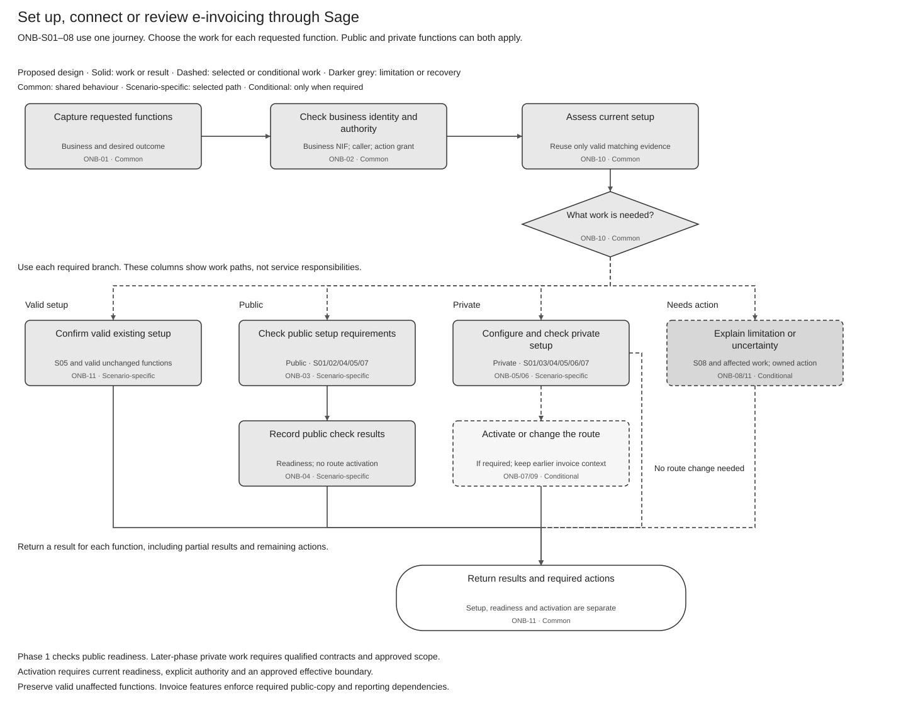

# Customer Onboarding Solution Summary

[Logical Feature Specification](SPEC-SEI-019-customer-onboarding-logical-feature-specification.md) · [API Reuse Assessment](SPEC-SEI-021-customer-onboarding-sequence-and-reuse-assessment.md) · [Feature landing page](README.md)

## Revision overview

This stakeholder overview explains the onboarding outcome, scope and main decisions. [SEI019](SPEC-SEI-019-customer-onboarding-logical-feature-specification.md) shows the high-level journeys; [SEI021](SPEC-SEI-021-customer-onboarding-sequence-and-reuse-assessment.md) assesses engineering reuse and Spain-specific changes. All are based on [SPEC-SEI-002](../archive/SPEC-SEI-002-onboarding-solution-specification.md).

The predecessor, phase boundaries and ONB/OFR meanings remain unchanged. SPEC-SEI-018 is selected for the stable summary page after the authorised publication. Implementation approval and delivery-feature breakdown remain open.

## 1 Purpose

Help a Spanish business set up, connect, confirm or extend supported e-invoicing functions through Sage. A direct customer or authorised accountant must understand what is ready, what is active and who must act next. An existing customer should complete only missing or invalidated work.

**Audience: local Product teams, directors and cross-functional stakeholders.** Use this page for the business outcome, scope, responsibilities and decisions. Read [SEI019](SPEC-SEI-019-customer-onboarding-logical-feature-specification.md) for the main process paths and exceptions. Architects and engineers use [SEI021](SPEC-SEI-021-customer-onboarding-sequence-and-reuse-assessment.md) for existing capabilities, public/private Spain tailoring and evidence gaps.

Customer onboarding is the Master Feature journey. Behaviour remains proposed; a sourced fact or recorded decision does not prove implementation readiness.

## 2 Terms used

Use the [shared glossary](../../context/GLO-SEI-001-e-invoicing-terminology.md). These distinctions are essential to the summary.

| Term | Meaning |
|---|---|
| Represented business | The business whose setup or invoice function is affected. It is separate from the authenticated caller. |
| Authority | Current permission for a specific action for that business. A login, client relationship or certificate alone is insufficient. |
| Readiness | An evidenced check result for a stated function, actor and environment, with limitations and recheck conditions. |
| Activation | An evidenced start of authorised use for the exact function, direction and scope. Connection and readiness are separate results. |
| Recovery | Correct or establish the result of affected work, then return to its blocked check. |

## 3 Master Feature purpose and scope

An authorised customer or accountant requests setup for one business or independent client businesses. Return each function’s result, limitations and action owner. Existing setup needs only missing or invalidated work.

| Customer situation | Intended outcome |
|---|---|
| First-time setup | Select a supported option and establish the required checks. |
| Existing public service | Establish Sage access for selected functions without assuming new public enrolment (SPFE-S03). |
| Existing private provider | Keep the provider and connect its qualified account to Sage. |
| Public and private services | Qualify the function assigned to each service and return independent results. |
| Existing Sage setup | Confirm unchanged valid setup or add only requested functions. |
| Platform change | Change supported future work at an authorised boundary; preserve earlier obligations. |
| Existing B2G use | Assess B2B separately and retain the B2G setup. |
| Unsupported or uncertain setup | Explain the limitation or missing evidence and give an owned next action. The unlisted-provider option remains TBD; a planned provider list does not establish availability. |

SEI019 identifies these situations as ONB-S01–08. Each can apply to a direct customer, an accountant for one client or a portfolio. A single client does not require batch processing.

**Phase 1** returns public readiness. Private setup and activation need later-phase qualification. Private A to Private B remains gated.

**Private-platform timing:** customer ERP setup and operator interconnection are separate. For qualifying platform-to-platform requests, the receiving operator has **one month**, subject to the specific queue exception; the public solution provides the required interim exchange. This is not a general 30-day onboarding promise. [SEI019 ONB-R25](SPEC-SEI-019-customer-onboarding-logical-feature-specification.md#67-onb-05-configure-private-choice) defines the clock and handoff. REF-INTERCONNECT.

| Outcome or endpoint | Meaning |
|---|---|
| Selected work complete | Each function has a supported, evidenced result. Public readiness and later activation retain separate meanings. |
| Final rejection or withdrawal | The requested work has a recorded final disposition. Existing service remains subject to its own state and obligations. |
| Cancellation complete | Safe pending work is stopped and every possible external effect has sufficient evidence-backed resolution for closure. |
| Action pending or outcome unknown | Not an endpoint. Retain the owner and recovery path; do not infer completion from escalation. |

Invoice creation, sending, retrieval, reporting and full exit belong to their owning features. Onboarding supplies setup evidence and checks dependencies.

## 4 Parties and responsibility boundary

| Party | Responsibility and handoff |
|---|---|
| Business or authorised accountant | Select the requested outcome and supported option; provide missing information or a purpose-specific decision. |
| ERP or product | Present choices and client actions; show the current permitted per-function result through the Global API. |
| E-Invoice Service | Own setup and recovery coordination. This recorded direction does not establish a separate onboarding service. |
| Identity, trust and connection owners | Supply qualified identity, authority, protected access and connection evidence. Keep their decisions separate. |
| Routing and invoice-operation owners | Qualify activation, preserve invoice origins and apply runtime checks for their own operations. |
| Provider or public connector | Execute only the selected qualified contract and provide operation evidence. |
| Operations | Own assigned unresolved work and evidence-backed manual action; assignment alone does not prove success. |

## 5 Key open solution decisions

The [existing decision record](../archive/SPEC-SEI-002-onboarding-solution-specification.md#5-key-decisions-and-risks) retains owners and gates. These open decisions affect scope or delivery.

| References | Impact | Owner and gate |
|---|---|---|
| ONB-Q01/02 and OFR-Q01/02 | Supported observations, public/private combinations, receiving reachability and exact recovery checkpoints. | Integration, Routing, Product and Operations; selected-provider pilot. |
| ONB-Q04/09 | Actual ERP/API results, customer inputs, scheduling, timezones and receiving-history coverage. | API, ERP Product, Routing and Receiving; contract review and cohort pilot. |
| ONB-Q06/07 and OFR-Q04 | Protected-source operations, accepted representation evidence, eligible approvers and action channel. | Trust, Identity, Spain Compliance and Security; selected-function and delegated pilots. |
| ONB-Q08 | Batch permissions, limits, fair processing and access-filtered progress. | Accountant Product, API, Identity and Operations; portfolio pilot. |
| ONB-Q05 and OFR-Q03 | Existing implementation coverage and gaps within the E-Invoice Service. | Service owner and Architecture; before build. |
| Unnumbered transition and operational decisions | Operator approval, publication sequence, historical access, safe retry budgets and manual closure evidence. | Provider, Routing, Compliance and Operations; before the affected path is enabled. |
| Unlisted private provider | Whether to show only enabled providers or add an “Other provider” request remains TBD. Refine with coverage; do not promise an unqualified connection. | Spain Product and local technical lead; before the private onboarding option is enabled. SEI019 section 3.5. |

## 6 End to end workflow

Verify the business and actor, assess existing setup, and run the required public/private checks. Missing approval enters ONB-12; portfolio processing uses ONB-13. Uncertain effects enter ONB-08 and return to the affected check.

Figure 1. Onboarding paths for ONB-S01–08. [Editable Draw.io](../../assets/diagrams/onboarding-scenario-selection-process.drawio) · [PNG](../../assets/diagrams/onboarding-scenario-selection-process.png).

Solid arrows show work or a result. Dashed arrows show selected or conditional work. The columns identify paths, not service boundaries. A combined setup can use several branches. Recovery and approval remain conditional activities, not alternative delivery routes.

## 7 Master Feature lifecycle

| Activity | Outcome | Accountable party or handoff |
|---|---|---|
| ONB-13 Manage portfolio batch | Saved receipt and independent item mapping, where batch mode applies. | E-Invoice Service; current per-client permission. |
| ONB-01 Capture requested functions | Scoped request recorded or duplicate/conflict returned. | Product to E-Invoice Service. |
| ONB-02 Check business identity and authority | Separate identity and action-authority findings. | Identity and authority owners. |
| ONB-10 Assess current setup | Plan for missing, unchanged, stale or unsupported work. | E-Invoice Service with evidence owners. |
| ONB-12 Coordinate client approval and evidence | Missing decision resolved or owned client action retained. | Eligible approver and evidence owner. |
| ONB-03 Assess prerequisites | Required access and trust checks established. | Policy, Identity and trust owners. |
| ONB-04 Publish public readiness | Evidenced result for each selected public function. | E-Invoice Service to product. |
| ONB-05 Configure private choice | Explicit supported choice and missing configuration recorded. | Customer, product and connection owner. |
| ONB-06 Prove private readiness | Selected function and required external state qualified. | Connection and provider owners. |
| ONB-07 Cut over new traffic | Authorised future-work boundary evidenced. | Routing owner. |
| ONB-08 Reconcile and recover | Original effect resolved or kept on an owned hold. | Operation owner and Operations. |
| ONB-09 Preserve and release | Earlier invoice access retained; dependency release separately gated. | Routing, records and Operations. |
| ONB-11 Return results and required actions | Current permitted results, limitations and next actions. | E-Invoice Service through Global API to product. |

SEI019 defines these activities. Approval and recovery can interrupt a check; independent client work can continue.

## 8 Cross cutting solution considerations

Spain identity, representation and provider rules remain country-specific. Reusable journey patterns need the selected country and provider evidence.

Reuse the existing FR APIs with Spain country-pack tailoring. Public readiness and private-provider setup need different qualifications. Keep business mapping, traffic changes and unresolved dependencies visible; engineering detail stays in [SEI021](SPEC-SEI-021-customer-onboarding-sequence-and-reuse-assessment.md#1-engineering-direction).

Existing Tax Service certificate capability is the intended reuse source; exact Spain fitness remains to qualify. DTS is the preferred transformation candidate for later invoice operations under [SPEC-SEI-008](../SPEC-SEI-008-spain-ubl-mapper-migration-to-dts-solution-specification.md). Onboarding itself establishes neither implementation as ready.

## 9 Dependencies and risks

| Dependency or risk | Consequence and response |
|---|---|
| Authority or trust evidence is missing | Hold dependent work and return the eligible action owner. |
| An external change has an unknown outcome | Preserve the original operation and check actual state before repetition. |
| A receiving change affects reachability | Routing decides hold or continuation from evidence, even before local activation. |
| Earlier invoices still need the previous path | Retain required access until the historical-continuity gate passes. |
| Capacity and service targets are unqualified | Set measurable limits and objectives from approved contracts and pilot evidence. |

## 10 Features within this Master Feature

One [high-level logical journey](SPEC-SEI-019-customer-onboarding-logical-feature-specification.md) covers ONB-01–13 and OFR-01–08. Public/private setup, approval and portfolio work are activity groups; delivery-feature boundaries remain for Product and Engineering to agree.

Certificate, connectivity/routing and invoice-operation features retain their existing responsibilities. SEI019 links their handoffs.

## 12 Assurance and completion checks

Before enabling a scope, confirm scenario/actor coverage, qualified business authority and access, safe recovery, historical continuity and an owner for each open gate.

SEI019 holds the functional acceptance checks; SEI021 holds engineering qualification. Neither establishes production readiness.

## REF Source references

| REF ID | Source and version | Exact location | Supported claim and limit |
|---|---|---|---|
| REF-BASE | [SPEC-SEI-002](../archive/SPEC-SEI-002-onboarding-solution-specification.md), snapshot 20 October 2026 | Parts 1–4 and REF | Predecessor scope, IDs, recorded ownership direction, proposed behaviour and open gates. Not implementation evidence. |
| REF-PRODUCT | [PRD-SEI-101](../../prds/PRD-SEI-101-public-platform-onboarding.md), [104](../../prds/PRD-SEI-104-accountant-and-single-client-onboarding.md), [107](../../prds/PRD-SEI-107-public-onboarding-failure-recovery.md), [222](../../prds/PRD-SEI-222-customer-onboarding-entry-point-migration.md) | Decision summaries, scope and functional requirements | Canonical product scope; unresolved differences require an owner decision. |
| REF-COUNTRY | [PRD-SEI-227](../../prds/PRD-SEI-227-e-invoicing-as-a-service.md) | Shared platform and country-pack direction | Reuse direction; not deployment qualification. |
| REF-INTERCONNECT | [RD 238/2026 official original](https://www.boe.es/buscar/doc.php?id=BOE-A-2026-7295), published 31 March 2026; checked 22 October 2026 | Articles 8(1)–(3), 9(1)–(5) | Participating-platform interconnection, one-month receiving-operator period, specific queue exception and interim public exchange. Not a general customer ERP-onboarding SLA. |
| SPFE-S03 | [Original catalogue](<../../context/Descripción servicios web/Catálogo de servicios/20261013/CatalogoServicios.pdf>), 0.1.0, 9 October 2026 | Sections 6.1–6.10, pp. 9–20 | Supplied public operations; no onboarding enrolment contract in this bundle. Supports the S02 boundary. Does not prove live availability. |
| REF-EVIDENCE | [RES-SEI-002](../../context/RES-SEI-002-spain-public-platform-technical-evidence.md) and [logical REF](SPEC-SEI-019-customer-onboarding-logical-feature-specification.md#ref-source-references) | Source register, exact contracts and open conflicts | Original-source route for Spain-dependent rules and acceptance. The guide is a reading aid. |
