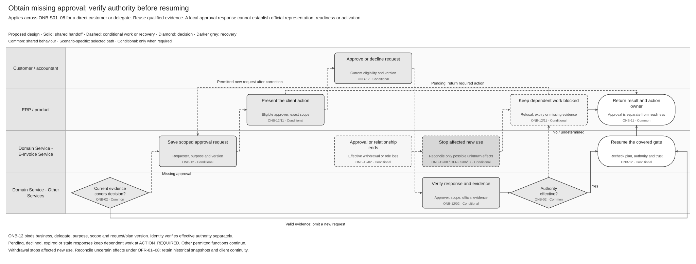
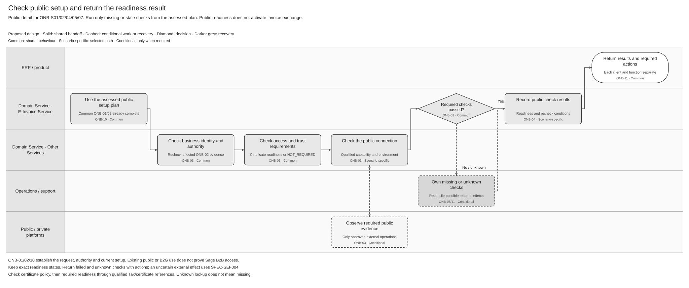
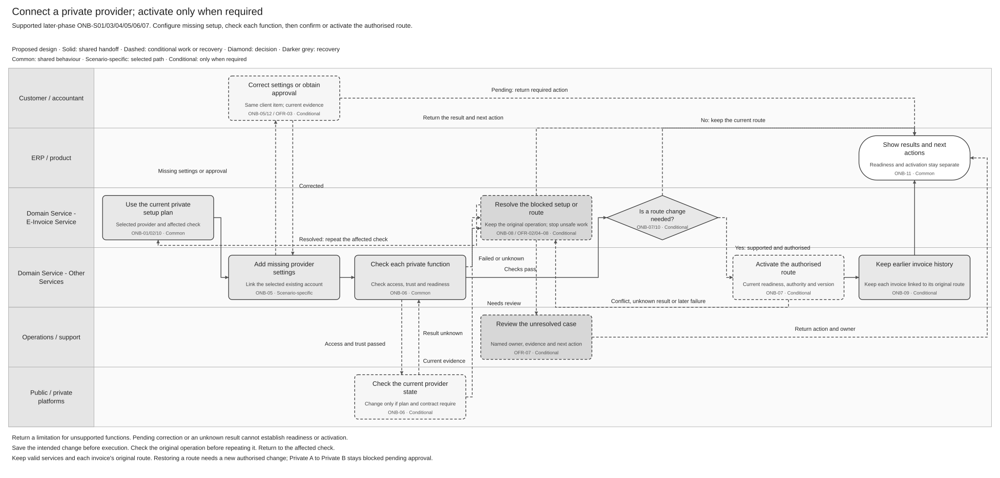
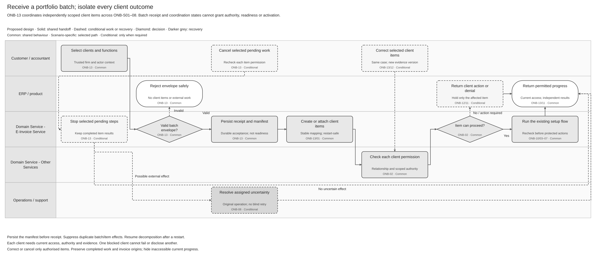

# Customer Onboarding Logical Feature Specification

## Revision overview

This high-level journey view is based on [SPEC-SEI-002](../SPEC-SEI-002-onboarding-solution-specification.md). It retains the business rules, activity IDs, diagrams and acceptance checks. [SEI018](SPEC-SEI-018-customer-onboarding-solution-summary.md) gives the overview; [SEI021](SPEC-SEI-021-customer-onboarding-sequence-and-reuse-assessment.md) holds engineering reuse and Spain-specific evidence.

The predecessor, phase gates and ONB/OFR meanings remain unchanged. Contract detail, record fields and technical sequences stay in the linked supporting sources. This revision does not approve implementation or enable a provider.

Existing decisions and release gates remain open with their owners. SPEC-SEI-018 is selected for stable Confluence page `923861390` for the authorised publication. These companions remain drafts; implementation gates are unchanged.

## 1 Purpose and authority

**Audience: local Product teams, business analysts and stakeholder reviewers.** Explain who acts, the main public/private journeys, decisions, results and safe recovery. For quick review, read [scope](#3-scope) and the [activity diagrams and outcomes](#6-feature-activities). Use [SEI021](SPEC-SEI-021-customer-onboarding-sequence-and-reuse-assessment.md) for existing capabilities, Spain tailoring and engineering gaps.

Product scope comes from REF-PRODUCT. Behaviour remains proposed. External Spain rules use SPFE source IDs; proposed Sage controls and engineering qualification remain separate.

## 2 Terms used

Use the [shared e-invoicing glossary](../../context/GLO-SEI-001-e-invoicing-terminology.md). Terms below retain its meanings.

| Term | Meaning in this feature |
|---|---|
| Represented business | The business whose setup is affected. It is separate from the authenticated caller. |
| Authority | Current permission for the exact action, business, scope and period. Product access and a client relationship are separate. |
| Readiness | An evidenced capability-check result for an actor, business, environment and selected profile, with limitations and recheck conditions. |
| Route and cutover | The selected platform/connection for a direction and scope; the authorised boundary for changing future work. |
| Entry point | A published receiving destination. A local configuration does not prove external reachability. |
| Reconciliation | Establish what happened to the original operation from reliable evidence before deciding the next action. |
| Idempotency | Repetition of the same logical request adds no effect within the qualified contract's scope and duplicate window. |
| Approval evidence | A purpose-specific decision bound to the business, scope and request or plan version. It is separate from effective authority. |
| Batch receipt | Saved acceptance of a manifest of independently scoped requests. It does not establish client readiness. |

## 3 Scope

### 3.1 In scope

Assess the requested outcome and current setup; verify identity and action authority; establish conditional access and trust; confirm public readiness; configure supported private connections; coordinate separately authorised activation; preserve earlier invoice obligations; and return per-function results. Missing approval, portfolio processing, correction, cancellation and recovery use the same activity controls.

These scenarios are authoritative for entry selection. Apply actor and processing mode separately.

| ID | Starting situation | Required plan and result |
|---|---|---|
| ONB-S01 | No established e-invoicing setup | Present qualified choices, establish missing prerequisites and return results for selected functions. |
| ONB-S02 | Existing public service outside Sage | Establish Sage access and qualified function evidence; do not infer external registration or active exchange. |
| ONB-S03 | Existing private provider retained | Bind the existing account and add only missing Sage setup. An initial Sage route still needs separate authority where required. |
| ONB-S04 | Public and private services used together | Plan functions separately, preserve valid independent results and identify dependencies. Do not create overlapping delivery executors. |
| ONB-S05 | Existing Sage setup confirmed or extended | Return valid unchanged references without mutation; recheck stale evidence or add only the requested functions. |
| ONB-S06 | Supported platform change requested | Qualify the new plan and future-work boundary. Preserve earlier invoice context. Keep unapproved transitions blocked. |
| ONB-S07 | B2G service used before B2B setup | Assess B2B access independently and retain the existing B2G service. |
| ONB-S08 | Provider/function unsupported or setup unknown | Return the precise limitation, missing evidence and owner. Do not force a provider change or infer absence. |

### 3.2 Out of scope

Invoice issuance, delivery, retrieval, lifecycle reporting and full exit belong to their owning features. Onboarding supplies their setup evidence and checks relevant dependencies. Physical endpoints, schemas, storage design, deployment and detailed field mapping are outside this logical specification; section 7 links their supporting analysis.

### 3.3 Outcomes and end states

Return a recorded outcome for each function: readiness, independently evidenced activation, unchanged setup, a limitation or an owned action. Readiness, activation, request completion, approval-request status and batch coordination remain separate dimensions.

Pending prerequisites, retry waits, unknown external effects and unresolved manual cases remain open work. Cancellation is final only after the ONB-08 closure gate passes. No whole-customer ONBOARDED flag substitutes for these results.

### 3.4 Assumptions and dependencies

| Dependency | Owner and boundary |
|---|---|
| Identity, direct/delegated access and evidence | Identity and Product; current per-business action checks. |
| Protected credentials and operations | SPEC-SEI-001 owner; qualify the actual Tax/Connections/AFL source and selected purpose. |
| Connections, route versions and historical context | SPEC-SEI-014 owner; independent configuration, readiness and route gates. |
| Global API and public execution | SPEC-SEI-013 and SPEC-SEI-011 owners; qualified contracts rather than invented setup operations. |
| Receiving history and progress | SPEC-SEI-016 owner; available history, source-date meaning, authority and saved checkpoints. |
| Existing implementation coverage | E-Invoice Service and Architecture; build, contract, local-change and gap evidence under ONB-Q05/OFR-Q03. |
| Network dataset provisioning, where the selected channel requires it | API/Identity and Sage Enablement; qualify the dataset, represented-business and address relationship. Multiple addresses do not establish entity cardinality. Spain support, accountant/client isolation, product/Tax mapping and native-channel linkage remain open. INT-DS01; SEI021 GAP-01/02/08. |

### 3.5 Decisions and open questions

The [existing decision record](../SPEC-SEI-002-onboarding-solution-specification.md#5-key-decisions-and-risks) retains ONB-Q01–09 and OFR-Q01–04. Missing qualification holds only dependent work; SEI021 identifies the engineering evidence needed.

## 4 Feature wide functional requirements and rules

These business rules apply across the activity diagrams. REF-PRODUCT/REF-BASE are the baseline unless a SPFE source is cited.

| ID | Requirement or rule | Applies to |
|---|---|---|
| ONB-R01 | Before any external change, Sage must resolve the authorised tenant, represented business, environment and exact function/scope. | All protected work. |
| ONB-R02 | Sage must verify direct or per-client delegated authority for each action and recheck it before activation or another protected execution. | Identity, setup, activation and use. |
| ONB-R03 | Sage must keep readiness dimensions and their evidence separate. A certificate check applies only where the selected policy requires it. | Public/private readiness and results. |
| ONB-R04 | Sage must isolate each client's result, correction, cancellation and failure; other safe clients can continue. | Portfolio processing. |
| ONB-R10 | Sage must retain who requested, decided, changed, observed, corrected or overrode the work, with scope, time and source. | All activities. |
| ONB-R12 | Sage must reuse only matching valid evidence. Unchanged setup requires no external change; extension affects only requested functions. | Planning and checks. Proposed scenario refinement. |
| ONB-R14 | Sage must retain B2G/B2B distinctions, phase limits, unsupported functions and gated transitions. Invoice owners decide transaction applicability. | Scenario planning and execution. |
| ONB-R16 | Sage must reuse suitable protected references under SPEC-SEI-001. Failed lookup remains unknown and cannot trigger an assumed missing-certificate upload. Authentication and signing require separate qualification. | Public/private trust checks and recovery. |
| ONB-R17 | Before readiness, Sage must verify the business NIF and action authority, plus a suitable certificate where required. A policy-backed NOT_REQUIRED removes only the certificate condition. | ONB-02/03/04/06. |
| ONB-R18 | Sage must distinguish intake, readiness, activation and later use. Each actual actor/contract must qualify authentication, signing, retrieval and reporting separately. | Setup and runtime handoff; SPFE-S02 Article 11. |
| ONB-R19 | Sage must check current firm role, client relationship and action permission independently at protected reads, changes and execution. | Direct/delegated access and portfolio results. |
| ONB-R24 | Sage must prefill qualified current information and ask only for missing, changed or unverified information required by selected functions. A missing/conflicting value returns the affected function, reason and correction owner. | Intake, assessment and client action. Proposed field refinement. |
| OFR-R01 | Sage must classify the business problem separately from whether the operation can safely repeat. | Every failed operation. |
| OFR-R02 | For a permitted retry, Sage must preserve operation identity and correlation and apply an approved, versioned policy and budget. | Automatic and manual retry. |
| OFR-R03 | After a possible external effect with no definitive result, Sage must hold dependent work and reconcile before retry or success. | Unknown changes. |
| OFR-R05 | Sage must return an existing result for an unchanged duplicate and reject conflicting input or stale revisions without another effect. | Requests, corrections and concurrent decisions. |
| OFR-R06 | Sage must isolate recovery and cancellation by client item. | Portfolio processing. |
| OFR-R07 | Manual actions must enforce current authority, environment, security and audit controls. An override cannot bypass evidence or legal-policy gates. | Support and manual recovery. |
| OFR-R08 | Sage must return stable safe status, correlation, relevant policy version, action and owner without exposing protected data. | Product and support results. |
| OFR-R09 | Sage must bind recovery to the original scenario, plan, provider/role, direction, scope and blocked check. Preserve independent valid functions and enforce dependencies. | Failed checks and external effects. |
| OFR-R10 | Corrected or reconciled work must return to its parent checks. Recovery cannot force migration, repeat enrolment, commit a route or infer absence from failed discovery. | Recovery completion. |
| OFR-R12 | Sage must keep NIF, required-certificate and authority findings independent and use qualified protected references and original-source observations. | Trust correction and recovery. |

**Phase rule:** Phase 1 performs public readiness checks without route mutation. Private setup and activation need later-phase qualification. Private A to Private B remains disabled until the shared-foundation decision is approved.

**Isolation rule:** TEST and production evidence, credentials and routes remain separate. Spain identity, representation, routing and recovery rules are selected explicitly; they cannot become another country's defaults.

## 5 Cross cutting quality and operational requirements

These NFR IDs group existing controls; they introduce no numeric service commitment.

| NFR ID | Category | Requirement and acceptance target | Position |
|---|---|---|---|
| ONB-NFR01 | Security and privacy | Isolate tenant/business/environment access. Return no private keys, reusable secrets, raw confidential provider bodies or full tax identifiers in logs, metrics and notifications. Retain only safe protected references in setup results. | Proposed control; negative access/redaction tests required. |
| ONB-NFR02 | Recoverability | A restart must retain accepted intent, duplicate detection, batch manifests and unresolved original effects. Recover without creating an additional effect. | Proposed control; persistence-loss/restart evidence required. |
| ONB-NFR03 | Audit and retention | Keep reproducible decision, correction and operation histories. Apply approved retention and deletion by data class; do not invent a duration. | Policy schedule open with Security, Privacy and Compliance. |
| ONB-NFR04 | Capacity and support | Bound retry attempts and elapsed time, observe provider guidance and schedule independent clients fairly. Monitor pending/unknown age, missing owners, approval expiry, queue age and failed transitions. | Numeric limits, objectives and alert thresholds open with Operations; ONB-Q07/08. |
| ONB-NFR05 | Usability and accessibility | Show the affected function, current outcome and permitted next action with its owner. Do not rely on colour alone to distinguish status or client actions. | Proposed control; ERP review under ONB-Q04/09. |

## 6 Feature activities

Each activity states its outcome, actors and precondition, followed by the business rule and acceptance checks. Engineering contracts, fields and provider/version findings are linked in [supporting inventories](#supporting-inventories).

### 6.1 ONB-01 Capture requested functions

**Outcome:** One saved, scoped request or an explicit duplicate/conflict result. **Parties:** customer/accountant, product and Sage. **Precondition:** authenticated product context and current permission to prepare the selected business.

Record the business, requested functions, direction and environment. Pending NIF/certificate checks allow intake, but hold dependent work. Unsupported requests return a limitation.

An unchanged repeat returns the existing item after current access checks; changed input conflicts. **OFR-01 Capture durable intent** preserves the request and authority before an external change. Possible effects enter ONB-08.

Verify the represented business independently of shared technical access. Reuse confirmed setup; a failed lookup cannot justify duplicate provisioning. Dataset/address mapping and integration evidence stay in SEI021.

| Acceptance ID | Acceptance check |
|---|---|
| ONB-A26 | Save authorised intake with pending identity/trust checks; do not trigger upload, readiness, activation or dependent execution. |
| OFR-A06 | Unchanged repeats reuse the saved result. Changed input or stale revisions conflict without another effect. |
| OFR-A04 | After external success and local data loss, recover the original effect once from retained evidence. |

### 6.2 ONB-02 Check business identity and authority

**Outcome:** Independent business-identity, caller and action-authority findings. **Parties:** direct customer/delegate, Sage and Identity. **Precondition:** authorised business context from ONB-01.

Verify NIF/NIE for the represented business, caller identity and current action authority separately. A delegate also needs a valid firm role and client relationship. Missing approval enters ONB-12; uncertain existing effects enter ONB-08.

| Acceptance ID | Acceptance check |
|---|---|
| ONB-A03 | Recheck corrected NIF/authority evidence as a new revision; preserve earlier decisions and operations. |
| ONB-A25; OFR-A20 | Keep NIF, certificate and authority independent. One pass cannot hide another failure; resume the affected check. NOT_REQUIRED removes only the certificate condition. |
| ONB-A29 | Check single-client delegated access without requiring batch mode. Deny unrelated/unknown client references safely. |
| ONB-SPFE-A03 | A valid certificate cannot overcome missing registered retrieval authority. Hold retrieval; preserve independent results. SPFE-S02 Article 11; SPFE-S03. |

### 6.3 ONB-12 Coordinate client approval and evidence

**Outcome:** Qualified evidence or a specific pending client action. **Parties:** requester, eligible approver, product, Sage and evidence owner. **Precondition:** a gate identifies a missing purpose-specific decision.

Figure 1. Approval and evidence flow. [Draw.io](../../assets/diagrams/onboarding-client-approval-process.drawio) · [PNG](../../assets/diagrams/onboarding-client-approval-process.png). Solid arrows show handoffs; dashed arrows show conditional work and recovery. Existing qualified evidence bypasses a new request. Refusal or missing authority retains the blocked check.

| Requirement ID | Activity requirement |
|---|---|
| ONB-R20 | First check current evidence for the exact purpose/scope. If insufficient, Sage must save and present a request to an eligible approver. Keep terms acceptance, delegated operation, route change and signing decisions separate. |
| ONB-R21 | Sage must bind the request/response to business, delegate where relevant, purpose, scope, environment, plan/digest, policy/terms version and expiry. Reject stale/conflicting responses. Withdrawal stops affected future use and preserves earlier snapshots. |

Request states remain REQUESTED, APPROVED, DECLINED, EXPIRED, WITHDRAWN and SUPERSEDED. Only REQUESTED accepts an initial decision. APPROVED records a response; official authority is checked separately. Pending-request expiry and grant expiry remain separate.

Repeated identical responses acknowledge the saved decision; they cannot restore withdrawn/expired permission. Reject stale/conflicting decisions. Changed plans need revalidation or replacement. Invitations are not approval. Approvers, channel and expiry policy remain ONB-Q07.

| Acceptance ID | Acceptance check |
|---|---|
| ONB-A30 | Reuse current matching evidence. Otherwise return ACTION_REQUIRED and the eligible owner for dependent work. |
| ONB-A31 | Local approval or terms acceptance cannot replace effective delegation and official evidence. SPFE-S02 Article 11. |
| ONB-A32 | Refusal, expiry, changed plans or competing decisions cannot authorise stale work or trigger technical retries. |
| ONB-A33 | Withdrawal or relationship/staff-role loss stops affected future work and reads; reconcile in-flight effects. Replacement actors need fresh authority. |
| ONB-A39 | Use trusted firm/actor context for client actions; manual entry or invitation cannot establish approver eligibility. |

### 6.4 ONB-10 Assess current setup

**Outcome:** A versioned plan for each requested function. **Parties:** customer/accountant, Sage and qualified evidence owners. **Precondition:** current access to the business.

| Requirement ID | Activity requirement |
|---|---|
| ONB-R11 | Sage must assess current public/private/Sage setup and the requested outcome before planning missing work. Keep customer declarations separate from observed evidence, including source, time, environment and version. |

Assess missing, valid unchanged, stale and unsupported setup from current evidence. Empty/failed discovery cannot prove absence. Refresh affected checks; never repeat completed or uncertain changes.

Confirm existing product/provider relationships before new setup. A new address registration may redirect traffic; apply the route-change gates. Country/provider evidence stays in SEI021.

| Acceptance ID | Acceptance check |
|---|---|
| ONB-A11 | For ONB-S01, present supported choices and apply their phase/activation gates; no silent platform selection. |
| ONB-A12 | For ONB-S02, request missing Sage authority or reuse matching valid evidence without repeated work. |
| ONB-A15; OFR-A14 | For ONB-S05, preserve valid references and route version despite failed reads; refresh only affected checks or requested extensions. |
| ONB-A17; OFR-A18 | For ONB-S07/08, preserve B2G/B2B distinctions and return owned limitations; no retry loop or whole-business applicability decision. |
| ONB-A18 | Unknown/unsupported setup cannot force a provider change or mutation. Possible effects enter ONB-08. |
| ONB-A38 | Across ONB-S01–08, prefill valid information and request necessary corrections only. Unchanged S05 needs no new input or mutation. |

### 6.5 ONB-03 Assess prerequisites

**Outcome:** Required access, policy and trust checks for the exact public/private purpose. **Parties:** Sage, Identity, trust owner and qualified integration. **Precondition:** current selected-function plan.

Figure 2. ONB-02–04 public checks. [Draw.io](../../assets/diagrams/onboarding-public-readiness-process.drawio) · [PNG](../../assets/diagrams/onboarding-public-readiness-process.png). Responsibility lanes group logical roles. Failed checks return to their correction/recovery owner; a recovered check must pass before readiness is recorded. Lane labels do not approve deployment boundaries.

Apply the selected country/function policy. Where required, use Tax Service certificate evidence under SPEC-SEI-001: in-date, suitable material, current authority and protected references. Missing/expired/revoked/unsuitable material needs correction; unavailable/stale evidence stays unknown. NOT_REQUIRED needs policy evidence. Hold dependent work until prerequisites pass.

| Requirement ID | Public source constraint and proposed Sage control |
|---|---|
| ONB-SPFE-R02 | Use only supplied qualified checks for public-only setup. Do not invent enrolment, receiving-point publication, onboarding `effectiveDate` or a test invoice. The supplied operation inventory has no such setup payload. SPFE-S03 sections 6.1–6.10; SPFE-S08 sections 5.1–5.9; SPFE-S16. |
| ONB-SPFE-R03 | Verify the represented business independently from the certificate caller and require current action authority. Local approval or an existing credential alone cannot satisfy official representation. SPFE-S02 Article 11; SPFE-S03 operation authorisation. |

Public web-form access does not prove automated ERP access. Registered third-party retrieval/consultation authority remains required where Article 11 applies. Authentication, invoice signing and authority are separate. SPFE-S02; REF-PRIVATE Article 7(3).

| Acceptance ID | Acceptance check |
|---|---|
| ONB-A22 | Reuse protected references only for matching purpose, subject, role, environment and version; no repeat upload or credential copy. |
| ONB-A23; OFR-A21 | Distinguish missing material from unavailable evidence. Retry only a safe read within budget; otherwise escalate. |
| ONB-A24 | Tax-only validity or certificate status cannot enable authentication/signing without qualified execution coverage. |
| ONB-A27; OFR-A23 | Unmet prerequisites or web-form access cannot qualify automated functions or justify an invented setup mutation. SPFE-S02 Article 11. |
| ONB-SPFE-A02 | Without an external registration contract, public setup performs no enrolment, receiving publication or invoice mutation. SPFE-S03/S08/S16. |

### 6.6 ONB-04 Publish public readiness

**Outcome:** Evidenced readiness for each selected public function. **Parties:** Sage and product. **Precondition:** required checks have recorded results.

| Requirement ID | Activity requirement |
|---|---|
| ONB-SPFE-R01 | Qualify submission, consultation, retrieval and event reporting independently for contract, credential and authority. A network connection or one accepted operation cannot prove all functions ready. SPFE-S03; SPFE-S16 establishes submission ports only. |

Readiness states remain NOT_STARTED, CHECKING, ACTION_REQUIRED, READY_WITH_LIMITATIONS, READY, SUSPENDED and OUTCOME_UNKNOWN. READY records checks passed at that time; expiry/revocation can change it. Pending prerequisites are separate from unknown external effects. Readiness cannot activate a route.

| Acceptance ID | Acceptance check |
|---|---|
| ONB-A01 | Return evidenced public readiness or a precise limitation; keep the private route unchanged. |
| ONB-SPFE-A01 | Submission qualification cannot establish receiving readiness. Return separate function findings. SPFE-S03/S16. |

### 6.7 ONB-05 Configure private choice

**Outcome:** Explicit supported choice and only missing configuration recorded. **Parties:** customer/delegate, product, Sage and connection owner. **Precondition:** later-phase scope and selected-provider contract are qualified.

Figure 3. ONB-05–09 private setup and activation. [Draw.io](../../assets/diagrams/onboarding-private-route-process.drawio) · [PNG](../../assets/diagrams/onboarding-private-route-process.png). Configure/check first; decide separately whether an authorised route change is required. Setup calls with routing effects follow the ONB-05 pre-dispatch controls below. Failed/unknown work returns to its blocked gate. Historical obligations continue after a qualified change.

| Requirement ID | Activity requirement |
|---|---|
| ONB-R05 | Sage must allow private configuration and checks without changing the active route. Record explicit operator, scope, direction and supported commercial/support boundary. |

Keep the selected provider and reuse valid setup. Do only missing authorised work; avoid duplicate enrolment, subscription or credential replacement. Possible external effects enter ONB-08.

If setup can redirect traffic, apply authority, supported-transition and continuity gates before that action. Provider operation/version details stay in SEI021. A setup label cannot bypass a gated Spain migration.

| Acceptance ID | Acceptance check |
|---|---|
| ONB-A04 | Configuration/testing without activation, including local failure, leaves the active route unchanged. |
| ONB-A13; OFR-A12 | For ONB-S03 recovery, retain provider and original operation; avoid another account/enrolment and resume ONB-05/06. |

### 6.8 ONB-06 Prove private readiness

**Outcome:** Evidence for each selected private function and required external state. **Parties:** Sage, trust/connection owners and provider. **Precondition:** qualified plan, access, operator and customer scope.

Prove each selected function and receiving destination from current evidence. A configured connection or missing address alone cannot prove readiness or successful removal. Preserve the intended change and its observed result.

If a change may affect receiving, hold unsafe traffic and establish actual reachability. The old route may remain selected but be unsafe. Missing evidence needs an owned review.

| Acceptance ID | Acceptance check |
|---|---|
| ONB-A14; OFR-A13 | For ONB-S04 partial failure, preserve independent valid functions, enforce dependencies and retain one delivery executor per action. |
| ONB-A06; OFR-A03 | A lost publication result remains OUTCOME_UNKNOWN. Preserve original evidence; no blind repeat or assumed previous-route safety. |

### 6.9 ONB-07 Cut over new traffic

**Outcome:** An evidenced authorised boundary for eligible new work, or a conflict/hold. **Parties:** authorised actor, Sage and Routing. **Precondition:** supported transition, current authority/readiness and observed required external state.

| Requirement ID | Activity requirement |
|---|---|
| ONB-R06 | Before activation, Sage must require explicit authority for the exact direction/scope and observed required inbound readiness. |
| ONB-R07 | Sage must process overlapping scope changes one at a time and preserve each invoice's actual origin route. A stale expected route version cannot overwrite a concurrent change. |
| ONB-R25 | Sage must distinguish the requested start from the confirmed effective boundary. Unknown historical start alone cannot reset unchanged setup or receiving progress. Scheduling/timezone support remains ONB-Q09. |

Change only the authorised scope at its confirmed boundary. Reject stale/competing plans; preserve each invoice’s original route. Disputed internal/external state cannot become ACTIVE. Unchanged routes need no change; restoration needs fresh authority and reachability evidence.

| Acceptance ID | Acceptance check |
|---|---|
| ONB-A05 | Only the authorised direction changes at its evidenced boundary; earlier invoices retain their origins. |
| ONB-A07; OFR-A17 | Overlapping or changed plans cannot overwrite a stale version; preserve separate original operations. |
| ONB-A08; OFR-A15 | During uncertain cutover/restoration, Routing uses actual reachability and a separately authorised transition; preserve invoice history. |
| ONB-A10; ONB-A16 | Confirm unchanged setup without unnecessary change. Hold unapproved transitions, including Private A to Private B. |
| ONB-A40 | Distinguish requested and confirmed start, preserve unknown historical start, and verify timezone/boundary behaviour. |

### 6.10 ONB-08 Reconcile and recover

**Outcome:** Resolved original work returned to its exact check, or an owned unresolved hold. **Parties:** Sage, original operation owner, customer/delegate for correction and Operations. **Precondition:** failed check, inconsistent state or possible external effect.

| Recovery activity | Required behaviour and safe next action |
|---|---|
| OFR-01 Capture durable intent | Use the original record from ONB-01; preserve input, policy, authority and operation identity before dispatch. |
| OFR-02 Classify | Separate problem category from repeat safety. Preserve original source reason and mapping version; return a safe reason/owner. Security/environment mismatch is denied and audited. |
| OFR-03 Correct | Accept authorised scoped correction as a new revision; keep prior decisions. Hold conflicting new changes while an earlier effect is unknown. Resume the affected check. |
| OFR-04 Retry safely | Retry only a proven safe read or contractually idempotent change, with the same identity. Check current authority, cancellation, environment, provider guidance, scope conflict and attempt/elapsed budget. |
| OFR-05 Hold unknown | After a possible effect, retain OUTCOME_UNKNOWN, original input/operation/provider reference, version and transmission timing. Block conflicting repeat, dependent readiness and final cancellation. |
| OFR-06 Reconcile | Query reliable original state. CONFIRMED_SUCCESS records the effect once and returns to parent checks. CONFIRMED_ABSENT permits retry only if that contract accepts the proof. CONFLICT/UNRESOLVED stays held. |
| OFR-07 Escalate | Assign an owner with original evidence, deadline exposure, last observation, unsafe actions and customer-safe message. Manual disposition needs approver/evidence; it cannot rewrite external facts. |
| OFR-08 Publish | Commit the result before notification; ONB-11 composes the per-function view. Repeated/lost notifications are repaired by reading the current permitted version. |

Classify validation, authentication, authority, policy, conflict, dependency, security and internal problems separately from unknown effects and retry safety. Exact source codes and mappings stay in SEI021. SPFE-S03 section 5.1; SPFE-S08 sections 4.3 and 5.2–5.9.

Do not duplicate work that its owner is retrying or claim a retry without evidence. Country/provider retry and escalation rules stay in SEI021; France rules do not become Spain defaults.

| Requirement ID | Additional constraint |
|---|---|
| ONB-R08 | Before retry or success, Sage must reconcile an external change whose result is unknown. An empty/failed query is not proof of absence. |
| OFR-R04 | Exhausted budgets or missing reliable observation must produce an owned unresolved case, without false success, absence or final cancellation. |
| OFR-SPFE-R01 | Recover the failed setup check through its qualified owner; do not use SendInvoice/CancelInvoice as an onboarding probe or rollback. Proposed Sage control; SPFE-S03/S16 identify invoice operations. |
| OFR-SPFE-R02 | Preserve transport, SOAP, request and per-item results separately. Resume only with proven repeat safety or authoritative reconciliation. SPFE-S03/S08. |

**Cancellation closure gate:** stop safe queued work. Resolve every possible effect or obtain an approved evidence-backed disposition. An assigned owner or open unknown effect cannot complete cancellation.

| Acceptance ID | Acceptance check |
|---|---|
| OFR-A01 | Proven non-transmission with invalid data returns correction; no unchanged automatic retry or external call. |
| OFR-A02 | A throttled safe-read retry preserves correlation, approved budget, provider guidance and fair client processing. |
| OFR-A05 | Exhausted retries or missing reliable observation retain an owned unresolved case; do not infer absence. |
| OFR-A09 | Manual support/retry enforces current authority, environment and redaction. |
| OFR-A16 | CONFIRMED_SUCCESS returns to fresh parent checks; it cannot commit a route or claim active use. |
| OFR-A22 | Credential correction or uncertain protected use retains original source/purpose/version and owner; no new signer, issuance or blind repeat. |
| OFR-SPFE-A01 | Generic resend guidance permits only a proven safe public-check retry; no invoice/route mutation. SPFE-S03/S08. |
| OFR-SPFE-A02 | Lost owning-feature results retain their original operation and recovery owner; no fabricated setup success. SPFE-S03/S16. |

### 6.11 ONB-09 Preserve and release

**Outcome:** Earlier invoice obligations retain qualified access; old dependencies release only at separate gates. **Parties:** Sage, Routing, records, provider and Operations. **Precondition:** earlier/in-flight work or a transition exists.

| Requirement ID | Activity requirement |
|---|---|
| ONB-R09 | Sage must preserve original actor, route and evidence for earlier invoices and release previous dependencies separately after their approved continuity gates. |

Preserve access needed for earlier delivery, reports, rejection, correction and audit. Keep retrieval progress and prevent duplicate intake. Unknown historical coverage holds dependency release, but need not block independently safe new work. Full exit follows SPEC-SEI-003.

| Acceptance ID | Acceptance check |
|---|---|
| ONB-A41 | Earlier-invoice retrieval qualifies dates, authority and source coverage, preserves progress and avoids duplicates. Unknown coverage has an owner. |

### 6.12 ONB-11 Return results and required actions

**Outcome:** The current authorised result for each function, with its limitation/action owner. **Parties:** Sage, Global API, ERP/product and support. **Precondition:** result and evidence committed.

| Requirement ID | Activity requirement |
|---|---|
| ONB-R13 | Sage must return setup, readiness and independently evidenced activation separately for each selected function through the common API. |

Show each function’s setup, readiness, independently evidenced activation, limitations and action owner. Missing activation evidence stays pending/unknown. Delivery, receiving, public copy and reporting remain separate. Setup cannot prove invoice acceptance, payment or completed reporting.

When notifications are used, reflect saved state and recover the current permitted result after loss, duplication or out-of-order delivery. Partial observations remain partial. Later protected use must recheck authority and certificate validity. Event contracts and source differences stay in SEI021.

| Acceptance ID | Acceptance check |
|---|---|
| ONB-A20 | After concurrent/lost/duplicate observations, return the current authorised result without repeating work or implying activation. |
| ONB-A42 | Keep business/caller, function findings and owned actions separate. Return no credentials, invented SPFE setup fields or test invoice. SPFE-S02 Article 11; SPFE-S03/S08/S16/S18. |

### 6.13 ONB-13 Manage portfolio batch

**Outcome:** Saved receipt and independent client work with permitted progress. **Parties:** authorised submitter, product, Sage, Identity and Operations. **Precondition:** qualified batch permission and contract under ONB-Q08.

Figure 4. Portfolio intake and independent client processing. [Draw.io](../../assets/diagrams/onboarding-portfolio-batch-process.drawio) · [PNG](../../assets/diagrams/onboarding-portfolio-batch-process.png). Reject an invalid envelope before client work. Save valid intake before receipt, check each client independently and stop only unsafe/unauthorised work. Dashed paths show correction, cancellation and uncertain-effect recovery.

| Requirement ID | Activity requirement |
|---|---|
| ONB-R22 | Sage must save a batch manifest before receipt, map each logical client item once and resume incomplete decomposition after restart. An invalid envelope/conflicting duplicate item reference creates no client work. |
| ONB-R23 | Sage must expose only currently permitted progress/actions and allow authorised selected correction/cancellation without repeating completed independent work or hiding unknown effects. |

Bind the batch to the submitting organisation, environment and purpose. An unchanged repeat reuses its receipt; conflicting or overlapping requests cannot duplicate client work. Preserve submitted/unique counts and resume incomplete processing after restart.

Recheck each client before execution and result access. Unlinked clients receive a safe denial. Relationship/staff-role loss stops affected work and access; a replacement actor needs fresh checks and receives no inherited authority or credential.

| Proposed coordination state | Meaning |
|---|---|
| RECEIVED | Receipt and manifest saved; item creation/processing not started. |
| PROCESSING | Work advances without an unresolved approval, correction or uncertain effect. |
| PARTIAL | At least one item needs such action/resolution; other safe items can continue. |
| COMPLETED | Every requested item has a recorded final disposition; no pending action/uncertain effect remains. Not a readiness result. |
| CANCELLING | Remaining-batch cancellation recorded; safe pending work stops and submitted effects await resolution. |
| CANCELLED | Remaining-batch work stopped and ONB-08's closure gate passed. Retain completed item results. |
| FAILED_ENVELOPE | Rejected before client items or external work. Failure after receipt is recoverable work. |

During remaining-batch cancellation, CANCELLING takes precedence until effects are resolved. Selected-item cancellation does not cancel the whole batch. Show only currently accessible client progress; withhold revealing totals or parent states. Receipt counts describe submitted requests, not current progress.

| Acceptance ID | Acceptance check |
|---|---|
| ONB-A02; OFR-A07 | Each client retains permission and result. Counts reflect saved outcomes; unknown work is not complete or failed. |
| ONB-A34 | Repeats/restarts create each logical item once; preserve received/unique counts. Reject conflicting envelope entries before client work. |
| ONB-A35; OFR-A08 | Selected correction/cancellation preserves other safe and completed work. Unknown effects prevent final cancellation. |
| ONB-A36 | Lost client access withholds current details, totals and revealing parent state; retain only safe submitted references. |

## 7 Traceability and supporting artefacts

### Supporting inventories

| Reference | Purpose and authority |
|---|---|
| [Feature landing page](README.md) | Navigation to canonical PRDs, companions and unchanged predecessor. |
| [Solution Summary](SPEC-SEI-018-customer-onboarding-solution-summary.md) | End-to-end outcome, workflow, boundaries and material decisions. |
| [API Reuse Assessment](SPEC-SEI-021-customer-onboarding-sequence-and-reuse-assessment.md) | FR connection contracts, internal dataset guide, Spain tailoring, source differences and implementation evidence gaps. |
| [Archived SPEC-SEI-020](../archive/SPEC-SEI-020-customer-onboarding-api-design-and-reuse-assessment.md) | Retained detailed API assurance and source-conflict analysis, referenced by the main SEI021 engineering view. |
| [SPEC-SEI-002 interaction contracts](../SPEC-SEI-002-onboarding-solution-specification.md#1-interaction-contracts) | ONB-INT-01–13 and OFR-INT-01–09 logical/technical analysis. Proposed service allocations and field names require qualification. |
| [SPEC-SEI-002 data inventory](../SPEC-SEI-002-onboarding-solution-specification.md#2-data-inventory) | ONB-D01–13 and OFR-D01–09 supporting records; no new duplicate stores are required by this split. |
| [SPEC-SEI-002 customer fields](../SPEC-SEI-002-onboarding-solution-specification.md#3-customer-and-accountant-fields-by-scenario) and [system/results fields](../SPEC-SEI-002-onboarding-solution-specification.md#4-system-fields-dates-and-erp-results) | Proposed field-level analysis under ONB-Q04/09, including start dates and receiving history. |
| [SPEC-SEI-002 public field boundary](../SPEC-SEI-002-onboarding-solution-specification.md#5-sage-spfe-field-boundary) | Exact transport elements and source limits. Does not define an onboarding payload. |
| [SPEC-SEI-002 original verification matrix](../SPEC-SEI-002-onboarding-solution-specification.md#1-verification-matrix) | Detailed PRD-to-interaction/data mappings for existing acceptance IDs. The compact scenarios here retain their observable outcomes. |
| [SPEC-SEI-002 technical sequences](../SPEC-SEI-002-onboarding-solution-specification.md#onboarding-technical-sequences) | Supporting public/private sequence examples. Physical contracts and deployment remain unqualified. |
| [SPEC-SEI-001](../SPEC-SEI-001-certificate-management-solution-specification.md), [013](../SPEC-SEI-013-provider-api-through-the-e-invoicing-global-api-solution-specification.md), [014](../SPEC-SEI-014-shared-platform-connectivity-and-routing-solution-specification.md), [011](../SPEC-SEI-011-public-platform-connector-solution-specification.md), [016](../SPEC-SEI-016-invoice-receiving-retrieval-and-download-solution-specification.md), [003](../SPEC-SEI-003-offboarding-solution-specification.md) | Owning trust, API, route, public-execution, receiving and exit boundaries. |

### Solution ownership and reuse qualification

**ONB-R15 / OFR-R11:** the E-Invoice Service coordinates setup and recovery; dependency owners retain their controls. Implementation ownership, reuse and deployment qualification are assessed in SEI021 under ONB-Q05/OFR-Q03.

Engineering evidence for shared workflow, country/provider rules, Tax Service and DTS stays in [SEI021](SPEC-SEI-021-customer-onboarding-sequence-and-reuse-assessment.md). Existing DTS remains the preferred transformation candidate under [SPEC-SEI-008](../SPEC-SEI-008-spain-ubl-mapper-migration-to-dts-solution-specification.md); onboarding performs no invoice conversion. ONB-Q01/02/05/06/07/08 and OFR-Q01/02/03/04 retain their owners and gates.

| Acceptance ID | Required cross-feature evidence |
|---|---|
| ONB-A09; OFR-A10 | Select each country/provider’s approved rules. Missing evidence holds dependent work; preserve prior Spain evidence. |
| ONB-A19; OFR-A11 | Reuse needs source capability/build, changes, gaps, owner and evidence. Changed role/purpose/environment/version requires requalification. |
| ONB-A21; OFR-A19 | Retain E-Invoice Service coordination; confirm actual implementation rather than assume a proposed component exists. |
| ONB-A28; OFR-A24 | Diagrams and supporting sequences retain aligned IDs and outcomes; faults return to the correct correction/recovery checkpoint. |
| ONB-A37 | Reusing approval/portfolio patterns needs local authority, approver, disclosure and implementation qualification. |

### Review and release gates

Acceptance checks describe evidence to obtain. Before enabling a scope, close its gates in the [existing release record](../SPEC-SEI-002-onboarding-solution-specification.md#2-review-and-release-gates); engineering findings stay in SEI021.

| Scope | Evidence needed |
|---|---|
| Design | Scenario/function dependencies, original-operation identity, safe repeat/observation semantics, exact recovery checkpoints and accountable owners. |
| Public pilot | Qualified function contracts, caller/representation, conditional trust, independent results and SPFE acceptance above. Resolve relevant SPFE-Q01/09/12 conflicts with the source owner. |
| Private/migration pilot | Qualified provider/operator, receiving-point sequence/reachability, authorised boundary, concurrent-change/restoration tests and historical access. |
| Delegated/portfolio pilot | Eligible approvers, accepted evidence and actual action channel; durable receipt, restart, selected recovery/cancellation and current-visibility tests. |
| ERP/cohort pilot | Actual field mappings, missing-input actions, timezone/scheduling support and receiving-history coverage. Measure existing-use assumptions. |
| Production | Approved security, retention, support ownership/runbooks, conformance and measured capacity, service/recovery objectives and retry limits. |

## REF Source references

Final published law establishes legal duties. A technical file establishes only its own stated contract facts. Examples cannot close missing field/profile/operation coverage. The supplied formats document is draft; conflicting transport and unfinished service formats remain qualification gates. English guides and text extracts are reading aids.

| REF ID | Original source and version | Exact location | Supported claims and limits |
|---|---|---|---|
| REF-BASE | [SPEC-SEI-002](../SPEC-SEI-002-onboarding-solution-specification.md), updated 20 October 2026 | ONB/OFR activities, requirements, verification matrix and decisions | Predecessor IDs, recorded ownership and proposed behaviour. Does not prove implementation. |
| INT-AP01–06 | [Supplied access-point guide extracts](<../../context/FR API/Onboarding/access-point-guides-evidence-extract.md>), received 22 October 2026; revisions/builds unverified | Connect/channel selection; update/removal; disconnection; ownership transfer; error dictionary; catalogue/address/status guidance | Existing France registration effects, product mapping responsibility, per-address events and retry guidance. SEI021 retains version/source conflicts and Spain qualification; no gated transition is enabled by these guides. |
| INT-DS01 | [Supplied internal Network dataset guide extract](<../../context/FR API/Onboarding/network-onboarding-create-dataset-guide-extract.md>), received 22 October 2026; canonical URL/revision unknown | Partner tenancy model / Ownership and access; Multi-product and existing Sage channels; Steps 1–2 | Documents partner-owned datasets and create/confirm behaviour for an external partner channel. One-per-entity provisioning guidance is not a proven dataset constraint; France cardinality, Spain support, channel linkage and source inconsistencies remain open in SEI021. |
| REF-PRODUCT | [PRD-SEI-101](../../prds/PRD-SEI-101-public-platform-onboarding.md), [104](../../prds/PRD-SEI-104-accountant-and-single-client-onboarding.md), [107](../../prds/PRD-SEI-107-public-onboarding-failure-recovery.md), [222](../../prds/PRD-SEI-222-customer-onboarding-entry-point-migration.md), [225](../../prds/PRD-SEI-225-operations-resilience-support-reconciliation.md), [231](../../prds/PRD-SEI-231-country-identifiers-tenancy-and-delegated-accountants.md) | Product scope/FRs; PRD-104 FR2–8/13–20 and NFR4; PRD-107 FR1–20; PRD-231 ID-FR9–12. Individual source versions remain in their front matter. | Canonical product needs for readiness, authority, portfolio, recovery and continuity. Earlier external assumptions cannot override final sources. |
| SPFE-S02 | [BOE-A-2026-20587.pdf](../../context/BOE-A-2026-20587.pdf); Order HAC/1028/2026, published 5 October 2026; [official original](https://www.boe.es/eli/es/o/2026/10/02/hac1028) checked 21 October 2026 | Article 11(1)–(2) | Certificate access, specified web-form options and representation rules including registered third-party recovery/consultation authority. Does not prove Sage API support. |
| REF-PRIVATE | [RD 238/2026 official original](https://www.boe.es/buscar/doc.php?id=BOE-A-2026-7295), published 31 March 2026; checked 21 October 2026 | Article 7(3) | Signature boundary for covered private-platform invoices. Separate from connection authentication; no universal customer-upload requirement follows. |
| SPFE-S03 | [CatalogoServicios.pdf](<../../context/Descripción servicios web/Catálogo de servicios/20261013/CatalogoServicios.pdf>), 0.1.0, 9 October 2026 | Sections 4.1–4.3, 5.1 and 6.1–6.10, pp. 7–20 | Operation inventory, authorisation and fault/resend guidance. No supplied onboarding enrolment contract; no blanket repeat-safety guarantee. |
| SPFE-S08 | [FormatosEntradaSalida.pdf](<../../context/Descripción servicios web/Formatos entrada y salida/20261013/FormatosEntradaSalida.pdf>), 0.1.0, 9 October 2026, marked draft | Sections 4.3 and 5.1.2–5.9, pp. 7–15 | Caller/destination/message structure and distinct response levels. No onboarding payload; transport conflict and pending formats limit qualification. |
| SPFE-S16 | [SendInvoice.wsdl](<../../context/WSDL servicios web - PRE/20261013/SendInvoice.wsdl>), supplied 13 October 2026 | Request documentation, SOAP binding, fault and service/port elements | Submission contract and certificate-class PRE ports; no onboarding mutation, live-availability evidence or guarantee that repetition is safe. |
| SPFE-S18 | [ebms-header-3_0-200704.xsd](<../../context/WSDL servicios web - PRE/20261013/xsd/ebms/ebms-header-3_0-200704.xsd>), supplied 13 October 2026 | MessageInfo, PartyInfo/From/To, CollaborationInfo and PayloadInfo/PartInfo | Exact header structure used by ONB-A42's supporting mapping; generic schema does not establish business values, authority or replay safety. |
| REF-CONTEXT | [RES-SEI-002](../../context/RES-SEI-002-spain-public-platform-technical-evidence.md), [source manifest](../../assets/regulatory/spain/spfe/source-manifest.json), [glossary](../../context/GLO-SEI-001-e-invoicing-terminology.md) | Source register, snapshot hashes, shared conflicts and terminology | Traceability and reading aids. Inventory completeness and hashes do not prove field-map or implementation completeness. |
