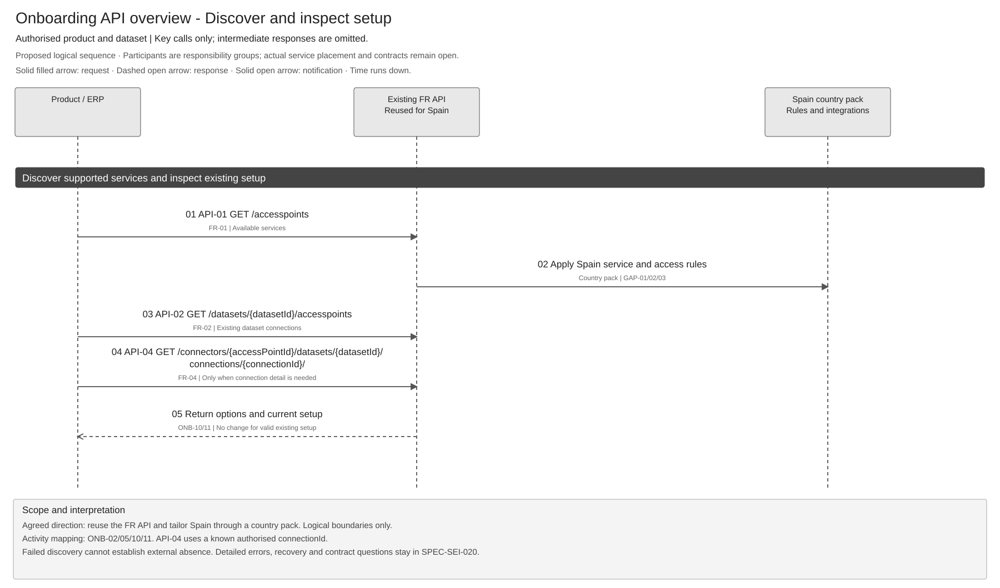
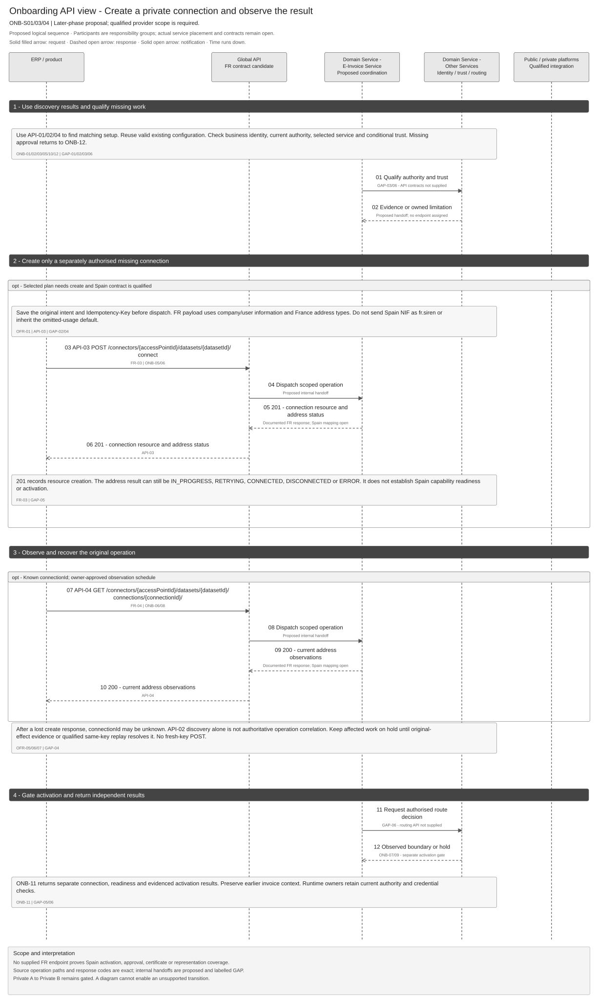
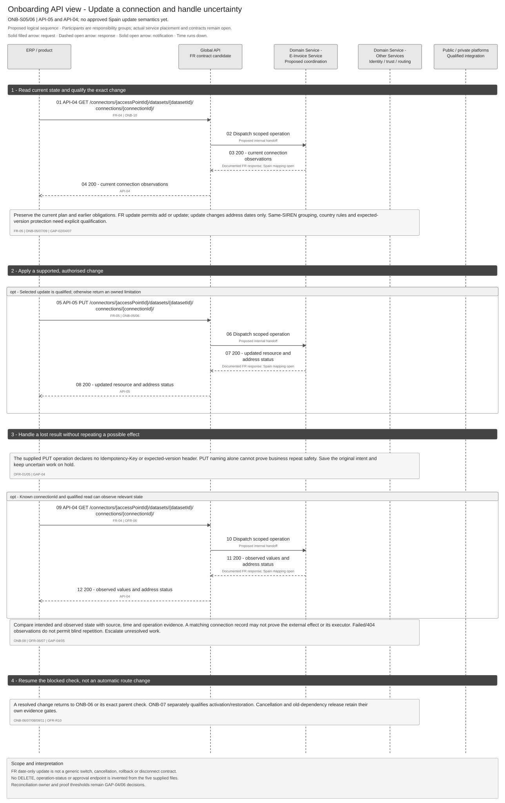
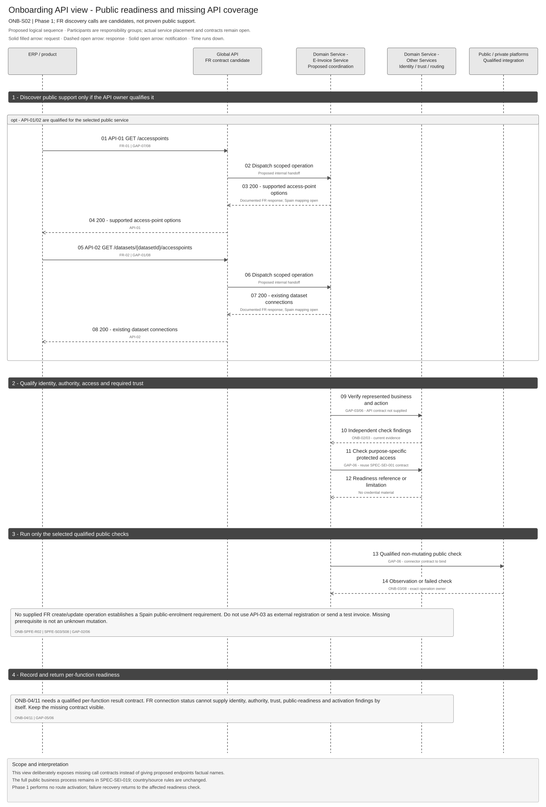

# Customer Onboarding API Design and Reuse Assessment

[Solution Summary](SPEC-SEI-018-customer-onboarding-solution-summary.md) · [Logical Feature Specification](SPEC-SEI-019-customer-onboarding-logical-feature-specification.md) · [Feature landing page](README.md)

## Revision overview

This engineering companion is based on [SPEC-SEI-002](../SPEC-SEI-002-onboarding-solution-specification.md), the split onboarding documents and the five supplied FR onboarding contracts. It presents the same activities through API calls and assesses reuse for Spain. The original specification and diagrams remain unchanged.

Business requirements, phase gates and ONB/OFR meanings stay in SPEC-SEI-019. This file adds operation mappings, API sequence views, contract differences and evidence gates. It does not approve new endpoints, implementation reuse, a country rule or production activation. FR implementation coverage, missing shared contracts and the final Spain API surface remain open. Publication selection is unchanged.

## 1 Engineering decision summary

The supplied contracts support a **reuse assessment of discovery and connection management**. They do not establish a complete Spain onboarding API. Start with read-only discovery and inspection. Qualify country-specific changes and repeat safety before enabling connection mutations.

**Confirmed in supplied contract** means the field or operation appears in FR-01–05. **Proposed** describes its Spain mapping or internal handoff. **Open** means an owner must qualify the contract or implementation. A production server URL in a document does not prove a deployed build or Spain support.

| API | Documented operation | Proposed onboarding use | Reuse assessment |
|---|---|---|---|
| [API-01](#api-01-list-available-access-points) | GET `/accesspoints` | Discover supported choices; ONB-10/05. | Candidate for shared discovery. Signature inconsistency and Spain service coverage remain open. FR-01. |
| [API-02](#api-02-list-dataset-access-points) | GET `/datasets/{datasetId}/accesspoints` | Inspect known dataset connections; ONB-10/11. | Candidate with qualified dataset/business binding and richer result mapping. FR-02. |
| [API-03](#api-03-create-access-point-connection) | POST `/connectors/{accessPointId}/datasets/{datasetId}/connect` | Configure a missing supported private connection; ONB-05/06. | Adaptation candidate. France address/usage/date rules cannot be reused as Spain defaults. FR-03. |
| [API-04](#api-04-retrieve-access-point-connection) | GET `/connectors/{accessPointId}/datasets/{datasetId}/connections/{connectionId}/` | Inspect an authorised connection; possible recovery observation; ONB-06/08/10/11. | Candidate with qualified freshness, authority and observation semantics. Not an authoritative operation-status contract by default. FR-04. |
| [API-05](#api-05-update-access-point-connection) | PUT `/connectors/{accessPointId}/datasets/{datasetId}/connections/{connectionId}/` | Add an address or change supported dates; ONB-05/06. | Adaptation candidate. Country rules, concurrent changes and uncertain-outcome recovery remain open. FR-05. |

No operation is classified as a qualified unchanged implementation. The API owner must identify the build, actual contracts, supported provider/environment, retained code, local changes, gaps and tests before activation (GAP-08).

## 2 Shared contract boundaries

### Identity and terminology

Use the [shared glossary](../../context/GLO-SEI-001-e-invoicing-terminology.md). In these supplied contracts, `datasetId`, `accessPointId` and `connectionId` are UUID resource references. Their mapping to a Sage tenant, ERP company, represented business, provider and environment is not established by their names. Identity and the API owner must qualify that mapping (GAP-01).

The authenticated M2M application, the user named in a request, the represented business and the eligible approver are separate actors. An address entry is not proof of a separately authorised client item. A connection is not a whole-customer onboarding case.

### Request and response conventions

FR-01–05 declare M2M bearer authentication and optional `traceparent`/`tracestate`. Response bodies use `application/vnd.api+json`. FR-03/05 use that media type for request bodies. Access control for direct customers, accountants, portfolios and protected evidence must still satisfy ONB-R01/02/19 and ONB-NFR01 in SPEC-SEI-019; JWT authentication alone does not establish those permissions.

| Contract observation | Spain design consequence |
|---|---|
| FR-03 requires `Idempotency-Key`; FR-05 declares no equivalent header. | Qualify duplicate scope, payload binding, retention, in-flight replay and recovery independently for create/update. Do not infer safety from HTTP method names (GAP-04). |
| Common responses include 400/401/403/404/405/413/415/429/500/502/503/504. `429` documents `Retry-After` seconds. | Preserve the original reason and classify the operation separately. Provider guidance informs approved retry budgets; it does not authorise repeating an uncertain change. |
| Dataset listing exposes CONNECTED/DISCONNECTED; address details expose IN_PROGRESS/RETRYING/CONNECTED/DISCONNECTED/ERROR. | Preserve raw source status and map it explicitly. Neither source scope supplies the independent identity, authority, trust, readiness and activation results in ONB-11 (GAP-05). |
| The supplied five operations show no `If-Match` or other expected-version parameter. | ONB-R07 and OFR-R05 still require conflict-safe changes. Qualify actual version/serialisation support; do not invent a header (GAP-04). |

### Handling protected information

Retain connection references, source status, error mapping version and observation time where qualified. Minimise and protect company/user information and address identifiers. Runtime credentials and private keys stay with the qualified trust owner. Do not copy request examples, personal information, bearer tokens or raw provider errors into logs, notifications or diagrams. Retention follows the approved class-specific policy in ONB-NFR03.

## 3 API catalogue and sequence views

These are **proposed Spain call sequences using documented FR operations**. The participant names show logical responsibilities, not deployed service boundaries. API-01–05 identify real supplied method/path pairs. GAP labels identify missing evidence or an unbound handoff; they are not endpoint names. Diagram activity IDs refer to SPEC-SEI-019.

Solid filled arrows show requests, dashed open arrows show replies and solid open arrows show notifications. Time runs down. **opt** groups conditional work. Each diagram has an editable Draw.io source and full-size preview.

### API 01 List available access points

**FR-01:** `Get-AccessPoints` — GET `/accesspoints`.

| Concern | Contract and proposed use |
|---|---|
| Purpose and caller | ERP/product obtains available options through the Global API. Candidate input to ONB-10/05; a listing cannot select a platform or prove a function supported for this business. |
| Input | Authenticated M2M context and optional trace headers. **Conflict:** the operation references a required path `datasetId`, but its path contains no `{datasetId}` placeholder. Confirm the canonical signature before generating a client. |
| Output | 200 with AccessPoint resources: `id` and `attributes.name`. No country, operation capabilities, qualified execution role, pricing or readiness evidence is defined by this response. |
| Failure and recovery | Deny unauthorised reads. Classify unavailable listing separately from no supported option. An approved bounded read retry may be appropriate; an empty result cannot prove that an external business has no setup. |
| Reuse and gate | Shared discovery candidate; confirm filtering, public/private scope and signature. API owner and Product; GAP-01/03/07/08, ONB-Q01/02/04. |

Figure 1. Discover choices, list existing dataset connections and inspect a known connection. Unchanged valid setup needs no mutation. [Full-size SVG](../../assets/diagrams/onboarding-api-discovery-sequence.svg) · [Draw.io](../../assets/diagrams/onboarding-api-discovery-sequence.drawio) · [PNG](../../assets/diagrams/onboarding-api-discovery-sequence.png).

### API 02 List dataset access points

**FR-02:** `Get-Dataset-AccessPoints` — GET `/datasets/{datasetId}/accesspoints`.

| Concern | Contract and proposed use |
|---|---|
| Purpose and caller | ERP/product inspects connections for an authorised dataset. Input to ONB-10; connection facts can contribute to ONB-11. Sequence: Figure 1. |
| Input | Required UUID `datasetId`, M2M context and optional trace headers. Resolve trusted dataset/business/environment mapping before the read. |
| Output | 200 with AccessPoint resources and `name`, `status` (CONNECTED/DISCONNECTED), nullable `connectionId`. A null ID is not an operation result or proof of external absence. |
| Failure and recovery | Preserve earlier observations when lookup fails. Recheck current client access for results and aggregates. List discovery is not a proven way to correlate a lost create response to its original operation. |
| Reuse and gate | Candidate for setup assessment. Qualify freshness, source authority, cross-client access and status scope. API/Identity owners; GAP-01/03/04/05/08, ONB-Q01/04/08. |

### API 03 Create access point connection

**FR-03:** `New-AccessPoint-Connection` — POST `/connectors/{accessPointId}/datasets/{datasetId}/connect`.

| Concern | Contract and proposed use |
|---|---|
| Purpose and caller | ERP/product requests a missing private connection after ONB-10 assessment and ONB-02/03/05/12 gates. Qualify the selected provider and execution owner. This is not a Spain public registration command. |
| Input | Required UUID `accessPointId`/`datasetId`, `Idempotency-Key` and JSON:API `data` with `type: AccessPointConnection` and `attributes`. The attributes require company name/address/postal code/country, `user` and at least one `accessPointAddresses` entry. `user` requires first/last name, job title, email and IP property; job title permits null. |
| Country binding | Address types are `fr.siren`, `fr.sirensiret`, `fr.siren_suffix`, `fr.sirensiret_routing`. Optional date fields use `YYYY/MM/DD`; the described effective-date minimum is today plus one day. These are supplied FR constraints, not Spain requirements. |
| Output | 201 with an AccessPointConnection resource whose `data.id` is described as the onboarding transaction/connection ID. Address results can still be pending or error. Record resource creation separately from readiness/activation. |
| Failure and recovery | Save original input and key before dispatch (OFR-01). After a possible effect, hold dependent work (OFR-05). Use a qualified observation or same-key recovery contract. If the response is lost, `connectionId` may be unknown; API-02 alone is insufficient original-operation evidence. Do not submit a new key to bypass uncertainty. |
| Reuse and gate | Adaptation candidate for connection creation. Qualify country payload, local-vs-external effects, idempotency guarantees, actor/terms evidence and recovery correlation. API/Integration, Identity, Product and Operations; GAP-01–05/07/08. |

Figure 2. Conditional create, inspection and separately gated activation. The sequence retains ONB-05/06/07/08/09/11 and exposes the missing authority, trust and route contracts. [Full-size SVG](../../assets/diagrams/onboarding-api-private-connection-sequence.svg) · [Draw.io](../../assets/diagrams/onboarding-api-private-connection-sequence.drawio) · [PNG](../../assets/diagrams/onboarding-api-private-connection-sequence.png).

### API 04 Retrieve access point connection

**FR-04:** `Get-AccessPoint-Connection` — GET `/connectors/{accessPointId}/datasets/{datasetId}/connections/{connectionId}/`.

| Concern | Contract and proposed use |
|---|---|
| Purpose and caller | ERP/product inspects one authorised connection for ONB-10/06/11. Recovery may consume it only after the owner qualifies what it observes. Used in Figures 1–3. |
| Input | Required UUID `accessPointId`, `datasetId`, `connectionId`; M2M and optional trace headers. Keep resource hierarchy and represented-business checks separate. |
| Output | 200 with connection resource/meta and nullable `accessPointAddresses`. Address entries include type/value, dates, `mandateNumber`, `usage`, source status and `errorCode`. Metadata includes created/modified times and source/trace references. These are not necessarily external observation times or state versions. |
| Failure and recovery | Distinguish a failed read, missing/inaccessible resource and an unresolved external effect. A 404 cannot safely establish that a previous external mutation did not occur. Polling interval, freshness and authoritative observation support need owner agreement; no arbitrary interval is assigned. |
| Reuse and gate | Inspection candidate. Prove whether the result is local configuration, cached provider state or fresh external observation, and how it correlates to the original change. API/Integration and Operations; GAP-01/03/04/05/08, OFR-Q01/02/04. |

### API 05 Update access point connection

**FR-05:** `Put-AccessPoint-Connection` — PUT `/connectors/{accessPointId}/datasets/{datasetId}/connections/{connectionId}/`.

| Concern | Contract and proposed use |
|---|---|
| Purpose and caller | ERP/product submits a supported change to a known authorised connection. Candidate for missing configuration/extension under ONB-05/06; not proof of a route-switch command. |
| Input | Required path UUIDs and JSON:API `data` with resource `type`. Optional attributes include company/user details and addresses. Address action is `add` or `update`; descriptions limit `update` to effective/end dates. `usage` is permitted only for `add`. The request groups addresses by the same base SIREN. |
| Output | 200 with resource and per-address action, status and `errorCode`. Treat HTTP completion and business outcomes separately. Determine partial-update/atomicity semantics before handling mixed address results. |
| Failure and recovery | No Idempotency-Key or expected-version parameter is declared in this operation. Establish repeat/conflict safety before dispatch; save original intent. A lost response remains uncertain until the qualified owner establishes actual state. API-04 helps only within its proven observation limits. |
| Reuse and gate | Adaptation candidate. Qualify country grouping, supported edits, operation identity, atomicity, deletion/disconnection and cancellation semantics. A date update cannot be treated as general rollback, mandate withdrawal or provider migration. API/Integration, Routing and Operations; GAP-02/04/05/07/08. |

Figure 3. Read before change, conditionally update, then inspect/reconcile the original result. Resolved work resumes its parent check; route activation/restoration remains separate. [Full-size SVG](../../assets/diagrams/onboarding-api-update-recovery-sequence.svg) · [Draw.io](../../assets/diagrams/onboarding-api-update-recovery-sequence.drawio) · [PNG](../../assets/diagrams/onboarding-api-update-recovery-sequence.png).

## 4 Public readiness and API coverage

The business flow remains the [public sequence in SPEC-SEI-019](SPEC-SEI-019-customer-onboarding-logical-feature-specification.md#connect-an-existing-public-service). The supplied FR documents do not identify the actual identity, representation, certificate, public-check or per-function-readiness API contracts. Bind those existing owner contracts before enabling the path; do not infer a need to build new services from this limited evidence set.

Figure 4. Public setup with explicit contract gaps. Optional FR discovery needs public-service qualification. Missing prerequisites remain owned findings; a possible effect uses original-operation recovery. No route activation or invented enrolment call is added. [Full-size SVG](../../assets/diagrams/onboarding-api-public-readiness-sequence.svg) · [Draw.io](../../assets/diagrams/onboarding-api-public-readiness-sequence.drawio) · [PNG](../../assets/diagrams/onboarding-api-public-readiness-sequence.png).

| Behaviour in SPEC-SEI-019 | Supplied coverage and safe design position |
|---|---|
| ONB-01 request/case intake | FR-03 creates a connection resource. It does not establish the pending multi-function case, plan/revision or cancellation contract. Bind the actual workflow contract. |
| ONB-02/03 identity, authority and conditional trust | M2M and `user` fields do not prove these decisions. Bind Identity and SPEC-SEI-001 contracts. |
| ONB-04/11 per-function readiness/results | FR connection status is insufficient by itself. Define a qualified mapping/composition with source evidence and owned actions. |
| ONB-05/06 private configuration/readiness | FR-03/04/05 are candidates; exact provider effects and country rules remain gates. |
| ONB-07/09 route change and continuity | No explicit route-version commit, restoration or earlier-invoice access contract is supplied. Retain SPEC-SEI-014 and the owning invoice features' gates. |
| ONB-08/OFR-01–08 recovery | FR create has a key; resource reads exist. No original-operation query, closure proof or complete retry policy is established. |
| ONB-10 assessment | FR-01/02/04 can contribute after dataset, access and observation qualification. Failed lookup cannot establish absence. |
| ONB-12 approval; ONB-13 portfolio | User attributes and address arrays do not establish eligible approval, client separation, durable batch receipt or current aggregate visibility. Find the actual owning contracts. |

The Spain public boundary follows ONB-SPFE-R02 and OFR-SPFE-R01 in SPEC-SEI-019: the supplied public service inventory does not define a customer-enrolment payload, and invoice submission/cancellation is not an onboarding probe. SPFE-S03/S08 establish that supplied snapshot; these controls do not prohibit separately qualified internal connection configuration.

## 5 Reuse differences and open gates

### Country and contract differences

| Source evidence | Reuse decision needed | Owner or gate |
|---|---|---|
| FR-03/04/05 address type enums and FR-05 same-SIREN grouping | Reuse connection patterns with explicit country rules. Do not relabel NIF as SIREN or infer a Spain address format, grouping rule or directory operation. | Spain Product/Identity, API and Integration; GAP-02. |
| FR-04/05 `mandateNumber` is described as generated per France opt-in form | Keep it source-specific. Identify Spain action-authority evidence and its owner separately; a local connection field is not legal representation. | Identity/Compliance; GAP-02/03. |
| FR-03/04/05 `usage`: omitted/null permits all operations; maximum one explicit value, with SEND/EREPORTING values | Do not import the default or treat absence as permission to receive, report or sign. Define exact country/function permissions and compatibility; preserve the raw FR semantics. | API, Identity and Product; GAP-02/03/05. |
| FR date format/minimum and end-date constraints | Qualify business timezone, requested vs effective start and historical dates. France's next-day rule cannot define Spain activation or statutory dates. | API/Routing/ERP Product; GAP-02/07, ONB-Q09. |
| Create/update address input max length 114; response max length 50 | Resolve canonical lengths and test round-trip values before client/schema reuse. | FR API owner; GAP-07. |
| FR-05 prose limits updates to dates, but the schema exposes more optional properties; mixed address operations are possible | Confirm validation, unsupported-edit response and partial/atomic effect semantics. | API/Integration; GAP-04/07. |
| FR dataset status is binary; detail states and errorCode have a different scope | Preserve source status. Approve a mapping to per-function findings and activation evidence rather than a direct enum rename. | API, connection and workflow owners; GAP-05. |

### Evidence gates

These are local engineering questions, not approved additions to the project decision register. Existing ONB-Q/OFR-Q records retain ownership and status. Each gate needs an owner's dated outcome and links to actual contracts/builds/tests before its scope is enabled.

| Gate | Required evidence and impact | Owner and existing reference |
|---|---|---|
| GAP-01 Dataset and resource identity | Prove tenant/company/business/environment and access-point/connection mappings, isolation and reference ownership. Blocks protected mapping and client access. | API + Identity; ONB-Q01/04/08. |
| GAP-02 Country binding | Approve Spain service roles, identifier/address/usage/date rules and country-rule isolation. Blocks unmodified FR mutations for Spain. | Spain Product, Compliance, API/Integration; ONB-Q02/03/09. |
| GAP-03 Actor and authority | Prove direct/delegated M2M access, current firm/client checks, terms and action evidence. Identify credential owner, caller and represented party separately. | Identity, Security, Product; ONB-Q06/07/08. |
| GAP-04 Mutation safety | Prove create replay/retention/payload rules, update repeat safety, concurrency and atomicity, lost-response correlation and authoritative observation. Blocks automated uncertain-mutation repeat. | API/Integration + Operations; OFR-Q01/02 and retry-safety decision. |
| GAP-05 Result meanings | Approve raw-to-logical status/error mapping, source freshness, external observation level and separate activation proof. Blocks a global ready/active label. | API, E-Invoice Service, Routing; ONB-Q04/09. |
| GAP-06 Companion APIs | Locate existing case, Identity, trust, approval, batch, route and per-function-result contracts. Decide reuse/extension only after that inventory. | E-Invoice Service, Architecture and dependency owners; ONB-Q04–08, OFR-Q03/04. |
| GAP-07 Source inconsistencies | Resolve FR-01 path parameter, length differences, date validation, supported edits and actual error semantics. Blocks final schema/client generation. | FR API owner; selected-contract review before build. |
| GAP-08 Implementation qualification | Record repository/component/build, supported scope, operations/runbooks, test evidence, local changes and remaining gaps for each reused operation. Documentation alone cannot qualify a build. | Architecture, E-Invoice Service, API/Integration + Operations; ONB-Q05, OFR-Q03. |

Existing DTS remains the preferred transformation reuse candidate where relevant. This API slice supplies no transformation contract. The DTS/exchange owners retain build, mapping, rule-pack and operational qualification under SPEC-SEI-008; connection creation cannot establish invoice-format readiness.

## 6 Design assurance

These are acceptance checks to obtain from the actual implementation. They supplement the existing ONB/OFR scenarios without restating the business requirements.

| Check | Evidence and expected result | Trace |
|---|---|---|
| API-A01 Resource access | Wrong tenant/client, removed relationship or mismatched dataset/connection cannot expose another business or perform protected work; response does not enumerate inaccessible clients. | ONB-A29/33/36; GAP-01/03. |
| API-A02 Unchanged setup | Matching valid observations return the existing result with no create/update or new route version. | ONB-A15; Figure 1. |
| API-A03 Create duplicates | Qualified same-key/same-input replay returns the original resource/effect; changed payload conflicts safely within the approved duplicate window. Test restart and in-flight replay. | OFR-A04/06; GAP-04/08. |
| API-A04 Lost create response | A lost 201 result retains the original intent/key. If connection ID cannot be recovered authoritatively, dependent work stays held; no fresh-key POST. | ONB-A06, OFR-A03/05; Figure 2. |
| API-A05 Update concurrency and uncertainty | Competing updates cannot overwrite stale plans. A lost result uses qualified observation or an owned unresolved case; no blind PUT or date-based rollback. | ONB-A07/08, OFR-A15/17; Figure 3. |
| API-A06 Status interpretation | 201/200, CONNECTED or RETRYING cannot become blanket readiness/activation. Preserve address/function distinctions and raw evidence. | ONB-A20/24/42; GAP-05. |
| API-A07 Country isolation | France-specific identifiers, opt-in references, usage defaults and next-day dates do not run as Spain/other-country defaults. Missing local policy blocks dependent work. Test all FR address forms and maximum lengths. | ONB-A09/19/37, OFR-A10; GAP-02/07. |
| API-A08 Retry classification | 429 uses approved guidance/budget for a repeat-safe operation; 401/403, unclassified 5xx or 404 cannot silently authorise mutation retry or prove absence. | OFR-A01/02/09/21; GAP-04. |
| API-A09 Missing companion coverage | Missing approval/trust/batch/route contracts produce owned limitations. An address array/user field cannot satisfy missing effective authority or portfolio isolation. | ONB-A25/31/34/35; GAP-03/06. |
| API-A10 Public boundary | Qualified public readiness runs its actual checks; no invented external registration, test invoice, CancelInvoice repair or automatic route activation. | ONB-SPFE-A01–03; OFR-SPFE-A01/02; Figure 4; SPFE-S03/S08. |
| API-A11 API/diagram correlation | All five method/path/operation-ID pairs match FR-01–05, including trailing slashes. Each GAP handoff is labelled unbound; sequence IDs map to the same ONB activities as 019. | ONB-A28; source snapshots below. |
| API-A12 Reuse and operations | Record actual build/contracts, retained behaviour, country changes, gaps, monitoring and recovery evidence per enabled operation. Redact diagnostics and preserve approved retention. | ONB-A19/21, OFR-A11/19; ONB-NFR01–04; GAP-08. |

## 7 Confluence presentation

The proposed presentation uses three sibling pages under the existing onboarding feature/PRD page. The [landing page](README.md#confluence-presentation) records source mapping and the current publication boundary. The local preview shows the reading routes, linked headings and full-size diagrams.

Publish one engineering page with per-operation headings and contents links. Keep reusable schema detail in FR-01–05 and link it from each entry. The existing publisher can attach Draw.io sources and PNGs and use its full-screen viewer. A publication preview is not evidence of a live page update.

## REF Source references

FR files are supplied OpenAPI 3.1.0 snapshots, each declaring `info.version: 1.0.0`, reviewed 21 October 2026. No contract publication date, actual build version or completeness of the wider service is established. Source files remain unchanged. JSON names and paths below are exact; review excludes generated code samples and sample personal data.

| Source ID | Original file | Exact contract element | Supported claim and limit |
|---|---|---|---|
| FR-01 | [get-accesspoints.md](<../../context/FR API/Onboarding/get-accesspoints.md>) | `paths["/accesspoints"].get`, `GetAccessPointsResponse`, `AccessPointsResponse`, `parameters.datasetId` | Discovery path, response and signature inconsistency. No capability/readiness contract or Spain deployment proof. |
| FR-02 | [get-dataset-accesspoints.md](<../../context/FR API/Onboarding/get-dataset-accesspoints.md>) | `paths["/datasets/{datasetId}/accesspoints"].get`, `DatasetAccessPointsResponse` | Dataset listing, binary status and nullable connection reference; no proven original-operation recovery semantics. |
| FR-03 | [new-accesspoint-connection.md](<../../context/FR API/Onboarding/new-accesspoint-connection.md>) | `paths["/connectors/{accessPointId}/datasets/{datasetId}/connect"].post`; `Idempotency-Key` parameter; `AccessPointConnectionRequest/Response` | Create contract, required inputs, FR constraints and 201/address states. Key scope/retention/replay and external effects remain unqualified. |
| FR-04 | [get-accesspoint-connection.md](<../../context/FR API/Onboarding/get-accesspoint-connection.md>) | `paths["/connectors/{accessPointId}/datasets/{datasetId}/connections/{connectionId}/"].get`; `AccessPointConnectionResponse`; `Assigned-Keys` | Detail read, address states/metadata and FR mandate description. Does not establish fresh authoritative external observation or authority. |
| FR-05 | [put-accesspoint-connection.md](<../../context/FR API/Onboarding/put-accesspoint-connection.md>) | Same connection path `.put`; `PutAccessPointConnectionRequest`; `UpdateAccessPointConnectionRequest/Response` | Update actions, country grouping/date/usage rules and response shape. No supplied idempotency/version header; actual repeat/atomicity semantics need qualification. |
| REF-LOGICAL | [SPEC-SEI-019](SPEC-SEI-019-customer-onboarding-logical-feature-specification.md), draft 21 October 2026 | ONB/OFR requirements, activity blocks, NFRs and acceptance | Required behaviour baseline for this design proposal. API allocation here cannot change those requirements. |
| REF-BASE | [SPEC-SEI-002](../SPEC-SEI-002-onboarding-solution-specification.md), updated 20 October 2026 | Interaction/data inventories and decision/release-gate record | Original technical analysis and existing open decisions. Preserved unchanged; not implementation evidence. |
| SPFE-S03 | [Original public service catalogue](<../../context/Descripción servicios web/Catálogo de servicios/20261013/CatalogoServicios.pdf>), 0.1.0, 9 October 2026 | Sections 5.1 and 6.1–6.10, pp. 9–20 | Public operation inventory and fault guidance; no supplied external onboarding registration command or blanket safe-retry guarantee. |
| SPFE-S08 | [Original input/output formats](<../../context/Descripción servicios web/Formatos entrada y salida/20261013/FormatosEntradaSalida.pdf>), 0.1.0, 9 October 2026, draft | Sections 5.1–5.9, pp. 8–15 | Operation/request/item response distinctions and supplied formats; no onboarding payload. Pending formats/conflicts remain gates. |
| REF-SPAIN | [SPEC-SEI-019 REF](SPEC-SEI-019-customer-onboarding-logical-feature-specification.md#ref-source-references), [RES-SEI-002](../../context/RES-SEI-002-spain-public-platform-technical-evidence.md), [glossary](../../context/GLO-SEI-001-e-invoicing-terminology.md) | Original legal/contract locators, shared conflicts and qualified identity/outcome terms | Existing Spain evidence route. This engineering assessment introduces no new legal rule; final BOE evidence retains its authority. |
