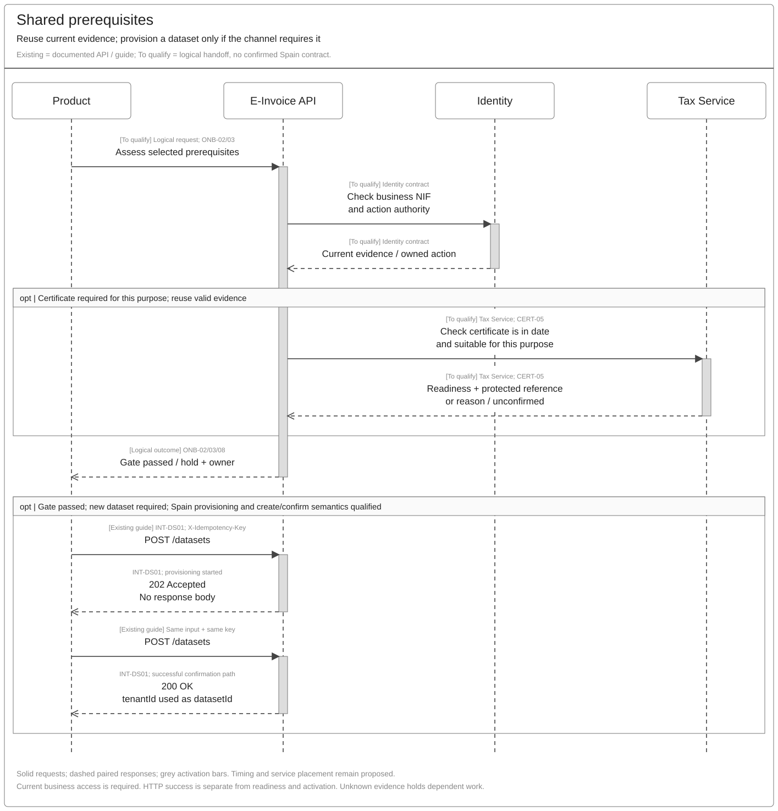
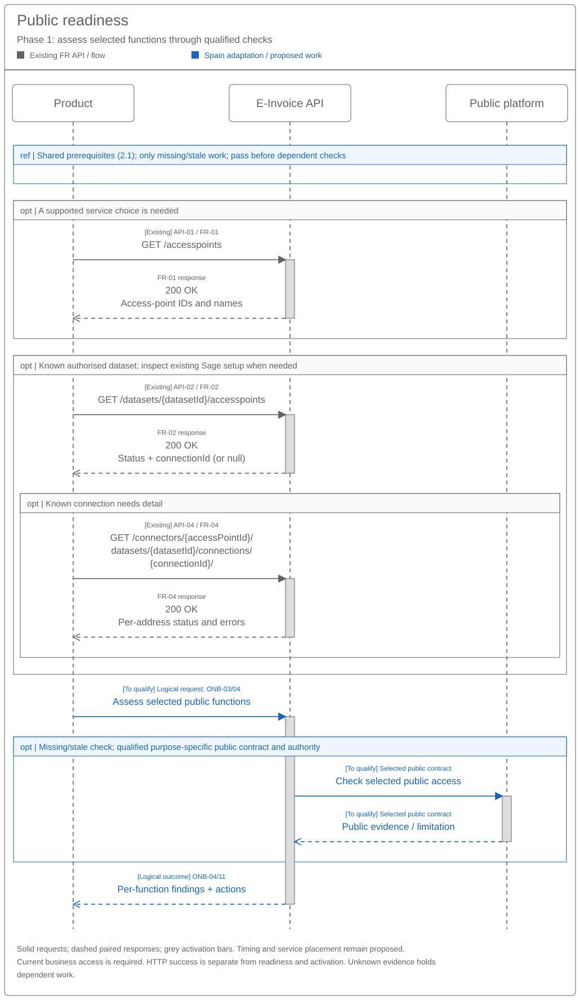
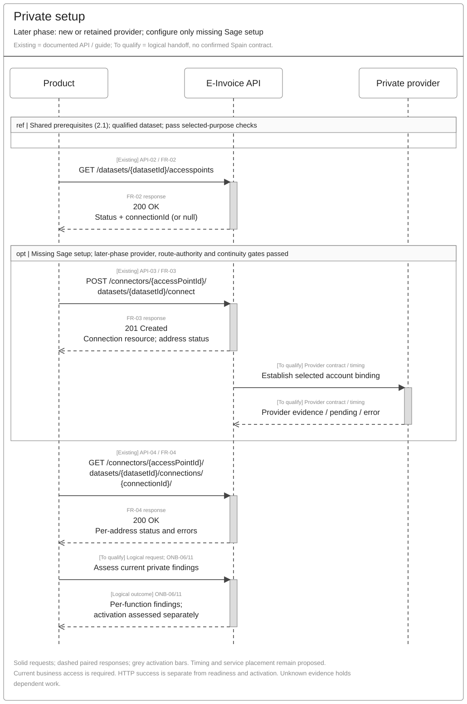
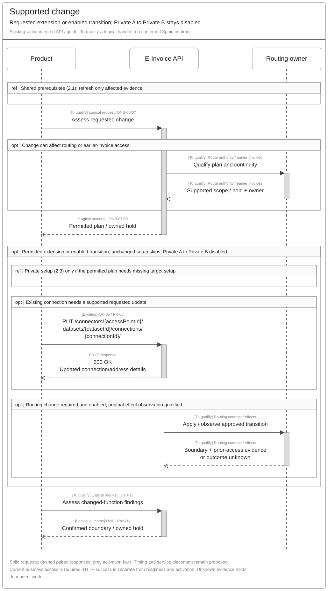
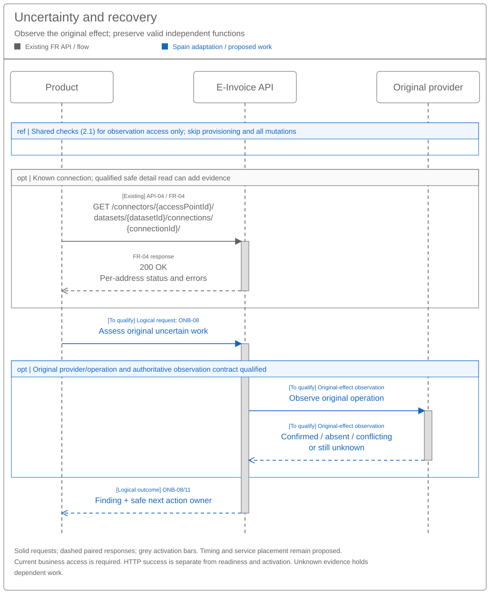

# Customer Onboarding Sequence and Reuse Assessment

[Stakeholder summary — SEI018](SPEC-SEI-018-customer-onboarding-solution-summary.md) · [Business behaviour — SEI019](SPEC-SEI-019-customer-onboarding-logical-feature-specification.md) · [Predecessor — SEI020](../archive/SPEC-SEI-020-customer-onboarding-api-design-and-reuse-assessment.md)

## Revision overview

This separate successor to **SPEC-SEI-020** provides the main sequence-led engineering view. Three core sequences and two change/recovery sequences replace eight repeated flows. Scenario, gap and acceptance IDs keep their meanings. Business scope, source contracts and open implementation decisions remain unchanged. SPEC020 is retained in the archive for detailed assurance and source analysis. This draft uses the same engineering topic, not another Confluence page; SPEC-SEI-018 is selected for the stable summary page after the authorised publication.

## 1 Engineering direction

Help a Spanish business or authorised accountant confirm or establish selected e-invoicing functions through Sage. Engineers need to identify reusable calls, Spain changes and missing evidence. **Reuse the FR APIs and bind country/provider rules separately.** New endpoints and payload design are outside scope. REF-REUSE; REF-COUNTRY.

Phase 1 is public readiness. Private setup and activation require later-phase qualification. Private A to Private B remains disabled. SEI019 owns the business requirements. REF-LOGICAL.

Use the [API and capability table](#26-existing-api-and-capability-reuse) for the inventory and reuse gaps; [section 4](#4-open-engineering-decisions) assigns owners and evidence.

**Product integration impact:** no breaking API change has been established. The rows below identify possible platform changes and product work to assess. Exact Spain inputs, prerequisite/result contracts and event coverage remain unconfirmed; an existing FR integration does not establish Spain readiness. GAP-02/05/07/08.

| Scope | Possible platform changes / qualification | Impact on products using existing APIs | Affected operations / evidence |
|---|---|---|---|
| Public platform MVP | Bind Spain service/environment, NIF/authority and Tax certificate readiness; qualify public checks and per-function results. Internal dataset/connection need remains open. | Reuse valid business evidence. Handle invalid NIF, missing authority, unsuitable certificates, unconfirmed checks and owned actions. Additional prerequisite/result integration may be needed; exact contracts are open. | API-01/02/04; [shared](#21-shared-prerequisites) and [public](#22-public-readiness) sequences. REF-TRUST; SPFE-S02/S03/S08; GAP-02/03/05/06. |
| Public platform nice-to-haves | Additional renewal/remediation reminders and richer progress guidance; qualify supporting notifications. | Optional notification/UI work. Core observation and owned recovery remain MVP requirements. | Existing event/read patterns are candidates; Spain public event support is unverified. INT-AP01/06; GAP-05/06. |
| Private platforms | Bind each provider's account, Spain addresses/usage, credentials and receiving evidence. Qualify API/UI eligibility and route effects before connect. | Assess provider-specific inputs and setup UI. Reuse existing connections; handle partial address results and separate sending/receiving readiness. Gate handover and preserve earlier-invoice access. | API-01–05; [private](#23-private-setup) and [change](#24-supported-change) sequences. INT-AP01–06; GAP-02/04/05/06/07. |
| Other shared changes | Qualify dataset/business/client mapping, Spain provisioning inputs, key/replay semantics, event versions and compatibility. Approval/portfolio implementation coverage remains unknown. | Retain dataset/connection IDs. Distinguish provisioning started from completion; preserve original request identity and avoid duplicate connect during `RETRYING`. Native-product channel linkage needs confirmation. | Dataset provisioning; API-02–05; [recovery](#25-uncertainty-and-recovery). INT-DS01; FR-01–05; GAP-01/04/07/08. |

## 2 Proposed reuse sequences

**Existing** labels show supplied methods, full paths and success codes; wrapped paths retain every segment. **To qualify** labels describe logical requests/returns with no confirmed contract. Participants group responsibilities, not approved deployment boundaries. Solid arrows are requests; dashed arrows are responses; grey bars show handling intervals without timing promises. A `ref` box invokes another sequence conditionally; it is not an API call.

All views assume authorised business access and the correct environment. HTTP success, setup, per-function readiness and route activation have separate meanings. Failed/unknown evidence holds dependent work and returns an owner. Terms follow the [shared glossary](../../context/GLO-SEI-001-e-invoicing-terminology.md).

### 2.1 Shared prerequisites

Use once per selected business/purpose. Reuse current evidence; check only missing/stale evidence. Keep represented-business NIF, establishment/routing references, authenticated caller and action authority separate. Certificate lookup returns readiness and a protected reference, never key material. Unavailable lookup does not prove that another upload is needed. REF-LOGICAL ONB-02/03; REF-TRUST.

Dataset POSTs show the successful create/confirm path, conditional on the channel. Preserve identical input and `X-Idempotency-Key`; `202` supplies no ID. Retain confirmed `tenantId` as `datasetId`. Replay limits, differing example `data.id`, Spain inputs and native-product linkage remain gates. INT-DS01.

[Full-size SVG](../../assets/diagrams/onboarding-reuse-shared-prerequisites-sequence.svg) · [Editable Draw.io](../../assets/diagrams/onboarding-reuse-shared-prerequisites-sequence.drawio) · [PNG](../../assets/diagrams/onboarding-reuse-shared-prerequisites-sequence.png)

### 2.2 Public readiness

The supplied AEAT contracts define HTTPS certificate/seal access, SOAP 1.2 bindings, ebMS headers and MIME attachments at PRE endpoints. They do not supply an enrolment operation. PRE access, production addresses and the SOAP-version conflict remain open. SPFE-S03/S08/S16; REF-SPAIN SPFE-Q01/Q12.

Reuse valid public evidence; run only missing/stale checks under qualified contracts. Existing public access does not prove Sage access. The selected action's authority must be established; third-party recovery/consultation needs the registered-authority evidence in SPFE-S02 Article 11. No external enrolment or test-invoice probe is inferred. REF-LOGICAL ONB-03/04/11; SPFE-S02/S03/S08.

[Full-size SVG](../../assets/diagrams/onboarding-reuse-public-readiness-sequence.svg) · [Editable Draw.io](../../assets/diagrams/onboarding-reuse-public-readiness-sequence.drawio) · [PNG](../../assets/diagrams/onboarding-reuse-public-readiness-sequence.png)

### 2.3 Private setup

Inspect known Sage setup first. For a retained provider, keep its account and add only missing Sage setup. **Connect may change address routing:** qualify provider effects, route authority and historical continuity before dispatch. Skip connect when setup already matches. FR-02/03/04; INT-AP01/04/05; REF-LOGICAL ONB-05–09.

Provider timing is unconfirmed; the drawn handoff does not promise synchronous completion after `201`. Use qualified per-address events/detail observations, then assess sending and receiving independently. Activation needs separate evidence. INT-AP01/06.

The supplied connection APIs describe France/Sovos behaviour. No Spain private-provider contract is supplied. Qualify each provider's endpoints, protocol, API/UI eligibility, credentials/signing purpose, address/usage rules, environment and receiving destination. Customer-account setup and platform-to-platform interconnection need separate evidence. INT-AP01/06; REF-TRUST; REF-ROUTING.

Check actual support for an unlisted provider; without a qualified path, return the ONB-S08 limitation and owner. The customer option remains TBD. For qualifying operator interconnection, follow [SEI019 ONB-R25](SPEC-SEI-019-customer-onboarding-logical-feature-specification.md#67-onb-05-configure-private-choice): track the receiving operator's **one-month** clock, specific receipt-order exception, interim public exchange and operational evidence. Existing `/connect`, HTTP success and `CONNECTED` do not satisfy that process. Operator case/clock integration remains GAP-06/08. REF-LOGICAL; REF-INTERCONNECT.

[Full-size SVG](../../assets/diagrams/onboarding-reuse-private-setup-sequence.svg) · [Editable Draw.io](../../assets/diagrams/onboarding-reuse-private-setup-sequence.drawio) · [PNG](../../assets/diagrams/onboarding-reuse-private-setup-sequence.png)

### 2.4 Supported change

Unchanged valid setup needs no mutation, new input or route version. Refresh only affected prerequisites. A requested extension uses qualified update semantics; a platform transition also needs its enabled scope, future-work boundary and earlier-invoice access confirmed before route-affecting calls. Private A to Private B stays disabled. REF-LOGICAL ONB-S05/S06, ONB-07/09; REF-ROUTING.

[Full-size SVG](../../assets/diagrams/onboarding-reuse-supported-change-sequence.svg) · [Editable Draw.io](../../assets/diagrams/onboarding-reuse-supported-change-sequence.drawio) · [PNG](../../assets/diagrams/onboarding-reuse-supported-change-sequence.png)

### 2.5 Uncertainty and recovery

Use after a possible effect, conflicting observations or an unsupported/unknown setup. Preserve the original business, provider, environment and operation identity. A failed/empty read does not prove absence. Record confirmed success once; retry proven absence only under qualified semantics and current authority. Otherwise hold dependent work with an owner. Preserve valid independent functions. REF-LOGICAL ONB-08/11, OFR-01–08.

Do not duplicate platform `RETRYING` work, force a provider switch or use delete/recreate recovery. INT-AP05/06.

[Full-size SVG](../../assets/diagrams/onboarding-reuse-uncertainty-recovery-sequence.svg) · [Editable Draw.io](../../assets/diagrams/onboarding-reuse-uncertainty-recovery-sequence.drawio) · [PNG](../../assets/diagrams/onboarding-reuse-uncertainty-recovery-sequence.png)

### 2.6 Existing API and capability reuse

Documented France behaviour and demo success do not prove Spain readiness. GAP IDs link to the owners/evidence in section 4; supporting capability rows identify candidates, not confirmed APIs.

| Existing operation / evidence | Documented capability | Spain public / private use | Gap before reuse |
|---|---|---|---|
| Dataset guide: `POST /datasets`. INT-DS01. | Create/confirm a dataset; `202`, then `200`. | Conditional for the selected channel. | Spain inputs, cardinality, native-channel linkage and replay guarantees. GAP-01/02/04. |
| API-01: `GET /accesspoints`. FR-01. | List route IDs/names. | Public/private service selection. | Spain availability, filtering and supported functions. GAP-02/08. |
| API-02: `GET /datasets/{datasetId}/accesspoints`. FR-02. | List Sage connections/status and `connectionId`. | Inspect existing public/private Sage setup. | Business/client scope and status meaning. GAP-01/05. |
| API-03: `POST /connectors/{accessPointId}/datasets/{datasetId}/connect`. FR-03; INT-AP04. | Create a connection; may take over address routing. | Private missing setup; public applicability open. | Spain inputs/addresses, authority, provider effects and duplicate handling. GAP-02/03/04. |
| API-04: `GET /connectors/{accessPointId}/datasets/{datasetId}/connections/{connectionId}/`. FR-04. | Read per-address status/errors. | Public internal inspection; private progress/recovery evidence. | Freshness, partial/absent addresses and original-effect authority. GAP-04/05. |
| API-05: `PUT /connectors/{accessPointId}/datasets/{datasetId}/connections/{connectionId}/`. FR-05; INT-AP02. | Update supported connection/address details. | Private requested changes; public applicability open. | Supported edits/removal, concurrency and route effects; no inferred migration/rollback. GAP-04/07. |
| Guide only: `POST /internal/events/subscriptions`. INT-AP01–03. | Subscribe to completed/updated address events. | Private progress candidate; public events unverified. | Surface/access, exact event library and delivery semantics. GAP-05/06/07. |
| Guide only: `DELETE /connectors/{accessPointId}/datasets/{datasetId}/connections/{connectionId}`. INT-AP03. | Legacy whole-connection disconnection; `202`. | Private disconnection candidate; public support unproven. | Current provider/build, removal scope and continuity. [SPEC003](../archive/SPEC-SEI-003-offboarding-solution-specification.md) owns full exit. GAP-04/07. |
| Identity / Tax candidates; APIs unconfirmed. REF-TRUST; REF-SAGE-CERT. | Proposed NIF/authority and certificate-readiness handoffs. | Selected-purpose public/private prerequisites. | Actual contracts, custody, protected-reference lookup and B2B fitness. GAP-03/06. |
| Shared routing pattern; API unconfirmed. REF-ROUTING. | Proposed activation, boundary and continuity controls. | Qualified later-phase route changes. | Existing implementation, transition contracts and earlier-invoice access. GAP-06/08. |

## 3 Scenario variations

SEI019 remains authoritative for ONB-S01–08. These rows select the technical path; they add no business scope.

| Scenario | Sequences / variation |
|---|---|
| ONB-S01 No established setup | Shared, then the selected public/private path. Provision only required missing resources; apply phase and route gates. |
| ONB-S02 Existing public service | Public path; reuse valid evidence and establish missing Sage access. |
| ONB-S03 Private provider retained | Private path; keep its account. Existing external registration does not prove a Sage connection. |
| ONB-S04 Public and private together | Evaluate both paths independently; preserve partial results, enforce public-copy/reporting dependencies and retain one delivery executor. |
| ONB-S05 Existing Sage setup | Confirm unchanged references; use supported change only for stale checks or requested extensions. |
| ONB-S06 Platform change | Supported change, with private setup only where needed; retain earlier invoice context. |
| ONB-S07 Existing B2G | Assess B2B through the selected path; preserve B2G configuration and references. |
| ONB-S08 Unsupported/unknown | Return the precise limitation and owner; unlisted-provider UI remains TBD. Distinguish the operator interconnection handoff in ONB-R25. Use recovery only where earlier effects need observation. |

## 4 Open engineering decisions

Existing GAP IDs retain SPEC020 meanings. Each owner must identify the actual reused build, local changes and evidence before enabling the affected function.

| Gate / affected views | Decision or evidence needed | Owner |
|---|---|---|
| GAP-01 Resource identity / all | Confirm `tenantId` versus `data.id`, dataset/business/address cardinality, multiple-NIF use, partner/client isolation and native-channel mapping. Multiple addresses do not prove multiple legal entities. INT-DS01; FR-02–05. | API, Identity, Tax, Enablement. |
| GAP-02 Country binding / all | Bind Spain identifiers, business-type codes, authority, address/usage rules, service/environment and provider coverage. Classify configuration, country/provider work or contract gap. REF-COUNTRY; INT-DS01; INT-AP06. | Spain Product/Compliance, API, Integration. |
| GAP-03 Authority / all | Prove represented-business and direct/delegated action scope independently of M2M access, certificate possession or request `user`. SPFE-S02; REF-TRUST. | Identity, Security, Product. |
| GAP-04 Mutation safety / shared, private, change, recovery | Qualify create/confirm replay, `X-Idempotency-Key` versus `Idempotency-Key`, duplicate windows, partial effects, update concurrency and original-effect observation. FR-03/05; INT-DS01. | API, Integration, Operations. |
| GAP-05 Result meaning / public, private, change, recovery | Qualify partial/missing addresses, status-to-function mapping, event library, evidence freshness and independent activation. A `CONNECTED` resource or absent address is insufficient. FR-02/04; INT-AP05/06. | API, E-Invoice Service, Routing. |
| GAP-06 Companion coverage / all | Prove NIF/Tax readiness, custody and selected-purpose fitness; qualify subscription/UI eligibility, approvals, case/batch and route capabilities. For operator interconnection, prove request/receipt and queue evidence, one-month deadline tracking, interim exchange and operational completion under ONB-R25. No supplied FR setup API proves this coverage. REF-TRUST; INT-AP01–03; REF-INTERCONNECT. | Architecture and dependency owners; operator process: Compliance/Operations. |
| GAP-07 Source conflicts / all | Pin build/contract: `RECEIVE` enum, update/remove/DELETE, takeover/conflicts, dates/lengths/auth, statuses/events and header/version differences. Resolve 24-hour retry versus six-day escalation and seven-day error observations; the latter is not audit retention. INT-AP01–06. | FR API/dataset owners, Operations. |
| GAP-08 Implementation qualification / all | Record retained behaviour, Spain changes, actual caller impact, regressions, monitoring, recovery and support ownership. Existing capability documentation is not production readiness. | Architecture, API, Integration, Operations. |

Detailed conflicting source statements remain in [SPEC020 section 5](../archive/SPEC-SEI-020-customer-onboarding-api-design-and-reuse-assessment.md#5-common-spain-changes-and-open-evidence). Invoice transformation remains outside these sequences; existing [DTS](../SPEC-SEI-008-spain-ubl-mapper-migration-to-dts-solution-specification.md) is the preferred reuse candidate when qualifying that scope.

## 5 Acceptance coverage

Retain [API-A01–16](../archive/SPEC-SEI-020-customer-onboarding-api-design-and-reuse-assessment.md#6-reuse-assurance) and SEI019 functional acceptance; this view changes their presentation only.

| Existing checks | Review against these sequences |
|---|---|
| API-A01/02/07/13 | Business/client isolation, unchanged setup, Spain-rule isolation and existing-product regressions. FR-01–05; INT-DS01; REF-COUNTRY. |
| API-A03/04/05/08 | Duplicate, lost-response, concurrency and retry cases preserve original effects. FR-03/05; INT-DS01; INT-AP05/06. |
| API-A06/11 | HTTP paths/codes, paired returns and per-address outcomes match source meaning. FR-01–05. |
| API-A09/12/16 | Missing capability stays owned; selected builds, guide conflicts, events and actual operations are qualified. INT-AP01–06. |
| API-A10/14 | Public boundary, independent NIF/authority/certificate findings, protected-reference reuse and later-use rechecks. SPFE-S02/S03/S08; REF-TRUST. |
| API-A15 | Conditional provisioning, retained identifiers/keys, multi-address scope and qualified native-channel mapping. INT-DS01. |
| ONB-A43–45 | Unlisted-provider limitations, role-specific interconnection handoff, one-month receipt/queue timing and required interim exchange. Setup responses cannot imply process completion. REF-LOGICAL; REF-INTERCONNECT. |

## REF Source references

FR-01–05 are supplied OpenAPI 3.1.0 files declaring `info.version: 1.0.0`, reviewed 21 October 2026; publication dates and deployed builds are unknown. Guide extracts were received 22 October 2026; their original URLs/revisions/builds remain unverified. Extracts and examples are not complete contracts. Original Spain files remain authoritative; REF-SPAIN inventories contracts and unresolved conflicts, not implementation readiness.

| ID | Source / version and exact locator | Supports / limit |
|---|---|---|
| REF-REUSE | [SPEC020 section 1](../archive/SPEC-SEI-020-customer-onboarding-api-design-and-reuse-assessment.md#1-engineering-decision-summary), recorded direction, 22 October 2026. | FR reuse choice; no schema or deployment approval. |
| REF-COUNTRY | [PRD-SEI-227](../../prds/PRD-SEI-227-e-invoicing-as-a-service.md), canonical proposal, FR11 / country-pack governance. | Shared/country separation; broader proposal status unchanged. |
| REF-LOGICAL | [SPEC-SEI-019](SPEC-SEI-019-customer-onboarding-logical-feature-specification.md), draft, updated 22 October 2026; sections 3–7, ONB/OFR activities and acceptance. | Canonical business behaviour and phase gates; no deployed API proof. |
| REF-INTERCONNECT | [RD 238/2026 official original](https://www.boe.es/buscar/doc.php?id=BOE-A-2026-7295), published 31 March 2026; checked 22 October 2026; Articles 8(1)–(3), 9(1)–(5). | Participating-platform operator duty, invoice/status exchange, one-month receipt-based period, specific receipt-order exception and public interim route. Not an ERP/customer setup SLA; no provider API or calendar implementation contract supplied. |
| REF-TRUST | [SPEC-SEI-001](../SPEC-SEI-001-certificate-management-solution-specification.md), draft, updated 20 October 2026; CERT-04/05, G1/G9/G10. | Proposed protected-reference/readiness controls; Tax/Connections/AFL ownership and B2B fitness remain open. |
| REF-SAGE-CERT | [Sage certificate management](https://confluence.sage.com/spaces/CCLD/pages/759615024/Sage+certificate+management), page 759615024; version/content unverified, access unavailable in predecessor review. | User-supplied supporting context; no independent proof of live Tax contracts or Spain acceptance. |
| REF-ROUTING | [SPEC-SEI-014](../SPEC-SEI-014-shared-platform-connectivity-and-routing-solution-specification.md), SPC-04/08; [SPEC-SEI-016](../archive/SPEC-SEI-016-invoice-receiving-retrieval-and-download-solution-specification.md), Shared connection and route handoff; drafts updated 20 October 2026. | Proposed route/continuity boundary; no supplied mutation contract. |
| INT-DS01 | [Dataset guide extract](<../../context/FR API/Onboarding/network-onboarding-create-dataset-guide-extract.md>); ownership/channel sections, steps 1–2 and field reference. | POST `202`/`200`, keys and `tenantId`; Spain availability, example ID and enforced cardinality unproven. |
| INT-AP01 | [Connect extract](<../../context/FR API/Onboarding/access-point-guides-evidence-extract.md#int-ap01-connect-and-channel-selection>); connection model, channel selection, steps 0–5. | Connection, API/UI and observations; France coverage only. |
| INT-AP02 | [Update extract](<../../context/FR API/Onboarding/access-point-guides-evidence-extract.md#int-ap02-update-and-removal>); steps 1–4; removal names v1.1.0. | Candidate update/remove; guide/OpenAPI differences unresolved. |
| INT-AP03 | [Disconnection extract](<../../context/FR API/Onboarding/access-point-guides-evidence-extract.md#int-ap03-connection-disconnection>); remove/confirm, linked API 0.1.7. | Legacy DELETE/202 and observations; no generic rollback or full-exit proof. |
| INT-AP04 | [Ownership extract](<../../context/FR API/Onboarding/access-point-guides-evidence-extract.md#int-ap04-address-ownership-transfer>); scenarios A/B, implementation/confirmation, linked API 0.1.9. | Possible routing takeover; not universal linking or last-one-wins. |
| INT-AP05 | [Error extract](<../../context/FR API/Onboarding/access-point-guides-evidence-extract.md#int-ap05-error-handling-and-retry-ownership>); retention/dictionary/ERR-PPL002-3; link contains 1.10.0. | Retry scopes, seven-day observations and failed-absent addresses; build semantics need confirmation. |
| INT-AP06 | [Catalogue/status extract](<../../context/FR API/Onboarding/access-point-guides-evidence-extract.md#int-ap06-catalogue-address-mapping-and-environments>); addresses, usage, retries, notifications and environments. | Partial events, mapping and real/demo limits; no Spain deployment proof. |
| FR-01 | [Discovery contract](<../../context/FR API/Onboarding/get-accesspoints.md>); operationId `Get-AccessPoints`, GET response. | API-01 IDs/names; no capability/readiness proof. |
| FR-02 | [Dataset listing contract](<../../context/FR API/Onboarding/get-dataset-accesspoints.md>); `Get-Dataset-AccessPoints`, GET response. | API-02 status/nullable `connectionId`; no external-absence proof. |
| FR-03 | [Connect contract](<../../context/FR API/Onboarding/new-accesspoint-connection.md>); `New-AccessPoint-Connection`, `Idempotency-Key`, `201` response. | API-03 inputs/address states; replay/effects unqualified. |
| FR-04 | [Detail contract](<../../context/FR API/Onboarding/get-accesspoint-connection.md>); `Get-AccessPoint-Connection`, GET response. | API-04 address results; freshness/original-effect authority unproven. |
| FR-05 | [Update contract](<../../context/FR API/Onboarding/put-accesspoint-connection.md>); `Put-AccessPoint-Connection`, PUT response. | API-05 actions/date/usage rules; no supplied repeat/version guarantee. |
| SPFE-S02 | [Original BOE order](../../context/BOE-A-2026-20587.pdf), HAC/1028/2026, published 5 October 2026; Article 11(1)–(2). | Certificate access and representation; no Sage implementation proof. |
| SPFE-S03 | [Original service catalogue](<../../context/Descripción servicios web/Catálogo de servicios/20261013/CatalogoServicios.pdf>), 0.1.0, 9 October 2026; sections 4.3, 5.1, 6.1–6.10, pp. 8–20. | Public access/operation inventory; no supplied onboarding enrolment command. |
| SPFE-S08 | [Original input/output formats](<../../context/Descripción servicios web/Formatos entrada y salida/20261013/FormatosEntradaSalida.pdf>), draft 0.1.0, 9 October 2026; sections 5.1–5.9, pp. 8–15. | Response distinctions; pending formats do not supply an onboarding payload. |
| SPFE-S16 | [Original SendInvoice WSDL](<../../context/WSDL servicios web - PRE/20261013/SendInvoice.wsdl>), supplied snapshot 13 October 2026; `SendInvoiceSoapBinding`, `SendInvoiceCertPort`, `SendInvoiceSealPort`. | SOAP 1.2, ebMS/MIME packaging and PRE certificate/seal addresses; no proven connectivity or production endpoint. |
| REF-SPAIN | [Original-file evidence baseline](../../context/RES-SEI-002-spain-public-platform-technical-evidence.md), updated 20 October 2026; source authority, file inventory and conflicts. | Routes legal/technical claims to original BOE/catalogue/WSDL/XSD files; inventory is not mapping completeness. |
