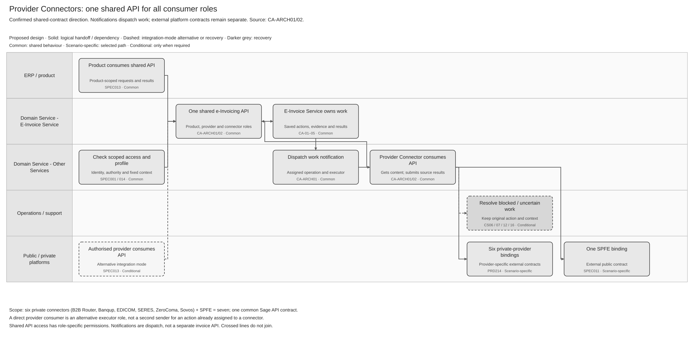

# Provider Connectors and Shared API Architecture Summary

[Summary](SPEC-SEI-044-provider-connector-architecture-summary.md) · [Logical contract](SPEC-SEI-045-provider-connector-api-logical-contract.md) · [Sequences and reuse](SPEC-SEI-046-provider-connector-api-sequences-and-reuse-assessment.md)

## Revision overview

This compact architecture set extends the provider connector boundary discussed in SPEC-SEI-013. That source remains unchanged and remains the configured source for its stable Confluence page. These companions do not replace its Global API requirements. They describe Provider Connectors as consumers of the shared API and identify the Spain bindings still needing evidence. Deployment topology, private contracts and implementation reuse remain open.

## 1 Scope and boundary

A Sage product needs to exchange invoices through its customer's selected platform without implementing a separate provider integration in each product. The customer needs separately observable setup, delivery, retrieval and lifecycle results. The owning feature coordinates those results; a provider connector executes the qualified external operations.

**Architecture direction confirmed by the user after architect discussion, 9 November 2026:** products, authorised providers and Provider Connectors interact through the same Sage e-Invoicing API contract. Consumer roles have different operation permissions. The E-Invoice Service coordinates work; notifications can dispatch assigned work to a Provider Connector. The connector uses the selected external platform contract and submits source invoices, statuses and results through the shared API. CA-ARCH01/02. An exchange action is one separately tracked invoice delivery, public-copy submission or event report.

| Boundary | Contract responsibility | Authoritative detail |
|---|---|---|
| Product / authorised provider / Provider Connector → shared Sage API | Common invoice and operation contract; role-scoped access and results | [SPEC013](../SPEC-SEI-013-provider-api-through-the-e-invoicing-global-api-solution-specification.md); CA-ARCH01/02 |
| E-Invoice Service → notifications → assigned executor | Correlated work notification; execution and reconciliation owner remain fixed | [046](SPEC-SEI-046-provider-connector-api-sequences-and-reuse-assessment.md); CA-ARCH01 |
| Provider Connector → external platform | Selected platform's protocol, authentication and payload contract; source result/evidence | [SPEC011](../SPEC-SEI-011-public-platform-connector-solution-specification.md) for SPFE; [SPEC017](../SPEC-SEI-017-b2b-router-provider-adapter-binding-solution-specification.md) for B2B Router |
| Shared connectivity | Qualified profiles, connection readiness and route selection | [SPEC014](../SPEC-SEI-014-shared-platform-connectivity-and-routing-solution-specification.md), SPC-01–08 |

Provider Connector availability precedes customer setup. Provider Connector architecture belongs here; customer onboarding calls and outcomes remain in [037–040](../onboarding-and-connectivity/README.md). Sending, receiving, lifecycle and offboarding retain their business rules in their feature folders.

[Editable Draw.io](../../assets/diagrams/provider-connector-logical-architecture.drawio) · [PNG](../../assets/diagrams/provider-connector-logical-architecture.png).

The diagram shows products, authorised providers and Provider Connectors using one shared API. Notifications dispatch assigned work; external platform calls remain a separate contract. The direct-provider consumer path is an integration-mode alternative, not permission for two executors to send the same action. Inbound processing returns source data to the feature owner; [046](SPEC-SEI-046-provider-connector-api-sequences-and-reuse-assessment.md#1-execution-sequences) shows the durable handoff and recovery.

## 2 API terminology and deployment

| Current term | Meaning / call direction |
|---|---|
| **Provider Connector** | Integration component that translates qualified operations to the external platform contract and returns source results/evidence. |
| **Shared e-Invoicing API / Provider API** | The common Sage API contract used by products, authorised providers and Provider Connectors. Roles select allowed operations; they do not create separate API products. SPEC013 owns its common access behaviour. |
| **Provider Connector API** | Earlier working label in this set. Read it as the Provider Connector's use of the shared API, not a separate API contract exposed by every connector. |
| **Provider-owned API / SPFE interface** | External platform contract called by the selected Provider Connector. These external interfaces remain platform-specific. |

The set includes private-provider integrations and the dedicated SPFE public-platform binding. SPFE remains a public platform under SPEC011; this naming does not classify it as a private provider.

The supplied 2020 page uses **Provider API** for DES's connector-facing API and **Connector API** for the API exposed by a connector to DES. That historical two-API description is not the selected current architecture. CA-ARCH01/02 establish the shared-contract direction. Retained callback interfaces, operation versions, credentials and deployment mappings still require an implementation inventory; do not infer a second API product from the old labels. CA-H01.

A provider connector is a logical integration boundary here. The historical description permits hosting outside the eDocs infrastructure; it does not require an external runtime, one service per platform, Lambda, DynamoDB, KMS RSA_4096 or Parameter Store. The supplied diagram illustrates token acquisition/onboarding and transaction retrieval; it does not establish a complete sending or lifecycle contract. CA-H01.

## 3 Spain provider connector scope

**Required scope: seven logical platform connectors — six private-provider connectors and one SPFE connector.** The private providers are B2B Router, Banqup (Unifiedpost), EDICOM, SERES (Docaposte), ZeroComa and Sovos. **Seven connectors do not mean seven Sage APIs:** all use the shared API contract. External platform contracts and deployment may differ.

Each private-provider connector must support both customer starting points: **already using that provider** and **newly onboarding to it**. [045 CS01](SPEC-SEI-045-provider-connector-api-logical-contract.md#4-scenario-coverage) defines the distinct setup outcomes. Both paths use the same provider connector and continue to its sending, receiving and lifecycle capabilities; they do not require separate connectors.

| Integration role | Planning baseline | Qualification boundary |
|---|---|---|
| Customer → private provider | Six private-provider connectors; [PRD214 portfolio](../../prds/PRD-SEI-214-connections-registration-routing-structured-review.md#problem-and-business-objective) | Qualify the selected Spain service, integration mode and supported operations for each provider. Connector scope is separate from deployment and release readiness. |
| Sage → SPFE | One public-platform binding with multiple operation profiles | Use the reviewed 29 October PRE contracts; implementation and production access remain unqualified. SPFE-S16/S23; CA-SPFE. |
| Sage private platform → peer platform | Future interconnection role using the shared foundation | Qualify peer contract, trust and operations separately. Reuse a direct-provider adapter only where its contract fits; becoming an operator does not prove compatibility. SPEC014 §1. |

## 4 REF Source references

| Source ID | Original or canonical source and locator | Supports / limits |
|---|---|---|
| CA-ARCH01 | [Service and connector overview](../../assets/architecture/b22496cd-5719-45a2-ae1a-27d91f69f11c.png), reviewed 9 November 2026; central e-Invoicing Service/Provider API, Network API, connector API labels, connector-to-service invoice/status calls and Notifications Service | Shared service contract and asynchronous work/results pattern. Image has no recorded author, design date, revision or approval; it does not prove every Spain operation or current deployment. |
| CA-ARCH02 | User's architect-discussion clarification, 9 November 2026; product, provider and connector use the same API. Corroborating [detailed invoice flow](../../assets/architecture/711539a8-ff4e-4723-9181-b21c71f389af.png), reviewed the same day; API gateway, connector, invoice/status calls and notification paths | Confirmed shared-contract design direction. No independent discussion transcript is stored. Exact schema, version, caller credentials and compatibility still need API-owner evidence. |
| CA-H01 | [Connectors Architecture](https://confluence.sage.com/spaces/EINV/pages/226610799/Connectors+Architecture), displayed update 7 August 2020; user-supplied opening paragraphs, two API bullets and diagram | Historical boundary and hosting option. Supplied extract/image only; current deployment, contract completeness and compatibility are unknown. |
| CA-BASE | [SPEC013](../SPEC-SEI-013-provider-api-through-the-e-invoicing-global-api-solution-specification.md), updated 20 October 2026, Part 1 §§1–3 and GPA-Q01–12; [SPEC014](../SPEC-SEI-014-shared-platform-connectivity-and-routing-solution-specification.md), Part 1 §1 | Canonical proposed API, role and ownership boundaries; not external contracts or build evidence. |
| CA-SPFE / SPFE-S16, SPFE-S23 | [SendInvoice.wsdl](<../../context/WSDL servicios web - PRE_29_10_2026/SendInvoice.wsdl>), `documentation`, `portType`, `binding`, `service`; [ValidationInvoice.wsdl](<../../context/WSDL servicios web - PRE_29_10_2026/ValidationInvoice.wsdl>), same elements; PRE release 29 October 2026 | Operation-specific public transport. Validation uses direct SOAP bodies; invoice submission uses ebMS/MIME. No generic onboarding operation, private-provider contract or production qualification follows from these files. |

The [source manifest](../../assets/regulatory/spain/spfe/source-manifest.json), `current_wsdl_baseline`, and [release review](../../context/RES-SEI-002-spain-public-platform-technical-evidence.md#pre-wsdl-release-reviewed-29-october-2026) select the reviewed local public evidence. They do not monitor future AEAT releases. Terms follow the [shared glossary](../../context/GLO-SEI-001-e-invoicing-terminology.md).
