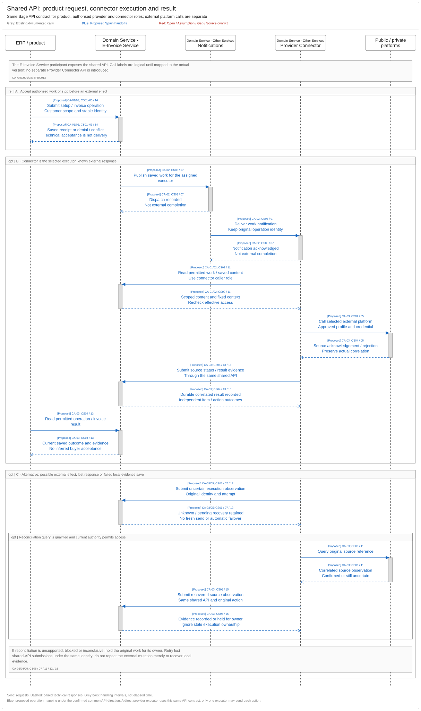
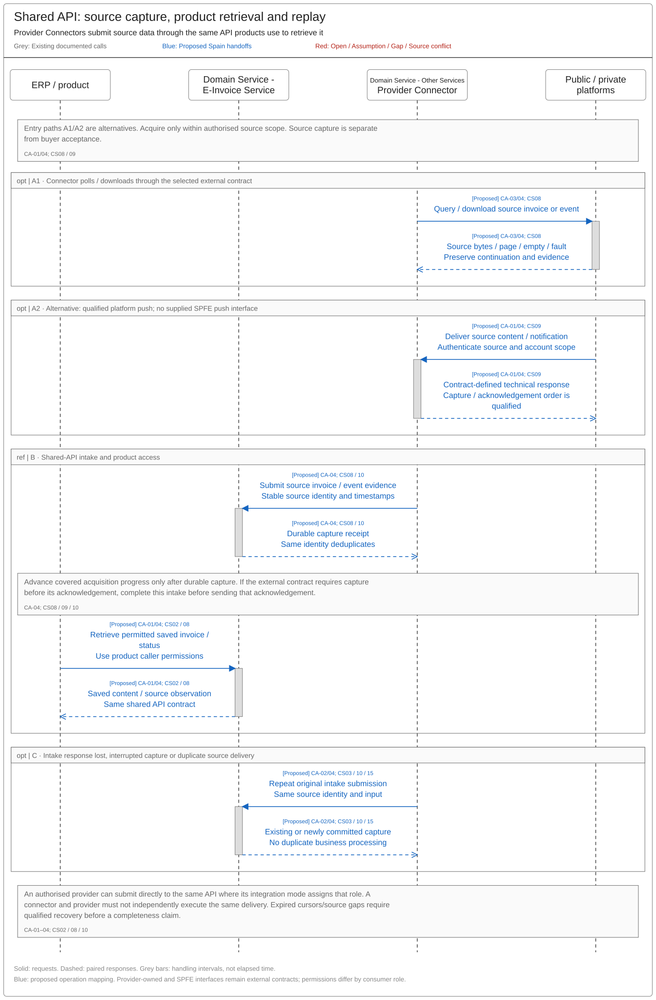

# Provider Connector Shared API Sequences and Reuse Assessment

[Summary](SPEC-SEI-044-provider-connector-architecture-summary.md) · [Logical contract](SPEC-SEI-045-provider-connector-api-logical-contract.md) · [Sequences and reuse](SPEC-SEI-046-provider-connector-api-sequences-and-reuse-assessment.md)

## 1 Execution sequences

The diagrams use the established onboarding responsibility labels and UML sequence style. Blue marks proposed handoffs; activation bars show handling, not elapsed time.

The shared-contract direction is confirmed by CA-ARCH01/02 in [044 REF](SPEC-SEI-044-provider-connector-architecture-summary.md#4-ref-source-references). Sequence calls below are logical until mapped to actual API versions; notifications are not a second invoice API.

The sequences implement [045 CA-01–05](SPEC-SEI-045-provider-connector-api-logical-contract.md#1-required-behaviour-and-acceptance). They show logical boundaries; protocol and deployment remain architecture decisions.

### 1.1 Operation execution and recovery

[Editable Draw.io](../../assets/diagrams/provider-connector-operation-sequence.drawio) · [PNG](../../assets/diagrams/provider-connector-operation-sequence.png).

A validates the product request at the shared API. B dispatches saved work through notifications to one executor; the Provider Connector calls the external platform and posts the correlated result to that same API. C holds uncertain effects, reconciles the original operation when permitted and submits recovered evidence through the shared API. A provider acting directly uses the same contract under its assigned role; it must not execute work already assigned to a connector.

### 1.2 Inbound acquisition and durable handoff

[Editable Draw.io](../../assets/diagrams/provider-connector-inbound-sequence.drawio) · [PNG](../../assets/diagrams/provider-connector-inbound-sequence.png).

A shows polling and qualified push as alternative entry paths. B submits source data through the shared API and confirms durable capture before covered progress advances. C retries that same submission after interruption; shared-API duplicate handling prevents repeated business processing. A product retrieves permitted saved content through that same API. Expired cursors or source gaps require qualified recovery before a completeness claim. No SPFE push interface is established by the reviewed baseline.

[045 §4](SPEC-SEI-045-provider-connector-api-logical-contract.md#4-scenario-coverage) holds CS01–16, including changes during pending work, partial outcomes and country/profile isolation. Those cases refer to the applicable diagram branch or the owning feature rather than adding one diagram per exception.

## 2 Reuse and country binding

| Capability/source | Spain use and classification | Local change, owner and evidence before activation |
|---|---|---|
| Shared API and notification pattern, CA-ARCH01/02 | Shared-contract direction **confirmed**; implementation coverage **unknown** | API Architecture: inventory deployed operations, caller roles, event schemas, builds and versions. Compare with SPEC013; qualify Spain behaviour and existing-consumer compatibility. |
| Correlation, durable execution, duplicate handling and evidence | **Reusable proposed design pattern** across bindings | Provider Connector Engineering: prove actual persistence, concurrent execution and crash recovery under 045 CA-02–04. |
| Shared connectivity, SPEC014 | **Shared capability requiring country/provider/role bindings** | Connectivity owner: qualify supported contract versions, trust, limits, credentials and operation readiness. |
| SPFE provider connector, SPEC011 | **Spain-specific transport binding** | Spain Integration owner: test selected client, SOAP/ebMS/MIME handling, faults and credential ports against the 29 October local baseline. Production access and missing business schemas remain open. CA-SPFE. |
| B2B Router, SPEC017 | Proposed private-provider binding; implementation coverage **unknown** | Provider owner: supply contracted version, entitlement, supported directions, account model and conformance evidence. It does not qualify the other five providers. |
| Existing DTS, SPEC008 | Preferred transformation implementation candidate upstream | DTS + invoice-feature owners: qualify exact build, input/output mappings, rule packs and operations. No transformation responsibility moves into provider connector transport. |
| Spain identity, routing, public-copy and reporting rules | **Spain-specific feature rules**, referenced rather than copied | Country/domain owners: bind approved rules; prove another country's profile does not inherit Spain behaviour. |
| Future peer interconnection | Shared design candidate; implementation reuse **unknown** | Operator/Architecture owners: qualify peer protocol, trust, role and capability differences. No automatic reuse of customer-provider credentials or adapters. |

## 3 Architecture decisions and release evidence

These gates refine existing SPEC013 GPA-Q01–12 and SPEC014 decisions; they do not create a second approval process.

| Decision / owner | Evidence needed |
|---|---|
| Interface direction and ownership / API Architecture | Use the confirmed common contract for product, provider and connector consumers. Map historical labels and exact operation versions; qualify notification/callback interfaces separately. Select one executor and reconciler per mutation. |
| Private scope / Product + Provider Integration | Use the six-provider portfolio in [PRD214](../../prds/PRD-SEI-214-connections-registration-routing-structured-review.md#problem-and-business-objective), including Sovos. Confirm selected Spain services and direct versus aggregated access. Complete the 045 matrix with contract version, environment, owner and source evidence for each binding. |
| Contract and trust / API Architecture + Security | Define actual request/result schemas, authentication, authorised destinations, credential custody/rotation, callback replay protection and compatibility policy. Do not expose arbitrary endpoint execution. |
| Runtime and operations / Engineering + Operations | Select shared versus isolated deployment from trust and load needs. Set measured timeouts, quotas, payload limits, evidence retention and support ownership; no numeric targets are established here. |
| Conformance / Integration + domain owners | Execute applicable CS01–16 under CA-01–05, selected external-contract checks and existing-consumer compatibility. Record build/version and results. |

## 4 REF Source references

Historical CA-H01, canonical CA-BASE and original public CA-SPFE sources, versions and limits are recorded in [044 REF](SPEC-SEI-044-provider-connector-architecture-summary.md#4-ref-source-references). Public operation sources SPFE-S10–S17/S23 are mapped in [045 REF](SPEC-SEI-045-provider-connector-api-logical-contract.md#5-ref-source-references). These sequences and gates are proposed design controls, not AEAT-prescribed components.

Reuse sources: [SPEC017](../SPEC-SEI-017-b2b-router-provider-adapter-binding-solution-specification.md), Part 1 §§2–4 and REF, establishes the proposed provider binding and its contract gaps; [SPEC008](../SPEC-SEI-008-spain-ubl-mapper-migration-to-dts-solution-specification.md), Spain use/reuse and qualification gates, establishes the DTS assessment boundary. Neither proves a deployed Spain implementation. Public source selection remains the [reviewed manifest](../../assets/regulatory/spain/spfe/source-manifest.json), `current_wsdl_baseline`, and the [29 October release review](../../context/RES-SEI-002-spain-public-platform-technical-evidence.md#pre-wsdl-release-reviewed-29-october-2026).
